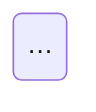

# Authoring brief for grooveshop-docs

Read `CLAUDE.md` in this repo first; it holds the rules. This file adds the
page templates and the list of facts to verify.

## Ground rules for writers

1. **Write from the code, not from memory.** Open the admin classes
   (`*/admin.py`), models (`*/models.py`, `help_text`), serializers, views,
   tasks, settings and templates in `../grooveshop-django-api/` and the other
   repos before writing a claim. If you cannot find it in code, leave it out.
2. **Every page has frontmatter** with `title` and `description` (one
   sentence, plain text). Both feed search and `llms.txt`.
3. **Admin guide pages exist twice**: `src/admin/<path>.md` (English) and
   `src/el/admin/<path>.md` (Greek), same headings in the same order. Write the
   Greek natively for a Greek shop owner; do not transliterate English jargon
   when a normal Greek term exists, but keep the admin's own UI labels as they
   appear on screen (the admin UI is translated through `locale/el/…/django.po`
   in the Django repo — use the `msgstr` there for the on-screen label when one
   exists, otherwise the English label).
4. **Name sidebar locations exactly** as `UNFOLD["SIDEBAR"]["navigation"]` in
   `grooveshop-django-api/settings.py` renders them, wrapped as
   `<span class="sidebar-path">Sales → Orders</span>`.
5. **Links** between pages are root-absolute (`/admin/sales/orders`,
   `/el/admin/sales/orders`, `/dev/flows/order-lifecycle`). Only link to pages
   that exist in the sidebar files under `.vitepress/sidebars/`. A dead link
   fails the build.
6. **No versions in prose.** No dates unless they explain a still-live
   behaviour. No secrets, hostnames of tenants, or personal data. The platform
   host is `docs.grooveshop.space`; a tenant's own domain never appears.
7. **Diagrams** are ```` ```mermaid ```` fences (flowchart, sequenceDiagram,
   stateDiagram-v2). Keep labels short; no HTML in labels.
8. **Do not run `pnpm build` or `pnpm dev`** while other writers work in the
   tree; the coordinator builds at the end. Do not touch files outside your
   assigned list, and do not run git commands.
9. Prefer short paragraphs, numbered steps for tasks, tables for options and
   statuses. Bold the on-screen button or field name the reader must click.

## Template — admin guide page (en; the el twin mirrors it)

```md
---
title: Orders
description: Find, inspect and act on customer orders; understand every order and payment status.
---

# Orders

<span class="sidebar-path">Sales → Orders</span>

One or two sentences: what this screen is for and who uses it (roles).

## What you see

The list columns, the filters on the right, the search box, the bulk actions.
Tables for statuses with their meaning.

## Tasks

### Find an order
1. …
### Change the status
1. …

## Things to know

- Gotchas, invariants, "why did X happen", what is automatic vs manual.

## Related

- [Invoices](/admin/sales/invoices)
```

Greek twin headings: `## Τι βλέπετε`, `## Εργασίες`, `## Καλό είναι να ξέρετε`, `## Σχετικά`.

## Template — developer flow / platform page

```md
---
title: Order lifecycle
description: Every state an order passes through, who moves it, and what each transition triggers.
---

# Order lifecycle

Summary paragraph: the one thing a reader must know.

## Diagram



## How it works

Numbered steps or sections; each names the code path
(`order/services.py: OrderService.confirm()`).

## Invariants

- Bullet list of rules the code enforces; say where.

## Failure modes

- What happens when X fails; what the operator sees; what recovers it.

## Source

| File | Role |
|---|---|
| `grooveshop-django-api/order/models.py` | `Order`, status choices |
```

## Facts to verify before you rely on them

These come from earlier work sessions. Treat each as a candidate: confirm it
in the code, then write it in your own words with the file path. If the code
says otherwise, the code wins.

- Tenant admin roles are `staff`, `admin`, `owner` (`tenant/models.py`
  `TenantMembershipRole`); `member` is retired. Staff = operational
  screens only; admin/owner = settings and team; a tenant always keeps at
  least one owner.
- Feature flags are two-tier: a platform-level switch and a tenant-level
  switch; both must be on (look for `is_feature_enabled` / tenant config
  and `PUBLIC_SETTING_KEYS`).
- Loyalty has one switch that controls both earning and redeeming.
- B2B pricing: the customer-group price list binds on every cart
  materialisation, not once.
- Cash on delivery orders stay payment-pending until the courier (ACS) pays
  out, typically days later; that is by design.
- Stock reserved for a failed online payment is released only by the
  stuck-pending-order cleanup task, not at the moment of failure.
- ACS: the contract is cash-on-delivery only; vouchers are issued per
  shipment; pickup lists (manifests) must be issued or vouchers are never
  collected; the thermal print type is used; ACS COD payouts are reconciled
  against orders.
- BoxNow: webhook is HMAC-verified; lockers are synced into a table; the
  locker map on the storefront needs the CDN allowed in the CSP.
- Viva Wallet is the primary online payment provider, Stripe secondary; a
  webhook verification key is an optional cache on the tenant.
- Storefront navigation is a `page_config` model; a saved navigation row
  shadows the code default; its cache key is `pageConfigNavigation`.
- Promotions, coupons, gift cards, content pages and the feedback form ship
  dark behind tenant flags; content pages seed unpublished.
- Recommendations: curated relations rank above scored ones; impressions are
  reported by the client; add-to-cart carries the impression through to the
  order line.
- Emails: many transactional types; admin-facing emails ignore the customer
  language override; Mailpit is the staging sink.
- Search: Meilisearch with Greeklish transliteration at index time; the
  search key is read-only.
- Deploying: Argo CD app-of-apps; the Django image tag is pinned twice
  (kustomize image + PreSync Helm tag); staging is manual-sync; after a
  storefront deploy the SWR page cache must be purged (`*routes*` and
  `*pageConfig*` patterns).
- Backups: nightly `pg_dump` runs in-cluster only; there is no off-cluster
  copy yet. No metrics/alerting stack and no Sentry.
