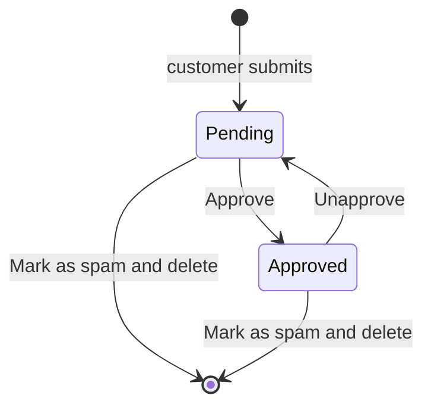

# Comments

Blog → Blog Comments

Customers comment on blog posts and reply to each other. A new comment is hidden until staff approve it here. Comments can be switched off store-wide with the `BLOG_COMMENTS_ENABLED` setting under Settings → Extra Settings; the blog's plan flag also has to be on.

## What you see

The sidebar entry carries a blue badge with the number of unapproved comments. The list shows 30 comments per page in thread order, with a date drill-down by creation date.

| Column | Meaning |
|---|---|
| **Content** | First 50 characters, indented by reply depth so threads read top to bottom. |
| **User** | Commenter's name and email, or **Anonymous** when the account is gone. |
| **Post** | Linked post title. |
| **Approved** | Editable in the list; tick and press **Save**. |
| **Engagement** | Likes and approved replies. |
| **Created** | Timestamp. |

**Search** matches the commenter's email, username, first and last name, the post title and subtitle, and the comment text. **Filters**: Approved, creation date range, Post, User.

**Bulk actions**:

| Action | Effect |
|---|---|
| **Approve selected comments** | Sets Approved on. |
| **Unapprove selected comments** | Sets Approved off; the comment and its replies disappear from the storefront. |
| **Mark as spam and delete** | Deletes the comments **permanently**, together with every reply under them, and repairs the thread structure. |

The form: **Comment Content** (**Content** per language, up to 1000 characters), **Relations** (**Post**, **User**, **Parent**), **Moderation** (**Approved**), collapsed **Engagement**.

## Moderation flow

- **Pending** (Approved off): visible only to its author and to store staff. It does not count towards the post's comment count.
- **Approved**: visible to everyone on the post page, counted, and open to likes and replies.
- A reply is visible only when it is approved **and** its parent is visible.

## Tasks

### Work through the queue
1. Open Blog → Blog Comments and filter **Approved** to No.
2. Read the content; open the **Post** link for context.
3. Tick **Approved** on the good ones and press **Save**, or select them and run **Approve selected comments**.
4. Select the spam and run **Mark as spam and delete**.

### Answer a comment as the store
1. Click **Add**.
2. Set **Post** to the same post, **Parent** to the comment you are answering, **User** to your own account, write **Content**, tick **Approved**, save.
3. The reply shows under the customer's comment with your account name.

### Remove a single comment without deleting the thread
Untick **Approved**. Its replies stay in the database but are hidden with it.

## Likes and notifications

- Any signed-in customer can like another person's comment on the storefront; the admin only shows the count.
- When a comment receives a like, its author gets an **in-app notification** ("Your comment was liked", in the author's language) that links to the post's comments. Self-likes send nothing. The notification is created by a background task, so it appears within moments rather than instantly, and it is not an email.
- Notifications are listed under [Notifications](/admin/sales/notifications).

## Things to know

- Deleting the post deletes its comments; deleting a customer account keeps their comments and shows them as **Anonymous**.
- **Mark as spam and delete** cannot be undone. Use **Unapprove** when in doubt.
- Editing **Content** rewrites the customer's words; prefer unapproving to editing.
- The badge and the counts refresh within a minute.
- Blog pages are cached on the storefront; a newly approved comment may take a few minutes to show unless you purge the **Blog** surface in the [Cache](/admin/system/cache) tool.

## Related

- [Posts](/admin/blog/posts)
- [Categories, authors & tags](/admin/blog/categories-authors-tags)
- [Notifications](/admin/sales/notifications)
- [Store settings](/admin/settings/store-settings)
