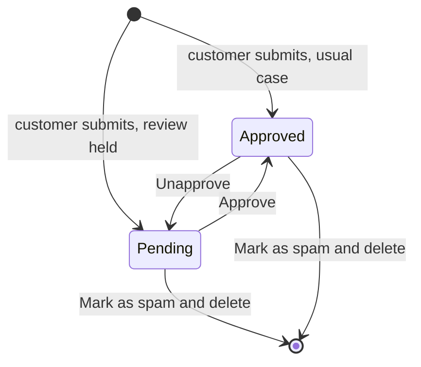

# Comments

Content → Blog → Blog Comments

Customers comment on blog posts and reply to each other. This screen is where you approve, hide and remove what they write.

**Read this before you plan a moderation routine.** New comments are normally **approved the moment they are posted** and appear on the blog immediately. Holding them for review first is a platform-level choice, not a store setting, so it is not something you can switch on from the admin. If yours holds them, the number beside the **Blog** menu in the sidebar counts up as comments arrive; if no number appears while comments keep appearing on your posts, yours publishes them straight away and this screen is for taking bad ones down afterwards. Ask the platform team to change which way it works.

Comments can be switched off entirely, store-wide, with the **BLOG_COMMENTS_ENABLED** setting under Settings → Store Settings. Your plan's blog feature also has to be on. With the setting off, **Blog Comments** leaves the sidebar and the **Blog** menu counts nothing; without the blog on your plan, the whole **Blog** menu is hidden.

## What you see

The **Blog** menu in the sidebar shows the number of unapproved comments, and the dashboard lists them under **Needs attention** as **Blog comments to approve**. The list shows 30 comments per page in thread order, with a date drill-down by creation date.

| Column | Meaning |
|---|---|
| **Content** | First 50 characters. Rows are ordered so that each reply follows its parent, but they are not visually indented, so use the **Post** link and the text itself to work out what answers what. |
| **User** | Commenter's name and email, or **Anonymous** when the account is gone. |
| **Post** | Linked post title. |
| **Approved** | Editable in the list; tick and press **Save**. |
| **Engagement** | Likes and approved replies. |
| **Created** | Timestamp. |

**Search** matches the commenter's email, username, first and last name, the post title and subtitle, and the comment text. **Filters**: Approved, creation date range, Post, User.

**Bulk actions**:

| Action | Effect |
|---|---|
| **Approve selected comments** | Sets Approved on. |
| **Unapprove selected comments** | Sets Approved off; the comment and its replies disappear from the storefront. |
| **Mark as spam and delete** | Deletes the comments **permanently**, together with every reply under them, and repairs the thread structure. Nothing is recorded as spam anywhere; despite the name this is only a delete. |

The form: **Comment Content** (**Content** per language, up to 1000 characters), **Relations** (**Post**, **User**, **Parent**), **Moderation** (**Approved**), collapsed **Engagement**.

## Moderation flow

- **Pending** (Approved off): gone from the post page for everyone, its own author included. The writer can still find it in their account, under their own comments, so it does not look lost to them. It does not count towards the post's comment count.
- **Approved**: visible to everyone on the post page, counted, and open to likes and replies.
- A reply is visible only when it is approved **and** its parent is visible. Unapproving a comment therefore takes its whole thread down with it.

## Tasks

### Work through the queue
Only useful on a store whose comments are held for review. Where they publish on arrival this filter is normally empty, and the section below is what you want instead.

1. Open Content → Blog → Blog Comments and filter **Approved** to No.
2. Read the content; open the **Post** link for context.
3. Tick **Approved** on the good ones and press **Save**, or select them and run **Approve selected comments**.
4. Select the spam and run **Mark as spam and delete**.

### Take down a comment that is already public
1. Find it with the search box, which matches the comment text as well as the writer's name, email and the post title.
2. Untick **Approved** and press **Save**, or select it and run **Unapprove selected comments**. It leaves the post at once, and so do any replies beneath it.
3. Purge the **Blog** surface in the [Cache](/admin/system/cache) tool, or a cached copy of the page can keep showing it for a few minutes.
4. Delete it only once you are sure. **Mark as spam and delete** cannot be undone.

### Answer a comment as the store
1. Click **Add**.
2. Set **Post** to the same post, **Parent** to the comment you are answering, **User** to your own account, write **Content**, tick **Approved**, save.
3. The reply shows under the customer's comment with your account name.

### Remove a single comment without deleting the thread
Untick **Approved**. Its replies are kept but hidden along with it, and they come back if you approve the parent again.

## Likes and notifications

- Any signed-in customer can like another person's comment on the storefront; the admin only shows the count.
- When a comment receives a like, its author gets an **in-app notification** ("Your comment was liked", in the author's language) that links to the post's comments. Self-likes send nothing. It arrives within moments rather than the same instant, and it is never an email.
- Notifications are listed under [Notifications](/admin/sales/notifications).

## Things to know

- **Deleting a post does not delete its comments.** They stay in this list with an empty **Post** column, which is the usual reason for orphaned-looking rows. Delete the comments first if you want them gone with the post.
- Deleting a customer account keeps their comments and shows them as **Anonymous**.
- **Mark as spam and delete** cannot be undone. Use **Unapprove** when in doubt.
- Editing **Content** rewrites the customer's words under their name; prefer unapproving to editing.
- The number beside **Blog** is refreshed whenever a comment is saved or deleted, and at least once a minute otherwise. The list itself is always current.
- Blog pages are cached on the storefront; a newly approved comment may take a few minutes to show unless you purge the **Blog** surface in the [Cache](/admin/system/cache) tool.

## Related

- [Posts](/admin/blog/posts)
- [Categories, authors & tags](/admin/blog/categories-authors-tags)
- [Notifications](/admin/sales/notifications)
- [Store settings](/admin/settings/store-settings)
