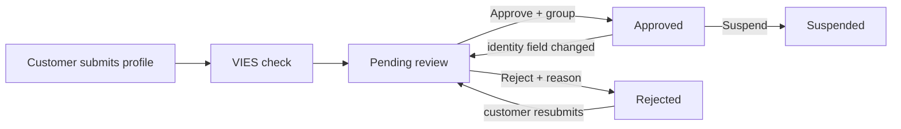

# Business customers

Customers → Wholesale → Business Customers

A business profile is a customer's company identity for the wholesale program: company name, VAT number (ΑΦΜ), tax office (ΔΟΥ), business activity and registered address. Customers apply from their account; you review, approve into a customer group, reject with a reason, or suspend. Approval is what switches that customer's cart to wholesale prices. The number beside the **Wholesale** menu in the sidebar counts applications waiting for review.

The wholesale program ships dark. It works only when the platform has enabled B2B for the store and `B2B_WHOLESALE_ENABLED` is on under [Store settings](/admin/settings/store-settings). Without B2B on your plan the **Wholesale** menu is not in the sidebar at all. With B2B on your plan but the setting off, the menu stays so you can prepare groups and price lists, marked **Off**, and it counts nothing. Invoice-at-checkout is separate and available to every shopper; see [Receipts and credit documents](/admin/sales/receipts).

## What you see

### The list

| Column | Meaning |
|---|---|
| **Company name** | As entered by the customer. |
| **VAT number (ΑΦΜ)** | Nine digits, stored without the EL prefix. |
| **User** | The customer account. One profile per account. |
| **Status** | See the table below. |
| **Customer group** | The wholesale tier assigned at approval. |
| **VIES** | The result of the EU VAT-number check. |
| **Created** | When the application was made. |

Filters: status, VIES status, customer group, created date. Search by company name, VAT number or the customer's email.

### The profile page

- **Company**: the user, company name, VAT number, tax office, activity, and the billing street, number, city and postcode. Editable, but customers maintain these themselves; edit only to fix an obvious typo.
- **Review**: **Status** (read-only, changed only by the actions), **Customer group**, **Reviewed by**, **Reviewed at**, **Rejection reason**.
- **VIES**: **VIES status**, **VIES checked at**, the name and address VIES returned, and the last **VIES error**. All read-only.

Header actions: **Approve**, **Reject**, **Suspend**, **Re-check VIES**.

## Statuses

| Status | Meaning | How it gets there |
|---|---|---|
| **Pending review** | Waiting for you. | A new application, a resubmission after rejection, or an approved customer changing an identity field (company name, VAT, tax office, activity). |
| **Approved** | Wholesale prices apply. | **Approve**. |
| **Rejected** | No wholesale; the customer got your reason by email and may resubmit. | **Reject**. |
| **Suspended** | Wholesale removed; the customer cannot lift it by editing. | **Suspend**. |

| VIES status | Meaning |
|---|---|
| **Not checked** | No check has run. |
| **Valid** | The EU VIES service confirmed the VAT number; name and address were captured. |
| **Invalid** | VIES says the number is not registered for intra-EU trade. |
| **Service unavailable** | VIES did not answer (timeout or outage). Not a verdict; try **Re-check VIES** later. |

## The workflow

1. The customer fills in the form in their account. The VAT number must pass the Greek ΑΦΜ checksum.
2. The platform asks the EU VIES service (five-second timeout) and stores the result. On an outage the profile still lands in your queue with **Service unavailable**; the decision is yours either way.
3. You get an email at the store's contact address for every new application.
4. **Approve** asks you for the customer group and emails the customer that their account was approved. **Reject** asks for a reason and emails it. **Suspend** is deliberately silent.
5. Resubmissions: a rejected profile goes back to Pending review on any edit; an approved profile goes back only when an identity field changes (address edits keep wholesale access); a suspended profile stays suspended.

## Tasks

### Review an application
1. Filter **Status → Pending review**, or click **Business accounts to verify** under **Needs attention** on the [dashboard](/admin/getting-started/dashboard).
2. Open the profile. Compare the company details with the **VIES** tab; a **Valid** result with a matching name is strong evidence. **Invalid** or **Service unavailable** means check the number with the customer or re-run the check.
3. **Approve** and pick the **Customer group**, or **Reject** with a reason the customer will read. The Approve dialog lists active groups only, so create or reactivate the tier first if it is not there.

### Change a customer's tier
1. Open the profile and set **Customer group** on the **Review** tab, then save. The next time the customer loads their cart it is priced with the new group.

### Remove wholesale access
1. **Suspend**. No email is sent. The customer's next cart load is priced at retail.
2. To restore, **Approve** again with a group.

### Re-run the VIES check
1. **Re-check VIES** in the header. The result and timestamp are updated at once.

## Things to know

- **Wholesale access needs four things at once**: the feature switched on, the profile **Approved**, a **Customer group** assigned, and that group **Active**. Missing any one, the customer is priced at retail without an error. See [Customer groups & price lists](/admin/customers/groups-and-price-lists).
- **Prices bind on every cart load**, not at approval. Approving, changing the group or suspending takes effect on the customer's next request; orders already placed keep the pricing they were placed with.
- **The profile's billing details are the customer's invoice identity.** Orders carry their own snapshot of these fields, so a later edit to the profile never rewrites an existing order or invoice.
- **VIES is advisory.** The platform never approves or rejects on its own; **Valid** does not auto-approve and **Invalid** does not block you.
- **One profile per account.** A business with several buyers needs one account per buyer, each with its own profile.
- **Wholesale orders are marked.** The orders list has a **Wholesale** filter and each order shows the group and percent it was priced with. See [Orders](/admin/sales/orders).

## Related

- [Customer groups & price lists](/admin/customers/groups-and-price-lists)
- [Receipts and credit documents](/admin/sales/receipts)
- [Orders](/admin/sales/orders)
- [Users & addresses](/admin/customers/users-and-addresses)
- [Store settings](/admin/settings/store-settings)
