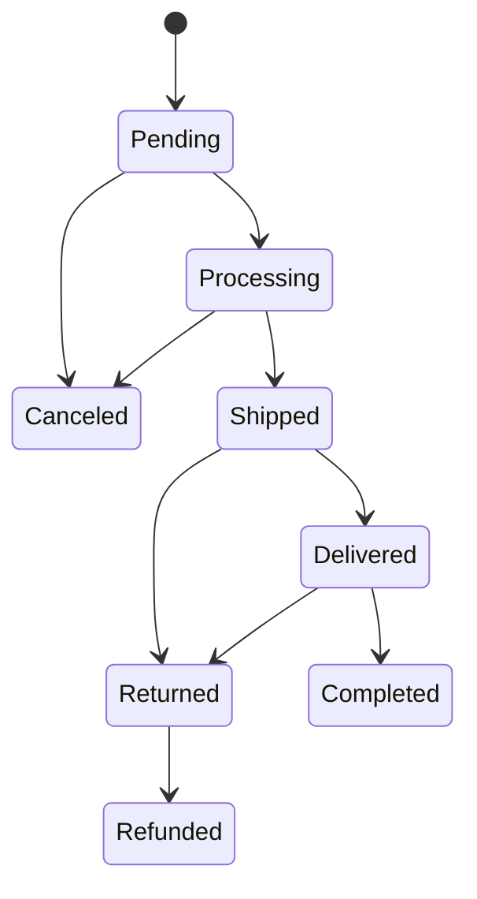

# Orders

Sales → Orders

Every purchase, whether it came from the storefront, a guest checkout or an AI agent, is one order. This is the screen store staff live in: it answers "where is this order, has it been paid, and what do I have to do next". The red badge on the sidebar entry is the number of orders still in **Pending**.

## What you see

### The list

| Column | Meaning |
|---|---|
| **Status** | The fulfilment state (see the table below). |
| **Customer** | Name on the order and the email it was placed with. Guest orders show the same, just without a linked account. |
| **Order** | Line count, total quantity and the amount the customer actually owes after discounts, loyalty points and gift cards. |
| **Payment** | The financial state, independent of the fulfilment state. |
| **Shipment** | The courier's own state for the parcel (ACS or BoxNow), blank when no carrier is attached yet. |
| **Shipping** | Tracking number, carrier and city, or "No tracking" and the city. |
| **Created** | Date and time, with a relative age. |

Each row has two quick actions: **Download shipping voucher (PDF)** and **Customer's orders**, which reopens the list filtered to the same account, or to the same email for guests.

### Filters

The right-hand panel offers, top to bottom: **Status Group** (Active, In Fulfillment, Completed, Problematic), **Payment Status** (each state plus "Needs Attention", which is Failed or Pending), **Document Type** (Receipt or Invoice and the label kinds), **Wholesale** (orders priced with a B2B customer group or retail), **Recent Orders** (Today, This Week, This Month, "Urgent" meaning Pending for more than 24 hours), then the raw status and payment status, created and status-updated date ranges, country, region, payment method, the gateway that processed the charge, shipping provider, shipping kind and, for BoxNow orders, the parcel state. A date drill-down by creation date sits above the table.

### Search

The search box matches order ID, UUID, customer email, first and last name, phone, city, tracking number, payment ID, and for BoxNow the parcel ID, delivery-request ID and locker ID. Paste a voucher number and the order comes up.

### Bulk actions

Select rows and pick one of **Mark selected orders as processing / shipped / delivered / completed** or **Cancel selected orders and restore stock**. Every order is checked against the allowed transitions individually. Rows that cannot move are skipped with a warning naming the order and the reason; the others go through.

### The order page

The page is split into tabs:

- **Order Information**: UUID, the editable **Status**, created, updated and status-updated timestamps.
- **Billing / Invoice**: **Document type** (Receipt or Invoice), and for invoice orders the buyer's company name, VAT ID (ΑΦΜ), tax office (ΔΟΥ), business activity and registered billing address. **Wholesale pricing** shows which B2B group priced the order, or "Retail (no group pricing)".
- **Customer Information**: linked account (empty for guests), name, email, phone.
- **Shipping Address**: country, region, city, street, number, postcode, floor, location type.
- **Payment Information**: the chosen payment method, the editable **Payment status**, the gateway that processed the charge, the provider's payment ID, the paid amount, and the read-only promotion discount, loyalty discount and gift-card amount stamped at checkout.
- **Shipping & Tracking**: shipping provider, shipping kind, shipping price, tracking number, carrier name.
- **Additional Information**: the customer's notes from checkout.

Below the tabs: the **order items** (product, quantity, unit price, line total, refund status), the **invoice** row if one exists (number, issue date, total, **Download PDF**), the **history** (last twenty entries: change type, description, who changed it or "System", when) and, when a carrier is attached, an **ACS** or **BoxNow** shipment tab with the voucher details.

The header carries **Download shipping voucher (PDF)** and an **Invoicing & myDATA** menu with **Generate invoice**, **Regenerate invoice (same number)**, **Send invoice to myDATA** and **Cancel invoice in myDATA**. See [Invoices](/admin/sales/invoices).

## Order statuses

| Status | Meaning | Who moves it there |
|---|---|---|
| **Pending** | Placed, nothing has happened yet. For online payments the money is not in yet; for cash on delivery the courier voucher is being created. | The checkout. |
| **Processing** | Confirmed and being prepared. | Automatic when an online payment succeeds or when the courier voucher is issued for a cash-on-delivery order; or the bulk action. |
| **Shipped** | The carrier reports the parcel moving. | Automatic from ACS polling or the BoxNow webhook; or the bulk action. |
| **Delivered** | The carrier reports delivery. | Automatic from the carrier; or the bulk action. |
| **Completed** | Delivered and paid. Final. | Automatic once a delivered order is paid (for cash on delivery, when the courier's payout is reconciled); or the bulk action. |
| **Canceled** | Closed before shipping. Stock was restored. Final. | The customer from their account, the cancel bulk action, or the automatic cleanup of unpaid online orders. |
| **Returned** | The carrier brought the parcel back, or the customer returned it. | Automatic from the carrier; otherwise you, by editing **Status** on the order page (there is no bulk action for it). |
| **Refunded** | A returned order whose money went back. Final. | You, by editing **Status** on a Returned order. |

Only **Pending** and **Processing** orders can be canceled. **Completed**, **Canceled** and **Refunded** have no exit.

## Payment statuses

| Payment status | Meaning | What sets it |
|---|---|---|
| **Pending** | Nothing collected yet. Normal for cash on delivery until the courier pays out, and for bank transfer until you confirm it. | Checkout. |
| **Processing** | The provider is still working on the charge. | Provider webhook. |
| **Completed** | Paid in full. Also used when gift cards, points or a 100% promotion covered the whole total. | Stripe or Viva Wallet webhook, the daily ACS cash-on-delivery reconciliation, or you, by editing the field. |
| **Failed** | The online charge was declined. The order stays Pending and is auto-canceled after the grace period. | Provider webhook. |
| **Refunded** | Fully refunded. | A full refund seen on the Stripe webhook. |
| **Partially Refunded** | Part of the money went back. | A partial refund seen on the Stripe webhook. |
| **Canceled** | The provider reversed a payment that never completed. | Viva Wallet webhook. |

Once a payment is Completed, Refunded, Partially Refunded or Canceled, a late or duplicated provider message can never move it back to Pending or Failed.

## Tasks

### Find an order
1. Type the order number, the customer's email or phone, or a tracking or voucher number in the search box.
2. Narrow with **Status Group** or **Recent Orders** if the customer has many orders.
3. Open the row. From there **Customer's orders** shows everything else the same person bought.

### Move an order forward by hand
1. Tick the order (or several) in the list.
2. Choose **Mark selected orders as shipped** (or processing, delivered, completed) and confirm.
3. Read the flash messages: a skipped row tells you why, usually because the transition is not allowed from its current status.

Prefer the bulk action over editing the **Status** field on the order page. The bulk action validates the transition; the field does not.

### Cancel an order
1. Tick the order in the list and run **Cancel selected orders and restore stock**.
2. The platform restores the stock, releases any leftover reservation, records the cancellation in the history, asks the courier to cancel the voucher and emails the customer.
3. If the courier refuses (for example the parcel is already on a pickup list), the order is still canceled locally and the refusal is noted in the order's data; deal with the parcel through the carrier.

Money is not refunded by this action. See "Refunds" below.

### Confirm a bank transfer or other offline payment
1. Open the order and go to **Payment Information**.
2. Set **Payment status** to **Completed** and save.
3. Move the order to **Processing** with the bulk action so fulfilment starts.

### Print the voucher or the invoice
- **Download shipping voucher (PDF)** on the row or in the page header fetches the label from the carrier. It tells you if no shipment exists yet or the carrier has not assigned a voucher.
- The invoice PDF is the **Download PDF** link in the invoice row, or the **Invoicing & myDATA** menu to generate one first.

### Add a tracking number manually
1. Open the order, tab **Shipping & Tracking**.
2. Fill **Tracking number** and **Shipping carrier**, save.
3. The "your order has shipped" email goes out only when the order is also in **Shipped**; whichever of the two happens second triggers it.

## What happens automatically

- **Stock**: checkout reserves stock for a limited time (the `STOCK_RESERVATION_TTL_MINUTES` setting, 30 minutes by default). Placing the order consumes the reservation; expired reservations are released every hour. A failed online payment does not release stock by itself: that happens when the order is canceled, by you or by the cleanup below.
- **Unpaid online orders are canceled for you**: every fifteen minutes the platform cancels online-payment orders whose payment **Failed** more than `ORDER_AUTO_CANCEL_FAILED_PAYMENT_MINUTES` ago (30) and orders still **Pending** with payment **Pending** older than `ORDER_AUTO_CANCEL_PENDING_HOURS` (24). Cash on delivery and bank transfer are never auto-canceled. An order Viva Wallet charged for a different amount than the total is skipped and left for a person.
- **Reminders**: online orders left unpaid get up to three reminder emails, one, three and seven days apart (the `PENDING_ORDER_REMINDER_*` settings), checked daily at 07:00.
- **Courier voucher**: created right after checkout for cash on delivery, after the payment succeeds for online orders. Its arrival moves the order to Processing and sets the tracking number.
- **Carrier tracking** moves the order through Shipped and Delivered, and a delivered, paid order to Completed.
- **Cash on delivery stays payment-Pending until the courier pays out.** ACS remits collected cash days later; a nightly reconciliation matches the payout report to orders and marks them Completed, silently for the customer. That is by design, not a stuck order.
- **Invoices** are generated when an order with document type **Invoice** reaches Completed. See [Invoices](/admin/sales/invoices).
- **Emails** to the customer: order received (immediately for cash on delivery, after payment for online orders), payment failed, shipped (when genuinely in transit), delivered, canceled, completed, refunded, returned, invoice, refund confirmation. **Pending** and **Processing** never email the customer. The store also gets a new-order email. Templates are under [Email templates](/admin/storefront/email-templates).
- **In-app notifications** mirror the same milestones for customers with an account; guests only get email. See [Notifications](/admin/sales/notifications).
- **History** logs every status change, payment update, shipping update, note and refund, with the user who did it or "System".

## Refunds

There is no refund button in the admin. A refund issued from the Stripe dashboard reaches the order through the webhook and sets the payment status to Refunded or Partially Refunded, emails the customer and writes a history entry. The order status is not changed automatically: when the goods are back, set **Status** to Returned and then Refunded on the order page (the only two statuses with no bulk action). Money paid through gift cards goes back to the cards automatically when an order is canceled or refunded. See [Gift cards](/admin/sales/gift-cards).

## Guest orders

A guest order has no account in **Customer Information**. Everything else works the same: the customer receives every email at the order's address and can open the order through the link in those emails. Guests get no in-app notifications. **Customer's orders** uses the email to find their other purchases.

## Things to know

- **Editing Status on the order page skips the safety checks.** It still emails the customer, logs history and, for Canceled, asks the courier to cancel, but it does not restore stock and it lets you jump to any state. Use the bulk actions.
- **Editing money fields does not move money.** Changing the paid amount, discounts or gift-card amount only changes what the screen shows; nothing is charged or refunded. Discount fields are read-only for that reason.
- **Payment status Completed by hand** is right for bank transfers and cash collected in person. Do not use it for card payments still awaited from a provider.
- **Two "payment method" fields exist.** The one under **Payment Information** with a dropdown is what the customer chose. The gateway field next to it (stripe, viva_wallet, acs_cod) is written by the provider and is used for matching webhooks; leave it alone.
- **Wholesale orders** keep the group name and discount percent they were priced with; changing the customer's group later does not touch old orders. See [Customer groups & price lists](/admin/b2b/groups-and-price-lists).
- **A Shipment column without a value** means the carrier task has not run or the order predates the carrier registry. The voucher button will say so.
- Superusers also see the raw **Order History** and **Stock Logs** under [Audit & logs](/admin/system/audit-and-logs).

## Related

- [Invoices](/admin/sales/invoices)
- [Payment methods](/admin/sales/payment-methods)
- [Carts](/admin/sales/carts)
- [ACS Courier](/admin/shipping/acs)
- [BoxNow](/admin/shipping/boxnow)
- [Notifications](/admin/sales/notifications)
