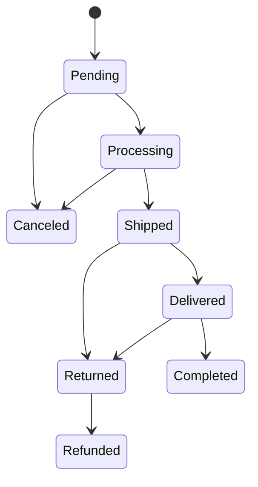

# Orders

Sales → Orders

Every purchase, whether it came from the storefront, a guest checkout or an AI agent, is one order. This is the screen store staff live in: it answers "where is this order, has it been paid, and what do I have to do next". The number beside the sidebar entry is the number of orders still in **Pending**; the dashboard shows the same count as **Orders to process** under **Needs attention**.

## What you see

### The list

| Column | Meaning |
|---|---|
| **Status** | The fulfilment state (see the table below). |
| **Follow-up** | A blue **Follow up** badge when the shopper has been waiting too long for the parcel; empty otherwise. See [Orders to follow up](#orders-to-follow-up). Click the column header to bring the flagged orders together. |
| **Customer** | Name on the order and the email it was placed with. Guest orders show the same, just without a linked account. |
| **Order** | Line count, total quantity and the amount the customer actually owes after discounts, loyalty points and gift cards. |
| **Order source** | Where the customer came from before placing the order, as a coloured badge: the channel's name (Instagram, Google, a referring website, "AI agent (UCP)") coloured by its kind (see [Order source](#order-source) below). Empty for orders placed before the store started recording it. |
| **Payment** | The financial state, independent of the fulfilment state. |
| **Payment Method** | How the order is paid: the payment provider's name (Viva Wallet, Stripe) for an online payment, otherwise the method the customer picked, such as cash on delivery or bank transfer. |
| **Shipment** | The courier's own state for the parcel (ACS or BoxNow), blank when no carrier is attached yet. |
| **Shipping** | Tracking number, carrier and city, or "No tracking" and the city. |
| **Created** | Date and time, with a relative age. |

Each row has two quick actions: **Download shipping voucher (PDF)** and **Customer's orders**, which reopens the list filtered to the same account, or to the same email for guests.

A tab strip above the list links **Orders**, **Order Items**, **Receipts** and **Credit Documents**; platform operators also get **Stock Logs** and **Order History**. **Order Items** has no sidebar entry of its own: it lists every order line separately, so filtering it by product shows who bought that product.

### Filters

The **Filters** panel offers, top to bottom: **Status** and **Payment Status**, where you may pick several at once (Pending and Processing together are the orders still to handle; Failed and Pending together are the payments needing attention), **Document Type**, **Wholesale** (orders priced with a B2B customer group, or retail), **Refund** (**Cancelled but still paid**: cancelled orders whose money has not all gone back, see [Orders cancelled but still paid](#orders-cancelled-but-still-paid)), **Needs follow-up** (**Yes** or **No**, see [Orders to follow up](#orders-to-follow-up)), **Recent Orders** (Today, This Week, This Month, "Urgent" meaning Pending for more than 24 hours), **Source type** and **Order source** (see [Order source](#order-source)), created and status-updated date ranges, **Country** and **Region** (type to search), the pay way, the gateway that processed the charge, shipping provider, **Shipping Kind** and, for BoxNow orders, the parcel state. Choose any number of them and press **Apply Filters** once. A date drill-down by creation date sits above the table.

### Search

The search box matches order ID, UUID, customer email, first and last name, phone, city, tracking number, payment ID, and for BoxNow the parcel ID, delivery-request ID and locker ID. Paste a voucher number and the order comes up.

### Bulk actions

Select rows and pick one of **Mark selected orders as processing / shipped / delivered / completed / returned / refunded** or **Cancel selected orders and restore stock**. Every order is checked against the allowed transitions individually. Rows that cannot move are skipped with a warning naming the order and the reason; the others go through. These actions are the only way to change an order's status: they are what restores stock on a cancellation and refuses a transition that is not allowed.

### The order page

A row of cards at the top gives the order at a glance: **Status** (and how long ago it last changed), **Payment** (and the method), **Total** (and the number of items), **Customer** (linking to the account), **Shipment** (and the tracking number) and **Receipt** (its number and myDATA state, or that the store issues the receipt outside the platform; **Invoice** for an invoice order, with the number you recorded from timologio).

Below them the page is split into tabs:

- **Order Information**: UUID, the **Status** (read-only here; change it with the actions above), **Follow-up** (why and since when the order needs follow-up, or "—"; see [Orders to follow up](#orders-to-follow-up)), created, updated and status-updated timestamps.
- **Billing / Invoice**: **Document type** (Receipt or Invoice), and for invoice orders the buyer's company name, VAT ID (ΑΦΜ), tax office (ΔΟΥ), business activity and registered billing address, a **To issue in timologio** summary, and the fields where you record the number and MARK of the invoice (and credit invoice) you issued in timologio. **Wholesale pricing** shows which B2B group priced the order, or "Retail (no group pricing)".
- **Customer Information**: linked account (empty for guests), name, email, phone.
- **Shipping Address**: country, region, city, street, number, postcode, floor, location type and **Place**, a legacy field that new checkouts leave empty. Saving a change to the country, region, street, number or postcode checks the address the way checkout does: the postcode must match the country's format, a region is required for a country that has regions and must belong to it, the street must contain a letter, and the number must not be a postcode. An old order with an address that fails is not blocked from other edits; the check runs only when you change the address.
- **Payment Information**: **Payment Method** (what the customer chose), the editable **Payment status**, **Payment Gateway** (the gateway that took the charge), **Payment ID**, **Paid Amount**, and the read-only **Promotion Discount**, **Loyalty Discount** and **Gift Card Amount** stamped at checkout.
- **Shipping & Tracking**: shipping provider, shipping kind, shipping price, tracking number, carrier name.
- **Additional Information**: the customer's notes from checkout, then the read-only order source fields: **Source type**, **Order source**, **Traffic medium**, **Campaign name**, **Referrer host** and **Landing page**. All show "-" on an order placed before the store started recording them.

Below the tabs: the **order items** (product, quantity, unit price, line total, refund status), **Payment Transactions** (read-only: every charge, cash-on-delivery collection, refund and chargeback recorded for the order, with **Created At**, **Kind**, **Amount**, **Provider**, **Provider reference** and, for a refund, the reason in **Description**), the **invoice** row if one exists (number, issue date, total, **Download PDF**), the **history** (the whole history, newest first, fifteen rows per page: change type, description, who changed it or "System", when) and, when a carrier is attached, an **ACS** or **BoxNow** shipment tab with the voucher details.

The header carries **Refund (amount, reason)** on a delivered, completed or returned order (see [Refunds](#refunds)), **Download shipping voucher (PDF)** and, when the platform issues your receipts, an **Invoicing & myDATA** menu with **Issue receipt (myDATA)**, **Regenerate receipt (same number)**, **Send receipt to myDATA**, **Issue credit documents (myDATA)** and **Cancel receipt in myDATA (issued in error)**. See [Receipts and credit documents](/admin/sales/receipts).

## Order statuses

| Status | Meaning | Who moves it there |
|---|---|---|
| **Pending** | Placed, nothing has happened yet. For online payments the money is not in yet; for cash on delivery the courier voucher is being created. | The checkout. |
| **Processing** | Confirmed and being prepared. | Automatic when an online payment succeeds or when the courier voucher is issued for a cash-on-delivery order; or the bulk action. |
| **Shipped** | The carrier reports the parcel moving. | Automatic, from the regular ACS tracking checks or from BoxNow's own parcel updates; or the bulk action. |
| **Delivered** | The carrier reports delivery. | Automatic from the carrier; or the bulk action. |
| **Completed** | Delivered and paid. Final. | Automatic once a delivered order is paid (for cash on delivery, when the courier's payout is reconciled); or the bulk action. |
| **Canceled** | Closed before shipping. Stock was restored. Final. | The customer from their account (only while the courier can still cancel the parcel), the cancel bulk action, or the automatic clean-up of unpaid orders. |
| **Returned** | The carrier brought the parcel back, or the customer returned it. For a cash-on-delivery order nothing was collected, so the payment status becomes **Canceled** at the same time and the order is closed; a paid order keeps its payment until you refund it. Stock is not restored on its own: put the goods back once you have the parcel in hand. | Automatic from the carrier; otherwise you, with **Mark selected orders as returned**. |
| **Refunded** | A returned order whose money went back. Final. | You, with **Mark selected orders as refunded** on a Returned order. |

Only **Pending** and **Processing** orders can be canceled. A customer has one more condition: the courier must still be able to cancel the parcel (see [Cancellations by the customer](#cancellations-by-the-customer)). **Completed**, **Canceled** and **Refunded** have no exit.

## Payment statuses

| Payment status | Meaning | What sets it |
|---|---|---|
| **Pending** | Nothing collected yet. Normal for cash on delivery until the courier pays out, and for bank transfer until you confirm it. | Checkout. |
| **Processing** | The provider is still working on the charge. | The provider, when it reports back. |
| **Completed** | Paid in full. Also used when gift cards, points or a 100% promotion covered the whole total. | Viva Wallet or Stripe confirming the charge, the nightly match against the ACS cash-on-delivery payout report, BoxNow reporting a paid parcel delivered, or you, by editing the field. |
| **Failed** | The online charge was declined. The order stays Pending and is auto-canceled after the grace period. | The provider, when it reports the decline. |
| **Refunded** | Fully refunded: nothing is left to give back. | The refund that returns the last of the payment, in one go or after earlier partial refunds: the **Refund (amount, reason)** button, cancelling a paid order, or a refund made in the Viva Wallet or Stripe dashboard. |
| **Partially Refunded** | Part of the money went back; more refunds can follow until nothing is left. | A partial refund from the **Refund (amount, reason)** button or the Viva Wallet or Stripe dashboard, or a cancellation whose refund the provider completed only in part. |
| **Canceled** | Nothing was collected and nothing is owed. Set when an unpaid order is canceled or comes back **Returned** (cash on delivery the customer refused or never collected, or an online payment that never completed), or when Viva Wallet reverses a payment that never completed. | The cancellation or the return itself, or Viva Wallet. |

Once a payment is Completed, Refunded, Partially Refunded or Canceled, a late or duplicated provider message can never move it back to Pending or Failed.

## Order source

Every new order records where the customer came from: the ad, post, search result or website that brought them to the store in the browser tab they ordered from. It is worked out once, when the order is placed, and never changes afterwards.

| Source type | Meaning |
|---|---|
| **Direct** | No trace of where the visit came from: a typed address, a bookmark, or an app that hides the link it opened. |
| **Campaign** | A link you tagged with `utm_source` (a newsletter, an influencer's link, a QR code), not marked as paid. |
| **Paid** | A paid ad click: the ad network's own click marker was on the link (Google Ads, Microsoft Ads, TikTok, X, LinkedIn, Pinterest ads), or a tagged link whose `utm_medium` says it was paid (`cpc`, `ppc`, `paid_social` and the like). Facebook and Instagram mark ordinary shared links the same way as their ads, so a Meta ad reads as **Paid** only when its link is tagged so. |
| **Social** | Instagram, Facebook, TikTok, Pinterest, YouTube, X, LinkedIn or Reddit, whether from a link on the site or from the app's own built-in browser. |
| **Search** | Google, Bing, DuckDuckGo or Yahoo search results. |
| **Referral** | Any other website that linked to the store, shown by its address, and AI assistants such as ChatGPT and Perplexity. |
| **AI agent** | The order was placed by an AI agent through the store's agent checkout (UCP or ACP), not by a person in the storefront. |

**Order source** is the channel's name (Instagram, Google, the referring website) and is what the list column shows. **Traffic medium** and **Campaign name** are the `utm_medium` and `utm_campaign` of a tagged link. **Referrer host** is the website the customer arrived from, without the page, and **Landing page** is the first page they saw, without its parameters.

The dashboard's **Where orders come from** card shows each source's share of the orders in the period you pick there: the five biggest sources by name, the rest together as **Other**. See [Dashboard](/admin/getting-started/dashboard).

### Tag a link so its orders are recognised
1. Add `utm_source`, `utm_medium` and `utm_campaign` to the link you share, e.g. `?utm_source=newsletter&utm_medium=email&utm_campaign=autumn-sale`.
2. Orders placed from that visit show the source `newsletter` with type **Campaign**, and the campaign name on the order page.
3. For an ad, set `utm_medium` to `cpc` or `paid_social` so the orders read as **Paid**. Google and Microsoft ads that add their own click marker are recognised as paid without it.

### See the orders from one channel
1. Open **Sales → Orders**.
2. Pick the channel in **Order source**, or a whole kind in **Source type** (for example every **Social** order).
3. Direct orders have no source name, so reach them through **Source type → Direct**.

## Orders to follow up

A shopper who ordered a week ago and still has no parcel is about to write to you. The platform flags those orders so you can get in touch first, whether nobody has shipped the order yet or the parcel is stuck on its way.

An order is flagged when all of these are true:

- it was placed at least `ORDER_FOLLOW_UP_DAYS` days ago (7 by default). The days are whole calendar days in the store's time zone, counted from the day the order was placed: with 7, an order placed on the 3rd is flagged from midnight at the start of the 10th, whatever the hour it was placed;
- its status is **Pending**, **Processing** or **Shipped**;
- it is not an online order still waiting for its payment. An unpaid card order is an abandoned checkout, not a parcel to chase, and the automatic cancellation takes care of it (see [What happens automatically](#what-happens-automatically)). Cash on delivery and bank transfer orders are flagged like any other.

Where the flag shows:

- the **Follow-up** column of the list, as a blue **Follow up** badge;
- the **Needs follow-up** filter: **Yes** lists the flagged orders, **No** the rest;
- the **Follow-up** line on the order's **Order Information** tab, which reads **Needs follow-up since**, the date the order was flagged, the reason, and **Last carrier event**. The reason is **Not shipped yet** for a Pending or Processing order and **In transit** for a Shipped one. **Last carrier event** is the last time ACS or BoxNow reported anything about the parcel, or **none yet**;
- **Orders to follow up** under **Needs attention** on the [Dashboard](/admin/getting-started/dashboard), which opens the list with the filter set to **Yes**.

The flag is not stored and there is nothing to tick off. It disappears by itself once the order is Delivered, Completed, Returned, Canceled or Refunded. Getting in touch with the customer does not clear it; only the order moving on does.

### Change the follow-up period
1. Open Settings → Store Settings and search for `ORDER_FOLLOW_UP_DAYS`.
2. Enter the number of days you want shoppers to wait before you hear about it, and save. The list, the filter and the dashboard all follow the new value at once.
3. To switch the flag off entirely, enter `0`: no order is flagged and the dashboard line disappears.

## Tasks

### Find an order
1. Type the order number, the customer's email or phone, or a tracking or voucher number in the search box.
2. Narrow with **Status** or **Recent Orders** if the customer has many orders.
3. Open the row. From there **Customer's orders** shows everything else the same person bought.

### Move an order forward by hand
1. Tick the order (or several) in the list.
2. Choose **Mark selected orders as shipped** (or processing, delivered, completed) and confirm.
3. Read the flash messages: a skipped row tells you why, usually because the transition is not allowed from its current status.

There is no other way: **Status** is read-only on the order page.

### Cancel an order
1. Tick the order in the list and run **Cancel selected orders and restore stock**.
2. The platform restores the stock, releases any leftover reservation, records the cancellation in the history, asks the courier to cancel the voucher and emails the customer.
3. If the courier refuses (for example the voucher is already on a pickup list) or cannot be reached, the order is canceled all the same. An error message at the top of the list names the order and the courier's reply, and a note in the order's history says the same: the parcel may still be delivered, so arrange its return with the courier.

**This action refunds the money too**, when there is money to refund: an order whose payment status is Completed and that was charged by Viva Wallet or Stripe gets a full provider refund as part of the cancellation, and the payment status becomes Refunded. Cash on delivery, bank transfer and orders settled entirely by gift card have nothing for a provider to send back; the gift-card part goes back to the cards either way. If the provider refuses the refund, the order is still canceled, the payment status stays Completed, an error message says the payment was not refunded and the provider's reason is noted in the order's history. Such orders are listed by the **Refund** filter; see [Orders cancelled but still paid](#orders-cancelled-but-still-paid).

### Confirm a bank transfer or other offline payment
1. Open the order and go to **Payment Information**.
2. Set **Payment status** to **Completed** and save.
3. Move the order to **Processing** with the bulk action so fulfilment starts.

### Print the voucher or the receipt
- **Download shipping voucher (PDF)** on the row or in the page header fetches the label from the carrier. It tells you if no shipment exists yet or the carrier has not assigned a voucher.
- The receipt PDF is the **Download PDF** link in the receipt row. When the platform issues your receipts and the order has none yet, **Invoicing & myDATA → Issue receipt (myDATA)** issues it first.

### Add a tracking number manually
1. Open the order, tab **Shipping & Tracking**.
2. Fill **Tracking number** and **Shipping carrier**, save.
3. The "your order has shipped" email goes out only when the order is also in **Shipped**; whichever of the two happens second triggers it.

## What happens automatically

- **Stock**: checkout reserves stock for a limited time (`STOCK_RESERVATION_TTL_MINUTES`, 30 minutes by default). Placing the order consumes the reservation; expired reservations are released every hour. A failed online payment does not release stock by itself: that happens when the order is canceled, by you or by the cleanup below.
- **Unpaid orders are canceled for you**: every fifteen minutes the platform runs two rules. Any order still **Pending** whose payment is **Failed** and untouched for `ORDER_AUTO_CANCEL_FAILED_PAYMENT_MINUTES` (30) is canceled. Separately, an order still **Pending** with payment **Pending** is canceled once its payment window has passed, and only if it was meant to be paid online: cash on delivery and bank transfer sit unpaid by design and are never touched by that second rule. Neither rule refunds anything. An order Viva Wallet charged for a different amount than the total is skipped and left for a person. An unpaid order gets no reminder email.
- **Courier voucher**: created right after checkout for cash on delivery, after the payment succeeds for online orders. Its arrival moves the order to Processing and sets the tracking number.
- **Carrier tracking** moves the order through Shipped and Delivered, and a delivered, paid order to Completed.
- **Cash on delivery stays payment-Pending until the courier pays out.** ACS remits collected cash days later; a nightly reconciliation matches the payout report to orders and marks them Completed, silently for the customer. That is by design, not a stuck order.
- **Receipts** are issued when a receipt order ships, and a **credit document** for every refund. Invoice orders get no document from the platform: you issue the invoice in timologio. See [Receipts and credit documents](/admin/sales/receipts).
- **Emails** to the customer: order received (immediately for cash on delivery, after payment for online orders), payment failed, shipped (when genuinely in transit), delivered, canceled, completed, refunded, returned, receipt, refund confirmation. **Pending** and **Processing** never email the customer, and neither does the automatic step to **Completed**: the customer has just had the delivered message, so only a Completed you trigger yourself emails them. The store also gets a new-order email. Templates are under [Email templates](/admin/storefront/email-templates).
- **In-app notifications** mirror the same milestones for customers with an account; guests only get email. See [Notifications](/admin/sales/notifications).
- **History** logs every status change, payment update, shipping update, note, refund and chargeback, with the user who did it or "System".

## Cancellations by the customer

A customer sees a **Cancel order** button on the order in their account while it is **Pending** or **Processing** and the courier can still take the parcel back: no voucher yet, an ACS voucher that is not yet on a pickup list, or a BoxNow parcel still in state **New**.

When they press it, the platform asks the courier to cancel the parcel **first**:

- **The courier agrees**, or there is no parcel yet: the order is canceled exactly as your own cancel would do it, with the stock restored and the money refunded.
- **The courier refuses**, because it already has the parcel: nothing changes. The customer is told the order can no longer be canceled; expect them to contact you about a return.
- **The courier cannot be reached**: nothing changes either. The customer is asked to try again.

Your own cancel from the list is not held back like this: it cancels the order whatever the courier answers (see [Cancel an order](#cancel-an-order)).

Rarely, the order moves on while the courier is answering, for example because you marked it shipped at that moment. The parcel is then canceled but the order is not, and the order's history gets a note saying that the shipment no longer has a voucher. If the order still has to ship, create a new voucher for it; for ACS, see [ACS Courier](/admin/shipping/acs).

## Refunds

Money goes back to the customer in three ways: the **Refund (amount, reason)** button on a delivered or returned order, a cancellation, or a refund made in the payment provider's own dashboard. Whichever you use, every refund is recorded on the order, the payment status follows from how much has gone back in total, and the customer gets one refund email for each refund.

### Refund a delivered or returned order
Use this for returns (including the customer's 14-day right of withdrawal), goodwill refunds and anything else after delivery.
1. Open the order. The **Refund (amount, reason)** button is in the header of an order that is **Delivered**, **Completed** or **Returned**, for team members who can edit orders.
2. **Amount** is filled in with everything that can still be refunded; lower it for a partial refund. Fill in **Reason**: it is kept with the refund.
3. Confirm. The money goes back through the provider that took it (Viva Wallet or Stripe), and the message at the top of the page says how it went:
   - "Order N refunded €X.": done.
   - "Order N: €X of €Y refunded; the rest was declined: …": part went back and the provider refused the rest. What went back is recorded; try the rest again later, or refund it in the provider's dashboard.
   - "Order N was not refunded; see the order history.": nothing went back. The provider's reason is in the order's history.
4. After a partial refund the payment status is **Partially Refunded** and the button is still there: refund the rest, in one go or in several steps. Once nothing is left the payment status becomes **Refunded**.

You cannot refund more than is left: the platform refuses and tells you how much can still be refunded. An order paid by bank transfer or entirely by gift card has nothing a provider can send back, and the platform says so. Cash on delivery is covered in the next section. Each refund is listed on the order's **Payment Transactions** tab with its amount and reason, and the platform records which team member ran it.

The button changes neither the order status nor the stock. When the goods are back, run **Mark selected orders as returned**, and if you want the order closed as refunded, **Mark selected orders as refunded** after it.

### Refund a cash-on-delivery order
Cash the courier collected is refunded with the same **Refund (amount, reason)** button, but no provider can send it back: you pay the customer back yourself, by bank transfer or in cash, and the platform records it.
1. Pay the customer back first (or at the same time), and note how: the bank transfer's reference, for instance.
2. Open the order and press **Refund (amount, reason)**. When the order has collected cash left to refund, the form also asks **How it was paid back**. Enter the transfer reference or a short note on how you paid. It is required whenever the amount reaches that cash, and it is not asked for when the refund is covered by a card payment on the same order.
3. Confirm. The refund is recorded on the **Payment Transactions** tab like any other, the payment status becomes **Partially Refunded** or **Refunded**, the customer gets the refund email, and the credit document is issued for the amount (see [Receipts and credit documents](/admin/sales/receipts)).

Each refund needs its own reference: the platform refuses a reference you have already used on the order, which also stops a double click from recording the same refund twice. The platform sends no money in this case, so check that you really paid before you confirm.

Until the courier's payout has been recorded on the order (the payment status is still **Pending**), no cash has been collected and there is nothing to refund: the platform says so. Come back once the payment status is **Completed**.

### Cancel before shipping
Cancelling a **Pending** or **Processing** order that was paid online refunds it in full as part of the cancellation. See [Cancel an order](#cancel-an-order).

### Refunds made in the provider's dashboard
A refund made in the Viva Wallet or Stripe dashboard reaches the order on its own: it is recorded on the order, the payment status becomes **Partially Refunded** or **Refunded**, and the customer gets a refund email for it, a partial refund included. A refund you made from the admin is never counted twice when the provider reports it back. If a Viva Wallet refund does not show up on the order, ask the platform team to check that the store's Viva account sends refund notifications.

### Card disputes and chargebacks
A customer can dispute a card payment with their bank instead of asking you for a refund. Viva Wallet and Stripe report the dispute, and the order follows it on its own:

- **The dispute opens.** The order's history gets a note, and the contact email on your store profile receives "[Store] Viva Wallet dispute opened — Order #N" (or Stripe). Answer the dispute in the provider's dashboard: the platform does not answer it for you.
- **While it is open, the order cannot be refunded.** The provider does not accept a refund of a disputed payment, so **Refund (amount, reason)** stops with "A dispute is open on this payment and the payment provider does not accept a refund until it is decided. Refund once it has closed." Cancelling such an order still cancels it, but its refund fails the same way and the order is listed under [Orders cancelled but still paid](#orders-cancelled-but-still-paid). A Stripe inquiry, where the bank only asks a question and no dispute has been opened, does not block a refund.
- **You win.** The history gets a note and the order can be refunded again. No email.
- **You lose.** The money has been taken back. The history gets a red **Chargeback** entry, "Chargeback €X", and the contact email receives "[Store] Viva Wallet dispute lost — Order #N". The amount is listed on **Payment Transactions** with the kind **Chargeback**, and what you can still refund goes down by it.

When earlier refunds had already returned part of the payment, the chargeback is recorded only up to what was left, and the entry says so: "Chargeback €70.00 (disputed €100.00, €30.00 already returned)". When nothing was left, the entry reads "Chargeback of €100.00 not recorded: nothing is left on the payment (€100.00 already returned)", and the email still goes out. Each dispute is recorded once, however many times the provider reports it.

A chargeback is not a refund:
- **The payment status does not change**, and neither does the order status. A Completed payment stays Completed and a Partially Refunded one stays Partially Refunded; the red entry and the **Payment Transactions** row are what show the money left.
- **Nothing goes to the customer**: no refund email, no credit document, and gift cards used on the order do not get their amount back.
- **Loyalty points**: once refunds and chargebacks together cover the whole payment, the points earned on the order are taken back. Unlike a refund or a cancellation, the points the customer spent on the order are **not** given back, because the customer took the money back through their bank. To give them back anyway, a platform operator can add them by hand; see [Tiers & points](/admin/loyalty/tiers-and-points#add-or-remove-points-for-a-customer).

If a Viva Wallet dispute never shows up on the order, ask the platform team to check that the store's Viva account sends account transaction notifications. Without them the platform hears of a Viva dispute only if Viva reports the lost money as a refund claim, and you learn of it from Viva's own email.

### Orders cancelled but still paid
When a provider refuses the refund of a cancelled order, the order stays **Canceled** and the money stays with you. The same happens when a payment arrives after the order was cancelled, for instance a card payment that completed after the unpaid order had been cancelled automatically: the order stays **Canceled**, nothing ships, the payment is recorded as **Completed**, the order's history gets a note asking you to refund the customer, and the store is emailed "Payment received for canceled order N" (unless you switched that email off, see [Store settings](/admin/settings/store-settings#operational-alert-emails)). Choose **Refund → Cancelled but still paid** in the filters to list every such order, including ones refunded only in part; the dashboard counts them as **Canceled orders to refund** under **Needs attention** and that line opens the same list. The **Refund (amount, reason)** button is not offered on a cancelled order, so refund what is left in the Viva Wallet or Stripe dashboard; the refund then reaches the order on its own.

### What the customer receives
One refund email for each refund: a partial refund and the later refund of the rest send one each. Customers with an account also get an in-app notification for each refund.

Gift cards and loyalty points come back only when **all** the money has been refunded, or when the order is canceled. Each card then gets back exactly what it paid; the points spent on the order are given back and the points earned on it are taken back. A partial refund leaves both alone; they come back, in full, with the refund that returns the rest. A chargeback is different, see [Card disputes and chargebacks](#card-disputes-and-chargebacks). See [Gift cards](/admin/sales/gift-cards) and [Tiers & points](/admin/loyalty/tiers-and-points).

## Guest orders

A guest order has no account in **Customer Information**. Everything else works the same: the customer receives every email at the order's address and can open the order through the link in those emails. Guests get no in-app notifications. **Customer's orders** uses the email to find their other purchases.

## Things to know

- **Status cannot be edited on the order page.** Every change goes through the bulk actions, which check that the move is allowed, restore stock on a cancellation and refund a paid order.
- **Editing money fields does not move money.** Changing the paid amount only changes what the screen shows; nothing is charged or refunded. Setting **Payment status** to Refunded or Partially Refunded by hand sends nothing back either, and adds nothing to **Payment Transactions**: to give money back, use **Refund (amount, reason)**. **Promotion Discount**, **Loyalty Discount** and **Gift Card Amount** are read-only for that reason: they are stamped at checkout and the matching coupon, points and gift-card records already exist.
- **Payment status Completed by hand** is right for bank transfers and cash collected in person. Do not use it for card payments still awaited from a provider.
- **Payment Method and Payment Gateway are different fields.** **Payment Method** is the dropdown, and it holds what the customer chose at checkout. **Payment Gateway** next to it is written by the platform and records which gateway took the money (`stripe`, `viva_wallet`, `acs_cod`, `boxnow_cod`); it is used to match incoming provider messages, so leave it alone.
- **Wholesale orders** keep the group name and discount percent they were priced with; changing the customer's group later does not touch old orders. See [Customer groups & price lists](/admin/b2b/groups-and-price-lists).
- **A Shipment column without a value** means no voucher has been asked for yet, or the order is older than the current carrier setup. The voucher button will say so.
- **The order source is a guide, not proof.** Anyone can type the tags into a link, and some apps hide where a visit came from, so a real Instagram visit can show as **Direct**. It is counted for the browser tab the customer ordered in: the first page they opened in that tab sets it, and only a later tagged or ad link replaces it. Returning from the card payment page never changes it.
- Superusers also see the raw **Order History** and **Stock Logs** under [Audit & logs](/admin/system/audit-and-logs).

## Related

- [Receipts and credit documents](/admin/sales/receipts)
- [Payment methods](/admin/sales/payment-methods)
- [Carts](/admin/sales/carts)
- [ACS Courier](/admin/shipping/acs)
- [BoxNow](/admin/shipping/boxnow)
- [Notifications](/admin/sales/notifications)
- [Dashboard](/admin/getting-started/dashboard)
