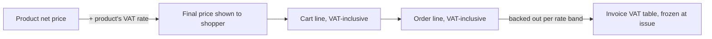

# VAT rates

Sales → VAT Rates

A VAT rate is a single percentage. Each product points at one rate; the rate is what turns the product's net price into the price the shopper sees and what the invoice reports per band. Most stores need two or three rows: the standard rate, a reduced rate for books or food, and zero.

## What you see

### The list

| Column | Meaning |
|---|---|
| **VAT Rate** | The percentage. |
| **Category** | A colour band by size: **Tax Free** (0), **Reduced Rate** (up to 5), **Low Rate** (up to 15), **Standard Rate** (up to 25), **High Rate**, **Premium Rate**. Cosmetic only. |
| **Usage** | How many products use it. |
| **Price Examples** | What 10, 50 and 100 € net become with this rate. |
| **Created** / **Updated** | Timestamps. |

Filters: **Usage Status** (Currently in Use, Not in Use, Popular with 5+ products, Rarely Used with 1 or 2), value range, dates. Search by value or ID.

### The rate page

**VAT Configuration** with the single **Value** field; a collapsed **Usage** block that says how many products use the rate; system information.

## Accepted values

The field accepts one decimal between 0 and 100, but saving is refused for any rate the Greek tax authority's myDATA platform does not recognise. The accepted rates are 24, 17, 13, 9, 6, 4, 3 and 0: the mainland rates, the island-reduced rates and the special 3 % rate. A product carrying any other rate would produce an invoice that myDATA rejects, so the check happens here, when you save, rather than weeks later on a submission.

## How VAT is applied

- The product stores a **net** price and a link to a VAT rate. The storefront, the cart and the order work with the VAT-inclusive final price.
- A product with no VAT rate is treated as 0 %.
- The invoice groups lines by rate, backs the VAT out of each line, and stores that table on the invoice so it never changes afterwards. Order-level discounts are spread across lines first, so VAT is computed on what was actually paid. Gift-card amounts are payment and do not touch VAT. See [Invoices](/admin/sales/invoices).
- Shipping and payment-method fees are entered as VAT-inclusive amounts and appear as their own invoice lines.
- Wholesale prices for business customers are net prices too; the product's own rate is applied on top. See [Customer groups & price lists](/admin/b2b/groups-and-price-lists).

There is no per-country VAT. One rate per product applies whatever the destination; the buyer's country only decides the myDATA invoice type (domestic, intra-EU, third country).

There is no "default rate" setting. A new product has no rate until you pick one on the product page.

## Tasks

### Add a rate
1. **Add VAT rate**, enter the **Value** (for example 13), save.
2. Assign it to products under [Products](/admin/catalog/products).

### Change the rate of many products
1. Do not edit the value of a rate in use unless the law changed: every product pointing at it changes price immediately, everywhere.
2. Instead, create the new rate and re-point the products to it.
3. When the old rate has **Not in Use**, delete it.

### Move to a new legal rate
1. Add the new rate. Re-point the products.
2. Delete the old row once unused. Existing invoices keep their frozen VAT tables; existing orders keep their line prices.

## Things to know

- **Editing a value changes prices, not just labels.** Final prices are computed live from the net price and the rate, so a rate change is a price change for every product using it, and the storefront cache should be purged afterwards under [Cache](/admin/system/cache).
- **Deleting a rate in use** does not delete products; they are left with no rate, which means 0 % VAT and a lower final price. Check **Usage** before deleting.
- **Orders keep their prices.** An order line stores the VAT-inclusive price at purchase time; later rate changes never rewrite it. Regenerating an invoice, however, recomputes the VAT table with the products' current rates.
- **Rates are shared with nothing else.** Payment fees and shipping are not tied to a rate row.

## Related

- [Products](/admin/catalog/products)
- [Invoices](/admin/sales/invoices)
- [Customer groups & price lists](/admin/b2b/groups-and-price-lists)
- [Cache](/admin/system/cache)
