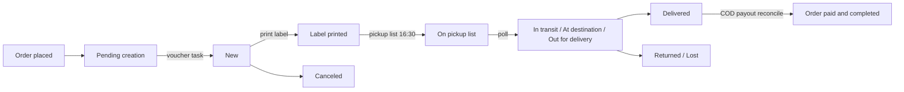

# ACS Courier

Shipping → ACS Shipments

Every order shipped with ACS has one ACS shipment record. The record is created at checkout, receives its voucher from ACS a few seconds later, is printed and collected, and is then tracked by polling ACS every fifteen minutes until it reaches a final state. Store staff work mostly from this list and from the order page. Superusers also see the pickup lists, the cash-on-delivery payouts and the raw tracking events under System.

## The lifecycle at a glance

What the platform does automatically:

1. **At checkout** the shipment row is created in state **Pending creation** with the delivery kind, the chosen Smartpoint (if any), the parcel weight from the cart, one parcel, and the charge type.
2. **Voucher creation** runs as a background task: immediately for cash-on-delivery and other offline orders, after the payment succeeds for online orders. On success the row gets its **Voucher number**, moves to **New**, the order's tracking number is set and the order moves from Pending to Processing.
3. **Printing** the label records **Label printed at** on the row.
4. **The pickup list** (manifest) is issued Monday to Friday at 16:30 Athens time, or on demand with the button on this page. ACS does not collect parcels that are not on a pickup list.
5. **Tracking** is polled every fifteen minutes for every non-final shipment. The shipment state follows ACS, and the order status follows the shipment state.
6. **Cash on delivery** is settled days later: a nightly task pulls ACS's payout report and marks the matching orders paid.

## What you see

Columns of the list:

| Column | Meaning |
|---|---|
| **Voucher number** | The 10-digit ACS voucher. Empty while the shipment is Pending creation. |
| **Order** | Link to the order. |
| **State** | See the state table below. |
| **Delivery kind** | Home delivery or Pickup point / locker. |
| **Pickup list** | The manifest the voucher was issued on. Empty until the daily list runs. |
| **Label printed at** | When the label was last downloaded through the platform. Empty means ACS will reject the pickup list. |
| **Last polled at** | When tracking was last refreshed. |

Filters: **Shipment state**, **Delivery kind**, **Label printed at** (empty or not), **Created at** range. The search box matches the voucher number, the order number and the customer email.

Shipment states:

| State | Meaning | Order status it sets |
|---|---|---|
| Pending creation | Row exists, no voucher yet. | none |
| New | Voucher issued, parcel still with you. | none (already Processing) |
| In transit | ACS has loaded the parcel. | Shipped |
| At destination station | Parcel reached the delivery branch. | Shipped |
| Out for delivery | On the courier's vehicle. The customer is emailed once. | Shipped |
| Delivery attempted | ACS recorded a failed attempt with a reason. | none |
| Delivered | Signed for. | Delivered, then Completed if the order is paid |
| Returned | Returned to sender. | Returned |
| Canceled | Voucher cancelled at ACS or retired locally. | Canceled |
| Lost | Declared lost. | Returned |

Delivered, Returned, Canceled and Lost are final: a later noisy poll can never move the shipment out of them.

The shipment page shows the voucher and tracking fields read-only, the destination (delivery kind, station), the parcel (weight in grams, item quantity, charge type, COD amount, COD payment way, delivery products) and a tab with every tracking event: **Event time**, **Checkpoint action**, **Checkpoint location**, **Notes**, **Received at**. The same shipment is shown as an **ACS Shipment** tab on the order page in Sales → Orders.

Buttons on this page:

| Where | Button | What it does |
|---|---|---|
| Top of the list | **Issue ACS pickup list now** | Runs the daily manifest immediately for today's vouchers. |
| Each row | **Re-poll ACS tracking** | Queues one tracking refresh for that shipment. |
| Each row | **Issue ACS voucher now** | Queues voucher creation. On a Canceled shipment it first clears the old voucher so a fresh one can be issued. |
| Bulk action | **Re-poll tracking for selected shipments** | Queues one refresh per selected row. |
| Bulk action | **Retire selected shipments (mark CANCELED, stop polling)** | Local bookkeeping only. Marks the rows Canceled so the poller and the stale alert stop. Does not call ACS and does not change the order. |

## Tasks

### Create a voucher for an order

Nothing to do in the normal case: the voucher is minted automatically. If an order shows **Pending creation** for more than a minute:

1. Open the order in Sales → Orders and check the email you received about the failed voucher, or the **Metadata** section of the shipment, where the last ACS error and the request that failed are stored.
2. Fix the cause on the order. Typical rejections: a postcode with letters or spaces (ACS accepts digits only), a phone number that is not a 10-digit Greek number, an unknown Smartpoint.
3. Back on Shipping → ACS Shipments, click **Issue ACS voucher now** on the row.

### Print the voucher

1. In Sales → Orders, click **Download shipping voucher (PDF)** on the order row or at the top of the order page.
2. Print the PDF on the thermal roll printer. The layout is the thermal one (one voucher per page) unless the ACS provider's metadata sets `print_type` to `2` for laser, four per A4. See [Shipping providers](/admin/shipping/providers).
3. **Label printed at** is now set. Print every voucher before 16:30; ACS refuses the whole day's pickup list if even one voucher on it is unprinted.

A label printed from ACS's own portal is not visible to the platform, so the column stays empty in that case. Nothing blocks on the column; it is a pre-flight check.

### Issue the pickup list

Automatic on working days at 16:30. You get a warning email at 15:45 listing vouchers that still have no printed label.

To issue earlier, or again after fixing a rejection:

1. Filter the list by **Label printed at: empty** and print whatever is listed.
2. Click **Issue ACS pickup list now**.
3. Read the message. "Pickup list … issued for N voucher(s)" is success. "No vouchers are waiting for a pickup list" means every voucher already belongs to a list. "ACS did not issue the pickup list: …" quotes ACS's own reason, usually naming the unprinted vouchers.

Why it matters:

- ACS collects only vouchers that are on an issued pickup list.
- A voucher on a list can no longer be cancelled through the platform and can no longer be reprinted through ACS.
- ACS scopes the list to today's pickup date. A voucher created on an earlier day that missed its list is not picked up by a later list.

Issued lists are visible to superusers at System → Reconciliation → ACS Pickup Lists with the **Pickup list number**, **Issued at**, **Voucher count** and **Issued by** (empty when the scheduled task issued it). The rows are read-only. See [Reconciliation](/admin/system/reconciliation).

### Cancel a voucher

- Cancelling the order in Sales → Orders also asks ACS to delete the voucher, when it is still allowed. See [Orders](/admin/sales/orders).
- ACS refuses to delete a voucher that is already on a pickup list. Contact ACS for a manual return instead.
- A cancelled voucher can be reissued: click **Issue ACS voucher now** on the Canceled row. The old voucher number is kept in the row's metadata history.

### Deal with a shipment that stopped moving

A daily task at 09:00 emails the store's admins about shipments with no tracking movement for three days, and about rows stuck in Pending creation for more than a day. Each shipment is reported once; a new tracking event re-arms the alert.

1. Search the voucher on the ACS portal or call ACS.
2. If the parcel was never handed over and never will be, select the row and run **Retire selected shipments**. The order is not changed; cancel it separately if needed.
3. If the parcel is genuinely moving, click **Re-poll ACS tracking**.

### Cash on delivery

The store's ACS contract is cash-on-delivery only. Every voucher is created with **Charge type** Cash on delivery. The **COD amount** is the order's paid amount for orders whose payment method is courier cash, and 0,00 for orders paid online or by bank transfer, so the courier collects nothing on those. The payment way is only sent when an amount is due.

How a COD order gets paid:

1. The customer pays the courier. The shipment reaches Delivered, the order becomes Delivered, and its payment status stays Pending.
2. ACS remits the collected cash to the store some days later. A measured remittance lag is about four days.
3. Every night at 02:30 the platform pulls yesterday's payouts from ACS and stores one row per voucher and payout date in System → Reconciliation → ACS COD Payouts.
4. Each payout matched to a shipment flips the order's payment status to Completed and the order to Completed. Customers are not emailed for this step; they were already notified at delivery.

The payouts screen (superusers) shows **Voucher number**, **Parcel delivery date**, **COD amount total**, **COD payment date**, **Shipment** and **Customer reference 1** (the order number sent to ACS). Filters: **COD payment date** and **Parcel delivery date** ranges. Search matches the voucher, both customer references and the receiver name. Rows are read-only. The row button **Run COD reconciliation now** re-runs the nightly pull for yesterday's date.

Alerts you may receive:

| Email subject | Meaning | What to do |
|---|---|---|
| "ACS COD reconcile: N unattributable payout row(s)" | ACS paid out money for a voucher the platform does not know, typically one created by hand in the ACS portal. The row is stored; it is not attributed. | Reconcile it as an off-platform sale against ACS's beneficiary report. |
| "ACS COD: N delivered parcel(s) never remitted" | Delivered COD parcels older than ten days with no payout row. | Give ACS the voucher numbers and ask for the remittance status. If ACS paid on a date the nightly pull never queried, the platform team can replay that date. |

See [Reconciliation](/admin/system/reconciliation) for the finance view.

### Smartpoint stations

Shipping → ACS Stations is a local copy of ACS shops and Smartpoint lockers, refreshed daily at 03:00. Columns: **External ID** (the area station code), **Name**, **Shop kind**, **City**, **Postal code**, **Country code**, **Is active**. Filters: **Shop kind**, **Country code**, **Is active**. Search matches ID, name, city and postcode. **Last synced at** is read-only. There is no manual sync button; the daily task does it.

Notes:

- A locker's identity is the pair of **External ID** and branch code. Many lockers share one area code.
- Only kinds **Smartpoint (no locker)** and **Smartpoint locker** are offered to customers as pickup points. Kind **Shop** rows are kept fresh but not shown.
- Smartpoint lockers cap at 6 kg per parcel.
- The picker appears in checkout only when the ACS row has **Supports Pickup Point** on and the setting **ACS_SMARTPOINT_ENABLED** is on. See [Shipping providers](/admin/shipping/providers).
- A station that disappears from ACS's list is marked inactive, not deleted. Shipments keep the station code they were created with.

### Tracking events

System → Audit & Logs → ACS Tracking Events (superusers) lists every checkpoint the poller has recorded: **Shipment**, **Event time**, **Checkpoint action**, **Checkpoint location**, **Received at**. Filters: **Checkpoint action**, **Received at** range. The rows are read-only and are the same events shown in the tab on the shipment page. See [Audit & logs](/admin/system/audit-and-logs).

## Things to know

- **Transient 403 and 406 errors.** ACS sporadically answers a tracking poll or a voucher request with HTTP 403 or 406 and then succeeds on the next attempt. The platform retries those automatically with backoff. Only a persistent rejection means a wrong API key or an IP address ACS has not allow-listed; in that case raise it with the platform team.
- **Business errors do not retry.** A rejected address or station is reported by email at once and stored on the shipment. Fix the data and click **Issue ACS voucher now**.
- **Parcels per voucher.** ACS's item quantity is the number of physical parcels, not cart lines. The platform sends one. Smartpoint pickup requires exactly one.
- **Weight** is stored in grams and sent in kilograms with a minimum of 0.5 kg. Bounds come from the provider metadata.
- **The customer's checkout note** is printed on the voucher's remarks line, trimmed to one paragraph.
- **Out for delivery** is emailed to the customer once per shipment, even when ACS's snapshot bounces between "on the vehicle" and "at the station" across days.
- **The order status only moves forward.** When ACS reports Delivered or Returned while the order is still Processing, the platform passes through Shipped first; the Shipped hop is silent for the customer on the Returned path.
- **Editing the shipment form.** Weight, item quantity, charge type and COD fields are editable but are only read at voucher creation time. Changing them after the voucher exists has no effect at ACS.

## Related

- [Shipping providers](/admin/shipping/providers)
- [Orders](/admin/sales/orders)
- [Reconciliation](/admin/system/reconciliation)
- [Audit & logs](/admin/system/audit-and-logs)
- [Background jobs](/admin/system/background-jobs)
