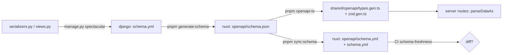

# OpenAPI contract

Django is the source of the API contract; the Nuxt storefront consumes it
as generated code. drf-spectacular renders the serializers into
`schema.yml`, the storefront fetches it, `@hey-api/openapi-ts` turns it into
TypeScript types and Zod schemas, and every Nuxt server route parses
Django's response with those schemas. A serializer change that is not
propagated does not fail a build; it fails a customer's request.

## Diagram

## How it works

1. **Django renders the schema.** `uv run python manage.py spectacular
   --color --file schema.yml` in `grooveshop-django-api/`. The output is
   camelCase (the `camelize_serializer_fields` hook in
   `SPECTACULAR_SETTINGS`), enum names are pinned by
   `ENUM_NAME_OVERRIDES`, and every ViewSet action is described by the
   `@extend_schema_view(**create_schema_view_config(...))` decorator (see
   [API conventions](/dev/django/api-conventions)). The committed
   `schema.yml` at the Django root is validated by the Code Quality CI job.
2. **The storefront fetches it.** `pnpm generate:schema` runs
   `scripts/fetch-schema.mjs`, which reads `NUXT_DJANGO_URL` (default
   `http://localhost:8000`), sends `DJANGO_API_TOKEN` (or the
   `.auth-token` file) and writes `GET /api/v1/schema` to
   `openapi/schema.json`.
3. **Types and Zod are generated.** `pnpm openapi-ts` reads
   `openapi-ts.config.ts`: input `./openapi/schema.json`, output
   `./shared/openapi/` with the `@hey-api/typescript` plugin and the `zod`
   plugin (requests, responses, definitions, dates with offset), then
   ESLint `--fix` over the output. The result is `types.gen.ts` and
   `zod.gen.ts`. Nothing in `shared/openapi/` is hand-edited; a missing
   field is fixed in Django and regenerated, never patched locally.
4. **The derived YAML is synced.** `pnpm sync:schema` runs
   `scripts/sync-schema-yml.mjs`, which rewrites `openapi/schema.yml` and
   the storefront's root `schema.yml` from `schema.json`. Both are derived
   artifacts. CI's `schema-freshness` job regenerates them and fails on
   any `git diff`, so skipping this step breaks the build. Copying
   Django's YAML across also fails it: the dump formatting differs.
5. **Type check.** `pnpm typecheck` (`nuxt typecheck`) surfaces every
   storefront consumer of a field whose type changed; it catches template
   errors that `vue-tsc --noEmit` misses.

From the workspace root the `/schema-sync` skill
(`.claude/skills/schema-sync/SKILL.md`) runs steps 1 to 5 in order across
both repositories; `/openapi-sync` inside the storefront runs the Nuxt
half when Django's schema is already current. Both refuse to guess: a
local Django must be running.

## Regenerate from a local backend, never production

`fetch-schema.mjs` reads `NUXT_DJANGO_URL`, not `NUXT_API_BASE_URL`.
Production's `/api/v1/schema` is a subset of a local one: it omits
components the frontend genuinely uses (`Country`, `BlogAuthor`, the
`Paginated*List` envelopes). Regenerating from production silently deletes
them from `types.gen.ts` and breaks the storefront at build time.

## What drift does at runtime

Nuxt server routes call `parseDataAs(response, zSchema)` before returning
data to the page. The generated Zod marks every non-nullable serializer
field `required`, so:

- **A field removed in Django** is still required in Zod; `parseDataAs`
  rejects the correct response with a 422 "Data parsing failed". This
  surfaces only on the flow that returns that object, for example a
  checkout whose order response nests a shipment detail.
- **A type or nullability change** (integer to string, `null` allowed on
  Django but not in Zod) fails the same way.
- **A field added in Django** is harmless until a Zod schema expects it.
  The dangerous case is the cached `tenant_resolve` payload: the storefront
  validated a pre-release cached shape against a Zod that required the new
  field and answered 404 on every route. `tenant/cache.py:
  tenant_resolve_key()` now derives the key from the serializer's field
  names, so a changed shape reads a fresh key.

The direction matters: Nuxt being stricter than Django is a 422 risk; Nuxt
being more lenient is safe.

## The schema-drift-detector agent

`.claude/agents/schema-drift-detector.md` at the workspace root is a
read-only subagent that regenerates the schema and the types into a
scratch location and reports differences against the committed files
without committing. Use it after editing a serializer or view, before a
commit that spans both repositories, or when reviewing a PR that touches
`*/serializers.py` or `*/views.py`. It is only visible from a session
started at the workspace root; subproject sessions do not see the root
`.claude/`.

## Invariants

- `shared/openapi/*.gen.ts` are generated; never edited by hand
  (`openapi-ts.config.ts`).
- `openapi/schema.yml` and the storefront root `schema.yml` are derived from
  `openapi/schema.json` (`scripts/sync-schema-yml.mjs`, CI
  `schema-freshness`).
- Enum component names are fixed in `SPECTACULAR_SETTINGS["ENUM_NAME_OVERRIDES"]`
  so a collision cannot rename a generated type.
- Regeneration reads `NUXT_DJANGO_URL` (`scripts/fetch-schema.mjs`).

## Failure modes

- **CI `schema-freshness` fails**: run `pnpm sync:schema` and commit both
  YAML files.
- **Storefront 422 on one flow after a Django release**: a serializer
  field was removed or retyped; regenerate and ship the storefront.
- **Storefront types lose components after regeneration**: the fetch hit
  production; point `NUXT_DJANGO_URL` at local Django and redo it.
- **`pnpm openapi-ts` fails on lint**: the config already passes `--fix`;
  a remaining error is a real rule violation in generated output, report
  it upstream rather than editing the file.

## Source

| File | Role |
|---|---|
| `grooveshop-django-api/settings.py` | `SPECTACULAR_SETTINGS` (camelize hook, enum overrides) |
| `grooveshop-django-api/schema.yml` | Committed Django schema |
| `grooveshop-django-api/core/utils/serializers.py` | `create_schema_view_config` |
| `grooveshop-storefront-ui-node-nuxt/scripts/fetch-schema.mjs` | `pnpm generate:schema` |
| `grooveshop-storefront-ui-node-nuxt/scripts/sync-schema-yml.mjs` | `pnpm sync:schema` |
| `grooveshop-storefront-ui-node-nuxt/openapi-ts.config.ts` | `pnpm openapi-ts` |
| `grooveshop-storefront-ui-node-nuxt/shared/openapi/types.gen.ts`, `zod.gen.ts` | Generated output |
| `grooveshop-storefront-ui-node-nuxt/.github/workflows/ci.yml` | `schema-freshness` job |
| `grooveshop-django-api/tenant/cache.py` | Shape-keyed `tenant_resolve_key` |
| `.claude/skills/schema-sync/SKILL.md`, `.claude/agents/schema-drift-detector.md` | Workspace-root tooling |
