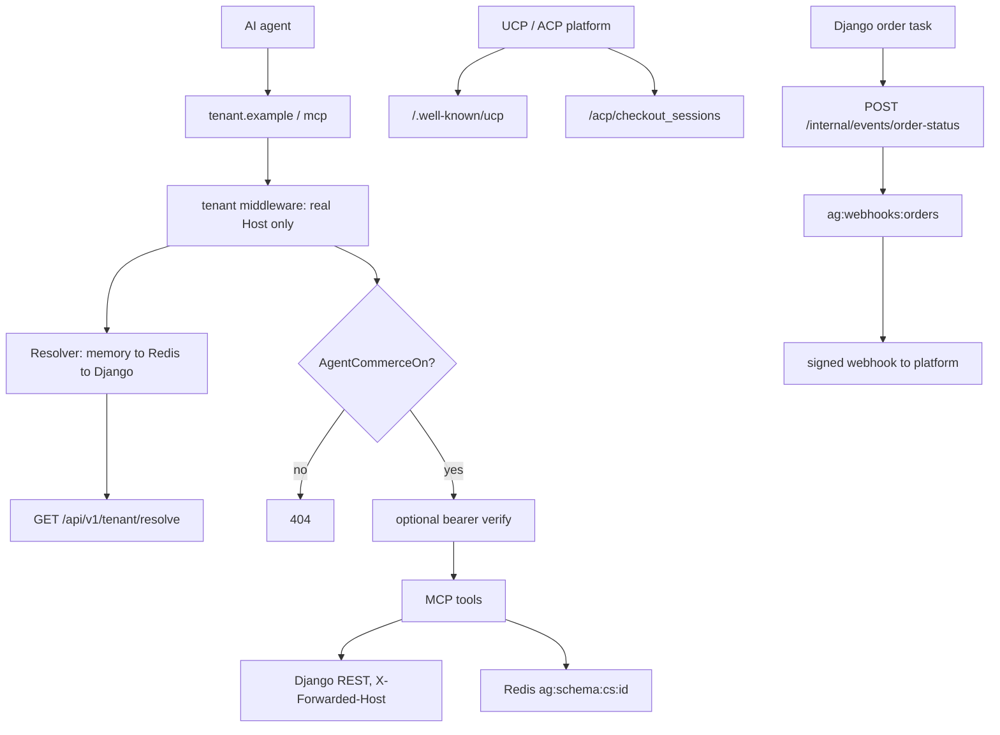

# Agentic commerce

One Go binary serves five protocol surfaces on each tenant's **own**
storefront domain, path-routed there by Traefik. It is a **protocol adapter**
and nothing else: all commerce state lives in Django's REST API, sessions and
caches live in Redis, and it holds no database and no payment-provider
secrets.

| Path | Surface |
|---|---|
| `/mcp` | MCP server, stateless streamable HTTP. Registered without a method, unlike every other route, because streamable HTTP uses POST, GET and DELETE on the one path |
| `GET /.well-known/ucp` | UCP business profile |
| `GET /mcp/server-card`, `/.well-known/ard.json`, `/.well-known/ai-catalog.json` | Agent discovery: the MCP Server Card, the ARD manifest and the AI Catalog |
| `/acp/*` | ACP agentic-checkout REST |
| `/feeds/*` | `google.xml`, `meta.xml`, `tiktok.xml`, `acp.json` |
| `POST /chat` | First-party shopping chatbot, SSE |
| `/internal/*` | Cluster-only: Django order events and feed invalidation |

## Diagram

## How it works

### Tenant resolution is one path

`internal/tenant/middleware.go` resolves from the **real `Host` header only**
and deliberately ignores any inbound `X-Forwarded-Host` — Traefik sets `Host`,
and trusting a client-supplied forwarded host would let a caller pivot between
tenant schemas.

`internal/tenant/resolver.go` layers three tiers: process memory with a TTL
(plus stale-if-error retention), Redis at `ag:tenant:v2:{host}` shared across
pods, then Django. The key's version moves with the cached `TenantConfig`
shape, so a pod never reads an entry written without a field as that field
off. Lookups are collapsed with `singleflight`; a confirmed
unknown host gets a short negative TTL under a sentinel so scanner traffic
cannot stampede Django; a Django outage serves the last known config marked
`Stale`.

The upstream call is `internal/django/client.go: ResolveTenant`, and it is the
**only host-unscoped call the gateway makes**: the platform API host satisfies
Django's `ALLOWED_HOSTS` while the domain being resolved rides the query
string. It sends `X-Internal-Token`, which is what makes Django include the
tenant's secret fields.

Secrets are kept **out of the shared Redis tier** on purpose, so a config
served from there arrives with `ChatAPIKey` and `ACPBearerToken` empty —
indistinguishable, to a handler, from a tenant that never configured the
feature. Routes that need one (`/chat`, `/acp`) use
`MiddlewareWithSecrets`, which tops them up through `EnsureSecrets` before the
handler runs.

Every tenant-scoped Django call then sends `X-Forwarded-Host: <tenant
domain>` and `X-Forwarded-Proto: https`, plus `X-Language` when the request
carries a language (`internal/django/client.go` omits the header on an empty
value rather than sending a blank one). GETs retry twice on 5xx or network
errors; mutations never retry at transport level.

### The gates

Django serves **effective** booleans — plan flag AND merchant extra-setting,
folded in `TenantConfigSerializer` — so the gateway reads one authoritative
value per surface and a payload missing a field decodes as off.

| Field | Accessor | Guards |
|---|---|---|
| `agentCommerceEnabled` | `AgentCommerceOn()` | `/mcp` and `/mcp/server-card`, `/.well-known/ucp`, `/.well-known/ard.json`, `/.well-known/ai-catalog.json`, `/acp/*`, `/chat` |
| `productFeedsEnabled` | `ProductFeedsOn()` | `/feeds/*`, subordinate to agent commerce |
| `agentHostedPaymentEnabled` | `HostedPaymentOn()` | The hosted-selection extension, subordinate to agent commerce |

`tenant.RequireAgentCommerce` and `RequireProductFeeds` answer **404**, not
403, mirroring Django's feature gates: a disabled surface is
indistinguishable from a route that never existed. Always read through the
accessors — they encode the subordination.

Store features follow the same rule one level down. `features` on
`tenant/resolve` (`TenantConfig.Features`) is each optional store feature's
effective state, which Django folds in `tenant/features.py:
effective_features` from the same permission classes that answer 404 for it.
The gateway decodes the four that something of it serves, and reads nothing
else for them:

| Feature | Off means |
|---|---|
| `productReviews` | `get_product_reviews` is not served; `search_products` and `get_product` carry no rating or review count; the chatbot's prompt does not offer reviews |
| `loyalty` | `my_loyalty_points` is not served |
| `favourites` | `my_favourites` is not served |
| `promotions` | `checkout.ApplyDiscountCodes` refuses every code as `discount_code_invalid` without applying it (Django's coupon routes answer 404 with the plan flag off and would fail the request) and clears the cart's old coupon best effort; ACP sessions do not declare the discount extension |

A switch reaches the gateway within twice `TENANT_CACHE_TTL` (five minutes by
default). Django drops its own resolve cache at once, but the Redis tier and
then each pod's memory can each hold the previous config for one TTL.

### MCP

`internal/mcpsrv/server.go` registers the tool surface. One server is built
per store and cached by schema, identity and feature set: it advertises the
store's name at `initialize` and registers only the tools of the features
the store has on (`onlyWith`), so a switched-off tool is neither listed nor
callable, and a switch reaches `tools/list` without a restart.

Ergonomic commerce tools: `search_products`, `get_product`,
`list_categories`, `get_trending_searches`, `get_product_reviews`,
`get_shipping_options`, `find_pickup_points`, `get_payment_methods`,
`create_cart`, `get_cart`, `add_to_cart`, `update_cart_item`,
`remove_cart_item`, `get_checkout_link`, `track_order`,
`subscribe_product_alert`.

Account tools, which need a linked credential: `my_orders`,
`my_loyalty_points`, `my_favourites`.

A rating is the average of the product's review rates, on Django's 1–10
scale (`product/enum/review.py: RateEnum`).

The UCP checkout capability's five canonical tools plus `get_order`:
`create_checkout`, `get_checkout`, `update_checkout`, `complete_checkout`,
`cancel_checkout`.

Business failures surface as `CallToolResult{IsError: true}` with actionable
text. Returning a plain Go error from a typed handler is fine — the SDK wraps
it into exactly that. Only a `*jsonrpc.Error` becomes a protocol error, so
never return one for a business condition.

### UCP

`GET /.well-known/ucp` renders a per-tenant business profile
(`internal/ucp/profile.go`): the `dev.ucp.shopping` service pointing at that
tenant's own `/mcp` endpoint, the `checkout` and `order` capabilities, the
payment-handler registry, and the tenant's own signing key as a JWK. It is
served with `Cache-Control: public, max-age=300`.

The canonical tools take the wire shapes from the OpenRPC document: `meta`
(carrying `ucp-agent.profile`, plus `idempotency-key` on complete and cancel),
`id` for the target session, and `checkout` for the domain object with
snake_case members. Extensions compose **flat** onto `checkout`, never nested
under capability names.

Every canonical tool **negotiates** before it acts
(`internal/ucp/negotiate.go`, `internal/ucp/profiles.go`). The platform
profile named in `meta.ucp-agent.profile` is fetched under the spec's fetch
rules (https only, no redirects, public addresses only, bounded size, cached for
at least 60 seconds, failures backed off, one global rate budget), validated
against the spec's own `platform_schema` (the vendored schemas are embedded in
the binary under `internal/ucp/spec/`), version-checked, and intersected with
the business's capabilities — the same registry `/.well-known/ucp` publishes.
A profile that cannot be fetched, parsed or version-matched is the spec's
JSON-RPC `-32001` error with a `continue_url`; a valid profile that shares no
version of the operation's capability gets the `error_response` branch
(`capabilities_incompatible`). Responses declare the negotiated capabilities
in `ucp.capabilities`. The order webhook endpoint is taken **only** from the
negotiated order capability's `config.webhook_url` — never from a request
member — and a `pay_way_id` is honoured only when the hosted-selection
extension is negotiated.

The service `schema` URL may appear **only** while every method it defines for
an advertised capability exists — the five checkout tools plus `get_order`.
Declaring it asserts a machine-checkable contract. Its cart and catalog
methods belong to capabilities the profile does not advertise, so a
negotiating platform never calls them.

`get_order` sources the required `checkout_id` from the gateway's own order
link (`ag:{schema}:orderlink:{uuid}` — checkout id, storefront domain and
webhook target — retained a year, because the link must outlive the session
itself: `internal/checkout/store.go` holds an active session for 30 minutes
and a terminal one for 24 hours). An order placed on the web has no checkout to
name and is refused with that explanation, never a fabricated id.
`order.fulfillment` stays `{}`: an expectation needs a destination the order
detail deliberately does not decode, and an event needs a shipment timestamp
upstream does not expose.

Completing a checkout, UCP or ACP, places the order through
`internal/checkout/flow.go: Flow.Complete`, which sets
`attribution.agentProtocol` on the `POST /order` body
(`internal/django/client_checkout.go: OrderAttribution`) to the owning
session's protocol, `ucp` or `acp`. Django believes it only alongside the
gateway's shared secret, which the same call already carries as
`X-Internal-Gateway` (`cartHeaders`, `internal/django/client_cart.go`;
checked by `order/views/order.py: _attribution_input`). With it, Django books
the order with source type `agent` ahead of every other signal, so it reads as "AI agent (UCP)" or
"AI agent (ACP)" in the admin; see
[Checkout & payment](/dev/flows/checkout-and-payment#_9-acquisition-source).

### An ONLINE payment method is not an instrument

This is the sharpest rule in the gateway, and it fails closed.

Payment is selected by submitting an **advertised** instrument from
`checkout.payment.instruments`, which the business resolves back to a
pay-way. An ONLINE method is not an instrument: there is nothing for a
platform to acquire, because the buyer authenticates on the PSP's page. It
cannot be an Action either, since both standard payment Action types require
a `payment_instrument_id`. UCP models that case as `requires_escalation` plus
a `continue_url`.

`internal/ucp/handler.go: paymentHandlers` therefore advertises only pay-way
codes with a **modelled instrument** — today that is
`cash_on_delivery` — and returns an **empty registry** for a store whose only
active methods are online. Empty is the honest answer, and the registry is
required even when empty. Instrument order follows the merchant's own pay-way
ordering, which UCP reads as the business's preferred presentation.

Choosing an online method travels as a **declared extension**,
`space.grooveshop.payments.hosted_selection`, carrying a `pay_way_id`. It is
advertised and accepted only while `HostedPaymentOn()` is true, and a gated
`pay_way_id` is **refused, never ignored** — ignoring it would complete the
checkout against a stale selection.

The platform authors its own handler because neither published alternative is
usable: Stripe's is in private preview and its schema origin fails UCP's
namespace authority binding, and Viva publishes no UCP handler at all. The
handler's name (`space.grooveshop.payments`) is the reverse of the host that
serves its schema (`payments.grooveshop.space`) — the exact-match case of the
authority binding. The namespace is **platform-owned rather than derived per
tenant**: the binding check ignores the Public Suffix List, so a namespace
derived from an arbitrary tenant domain would let co-tenants under a shared
suffix satisfy the same prefix.

`responsePaymentHandlers` renders the authoritative per-checkout declaration:
it drops `spec` and `schema` (a platform that reached a checkout has already
composed the handler from discovery) and adds `settlement: on_delivery` so the
platform can tell the buyer when money moves.

### ACP

`internal/acp/handler.go` mounts five routes:
`POST /acp/checkout_sessions`, `GET`/`POST /acp/checkout_sessions/{id}`,
and `.../complete` and `.../cancel`.

Access is bearer-authenticated with the **tenant's own** `acpBearerToken`,
issued at enrollment and served on `tenant/resolve`, so a platform enrolled
with one store can never drive another's checkout by switching `Host`. An
empty token means ACP is disabled for that tenant and every bearer gets the
same 401 as a wrong one. Idempotency keys are namespaced per schema and
operation at `ag:{schema}:acp:idem:{op}:{key}`.

A session declares the discount extension in `capabilities.extensions` only
while the store has promotions on (`internal/acp/render.go:
capabilitiesOf`); with promotions off every submitted code comes back in
`discounts.rejected`.

### Catalog feeds

`internal/feeds/` streams four artifacts per tenant, cached in Redis at
`ag:{schema}:feed:{kind}` with a fresh and a stale TTL and an ETag.

The RSS dialect (RSS 2.0 plus `xmlns:g`) is what Meta Commerce Manager,
TikTok Ads Manager and Google Merchant Center all ingest. The constants that
matter are listed at the top of `internal/feeds/rss.go`:

- **`g:id` is always the product id**, formatted as a number — never a SKU,
  never a UUID — because it must equal the `content_ids` the pixel and the
  Conversions API send, or attribution breaks.
- **Prices are VAT-inclusive.** `newFeedItem` computes
  `regular = price + vat_value` and `sale = final_price`, and emits
  `g:sale_price` only when a markdown actually lowers it. Amounts are integer
  minor units internally and rendered as `12.34 EUR` at the edge.
- **No `g:mpn` is emitted at all.** There is no manufacturer part number on
  the product model, and a SKU is not one — putting a SKU there is a
  merchant-identifier collision, not a part number.
- Availability is the enum `in stock` / `out of stock`; condition is `new`;
  `g:item_group_id` carries the variant group; `g:brand` falls back to the
  store name.
- A product with no default-locale name or no image is **skipped**, because
  the platforms would reject it anyway. A malformed money field is an error,
  because it would corrupt every consumer's feed.

`acp.json` follows the ACP feed schema: one Product per catalog row with a
single self-Variant, since variant grouping across a streamed catalog would
require full buffering and the RSS feeds already carry `item_group_id`.

Image origins go through `internal/media/url.go: Host`, which returns the
tenant's own assets domain **only when it opted into white-label assets** and
the platform origin otherwise. The comment records the bug: deriving
`assets.{tenant-domain}` produced a hostname standard onboarding never
creates, and the gateway emitted NXDOMAIN image URLs into every feed — which
Meta and TikTok reject silently, because nothing here ever fetches what it
emits.

### The chatbot

`POST /chat` is a first-party shopping assistant over SSE, speaking the
OpenAI-compatible chat-completions protocol (`CHAT_BASE_URL` selects the
provider). The credential is **per tenant**: `chatApiKey` from
`tenant/resolve`, attached per turn. A tenant without one gets a localized
404, so the route is always mounted and the handler rejects keyless tenants.
Chat carries its own stricter per-IP rate limiter on top of the global one,
because it pays per token. Conversations live at `ag:{schema}:chat:{id}` with
a configurable TTL and turn cap.

`internal/chat/bridge.go` connects an in-process MCP client to the **same**
tool server over in-memory transports, so the chatbot's tool definitions are
derived from the server's own schemas and the two can never drift. Three
groups are withheld, and a fourth is kept but marked:

- **`checkoutTools`** — the five canonical UCP tools. Their arguments are
  shaped for a platform generating calls from an OpenRPC document, not for a
  conversational model, and the assistant hands over a checkout link instead
  of placing orders.
- **`accountTools`** — they need an OAuth-linked agent credential on the MCP
  HTTP request; the chat widget's shopper authenticates through the storefront
  session, which already shows orders and loyalty.
- **Tools of a feature the store has off.** The bridge's server is shared
  by every store, so it is built with `mcpsrv.EveryFeature`, and
  `bridge.tools` drops each tool `mcpsrv.Offered` refuses for the store.
  Only an offered tool is callable.
- Cart tools are kept but flagged, so a successful call tells the widget to
  refresh its cart store.

#### SSE events

The handler writes named events (`internal/chat/handler.go`). Each event is
`event: <name>` plus one JSON `data:` line:

| Event | Data | When |
|---|---|---|
| `delta` | `{text}` | A chunk of the assistant's reply. Also carries the localized fallback when a turn ends with no prose. |
| `tool` | `{name, status}` | `running` before each tool call and `done` after it, so the widget can show progress instead of silence. |
| `products` | `{tool, query?, total?, products: [{id}]}` | After the `done` of a catalog tool (`search_products`, `get_product`). |
| `error` | `{message}` | The turn failed (for example, the provider rate-limited it). The message is localized. No `done` follows. |
| `done` | `{conversationId, cartId?, cartMutated}` | The turn is saved. `cartMutated` tells the widget to refresh its cart. A browser that had no cart adopts `cartId`, the cart the assistant created, as its guest cart (`POST /api/cart/claim` in the storefront). |

The `products` event (`internal/chat/products.go`) carries **ids only**:
- **Pricing.** The storefront loads each product with the shopper's own
  session, so prices (B2B group pricing included) and stock are the shopper's
  real ones. The gateway's catalog calls are anonymous and would show retail
  figures.
- **Dedup and cap.** `bridge.recordProducts` drops ids already sent this turn
  and caps the list at `maxProductCards`.
- **`get_product`** adds the product's variants.
- **`search_products`** also sends `query` and the search's `total`. Its event
  is sent even when no new ids are left, so the widget can still say what was
  found, including "No products found".
- **Not covered.** Cart and stock-alert tools reference products but emit
  nothing: the widget already shows the cart, and an alert confirmation is not
  a recommendation.

In the storefront:
- `app/utils/sse.ts` parses the stream and `app/composables/useShopChat.ts`
  attaches each `products` event to its message.
- `app/components/Chrome/AssistantProducts.vue` fetches the products in
  parallel through `/api/products/{id}`, drops any that 404 or are inactive,
  and renders `AssistantProductCard.vue` cards with Add to cart.
- A search shows "Found N" and a **View all** link to `/search?query=…`.
- The frozen webside chat panel (`app/components/Chat/Panel.vue`) ignores the
  event.

### Identity linking

Django is the OAuth 2.1 authorization server through `allauth.idp`, and the
storefront advertises it. `server/routes/.well-known/oauth-protected-resource/mcp.get.ts`
returns the RFC 9728 document naming the tenant's **own API origin**
(`TenantConfig.apiDomain`) as the authorization server, with
`scopes_supported` of `openid`, `profile`, `email`, `orders:read`,
`loyalty:read` and `favourites:read`. The documents that describe the MCP
server itself are the gateway's (see Agent discovery below).

`internal/identity` is **optional** auth on `/mcp`: anonymous shopping stays
open, a present bearer is verified against Django's `/agent/me`, and an
invalid one gets 401 plus the RFC 9728 `WWW-Authenticate` challenge so the
client can re-run its OAuth flow. Verdicts are cached 60 seconds, keyed by
**SHA-256 of (schema, token)** — never the token alone. The comment records
why: a bearer valid for tenant A, replayed against tenant B inside the TTL,
was admitted with A's shopper profile attached, and every tenant's ingress
targets the same pod pool.

Account tools forward the bearer to `/api/v1/agent/*` and **Django enforces
the scopes**. `agent/views.py` accepts OIDC bearer tokens only — never Knox,
never session auth — and tenant scoping is structural rather than a
permission: the OIDC token tables live in the tenant schema, so a token
issued by one store cannot be found on another's host.

### Agent discovery

The gateway serves every document that describes the store's MCP server,
so an agent finds the server, its name and its tools from one owner
(`internal/mcpsrv/discovery.go`, `internal/mcpsrv/servercard.go`):

| Route | Content-Type | Content |
|---|---|---|
| `GET /mcp/server-card` | `application/mcp-server-card+json` | The MCP Server Card at the reserved `<streamable-http-url>/server-card`: identity and remotes only, no tools, which clients read from `tools/list`. Its name, title and version are the ones `initialize` reports (`mcpsrv.IdentityFor`) |
| `GET /.well-known/ard.json` | `application/json` | The Agentic Resource Discovery manifest, the document ARD consumers must fetch. One entry: `identifier`, `type`, `url`, plus `displayName`, `description`, `capabilities` and `representativeQueries` |
| `GET /.well-known/ai-catalog.json` | `application/ai-catalog+json` | The AI Catalog, through which MCP Server Card discovery (SEP-2127) goes. The same entry as `ard.json` (`mcpsrv.storeEntry`), `displayName` included: Lighthouse finds the manifest here and validates it against the ARD schema, which requires that key. The catalog allows the extra keys, and every value is the Server Card's own |

Both well-known documents are built from one entry, `storeEntry`, so they
cannot disagree about what they describe. `displayName` and `description`
are the Server Card's own title and description (`Identity.Description()`,
so the string exists once); `capabilities` is `toolNamesFor` the store's
features, read off the same toolset `NewServer` registers from, so a new
tool is advertised the moment it is served and a switched-off one is not; the four `representativeQueries` sit
next to the tool definitions in `internal/mcpsrv/server.go`. `identifier`
is `urn:air:<primary domain>:mcp:store`, the primary domain lower-cased in
ASCII (IDNA) because the ARD URN admits no internationalised form, and
`url` is the Server Card on the request's own store host
(`internal/storefront/urls.go: MCPServerCard`). The envelope carries
`specVersion` and a `host` naming the store and its primary domain.

All three sit behind the same gate as `/mcp` (`describeMCP` in
`internal/server/routes.go`): a store with agent commerce off answers 404
`not found`, and an unknown host the tenant middleware's 404 `unknown
store`. They share `publicDocument` for CORS (`OPTIONS` answers 204),
`Cache-Control: public, max-age=3600` and ETag / `If-None-Match`
revalidation.

The ingress routes `/.well-known/ard.json` and
`/.well-known/ai-catalog.json` to the gateway on every store host as
`Exact` paths beside `/.well-known/ucp`
(`grooveshop-infrastructure/manifests/app-constructs/grooveshop/overlays/production/tenants/TEMPLATE/ingress.yaml`);
the storefront serves neither.

### Order events

`order/tasks.py` POSTs to `/internal/events/order-status` with the shared
`X-Internal-Token`, carrying `schemaName`, `orderUuid`, `status`,
`paymentStatus` and `trackingNumber`. The schema comes from the live
connection, because the task runs inside the schema captured at dispatch.
A 5xx from the gateway is raised so Celery retries; a 4xx is logged.

`internal/server/internalapi.go` checks the token with a constant-time compare
**before reading the body**, so an unauthenticated caller cannot distinguish a
malformed body from a valid one. It routes the event through the **order
link**, not the checkout session — the session is gone within a day, while
shipment and delivery events arrive for weeks — applies it to the session if
one still exists, and, when the checkout registered a webhook target, fetches
the order and queues the full UCP order entity for delivery.

Deliveries follow the UCP order-event rules: the body is the order entity,
headers follow Standard Webhooks (`Webhook-Id`, `Webhook-Timestamp`) with
`UCP-Agent` naming the tenant's profile, and the request is signed per RFC
9421 (`Content-Digest`, `Signature-Input`, `Signature`) with the tenant's
ES256 key — the one algorithm every UCP verifier must support
(`internal/httpsig`). The client dials only public addresses and never
follows a redirect, so a registered URL cannot be turned toward the cluster.

The webhook queue is deliberately **not** per schema: one Redis stream
(`ag:webhooks:orders`) and consumer group for the whole pod pool, one consumer
per pod name, each delivery carrying its own schema for the signing key.
Delivery runs in a bounded worker pool because inline delivery let one
undeliverable endpoint stall every tenant's webhooks. Semantics are
at-least-once: an entry is acknowledged only on a terminal outcome; a
restarted pod replays its own pending entries at once, and a vanished pod's
are claimed by another after the visibility timeout — never while the pod
that holds them is still delivering.

Django can also drop a tenant's cached feeds through
`POST /internal/feeds/invalidate` (`core/cache/gateway.py`), which requires
the schema **explicitly** — guessing would drop another tenant's feeds.

### Health

`/healthz` is process-only liveness: no dependency checks, because a Django
or Redis outage must never restart pods.

`/readyz` gates on **Redis only**. `internal/obs/health.go: Readyz` pings both
and reports both in the body, but only the Redis error sets the 503 status —
the Django result is informational and never flips readiness. With Django
down the gateway still serves actionable tool errors and stale feeds, which
beats Traefik 502s.

### Routing and release

Each tenant path-routes five prefixes to `agent-gateway-service`, split
across **two** Ingress objects in
`grooveshop-infrastructure/manifests/app-constructs/grooveshop/overlays/production/tenants/TEMPLATE/ingress.yaml`:
`TENANT_SLUG-ingress-agent` carries `/mcp`, `/.well-known/ucp`,
`/.well-known/ard.json`, `/.well-known/ai-catalog.json`, `/feeds` and
`/acp`, while `/chat` gets its own `TENANT_SLUG-ingress-agent-chat` so it can
take the `rate-limit-chat` Traefik middleware the others must not.
The payment-handler documents are served host-scoped on
`payments.grooveshop.space`, which the mux binds explicitly and which takes no
tenant middleware — it is a platform artifact, not a tenant.

Releases are **manual**. `.github/workflows/ci.yml` runs lint, tests and a
build on every push to `main`, but `.github/workflows/release.yml` triggers
only on a pushed `v*.*.*` tag. Unlike the other repositories there is no
semantic-release on `main`: cutting a gateway image means tagging it
yourself, then bumping the pin in the infrastructure repo.

## Invariants

- **The real `Host` decides the tenant.** Inbound `X-Forwarded-Host` is
  ignored; spoofing it must never switch schemas.
- **`tenant/resolve` is the one resolution path.** There is no second lookup,
  no env-configured tenant, and no tenant name anywhere in gateway code — not
  even the first one. Tests use `demostore`, `acme`, `alpha`, and a literal
  schema name in non-test code is a bug.
- **Platform defaults are never a tenant host.** The platform origins are
  `*.grooveshop.space`; a tenant's own domain arrives in its config. Never
  build an asset host by prefixing a tenant domain.
- **An ONLINE method is not an instrument and fails closed.** No instrument,
  no handler entry; hosted selection is a gated declared extension and a gated
  `pay_way_id` is refused.
- **Every tenant gate is read through its accessor**, which encodes the
  subordination to agent commerce; a missing field decodes as off.
- **A disabled surface answers 404.**
- **Agent discovery has one owner and one entry.** The ARD manifest and the
  AI Catalog are both cut from `storeEntry`, whose name and description are
  the Server Card's and whose capabilities are the tools the store is
  served; never a second list.
- **A store feature switched off is off on every agent surface.** Read
  `TenantConfig.Features`, never a flag or setting of your own; a tool that
  serves a feature is registered with `onlyWith`.
- **`/readyz` never fails on Django.** Only Redis flips it.
- **Redis keys are `ag:{schema}:…`**, except the tenant cache
  (`ag:tenant:v2:{host}`) and the shared order-event queue.
- **No tenant label on Prometheus metrics** — unbounded cardinality; tenant
  goes in the logs.
- **The gateway is retail-only.** Every catalog, cart and checkout call is
  anonymous and forwards no bearer, so B2B prices never reach an MCP tool, a
  UCP/ACP checkout or a feed, and totals stay self-consistent end to end. Only
  `/api/v1/agent/*` forwards a bearer, and those endpoints carry no pricing.
- **A cart call acts on the cart it named, or fails.** Django never
  refuses a cart an anonymous caller cannot reach, whether a signed-in
  shopper's or a guest cart since deleted. It answers 200/201 with a new
  guest cart and acts on that one. Every cart call in
  `internal/django/client_cart.go` that names a cart compares the cart that
  answered (`servedNamed`) and returns `ErrCartUnreachable` for another.
  `add_to_cart` then tells the model the product is not in the shopper's
  cart. The other MCP tools (`upstreamErr`) and ACP (`upstreamError`)
  report it as not found.
- **No fallback or backward-compatibility code paths.** Environment
  differences are config values, not conditionals.

## Failure modes

- **A tenant's agent surfaces all 404.** `agentCommerceEnabled` is off at one
  of its two tiers, or the host resolved to no tenant. Check the resolve
  payload first; the negative cache holds a confirmed-unknown host briefly.
- **`/.well-known/ard.json` or `ai-catalog.json` 404s.** The documents share
  the `/mcp` gate, so a store with agent commerce off has none. If
  `/mcp/server-card` answers on the same host, the ingress is not routing
  the well-known path to the gateway yet.
- **An agent finds no reviews, loyalty or favourites tool, or every
  discount code is refused.** The store has that feature off at one of its
  tiers; check `features` on the resolve payload. Right after a switch,
  allow twice `TENANT_CACHE_TTL`.
- **`/chat` 404s with a localized message.** The tenant has no `chatApiKey`.
  Remember that the key only arrives on an internally-authenticated resolve,
  so a config served from the Redis tier has it empty — `/chat` uses the
  secrets middleware for exactly that reason.
- **Every ACP bearer gets 401.** The tenant has no `acpBearerToken`, which is
  how ACP is disabled. It is not a credential mismatch.
- **The assistant says it cannot update a signed-in shopper's cart.**
  Expected until the cart-scoped token (gateway issue #24, part 2). The
  gateway calls Django anonymously, so the shopper's own cart is
  unreachable (`ErrCartUnreachable`), and `add_to_cart` says so instead of
  adding to a guest cart nobody sees.
- **A feed publishes broken image URLs.** Check `ASSETS_HOST` and the tenant's
  `assetsDomain`; an empty media host yields an empty URL by design, dropping
  the image rather than publishing an unreachable one, and a product with no
  image is skipped entirely.
- **A platform never calls the checkout tools.** The OpenRPC `schema` URL is
  only published while every method it defines for an advertised capability
  exists. Dropping one of the five tools without removing the URL breaks the
  contract the profile asserts.
- **`get_order` refuses with "no checkout".** The order was placed on the web
  and has no session in the order index, or the index entry aged out past its
  one-year retention. It is a refusal, not a bug.
- **Order webhooks stop for one tenant.** The delivery pool bounds the damage
  to one worker per stuck endpoint, so the symptom is usually that tenant's
  platform endpoint blackholing. Undelivered entries stay pending in the
  `dispatch` group (`XPENDING ag:webhooks:orders dispatch`) until a terminal
  outcome.
- **Deploy changed nothing.** The gateway image is not released by pushing to
  `main`. Tag `vX.Y.Z`, then update the pin in the infrastructure repo.

## Related

- [Multi-tenancy](/dev/platform/multi-tenancy)
- [Checkout and payment](/dev/flows/checkout-and-payment)
- [Order lifecycle](/dev/flows/order-lifecycle)
- [B2B](/dev/flows/b2b)
- [Agent gateway service](/dev/gateway/)
- [Deploying](/dev/operations/deploying)

## Source

| File | Role |
|---|---|
| `grooveshop-agent-gateway/CLAUDE.md` | Surface map, conventions, cross-repo contracts |
| `grooveshop-agent-gateway/internal/server/routes.go` | Mux assembly and middleware order |
| `grooveshop-agent-gateway/internal/server/internalapi.go` | Order events, feed invalidation, token check |
| `grooveshop-agent-gateway/internal/tenant/` | Resolver, middleware, feature requirements |
| `grooveshop-agent-gateway/internal/django/client.go` | `ResolveTenant`, retries, forwarded headers |
| `grooveshop-agent-gateway/internal/django/dto.go` | `TenantConfig` and the gate accessors |
| `grooveshop-agent-gateway/internal/django/client_agent.go` | `/agent/me` and the scoped resources |
| `grooveshop-agent-gateway/internal/identity/identity.go` | Optional bearer verification, per-tenant cache key |
| `grooveshop-agent-gateway/internal/mcpsrv/server.go` | Tool registration, `onlyWith`, `toolNamesFor`, `Offered`, `EveryFeature`, `representativeQueries` |
| `grooveshop-agent-gateway/internal/mcpsrv/catalog.go` | Catalog tools, `ratingOf` |
| `grooveshop-agent-gateway/internal/checkout/discounts.go` | `ApplyDiscountCodes`, shared by UCP and ACP |
| `grooveshop-django-api/tenant/features.py` | `STORE_FEATURES`, `effective_features` |
| `grooveshop-agent-gateway/internal/mcpsrv/discovery.go` | `storeEntry`, `ARDHandler`, `AICatalogHandler` |
| `grooveshop-agent-gateway/internal/mcpsrv/servercard.go` | `ServerCardHandler`, `IdentityFor`, `publisher`, `publicDocument` |
| `grooveshop-agent-gateway/internal/storefront/urls.go` | `MCPServerCard` and every other link into the storefront |
| `grooveshop-agent-gateway/internal/ucp/profile.go` | Business profile document |
| `grooveshop-agent-gateway/internal/ucp/handler.go` | Payment handler, instruments, hosted selection |
| `grooveshop-agent-gateway/internal/ucp/webhook.go` | Order-event queue and signed delivery |
| `grooveshop-agent-gateway/internal/ucp/negotiate.go` | Capability intersection and authority binding |
| `grooveshop-agent-gateway/internal/ucp/profiles.go` | Platform profile fetch, validation and cache |
| `grooveshop-agent-gateway/internal/httpsig/httpsig.go` | RFC 9421 request signing and RFC 9530 `Content-Digest` |
| `grooveshop-agent-gateway/internal/acp/handler.go` | ACP routes and bearer auth |
| `grooveshop-agent-gateway/internal/acp/render.go` | Session rendering, `capabilitiesOf` |
| `grooveshop-agent-gateway/internal/feeds/rss.go` | `g:id`, VAT-inclusive prices, skip rules |
| `grooveshop-agent-gateway/internal/feeds/acp.go` | ACP feed shape |
| `grooveshop-agent-gateway/internal/media/url.go` | Asset origin fallback |
| `grooveshop-agent-gateway/internal/chat/handler.go`, `bridge.go` | Chatbot, its SSE events, and withheld tools |
| `grooveshop-agent-gateway/internal/chat/products.go` | The `products` event: extractors, dedup, card cap |
| `grooveshop-storefront-ui-node-nuxt/app/composables/useShopChat.ts`, `app/utils/sse.ts` | Chat stream client |
| `grooveshop-storefront-ui-node-nuxt/app/components/Chrome/AssistantProducts.vue`, `AssistantProductCard.vue` | Chat product cards |
| `grooveshop-agent-gateway/internal/checkout/store.go` | Redis keys and TTLs |
| `grooveshop-agent-gateway/internal/checkout/flow.go`, `internal/django/client_checkout.go` | Order placement and its `agentProtocol` attribution |
| `grooveshop-agent-gateway/internal/obs/health.go` | `/healthz`, `/readyz` |
| `grooveshop-agent-gateway/.github/workflows/release.yml` | Tag-triggered release |
| `grooveshop-django-api/tenant/views.py`, `tenant/serializers.py` | `tenant_resolve` and the folded gates |
| `grooveshop-django-api/agent/views.py`, `agent/oidc.py` | Agent resources and scopes |
| `grooveshop-django-api/order/tasks.py` | Order-event push |
| `grooveshop-django-api/core/cache/gateway.py` | Feed invalidation call |
| `grooveshop-storefront-ui-node-nuxt/server/routes/.well-known/oauth-protected-resource/mcp.get.ts` | OAuth protected-resource metadata for `/mcp` |
| `grooveshop-infrastructure/manifests/app-constructs/grooveshop/overlays/production/tenants/TEMPLATE/ingress.yaml` | Path routing |
