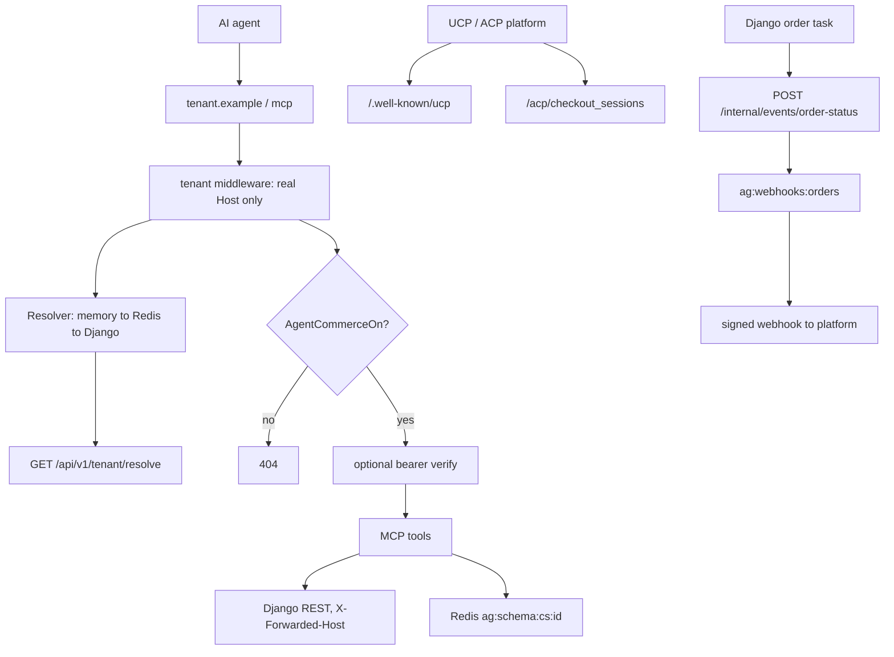

# Agentic commerce

One Go binary serves five protocol surfaces on each tenant's **own**
storefront domain, path-routed there by Traefik. It is a **protocol adapter**
and nothing else: all commerce state lives in Django's REST API, sessions and
caches live in Redis, and it holds no database and no payment-provider
secrets.

| Path | Surface |
|---|---|
| `/mcp` | MCP server, stateless streamable HTTP. Registered without a method, unlike every other route, because streamable HTTP uses POST, GET and DELETE on the one path |
| `GET /.well-known/ucp` | UCP business profile |
| `GET /mcp/server-card`, `/.well-known/ard.json`, `/.well-known/ai-catalog.json` | Agent discovery: the MCP Server Card, the ARD manifest and the AI Catalog |
| `/acp/*` | ACP agentic-checkout REST |
| `/feeds/*` | `google.xml`, `meta.xml`, `tiktok.xml`, `acp.json` |
| `POST /chat` | First-party shopping chatbot, SSE |
| `/internal/*` | Cluster-only: Django order events and feed invalidation |

A store's own team has a separate server on `/mcp/admin`, with its own sign-in and read-only admin tools: [Store-admin tools over MCP](/dev/flows/staff-mcp).

## Diagram



## How it works

### Tenant resolution is one path

`internal/tenant/middleware.go` resolves from the **real `Host` header only**
and deliberately ignores any inbound `X-Forwarded-Host` — Traefik sets `Host`,
and trusting a client-supplied forwarded host would let a caller pivot between
tenant schemas.

`internal/tenant/resolver.go` layers three tiers: process memory with a TTL
(plus stale-if-error retention), Redis at `ag:tenant:<version>:{host}` shared
across pods, then Django. The key's version (`redisKeyVersion`) moves with the
cached `TenantConfig` shape, so a pod never reads an entry written without a
field as that field off; a test pins the shape to the version and fails on a
change until the version is bumped. Lookups are collapsed with `singleflight`; a confirmed
unknown host gets a short negative TTL under a sentinel so scanner traffic
cannot stampede Django; a Django outage serves the last known config marked
`Stale`.

The upstream call is `internal/django/client.go: ResolveTenant`, and it is the
**only host-unscoped call the gateway makes besides the readiness
ping**: the platform API host satisfies
Django's `ALLOWED_HOSTS` while the domain being resolved rides the query
string. It sends `X-Internal-Token`, which is what makes Django include the
tenant's secret fields.

Secrets are kept **out of the shared Redis tier** on purpose, so a config
served from there arrives with `ChatAPIKey` and `ACPBearerToken` empty —
indistinguishable, to a handler, from a tenant that never configured the
feature. Routes that need one (`/chat`, `/acp`) use
`MiddlewareWithSecrets`, which tops them up through `EnsureSecrets` before the
handler runs.

Every tenant-scoped Django call then sends `X-Forwarded-Host: <tenant
domain>` and `X-Forwarded-Proto: https`, plus `X-Language` when the request
carries a language (`internal/django/client.go` omits the header on an empty
value rather than sending a blank one). Every call made while serving a request
also sends that request's id as `X-Correlation-ID`, the id Django logs the call
under.

How a call is retried is decided in `internal/django/client.go`:

- **A GET is retried twice**, with a short jittered delay, on a 5xx or on a
  connection that failed without timing out: refused, reset, closed before the
  headers or in the middle of the body.
- **Never on a timeout.** A call cut by `UPSTREAM_TIMEOUT` or by a context
  deadline is not retried: a Django that hangs would be asked three times and
  the caller would wait three timeouts instead of one. A body that is not the
  JSON expected is not retried either.
- **Never once the caller has hung up.** A cancelled request context (a
  shutdown included) ends the call as `context.Canceled`, which is not
  `ErrUpstreamDown`, is not logged and is not counted as an upstream failure:
  Django did not fail. A deadline is one of the gateway's own budgets, so a
  call it cuts is an upstream failure.
- **A redirect is an error.** The client never follows one: a 3xx is
  `ErrUpstreamDown`, not retried, because following it would replay the call
  and a mutation Django redirected may already have run.
- **Sent once:** every mutation, the `/readyz` ping, and `GetCart` when it
  names no cart (`internal/django/client_cart.go`), because Django creates a
  guest cart for that read and a retry would create another. `Idempotency-Key`
  goes only on a call Django deduplicates by it (`add_to_cart` in the chat),
  since net/http itself re-sends a GET, or a request carrying that header, when
  a reused connection dies before the first response byte.

Each attempt is counted once, by its outcome: the status, `error` for an
outage, `canceled` for a caller that left. The error sentinels
(`internal/django/errors.go`) are branched on with `errors.Is`, never on a
status literal.

### The gates

Django serves **effective** booleans — plan flag AND merchant extra-setting,
folded in `TenantConfigSerializer` — so the gateway reads one authoritative
value per surface and a payload missing a field decodes as off.

| Field | Accessor | Guards |
|---|---|---|
| `agentCommerceEnabled` | `AgentCommerceOn()` | `/mcp` and `/mcp/server-card`, `/.well-known/ucp`, `/.well-known/ard.json`, `/.well-known/ai-catalog.json`, `/acp/*`, `/chat` |
| `productFeedsEnabled` | `ProductFeedsOn()` | `/feeds/*`, subordinate to agent commerce |
| `agentHostedPaymentEnabled` | `HostedPaymentOn()` | The hosted-selection extension, subordinate to agent commerce |

`tenant.RequireAgentCommerce` and `RequireProductFeeds` answer **404**, not
403, mirroring Django's feature gates: a disabled surface is
indistinguishable from a route that never existed. Always read through the
accessors — they encode the subordination.

Store features follow the same rule one level down. `features` on
`tenant/resolve` (`TenantConfig.Features`) is each optional store feature's
effective state, which Django folds in `tenant/features.py:
effective_features` from the same permission classes that answer 404 for it.
The gateway decodes the four that something of it serves, and reads nothing
else for them:

| Feature | Off means |
|---|---|
| `productReviews` | `get_product_reviews` is not served; `search_products` and `get_product` carry no rating or review count; the chatbot's prompt does not offer reviews |
| `loyalty` | `my_loyalty_points` is not served |
| `favourites` | `my_favourites` is not served |
| `promotions` | `checkout.ApplyDiscountCodes` refuses every code as `discount_code_invalid` without applying it (Django's coupon routes answer 404 with the plan flag off and would fail the request) and clears the cart's old coupon best effort; ACP sessions do not declare the discount extension |

A switch reaches the gateway within twice `TENANT_CACHE_TTL` (five minutes by
default). Django drops its own resolve cache at once, but the Redis tier and
then each pod's memory can each hold the previous config for one TTL.

### MCP

`internal/mcpsrv/server.go` registers the tool surface. One server is built
per store and cached by schema, identity and feature set: it advertises the
store's name at `initialize` and registers only the tools of the features
the store has on (`onlyWith`), so a switched-off tool is neither listed nor
callable, and a switch reaches `tools/list` without a restart.

Ergonomic commerce tools: `search_products`, `get_product`,
`list_categories`, `get_trending_searches`, `get_product_reviews`,
`get_shipping_options`, `find_pickup_points`, `get_payment_methods`,
`create_cart`, `get_cart`, `add_to_cart`, `update_cart_item`,
`remove_cart_item`, `get_checkout_link`, `track_order`,
`subscribe_product_alert`, `get_store_policies`.

Store facts come from the store, never a default:

- **`find_pickup_points`** (`internal/mcpsrv/shipping.go`) takes a required
  `countryCode`. It searches only the carriers the store's
  `/shipping/options` list as `pickup_point` for that country and that the
  cart fits, among the networks the gateway can search (ACS, BOX NOW). A store
  with no pickup delivery gets an answer saying so, not an error. BOX NOW's
  `lockers/nearest` needs city, street AND postal code, so it is called only
  with all three, and the tool asks the model to collect the rest. When no
  point was found, a lookup that failed is reported as the outage it is
  (`unavailable`, with a retry hint) and never as "none found"; the one
  exception is BOX NOW's 400, which Django answers for every refusal,
  "no locker near that address" included, so it reads as no locker found.
  With nothing found and nothing failed the call fails with a hint to try a
  neighbouring postal code.
- **`get_store_policies`** (`internal/mcpsrv/policies.go`) reads
  `RETURN_WINDOW_DAYS` and `RETURN_FEES` from `/settings/public` (Django's
  `PUBLIC_SETTING_KEYS`). `0` or `""` means not stated and is left out; a
  missing or malformed value fails the call. It links the return-policy page
  only while `/content-page/return-policy` is published (a 404 means it is
  not). It has no feature gate, like `track_order`: return terms bind orders
  already placed.

**Links are in a language.** `storefront.Site` (`internal/storefront/urls.go`,
built once from `STOREFRONT_DEFAULT_LOCALE`, the storefront build's
`DEFAULT_LOCALE`) hands out `Links(domain, lang)`: the build default is
unprefixed and every other language goes under `/<code>`, as @nuxtjs/i18n's
`prefix_except_default` routes them. The cart claim is a Nitro server route,
not a page, so it carries `?locale=<code>` instead, and the storefront's
`/cart/claim` redirects to the cart in that language. A tool builds its links
through `linksFor` (`internal/mcpsrv/helpers.go`) in the turn's language;
`/mcp` names none, so it links the store's default. ACP, the UCP order
webhooks, the Server Card and the feeds link the store's default.

Account tools, which need a linked credential: `my_orders`,
`my_loyalty_points`, `my_favourites`.

A rating is the average of the product's review rates, on Django's 1–10
scale (`product/enum/review.py: RateEnum`).

The UCP checkout capability's five canonical tools plus `get_order`:
`create_checkout`, `get_checkout`, `update_checkout`, `complete_checkout`,
`cancel_checkout`.

Business failures surface as `CallToolResult{IsError: true}`. Returning a plain
Go error from a typed handler is fine — the SDK wraps it into exactly that.
Only a `*jsonrpc.Error` becomes a protocol error, so never return one for a
business condition.

A failure an agent acts on by its kind is a `ToolError`
(`internal/mcpsrv/helpers.go`), rendered as JSON text: a `code`, the store's
own `detail` when it gave one, `retryAfterSeconds` when a wait is known, and a
`hint` saying what to do next. The code is Django's own `code` for a refusal,
else the gateway's:

| Code | When |
|---|---|
| `not_found` | Django answered 404, or 403 (a guest-flow "not yours to see", indistinguishable from not found); also a cart the store no longer serves on `/mcp` |
| `cart_unreachable` | In the chat, a cart the store cannot reach, or whose cart token Django refused |
| `unauthorized` | No linked account on an account tool, or an expired token |
| `not_granted` | The linked token lacks the scope the tool needs (`orders:read`, `loyalty:read`, `favourites:read`); re-authorise, do not retry |
| `throttled` | Django's 429, with its `Retry-After` |
| `conflict`, `invalid` | A 409 or a 4xx the store explained in `detail` |
| a coupon's reason | A refused coupon: the rejection reason is the code (`discount_code_invalid` and its siblings) |
| `unavailable` | A 5xx or network failure, and the checkout records being down: `retryAfterSeconds` and a hint to retry once, then tell the shopper |

Nothing but what Django wrote for a client reaches the agent: never a raw body,
a status line or a 5xx's text. A checkout write that failed after another one
landed says so on top of its cause's hint (`withHint`). A list with nothing in
it is `[]`, never `null`.

### UCP

`GET /.well-known/ucp` renders a per-tenant business profile
(`internal/ucp/profile.go`): the `dev.ucp.shopping` service pointing at that
tenant's own `/mcp` endpoint, the `checkout` and `order` capabilities, the
payment-handler registry, and the tenant's own signing key as a JWK. It is
served with `Cache-Control: public, max-age=300`.

The canonical tools take the wire shapes from the OpenRPC document: `meta`
(carrying `ucp-agent.profile`, plus `idempotency-key` on complete and cancel),
`id` for the target session, and `checkout` for the domain object with
snake_case members. Extensions compose **flat** onto `checkout`, never nested
under capability names.

A delivery region is part of the address whenever the country has regions,
because Django refuses the order without one. `checkout.ResolveRegion`
(`internal/checkout/region.go`) settles it for UCP and ACP alike, from a code
or a name, ignoring case and accents, and upper-cases the country code, the
only form Django knows.

**Lookups run before the first cart write.** On UCP, `create_checkout` and
`update_checkout` (`internal/mcpsrv/ucp_checkout.go`) resolve the region and
the payment selection, and make every refusal that needs no cart, before they
touch the cart, so a region or payment the store refuses leaves the cart as it
was and, on a create, no cart behind. What can still fail after the first cart
write is the line sync and the discount codes. Then nothing is saved: a failed
create saves no session and says "No checkout was created", though the cart it
made holds the lines; a failed update says the buyer, fulfillment and payment
were not stored, though line items it sent may already be in the cart. ACP
(`internal/acp/handler.go`) differs on a create: it fills the cart first, so a
failed region or pay-way lookup there leaves the lines in the cart and saves no
session, and releases the idempotency key. An ACP update resolves the region
and the buyer before any cart write, but its pay-way lookup comes after the
line sync and the codes.

UCP takes the region as `fulfillment.regionId` and ACP as the address's `state`.
Until one is chosen a checkout stays `incomplete` on UCP and
`not_ready_for_payment` on ACP, and its message lists the codes, because a
store may hold its region names in one language only.

Every canonical tool **negotiates** before it acts
(`internal/ucp/negotiate.go`, `internal/ucp/profiles.go`). The platform
profile named in `meta.ucp-agent.profile` is fetched under the spec's fetch
rules (https only, no redirects, public addresses only, bounded size, cached for
at least 60 seconds, failures backed off, one global rate budget), validated
against the spec's own `platform_schema` (the vendored schemas are embedded in
the binary under `internal/ucp/spec/`), version-checked, and intersected with
the business's capabilities — the same registry `/.well-known/ucp` publishes.
A profile that cannot be fetched, parsed or version-matched is the spec's
JSON-RPC `-32001` error with a `continue_url`; a valid profile that shares no
version of the operation's capability gets the `error_response` branch
(`capabilities_incompatible`). Responses declare the negotiated capabilities
in `ucp.capabilities`. The order webhook endpoint is taken **only** from the
negotiated order capability's `config.webhook_url` — never from a request
member — and a `pay_way_id` is honoured only when the hosted-selection
extension is negotiated.

The service `schema` URL may appear **only** while every method it defines for
an advertised capability exists — the five checkout tools plus `get_order`.
Declaring it asserts a machine-checkable contract. Its cart and catalog
methods belong to capabilities the profile does not advertise, so a
negotiating platform never calls them.

`get_order` sources the required `checkout_id` from the gateway's own order
link (`ag:{schema}:orderlink:{uuid}` — checkout id, storefront domain and
webhook target — retained a year, because the link must outlive the session
itself: `internal/checkout/store.go` holds an active session for 30 minutes
and a terminal one for 24 hours, and `internal/checkout/session.go` ends a
placed one 24 hours after placement however often it is saved since). An order placed on the web has no checkout to
name and is refused with that explanation, never a fabricated id.
`order.fulfillment` stays `{}`: an expectation needs a destination the order
detail deliberately does not decode, and an event needs a shipment timestamp
upstream does not expose.

A UCP or ACP checkout books both its cart and its order as the agent's.
`internal/checkout/session.go: agentAttribution` builds
`attribution.agentProtocol` (`internal/django/client_checkout.go:
Attribution`) from the owning session's protocol, `ucp` or `acp`, and two
calls send it:

- every `POST /cart/item` the checkout makes while it fills the cart
  (`internal/checkout/cartlines.go: SyncCartLines`, called by the UCP
  `create_checkout` / `update_checkout` tools and by ACP's line sync).
  Django records it as the cart's source on the add that first fills the
  cart;
- the `POST /order` that completing the checkout makes
  (`internal/checkout/flow.go: Flow.Complete`).

Django believes `agentProtocol` only alongside the gateway's shared secret,
which both calls already carry as `X-Internal-Gateway` (`cartHeaders`,
`internal/django/client_cart.go`; checked by
`order/services.py: OrderAttributionService.input_from_request`). With it,
Django books the source type `agent` ahead of every other signal, so the
cart and the order read "AI agent (UCP)" or "AI agent (ACP)" in the admin;
see [Checkout & payment](/dev/flows/checkout-and-payment#_9-acquisition-source).
An agent that fills a cart with the ergonomic `add_to_cart` tool on `/mcp`
books it the same way with `agentProtocol: "mcp"`
(`django.AgentProtocolMCP`, chosen per server surface by
`internal/mcpsrv/shopper_attribution.go: handlers.cartAttribution`), so it
reads "AI agent (MCP)". The chat assistant serves the same tool but never
sends a protocol; see the chatbot's request below.

A checkout with an order renders from that order, not from the cart.
`checkout.ComputePricing` reads the order once the session has one, because
Django deletes the cart with the order (on payment, for an online method) and a
cart read would answer a new one. Lines are then named by product, as
`get_order` names them, and an ACP session's `continue_url` leads to the order.

The gateway reads its own orders through Django's private route
`GET /api/v1/agent/internal/order/{uuid}` (`PlacedOrder` in
`internal/django/client_cart.go`; `agent/urls.py` in Django), which takes
`X-Internal-Token` and opens only orders an agent placed. The guest route
`GET /order/uuid/{uuid}` stops opening an order `GUEST_ORDER_ACCESS_DAYS`
after it was placed, and the gateway works on its orders for longer. `get_order`
and `track_order` read a UUID the client hands them, so they keep the guest
route and its limit, and answer an order past it with the same words as an
unknown id (`internal/mcpsrv/order.go`).

### An ONLINE payment method is not an instrument

This is the sharpest rule in the gateway, and it fails closed.

Payment is selected by submitting an **advertised** instrument from
`checkout.payment.instruments`, which the business resolves back to a
pay-way. An ONLINE method is not an instrument: there is nothing for a
platform to acquire, because the buyer authenticates on the PSP's page. It
cannot be an Action either, since both standard payment Action types require
a `payment_instrument_id`. UCP models that case as `requires_escalation` plus
a `continue_url`.

`internal/ucp/handler.go: paymentHandlers` therefore advertises only pay-way
codes with a **modelled instrument** — today that is
`cash_on_delivery` — and returns an **empty registry** for a store whose only
active methods are online. Empty is the honest answer, and the registry is
required even when empty. Instrument order follows the merchant's own pay-way
ordering, which UCP reads as the business's preferred presentation.

Choosing an online method travels as a **declared extension**,
`space.grooveshop.payments.hosted_selection`, carrying a `pay_way_id`. It is
advertised and accepted only while `HostedPaymentOn()` is true, and a gated
`pay_way_id` is **refused, never ignored** — ignoring it would complete the
checkout against a stale selection.

The platform authors its own handler because neither published alternative is
usable: Stripe's is in private preview and its schema origin fails UCP's
namespace authority binding, and Viva publishes no UCP handler at all. The
handler's name (`space.grooveshop.payments`) is the reverse of the host that
serves its schema (`payments.grooveshop.space`) — the exact-match case of the
authority binding. The namespace is **platform-owned rather than derived per
tenant**: the binding check ignores the Public Suffix List, so a namespace
derived from an arbitrary tenant domain would let co-tenants under a shared
suffix satisfy the same prefix.

`responsePaymentHandlers` renders the authoritative per-checkout declaration:
it drops `spec` and `schema` (a platform that reached a checkout has already
composed the handler from discovery) and adds `settlement: on_delivery` so the
platform can tell the buyer when money moves.

### ACP

`internal/acp/handler.go` mounts five routes:
`POST /acp/checkout_sessions`, `GET`/`POST /acp/checkout_sessions/{id}`,
and `.../complete` and `.../cancel`.

Access is bearer-authenticated with the **tenant's own** `acpBearerToken`,
issued at enrollment and served on `tenant/resolve`, so a platform enrolled
with one store can never drive another's checkout by switching `Host`. An
empty token means ACP is disabled for that tenant and every bearer gets the
same 401 as a wrong one.

Every request names its spec version in `API-Version`, which must be
`2026-04-17` (`acp.Version`). It is checked after the bearer, so a request that
is not authorised learns nothing about versions. A request without the header
gets 400 `missing_api_version`, one with another value 400
`unsupported_api_version`, and both carry `supported_versions`.

Create answers 400 at `$.currency` for any currency but the store's, rather than
quoting amounts a platform would read as its own. A line's `quantity` is
optional, because the spec's request item has none, and an omitted one buys one.
A value below 1 is Django's to refuse, as it is on `add_to_cart` and on UCP line
items. Completing a session that still misses data answers 400 `missing`.

#### Errors

Every error the ACP handler writes is the spec's `Error` object (`type`,
`code`, `message`, and `param` where one field is to blame), with the statuses
and codes of the 2026-04-17 spec. Answers written before the handler is reached
(rate limit, recover, the mux's own 404 and 405) are not. The table is derived
from `internal/acp/handler.go`; the code wins.

| Status | Code | When |
|---|---|---|
| 400 | `missing_api_version`, `unsupported_api_version` | The `API-Version` header (above) |
| 400 | `idempotency_key_required` | A POST with no `Idempotency-Key`; `invalid` with `param: Idempotency-Key` when it is over 255 characters |
| 400 | `invalid` | A body that is not JSON (or is over 256 KiB), `$.currency` other than the store's, or a refusal the store explained (its `detail` is the message) |
| 400 | `missing` | `$.line_items` empty on a create, `$.payment_data` absent on a complete, or a complete of a session still missing buyer or fulfillment data |
| 400 | `not_found` | A referenced product or cart the store does not have (an unknown item id, or a cart it no longer serves) |
| 400 | `out_of_stock` | A complete refused for stock; the message names each product with what was requested and what is available |
| 400 | `unsupported` | Delegated card payment (any `handler_id` or instrument), a pay way the store has no agent-completable method for, or no pay way at all |
| 401 | `unauthorized` | No bearer, a wrong one, or a tenant with no `acpBearerToken` |
| 404 | `not_found` | An unknown store, or `No such checkout session` |
| 405 | `conflict` | An update or a cancel of a completed or canceled session, or a complete of a canceled one. It carries `Allow`: `GET, HEAD` for an update; empty for a complete or a cancel, which have no other method |
| 409 | `idempotency_in_flight` | A key still in flight, another request holding the session's lock, or an order still being placed. Always with `Retry-After`, in whole seconds |
| 422 | `idempotency_conflict` | A key reused with a different body |
| 429 | `rate_limited` | Django throttled the call |
| 500 | `order_placed` | The order exists but its session could not be saved: do not complete again |
| 502 | `order_outcome_unknown` | The store never confirmed whether the order was placed (below) |
| 502 | `payment_link_failed` | The order exists but its hosted payment page could not be opened |
| 503 | `unavailable`, `upstream_unavailable`, `order_placed` | Redis or the render failed; the store's backend is down; or the order is placed but its session cannot be rendered right now, in which case read the session again |

A complete of a session that is already completed is not an error: it answers
200 with the session, whatever its body.

An order being placed has a deadline: `checkout.Flow.CompletionDeadline` is the
session's in-progress save plus three upstream timeouts. Until then a call on
the session is 409 with a `Retry-After` of the time left. Past it the outcome
was never recorded and never will be, because the session stays
`complete_in_progress` until it expires: 502 `order_outcome_unknown`, with no
`Retry-After`. The platform must not complete again or start a new checkout,
since the order may exist; the buyer receives the store's confirmation email if
it does.

#### Idempotency

Every POST needs an `Idempotency-Key` of at most 255 characters. The key is
claimed with `SET NX` under `ag:{schema}:acp:idem:{scope}:{key}`, where the
scope is the endpoint: `create.v2` for a create, `update:{id}`, `complete:{id}`
and `cancel:{id}` for a session's operations. A claim that its request never
settled lapses after a minute; a settled key is kept for 24 hours, the spec's
minimum. The scope of a create carries the version of the record it stores, so
a record an older pod wrote is a miss, never misread.

- A **create** stores the response it sent (status and body) beside the key. A
  replay with the same body gets those bytes back with `Idempotent-Replayed:
  true` for the record's 24 hours, whether or not the session still lives:
  nothing is executed again.
- An **update, complete or cancel** replay renders the session as it is now,
  with the same header.
- The same key with another body is 422 `idempotency_conflict`. A key still in
  flight is 409.
- A create is rendered before it is saved, and every refusal or failure
  releases its key, so a create that failed leaves no session and no record.
- A complete that placed nothing releases its key; one that placed an order,
  or may have, spends it, so a retry reads the session and never places a
  second order.

**The stored create response holds the buyer's data.** It is the rendered
session: name, email, phone and delivery address, kept in Redis for 24 hours
while the session itself lives 30 minutes. Nothing else reads it. Count it when
answering a data-retention question.

#### Completing without the caller

`checkout.Flow.Complete` (`internal/checkout/flow.go`) runs on the caller's
context only until the order is about to be created. From the in-progress save
on, it runs detached, bounded by three upstream timeouts, because Django has the
order whether or not the platform is still connected. A call whose context ended
before that point places no order and releases its key. After a placed order
whose caller left, the answer is "order placed, read it again" (503
`order_placed` on ACP) without the upstream read, and an info line is logged.
Only the process exiting cuts a completion: the shutdown drain is shorter than
the budget. UCP's `complete_checkout` shares this flow, and both surfaces
store what the call itself submitted (ACP's buyer, UCP's payment) before they
call it, so a refused call keeps the buyer's latest choice.

A session declares the discount extension in `capabilities.extensions` only
while the store has promotions on (`internal/acp/render.go:
capabilitiesOf`); with promotions off every submitted code comes back in
`discounts.rejected`.

### Catalog feeds

`internal/feeds/` serves four URLs per tenant from two documents: the RSS
dialect (`google.xml`, `meta.xml`, `tiktok.xml` are one document, rendered,
compressed and cached once) and the ACP JSON feed (`acp.json`). One sweep of the
catalog renders both.

**The documents are built whole in memory.** Only the fetch is bounded: the
sweep reads the catalog in pages of 100 with four fetches in flight and a window
of eight completed pages, up to 100 pages, so ten thousand products. A catalog
past that is cut, logged as such. The RSS and the ACP document are each held
entire, then compressed (`internal/feeds/pipeline.go`, `acp.go`). Two sweeps run
per pod at most, whichever tenants they belong to.

**What is cached, and where.** Per format (`rss`, `acp`) Redis holds the gzipped
document at `ag:{schema}:feed:{format}` and its metadata (ETag, the time the sweep
started, the size, and the gateway build that rendered it) at
`ag:{schema}:feed:{format}:meta`, both expiring after `FEED_STALE_TTL`. Beside
them are `ag:{schema}:feed:epoch`, a counter an invalidation bumps, and
`ag:{schema}:feed:failed`, the failure mark below.

- A feed younger than `FEED_FRESH_TTL` is served as it is. An older one is
  served stale while a refresh runs in the background, until `FEED_STALE_TTL`
  removes it. A feed rendered by another build of the gateway is a miss, so a
  release that changes what a feed says reaches Google, Meta and TikTok at once
  instead of after the stale window.
- **A revalidation reads no blob.** The handler reads the metadata and
  compares the ETag; a match answers 304 without the document. It only TOUCHes
  the blob, which keeps its LRU clock as warm as the metadata's. Redis evicts
  keys one by one, so an entry whose blob is gone counts as a miss: the next
  request regenerates it.
- **`If-None-Match` and `Accept-Encoding` follow RFC 9110**
  (`internal/httphdr/httphdr.go`, shared with the Server Card). The ETag is
  compared weakly (a `W/` prefix on either side is ignored), the field may be
  `*` or a list of tags, and a tag is read by its quotes, never split on commas,
  so a comma inside one is safe. Gzip is sent when it weighs above 0 in
  `Accept-Encoding` (`x-gzip` counts as gzip, `*` applies, `q` values are
  honoured and a malformed one weighs 0), unless `identity` is listed with a
  higher weight. A request with no `Accept-Encoding`, or one that accepts
  neither, gets the document uncompressed.
- **A failed generation is logged once, counted and backed off.** It is logged
  as `feed generation failed` (a panic is turned into one), counted in
  `gateway_feed_generation_failures_total`, and marks the store at
  `ag:{schema}:feed:failed` for a minute, across every pod. While the mark
  holds, a stale feed is served without starting another sweep, and a missing one
  answers 503 at once: without it every request between `FEED_FRESH_TTL` and
  `FEED_STALE_TTL`, or on a missing feed, would start another full sweep of a
  catalog that is already failing. An invalidation removes the mark.
- **What is not marked.** A failure an invalidation overtook (the epoch moved
  since the sweep read it) is not marked, because that invalidation may be the
  fix. A sweep that succeeded but whose feed is gone again when it is read back
  is marked, so it does not loop. A read-back that merely failed is not, because
  the feed was written: that request gets the error and the next one reads the
  feed. A crawler that leaves does not fail anything: the sweep is detached from
  the request that started it and names no caller to Django, so an abandoned
  sweep still fills the cache and one sweep serves every waiter.
- **A sweep an invalidation overtook** is still written, because it is the
  newest complete feed there is, but stamped stale so the next request
  regenerates it.

The RSS dialect (RSS 2.0 plus `xmlns:g`) is what Meta Commerce Manager,
TikTok Ads Manager and Google Merchant Center all ingest. The constants that
matter are listed at the top of `internal/feeds/rss.go`:

- **`g:id` is always the product id**, formatted as a number — never a SKU,
  never a UUID — because it must equal the `content_ids` the pixel and the
  Conversions API send, or attribution breaks.
- **Prices are what checkout charges, VAT included.** `newFeedItem` reads the
  product feed's `effectivePrice`, already net of unconditional automatic
  promotions, and `priorPrice`, the EU Omnibus reference (the lowest price of
  the 30 days before the reduction began). With a `priorPrice`, `g:price` is the
  prior price and `g:sale_price` the charged one, so the platforms show a real,
  announced reduction. Without one, `g:price` is the charged price alone and
  there is no `g:sale_price`: a regular price above the charged one would read
  as a reduction, so it may only ever be the prior price. Nothing is computed
  from `price` and `vat_value` here any more. Amounts are integer minor units
  internally and rendered as `12.34 EUR` at the edge.
- **`g:gtin` and `g:mpn` go out only when the store entered them** (`Product.gtin`,
  `Product.mpn`). A SKU is neither: putting one there is a merchant-identifier
  collision, not a part number.
- The title is the translation's `feedTitle` when the store wrote one, else
  the name. The description is the plain text of the rich-text one (the HTML
  tokenizer's text, so markup and the content of script or style elements do
  not leak), else the name.
- Availability is the enum `in stock` / `out of stock`; condition is `new`;
  `g:item_group_id` carries the variant group; `g:brand` falls back to the
  store name.
- Every attribute that is not a variant option goes out as a
  `g:product_detail`, so a specification is entered once.
- The store's highlights go out as `g:product_highlight`, from `/product/feed`'s
  `highlights` in the feed's language. Fewer than two send none: Google's minimum.
- A product with no default-locale name, no image or no recorded
  `effectivePrice` is **skipped**: the platforms would reject the first two
  anyway, and the third has no price checkout would honour yet. An inactive
  product is skipped too. A malformed money field is an error, because it would
  corrupt every consumer's feed.
- **Fields stay within the strictest of the three targets' limits**, so one
  document serves Google, Meta and TikTok (the constants at the top of
  `internal/feeds/rss.go`, cut by rune, never by byte):

  | Field | Limit |
  |---|---|
  | Title, item group title | 150 characters |
  | Description | 5000 characters |
  | Brand | 70 characters |
  | `g:additional_image_link` | 10 per product |
  | `g:product_detail` | 100 per product; name 140, value 1000 characters |
  | `g:product_highlight` | 2 to 100 per product, 150 characters each (fewer than two send none) |
  | `g:variant_option` | 30 per product, name and value 250 characters each, 5000 characters in all; the leading options are the ones sent |

  A product that lost something to a count limit is counted in the
  `products_over_a_cap` field of the `feeds generated` log line, beside the
  products listed, inactive and skipped, and whether an invalidation overtook
  the sweep.

`acp.json` follows the ACP feed schema: one Product per catalog row with a
single self-Variant, because the RSS feeds already carry `item_group_id` for
the platforms that group variants. Its variant's `price` is the charged price,
and `list_price` is the prior price only when a reduction is announced. The
document is held whole in memory like the RSS one.

Image origins go through `internal/media/url.go: Host`, which returns the
tenant's own assets domain **only when it opted into white-label assets** and
the platform origin otherwise. The comment records the bug: deriving
`assets.{tenant-domain}` produced a hostname standard onboarding never
creates, and the gateway emitted NXDOMAIN image URLs into every feed — which
Meta and TikTok reject silently, because nothing here ever fetches what it
emits.

### The chatbot

`POST /chat` is a first-party shopping assistant over SSE, speaking the
OpenAI-compatible chat-completions protocol (`CHAT_BASE_URL` selects the
provider). The credential is **per tenant**: `chatApiKey` from
`tenant/resolve`, attached per turn. A tenant without one gets a localized
404, so the route is always mounted and the handler rejects keyless tenants.
Chat pays per token, so its spend is bounded in three layers before a model is
called, and again inside the turn:

- Traefik's `rate-limit-chat`, per IP.
- The gateway's own per-pod limiter on `(host, IP)`, stricter than the global
  one (`CHAT_RATE_LIMIT_PER_MIN`, `CHAT_RATE_LIMIT_BURST`).
- A Redis turn quota shared by every pod (`internal/chat/quota.go`):
  `CHAT_STORE_TURNS_PER_HOUR` per store per clock hour and
  `CHAT_VISITOR_TURNS_PER_DAY` per client IP per store per UTC day, counted only
  for a valid request and a loadable conversation. A turn is taken from both
  budgets or from neither, so a visitor locked out for the day does not drain the
  store's hour. A refused turn is 429 with the store's localized `rate_limited`
  message and a `Retry-After` until the full window resets.

Inside a turn (`internal/chat/turn.go`, `modelerror.go`):

- At most `CHAT_MAX_ITERATIONS` model calls. The last one is sent
  `tool_choice: none`, and tool calls a provider returns there anyway are not
  run. One response runs at most eight tool calls; the rest are answered with an
  error so every call id has its answer.
- The model client is built once with no SDK retries. A provider throttle,
  whether a 429 or an error sent inside the stream, ends the turn after one
  call with SSE `error {code: rate_limited, retryAfter}`.
- `CHAT_TURN_TIMEOUT`, counted from the turn's start, bounds the model calls and
  when a tool call may start. Past it no further tool call starts and the turn
  ends with the generic, retryable `error {message}`; a stalled provider ends the
  same way. A tool call already running is never cut, so a cart call is not cut
  midway.
- A retry with the same `turnId` does not add a product twice: `add_to_cart`
  sends an `Idempotency-Key` derived from the turn, which Django answers with the
  first outcome. A turn can still fail after a cart change Django accepted, with
  nothing telling the shopper (gateway issue #94).
- At shutdown a turn still running when the drain ends is cut with the same
  generic `error`, and the widget's retry reaches another pod.

The request names the page's language as `locale` (the widget sends
`$i18n.locale`). The turn is served in it when the store serves it
(`TenantConfig.ServedLocales`: `availableLocales`, else the default alone),
else in the store's default; an unserved one is ignored, not refused. It
rides the request context (`django.WithLanguage` / `django.Language`,
`internal/django/language.go`), so every Django call a tool makes sends that
`X-Language` and product names come back in the page's language; the
refusals, the SSE `error` messages and the links speak it too. The prompt
(`internal/chat/prompt.go`) tells the model to reply in the language of the
shopper's latest message, else the turn's; never to name a product, category
or brand that no tool result showed; and to answer return and policy
questions only from `get_store_policies`. Conversations live at `ag:{schema}:chat:{id}` with
a configurable TTL and turn cap.

#### Request

`POST /chat` takes one JSON object (`internal/chat/request.go: chatRequest`,
read by `parseRequest`):

| Field | Type | Meaning |
|---|---|---|
| `message` | string, required | The shopper's message, trimmed, at most `CHAT_MAX_MESSAGE_LEN` characters. |
| `conversationId` | string | The conversation to continue; absent starts one. |
| `cartId` | UUID | The browser's guest cart. |
| `cartToken` | string | A signed-in shopper's pass from Django's `POST /cart/agent-token`. Turn context only. |
| `turnId` | UUID | Minted per message, resent on a retry; keys each add's `Idempotency-Key`. |
| `locale` | string | The page's language code. |
| `attribution` | object | The tab's first touch, below. Turn context only. |

`attribution` is what `useOrderAttribution().read()` returns in the
storefront, sent as is:

```json
{
  "utmSource": "instagram",
  "utmMedium": "paid",
  "utmCampaign": "autumn",
  "clickIds": ["fbclid"],
  "referrer": "https://l.instagram.com",
  "landingPath": "/products/1"
}
```

Every field is optional. The shape is Django's `OrderAttributionInputRequest`
without `agentProtocol` (`chatAttribution`). The gateway has no field for
`agentProtocol`, so a request that sends it is decoded without it. Django
would believe it beside the gateway's secret, and a shopper must not be able
to book their cart as an agent's. A field of the wrong type is a malformed
request (400). The gateway checks no content: Django checks only the shape,
and an unknown `clickIds` name is refused there as it is on the storefront's
own add. The handler hands the value to the turn's tools
(`mcpsrv.WithShopperAttribution`, `internal/mcpsrv/shopper_attribution.go`),
and every `add_to_cart` of the turn sends it as `attribution` on
`POST /cart/item`. Django records it as the source of the cart that add
first fills, so a cart the assistant fills keeps the visit's paid or social
source. A turn without `attribution` sends none.

`internal/chat/bridge.go` connects an in-process MCP client to the chat's own
tool server (`mcpsrv.NewChatServer`) over in-memory transports. It is built from
the same toolset as `/mcp`, so the chatbot's tool definitions derive from the
server's own schemas and the two can never drift. It also serves the chat-only
tools `apply_coupon` and `remove_coupon`, gated on `promotions`, which `/mcp` and
discovery never carry. Three groups are withheld, and a fourth is kept but
marked:

- **`checkoutTools`** — the five canonical UCP tools. Their arguments are
  shaped for a platform generating calls from an OpenRPC document, not for a
  conversational model, and the assistant hands over a checkout link instead
  of placing orders.
- **`accountTools`** — they need an OAuth-linked agent credential on the MCP
  HTTP request; the chat widget's shopper authenticates through the storefront
  session, which already shows orders and loyalty.
- **Tools of a feature the store has off.** The bridge's server is shared
  by every store, so it is built with `mcpsrv.EveryFeature`, and
  `bridge.tools` drops each tool `mcpsrv.Offered` refuses for the store.
  Only an offered tool is callable.
- Cart tools are kept but flagged, so a successful call tells the widget to
  refresh its cart store.

#### SSE events

The service writes named events through `sseWriter` (`internal/chat/sse.go`,
which also defines the `error` and `done` payloads). The turn loop emits `delta`,
`tool` and `products` (`turn.go`), the handler emits `done` and the shutdown
`error` (`handler.go`), and a failed turn's `error` is built from the provider's
failure in `modelerror.go`. Each event is `event: <name>` plus one JSON `data:`
line:

| Event | Data | When |
|---|---|---|
| `delta` | `{text}` | A chunk of the assistant's reply. Also carries the localized fallback when a turn ends with no prose. |
| `tool` | `{name, status}` | `running` before each tool call and `done` after it, or `error` when the call failed and the model was told why, so the widget can show progress instead of silence. |
| `products` | `{tool, query?, total?, products: [{id}]}` | After the `done` of a catalog tool (`search_products`, `get_product`). |
| `error` | `{message, code?, retryAfter?}` | The turn failed. The message is localized. `code` is `rate_limited` when the model provider throttled the turn, with `retryAfter` its wait in seconds. No `done` follows. |
| `done` | `{conversationId, cartId?, cartMutated, cartTokenRefused}` | The turn is saved. `cartMutated` tells the widget to refresh its cart. A browser that had no cart adopts `cartId`, the cart the assistant created, as its guest cart (`POST /api/cart/claim` in the storefront); a turn that sent a `cartToken` gets no `cartId`. `cartTokenRefused` means Django refused the token this turn, and the widget mints a new one. |

The `products` event (`internal/chat/products.go`) carries **ids only**:
- **Pricing.** The storefront loads each product with the shopper's own
  session, so prices (B2B group pricing included) and stock are the shopper's
  real ones. The gateway's catalog calls are anonymous and would show retail
  figures.
- **Dedup and cap.** `bridge.recordProducts` drops ids already sent this turn
  and caps the list at `maxProductCards`.
- **`get_product`** adds the product's variants.
- **`search_products`** also sends `query` and the search's `total`. Its event
  is sent even when no new ids are left, so the widget can still say what was
  found, including "No products found".
- **Not covered.** Cart and stock-alert tools reference products but emit
  nothing: the widget already shows the cart, and an alert confirmation is not
  a recommendation.

In the storefront:
- `app/utils/sse.ts` parses the stream and `app/composables/useShopChat.ts`
  attaches each `products` event to its message.
- `app/components/Chrome/AssistantProducts.vue` fetches the products in
  parallel through `/api/products/{id}`, drops any that 404 or are inactive,
  and renders `AssistantProductCard.vue` cards with Add to cart.
- A search shows "Found N" and a **View all** link to `/search?query=…`.
- The webside design's chat panel (`app/components/Chat/Panel.vue`) renders
  the same event the same way, mounting `AssistantProducts.vue`, and its
  launcher (`app/components/Chat/Widget.vue`) shares the open state
  (`useShopChat().open`) with the default design's, so whatever opens the
  assistant opens either.

### Identity linking

Django is the OAuth 2.1 authorization server through `allauth.idp`, and the
storefront advertises it. `server/routes/.well-known/oauth-protected-resource/mcp.get.ts`
returns the RFC 9728 document naming the tenant's **own API origin**
(`TenantConfig.apiDomain`) as the authorization server, with
`scopes_supported` of `openid`, `profile`, `email`, `orders:read`,
`loyalty:read` and `favourites:read`. The documents that describe the MCP
server itself are the gateway's (see Agent discovery below).

`internal/identity` is **optional** auth on `/mcp`: anonymous shopping stays
open, a present bearer is verified against Django's `/agent/me`, and an
invalid one gets 401 plus the RFC 9728 `WWW-Authenticate` challenge so the
client can re-run its OAuth flow. Verdicts are cached 60 seconds, keyed by
**SHA-256 of (schema, token)** — never the token alone. The comment records
why: a bearer valid for tenant A, replayed against tenant B inside the TTL,
was admitted with A's shopper profile attached, and every tenant's ingress
targets the same pod pool.

An anonymous call to an account tool gets the same challenge
(`internal/mcpsrv/account_challenge.go: RequireLinkedAccount`), because a client
starts OAuth on a 401 and on nothing else: a tool error reaches the model as
text, which cannot link an account. Its `scope` lists `profile` and every
account tool the store serves. Tokens are opaque to the gateway, so it could not
step a narrower grant up later, and the shopper can still narrow it on the
consent screen. The rest of `/mcp` stays open.

The sign-in (`/accounts/login/`) and the consent (`/identity/o/authorize`)
are allauth pages Django serves on the store's API host. Every allauth page
there renders in `core/templates/allauth/layouts/base.html`, which wears the
store's name, logo, favicon and primary colour (`core/templatetags/store_brand.py`,
through the same helpers email and the admin use) and follows the visitor's
light or dark scheme; the styles are the `account-*` components in
`tailwind/input.css`. The consent page and the social-account sign-up name the
store (`core/templates/idp/oidc/authorization_form.html`,
`core/templates/socialaccount/signup.html`), never `django.contrib.sites`'
`SITE_ID` site, which is one row for every store.

A client may register with no `scope`. allauth would store `openid` alone for
it and refuse the account scopes at sign-in, so
`agent/oidc.py: AgentOIDCAdapter.validate_client_registration` registers it for
`LINKING_SCOPES`, and `populate_server_metadata` lists the same scopes in the
OAuth metadata.

Account tools forward the bearer to `/api/v1/agent/*` and **Django enforces
the scopes**. `agent/views.py` accepts OIDC bearer tokens only — never Knox,
never session auth — and tenant scoping is structural rather than a
permission: the OIDC token tables live in the tenant schema, so a token
issued by one store cannot be found on another's host.

A client binds its token to the store's MCP server, as MCP requires (RFC 8707),
and the gateway forwards that token to an API with a different URL. So
`agent/views.py: AgentTokenAuthentication` compares the token's resources with
`<store>/mcp`, on the store's primary domain, not with the URL it reached. A
token bound to anything else gets 401, so the client links again.
`agent/oidc.py: AgentOIDCAdapter` applies the same comparison when a token is
requested, so such a token is normally never issued.

`openid` needs `IDP_OIDC_PRIVATE_KEY` to sign the ID token, and clients request
it because the protected-resource metadata lists it.

### Agent discovery

The gateway serves every document that describes the store's MCP server,
so an agent finds the server, its name and its tools from one owner
(`internal/mcpsrv/discovery.go`, `internal/mcpsrv/servercard.go`):

| Route | Content-Type | Content |
|---|---|---|
| `GET /mcp/server-card` | `application/mcp-server-card+json` | The MCP Server Card at the reserved `<streamable-http-url>/server-card`: identity and remotes only, no tools, which clients read from `tools/list`. Its name, title and version are the ones `initialize` reports (`mcpsrv.IdentityFor`) |
| `GET /.well-known/ard.json` | `application/json` | The Agentic Resource Discovery manifest, the document ARD consumers must fetch. One entry: `identifier`, `type`, `url`, plus `displayName`, `description`, `capabilities` and `representativeQueries` |
| `GET /.well-known/ai-catalog.json` | `application/ai-catalog+json` | The AI Catalog, through which MCP Server Card discovery (SEP-2127) goes. The same entry as `ard.json` (`mcpsrv.storeEntry`), `displayName` included: Lighthouse finds the manifest here and validates it against the ARD schema, which requires that key. The catalog allows the extra keys, and every value is the Server Card's own |

Both well-known documents are built from one entry, `storeEntry`, so they
cannot disagree about what they describe. `displayName` and `description`
are the Server Card's own title and description (`Identity.Description()`,
so the string exists once); `capabilities` is `toolNamesFor` the store's
features, read off the same toolset `NewServer` registers from, so a new
tool is advertised the moment it is served and a switched-off one is not; the four `representativeQueries` sit
next to the tool definitions in `internal/mcpsrv/server.go`. `identifier`
is `urn:air:<primary domain>:mcp:store`, the primary domain lower-cased in
ASCII (IDNA) because the ARD URN admits no internationalised form, and
`url` is the Server Card on the primary domain too
(`internal/storefront/urls.go: MCPServerCard`), as is the card's own endpoint,
because a client refuses to link an account on a host other than the resource
the OAuth metadata names. `/mcp` still answers on a store's other hosts, for
shopping without an account. The envelope carries
`specVersion` and a `host` naming the store and its primary domain.

All three sit behind the same gate as `/mcp` (`describeMCP` in
`internal/server/routes.go`): a store with agent commerce off answers 404
`not found`, and an unknown host the tenant middleware's 404 `unknown
store`. They share `publicDocument` for CORS (`OPTIONS` answers 204),
`Cache-Control: public, max-age=3600` and ETag / `If-None-Match`
revalidation.

The ingress routes `/.well-known/ard.json` and
`/.well-known/ai-catalog.json` to the gateway on every store host as
`Exact` paths beside `/.well-known/ucp`
(`grooveshop-infrastructure/manifests/app-constructs/grooveshop/overlays/production/tenants/TEMPLATE/ingress.yaml`);
the storefront serves neither.

### Order events

`order/tasks.py` POSTs to `/internal/events/order-status` with the shared
`X-Internal-Token`, carrying `schemaName`, `orderUuid`, `status`,
`paymentStatus` and `trackingNumber`. The schema comes from the live
connection, because the task runs inside the schema captured at dispatch.
A 5xx from the gateway is raised so Celery retries; a 4xx is logged.

`internal/server/internalapi.go` checks the token with a constant-time compare
**before reading the body**, so an unauthenticated caller cannot distinguish a
malformed body from a valid one. It routes the event through the **order
link**, not the checkout session — the session is gone within a day, while
shipment and delivery events arrive for weeks — applies it to the session if
one still exists, and, when the checkout registered a webhook target, fetches
the order through the private route above and queues the full UCP order entity for delivery.

Deliveries follow the UCP order-event rules: the body is the order entity,
headers follow Standard Webhooks (`Webhook-Id`, `Webhook-Timestamp`) with
`UCP-Agent` naming the tenant's profile, and the request is signed per RFC
9421 (`Content-Digest`, `Signature-Input`, `Signature`) with the tenant's
ES256 key — the one algorithm every UCP verifier must support
(`internal/httpsig`). The client dials only public addresses and never
follows a redirect, so a registered URL cannot be turned toward the cluster.

The webhook queue is deliberately **not** per schema: one Redis stream
(`ag:webhooks:orders`) and consumer group for the whole pod pool, one consumer
per pod name, each delivery carrying its own schema for the signing key.
Delivery runs in a bounded worker pool because inline delivery let one
undeliverable endpoint stall every tenant's webhooks. Semantics are
at-least-once: an entry is acknowledged only on a terminal outcome; a
restarted pod replays its own pending entries at once, and a vanished pod's
are claimed by another after the visibility timeout — never while the pod
that holds them is still delivering.

Django can also drop a tenant's cached feeds through
`POST /internal/feeds/invalidate` (`core/cache/gateway.py`), which requires
the schema **explicitly** — guessing would drop another tenant's feeds.

### Health

`/healthz` is process-only liveness: no dependency checks, because a Django
or Redis outage must never restart pods.

`/readyz` gates on **Redis only**. `internal/obs/health.go: Readyz` pings both
and reports both in the body, but only the Redis error sets the 503 status —
the Django result is informational and never flips readiness. With Django
down the gateway still serves actionable tool errors and stale feeds, which
beats Traefik 502s. The Django ping is one attempt, never retried: the probe
repeats on its own period.

### Shutdown and logs

`cmd/gateway/serve.go` ends a pod in two windows. After the Deployment's preStop
sleep, SIGTERM starts a **10 second drain**: in-flight requests finish with
live contexts, because a context cancelled at the signal would abort a Django
call midway. Then every request context is cancelled with the cause
`httpmw.ErrShuttingDown` and a stream (a chat turn, an MCP call) gets **5
seconds** to write its last event; the chat sends its generic `error`. What is
still open is closed, logged at warn, and the process exits 0, inside
`terminationGracePeriodSeconds`. `ReadTimeout` (30 seconds) bounds reading a
request and is cleared once the body is read; there is no `WriteTimeout`, which
would cut every stream.

Every log line written with a request's context carries `request_id` and
`tenant` (`internal/obs/log.go`), and the same id goes to Django as
`X-Correlation-ID`, so one id finds both sides of a call. An inbound
`X-Request-Id` is kept only as visible ASCII cut to 64 bytes, else one is
minted. A handler panic is logged and still gets its access line and metric,
as a 500 or the status already sent.

### Routing and release

Each tenant path-routes five prefixes to `agent-gateway-service`, split
across **two** Ingress objects in
`grooveshop-infrastructure/manifests/app-constructs/grooveshop/overlays/production/tenants/TEMPLATE/ingress.yaml`:
`TENANT_SLUG-ingress-agent` carries `/mcp`, `/.well-known/ucp`,
`/.well-known/ard.json`, `/.well-known/ai-catalog.json`, `/feeds` and
`/acp`, while `/chat` gets its own `TENANT_SLUG-ingress-agent-chat` so it can
take the `rate-limit-chat` Traefik middleware the others must not.
The payment-handler documents are served host-scoped on
`payments.grooveshop.space`, which the mux binds explicitly and which takes no
tenant middleware — it is a platform artifact, not a tenant.

Releases are **manual**. `.github/workflows/ci.yml` runs lint, tests and a
build on every push to `main`, but `.github/workflows/release.yml` triggers
only on a pushed `v*.*.*` tag. Unlike the other repositories there is no
semantic-release on `main`: cutting a gateway image means tagging it
yourself, then bumping the pin in the infrastructure repo.

## Invariants

- **The real `Host` decides the tenant.** Inbound `X-Forwarded-Host` is
  ignored; spoofing it must never switch schemas.
- **`tenant/resolve` is the one resolution path.** There is no second lookup,
  no env-configured tenant, and no tenant name anywhere in gateway code — not
  even the first one. Tests use `demostore`, `acme`, `alpha`, and a literal
  schema name in non-test code is a bug.
- **Platform defaults are never a tenant host.** The platform origins are
  `*.grooveshop.space`; a tenant's own domain arrives in its config. Never
  build an asset host by prefixing a tenant domain.
- **An ONLINE method is not an instrument and fails closed.** No instrument,
  no handler entry; hosted selection is a gated declared extension and a gated
  `pay_way_id` is refused.
- **Every tenant gate is read through its accessor**, which encodes the
  subordination to agent commerce; a missing field decodes as off.
- **A disabled surface answers 404.**
- **Agent discovery has one owner and one entry.** The ARD manifest and the
  AI Catalog are both cut from `storeEntry`, whose name and description are
  the Server Card's and whose capabilities are the tools the store is
  served; never a second list.
- **A store feature switched off is off on every agent surface.** Read
  `TenantConfig.Features`, never a flag or setting of your own; a tool that
  serves a feature is registered with `onlyWith`.
- **`/readyz` never fails on Django.** Only Redis flips it.
- **Redis keys are `ag:{schema}:…`**, except the tenant cache
  (`ag:tenant:<version>:{host}`) and the shared order-event queue.
- **No tenant label on Prometheus metrics** — unbounded cardinality; tenant
  goes in the logs.
- **The gateway is retail-only.** Every catalog, cart and checkout call is
  anonymous and forwards no bearer, so B2B prices never reach an MCP tool, a
  UCP/ACP checkout or a feed, and totals stay self-consistent end to end. Only
  `/api/v1/agent/*` forwards a bearer, and those endpoints carry no pricing.
- **A cart call acts on the cart it named, or fails.** Django never
  refuses a cart an anonymous caller cannot reach, whether a signed-in
  shopper's or a guest cart since deleted. It answers 200/201 with a new
  guest cart and acts on that one. Every cart call in
  `internal/django/client_cart.go` that names a cart compares the cart that
  answered (`servedNamed`) and returns `ErrCartUnreachable` for another.
  What the model is told depends on who owns the cart id
  (`handlers.cartErr`, `internal/mcpsrv/helpers.go`). On `/mcp` the agent made
  its cart, so a cart the store no longer serves is `not_found` with "that cart
  no longer exists; create a new one with `create_cart`" on `get_cart`,
  `add_to_cart` (which adds that the product is therefore not in it),
  `get_checkout_link`, the coupon tools and `get_shipping_options` with a cart.
  `update_cart_item` and `remove_cart_item` are `not_found` too, but their hint
  is the one for a missing line ("fetch the cart with `get_cart`"), which then
  reports the gone cart. In the chat the cart is the shopper's own
  browser cart, which a cart the model created would never replace, so every
  cart tool answers `cart_unreachable`: nothing changed, tell the shopper to
  reload the page and try again. A refused cart token is the same answer. ACP
  (`upstreamError`) reports it as 400 `not_found`, and a UCP checkout whose cart
  is gone says to start a new one with `create_checkout`.
- **No fallback or backward-compatibility code paths.** Environment
  differences are config values, not conditionals.

## Failure modes

- **A tenant's agent surfaces all 404.** `agentCommerceEnabled` is off at one
  of its two tiers, or the host resolved to no tenant. Check the resolve
  payload first; the negative cache holds a confirmed-unknown host briefly.
- **`/.well-known/ard.json` or `ai-catalog.json` 404s.** The documents share
  the `/mcp` gate, so a store with agent commerce off has none. If
  `/mcp/server-card` answers on the same host, the ingress is not routing
  the well-known path to the gateway yet.
- **An agent finds no reviews, loyalty or favourites tool, or every
  discount code is refused.** The store has that feature off at one of its
  tiers; check `features` on the resolve payload. Right after a switch,
  allow twice `TENANT_CACHE_TTL`.
- **`/chat` 404s with a localized message.** The tenant has no `chatApiKey`.
  Remember that the key only arrives on an internally-authenticated resolve,
  so a config served from the Redis tier has it empty — `/chat` uses the
  secrets middleware for exactly that reason.
- **Every ACP bearer gets 401.** The tenant has no `acpBearerToken`, which is
  how ACP is disabled. It is not a credential mismatch.
- **Every ACP call is 400 `missing_api_version` or `unsupported_api_version`.**
  The platform sends no `API-Version` header, or a version the body's
  `supported_versions` does not list.
- **An ACP complete answers 502 `order_outcome_unknown`.** The store never
  confirmed whether the order was placed, and the session stays
  `complete_in_progress` until it expires. Do not complete again or start a new
  checkout: the buyer receives the store's confirmation email if the order was
  placed.
- **A feed answers 503 though Django is back.** A failed generation marks the
  store for a minute (`ag:{schema}:feed:failed`), and a missing feed fails at
  once meanwhile. Wait the minute, or invalidate the store's feeds
  (`clear_cache products`). A stale feed is still served during the mark.
  `gateway_feed_generation_failures_total` and the `feed generation failed` log
  line say why it failed.
- **The gateway pod crash-loops at start.** `config.Load` refused a value, and
  the error names the variable. See [Agent gateway](/dev/gateway/#configuration).
- **The token endpoint answers 500 after consent.** The client asked for
  `openid` and the environment has no `IDP_OIDC_PRIVATE_KEY`: Django logs
  `No active private key`, and `/.well-known/jwks.json` serves no keys.
- **A client is sent to link again right after linking.** Its token is bound to
  a resource other than the store's MCP server on the primary domain, so
  `/api/v1/agent/*` answers 401. A token issued before the store's primary
  domain changed does this too.
- **A client refuses to link: `Protected resource ... does not match expected`.**
  It connected on a host that is not the store's primary domain. Connect on the
  URL the Server Card names.
- **Staging refuses a real OAuth client.** Only the demo store exempts the OAuth
  paths from basic auth; see `docs/staging.md` in the infrastructure repository.
- **The assistant tells a signed-in shopper to reload the page.** A cart tool
  answered `cart_unreachable`. The shopper's own cart is reached only through
  the `cartToken` the widget sends (`django.CartToken`; Django's
  `POST /cart/agent-token`); the gateway's calls are otherwise anonymous. Django
  refused the token (expired or revoked), or the guest cart the widget named is
  gone. The `done` event then carries `cartTokenRefused`, and the widget mints a
  new token. Nothing was added to a cart nobody sees.
- **A feed publishes broken image URLs.** Check `ASSETS_HOST` and the tenant's
  `assetsDomain`; an empty media host yields an empty URL by design, dropping
  the image rather than publishing an unreachable one, and a product with no
  image is skipped entirely.
- **A platform never calls the checkout tools.** The OpenRPC `schema` URL is
  only published while every method it defines for an advertised capability
  exists. Dropping one of the five tools without removing the URL breaks the
  contract the profile asserts.
- **`get_order` refuses with "no checkout".** The order was placed on the web
  and has no session in the order index, or the index entry aged out past its
  one-year retention. It is a refusal, not a bug.
- **Order webhooks stop for one tenant.** The delivery pool bounds the damage
  to one worker per stuck endpoint, so the symptom is usually that tenant's
  platform endpoint blackholing. Undelivered entries stay pending in the
  `dispatch` group (`XPENDING ag:webhooks:orders dispatch`) until a terminal
  outcome.
- **Deploy changed nothing.** The gateway image is not released by pushing to
  `main`. Tag `vX.Y.Z`, then update the pin in the infrastructure repo.

## Related

- [Multi-tenancy](/dev/platform/multi-tenancy)
- [Checkout and payment](/dev/flows/checkout-and-payment)
- [Order lifecycle](/dev/flows/order-lifecycle)
- [B2B](/dev/flows/b2b)
- [Agent gateway service](/dev/gateway/)
- [Deploying](/dev/operations/deploying)

## Source

| File | Role |
|---|---|
| `grooveshop-agent-gateway/CLAUDE.md` | Surface map, conventions, cross-repo contracts |
| `grooveshop-agent-gateway/internal/server/routes.go` | Mux assembly and middleware order |
| `grooveshop-agent-gateway/internal/server/internalapi.go` | Order events, feed invalidation, token check |
| `grooveshop-agent-gateway/internal/tenant/` | Resolver, middleware, feature requirements |
| `grooveshop-agent-gateway/internal/django/client.go`, `errors.go` | `ResolveTenant`, retries, redirects, a caller that hung up, forwarded headers, the error sentinels |
| `grooveshop-agent-gateway/internal/django/client_cart.go` | The cart read sent once, `servedNamed`, `PlacedOrder` |
| `grooveshop-agent-gateway/internal/django/dto.go` | `TenantConfig` and the gate accessors |
| `grooveshop-agent-gateway/internal/django/client_agent.go` | `/agent/me` and the scoped resources |
| `grooveshop-agent-gateway/internal/identity/identity.go` | Optional bearer verification, per-tenant cache key |
| `grooveshop-agent-gateway/internal/mcpsrv/server.go` | Tool registration, `onlyWith`, `toolNamesFor`, `Offered`, `EveryFeature`, `representativeQueries` |
| `grooveshop-agent-gateway/internal/mcpsrv/catalog.go` | Catalog tools, `ratingOf` |
| `grooveshop-agent-gateway/internal/checkout/discounts.go` | `ApplyDiscountCodes`, shared by UCP and ACP |
| `grooveshop-django-api/tenant/features.py` | `STORE_FEATURES`, `effective_features` |
| `grooveshop-agent-gateway/internal/mcpsrv/discovery.go` | `storeEntry`, `ARDHandler`, `AICatalogHandler` |
| `grooveshop-agent-gateway/internal/mcpsrv/servercard.go` | `ServerCardHandler`, `IdentityFor`, `publisher`, `publicDocument` |
| `grooveshop-agent-gateway/internal/storefront/urls.go` | `Site.Links` (page links in a language), `MCPServerCard` and the gateway's own endpoints |
| `grooveshop-agent-gateway/internal/ucp/profile.go` | Business profile document |
| `grooveshop-agent-gateway/internal/ucp/handler.go` | Payment handler, instruments, hosted selection |
| `grooveshop-agent-gateway/internal/ucp/webhook.go` | Order-event queue and signed delivery |
| `grooveshop-agent-gateway/internal/ucp/negotiate.go` | Capability intersection and authority binding |
| `grooveshop-agent-gateway/internal/ucp/profiles.go` | Platform profile fetch, validation and cache |
| `grooveshop-agent-gateway/internal/httpsig/httpsig.go` | RFC 9421 request signing and RFC 9530 `Content-Digest` |
| `grooveshop-agent-gateway/internal/acp/handler.go`, `types.go` | ACP routes, bearer auth, `API-Version`, errors, idempotency, `acp.Version` |
| `grooveshop-agent-gateway/internal/checkout/region.go` | `ResolveRegion`, shared by UCP and ACP |
| `grooveshop-agent-gateway/internal/checkout/pricing.go` | `ComputePricing`, from the cart or, once placed, the order |
| `grooveshop-agent-gateway/internal/mcpsrv/account_challenge.go` | `RequireLinkedAccount`, the challenge on an anonymous account tool |
| `grooveshop-agent-gateway/internal/acp/render.go` | Session rendering, `capabilitiesOf` |
| `grooveshop-agent-gateway/internal/feeds/rss.go` | `g:id`, charged and prior prices, skip rules, field limits |
| `grooveshop-agent-gateway/internal/feeds/acp.go` | ACP feed shape |
| `grooveshop-agent-gateway/internal/feeds/service.go`, `pipeline.go`, `handler.go` | The cache, the failure mark, invalidation, the catalog sweep, revalidation |
| `grooveshop-agent-gateway/internal/httphdr/httphdr.go` | `If-None-Match` and `Accept-Encoding` per RFC 9110 |
| `grooveshop-agent-gateway/internal/obs/metrics.go` | `gateway_feed_generation_failures_total` |
| `grooveshop-agent-gateway/internal/media/url.go` | Asset origin fallback |
| `grooveshop-agent-gateway/internal/chat/handler.go`, `request.go`, `turn.go`, `sse.go`, `modelerror.go`, `quota.go` | Chatbot: the handler and its checks, request parsing, the turn loop and its bounds, the SSE writer and events, provider errors, the turn quota |
| `grooveshop-agent-gateway/internal/chat/bridge.go` | The in-process MCP client and the withheld tools |
| `grooveshop-agent-gateway/internal/chat/products.go` | The `products` event: extractors, dedup, card cap |
| `grooveshop-agent-gateway/internal/chat/prompt.go` | The system prompt: turn language, grounding, policies |
| `grooveshop-agent-gateway/internal/django/language.go` | `WithLanguage`, `Language`, `ServedLocales` |
| `grooveshop-agent-gateway/internal/mcpsrv/helpers.go` | `linksFor` (a tool's links in the turn's language), `ToolError`, `upstreamErr`, `cartErr` |
| `grooveshop-agent-gateway/internal/mcpsrv/cart.go`, `account.go` | Cart tool failures; `unauthorized` and `not_granted` on the account tools |
| `grooveshop-agent-gateway/internal/mcpsrv/ucp_checkout.go` | UCP create and update: lookups before the first cart write |
| `grooveshop-agent-gateway/internal/mcpsrv/shipping.go` | `find_pickup_points` over the store's pickup carriers |
| `grooveshop-agent-gateway/internal/mcpsrv/policies.go` | `get_store_policies` |
| `grooveshop-storefront-ui-node-nuxt/server/routes/cart/claim.get.ts` | Claims an agent cart, lands on the cart in `?locale=` |
| `grooveshop-storefront-ui-node-nuxt/app/composables/useShopChat.ts`, `app/utils/sse.ts` | Chat stream client |
| `grooveshop-storefront-ui-node-nuxt/app/components/Chrome/AssistantProducts.vue`, `AssistantProductCard.vue` | Chat product cards |
| `grooveshop-agent-gateway/internal/checkout/store.go` | Redis keys and TTLs |
| `grooveshop-agent-gateway/internal/checkout/flow.go`, `internal/django/client_checkout.go` | Order placement without its caller, `CompletionDeadline`, and the `agentProtocol` attribution |
| `grooveshop-agent-gateway/internal/checkout/cartlines.go`, `internal/checkout/session.go` | UCP/ACP cart adds and their `agentProtocol` attribution |
| `grooveshop-agent-gateway/internal/mcpsrv/shopper_attribution.go`, `internal/mcpsrv/cart.go` | A chat turn's shopper attribution on `add_to_cart` |
| `grooveshop-agent-gateway/internal/obs/health.go`, `log.go` | `/healthz`, `/readyz`, the request id and tenant on log lines |
| `grooveshop-agent-gateway/cmd/gateway/serve.go` | Shutdown windows, read and idle timeouts |
| `grooveshop-agent-gateway/.github/workflows/release.yml` | Tag-triggered release |
| `grooveshop-django-api/tenant/views.py`, `tenant/serializers.py` | `tenant_resolve` and the folded gates |
| `grooveshop-django-api/agent/views.py`, `agent/oidc.py` | Agent resources and scopes |
| `grooveshop-django-api/core/templates/allauth/layouts/base.html`, `core/templates/allauth/elements/` | The store's frame for every allauth page: sign-in, consent, device flow |
| `grooveshop-django-api/core/templates/idp/oidc/authorization_form.html`, `core/templates/socialaccount/signup.html` | Consent and social sign-up naming the store |
| `grooveshop-django-api/core/templatetags/store_brand.py` | The store's name, logo, favicon and colour for those pages |
| `grooveshop-django-api/tailwind/input.css` | The `account-*` styles |
| `grooveshop-django-api/order/tasks.py` | Order-event push |
| `grooveshop-django-api/core/cache/gateway.py` | Feed invalidation call |
| `grooveshop-storefront-ui-node-nuxt/server/routes/.well-known/oauth-protected-resource/mcp.get.ts` | OAuth protected-resource metadata for `/mcp` |
| `grooveshop-infrastructure/manifests/app-constructs/grooveshop/overlays/production/tenants/TEMPLATE/ingress.yaml` | Path routing |
