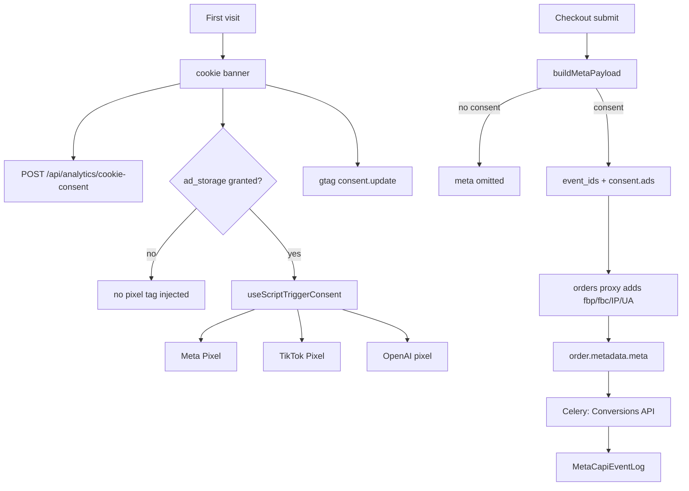

# Analytics and consent

Nothing that tracks a shopper loads before they answer the banner. The
browser side enforces that by making consent the script's **load trigger**,
not a flag passed to a script that has already downloaded; the server side
enforces it by refusing to dispatch a Conversions API event for an order
whose stored consent snapshot does not say `ads`.

Every tracker id is **per tenant** with no platform or environment fallback —
a shared id would mix ad accounts and analytics properties across merchants.

## Diagram

## How it works

### The consent categories

`nuxt.config.ts` configures `cookieControl` with two necessary categories —
one whose id is the single letter **`n`** (it lists the real cookie ids
`i18n_redirected`, `ncc_c`, `ncc_e`) and `functionality_storage` — and six
optional ones that mirror
Google Consent Mode v2: `ad_storage`, `ad_user_data`,
`ad_personalization`, `analytics_storage`, `personalization_storage`,
`security_storage`.

`app/composables/useCookieControl.ts` is a thin accessor over the module's
state. What matters downstream is two reactive values: `isConsentGiven`
(the banner has been answered at all) and `cookiesEnabledIds` (which
categories are on).

### Consent as a load trigger

`app/composables/setups.ts: useAdStorageConsent()` — declared without
`export`, so it is private to that module despite the name — is the shared
gate for
every advertising pixel, and it requires **both** conditions:

- `isConsentGiven` is true, so nothing fires for a visitor who never chose.
- `cookiesEnabledIds` contains `ad_storage`, so a visitor who accepted the
  banner but deselected ads in "Manage preferences" is honoured.

`setupMetaPixelConsent`, `setupTikTokPixelConsent` and
`setupOpenAIPixelConsent` each pass that computed boolean to
`useScriptTriggerConsent({ consent })` and use the result as the script's
`trigger`. That is the documented binary load gate: the tag is injected only
once consent flips true, and if it later flips false the trigger revokes and
the script is unloaded.

The comment records the pattern that was replaced and why. Combining
`defaultConsent: 'denied'` with a manual `consent.grant()` watcher left the
registry in a loaded-but-empty state — registered with no DOM tag and an
`fbq` queue that never drained — because `defaultConsent` is a vendor-side
flag that never gates injection.

All three setups are **client-only**. Since `@nuxt/scripts` 1.2 the registry's
`use()` is invoked eagerly, dereferencing `window.fbq` or `window.ttq` and
throwing during prerender, so each returns early on the server and the
consumer composables fall back to a no-op proxy.

### The `trigger: 'manual'` re-arm rule

This one is load-bearing and easy to undo.

`app/composables/useMetaPixel.ts` calls `useScriptMetaPixel` again to reach
the proxy, and passes `scriptOptions: { trigger: 'manual' }`. It must.
Unhead **re-arms the trigger of every duplicate `useScript` call** on the
existing script, and a call without an explicit trigger inherits the module
default `onNuxtReady`. The composable is captured during Pinia store setup —
`app/plugins/setup.ts` instantiates the cart store in the plugin phase, before
`app.vue` setup runs — so omitting the trigger attached an unconditional
app-ready load that bypassed the consent gate entirely. In production on
2026-07-02, `fbevents.js` loaded and fired `PageView` before the banner was
answered.

`'manual'` arms nothing, so only the consent trigger registered in
`setups.ts` can initiate the load, and events queue on the `window.fbq` stub
until then.

### Registry configuration

`nuxt.config.ts` registers only `googleAnalytics` and `stripe`, and every
entry carries `trigger: false` and `proxy: false`.

- **`trigger: false`** is the documented form for composable-driven scripts. A
  bare `{}` makes the registry plugin initialize the instance at boot, and
  every later `useScript*` call reuses that instance **ignoring its own
  options** — which silently dropped the consumers' id, trigger and
  `defaultConsent`.
- **`proxy: false` on every entry** keeps the module's first-party proxy
  infrastructure fully disabled, because `anyNeedsProxy` is computed only from
  these entries. With the proxy on, the bundler rewrites vendor URLs inside
  bundled scripts to `/_scripts/p/<domain>`, but the runtime allowlist covers
  only registry-registered domains — so the non-registry Meta and TikTok
  pixels chain-loaded resources that 403'd. A composable-level opt-out cannot
  fix this; `isProxyDisabled` reads exclusively from the config.
- **`bundle: false` on the Google Analytics entry**, and again at every
  pixel composable call site (`useMetaPixel`, `useTikTokPixel` and the three
  setups all pass it in `scriptOptions`). Bundling fetches the vendor script
  at image build time, and for gtag the asset even embeds the building
  tenant's container config — one tenant's analytics baked into the shared
  image. Two scripts deliberately go without it: the `stripe` registry entry
  sets only `trigger: false` and `proxy: false`, and the Google Sign-In
  client registered by `setupSocialLogin` passes neither option. Both serve
  the same asset to every tenant, so there is nothing tenant-specific to
  bake in.

### Google Analytics

GA is consent-**mode**, not consent-triggered: `setupGoogleAnalyticsConsent`
registers `useScriptGoogleAnalytics` with `wait_for_update: 500` and every
storage denied by default **except `functionality_storage`, which starts
`granted`** — it is a necessary category, so there is nothing to ask for. The
composable then watches `cookiesEnabledIds` and calls `consent.update(...)`
mapping each of the seven categories to `granted` or `denied`.

The script is skipped entirely when the tenant has no measurement id, when it
does not match `/^G-[A-Z0-9]{8,}$/`, or when it is the placeholder
`G-XXXXXXXXXX` — otherwise gtag is preloaded for every visitor and sits
unused.

Its load trigger is a promise that resolves on the **first user interaction**
(`pointerdown`, `keydown`, `touchstart`, `wheel`, `scroll`) or after five
seconds, with `warmupStrategy: 'preconnect'`. The comment carries the
measurement: gtag was 173 KB downloading for every visitor and the third
largest resource on the homepage, and the default warmup emitted a
`rel=preload` so the bytes arrived at preload-scan time regardless of the
trigger. Now the connection stays warm and the bytes wait; only sub-five-second
no-interaction bounces go unmeasured.

`app/composables/useGA4.ts` exposes only the official Recommended Event
catalogue, because GA4 silently drops unknown parameters. Its events pair
with Meta equivalents fired from the same call sites; the two do **not** dedup
against each other.

### TikTok: purchase is `CompletePayment`

`app/composables/useTikTokPixel.ts` states it in its header. TikTok's
`Purchase` is a separate offline/shop event and does not power web conversion
optimisation, so the purchase event the storefront fires is
`trackCompletePayment` sending `CompletePayment`.

There is no server-side TikTok Events API leg, so no `event_id` dedup is
needed — every TikTok event is browser-only.

### Meta Conversions API

Meta is the one channel with both legs, and they must share an `event_id` or
Meta counts the conversion twice.

**Browser-only** events live entirely in `useMetaPixel`: `ViewContent`,
`AddToCart`, `Search`, `AddPaymentInfo`, `CompleteRegistration`, `Lead`.
**Browser plus server** events need the same id on both: `InitiateCheckout`
and `Purchase`. `Refund` is the one the comment in `useMetaPixel` groups with
them but which has no browser leg — `meta_capi/services.py: build_refund_event`
mints a fresh `uuid4().hex`, so there is nothing to deduplicate against.

`app/composables/useCheckoutSubmit.ts: buildMetaPayload` mints them at
checkout and returns **`null` when `ad_storage` is not granted**, so no dedup
ids are leaked server-side for a shopper who refused marketing cookies. The
`Purchase` id is fresh on every submit, so a retry does not dedup against a
previous failed attempt; the `InitiateCheckout` id is sticky for the
checkout page's lifetime.

One id looks orphaned and is not. `add_payment_info` is minted, forwarded,
allowed through `_META_EVENT_ID_KEYS` and persisted on the order, yet no
server leg ever dispatches `AddPaymentInfo` — the event is browser-only
today. The stored id is the dedup key a future server leg would need, so do
not prune it as dead data.

`server/api/orders/index.post.ts` enriches that payload server-side and
explicitly **does not trust the client** for `client_ip_address` or
`client_user_agent` — both are read from the request. `fbp` and `fbc` are
cookies the browser pixel manages and are forwarded from the cookie header.
The real client IP comes from `CF-Connecting-IP`, falling back to
`True-Client-IP` and then to `X-Forwarded-For`; h3's default would otherwise
surface the socket address, which is the Traefik pod. The value only feeds
Meta's event matching, so a caller who forges it spoils the attribution of
their own events and nothing else — it is never used for a security
decision (that is `core/client_ip.py` in Django).

`order/services.py: _sanitise_meta_context` filters the incoming dict to a
closed key set — `fbp`, `fbc`, `client_user_agent`, `client_ip_address`,
`event_ids`, `consent` — caps raw strings at 512 characters, restricts
`event_ids` to `purchase`, `initiate_checkout` and `add_payment_info`, and
reduces `consent` to a single boolean `ads`. An empty result skips the `meta`
key entirely rather than leaving a phantom empty bag on the order.

The success page reads the ids back through the order serializer's
`metaEventIds` field.

**Dispatch** is signal-driven (`meta_capi/signals.py`):

| Signal | Event |
|---|---|
| `order_paid` | `Purchase` |
| `order_created` | `InitiateCheckout`, plus `Purchase` for **offline** pay-ways |
| `order_refunded` | `Refund` (custom) |
| `user_signed_up` | `CompleteRegistration` |

`CompleteRegistration` carries a consent gate of its own, separate from the
order-based one. `meta_capi/signals.py: _on_user_signed_up` reads the
`ad_storage` cookie off the signup request and sends only on an explicit
`granted`; a signup with no request at all, such as a programmatic one,
returns early. It fails closed because there is no order to carry a consent
snapshot.

The offline-pay-way branch exists because for cash on delivery the
confirmation page **is** the conversion: no webhook ever fires at purchase
time (the ACS reconcile emits `order_paid` days later at cash remittance, and
BoxNow COD has no reconcile at all). The unique `event_id` plus the SENT
short-circuit make any later `order_paid` re-dispatch a no-op, so both hooks
coexist safely.

**Gating** is `should_dispatch_for_order`, which is `is_capi_enabled()` and
`_consent_granted(order)` together. The kill switch is the
`META_CAPI_ENABLED` extra-setting, **and** both the tenant's
`meta_pixel_id` and `meta_capi_access_token` must be configured — tenant-only,
no platform fallback. Treating missing credentials as "disabled" keeps the
audit table clean and lets an operator stage credentials before flipping the
toggle. Consent defaults to **false**: without an explicit `consent.ads` on the
order, nothing is sent.

**The log table** is `meta_capi/models.py: MetaCapiEventLog`, one row per
`(event_name, event_id)` attempt with a **unique** `event_id`. It carries the
status (`pending`, `sent`, `failed`, `skipped`), Meta's `fbtrace_id` for
support tickets, `events_received`, the error message, and a **PII-stripped
copy** of the event body in `payload` for replay debugging.

That copy holds no plaintext personal data, and it takes two mechanisms to
get there. The SDK SHA-256 hashes the user identifiers (`em`, `ph` and the
rest) before anything is sent. The other four are not hashed at all:
`client_ip_address`, `client_user_agent`, `fbp` and `fbc` go to Meta **in
the clear**, because hashing them would break attribution. So
`meta_capi/tasks.py: _serialize_event_payload` pops exactly those four from
the persisted copy. The audit log is clean; the wire is not, and that is
deliberate.

`_dispatch` short-circuits when a row is already `SENT` (idempotency), then
`update_or_create`s a `PENDING` row, sends, and writes the terminal state. A
transient error is re-raised so Celery autoretries; a permanent one is logged
and stops.

The client is a facade (`meta_capi/client.py`) over the Facebook SDK,
centralising init and splitting exceptions into transient and permanent so the
task's `autoretry_for` works. Its API instances are **standalone per tenant**,
keyed by (token, version), never the SDK's process-global default.

### Consent telemetry

`setupCookieConsentTracking` emits two server-side wide events:
`banner_shown` once per browser session while the banner is on screen
(deduped through `sessionStorage`, forming the accept-rate denominator), and
`consent_decision` the first time the banner is resolved, carrying
`accept_all`, `accept_partial` or `decline_all` derived from how many optional
categories ended up enabled. Later preference changes through the floating
control button are deliberately not re-emitted — the metric is banner
resolution, not running churn.

`server/api/analytics/cookie-consent.post.ts` rate-limits per (tenant host,
client IP) at 30 per minute, writes the fields onto the request's wide log
through `useLogger(event)`, and answers 204.

Both analytics routes pass an **explicit TTL on every `setItem`**. The
storage driver's default is the long cache TTL, which would silently stretch
the rate-limit window to an hour in production.

### The evlog keep rule

`nuxt.config.ts` samples production logs at 10 percent for `info`, 50 for
`warn`, 0 for `debug` and 100 for `error` — with a `keep` list that overrides
sampling. `/api/analytics/**` is on it, alongside `/api/cart/**`,
`/api/_allauth/**`, `/api/orders/**`, any 400-or-worse status, and anything
slower than a second.

That matters: consent decisions and recommendation impressions are **the only
record** of those events, and a 10 percent sample of a denominator is not a
denominator. Anything added under `/api/analytics/` inherits the rule; anything
added elsewhere does not.

### Content Security Policy

Every tracker origin is added to the CSP **only when the tenant has that
tracker provisioned** (`shared/utils/csp.ts`): `connect.facebook.net` for the
Meta script, `analytics.tiktok.com` and `*.tiktok.com` for TikTok,
`bzrcdn.openai.com` for the OpenAI pixel. A store that does not advertise on
ChatGPT never has that origin in its policy. The Google origins are
unconditional because gtag is the shared analytics path.

### What staging disables

`grooveshop-infrastructure/scripts/staging-arm-features.py` runs after every
production clone and arms nearly everything — then deliberately blanks the
analytics credentials the clone brought across:

| Blanked on the tenant row | Why |
|---|---|
| `ga_tracking_id`, `meta_pixel_id`, `tiktok_pixel_id`, `openai_pixel_id` | Cloned ids would report staging traffic into production properties |
| `meta_capi_access_token`, `meta_capi_dataset_id` | Same, for the server leg |
| The seven `acs_*` fields | ACS has no test environment; production credentials would issue real vouchers |

It also forces `META_CAPI_ENABLED` to **False** as a prod-pollution guard, and
leaves `MYDATA_ENABLED` and `ACS_DYNAMIC_PRICING_ENABLED` off — both call a
live third party with cloned production credentials. `viva_wallet_live_mode`
goes off so a staging checkout can never charge a real card.

The script refuses to run unless the tenant's primary domain carries the
`staging` marker, so a mis-pointed `kubectl` context cannot arm production.

## Invariants

- **Consent gates the script tag, not a flag.** `useScriptTriggerConsent` is
  the injection gate; `defaultConsent` alone never was one.
- **Every duplicate `useScript*` call passes `trigger: 'manual'`**, or unhead
  re-arms the script with the module default and the consent gate is bypassed.
- **Ad pixels need both `isConsentGiven` and `ad_storage`.** Either alone is
  insufficient.
- **Every tracker id is per tenant.** No platform or env fallback, anywhere.
- **`proxy: false` on every registry entry**, and `bundle: false` on the
  Google Analytics entry and every pixel composable call site.
- **Server-side event ids are never emitted without consent.**
  `buildMetaPayload` returns `null`, and the order then carries no `meta`.
- **The server never trusts the client for IP or user agent.**
- **One `event_id` per Meta conversion**, unique in the log table, with a
  SENT short-circuit so a double dispatch is a no-op.
- **TikTok purchase is `CompletePayment`.**
- **Analytics routes are exempt from log sampling.** The `keep` list names
  the `/api/analytics/` prefix explicitly.
- **Staging never reports to a production property.**

## Failure modes

- **A pixel fires before the banner is answered.** Almost always a
  `useScript*` call site that dropped its explicit `trigger`, letting unhead
  re-arm the existing script with `onNuxtReady`. Check every consumer, not
  just the setup.
- **The pixel is registered but never loads.** The loaded-but-empty state:
  registered with no DOM tag and an undrained queue. It comes back if anyone
  reintroduces a `defaultConsent` plus manual `grant()` watcher alongside the
  trigger.
- **A bundled pixel chain-loads a 403.** The `@nuxt/scripts` proxy got
  re-enabled on some registry entry; `anyNeedsProxy` is global, so one entry
  without `proxy: false` turns it on for everything.
- **Meta reports double conversions.** The browser and server legs did not
  share an `event_id`. Check `order.metadata.meta.event_ids` — a missing key
  means the browser had no consent at submit time, so only the server leg (or
  neither) ran.
- **Meta reports nothing at all.** `is_capi_enabled()` is false: the kill
  switch is off, or the tenant is missing a pixel id or an access token.
  Missing credentials read as disabled, not as an error, so there are no
  `FAILED` rows to find.
- **`MetaCapiEventLog` rows stuck at `FAILED`.** A transient error re-raises
  and the next attempt flips the row back to `PENDING` through
  `update_or_create`; a permanent error stops there. The stored
  `error_message` and `fbtrace_id` are what to quote to Meta support.
- **A cash-on-delivery order never reports a purchase.** It should report at
  `order_created` through the offline-pay-way branch, not at `order_paid` —
  the ACS reconcile emits that days later. If it is missing, check the
  pay-way's `settlement` value.
- **Consent analytics look impossibly clean.** Check that the route is still
  under `/api/analytics/`; moving it out drops it to the 10 percent info
  sample and silently decimates the denominator.
- **A tracker is blocked in the browser console.** The tenant has the id set
  but the CSP was built without it, or vice versa — both come from the same
  tenant config in `shared/utils/csp.ts`.

## Related

- [Checkout and payment](/dev/flows/checkout-and-payment)
- [Order lifecycle](/dev/flows/order-lifecycle)
- [Security model](/dev/platform/security)
- [Staging](/dev/operations/staging)
- [Storefront service](/dev/nuxt/)

## Source

| File | Role |
|---|---|
| `grooveshop-storefront-ui-node-nuxt/nuxt.config.ts` | Consent categories, scripts registry, evlog sampling and keep list |
| `grooveshop-storefront-ui-node-nuxt/app/composables/setups.ts` | Consent triggers, GA consent mode, banner telemetry |
| `grooveshop-storefront-ui-node-nuxt/app/composables/useCookieControl.ts` | Banner state accessor |
| `grooveshop-storefront-ui-node-nuxt/app/composables/useMetaPixel.ts` | Meta events, `event_id` minting, the manual-trigger rule |
| `grooveshop-storefront-ui-node-nuxt/app/composables/useTikTokPixel.ts` | TikTok events and `CompletePayment` |
| `grooveshop-storefront-ui-node-nuxt/app/composables/useGA4.ts` | GA4 recommended events |
| `grooveshop-storefront-ui-node-nuxt/app/composables/useOpenAIPixel.ts` | ChatGPT Ads conversion pixel |
| `grooveshop-storefront-ui-node-nuxt/app/composables/useCheckoutSubmit.ts` | `buildMetaPayload` and its consent short-circuit |
| `grooveshop-storefront-ui-node-nuxt/server/api/orders/index.post.ts` | Server-side enrichment of the meta context |
| `grooveshop-storefront-ui-node-nuxt/server/api/analytics/cookie-consent.post.ts` | Banner telemetry endpoint |
| `grooveshop-storefront-ui-node-nuxt/shared/utils/csp.ts` | Per-tenant tracker origins |
| `grooveshop-django-api/order/services.py` | `_sanitise_meta_context`, the closed key set |
| `grooveshop-django-api/order/serializers/order.py` | `metaEventIds` on the order payload |
| `grooveshop-django-api/meta_capi/services.py` | Event building, `is_capi_enabled`, consent check |
| `grooveshop-django-api/meta_capi/signals.py` | Which domain events dispatch which CAPI events |
| `grooveshop-django-api/meta_capi/tasks.py` | `_dispatch`, idempotency, retry split |
| `grooveshop-django-api/meta_capi/models.py` | `MetaCapiEventLog` |
| `grooveshop-django-api/meta_capi/client.py` | Per-tenant SDK facade |
| `grooveshop-django-api/tenant/credentials.py` | Tenant-only tracker credentials |
| `grooveshop-infrastructure/scripts/staging-arm-features.py` | What staging blanks and disables |
