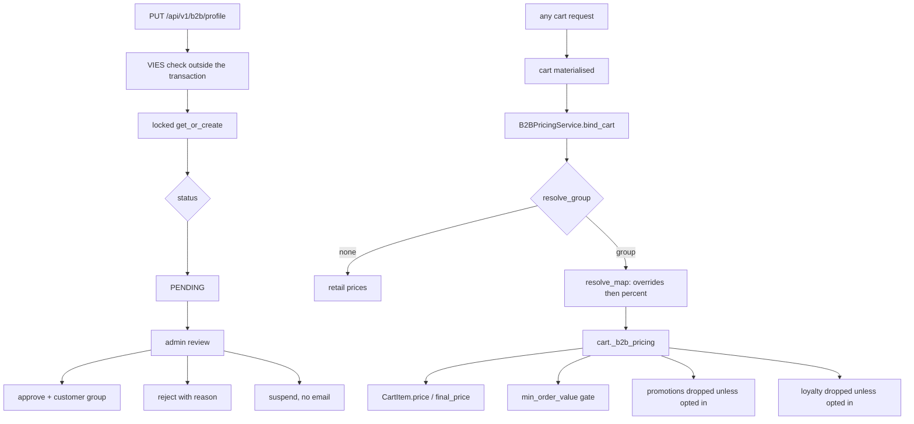

# B2B

The wholesale program changes **prices**, not the catalogue. An approved
business customer in an active customer group sees group prices on the same
products every other shopper sees, and the mechanism that makes that true is
a per-request **binding** attached to the cart instance — never a column, never
a snapshot on the row.

That design has one consequence worth stating before anything else: a cart
instance that was not bound prices every line at retail, silently and
correctly. So the binding must ride **every** cart materialisation, and the
codebase treats any path that produces a fresh `Cart` object without it as a
bug.

## Diagram

## How it works

### The profile

`b2b/models/profile.py: BusinessProfile` is a one-to-one on the customer
account inside the tenant schema, carrying the Greek invoice requisites
(`company_name`, `vat_id` normalised to nine digits with no `EL`/`GR` prefix,
`tax_office`, `activity`), an optional billing address, a frozen VIES
snapshot, and the review fields.

`vat_id` is indexed but deliberately **not unique** — several buyer accounts
of one company are legitimate, and the admin dedupes by search when it
matters.

Status is `PENDING`, `APPROVED`, `REJECTED` or `SUSPENDED`, and transitions
happen **only** through `B2BService` so the notification emails stay
deterministic.

### Submitting and re-review

`B2BService.submit_profile` encodes the re-review policy:

| Previous status | Any resubmit | Identity field changed |
|---|---|---|
| none | creates `PENDING` | — |
| `REJECTED` | back to `PENDING` | — |
| `APPROVED` | stays approved | back to `PENDING` |
| `SUSPENDED` | stays suspended | stays suspended |

Identity fields are `company_name`, `vat_id`, `tax_office`, `activity`.
Address edits keep wholesale access. Leaving suspension is a merchant
decision, never a self-service edit.

The VIES call (`b2b/vies.py: ViesClient`) runs **before** the row lock so a
five-second upstream timeout never holds a transaction open, and it is
skipped entirely when identity is unchanged, the last verdict is fresh
(`VIES_RECHECK_AFTER`), a check has actually happened before, and that
verdict was neither `UNCHECKED` nor `UNAVAILABLE`. Every check is an
outbound request, so unconditional refreshing would turn the endpoint into a
request amplifier; equally, a verdict that never resolved is worth retrying
however recent it is. An outage degrades to `ViesStatus.UNAVAILABLE`, which
is why such a profile re-checks on every resubmit; a human decides either
way.

Because the HTTP call sits between the unlocked read and the locked row,
every decision that depends on the previous status is **re-derived from the
locked row**. The comment spells out both bugs that fixed: a suspension
applied during the window being lifted by the customer's own edit, and an
approval landing in the window letting an identity change skip re-review.

The write itself is `select_for_update().get_or_create(...)` — two concurrent
first-time PUTs otherwise both pass a `filter().first()` check and the loser
500s on the one-to-one constraint.

A transition into `PENDING` queues the admin notification.

### Review actions

`approve(profile, group=..., reviewed_by=...)`, `reject(profile, reason=...,
reviewed_by=...)` and `suspend(profile, reviewed_by=...)` each re-select the
row `FOR UPDATE`, write only `_REVIEW_FIELDS`, and queue the customer email
through `dispatch_on_commit` — **except suspend, which sends nothing on
purpose**. Approval is where the customer group is assigned; there is no
approval without one.

### Groups and price lists

`b2b/models/group.py: CustomerGroup` is a wholesale segment with a
`discount_percent` off the retail **net** (VAT-exclusive) price, an
`is_active` flag, and a `min_order_value` (VAT-inclusive items total, 0
disables). It is admin-internal and deliberately not translated — customers
never see the name outside their own account badge.

`b2b/models/price.py: PriceListItem` is a fixed **net** price for one
(group, product), unique on that pair, and it **wins over the group's
percent**. Two guards live on the field and are re-enforced at read time in
`B2BPricingService._usable_override`, because form validators are bypassed by
`objects.create` and by rows written before the validators existed:

- A row in a currency other than `DEFAULT_CURRENCY` is **ignored** with an
  error log. The resolver reads `product.price.amount` and stamps the default
  currency on the result, so honouring it would apply a dollar figure at 1:1.
- A negative net price is **ignored** with an error log. The resolver clamps
  from above only, so a negative net would pass straight into the line total
  and make the order cheaper for adding the product.

`import_price_lines` backs the group admin's bulk paste: `sku;net_price` per
line, `;` or `,` separator, Greek decimal comma accepted, returning created
and updated counts plus a per-line error list.

### Resolving a price

`B2BPricingService.resolve(product, group, *, override_net=None)`:

1. Net is the override when there is a usable one, otherwise
   `product.price * (100 - group.discount_percent) / 100`.
2. The final price is net times the product's own VAT factor.
3. The retail `discount_percent` is **never stacked on top**.
4. The result is **capped** at the retail final price. `resolve` compares
   the computed wholesale final against `product.final_price` and, when the
   wholesale figure is the greater, replaces it with retail and back-solves
   the net. So a wholesale buyer can never pay **more** than a retail
   shopper — which is exactly what a deep retail sale would otherwise
   cause, since step 3 keeps the retail markdown out of the wholesale
   calculation. Going below retail is the normal case and is never
   clamped.

   Read the docstring on `resolve` with care: it describes this as
   "floored … so a retail sale can't be undercut", which is the opposite of
   what the code does. `_usable_override` states it correctly — `resolve`
   "clamps a final price from ABOVE (at retail) and from nowhere else".

All rounding is two decimal places, `ROUND_HALF_UP`, through
`product/models/product.py: _quantize_cents`, the same convention every other
money path uses.

### The binding, and every call site

`bind_cart(cart, user)` resolves the group, builds a bulk price map for the
cart's current lines, and attaches a `B2BPricingContext` to the **instance**
as `cart._b2b_pricing`. It is a no-op for guests, non-approved users and
disabled tenants, and every consumer falls back to retail through a `getattr`
read.

`resolve_group(user)` returns a group only when all of this holds: the user is
authenticated, `B2BService.is_enabled()` is true, a profile exists and is
`APPROVED`, a group is assigned, and that group is `is_active`.

`B2BPricingContext.price_for` resolves **lazily on a miss** and memoizes, so a
product added after the bind — the very add-to-cart request whose
`price_at_add` snapshot it feeds, or an item slipping into the order-create
lock window — can never be priced at retail on a bound cart.

There are exactly three `bind_cart` call sites, and two transplant helpers
that carry an existing context onto a re-materialised instance:

| Where | What it does |
|---|---|
| `cart/services.py: CartService._bind_pricing` | Both materialisation methods route through here, so every instance a cart view receives is bound: retrieve, update, destroy, coupon apply and remove, payment-intent creation |
| `order/services.py` (both order-create paths) | `bind_cart(cart, user)` at the top of the transaction, before any pricing maths |
| `cart/views/cart.py: _carry_b2b_pricing` (three call sites) | The `for_detail()` reloads exist for prefetching; a fresh instance would price at retail, so the context is transplanted when the primary keys match — and the prefetched items are re-pointed at the bound cart, because `CartItem.objects.for_list()`'s `select_related("cart")` hands every line its own unbound cart |
| `cart/views/item.py: _repoint_to_bound_cart` (two call sites) | Same problem on the item endpoints, for `get_object` and `list`; only items of the request's own cart are re-pointed, so staff listings of other carts stay untouched |

**One path materialises a cart and does not bind.**
`OrderService.reorder_to_cart`, behind `POST /api/v1/order/{id}/reorder`,
does `Cart.objects.get_or_create(user=user)` and then
`CartItem.objects.create(...)` with no bind and no transplant. Because
`CartItem.save()` snapshots `price_at_add` from `final_price`, and
`final_price` reads `cart._b2b_pricing` through a `getattr`, an approved
wholesale buyer's reordered lines are snapshotted at **retail** — and
`_log_price_drift_if_needed` then warns on every one of them at checkout.
Treat this as a known gap in the invariant below, not as a counter-example
to it.

**The buyer is still charged correctly.** Both order-creation paths bind
before any pricing maths, and the cart views bind on read, so the price the
buyer sees and pays is the wholesale one. Only the frozen `price_at_add`
snapshot is retail, which makes the resulting drift warning noise rather
than evidence of a mispriced order. The symptom is a log full of false
drift on wholesale reorders, not money lost.

**A line staff add to a wholesale order keeps the order's group price.**
`POST /api/v1/order-items` takes no price from the request; it prices the
new line with `order/views/item.py: OrderItemViewSet._line_price`. On an
order whose `metadata["b2b_pricing"]` marker names the group that priced
it at checkout, that is `B2BPricingService.resolve_single(product, group).final`
for that group, not for the buyer's group today; on any other order, the
product's VAT-inclusive `final_price`, as checkout stores it. If the
group no longer exists, the line is refused with a 400 on `order` rather
than sold at retail.

`CartItem.price` and `CartItem.final_price` read
`getattr(self.cart, "_b2b_pricing", None)` and fall back to retail. The
fallback is safe — never wrong-priced — which is exactly why a missing
binding is invisible until someone compares a preview to a charge.

### What a bound cart changes downstream

| Concern | Behaviour | Switch |
|---|---|---|
| Promotions | Dropped for a bound cart; attached codes surface as `COMBINATION_DISALLOWED`, wire value `discount_code_combination_disallowed` (non-blocking) | `B2B_ALLOW_PROMOTIONS` |
| Loyalty | Earning **and** redeeming dropped | `B2B_LOYALTY_ENABLED` |
| Minimum order value | Order create and payment-intent creation both refuse below the group's minimum | `CustomerGroup.min_order_value` |

`PromotionEngine.evaluate` checks `cart_pricing_active(cart) and not
B2BService.promotions_allowed()` in one place, which covers every caller
because pricing always binds before evaluation. A negotiated B2B price plus a
retail promotion is a silent double discount.

Loyalty is covered on its own page; the short version is that
`B2BService.loyalty_allowed()` is **one switch for both halves**, because the
points basis is the retail price. `suppresses_loyalty(cart)` is true only for
a cart actually bound to wholesale pricing while the merchant keeps wholesale
out of the program, and it is applied at payment-intent creation
(`cart/views/cart.py`) and at the top of both order-create paths
(`order/services.py`). On the order-create paths it runs before any pricing
maths; at payment-intent creation it runs after promotions, shipping and the
pay-way fee, but still before the loyalty maths. Either way the verified
intent amount, the order total and the redemption agree.

The minimum-order gate is `min_order_value_unmet(cart)`, one authority for
three consumers: the cart payload's `belowMinimum` flag,
`create_payment_intent` (which refuses to mint an intent order create would
then reject after capture), and both order-create paths.

### Invoice at checkout

Invoice-at-checkout is **not** behind the B2B plan flag. The comment on
`Tenant.b2b_enabled` is explicit: it stays a plain merchant setting,
`B2B_INVOICING_ENABLED`, available on every plan.

`Order` snapshots the billing identity as denormalised columns —
`billing_vat_id`, `billing_country`, `billing_company_name`,
`billing_tax_office`, `billing_activity` and the registered-address fields —
rather than a foreign key, because guests have no account, the snapshot must
survive later profile edits, and the tax register attaches to the order row.

`order/serializers/order.py` validates the cross-field rules:

1. `document_type = INVOICE` while `B2B_INVOICING_ENABLED` is off is
   **rejected**, so the API cannot be used while the UI hides the toggle.
2. `INVOICE` requires `billing_vat_id`, or the myDATA submission would
   silently downgrade or hard-fail at the worker.
3. `INVOICE` requires company name, tax office and activity.
4. A blank billing address means "same as delivery" and is copied explicitly
   onto the order. A **partial** explicit address is rejected, because the
   invoice would otherwise mix the billing street with the shipping city.

`billing_country` is stored against the VAT id so the AADE invoice type can
be chosen from it. Only two types are implemented today:
`order/mydata/builder.py: _pick_invoice_type` returns 11.1 for B2C retail or
1.1 for domestic B2B, and nothing else. Intra-EU (1.2) and third-country
(1.3) are deferred, so a non-domestic B2B order currently falls back to
11.1. The `billing_country` help text on the model claims otherwise and is
wrong.

### Storefront

| Surface | File |
|---|---|
| Profile page | `app/pages/account/business/index.vue`, `middleware: ['b2b-enabled']` |
| Route gate | `app/middleware/b2b-enabled.ts` |
| Price hydration | `app/composables/useB2BPricing.ts` |
| Proxies | `server/api/b2b/profile.get.ts`, `profile.put.ts`, `prices.get.ts` |
| Invoice fields | `app/components/Checkout/StepPersonalInfo.vue`, `app/composables/useCheckoutForm.ts` |

`b2b-enabled.ts` is two-tier like the others, but it fails **closed** on a
settings-fetch failure: the setting ships `False` and gates a commercial
program, so a transient error must hide the page. That is the opposite
posture from the loyalty gate.

`useB2BPricing` exists because catalogue HTML and product API responses are
aggressively cached and deliberately anonymous, so a wholesale price must
never be server-rendered into them. Product surfaces register the ids they
display; the composable batch-fetches them from the uncached, auth-forwarded
`/api/b2b/prices` proxy after hydration. Retail shows first, then swaps — an
accepted trade-off. Registrations are **buffered while inactive**, because on
SWR-cached pages the session is restored asynchronously after `onMounted`, and
dropping early registrations would kill the feature on exactly the pages it
targets. Prices are reset on every login, logout and user switch, so a shared
device never shows the previous customer's tier. Only 404 and 403 halt for the
session; a 401 is a transient session race and the ids stay wanted.

The cart payload's `b2bPricing` object drives the storefront's wholesale
badge and, when `allowPromotions` is false, hides the coupon input so nobody
types a code the engine will ignore. `allowLoyalty` hides both the
points-earned promise and the redemption widget.

## Invariants

- **The binding must ride every cart materialisation.** Nothing is stored on
  the cart row; a fresh instance prices at retail. Any new path that produces
  a `Cart` object must bind or transplant. Every priced path does today
  except `OrderService.reorder_to_cart`, described above.
- **Re-pointing matters as much as binding.** A prefetch or a
  `select_related("cart")` hands lines an unbound cart instance, and the
  serializer then prices lines at retail while the cart totals say wholesale.
- **A price-list override is net and positive and in the default currency**,
  or it is ignored at read time with an error log.
- **Retail markdown never stacks on a wholesale price**, and the wholesale
  final price never rises above retail final. The clamp is an upper bound
  only.
- **The plan gate is checked in the service, not only at the endpoint.** Cart
  resolution and order create run for everyone, including guests with no
  permission classes.
- **Loyalty is one switch for wholesale.** Earning and redeeming can never
  disagree.
- **Suspension is not self-service.** A `SUSPENDED` profile stays suspended
  through any resubmit.
- **Invoice identity is snapshotted on the order**, not read through a
  foreign key.
- **Wholesale is retail-only on the agent gateway.** Every gateway catalog,
  cart and checkout call is anonymous and forwards no bearer, so MCP tools,
  UCP/ACP checkout and the feeds always see retail prices and totals stay
  self-consistent (`grooveshop-agent-gateway/CLAUDE.md`).

## Failure modes

- **A wholesale customer sees retail prices on one screen.** Almost always a
  cart instance that was materialised without a binding or without the
  transplant. Start at `cart/services.py: _bind_pricing` and the two
  re-pointing helpers.
- **Preview and charge disagree for a wholesale cart.** Same cause, one step
  later: the preview was bound and the intent was not, or the reverse. Both
  order-create paths bind before any pricing maths for exactly this reason.
- **A coupon is accepted and then ignored.** The cart is bound and
  `B2B_ALLOW_PROMOTIONS` is off. `evaluate` reports every attached code as
  `COMBINATION_DISALLOWED`, which is non-blocking, so order create proceeds
  without a discount — matching what the preview showed. The storefront hides
  the input when `allowPromotions` is false; a direct API caller will not see
  that.
- **Checkout refuses just before payment.** The group's `min_order_value` is
  unmet. The same check runs at payment-intent creation, so an online payment
  can never be captured for an order this would reject.
- **VIES says `UNAVAILABLE`.** The service was unreachable or timed out. The
  snapshot records it and the reviewer decides; it is not a rejection.
- **A bulk price import reports unknown SKUs.** `import_price_lines` matches
  on `Product.sku` exactly and reports per line; nothing partial is rolled
  back, so fix the listed lines and re-paste — the upsert is idempotent.
- **Approval sent no email.** Check whether it was a **suspend** instead;
  suspension is silent by design.

## Related

- [Loyalty](/dev/flows/loyalty)
- [Promotions and gift cards](/dev/flows/promotions-and-gift-cards)
- [Checkout and payment](/dev/flows/checkout-and-payment)
- [Agentic commerce](/dev/flows/agentic-commerce)
- [Multi-tenancy](/dev/platform/multi-tenancy)

## Source

| File | Role |
|---|---|
| `grooveshop-django-api/b2b/models/profile.py` | `BusinessProfile`, VIES snapshot, review fields |
| `grooveshop-django-api/b2b/models/group.py` | `CustomerGroup`, discount percent, minimum order value |
| `grooveshop-django-api/b2b/models/price.py` | `PriceListItem`, net override, field guards |
| `grooveshop-django-api/b2b/enum.py` | `BusinessProfileStatus`, `ViesStatus` |
| `grooveshop-django-api/b2b/services.py` | Gates, profile workflow, `B2BPricingService`, binding |
| `grooveshop-django-api/b2b/vies.py` | VIES client and its unavailable path |
| `grooveshop-django-api/b2b/views.py` | `profile`, `submit_profile`, `prices` and their gates |
| `grooveshop-django-api/b2b/admin.py` | Approve, reject, suspend, import prices |
| `grooveshop-django-api/cart/services.py` | `_bind_pricing` — the materialisation hook |
| `grooveshop-django-api/cart/views/cart.py` | `_carry_b2b_pricing`, minimum-order refusal |
| `grooveshop-django-api/cart/views/item.py` | `_repoint_to_bound_cart` |
| `grooveshop-django-api/cart/models/item.py` | `_b2b_resolved`, `price`, `final_price` |
| `grooveshop-django-api/cart/serializers/cart.py` | The `b2bPricing` payload |
| `grooveshop-django-api/order/services.py` | Binding, loyalty suppression, minimum gate, metadata marker |
| `grooveshop-django-api/order/views/item.py` | `_line_price`: a staff-added line priced for the order's stamped group |
| `grooveshop-django-api/order/models/order.py` | Billing snapshot columns |
| `grooveshop-django-api/order/serializers/order.py` | Invoice cross-field validation |
| `grooveshop-django-api/tenant/models.py` | `b2b_enabled` and the invoicing exception |
| `grooveshop-storefront-ui-node-nuxt/app/middleware/b2b-enabled.ts` | Fail-closed two-tier gate |
| `grooveshop-storefront-ui-node-nuxt/app/composables/useB2BPricing.ts` | Post-hydration price swap |
| `grooveshop-storefront-ui-node-nuxt/app/pages/account/business/index.vue` | Profile page |
| `grooveshop-storefront-ui-node-nuxt/server/api/b2b/` | Profile and price proxies |
| `grooveshop-agent-gateway/CLAUDE.md` | Why the gateway is retail-only |
