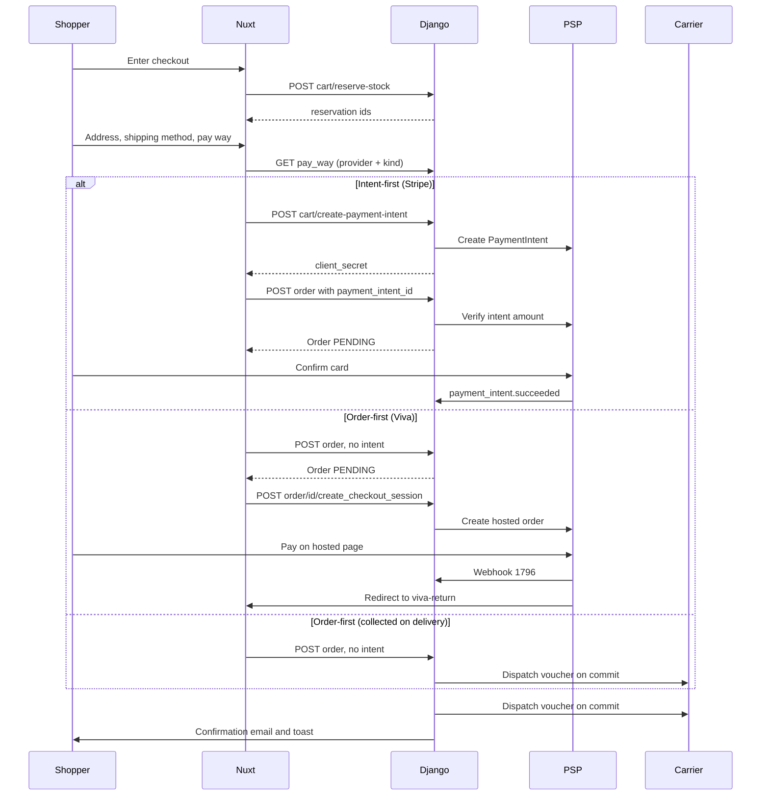

# Checkout & payment

There is exactly one order-creation endpoint and two ways through it.
Which one runs is decided by two facts about the chosen payment method:
what its **settlement** is (`pay_way/enum/settlement.py: PaySettlement`)
and whether its **provider** can mint a client-confirmed intent
(`order/payment.py: PaymentProvider.supports_payment_intent`). Never by a
provider name. Intent-first means the money is verified before the order
row exists; order-first means the order exists before any money moves.
Everything else on this page follows from that split.

For the exhaustive status tables and the audit history, read
[Order system](/dev/django/reference/order-system) — this page is the
cross-service narrative.

## Diagram

## How it works

### 1. The cart is the priced object

Every price the shopper sees and every price the order is built from
comes from the same cart row. Before any total is computed, both
creation paths re-lock the cart and re-bind wholesale pricing
(`order/services.py: create_order_from_cart` step 2.4 and
`create_order_from_cart_offline` step 2.4, both calling
`B2BPricingService.bind_cart`). The binding runs on **every**
materialisation, never once — see [B2B](/dev/flows/b2b).

Loyalty redemption and gift cards are priced under row locks in the same
transaction so the amount verified against the provider and the amount
recorded on the order cannot drift; the detail lives in
[Loyalty](/dev/flows/loyalty) and
[Promotions & gift cards](/dev/flows/promotions-and-gift-cards).

### 2. Stock is reserved, then consumed

`POST /api/v1/cart/reserve-stock` (`cart/views/cart.py: reserve_stock`)
creates one `StockReservation` per cart line, keyed on the cart UUID as
`session_id`, with a TTL from `STOCK_RESERVATION_TTL_MINUTES` (default 15,
`order/stock.py: StockManager.get_reservation_ttl_minutes`). If any line
fails the whole batch is rolled back and the endpoint answers 409 with
`failed_items`. The storefront calls it as step 1 of
`app/composables/useCheckoutSubmit.ts: onSubmit`.

At order creation `OrderService._consume_stock_for_order` reconciles the
reservations against the cart rather than converting them blindly: a
surplus hold is released, an expired hold is released and the shortfall
decremented directly, and the remainder is converted to a sale linked to
the order. This is what guards against double-decrement, a missed
decrement and oversell in one place. Physical movements are recorded as
`StockLog` rows with `OPERATION_DECREMENT`.

### 3. Address and phone validation runs twice

The storefront validates with Zod in
`app/composables/useCheckoutForm.ts`: `step1Schema` (identity and
address, phone through `isPlausiblePhone`), `step2Schema` (shipping
method plus the locker or station id the method requires) and
`step3Schema` (a pay-way id). The phone is validated on the normalised
value that will actually be submitted, so the error appears on the step
that owns the field instead of as a late 400.

Django re-validates in `OrderService.validate_shipping_address`: the nine
required fields, an email format check, a phone length band, a country
check, and then whatever the chosen carrier adds through
`ShippingService.validate_order_payload`. Carrier rules live in the
adapter, not here — see [Shipping](/dev/flows/shipping).

Two deliberate asymmetries: the storefront requires a street number that
Django allows blank (the courier voucher needs one), and the Greek VAT
number on an invoice order is checksum-validated on both sides so the
buyer never gets a late rejection.

### 4. Shipping method decides which pay-ways exist

`GET /api/v1/shipping/options` (`shipping/services.py:
ShippingService.available_options`) returns the
(provider, kind) matrix for active providers that have a registered
adapter, and each row carries the pay-ways that combination can settle.
`GET /api/v1/pay_way` applies the same rules through
`pay_way/filters.py`, which routes to `PayWayService.filter_by_carrier`
when a provider code is present and to `filter_by_shipping_kind` when it
is not — home delivery is provider-agnostic in checkout, so the second
form intersects the rules of every carrier that serves the kind.

Order creation re-applies both layers in
`order/views/order.py: OrderViewSet._validate_pay_way_for_order`, plus a
credentials gate (`PayWayService.is_provider_configured`). A stale client
cannot place an order with a method checkout would never have offered.

### 5. Order creation: two paths, one endpoint

`POST /api/v1/order` (`OrderViewSet.create`) picks the path:

| Condition | Path | Service method |
|---|---|---|
| Settlement is `online`, provider declares `supports_payment_intent`, and a `payment_intent_id` was sent | Payment-first | `OrderService.create_order_from_cart` |
| Everything else | Order-first | `OrderService.create_order_from_cart_offline` |

The payment-first path verifies the provider's reported amount against a
server-recomputed total (cart minus promotion discount, plus shipping,
plus pay-way fee, minus loyalty, minus the gift-card plan) and raises
`PaymentAmountMismatchError` on a mismatch, logging every input that
produced it. The order is created `status=PENDING` with the
provider-reported payment status.

The order-first path creates `status=PENDING, payment_status=PENDING`,
stamps `payment_id = "offline_<uuid>"` for non-online settlements, and
then branches on coverage: if deductions cover the whole total the order
is settled immediately through `Order.mark_as_paid` with a synthetic
`GIFTCARD_<uuid>` or `DISCOUNT_<uuid>` id and no provider is involved. An
intent-capable online pay-way that is only *partly* covered is a client
error, not a silent full charge.

### 6. Payment paths

**Viva Wallet — primary, hosted redirect.** The order is created first,
then `POST /api/v1/order/{id}/create_checkout_session` mints a Viva order
code (`order/payment.py: VivaWalletPaymentProvider.create_checkout_session`)
and the storefront sets `window.location.href` to the hosted page
(`app/components/VivaWalletCheckout.vue`). Every issued code is appended
to `metadata["viva_order_codes"]` — a shopper can pay on an older
session, and both the webhook and the return endpoint resolve by
`viva_order_code_q`, which matches any code ever issued.

The webhook is a machine-to-machine call that lands on the public schema,
since Viva knows nothing about the tenant boundary
(`order/views/viva_webhook.py: viva_wallet_webhook`). A GET is Viva's
verification handshake and returns the tenant's
`webhook_verification_key` when set, otherwise fetches one from Viva and
returns that — the stored key is a cache, not a requirement. A POST
resolves candidate tenants by order code, then **verifies against Viva's
Retrieve Transaction API inside each candidate's context**; only the
tenant whose credentials can retrieve the transaction processes it. The
IP allowlist is informational, a log line: refusing on Viva's hardcoded
ranges would fail closed the day they change. It reads the one address a
caller cannot write (`core/client_ip.py: client_ip_or_peer`), never a
bare `X-Forwarded-For` entry. Idempotency is a database row, not metadata:
`order/models/viva_webhook_event.py: VivaWebhookEvent` is unique on
`(transaction_id, event_type_id)`.

Event 1796 checks `StatusId == "F"`, then verifies the transaction
belongs to this order, then currency, then amount within one cent. A
verified charge whose amount disagrees stamps `AMOUNT_MISMATCH_FLAG` on
the order and refuses to mark it paid. On success it writes
`payment_id`, `payment_status=COMPLETED`, `payment_method="viva_wallet"`,
flips PENDING to PROCESSING inline, and dispatches the carrier task.
Event 1798 marks the payment failed; 1797 marks it refunded.

After payment Viva redirects to a static URL configured per tenant in the
merchant portal. It lands on the Nitro route
`server/routes/checkout/viva-return.get.ts`, which calls the anonymous
`GET /api/v1/order/viva_return`, resolves `t` (transaction id) or `s`
(order code) to an order UUID, and redirects to
`/checkout/success/{uuid}`. Resolving by `s` is what wins the
browser-versus-webhook race, because the code was recorded at session
creation.

**Stripe — secondary, intent-first.** `POST /api/v1/cart/create-payment-intent`
computes the charge with exactly the inputs order creation will
re-verify, then mints the intent. The card is confirmed in the browser
(`app/components/StripePayment.vue`) against the tenant's own
publishable key. dj-stripe receives webhooks on a per-tenant, UUID-routed
endpoint, so django-tenants selects the schema and dj-stripe verifies
against that schema's `WebhookEndpoint` secret. Handlers live in
`order/signals/handlers.py`: `payment_intent.succeeded`,
`payment_intent.payment_failed`, `payment_intent.requires_action`,
`charge.refunded`, `charge.dispute.created`, `checkout.session.completed`
and `checkout.session.expired`. Each marks
`metadata["webhook_processed_<event_id>"]` under a row lock before doing
any work.

Errors inside the succeeded, refunded and checkout-completed handlers are
allowed to **propagate**. They run inside dj-stripe's own atomic block,
so swallowing one would commit the idempotency mark for a charge that was
never recorded, and Stripe never redelivers past an accepted event id.

**Cash on delivery.** Settlement `courier_cash`. The order is created
order-first, the cart is cleared immediately (nothing is owed online),
and `_dispatch_shipment_creation_task` fires on commit. The voucher mint
advances PENDING to PROCESSING
(`AcsService._advance_pending_order_to_processing`). Payment stays
`PENDING` until ACS remits, which the nightly reconcile detects —
measured lag is around four days. That is by design, not a stuck order.

This waiting period is specific to `courier_cash`. It is **not** shared
by the other collect-on-delivery settlement: `PaySettlement`'s
`collected_on_delivery()` returns both `courier_cash` and
`carrier_terminal`, but only the first is settled by a remittance
reconcile.

**BoxNow PAY ON THE GO.** Settlement `carrier_terminal`. Despite the
name there is no terminal: BoxNow emails a Viva payment link after
pickup and activates the collection PIN when it clears. The `delivered`
webhook event is therefore proof of payment, and
`BoxNowService._mark_cod_order_paid_on_delivery` moves the order's
payment status from PENDING to `COMPLETED` with
`payment_method="boxnow_cod"`. It leaves `Order.status` alone. There is
no remittance reconcile on this path, and no multi-day wait.

**Bank transfer.** Settlement `offline_transfer` exists and
`PayWayService.process_payment` handles it (it deliberately does not
write `payment_id`/`payment_status` for that settlement), but **no
bank-transfer pay-way row is seeded**. `pay_way/migrations/0019_seed_default_pay_ways.py`
seeds only cash on delivery (active), Viva Wallet and Stripe (both
inactive until credentials land). A merchant who wants bank transfer
creates the row in the admin and fills in the WYSIWYG `instructions`
field, which the confirmation email renders.

### 7. What the customer sees

| Step | Surface |
|---|---|
| Enters checkout | Three steps in `app/pages/checkout/index.vue`; stock is reserved on submit, not on arrival |
| Places a COD order | Success toast, then `/checkout/success/{uuid}?placed=1`; order-received email |
| Places a Stripe order | Order created, card form mounts, then `onPaymentSuccess` navigates to the success page |
| Places a Viva order | "Order created, complete payment" toast, then the hosted page, then back through `viva-return` |
| Lands on success unpaid | The page polls `GET /api/orders/uuid/{uuid}` every 2s — 15 attempts for Viva, 5 for Stripe — and stops on a settled status |
| Lands on success with COD | No polling at all: `placed=1` means legitimately unpaid |

The purchase pixels fire once per order from the success page, keyed on
the Meta event id Django minted at creation, and only when the shopper
arrived through a real checkout — see
[Analytics & consent](/dev/flows/analytics-and-consent).

### 8. Idempotency

- **Checkout attempt.** The storefront mints one `Idempotency-Key` per
  attempt and reuses it across automatic retries
  (`useCheckoutSubmit.ts`), clearing it on success or on a
  non-retryable error.
- **Stripe webhooks.** `metadata["webhook_processed_<event_id>"]`,
  written under `select_for_update` before processing.
- **Viva webhooks.** The `VivaWebhookEvent` unique constraint, written
  *last* so a handler that raised leaves nothing behind.
- **Carrier tasks.** Each provider's create-shipment task is idempotent
  on its own shipment row, so a duplicate dispatch is harmless.
- **Emails.** Per-task reservation flags on `order.metadata`; the
  confirmation email additionally holds a short Redis execution lock so
  an OOM-killed worker cannot permanently block a resend.

## Invariants

- **Routing is on settlement and capability, never on a provider
  name.** `provider_supports(code, "supports_payment_intent")` and
  `PaySettlement(pay_way.settlement)` are the only discriminators
  (`order/views/order.py`, `order/services.py`, `cart/views/cart.py`).
- **Credentials never fall back to platform settings.** An unconfigured
  provider is hidden from the pay-way list, refused at order creation
  and refused at checkout-session creation
  (`PayWayService.is_provider_configured`). See
  [Multi-tenancy](/dev/platform/multi-tenancy).
- **The charged amount is always `Order.calculate_order_total_amount()`.**
  Every charge site, every verification and every webhook amount guard
  reads it; `total_price` is the undiscounted figure and charging it is
  the bug this method exists to prevent.
- **The cart survives a hosted payment.** `Order.awaits_online_payment`
  keeps it alive until `order_paid` fires, and
  `_clear_cart_for_order` removes only the order's own lines so a basket
  built during the redirect window is not destroyed.
- **A settled payment status is final.** `SETTLED_PAYMENT_STATUSES`
  (`order/enum/status.py`) blocks any provider report — webhook or poll
  — from regressing COMPLETED, REFUNDED, PARTIALLY_REFUNDED or CANCELED.
- **Money that arrived for a cancelled order is recorded, never
  fulfilled.** Both Stripe entry points stamp
  `metadata["payment_after_cancel"]`, log at ERROR and refuse to mint a
  shipment.
- **A Viva order code is merchant-editable metadata, so it is not proof
  of ownership.** Tenant selection is decided by which tenant's
  credentials can retrieve the transaction.

## Failure modes

- **`PaymentAmountMismatchError` at order creation.** The intent was
  priced with different inputs than the order. The warning log carries
  every input (carrier, kind, weight, country, region, cart total,
  shipping, fee, discounts); compare it against what
  `cart/create-payment-intent` received. Changing a deduction after the
  intent exists is the usual cause, which is why the storefront drops
  the intent whenever loyalty, gift cards or a coupon change.
- **Shopper pays on a stale Viva tab after the total moved.** The
  webhook verifies a real charge whose amount disagrees, so it refuses
  to mark the order paid and stamps `AMOUNT_MISMATCH_FLAG`.
  `auto_cancel_stuck_pending_orders` then skips the order permanently —
  it needs a human.
- **Viva webhook for a suspended tenant.** The handler answers 503 so
  Viva redelivers. Acknowledging would drop a paid order permanently,
  and unlike BoxNow there is no polling job to rescue it.
- **Stripe Checkout Session paid but the PaymentIntent event misses.**
  `checkout.session.completed` fulfils on its own — it marks paid,
  advances to PROCESSING and dispatches the carrier task — because the
  sibling event resolves by `payment_id`, which only `mark_as_paid`
  writes.
- **Payment fails.** `handle_payment_failed` writes
  `payment_status=FAILED` and nothing else. The stock this order holds
  is **not** returned at that moment; only
  `auto_cancel_stuck_pending_orders` releases it, after
  `ORDER_AUTO_CANCEL_FAILED_PAYMENT_MINUTES`. See
  [Order lifecycle](/dev/flows/order-lifecycle).
- **Shopper abandons the hosted page.** The order sits PENDING with a
  live cart. `auto_cancel_stuck_pending_orders` closes it after
  `ORDER_AUTO_CANCEL_PENDING_HOURS`; `check_pending_orders` may email a
  reminder first, but only for online settlements.
- **Reservation expires mid-checkout.** `cleanup_expired_stock_reservations`
  marks it consumed. `_consume_stock_for_order` then releases the lapsed
  hold and decrements the shortfall directly, so a lapsed TTL does not
  fail an otherwise fulfillable checkout — unless another session
  actually took the stock, in which case the whole creation rolls back
  with `InsufficientStockError`.

## Source

| File | Role |
|---|---|
| `grooveshop-django-api/order/views/order.py` | `OrderViewSet.create`, the two `_create_*` helpers, payment-intent / checkout-session / retry actions, `viva_return` |
| `grooveshop-django-api/order/services.py` | `create_order_from_cart`, `create_order_from_cart_offline`, `_consume_stock_for_order`, amount verification, `validate_shipping_address` |
| `grooveshop-django-api/order/payment.py` | `PaymentProvider` capabilities, `StripePaymentProvider`, `VivaWalletPaymentProvider`, `_PROVIDERS` registry |
| `grooveshop-django-api/order/views/viva_webhook.py` | Verification handshake, tenant candidate resolution, event handlers 1796/1797/1798 |
| `grooveshop-django-api/order/models/viva_webhook_event.py` | Viva idempotency table |
| `grooveshop-django-api/order/signals/handlers.py` | Every dj-stripe receiver and the order signal chain |
| `grooveshop-django-api/order/stock.py` | `StockManager` reserve, convert, decrement, increment, cleanup |
| `grooveshop-django-api/pay_way/services.py` | `is_provider_configured`, `filter_by_carrier`, `filter_by_shipping_kind`, `process_payment` |
| `grooveshop-django-api/pay_way/enum/settlement.py` | `PaySettlement` and why the old booleans were replaced |
| `grooveshop-django-api/pay_way/migrations/0019_seed_default_pay_ways.py` | Which pay-ways a fresh tenant gets |
| `grooveshop-django-api/cart/views/cart.py` | `reserve_stock`, `release_reservations`, `create_payment_intent` |
| `grooveshop-storefront-ui-node-nuxt/app/composables/useCheckoutForm.ts` | Zod step schemas, pay-way and settings loading |
| `grooveshop-storefront-ui-node-nuxt/app/composables/useCheckoutSubmit.ts` | Submit orchestration, idempotency key, the three payment flows |
| `grooveshop-storefront-ui-node-nuxt/app/composables/useCheckout.ts` | Reserve / release / create-intent calls |
| `grooveshop-storefront-ui-node-nuxt/server/api/orders/index.post.ts` | Order proxy, Meta context injection, upstream error forwarding |
| `grooveshop-storefront-ui-node-nuxt/server/routes/checkout/viva-return.get.ts` | Viva redirect translation |
| `grooveshop-storefront-ui-node-nuxt/app/pages/checkout/success/[uuid].vue` | Success page, payment-status polling, purchase pixels |
