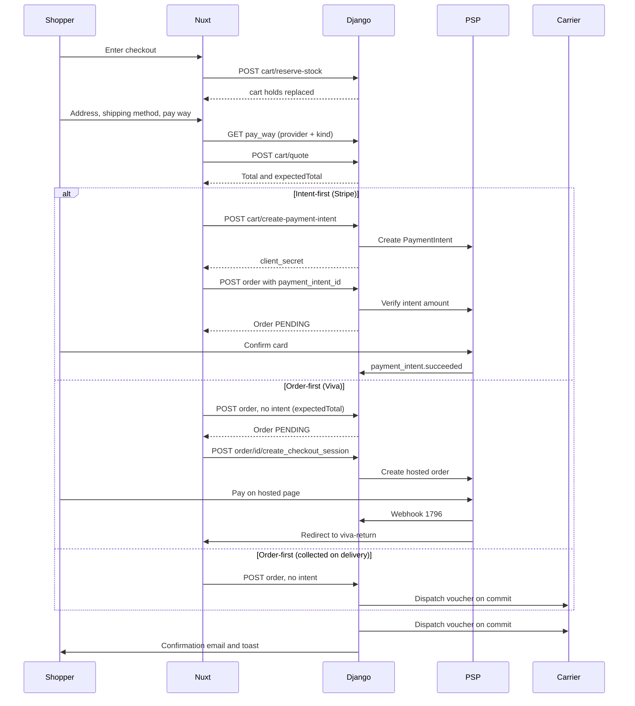

# Checkout & payment

There is exactly one order-creation endpoint and two ways through it.
Which one runs is decided by two facts about the chosen payment method:
what its **settlement** is (`src/pay_way/enum/settlement.py: PaySettlement`)
and whether its **provider** can mint a client-confirmed intent
(`src/order/payments/payment.py: PaymentProvider.supports_payment_intent`). Never by a
provider name. Intent-first means the money is verified before the order
row exists; order-first means the order exists before any money moves.
Everything else on this page follows from that split.

For the exhaustive status tables and the audit history, read
[Order system](/dev/django/reference/order/) — this page is the
cross-service narrative.

## Diagram

## How it works

### 1. The cart is the priced object

Every price the shopper sees and every price the order is built from
comes from the same cart row. Before any total is computed, both
creation paths re-lock the cart and re-bind wholesale pricing
(`src/order/services.py: create_order_from_cart` step 2.4 and
`create_order_from_cart_offline` step 2.4, both calling
`B2BPricingService.bind_cart`). The binding runs on **every**
materialisation, never once — see [B2B](/dev/flows/b2b).

Every call that changes the cart answers with the whole cart as `GET /cart`
would read it, so the storefront never follows a change with a reload: an
add or a quantity change (`POST /cart/item`, `PUT` and `PATCH
/cart/item/{id}`) answers with the line and the cart beside it as `cart`, and
a coupon apply or remove answers with the cart. The Nuxt proxy returns that
cart, and the cart store sets it (`createCartItem`, `updateCartItem` and
`setCart` in `app/stores/cart.ts`). Removing a line answers 204 with no body,
so `deleteCartItem` reads the cart once. A click on an add-to-cart button
is answered at once: an "Adding…" toast opens before the request and the
answer replaces it in place with "Added" or the failure
(`app/composables/useAddToCart.ts`, `app/utils/toast.ts`); stock is Django's
to judge, so "Added" never shows before it answers. The cart payload carries
no suggestions: the cart page and drawer ask for them
([Recommendations](/dev/flows/recommendations#the-storefront-strip)).

Loyalty redemption and gift cards are priced under row locks in the same
transaction so the amount verified against the provider and the amount
recorded on the order cannot drift; the detail lives in
[Loyalty](/dev/flows/loyalty) and
[Promotions & gift cards](/dev/flows/promotions-and-gift-cards).

### 2. Stock is reserved, then consumed

`POST /api/v1/cart/reserve-stock` (`src/cart/views/cart.py: reserve_stock`)
makes the cart's holds exactly its current quantities, through
`src/order/inventory/stock.py: StockManager.reserve_cart_stock`. One transaction locks the
`Cart` row first (`select_for_update`, the lock checkout takes first), then
every product the old or the new set touches in pk order, releases **all**
of the cart's unconsumed holds (expired ones included, each with its
`StockLog` line) and reserves one `StockReservation` per product, keyed on
the cart UUID as `session_id`, with a TTL from the store setting
`STOCK_RESERVATION_TTL_MINUTES` (default 30,
`StockManager.get_reservation_ttl_minutes`). The holds are replaced, never
stacked: the cart's own earlier holds never count against it, a retry is
idempotent, and a line that changed or left the cart is freed in the same
step. Holds of other carts still count, so two carts exclude each other for
the last unit. Because the cart row lock serialises this call with a
checkout of the same cart and with the login merge that rehomes its holds,
a checkout never reads a hold set half replaced. If any line is short the
transaction rolls back, the cart keeps the holds it had, and the endpoint
answers 409 `insufficient_stock` with every short line in `failed_items`.
The `reservation_ids` in the answer are informational: the ids from an
earlier answer are already released. The storefront calls it as step 1 of
`app/composables/useCheckoutSubmit.ts: onSubmit`.

At order creation `OrderService._consume_stock_for_order` takes the cart's
holds by cart (every unconsumed reservation whose `session_id` is the cart
UUID), never by id, and reconciles them against the cart rather than
converting them blindly: a
surplus hold is released, an expired hold is released and the shortfall
decremented directly, and the remainder is converted to a sale linked to
the order. This is what guards against double-decrement, a missed
decrement and oversell in one place. Physical movements are recorded as
`StockLog` rows with `OPERATION_DECREMENT`.

### 3. Address and phone validation runs twice

The storefront validates with Zod in
`app/composables/useCheckoutForm.ts`: `step1Schema` (identity and
address, phone through `isPlausiblePhone`), `step2Schema` (shipping
method plus the locker or station id the method requires) and
`step3Schema` (a pay-way id). The phone is validated on the normalised
value that will actually be submitted, so the error appears on the step
that owns the field instead of as a late 400.

**Phones follow the country, not a hardcoded `+30`.** The country API
exposes a read-only, derived `phone_metadata` on every country
(`src/country/serializers.py`, built by `src/country/phone.py` from
`phonenumbers.PhoneMetadata.metadata_for_region` and cached; never
stored): `national_number_pattern`, `possible_lengths`,
`national_prefix_for_parsing` and `example_mobile`. `app/utils/phone.ts`
uses it and no phone library of its own:

- `normalizePhone(raw, country)` passes a leading `+` through, turns
  `00` into `+`, strips the national prefix and prepends the dial code,
  guarding against a number typed with its dial code already in it.
- `isPlausiblePhone(raw, country)` checks the national pattern and
  lengths; any other `+` number gets a plain E.164 check, so a Greek
  mobile can ship to a Cypriot locker.
- `stripDialCodeForDisplay` and `dialCodeLabel` drive the dial-code
  badge, which follows the delivery country in checkout, the form's
  country in the address book and the profile country in account
  settings. The validation message quotes the country's `example_mobile`.

The storefront always submits E.164; `PHONENUMBER_DEFAULT_REGION` on the
Django side only matters for input that is not.

Django re-validates in `OrderService.validate_shipping_address`: the nine
required fields, an email format check, a phone length band, a country
check, **an active shipping rate for the chosen carrier, kind and
country**, and then whatever the chosen carrier adds through
`ShippingService.validate_order_payload`. Carrier rules live in the
adapter, not here — see [Shipping](/dev/flows/shipping).

**Region is required only where the country has regions, and must belong
to it.** `src/core/validators/address.py: address_errors` owns both rules,
and `region` is part of `ADDRESS_FIELDS`, so `Order.clean`,
`UserAddress.clean` and the serializers all inherit them;
`UserAddressWriteSerializer.region` is optional at the field level for
that reason. The Country API exposes a read-only `has_regions`, and the
storefront's region field (`required`, disabled state and Zod rule)
follows `selectedCountry.hasRegions` in checkout and the address forms.
The country list itself is the full ISO 3166-1 set, seeded by
`src/country/migrations/0012_seed_iso_countries.py`; only a rate makes a
country shippable. `src/order/serializers/order.py` returns field-scoped 400s for a
region in another country, a carrier with no active rate and a cart over
the rate's weight cap.

Two deliberate asymmetries: the storefront requires a street number that
Django allows blank (the courier voucher needs one), and the Greek VAT
number on an invoice order is checksum-validated on both sides so the
buyer never gets a late rejection.

### 4. Shipping method decides which pay-ways exist

`GET /api/v1/shipping/options` (`src/shipping/services.py:
ShippingService.available_options`) requires the delivery country and
returns one row per active `ShippingRate` for it, and each row carries
the pay-ways that combination can settle, plus `max_weight_grams` and
`exceeds_max_weight`. The checkout's country list comes from
`GET /api/v1/country?shippable=true`, so the shopper can only pick a
country the store has a rate for; a saved address elsewhere switches the
form to a new address.
`GET /api/v1/pay_way` applies the same rules through
`src/pay_way/filters.py`, which routes to `PayWayService.filter_by_carrier`
when a provider code is present and to `filter_by_shipping_kind` when it
is not — home delivery is provider-agnostic in checkout, so the second
form intersects the rules of every carrier that serves the kind.

Order creation, the payment intent and the quote ask one rule for the same
answer: `OrderQuoteService.offered_pay_ways`
(`src/order/checkout/quote.py`) lists the pay ways a shopper is offered for
the chosen delivery (active, through a provider the store holds credentials
for, not excluded for that delivery), and
`src/order/views/order.py: OrderViewSet._validate_pay_way_for_order` accepts a
pay way exactly when it is on that list, before the two creation paths split.
A home delivery that names no carrier (the storefront never names one) is
judged by every carrier that could take it. An order sent without a
`shippingKind` is a home delivery for the price, the carrier it is assigned
and this rule alike: all three read `OrderQuoteService.delivery_kind`. A stale
client cannot place an order with a method checkout would never have offered;
the refusal is 400 `pay_way_unavailable`, its message under `payWayId` on
order creation.

**Shipping is priced from the rate, never from a setting.** Every
caller — the quote, both order-creation paths and `cart/create-payment-intent` —
goes through `OrderQuoteService.shipping_cost`
(`src/order/checkout/quote.py`), which calls `ShippingService.quote`. A free-shipping promotion zeroes the price but
still calls `ShippingService.assert_available`, so it cannot ship to a
country the store does not serve. The storefront reads no shipping
setting either: `shippingPrice` is the live option price or `null`
(shown as "—"), and a failed options fetch is an error state with a
retry that blocks the step, not a fallback number.
`src/cart/serializers/cart.py` requires `country_id` for the same reason.

**Free shipping and a free pay-way fee are judged on one value.**
`OrderQuoteService.threshold_value(cart_total, discount_total)` is the products
after promotion and coupon discounts, never below zero, excluding shipping
and the pay-way fee; loyalty points and gift cards are payment, not
discounts, and do not move it. `ShippingService.quote` makes a rate free
when that value reaches `ShippingRate.free_shipping_threshold` (a `NULL`
threshold is never free), and `OrderQuoteService.calculate_payment_method_fee`
waives the fee when it reaches a non-zero `PayWay.free_threshold`.
`OrderQuoteService.quote` computes it once and passes it to both, for every
caller: the quote, both order-creation paths, the payment-first verification
and the `cart/create-payment-intent` preview (`src/cart/views/cart.py`), so
the preview and the order cannot disagree. The cart serializer exposes it as
`freeThresholdValue` (`src/cart/serializers/cart.py:
get_free_threshold_value`). The storefront compares every "free above X"
with it, never with the cart total: `useCheckoutForm.ts` sends it as the
shipping options' `orderValueAmount`, the pay-way fee shown is the quote's own
(`useQuotedPayWayOptions.ts`, from the quote's `payWays`, already 0 when
waived), and the free-shipping notices read it. Before this, free shipping compared the gross cart total
and the fee compared products plus shipping, so a cart just under a
threshold could pay shipping and skip the fee.

### 5. Order creation: two paths, one endpoint

`POST /api/v1/order` (`OrderViewSet.create`) picks the path:

| Condition | Path | Service method |
|---|---|---|
| Settlement is `online`, provider declares `supports_payment_intent`, and a `payment_intent_id` was sent | Payment-first | `OrderService.create_order_from_cart` |
| Everything else | Order-first | `OrderService.create_order_from_cart_offline` |

The payment-first path verifies the provider's reported amount against the
quote's `amount_due`, computed under the cart lock (cart minus promotion
discount, plus shipping, plus pay-way fee, minus loyalty, minus the gift-card
plan), and raises `PaymentAmountMismatchError` on a mismatch, logging every
input that produced it. The order is created `status=PENDING` with the
provider-reported payment status.

#### One total: the checkout quote

`OrderQuoteService.quote` (`src/order/checkout/quote.py`) is the one
computation of what checkout charges: a rule added there reaches every
caller. It returns a frozen `CheckoutQuote`: the products, the promotions,
the parcel (free gifts included), the delivery (`ShippingCharge`: price and
`waived_by`), the pay-way fee (amount and `waived`), the loyalty discount,
the gift-card plan, `grand_total` (the goods after promotions plus shipping
and the fee) and `amount_due` (what is left after loyalty and gift cards,
and what the order stores).

| Caller | Locks | Reads |
|---|---|---|
| `POST /api/v1/cart/quote` (`CartViewSet.quote`) | none | the whole quote; partial input allowed |
| `POST /api/v1/cart/create-payment-intent` | none | `amount_due` is the intent's amount |
| `create_order_from_cart` (payment-first) | `lock=True` | the intent's amount is compared with `amount_due` |
| `create_order_from_cart_offline` (order-first) | `lock=True` | the order's charges |

- **A row is never guessed.** Without a delivery `shipping` is `None`, without
  a pay way the fee is, and the rows that need both (`grand_total`, the
  gift-card plan, `amount_due`) are `None` with them.
- **`lock=True` is order creation.** It locks the candidate `Promotion` rows,
  the customer's row (when points are redeemed) and the gift cards until
  commit, so what was quoted is what `PromotionEngine.record`,
  `LoyaltyService.redeem_points` and `GiftCardService.record_plan` write. A
  refused attached coupon raises `InvalidCouponError`; without the lock it is
  reported on the quote (`blockingCoupon`). Both paths take the
  customer's and gift-card locks before the lines and products.
- **The order is built from the quote's rows**
  (`OrderService._quote_under_lock`). `Order.calculate_order_total_amount()`
  still decides what is stored, and `OrderService._require_quoted_total` rolls
  the creation back (400 `invalid_order_data`, logged at ERROR) when that sum
  is not the quote's `amount_due`, so "one total" is enforced, not assumed.
- **The delivery is priced before the transaction.** A carrier's live price
  is an HTTP call (ACS: a 15 s timeout) that would hold the cart,
  promotion, customer and gift-card rows. Both paths call
  `OrderService._resolve_live_shipping` ahead of their transaction, where the
  carrier's adapter caches the answer; the locked quote prices with
  `cached_only` and never calls out. A parcel the cache has no answer for
  (the cart changed in between, or the entry expired) rolls the creation back
  with `ShippingPriceUnresolvedError`; the cart is priced again with nothing
  locked and answered as 409 `total_changed` carrying that quote
  (`OrderService._refuse_unpriced`). This 409 does not depend on
  `expectedTotal`: a client that sent none gets it too. ACS's live price is cached per country, region and
  weight bracket for five minutes (`src/shipping_acs/carrier.py:
  AcsCarrier._fetch_live_quote`), so a polled quote does not reach the carrier
  each time, and a failed call is remembered for 60 seconds (the stored rate is
  charged meanwhile), so an outage is not re-asked on every attempt.
- **Points pay for goods, never for shipping or a fee.** The cap on a
  redemption is the goods after promotions (`threshold_value`), one value for
  the quote, the intent, both creation paths and `POST /loyalty/redeem`; see
  [Loyalty](/dev/flows/loyalty#redeeming).
- **`POST /api/v1/cart/quote`** takes the payment-intent body with every choice
  optional (`CartQuoteRequestSerializer`). A delivery is priced once
  `shippingKind` and `countryId` are both given (order creation prices a
  missing kind as a home delivery; a quote does not assume one). It returns
  the rows (`itemsSubtotal`, `discountTotal`, `appliedPromotions`,
  `blockingCoupon`, `freeThresholdValue`, `shipping`, `paymentMethodFee`,
  `loyaltyDiscount`, `giftCardAmount`, `grandTotal`, `amountDue`,
  `currency`), `expectedTotal` (`{amount, currency}` in minor units, to send
  back with the order) and the priced lists `shippingOptions` (each priced
  as an order would be, with `waivedBy`; null without a country) and `payWays`
  (each with its fee and `waived`). A row that depends on a choice the request
  did not make is null.
  - The cart is found as order creation finds it (`get_existing_cart`): 404
    `cart_not_found`, never a new cart; an empty one is 400 `cart_empty`.
  - Refusals are `{detail, reason, code}`. A delivery that cannot be priced
    has a code of its own (`src/shipping/enum/refusal.py: ShippingRefusal`:
    `shipping_unavailable`, `shipping_parcel_too_large`,
    `shipping_weight_exceeded`) so a client drops the selection instead of
    matching translated text; the payment intent and order creation keep
    `invalid_order_data` with `fieldErrors` for the same three. The rest are
    the payment intent's: `pay_way_unavailable`, `pay_way_not_found`,
    `loyalty_requires_authentication`, `loyalty_redemption_invalid`,
    `loyalty_redemption_too_small` and the gift card's own reason.
  - `X-Cart-Token` is accepted: the quote is then the cart owner's price.
    Points are priced only for the signed-in owner, so a token request that
    asks to redeem points is refused `loyalty_requires_authentication`, and
    order creation takes no token: a token quote must not feed the expected
    total of an anonymous order.
  - A quote only prices. Stock, the cart's validity, the wholesale minimum,
    the legal texts and the unpaid-order limit are order creation's to judge.
  - It has no VAT total: the receipt's VAT taxes shipping and the fee at the
    goods' rates and spreads the loyalty discount over the lines, while the
    cart's `totalVatValue` is the goods only.
- **The expected total.** `POST /api/v1/order` takes an optional
  `expectedTotal` (`{amount, currency}`, minor units). Both paths compare it,
  exactly, with the amount due computed under the cart lock and before
  anything is written. A difference creates nothing (no points, card balance,
  stock or cart line is taken) and answers **409**
  `{detail, error: {type, quote}, code: "total_changed"}`, `quote` being what
  the order would have been created at. It is the only amount check the
  order-first path has (cash on delivery, Viva). A price, VAT or markdown edit,
  a promotion starting or ending, a changed rate or fee, a live carrier price
  leaving its cache and another email than the one quoted with (promotions are
  evaluated with the checkout email) are each a `total_changed` by design, when
  they change the amount due that is compared; a change that leaves it equal is
  not refused. A live carrier price that left its cache is refused as
  `total_changed` even without `expectedTotal`. `error.type` is `invalid_order_data` for now: the
  enum value follows a storefront release, see
  [OpenAPI contract](/dev/django/openapi-contract#a-new-value-in-a-response-enum-ships-consumer-first).
  The field is optional until the storefront and the gateway send it.
- **Budgets.** The quote is repeated on every change of a checkout and polled
  by the agent gateway, so it has its own throttle scopes, `cart_quote`
  (signed-in callers) and `cart_quote_anon` (guests; per cart for a request
  that carries the gateway's secret), not the cart's write budget
  (`src/core/api/throttling.py: CartQuoteThrottle`, `CartQuoteAnonThrottle`).
  Guessing a gift-card code is budgeted on the quote, the payment intent and
  order creation alike (`gift_card_code_throttles`): only a code new to the
  cart counts, the cart remembering the codes it was allowed to try for
  `GIFT_CARD_CODES_SEEN_TTL_SECONDS` as keyed digests (never the code), so
  re-pricing the same card is never refused. The caller pays from the
  `gift_card_check` scope that `/giftcard/check` spends too (the signed-in
  customer, else the cart for a gateway request, else the address); the check
  and the count are one step under the budget's lock, and the codes are read by
  the route's own request serializer so a JSON list, repeated form keys and
  indexed form keys are counted as they are priced.
- **Not yet moved onto it.** The gateway's `internal/checkout/pricing.go`
  still computes totals of its own. The storefront has moved: it adds up no
  total and prints this quote (`app/composables/useCheckoutQuote.ts`).

**The provider is asked before the transaction opens.**
`create_order_from_cart` is not `@transaction.atomic`, and neither is
`OrderViewSet.create`. `OrderService._retrieve_payment_intent` reads the
intent (for Stripe a `PaymentIntent.retrieve` and the dj-stripe sync)
and refuses one that is not PENDING, PROCESSING or COMPLETED with nothing
locked. `_create_order_for_verified_intent` is the one transaction, and it
makes no provider call: it re-compares only the intent's amount and
currency with the total it computes under lock. Inside the transaction
that HTTP round trip held the cart row and every live automatic
`Promotion` row, which every concurrent checkout locks too, and left the
connection idle in a transaction that `idle_in_transaction_session_timeout`
kills. A cart that cannot be checked out therefore costs one provider read
first.

**One order per payment intent.** `Order.payment_id` carries a partial
unique index over non-empty ids (`order_payment_id_unique`, migration
`src/order/migrations/0069_order_payment_id_unique.py`; `''` and NULL stay
repeatable), and `_order_created_for_payment` looks the intent up twice:
once without a lock before the provider is asked, so a repeat does not
depend on the provider being reachable, and again under the cart row lock,
which serialises two first submits of one cart. Both run before cart
validation, because the first order already took the stock. A repeat for
the same cart gets the first order back, and the view answers `201` with
it, so a double click or a retry after a timeout yields one order and one
stock decrement. An intent that belongs to another cart, or to a canceled
or deleted order, is refused as `PaymentVerificationError`, 400
`payment_verification`. Two different carts racing for one intent can
both miss the lookup; the index then rejects the second insert, and
`create_order_from_cart` recognises the constraint by name
(`PAYMENT_ID_UNIQUE_CONSTRAINT`, `src/order/models/order.py`) and answers it
the same way. Any other integrity error stays a generic
`invalid_order_data`. The order-first path is **not** idempotent: a
repeated Viva submit creates a second PENDING order, which the stuck-order
sweep cancels.

**Products are locked in primary-key order.** Both paths lock every
product the order touches (cart lines, the session's reservations,
free-gift products) in one statement ordered by pk
(`OrderService._lock_order_products` calling
`src/order/inventory/stock.py: StockManager.lock_products`), before the first
`OrderItem` insert; the cart-item query locks only the cart lines
(`of=("self",)`). Two carts holding the same products in different line
orders used to lock them in opposite orders, and PostgreSQL broke the
cycle by aborting one checkout. The lock must precede the inserts because
each insert takes `FOR KEY SHARE` on its product, which conflicts with
`FOR UPDATE`. `cancel_order` and the expired-reservation sweep lock through
the same helper, the bulk discount lock in pk order
(`src/product/services.py: ProductService.set_discount`, which the admin's
discount and clear-discount actions in `src/product/admin/product.py` call;
it saves the products one by one, never with `update()`), and the guest-to-user cart merge (`src/cart/services.py`)
no longer locks products through its join.

Before it creates anything, the order-first path refuses an online-settled
order from a customer who already has `ORDER_MAX_UNPAID_ONLINE_ORDERS`
unpaid online orders waiting (`OrderService._enforce_unpaid_order_limit`,
per-store setting, default 5, `0` off; the customer is the account, or the
guest email). The orders counted are
`src/order/managers/order.py: holding_stock_for_online_payment`: PENDING,
online-settled, payment not financially final, so an order whose payment
is pending, processing or failed counts, because each still holds its
stock. The service raises `UnpaidOrderLimitError`, and
`OrderViewSet.create` answers it as a 400 validation error on `pay_way_id`
with the code `unpaid_order_limit` and a sentence naming the limit
(`src/order/views/order.py`), before its generic `invalid_order_data`
branch. The payment-first path (`create_order_from_cart`) does not call
it, though its own unpaid orders are counted.

The order-first path creates `status=PENDING, payment_status=PENDING`,
stamps `payment_id = "offline_<uuid>"` for non-online settlements, and
then branches on coverage: if deductions cover the whole total the order
is settled immediately through `Order.mark_as_paid` with a synthetic
`GIFTCARD_<uuid>` or `DISCOUNT_<uuid>` id and no provider is involved. An
intent-capable online pay-way that is only *partly* covered is a client
error, not a silent full charge.

### 6. Payment paths

**Viva Wallet — primary, hosted redirect.** The order is created first,
then `POST /api/v1/order/{id}/create_checkout_session` mints a Viva order
code (`src/order/payments/payment.py: VivaWalletPaymentProvider.create_checkout_session`)
and the storefront sets `window.location.href` to the hosted page
(`app/components/VivaWalletCheckout.vue`). Every issued code is appended
to `metadata["viva_order_codes"]` — a shopper can pay on an older
session, and both the webhook and the return endpoint resolve by
`viva_order_code_q`, which matches any code ever issued.

The webhook is a machine-to-machine call that lands on the public schema,
since Viva knows nothing about the tenant boundary
(`src/order/views/viva_webhook.py: viva_wallet_webhook`). A GET is Viva's
verification handshake and returns the tenant's
`webhook_verification_key` when set, otherwise fetches one from Viva and
returns that — the stored key is a cache, not a requirement. A POST
resolves candidate tenants by order code, then **verifies against Viva's
Retrieve Transaction API inside each candidate's context**; only the
tenant whose credentials can retrieve the transaction processes it. The
IP allowlist is informational, a log line: refusing on Viva's hardcoded
ranges would fail closed the day they change. It reads the one address a
caller cannot write (`src/core/client_ip.py: client_ip_or_peer`), never a
bare `X-Forwarded-For` entry. Idempotency is a database row, not metadata:
`src/order/models/viva_webhook_event.py: VivaWebhookEvent` is unique on
`(transaction_id, event_type_id)`.

Event 1796 checks `StatusId == "F"`, then verifies the transaction
belongs to this order, then currency, then amount within one cent. A
verified charge whose amount disagrees stamps `AMOUNT_MISMATCH_FLAG` on
the order and refuses to mark it paid. From then on the order detail serves
`paymentAwaitsReview: true` (`src/order/payments/payment_hold.py:
awaits_payment_review`, `src/order/serializers/order.py:
OrderDetailSerializer.payment_awaits_review`) while the order is still
undecided, that is PENDING with a payment that is not final (COMPLETED,
REFUNDED, PARTIALLY_REFUNDED and CANCELED are final). The flag is never
cleared: an order the store marks paid, cancels or refunds leaves the set
through its own state. A charge that passes every check
is recorded on the payment ledger as a CHARGE row keyed on the
transaction id, before the canceled-order and settled guards, so a second
payment under another of the order's codes is a second row. On success it
writes
`payment_id`, `payment_status=COMPLETED`, `payment_method="viva_wallet"`,
flips PENDING to PROCESSING inline, and dispatches the carrier task.
Event 1798 marks the payment failed. Event 1797 books a refund: its
`TransactionId` is the refund itself, verified through Retrieve
Transaction (`_verify_viva_reversal`: one of the order's codes, status `F`,
a refund or void type, a negative amount), and it is recorded as a REFUND
row against the order's CHARGE row that its `ParentId` names. The payment
status, PARTIALLY_REFUNDED or REFUNDED, follows from the ledger's sums
(`src/order/payments/payment_ledger.py: PaymentLedger.refund_status`). The handler
records its real outcome on `VivaWebhookEvent.outcome`, so a refused event
reads `skipped`, not `processed`. Refunds and the ledger are covered in
[Order lifecycle](/dev/flows/order-lifecycle).

After payment Viva redirects to a static URL configured per tenant in the
merchant portal. It lands on the Nitro route
`server/routes/checkout/viva-return.get.ts`, which calls the anonymous
`GET /api/v1/order/viva_return`, resolves `t` (transaction id) or `s`
(order code) to an order UUID, and redirects to
`/checkout/success/{uuid}`. Resolving by `s` is what wins the
browser-versus-webhook race, because the code was recorded at session
creation. That page keeps the order in the browser and replaces itself with the
plain `/checkout/success`, so the uuid never reaches a tracker: see
[Addresses that hold a secret](/dev/flows/analytics-and-consent#addresses-that-hold-a-secret).

**Stripe — secondary, intent-first.** `POST /api/v1/cart/create-payment-intent`
computes the charge with exactly the inputs order creation will
re-verify, then mints the intent. The card is confirmed in the browser
(`app/components/StripePayment.vue`) against the tenant's own
publishable key. dj-stripe receives webhooks on a per-tenant, UUID-routed
endpoint, so django-tenants selects the schema and dj-stripe verifies
against that schema's `WebhookEndpoint` secret. Handlers live in
`src/order/signals/handlers.py`: `payment_intent.succeeded`,
`payment_intent.payment_failed`, `payment_intent.requires_action`,
`charge.succeeded` / `charge.updated` (the fee, `handle_stripe_charge_fee`),
`refund.created` / `refund.updated` (one handler, `handle_stripe_refund_made`),
`refund.failed` / `refund.updated` / `charge.refund.updated`
(one handler, `handle_stripe_refund_failed`), `charge.refunded` (gift card
purchases only), `charge.dispute.created`, `charge.dispute.closed`,
`checkout.session.completed` and `checkout.session.expired`. The endpoint
the platform provisions subscribes every event (`src/tenant/provisioning.py`,
`enabled_events=["*"]`); an endpoint created by hand must deliver at least
`refund.created` and `refund.updated`, or no Stripe refund reaches an
order's ledger, because `charge.refunded` books none. Each except
the fee and refund handlers marks
`metadata["webhook_processed_<event_id>"]` under a row lock before doing
any work. The refund handlers are guarded by the payment ledger instead:
a refund is one REFUND row and a failed refund one `REFUND_REVERSAL` row,
both keyed on the Stripe refund id, so every event type and redelivery
books once, and both read the refund's current status from Stripe rather
than the event's snapshot, because Stripe does not order its events. `payment_intent.succeeded` and
`checkout.session.completed` record the charge on the ledger (the
event's `amount_received`, or the session's `amount_total`, keyed on the
PaymentIntent id), so the second of the two adds nothing.

Errors inside the succeeded, refunded and checkout-completed handlers are
allowed to **propagate**. They run inside dj-stripe's own atomic block,
so swallowing one would commit the idempotency mark for a charge that was
never recorded, and Stripe never redelivers past an accepted event id.

**Cash on delivery.** Settlement `courier_cash`. The order is created
order-first, the cart is cleared immediately (nothing is owed online),
and `_dispatch_shipment_creation_task` fires on commit. The voucher mint
advances PENDING to PROCESSING
(`AcsService._advance_pending_order_to_processing`). Payment stays
`PENDING` until ACS remits, which the nightly reconcile detects —
measured lag is around four days. That is by design, not a stuck order.
The reconcile settles the order through `OrderService.settle_cod_payment`,
which writes `payment_status=COMPLETED` and a `COD_COLLECTION` ledger row
in one atomic step under the order lock; see
[Shipping](/dev/flows/shipping). That collection counts as money
received: a refund of it has no provider to call, so staff record the
repayment they made themselves (`refund_order(..., repayment_reference=...)`,
a `manual` REFUND row; see [Order lifecycle](/dev/flows/order-lifecycle)).

This waiting period is specific to `courier_cash`. It is **not** shared
by the other collect-on-delivery settlement: `PaySettlement`'s
`collected_on_delivery()` returns both `courier_cash` and
`carrier_terminal`, but only the first is settled by a remittance
reconcile.

**BoxNow PAY ON THE GO.** Settlement `carrier_terminal`. Despite the
name there is no terminal: BoxNow emails a Viva payment link after
pickup and activates the collection PIN when it clears. The `delivered`
webhook event is therefore proof of payment, and
`BoxNowService._mark_cod_order_paid_on_delivery` moves the order's
payment status from PENDING to `COMPLETED` with
`payment_method="boxnow_cod"`, through the same `settle_cod_payment`
step and its `COD_COLLECTION` row. It leaves `Order.status` alone. There is
no remittance reconcile on this path, and no multi-day wait.

**Bank transfer.** Settlement `offline_transfer` exists and
`PayWayService.process_payment` handles it (it deliberately does not
write `payment_id`/`payment_status` for that settlement), but **no
bank-transfer pay-way row is seeded**. `src/pay_way/migrations/0019_seed_default_pay_ways.py`
seeds only cash on delivery (active), Viva Wallet and Stripe (both
inactive until credentials land). A merchant who wants bank transfer
creates the row in the admin and fills in the WYSIWYG `instructions`
field, which the confirmation email renders.

### 7. What the customer sees

| Step | Surface |
|---|---|
| Enters checkout | Three steps in `app/pages/checkout/index.vue`; stock is reserved on submit, not on arrival |
| Places a COD order | Success toast, then `/checkout/success` with the order in `sessionStorage`; order-received email |
| Places a Stripe order | Order created, card form mounts, then `onPaymentSuccess` navigates to the success page |
| Places a Viva order | "Order created, complete payment" toast, then the hosted page, then back through `viva-return` |
| Lands on success unpaid | The page polls `GET /api/orders/uuid/{uuid}` every 2s — 15 attempts for Viva, 5 for Stripe — and stops on a settled status |
| Lands on success with COD | No polling at all: the kept order says it was placed, which means legitimately unpaid |

The purchase pixels fire once per order from the success page, keyed on
the Meta event id Django minted at creation, and only when the shopper
arrived through a real checkout — see
[Analytics & consent](/dev/flows/analytics-and-consent).

### 8. Idempotency

- **Checkout attempt.** The storefront mints one `Idempotency-Key` per
  attempt and reuses it across automatic retries
  (`useCheckoutSubmit.ts`), clearing it on success or on a
  non-retryable error. Django scopes the key to the shopper, not the
  connection (`src/core/middleware/idempotency.py`: the authenticated user,
  else the cart token or id, else the session), so a retry from another
  address (a phone changing networks, the other gateway pod) still
  replays instead of running twice.
- **Payment-first order creation.** One order per payment intent: a
  repeat for the same cart returns the first order, backed by the
  `order_payment_id_unique` index (section 5).
- **Stripe webhooks.** `metadata["webhook_processed_<event_id>"]`,
  written under `select_for_update` before processing, except the
  fee events, which write the fee onto the CHARGE row and are safe to
  repeat, and the refund events, which the ledger guards by the Stripe
  refund id.
- **Money movements.** The payment ledger's
  `UNIQUE (provider, provider_reference, kind)` records each charge,
  cash collection and refund once, whichever webhook or caller reports
  it.
- **Viva webhooks.** The `VivaWebhookEvent` unique constraint, written
  *last* so a handler that raised leaves nothing behind.
- **Carrier tasks.** Each provider's create-shipment task is idempotent
  on its own shipment row, so a duplicate dispatch is harmless.
- **Emails.** Per-task reservation flags on `order.metadata`; the
  confirmation email additionally holds a short Redis execution lock so
  an OOM-killed worker cannot permanently block a resend.

### 9. Acquisition source

Every order records where the shopper came from, as one
`OrderAttribution` row written in the creation transaction by
`OrderAttributionService.record` (`src/order/services.py`), on both paths.

**Capture, in the browser.** `app/plugins/attribution.client.ts` runs
once per page load, synchronously, and reads `window.location` and
`document.referrer`: the URL the browser landed on, before any client
navigation. `app/composables/useOrderAttribution.ts: capture` keeps
three UTM values (trimmed, length-capped), the **names** of the
click-id parameters present (the `ClickIdsEnum` list; values identify a
click to an ad network and are never kept), the referrer's origin when
it is external, and the landing path, in per-tab `sessionStorage`. The
tab's first page load always writes it, even a direct one; afterwards
only a visit carrying a UTM or a click id replaces it. A later plain
referral is never a new landing: it is a Viva or 3-D Secure return,
which must not relabel the tab as a referral from the PSP. There is no
consent gate, because nothing persistent is stored and it is sent only
with the shopper's own order.

**Transport.** `useCheckoutSubmit.ts` adds the stored value as
`attribution` to the `POST /order` body when there is one.
`server/api/orders/index.post.ts` forwards `clientIdentityHeaders(event)`
so Django sees the shopper's `User-Agent`, not the pod's: an in-app
browser that strips `Referer` still names itself there. The agent
gateway sends only `attribution.agentProtocol`; see
[Agentic commerce](/dev/flows/agentic-commerce).

**Classification, in Django.** `src/order/checkout/attribution.py: classify` is pure
and first-match-wins: agent protocol, then `utm_source` (`paid` when the
medium matches GA4's paid rule or a paid click id is present, else
`campaign`), then click id, known referrer host, in-app browser
`User-Agent`, any other external referrer, and finally `direct`. The
tenant's own domains (`src/tenant/middleware.py: tenant_domain_set`) never
count as a referrer. Only the referrer's host and the landing path (no
query) are stored. The result is an `OrderSourceType`
(`src/order/enum/attribution.py`) plus `source`, `medium`, `campaign`,
`referrer_host` and `landing_path`.

**Read side.** `OrderSerializer.attribution` on order list and detail
(null for an order older than the table), the `source` / `sourceType`
filters (`src/order/filters.py`), and in the admin a source badge column,
two filters, read-only fields on the order's Additional Information tab
and the store dashboard's "Where orders come from" card
(`src/admin/dashboard/store/queries.py: order_sources`, the top five sources
plus "Other" for the selected period). The per-field reference
is section 3.4 of [Order system: what an order records when it is created](/dev/django/reference/order/creation-records#_3-4-acquisition-source-src-order-checkout-attribution-py).

## Invariants

- **Routing is on settlement and capability, never on a provider
  name.** `provider_supports(code, "supports_payment_intent")` and
  `PaySettlement(pay_way.settlement)` are the only discriminators
  (`src/order/views/order.py`, `src/order/services.py`, `src/cart/views/cart.py`).
- **Credentials never fall back to platform settings.** An unconfigured
  provider is hidden from the pay-way list, refused at order creation
  and refused at checkout-session creation
  (`PayWayService.is_provider_configured`). See
  [Multi-tenancy](/dev/platform/multi-tenancy).
- **Shipping never falls back to settings.** No active `ShippingRate`
  means no option, no quote and a 400 at order creation, on both sides
  (`src/shipping/services.py`, `src/order/services.py`,
  `app/composables/useCheckoutForm.ts`).
- **One order per provider payment.** `Order.payment_id` is unique when
  non-empty (`order_payment_id_unique`), and `create_order_from_cart`
  answers a repeat of the same cart's intent with the first order and
  refuses an intent of another cart or of a canceled or deleted order as
  `payment_verification`, the race between two carts included.
- **No provider call inside the order-creation transaction**, nor in a
  view-level `atomic`: the intent is read first, and the transaction only
  re-compares its amount and currency with the total computed under lock.
  A carrier's live price is resolved before the transaction too; the locked
  quote reads its cache and never calls out.
- **One total.** The quote, the intent's amount and both creation paths read
  `OrderQuoteService.quote`; `_require_quoted_total` refuses an order whose
  own sum differs from it (`src/order/services.py`).
- **No carrier call under the order-create locks.** The live shipping price
  is resolved before the transaction; the locked quote only reads its cache
  (`OrderService._resolve_live_shipping`).
- **Product rows are locked in ascending pk order, in one statement,
  before the first row that references a product is inserted**
  (`StockManager.lock_products`); a cart-item lock never joins the
  products.
- **The charged amount is always `Order.calculate_order_total_amount()`.**
  Every charge site, every verification and every webhook amount guard
  reads it; `total_price` is the undiscounted figure and charging it is
  the bug this method exists to prevent.
- **The cart survives a hosted payment.** `Order.awaits_online_payment`
  keeps it alive until `order_paid` fires, and
  `_clear_cart_for_order` removes only the order's own lines so a basket
  built during the redirect window is not destroyed.
- **A settled payment status is final.** `SETTLED_PAYMENT_STATUSES`
  (`src/order/enum/status.py`) blocks any provider report — webhook or poll
  — from regressing COMPLETED, REFUNDED, PARTIALLY_REFUNDED or CANCELED.
- **Money that arrived for a cancelled order is recorded, never
  fulfilled.** Both Stripe entry points stamp
  `metadata["payment_after_cancel"]`, log at ERROR and refuse to mint a
  shipment.
- **Attribution is analytics, never authorisation.** Every input but the
  agent protocol is shopper-controlled (that one needs the gateway's
  `X-Internal-Gateway` secret); nothing reads `OrderAttribution` to price, gate
  or route an order, and a malformed `attribution` never fails a
  checkout (only its shape is validated).
- **Every order placed through checkout has exactly one attribution
  row.** No signal is a `direct` row, so for a checkout order a missing
  row means it predates attribution. Demo-seeded and test-factory orders
  have none either.
- **A Viva order code is merchant-editable metadata, so it is not proof
  of ownership.** Tenant selection is decided by which tenant's
  credentials can retrieve the transaction.

## Failure modes

- **`PaymentAmountMismatchError` at order creation.** The intent was
  priced with different inputs than the order. The warning log carries
  every input (carrier, kind, weight, country, region, cart total,
  shipping, fee, discounts); compare it against what
  `cart/create-payment-intent` received. Changing a deduction after the
  intent exists is the usual cause, which is why the storefront drops
  the intent whenever loyalty, gift cards or a coupon change.
- **409 `total_changed` on `POST /order`.** Either the client sent
  `expectedTotal` and the amount due computed under the cart lock is another (a
  price, promotion, rate, fee or live carrier price moved since the last
  quote), or, whether or not it sent one, the locked quote found no cached
  carrier price for the parcel (`_refuse_unpriced`). Nothing was created; the
  body's `error.quote` is what the order would have been created at, so the
  client shows it and orders again.
- **400 `invalid_order_data` with "the order's rows do not add up".**
  `_require_quoted_total` fired: a charge was added to the order or to the
  quote and not the other, or a cart line changed between the quote and the
  line lock. It is logged at ERROR with both figures; the creation rolled back.
- **429 on a quote, payment intent or order carrying `giftCardCodes`.** The
  caller tried more new codes than the `gift_card_check` scope allows (6 a
  minute, shared with `/giftcard/check`). Re-sending a code the cart already
  tried is never counted.
- **A loyalty redemption whose discount rounds to 0.00 is refused** as
  `loyalty_redemption_too_small`, the detail naming the fewest points that
  round to a cent; order creation answers it as `invalid_order_data` with the message
  under `fieldErrors.loyaltyPointsToRedeem`.
- **400 `payment_verification` on a Stripe order.** Besides an intent in
  an invalid state, the intent already belongs to another order: a
  different cart's, or a canceled or deleted one. A repeat for the same
  cart is not refused; it gets the first order back. A repeat after the
  first order emptied the last units or deleted the cart is refused by
  the view's own cart validation, before the service, with no duplicate.
- **Migration `0069_order_payment_id_unique` stops the deploy.** Existing
  duplicate `payment_id`s abort it before anything is built (an
  `IntegrityError` naming the values and their row counts), so the PreSync
  hook fails and the old pods keep serving. It never deletes or merges
  rows: decide which order is real, cancel and clear the other, then sync
  again. The build is
  `src/core/db/migration_operations.py: AddUniqueConstraintAdaptively`,
  concurrent outside a transaction; a failed concurrent build drops its
  own INVALID index.
- **Shopper pays on a stale Viva tab after the total moved.** The
  webhook verifies a real charge whose amount disagrees, so it refuses
  to mark the order paid and stamps `AMOUNT_MISMATCH_FLAG`.
  `auto_cancel_stuck_pending_orders` selects through `swept_orders()`,
  which leaves out `payment_review_orders()` (flagged and still
  undecided), so it never cancels the order — it needs a human. The order
  detail serves `paymentAwaitsReview: true` and a null `paymentDecidedBy`,
  which tells it apart from an order whose sweep is switched off (null
  `paymentDecidedBy`, `paymentAwaitsReview: false`): a client must not
  offer a new payment link for the first. Once the store
  settles, cancels or refunds the order, it leaves the set.
- **Viva webhook for a suspended tenant.** The handler answers 503 so
  Viva redelivers. Acknowledging would drop a paid order permanently,
  and unlike BoxNow there is no polling job to rescue it.
- **Stripe Checkout Session paid but the PaymentIntent event misses.**
  `checkout.session.completed` fulfils on its own — it marks paid,
  advances to PROCESSING and dispatches the carrier task — because the
  sibling event resolves by `payment_id`, which only `mark_as_paid`
  writes.
- **Payment fails.** `handle_payment_failed` writes
  `payment_status=FAILED` and nothing else. The stock this order holds
  is **not** returned at that moment; only
  `auto_cancel_stuck_pending_orders` releases it, after
  `ORDER_AUTO_CANCEL_FAILED_PAYMENT_MINUTES`. See
  [Order lifecycle](/dev/flows/order-lifecycle).
- **Shopper abandons the hosted page.** The order sits PENDING with a
  live cart. `auto_cancel_stuck_pending_orders` closes it once the
  payment link has expired (`Order.payment_hold_expires_at`, from
  `ORDER_ONLINE_PAYMENT_HOLD_MINUTES`) plus
  `ORDER_ONLINE_PAYMENT_GRACE_MINUTES`; see
  [Order lifecycle](/dev/flows/order-lifecycle).
- **Reservation expires mid-checkout.** `cleanup_expired_stock_reservations`
  marks it consumed. `_consume_stock_for_order` then releases the lapsed
  hold and decrements the shortfall directly, so a lapsed TTL does not
  fail an otherwise fulfillable checkout — unless another session
  actually took the stock, in which case the whole creation rolls back
  with `InsufficientStockError`.
- **Order attributed as `direct` although the shopper came from an
  ad.** `sessionStorage` was blocked (private mode, quota), the order
  was placed in a different tab from the one the shopper landed in, or
  an in-app browser stripped both `Referer` and its UA marker. Checkout
  is unaffected; the capture swallows storage errors.

## Source

| File | Role |
|---|---|
| `grooveshop-django-api/src/order/views/order.py` | `OrderViewSet.create`, the two `_create_*` helpers, payment-intent / checkout-session / retry actions, `viva_return` |
| `grooveshop-django-api/src/order/services.py` | `create_order_from_cart`, `_retrieve_payment_intent`, `_order_created_for_payment`, `_create_order_for_verified_intent`, `create_order_from_cart_offline`, `_enforce_unpaid_order_limit`, `_lock_order_products`, `_consume_stock_for_order`, amount verification, `_quote_under_lock`, `_require_quoted_total`, `_resolve_live_shipping`, `_refuse_unpriced`, `validate_shipping_address`, `settle_cod_payment`, `OrderAttributionService` |
| `grooveshop-django-api/src/order/checkout/quote.py` | `OrderQuoteService`: `quote`, `shipping_cost`, `threshold_value`, `free_shipping_progress`, `calculate_payment_method_fee`, `offered_pay_ways`, `delivery_kind`, `resolve_live_shipping`; `CheckoutQuote`, `ExpectedTotal` |
| `grooveshop-django-api/src/order/serializers/quote.py` | `CartQuoteSerializer`, the quote's response |
| `grooveshop-django-api/src/order/enum/create_error.py` | `TOTAL_CHANGED_CODE`, `OrderCreateErrorType` |
| `grooveshop-django-api/src/shipping/enum/refusal.py` | `ShippingRefusal`: the quote's coded delivery refusals |
| `grooveshop-django-api/src/core/api/throttling.py` | `CartQuoteThrottle`, `CartQuoteAnonThrottle`, `gift_card_code_throttles`, `GiftCardCodeThrottle` |
| `grooveshop-django-api/src/shipping_acs/carrier.py` | `AcsCarrier._fetch_live_quote`: the cached live price |
| `grooveshop-storefront-ui-node-nuxt/app/composables/useCheckoutQuote.ts` | The checkout's total, rows and amount due: Django's quote, nothing added up in the storefront |
| `grooveshop-agent-gateway/internal/checkout/pricing.go` | The totals the gateway still computes itself |
| `grooveshop-django-api/src/order/managers/order.py` | `holding_stock_for_online_payment`, the set the unpaid-order limit counts |
| `grooveshop-django-api/src/order/exceptions.py` | `UnpaidOrderLimitError` |
| `grooveshop-django-api/src/order/models/order.py` | `PAYMENT_ID_UNIQUE_CONSTRAINT` and the partial unique index on `payment_id` |
| `grooveshop-django-api/src/order/migrations/0069_order_payment_id_unique.py` | Builds that index, refusing existing duplicates |
| `grooveshop-django-api/src/core/db/migration_operations.py` | `AddUniqueConstraintAdaptively` |
| `grooveshop-django-api/src/order/payments/payment_ledger.py` | `PaymentLedger`: CHARGE, COD_COLLECTION, OFFLINE_COLLECTION, REFUND, CHARGEBACK and REFUND_REVERSAL rows, `refund_status` |
| `grooveshop-django-api/src/order/serializers/order.py` | Field-scoped 400s for rate, weight cap and region; `OrderDetailSerializer.payment_awaits_review` |
| `grooveshop-django-api/src/order/payments/payment_hold.py` | `payment_review_orders`, `awaits_payment_review`, `swept_orders`, `decided_by` |
| `grooveshop-django-api/src/product/services.py` | `ProductService.set_discount` and `clear_discount`: the bulk discount, saved in pk order under row locks |
| `grooveshop-django-api/src/core/validators/address.py` | `address_errors`, `ADDRESS_FIELDS`, the region-in-country check |
| `grooveshop-django-api/src/shipping/services.py` | `quote`, `assert_available`, `available_options` |
| `grooveshop-django-api/src/country/serializers.py` | `phone_metadata` and `has_regions` fields |
| `grooveshop-django-api/src/country/migrations/0012_seed_iso_countries.py` | The full ISO 3166-1 country seed |
| `grooveshop-django-api/src/country/phone.py` | Phone metadata from `phonenumbers` |
| `grooveshop-django-api/src/country/filters.py` | `?shippable=true` |
| `grooveshop-django-api/src/cart/serializers/cart.py` | Required `country_id`, `free_threshold_value`, `CartQuoteRequestSerializer` |
| `grooveshop-django-api/src/order/payments/payment.py` | `PaymentProvider` capabilities, `StripePaymentProvider`, `VivaWalletPaymentProvider`, `_PROVIDERS` registry, `money_from_minor_units` |
| `grooveshop-django-api/src/order/views/viva_webhook.py` | Verification handshake, tenant candidate resolution, event handlers 1796/1797/1798 and the dispute event 2054 (`_handle_account_transaction_event`), `_verify_viva_reversal` |
| `grooveshop-django-api/src/order/models/viva_webhook_event.py` | Viva idempotency table |
| `grooveshop-django-api/src/order/signals/handlers.py` | Every dj-stripe receiver and the order signal chain |
| `grooveshop-django-api/src/order/checkout/attribution.py` | `classify`, the `KNOWN_SOURCES` / `CLICK_ID_PARAMS` registries, `source_label` |
| `grooveshop-django-api/src/order/models/attribution.py` | `OrderAttribution` |
| `grooveshop-django-api/src/order/enum/attribution.py` | `OrderSourceType` |
| `grooveshop-django-api/src/order/serializers/order.py` | `OrderAttributionInputSerializer` (write), `OrderAttributionSerializer` (read) |
| `grooveshop-django-api/src/order/filters.py` | `source` and `sourceType` order filters |
| `grooveshop-django-api/src/order/inventory/stock.py` | `StockManager.reserve_cart_stock` (a cart's holds replaced under the cart lock), convert, decrement, increment, cleanup, `lock_products` |
| `grooveshop-django-api/src/pay_way/services.py` | `is_provider_configured`, `filter_by_carrier`, `filter_by_shipping_kind`, `process_payment` |
| `grooveshop-django-api/src/pay_way/enum/settlement.py` | `PaySettlement` and why the old booleans were replaced |
| `grooveshop-django-api/src/pay_way/migrations/0019_seed_default_pay_ways.py` | Which pay-ways a fresh tenant gets |
| `grooveshop-django-api/src/cart/views/cart.py` | `reserve_stock`, `release_reservations`, `quote`, `create_payment_intent` |
| `grooveshop-storefront-ui-node-nuxt/app/composables/useCheckoutForm.ts` | Zod step schemas, shippable countries, shipping options (quoted on `freeThresholdValue`) and their error state, pay-way loading |
| `grooveshop-storefront-ui-node-nuxt/app/composables/useQuotedPayWayOptions.ts` | The pay-way fee shown: the quote's `payWays` row, 0 when waived |
| `grooveshop-storefront-ui-node-nuxt/app/utils/phone.ts` | `normalizePhone`, `isPlausiblePhone`, `stripDialCodeForDisplay`, `dialCodeLabel` |
| `grooveshop-storefront-ui-node-nuxt/app/composables/useCheckoutSubmit.ts` | Submit orchestration, idempotency key, the three payment flows |
| `grooveshop-storefront-ui-node-nuxt/app/composables/useOrderAttribution.ts` | Per-tab landing capture and the override rule |
| `grooveshop-storefront-ui-node-nuxt/app/plugins/attribution.client.ts` | Runs the capture once per page load |
| `grooveshop-storefront-ui-node-nuxt/app/composables/useCheckout.ts` | Reserve / release / create-intent calls |
| `grooveshop-storefront-ui-node-nuxt/app/stores/cart.ts` | The cart state; adds, changes and coupon calls set the cart they answer with |
| `grooveshop-storefront-ui-node-nuxt/app/composables/useAddToCart.ts`, `app/utils/toast.ts` | The add-to-cart click and its "Adding…" toast |
| `grooveshop-storefront-ui-node-nuxt/server/api/cart/items/index.post.ts`, `server/api/cart/items/[id]/index.put.ts` | Add and change proxies; they return the cart |
| `grooveshop-storefront-ui-node-nuxt/server/api/orders/index.post.ts` | Order proxy, Meta context injection, shopper identity headers, upstream error forwarding |
| `grooveshop-storefront-ui-node-nuxt/server/routes/checkout/viva-return.get.ts` | Viva redirect translation |
| `grooveshop-storefront-ui-node-nuxt/app/pages/checkout/success/[uuid].vue` | Keeps the order in the browser, then replaces itself with the plain address |
| `grooveshop-storefront-ui-node-nuxt/app/pages/checkout/success/index.vue` | Success page: payment-status polling, purchase pixels |
