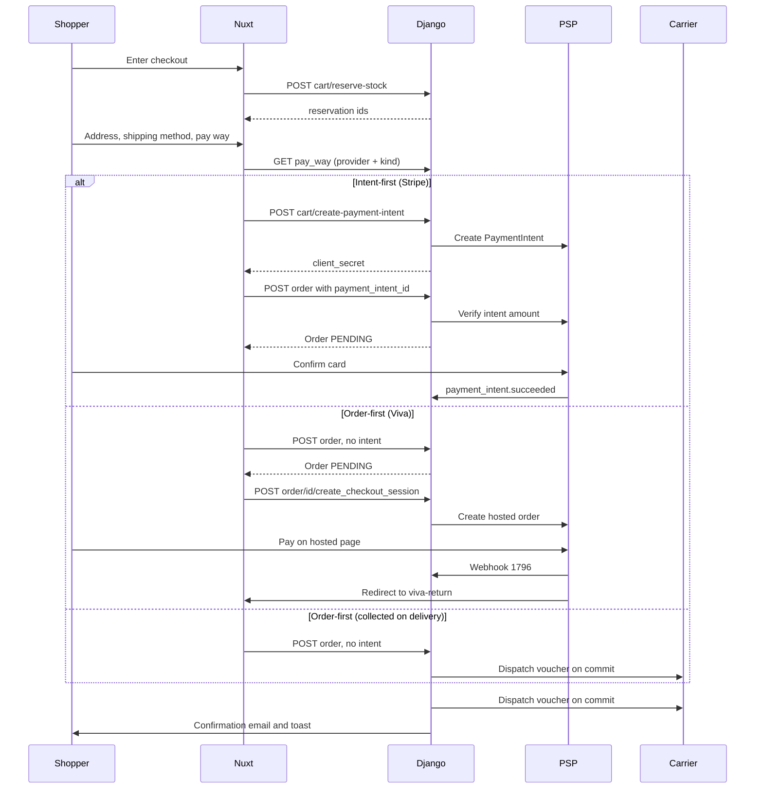

# Checkout & payment

There is exactly one order-creation endpoint and two ways through it.
Which one runs is decided by two facts about the chosen payment method:
what its **settlement** is (`pay_way/enum/settlement.py: PaySettlement`)
and whether its **provider** can mint a client-confirmed intent
(`order/payment.py: PaymentProvider.supports_payment_intent`). Never by a
provider name. Intent-first means the money is verified before the order
row exists; order-first means the order exists before any money moves.
Everything else on this page follows from that split.

For the exhaustive status tables and the audit history, read
[Order system](/dev/django/reference/order-system) — this page is the
cross-service narrative.

## Diagram

## How it works

### 1. The cart is the priced object

Every price the shopper sees and every price the order is built from
comes from the same cart row. Before any total is computed, both
creation paths re-lock the cart and re-bind wholesale pricing
(`order/services.py: create_order_from_cart` step 2.4 and
`create_order_from_cart_offline` step 2.4, both calling
`B2BPricingService.bind_cart`). The binding runs on **every**
materialisation, never once — see [B2B](/dev/flows/b2b).

Loyalty redemption and gift cards are priced under row locks in the same
transaction so the amount verified against the provider and the amount
recorded on the order cannot drift; the detail lives in
[Loyalty](/dev/flows/loyalty) and
[Promotions & gift cards](/dev/flows/promotions-and-gift-cards).

### 2. Stock is reserved, then consumed

`POST /api/v1/cart/reserve-stock` (`cart/views/cart.py: reserve_stock`)
creates one `StockReservation` per cart line, keyed on the cart UUID as
`session_id`, with a TTL from `STOCK_RESERVATION_TTL_MINUTES` (default 15,
`order/stock.py: StockManager.get_reservation_ttl_minutes`). If any line
fails the whole batch is rolled back and the endpoint answers 409 with
`failed_items`. The storefront calls it as step 1 of
`app/composables/useCheckoutSubmit.ts: onSubmit`.

At order creation `OrderService._consume_stock_for_order` reconciles the
reservations against the cart rather than converting them blindly: a
surplus hold is released, an expired hold is released and the shortfall
decremented directly, and the remainder is converted to a sale linked to
the order. This is what guards against double-decrement, a missed
decrement and oversell in one place. Physical movements are recorded as
`StockLog` rows with `OPERATION_DECREMENT`.

### 3. Address and phone validation runs twice

The storefront validates with Zod in
`app/composables/useCheckoutForm.ts`: `step1Schema` (identity and
address, phone through `isPlausiblePhone`), `step2Schema` (shipping
method plus the locker or station id the method requires) and
`step3Schema` (a pay-way id). The phone is validated on the normalised
value that will actually be submitted, so the error appears on the step
that owns the field instead of as a late 400.

**Phones follow the country, not a hardcoded `+30`.** The country API
exposes a read-only, derived `phone_metadata` on every country
(`country/serializers.py`, built by `country/phone.py` from
`phonenumbers.PhoneMetadata.metadata_for_region` and cached; never
stored): `national_number_pattern`, `possible_lengths`,
`national_prefix_for_parsing` and `example_mobile`. `app/utils/phone.ts`
uses it and no phone library of its own:

- `normalizePhone(raw, country)` passes a leading `+` through, turns
  `00` into `+`, strips the national prefix and prepends the dial code,
  guarding against a number typed with its dial code already in it.
- `isPlausiblePhone(raw, country)` checks the national pattern and
  lengths; any other `+` number gets a plain E.164 check, so a Greek
  mobile can ship to a Cypriot locker.
- `stripDialCodeForDisplay` and `dialCodeLabel` drive the dial-code
  badge, which follows the delivery country in checkout, the form's
  country in the address book and the profile country in account
  settings. The validation message quotes the country's `example_mobile`.

The storefront always submits E.164; `PHONENUMBER_DEFAULT_REGION` on the
Django side only matters for input that is not.

Django re-validates in `OrderService.validate_shipping_address`: the nine
required fields, an email format check, a phone length band, a country
check, **an active shipping rate for the chosen carrier, kind and
country**, and then whatever the chosen carrier adds through
`ShippingService.validate_order_payload`. Carrier rules live in the
adapter, not here — see [Shipping](/dev/flows/shipping).

**Region is required only where the country has regions, and must belong
to it.** `core/validators/address.py: address_errors` owns both rules,
and `region` is part of `ADDRESS_FIELDS`, so `Order.clean`,
`UserAddress.clean` and the serializers all inherit them;
`UserAddressWriteSerializer.region` is optional at the field level for
that reason. The Country API exposes a read-only `has_regions`, and the
storefront's region field (`required`, disabled state and Zod rule)
follows `selectedCountry.hasRegions` in checkout and the address forms.
The country list itself is the full ISO 3166-1 set, seeded by
`country/migrations/0012_seed_iso_countries.py`; only a rate makes a
country shippable. `order/serializers/order.py` returns field-scoped 400s for a
region in another country, a carrier with no active rate and a cart over
the rate's weight cap.

Two deliberate asymmetries: the storefront requires a street number that
Django allows blank (the courier voucher needs one), and the Greek VAT
number on an invoice order is checksum-validated on both sides so the
buyer never gets a late rejection.

### 4. Shipping method decides which pay-ways exist

`GET /api/v1/shipping/options` (`shipping/services.py:
ShippingService.available_options`) requires the delivery country and
returns one row per active `ShippingRate` for it, and each row carries
the pay-ways that combination can settle, plus `max_weight_grams` and
`exceeds_max_weight`. The checkout's country list comes from
`GET /api/v1/country?shippable=true`, so the shopper can only pick a
country the store has a rate for; a saved address elsewhere switches the
form to a new address.
`GET /api/v1/pay_way` applies the same rules through
`pay_way/filters.py`, which routes to `PayWayService.filter_by_carrier`
when a provider code is present and to `filter_by_shipping_kind` when it
is not — home delivery is provider-agnostic in checkout, so the second
form intersects the rules of every carrier that serves the kind.

Order creation re-applies both layers in
`order/views/order.py: OrderViewSet._validate_pay_way_for_order`, plus a
credentials gate (`PayWayService.is_provider_configured`). A stale client
cannot place an order with a method checkout would never have offered.

**Shipping is priced from the rate, never from a setting.** Every
caller — both order-creation paths and `cart/create-payment-intent` —
goes through `OrderService.shipping_cost`, which calls
`ShippingService.quote`. A free-shipping promotion zeroes the price but
still calls `ShippingService.assert_available`, so it cannot ship to a
country the store does not serve. The storefront reads no shipping
setting either: `shippingPrice` is the live option price or `null`
(shown as "—"), and a failed options fetch is an error state with a
retry that blocks the step, not a fallback number.
`cart/serializers/cart.py` requires `country_id` for the same reason.

### 5. Order creation: two paths, one endpoint

`POST /api/v1/order` (`OrderViewSet.create`) picks the path:

| Condition | Path | Service method |
|---|---|---|
| Settlement is `online`, provider declares `supports_payment_intent`, and a `payment_intent_id` was sent | Payment-first | `OrderService.create_order_from_cart` |
| Everything else | Order-first | `OrderService.create_order_from_cart_offline` |

The payment-first path verifies the provider's reported amount against a
server-recomputed total (cart minus promotion discount, plus shipping,
plus pay-way fee, minus loyalty, minus the gift-card plan) and raises
`PaymentAmountMismatchError` on a mismatch, logging every input that
produced it. The order is created `status=PENDING` with the
provider-reported payment status.

**The provider is asked before the transaction opens.**
`create_order_from_cart` is not `@transaction.atomic`, and neither is
`OrderViewSet.create`. `OrderService._retrieve_payment_intent` reads the
intent (for Stripe a `PaymentIntent.retrieve` and the dj-stripe sync)
and refuses one that is not PENDING, PROCESSING or COMPLETED with nothing
locked. `_create_order_for_verified_intent` is the one transaction, and it
makes no provider call: it re-compares only the intent's amount and
currency with the total it computes under lock. Inside the transaction
that HTTP round trip held the cart row and every live automatic
`Promotion` row, which every concurrent checkout locks too, and left the
connection idle in a transaction that `idle_in_transaction_session_timeout`
kills. A cart that cannot be checked out therefore costs one provider read
first.

**One order per payment intent.** `Order.payment_id` carries a partial
unique index over non-empty ids (`order_payment_id_unique`, migration
`order/migrations/0069_order_payment_id_unique.py`; `''` and NULL stay
repeatable), and `_order_created_for_payment` looks the intent up twice:
once without a lock before the provider is asked, so a repeat does not
depend on the provider being reachable, and again under the cart row lock,
which serialises two first submits of one cart. Both run before cart
validation, because the first order already took the stock. A repeat for
the same cart gets the first order back, and the view answers `201` with
it, so a double click or a retry after a timeout yields one order and one
stock decrement. An intent that belongs to another cart, or to a canceled
or deleted order, is refused as `PaymentVerificationError`, 400
`payment_verification`. Two different carts racing for one intent can
both miss the lookup; the index then rejects the second insert, and
`create_order_from_cart` recognises the constraint by name
(`PAYMENT_ID_UNIQUE_CONSTRAINT`, `order/models/order.py`) and answers it
the same way. Any other integrity error stays a generic
`invalid_order_data`. The order-first path is **not** idempotent: a
repeated Viva submit creates a second PENDING order, which the stuck-order
sweep cancels.

**Products are locked in primary-key order.** Both paths lock every
product the order touches (cart lines, the session's reservations,
free-gift products) in one statement ordered by pk
(`OrderService._lock_order_products` calling
`order/stock.py: StockManager.lock_products`), before the first
`OrderItem` insert; the cart-item query locks only the cart lines
(`of=("self",)`). Two carts holding the same products in different line
orders used to lock them in opposite orders, and PostgreSQL broke the
cycle by aborting one checkout. The lock must precede the inserts because
each insert takes `FOR KEY SHARE` on its product, which conflicts with
`FOR UPDATE`. `cancel_order` and the expired-reservation sweep lock through
the same helper, the bulk discount admin actions in `product/admin.py`
lock in pk order, and the guest-to-user cart merge (`cart/services.py`)
no longer locks products through its join.

The order-first path creates `status=PENDING, payment_status=PENDING`,
stamps `payment_id = "offline_<uuid>"` for non-online settlements, and
then branches on coverage: if deductions cover the whole total the order
is settled immediately through `Order.mark_as_paid` with a synthetic
`GIFTCARD_<uuid>` or `DISCOUNT_<uuid>` id and no provider is involved. An
intent-capable online pay-way that is only *partly* covered is a client
error, not a silent full charge.

### 6. Payment paths

**Viva Wallet — primary, hosted redirect.** The order is created first,
then `POST /api/v1/order/{id}/create_checkout_session` mints a Viva order
code (`order/payment.py: VivaWalletPaymentProvider.create_checkout_session`)
and the storefront sets `window.location.href` to the hosted page
(`app/components/VivaWalletCheckout.vue`). Every issued code is appended
to `metadata["viva_order_codes"]` — a shopper can pay on an older
session, and both the webhook and the return endpoint resolve by
`viva_order_code_q`, which matches any code ever issued.

The webhook is a machine-to-machine call that lands on the public schema,
since Viva knows nothing about the tenant boundary
(`order/views/viva_webhook.py: viva_wallet_webhook`). A GET is Viva's
verification handshake and returns the tenant's
`webhook_verification_key` when set, otherwise fetches one from Viva and
returns that — the stored key is a cache, not a requirement. A POST
resolves candidate tenants by order code, then **verifies against Viva's
Retrieve Transaction API inside each candidate's context**; only the
tenant whose credentials can retrieve the transaction processes it. The
IP allowlist is informational, a log line: refusing on Viva's hardcoded
ranges would fail closed the day they change. It reads the one address a
caller cannot write (`core/client_ip.py: client_ip_or_peer`), never a
bare `X-Forwarded-For` entry. Idempotency is a database row, not metadata:
`order/models/viva_webhook_event.py: VivaWebhookEvent` is unique on
`(transaction_id, event_type_id)`.

Event 1796 checks `StatusId == "F"`, then verifies the transaction
belongs to this order, then currency, then amount within one cent. A
verified charge whose amount disagrees stamps `AMOUNT_MISMATCH_FLAG` on
the order and refuses to mark it paid. A charge that passes every check
is recorded on the payment ledger as a CHARGE row keyed on the
transaction id, before the canceled-order and settled guards, so a second
payment under another of the order's codes is a second row. On success it
writes
`payment_id`, `payment_status=COMPLETED`, `payment_method="viva_wallet"`,
flips PENDING to PROCESSING inline, and dispatches the carrier task.
Event 1798 marks the payment failed. Event 1797 books a refund: its
`TransactionId` is the refund itself, verified through Retrieve
Transaction (`_verify_viva_refund`: one of the order's codes, status `F`,
a refund or void type, a negative amount), and it is recorded as a REFUND
row against the order's CHARGE row that its `ParentId` names. The payment
status, PARTIALLY_REFUNDED or REFUNDED, follows from the ledger's sums
(`order/payment_ledger.py: PaymentLedger.refund_status`). The handler
records its real outcome on `VivaWebhookEvent.outcome`, so a refused event
reads `skipped`, not `processed`. Refunds and the ledger are covered in
[Order lifecycle](/dev/flows/order-lifecycle).

After payment Viva redirects to a static URL configured per tenant in the
merchant portal. It lands on the Nitro route
`server/routes/checkout/viva-return.get.ts`, which calls the anonymous
`GET /api/v1/order/viva_return`, resolves `t` (transaction id) or `s`
(order code) to an order UUID, and redirects to
`/checkout/success/{uuid}`. Resolving by `s` is what wins the
browser-versus-webhook race, because the code was recorded at session
creation.

**Stripe — secondary, intent-first.** `POST /api/v1/cart/create-payment-intent`
computes the charge with exactly the inputs order creation will
re-verify, then mints the intent. The card is confirmed in the browser
(`app/components/StripePayment.vue`) against the tenant's own
publishable key. dj-stripe receives webhooks on a per-tenant, UUID-routed
endpoint, so django-tenants selects the schema and dj-stripe verifies
against that schema's `WebhookEndpoint` secret. Handlers live in
`order/signals/handlers.py`: `payment_intent.succeeded`,
`payment_intent.payment_failed`, `payment_intent.requires_action`,
`charge.refunded`, `charge.dispute.created`, `checkout.session.completed`
and `checkout.session.expired`. Each except `charge.refunded` marks
`metadata["webhook_processed_<event_id>"]` under a row lock before doing
any work; `charge.refunded` is guarded by the payment ledger instead,
because it carries the charge's cumulative refunded amount and the ledger
records only what it does not hold yet. `payment_intent.succeeded` and
`checkout.session.completed` record the charge on the ledger (the
event's `amount_received`, or the session's `amount_total`, keyed on the
PaymentIntent id), so the second of the two adds nothing.

Errors inside the succeeded, refunded and checkout-completed handlers are
allowed to **propagate**. They run inside dj-stripe's own atomic block,
so swallowing one would commit the idempotency mark for a charge that was
never recorded, and Stripe never redelivers past an accepted event id.

**Cash on delivery.** Settlement `courier_cash`. The order is created
order-first, the cart is cleared immediately (nothing is owed online),
and `_dispatch_shipment_creation_task` fires on commit. The voucher mint
advances PENDING to PROCESSING
(`AcsService._advance_pending_order_to_processing`). Payment stays
`PENDING` until ACS remits, which the nightly reconcile detects —
measured lag is around four days. That is by design, not a stuck order.
The reconcile settles the order through `OrderService.settle_cod_payment`,
which writes `payment_status=COMPLETED` and a `COD_COLLECTION` ledger row
in one atomic step under the order lock; see
[Shipping](/dev/flows/shipping). Cash never counts toward what a refund
can return.

This waiting period is specific to `courier_cash`. It is **not** shared
by the other collect-on-delivery settlement: `PaySettlement`'s
`collected_on_delivery()` returns both `courier_cash` and
`carrier_terminal`, but only the first is settled by a remittance
reconcile.

**BoxNow PAY ON THE GO.** Settlement `carrier_terminal`. Despite the
name there is no terminal: BoxNow emails a Viva payment link after
pickup and activates the collection PIN when it clears. The `delivered`
webhook event is therefore proof of payment, and
`BoxNowService._mark_cod_order_paid_on_delivery` moves the order's
payment status from PENDING to `COMPLETED` with
`payment_method="boxnow_cod"`, through the same `settle_cod_payment`
step and its `COD_COLLECTION` row. It leaves `Order.status` alone. There is
no remittance reconcile on this path, and no multi-day wait.

**Bank transfer.** Settlement `offline_transfer` exists and
`PayWayService.process_payment` handles it (it deliberately does not
write `payment_id`/`payment_status` for that settlement), but **no
bank-transfer pay-way row is seeded**. `pay_way/migrations/0019_seed_default_pay_ways.py`
seeds only cash on delivery (active), Viva Wallet and Stripe (both
inactive until credentials land). A merchant who wants bank transfer
creates the row in the admin and fills in the WYSIWYG `instructions`
field, which the confirmation email renders.

### 7. What the customer sees

| Step | Surface |
|---|---|
| Enters checkout | Three steps in `app/pages/checkout/index.vue`; stock is reserved on submit, not on arrival |
| Places a COD order | Success toast, then `/checkout/success/{uuid}?placed=1`; order-received email |
| Places a Stripe order | Order created, card form mounts, then `onPaymentSuccess` navigates to the success page |
| Places a Viva order | "Order created, complete payment" toast, then the hosted page, then back through `viva-return` |
| Lands on success unpaid | The page polls `GET /api/orders/uuid/{uuid}` every 2s — 15 attempts for Viva, 5 for Stripe — and stops on a settled status |
| Lands on success with COD | No polling at all: `placed=1` means legitimately unpaid |

The purchase pixels fire once per order from the success page, keyed on
the Meta event id Django minted at creation, and only when the shopper
arrived through a real checkout — see
[Analytics & consent](/dev/flows/analytics-and-consent).

### 8. Idempotency

- **Checkout attempt.** The storefront mints one `Idempotency-Key` per
  attempt and reuses it across automatic retries
  (`useCheckoutSubmit.ts`), clearing it on success or on a
  non-retryable error.
- **Payment-first order creation.** One order per payment intent: a
  repeat for the same cart returns the first order, backed by the
  `order_payment_id_unique` index (section 5).
- **Stripe webhooks.** `metadata["webhook_processed_<event_id>"]`,
  written under `select_for_update` before processing, except
  `charge.refunded`, which the ledger guards.
- **Money movements.** The payment ledger's
  `UNIQUE (provider, provider_reference, kind)` records each charge,
  cash collection and refund once, whichever webhook or caller reports
  it.
- **Viva webhooks.** The `VivaWebhookEvent` unique constraint, written
  *last* so a handler that raised leaves nothing behind.
- **Carrier tasks.** Each provider's create-shipment task is idempotent
  on its own shipment row, so a duplicate dispatch is harmless.
- **Emails.** Per-task reservation flags on `order.metadata`; the
  confirmation email additionally holds a short Redis execution lock so
  an OOM-killed worker cannot permanently block a resend.

### 9. Acquisition source

Every order records where the shopper came from, as one
`OrderAttribution` row written in the creation transaction by
`OrderAttributionService.record` (`order/services.py`), on both paths.

**Capture, in the browser.** `app/plugins/attribution.client.ts` runs
once per page load, synchronously, and reads `window.location` and
`document.referrer`: the URL the browser landed on, before any client
navigation. `app/composables/useOrderAttribution.ts: capture` keeps
three UTM values (trimmed, length-capped), the **names** of the
click-id parameters present (the `ClickIdsEnum` list; values identify a
click to an ad network and are never kept), the referrer's origin when
it is external, and the landing path, in per-tab `sessionStorage`. The
tab's first page load always writes it, even a direct one; afterwards
only a visit carrying a UTM or a click id replaces it. A later plain
referral is never a new landing: it is a Viva or 3-D Secure return,
which must not relabel the tab as a referral from the PSP. There is no
consent gate, because nothing persistent is stored and it is sent only
with the shopper's own order.

**Transport.** `useCheckoutSubmit.ts` adds the stored value as
`attribution` to the `POST /order` body when there is one.
`server/api/orders/index.post.ts` forwards `clientIdentityHeaders(event)`
so Django sees the shopper's `User-Agent`, not the pod's: an in-app
browser that strips `Referer` still names itself there. The agent
gateway sends only `attribution.agentProtocol`; see
[Agentic commerce](/dev/flows/agentic-commerce).

**Classification, in Django.** `order/attribution.py: classify` is pure
and first-match-wins: agent protocol, then `utm_source` (`paid` when the
medium matches GA4's paid rule or a paid click id is present, else
`campaign`), then click id, known referrer host, in-app browser
`User-Agent`, any other external referrer, and finally `direct`. The
tenant's own domains (`tenant/middleware.py: tenant_domain_set`) never
count as a referrer. Only the referrer's host and the landing path (no
query) are stored. The result is an `OrderSourceType`
(`order/enum/attribution.py`) plus `source`, `medium`, `campaign`,
`referrer_host` and `landing_path`.

**Read side.** `OrderSerializer.attribution` on order list and detail
(null for an order older than the table), the `source` / `sourceType`
filters (`order/filters.py`), and in the admin a source badge column,
two filters, read-only fields on the order's Additional Information tab
and the store dashboard's "Where orders come from" card
(`admin/dashboard/store/queries.py: order_sources`, the top five sources
plus "Other" for the selected period). The per-field reference
is section 3.4 of [Order system](/dev/django/reference/order-system).

## Invariants

- **Routing is on settlement and capability, never on a provider
  name.** `provider_supports(code, "supports_payment_intent")` and
  `PaySettlement(pay_way.settlement)` are the only discriminators
  (`order/views/order.py`, `order/services.py`, `cart/views/cart.py`).
- **Credentials never fall back to platform settings.** An unconfigured
  provider is hidden from the pay-way list, refused at order creation
  and refused at checkout-session creation
  (`PayWayService.is_provider_configured`). See
  [Multi-tenancy](/dev/platform/multi-tenancy).
- **Shipping never falls back to settings.** No active `ShippingRate`
  means no option, no quote and a 400 at order creation, on both sides
  (`shipping/services.py`, `order/services.py`,
  `app/composables/useCheckoutForm.ts`).
- **One order per provider payment.** `Order.payment_id` is unique when
  non-empty (`order_payment_id_unique`), and `create_order_from_cart`
  answers a repeat of the same cart's intent with the first order and
  refuses an intent of another cart or of a canceled or deleted order as
  `payment_verification`, the race between two carts included.
- **No provider call inside the order-creation transaction**, nor in a
  view-level `atomic`: the intent is read first, and the transaction only
  re-compares its amount and currency with the total computed under lock.
- **Product rows are locked in ascending pk order, in one statement,
  before the first row that references a product is inserted**
  (`StockManager.lock_products`); a cart-item lock never joins the
  products.
- **The charged amount is always `Order.calculate_order_total_amount()`.**
  Every charge site, every verification and every webhook amount guard
  reads it; `total_price` is the undiscounted figure and charging it is
  the bug this method exists to prevent.
- **The cart survives a hosted payment.** `Order.awaits_online_payment`
  keeps it alive until `order_paid` fires, and
  `_clear_cart_for_order` removes only the order's own lines so a basket
  built during the redirect window is not destroyed.
- **A settled payment status is final.** `SETTLED_PAYMENT_STATUSES`
  (`order/enum/status.py`) blocks any provider report — webhook or poll
  — from regressing COMPLETED, REFUNDED, PARTIALLY_REFUNDED or CANCELED.
- **Money that arrived for a cancelled order is recorded, never
  fulfilled.** Both Stripe entry points stamp
  `metadata["payment_after_cancel"]`, log at ERROR and refuse to mint a
  shipment.
- **Attribution is analytics, never authorisation.** Every input but the
  agent protocol is shopper-controlled (that one needs the gateway's
  `X-Internal-Gateway` secret); nothing reads `OrderAttribution` to price, gate
  or route an order, and a malformed `attribution` never fails a
  checkout (only its shape is validated).
- **Every order placed through checkout has exactly one attribution
  row.** No signal is a `direct` row, so for a checkout order a missing
  row means it predates attribution. Demo-seeded and test-factory orders
  have none either.
- **A Viva order code is merchant-editable metadata, so it is not proof
  of ownership.** Tenant selection is decided by which tenant's
  credentials can retrieve the transaction.

## Failure modes

- **`PaymentAmountMismatchError` at order creation.** The intent was
  priced with different inputs than the order. The warning log carries
  every input (carrier, kind, weight, country, region, cart total,
  shipping, fee, discounts); compare it against what
  `cart/create-payment-intent` received. Changing a deduction after the
  intent exists is the usual cause, which is why the storefront drops
  the intent whenever loyalty, gift cards or a coupon change.
- **400 `payment_verification` on a Stripe order.** Besides an intent in
  an invalid state, the intent already belongs to another order: a
  different cart's, or a canceled or deleted one. A repeat for the same
  cart is not refused; it gets the first order back. A repeat after the
  first order emptied the last units or deleted the cart is refused by
  the view's own cart validation, before the service, with no duplicate.
- **Migration `0069_order_payment_id_unique` stops the deploy.** Existing
  duplicate `payment_id`s abort it before anything is built (an
  `IntegrityError` naming the values and their row counts), so the PreSync
  hook fails and the old pods keep serving. It never deletes or merges
  rows: decide which order is real, cancel and clear the other, then sync
  again. The build is
  `core/db/migration_operations.py: AddUniqueConstraintAdaptively`,
  concurrent outside a transaction; a failed concurrent build drops its
  own INVALID index.
- **Shopper pays on a stale Viva tab after the total moved.** The
  webhook verifies a real charge whose amount disagrees, so it refuses
  to mark the order paid and stamps `AMOUNT_MISMATCH_FLAG`.
  `auto_cancel_stuck_pending_orders` then skips the order permanently —
  it needs a human.
- **Viva webhook for a suspended tenant.** The handler answers 503 so
  Viva redelivers. Acknowledging would drop a paid order permanently,
  and unlike BoxNow there is no polling job to rescue it.
- **Stripe Checkout Session paid but the PaymentIntent event misses.**
  `checkout.session.completed` fulfils on its own — it marks paid,
  advances to PROCESSING and dispatches the carrier task — because the
  sibling event resolves by `payment_id`, which only `mark_as_paid`
  writes.
- **Payment fails.** `handle_payment_failed` writes
  `payment_status=FAILED` and nothing else. The stock this order holds
  is **not** returned at that moment; only
  `auto_cancel_stuck_pending_orders` releases it, after
  `ORDER_AUTO_CANCEL_FAILED_PAYMENT_MINUTES`. See
  [Order lifecycle](/dev/flows/order-lifecycle).
- **Shopper abandons the hosted page.** The order sits PENDING with a
  live cart. `auto_cancel_stuck_pending_orders` closes it after
  `ORDER_AUTO_CANCEL_PENDING_HOURS`; `check_pending_orders` may email a
  reminder first, but only for online settlements.
- **Reservation expires mid-checkout.** `cleanup_expired_stock_reservations`
  marks it consumed. `_consume_stock_for_order` then releases the lapsed
  hold and decrements the shortfall directly, so a lapsed TTL does not
  fail an otherwise fulfillable checkout — unless another session
  actually took the stock, in which case the whole creation rolls back
  with `InsufficientStockError`.
- **Order attributed as `direct` although the shopper came from an
  ad.** `sessionStorage` was blocked (private mode, quota), the order
  was placed in a different tab from the one the shopper landed in, or
  an in-app browser stripped both `Referer` and its UA marker. Checkout
  is unaffected; the capture swallows storage errors.

## Source

| File | Role |
|---|---|
| `grooveshop-django-api/order/views/order.py` | `OrderViewSet.create`, the two `_create_*` helpers, payment-intent / checkout-session / retry actions, `viva_return` |
| `grooveshop-django-api/order/services.py` | `create_order_from_cart`, `_retrieve_payment_intent`, `_order_created_for_payment`, `_create_order_for_verified_intent`, `create_order_from_cart_offline`, `_lock_order_products`, `_consume_stock_for_order`, amount verification, `validate_shipping_address`, `shipping_cost`, `settle_cod_payment`, `OrderAttributionService` |
| `grooveshop-django-api/order/models/order.py` | `PAYMENT_ID_UNIQUE_CONSTRAINT` and the partial unique index on `payment_id` |
| `grooveshop-django-api/order/migrations/0069_order_payment_id_unique.py` | Builds that index, refusing existing duplicates |
| `grooveshop-django-api/core/db/migration_operations.py` | `AddUniqueConstraintAdaptively` |
| `grooveshop-django-api/order/payment_ledger.py` | `PaymentLedger`: CHARGE, COD_COLLECTION and REFUND rows, `refund_status` |
| `grooveshop-django-api/order/serializers/order.py` | Field-scoped 400s for rate, weight cap and region |
| `grooveshop-django-api/core/validators/address.py` | `address_errors`, `ADDRESS_FIELDS`, the region-in-country check |
| `grooveshop-django-api/shipping/services.py` | `quote`, `assert_available`, `available_options` |
| `grooveshop-django-api/country/serializers.py` | `phone_metadata` and `has_regions` fields |
| `grooveshop-django-api/country/migrations/0012_seed_iso_countries.py` | The full ISO 3166-1 country seed |
| `grooveshop-django-api/country/phone.py` | Phone metadata from `phonenumbers` |
| `grooveshop-django-api/country/filters.py` | `?shippable=true` |
| `grooveshop-django-api/cart/serializers/cart.py` | Required `country_id` |
| `grooveshop-django-api/order/payment.py` | `PaymentProvider` capabilities, `StripePaymentProvider`, `VivaWalletPaymentProvider`, `_PROVIDERS` registry, `money_from_minor_units` |
| `grooveshop-django-api/order/views/viva_webhook.py` | Verification handshake, tenant candidate resolution, event handlers 1796/1797/1798, `_verify_viva_refund` |
| `grooveshop-django-api/order/models/viva_webhook_event.py` | Viva idempotency table |
| `grooveshop-django-api/order/signals/handlers.py` | Every dj-stripe receiver and the order signal chain |
| `grooveshop-django-api/order/attribution.py` | `classify`, the `KNOWN_SOURCES` / `CLICK_ID_PARAMS` registries, `source_label` |
| `grooveshop-django-api/order/models/attribution.py` | `OrderAttribution` |
| `grooveshop-django-api/order/enum/attribution.py` | `OrderSourceType` |
| `grooveshop-django-api/order/serializers/order.py` | `OrderAttributionInputSerializer` (write), `OrderAttributionSerializer` (read) |
| `grooveshop-django-api/order/filters.py` | `source` and `sourceType` order filters |
| `grooveshop-django-api/order/stock.py` | `StockManager` reserve, convert, decrement, increment, cleanup, `lock_products` |
| `grooveshop-django-api/pay_way/services.py` | `is_provider_configured`, `filter_by_carrier`, `filter_by_shipping_kind`, `process_payment` |
| `grooveshop-django-api/pay_way/enum/settlement.py` | `PaySettlement` and why the old booleans were replaced |
| `grooveshop-django-api/pay_way/migrations/0019_seed_default_pay_ways.py` | Which pay-ways a fresh tenant gets |
| `grooveshop-django-api/cart/views/cart.py` | `reserve_stock`, `release_reservations`, `create_payment_intent` |
| `grooveshop-storefront-ui-node-nuxt/app/composables/useCheckoutForm.ts` | Zod step schemas, shippable countries, shipping options and their error state, pay-way loading |
| `grooveshop-storefront-ui-node-nuxt/app/utils/phone.ts` | `normalizePhone`, `isPlausiblePhone`, `stripDialCodeForDisplay`, `dialCodeLabel` |
| `grooveshop-storefront-ui-node-nuxt/app/composables/useCheckoutSubmit.ts` | Submit orchestration, idempotency key, the three payment flows |
| `grooveshop-storefront-ui-node-nuxt/app/composables/useOrderAttribution.ts` | Per-tab landing capture and the override rule |
| `grooveshop-storefront-ui-node-nuxt/app/plugins/attribution.client.ts` | Runs the capture once per page load |
| `grooveshop-storefront-ui-node-nuxt/app/composables/useCheckout.ts` | Reserve / release / create-intent calls |
| `grooveshop-storefront-ui-node-nuxt/server/api/orders/index.post.ts` | Order proxy, Meta context injection, shopper identity headers, upstream error forwarding |
| `grooveshop-storefront-ui-node-nuxt/server/routes/checkout/viva-return.get.ts` | Viva redirect translation |
| `grooveshop-storefront-ui-node-nuxt/app/pages/checkout/success/[uuid].vue` | Success page, payment-status polling, purchase pixels |
