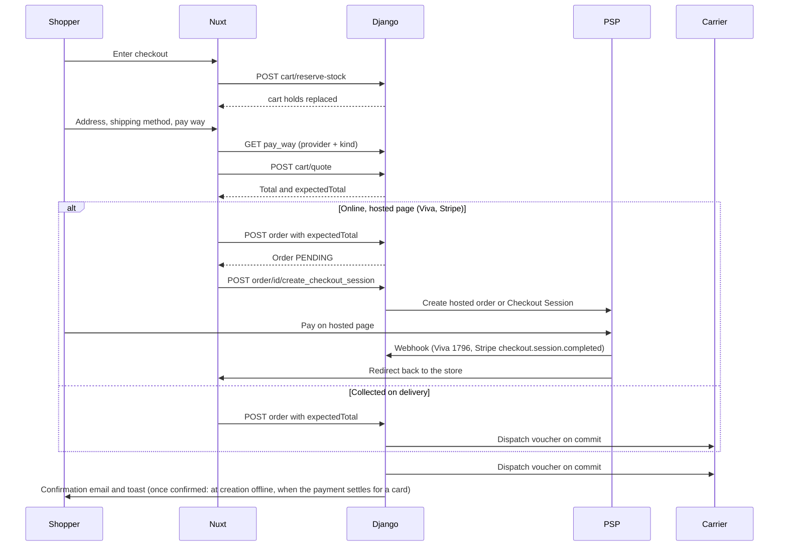

# Checkout & payment

There is exactly one order-creation endpoint and one way through it,
whatever the payment method: **the order is created first, and paid
afterwards** (`src/order/services.py: OrderService.create_order_from_cart`).
An offline pay way (cash on delivery, BoxNow's terminal, bank transfer) is
collected later; an online one (Viva Wallet, Stripe) is paid on the
provider's hosted page for the order that already exists. So the locked
quote runs every refusal (stock, total, cart digest, the wholesale minimum)
before any money moves. What follows the order differs by the pay way's
**settlement** (`src/pay_way/enum/settlement.py: PaySettlement`), never by a
provider name.

For the exhaustive status tables and the audit history, read
[Order system](/dev/django/reference/order/) — this page is the
cross-service narrative.

## Diagram

## How it works

### 1. The cart is the priced object

Every price the shopper sees and every price the order is built from
comes from the same cart row. Before any total is computed, order
creation re-locks the cart and re-binds wholesale pricing
(`src/order/services.py: create_order_from_cart`, step 2.4 of its locked
half `_create_order_locked`, calling `B2BPricingService.bind_cart`). The binding runs on **every**
materialisation, never once — see [B2B](/dev/flows/b2b).

Every call that changes the cart answers with the whole cart as `GET /cart`
would read it, so the storefront never follows a change with a reload: an
add or a quantity change (`POST /cart/item`, `PUT` and `PATCH
/cart/item/{id}`) answers with the line and the cart beside it as `cart`, and
a coupon apply or remove answers with the cart. The Nuxt proxy returns that
cart, and the cart store sets it (`createCartItem`, `updateCartItem` and
`setCart` in `app/stores/cart.ts`). Removing a line answers 204 with no body,
so `deleteCartItem` reads the cart once. A click on an add-to-cart button
is answered at once: an "Adding…" toast opens before the request and the
answer replaces it in place with "Added" or the failure
(`app/composables/useAddToCart.ts`, `app/utils/toast.ts`); stock is Django's
to judge, so "Added" never shows before it answers. The cart payload carries
no suggestions: the cart page and drawer ask for them
([Recommendations](/dev/flows/recommendations#the-storefront-strip)).

Loyalty redemption and gift cards are priced under row locks in the same
transaction so the amount quoted and the amount recorded on the order
cannot drift; the detail lives in
[Loyalty](/dev/flows/loyalty) and
[Promotions & gift cards](/dev/flows/promotions-and-gift-cards).

### 2. Stock is reserved, then consumed

`POST /api/v1/cart/reserve-stock` (`src/cart/views/cart.py: reserve_stock`)
makes the cart's holds exactly its current quantities, through
`src/order/inventory/stock.py: StockManager.reserve_cart_stock`. One transaction locks the
`Cart` row first (`select_for_update`, the lock checkout takes first), then
every product the old or the new set touches in pk order, releases **all**
of the cart's unconsumed holds (expired ones included, each with its
`StockLog` line) and reserves one `StockReservation` per product, keyed on
the cart UUID as `session_id`, with a TTL from the store setting
`STOCK_RESERVATION_TTL_MINUTES` (default 30,
`StockManager.get_reservation_ttl_minutes`). The holds are replaced, never
stacked: the cart's own earlier holds never count against it, a retry is
idempotent, and a line that changed or left the cart is freed in the same
step. Holds of other carts still count, so two carts exclude each other for
the last unit. Because the cart row lock serialises this call with a
checkout of the same cart and with the login merge that rehomes its holds,
a checkout never reads a hold set half replaced. If any line is short the
transaction rolls back, the cart keeps the holds it had, and the endpoint
answers 409 `insufficient_stock` with every short line in `failed_items`.
The `reservation_ids` in the answer are informational: the ids from an
earlier answer are already released. The storefront calls it as step 1 of
`app/composables/useCheckoutSubmit.ts: onSubmit`.

At order creation `OrderService._consume_stock_for_order` takes the cart's
holds by cart (every unconsumed reservation whose `session_id` is the cart
UUID), never by id, and reconciles them against the cart rather than
converting them blindly: a
surplus hold is released, an expired hold is released and the shortfall
decremented directly, and the remainder is converted to a sale linked to
the order. This is what guards against double-decrement, a missed
decrement and oversell in one place. Physical movements are recorded as
`StockLog` rows with `OPERATION_DECREMENT`.

### 3. Address and phone validation runs twice

The storefront validates with Zod in
`app/composables/useCheckoutForm.ts`: `step1Schema` (the **Details** step:
contact, recipient name, country, order notes; phone through
`isPlausiblePhone`), `step2Schema` (the **Delivery** step: the shipping method,
the locker or station id a pickup method requires, and for a home delivery the
street, number, postcode, city and region, plus the receipt or invoice choice)
and `step3Schema` (a pay-way id). The phone is validated on the normalised
value that will actually be submitted, so the error appears on the step
that owns the field instead of as a late 400.

**Phones follow the country, not a hardcoded `+30`.** The country API
exposes a read-only, derived `phone_metadata` on every country
(`src/country/serializers.py`, built by `src/country/phone.py` from
`phonenumbers.PhoneMetadata.metadata_for_region` and cached; never
stored): `national_number_pattern`, `possible_lengths`,
`national_prefix_for_parsing` and `example_mobile`. `app/utils/phone.ts`
uses it and no phone library of its own:

- `normalizePhone(raw, country)` passes a leading `+` through, turns
  `00` into `+`, strips the national prefix and prepends the dial code,
  guarding against a number typed with its dial code already in it.
- `isPlausiblePhone(raw, country)` checks the national pattern and
  lengths; any other `+` number gets a plain E.164 check, so a Greek
  mobile can ship to a Cypriot locker.
- `stripDialCodeForDisplay` and `dialCodeLabel` drive the dial-code
  badge, which follows the delivery country in checkout, the form's
  country in the address book and the profile country in account
  settings. The validation message quotes the country's `example_mobile`.

The storefront always submits E.164; `PHONENUMBER_DEFAULT_REGION` on the
Django side only matters for input that is not.

Django re-validates in `OrderService.validate_shipping_address`: the nine
required fields, an email format check, a phone length band, a country
check, **an active shipping rate for the chosen carrier, kind and
country**, and then whatever the chosen carrier adds through
`ShippingService.validate_order_payload`. Carrier rules live in the
adapter, not here — see [Shipping](/dev/flows/shipping).

**Region is required only where the country has regions, and must belong
to it.** `src/core/validators/address.py: address_errors` owns both rules,
and `region` is part of `ADDRESS_FIELDS`, so `Order.clean`,
`UserAddress.clean` and the serializers all inherit them;
`UserAddressWriteSerializer.region` is optional at the field level for
that reason. The Country API exposes a read-only `has_regions`, and the
storefront's region field (`required`, disabled state and Zod rule)
follows `selectedCountry.hasRegions` in checkout and the address forms.
The country list itself is the full ISO 3166-1 set, seeded by
`src/country/migrations/0012_seed_iso_countries.py`; only a rate makes a
country shippable. `src/order/serializers/order.py` returns field-scoped 400s for a
region in another country, a carrier with no active rate and a cart over
the rate's weight cap.

Two deliberate asymmetries: the storefront requires a street number that
Django allows blank (the courier voucher needs one), and the Greek VAT
number on an invoice order is checksum-validated on both sides so the
buyer never gets a late rejection.

#### The delivery address: home delivery or pickup point

The address belongs to the delivery step, because only a home delivery needs
one (`app/components/Checkout/StepShipping.vue`; the webside design has its
own copies under `app/components/variants/webside/Checkout/`).

- **Home delivery.** `app/components/Checkout/DeliveryAddress.vue` asks for the
  street, number, postcode, city and region (and offers to save the address to
  the address book). The street may be sent as one line with the number at its
  end, the Greek and Cypriot form: order creation splits it in one place
  (`src/core/validators/address.py: split_street_line`) so the order stores the
  two columns the courier voucher, the invoice and myDATA read. A number written
  first, or text after the number, is not guessed: the order is refused with
  400 `street_number_missing` on `street`. A `streetNumber` that is sent is
  used as sent. An optional second field, **Address line 2** (a flat, a floor or a
  building), is sent as `addressLine2` on a home-delivery order only, never on a
  pickup order, and is kept when the address is saved; the account's address
  forms, the address cards, checkout's saved-address cards and the review summary
  show it after the street. Django stores it on
  `Order.address_line_2` apart from the customer's note; the order pages print
  `fullAddress`, which already holds it after the street, the receipt and the
  order emails print it under the street, and the ACS voucher's `Delivery_Notes`
  carry it after the order's floor (which checkout does not ask for) and before the customer's note
  (`src/shipping/services.py: CourierNotes`, `docs/order/creation-address.md`).
- **Pickup point.** Only the picker is shown, and no address is sent. For
  `shipping_kind=pickup_point` the buyer's street, number, city and postcode
  are not required or kept: order creation stores the point's address from the
  carrier's catalogue (`ShippingService.pickup_point_address`,
  `ShippingCarrierInterface.address_of_pickup_point`: the BOX NOW locker, or
  the exact ACS station and branch) as the order's delivery address, with
  no region, floor, location type or address line 2
  (`src/order/serializers/order.py`, the pickup branch of the order
  validation). One snapshot is what the receipt, the ACS voucher and the order
  page read. Name, email and phone stay required.
- **Refusals** (400, on the carrier's location field): `pickup_point_required`
  (no point chosen), `pickup_point_unknown` (the catalogue does not hold it;
  a point that is missing is looked up once by resyncing the carrier's
  catalogue, for at most `PICKUP_POINT_RESYNC_TIMEOUT_SECONDS`) and
  `pickup_point_in_another_country`. The storefront sends the shopper back to
  the delivery step with a message under the picker
  (`shared/constants/orderRefusals.ts`). A 503
  `pickup_point_check_unavailable` with `Retry-After`
  (`src/shipping/api_errors.py: PickupPointCheckUnavailable`) means the point
  could not be judged because the cache holding the resync guard is down:
  `server/api/orders/index.post.ts` lets that one body through, and the
  checkout says to try again, keeping the order's idempotency key.
- **Receipt or invoice.** `app/components/Checkout/DocumentChoice.vue` sits under
  the address. "Same as delivery" is offered only for a home delivery; an
  invoice to a pickup point must name the company's address.

### 4. Shipping method decides which pay-ways exist

`GET /api/v1/shipping/options` (`src/shipping/services.py:
ShippingService.available_options`) requires the delivery country and
returns one row per active `ShippingRate` for it, and each row carries
the pay-ways that combination can settle, plus `max_weight_grams` and
`exceeds_max_weight`. The checkout's country list comes from
`GET /api/v1/country?shippable=true`, so the shopper can only pick a
country the store has a rate for; a saved address elsewhere switches the
form to a new address.
`GET /api/v1/pay_way` applies the same rules through
`src/pay_way/filters.py`, which routes to `PayWayService.filter_by_carrier`
when a provider code is present and to `filter_by_shipping_kind` when it
is not — home delivery is provider-agnostic in checkout, so the second
form intersects the rules of every carrier that serves the kind.

Order creation and the quote ask one rule for the same answer: `OrderQuoteService.offered_pay_ways`
(`src/order/checkout/quote.py`) lists the pay ways a shopper is offered for
the chosen delivery (active, through a provider the store holds credentials
for, not excluded for that delivery), and
`src/order/views/order.py: OrderViewSet._validate_pay_way_for_order` accepts a
pay way exactly when it is on that list, before the order is created.
A home delivery that names no carrier (the storefront never names one) is
judged by every carrier that could take it. An order sent without a
`shippingKind` is a home delivery for the price, the carrier it is assigned
and this rule alike: all three read `OrderQuoteService.delivery_kind`. A stale
client cannot place an order with a method checkout would never have offered;
the refusal is 400 `pay_way_unavailable`, its message under `payWayId` on
order creation.

**Shipping is priced from the rate, never from a setting.** Every
caller — the quote and order creation —
goes through `OrderQuoteService.shipping_cost`
(`src/order/checkout/quote.py`), which calls `ShippingService.quote`. A free-shipping promotion zeroes the price but
still calls `ShippingService.assert_available`, so it cannot ship to a
country the store does not serve. The storefront reads no shipping
setting either: `shippingPrice` is the live option price or `null`
(shown as "—"), and a failed options fetch is an error state with a
retry that blocks the step, not a fallback number.
`src/cart/serializers/cart.py` requires `country_id` for the same reason.

**Free shipping and a free pay-way fee are judged on one value.**
`OrderQuoteService.threshold_value(cart_total, discount_total)` is the products
after promotion and coupon discounts, never below zero, excluding shipping
and the pay-way fee; loyalty points and gift cards are payment, not
discounts, and do not move it. `ShippingService.quote` makes a rate free
when that value reaches `ShippingRate.free_shipping_threshold` (a `NULL`
threshold is never free), and `OrderQuoteService.calculate_payment_method_fee`
waives the fee when it reaches a non-zero `PayWay.free_threshold`.
`OrderQuoteService.quote` computes it once and passes it to both, for every
caller: the quote (`src/cart/views/cart.py`) and order creation, so the
preview and the order cannot disagree. The cart serializer exposes it as
`freeThresholdValue` (`src/cart/serializers/cart.py:
get_free_threshold_value`). Nothing on the client compares it by hand: the
storefront prints the quote's rows, its priced `shippingOptions` and the
fee of each pay way (`payWays[]`, already 0 when `waived`), and uses the
cart's `freeThresholdValue` only as the shipping options' `orderValueAmount`
(`useCheckoutForm.ts`) and as the cap on a points redemption. The gateway
prices from the same quote. Before the quote, free shipping compared the
gross cart total and the fee compared products plus shipping, so a cart just
under a threshold could pay shipping and skip the fee.

**The storefront shows Django's quote and adds nothing up.**
`useCheckoutQuote` (`app/composables/useCheckoutQuote.ts`) asks
`POST /api/cart/quote` (the Nuxt proxy `server/api/cart/quote.post.ts`, which
names the cart as order creation does, never by `X-Cart-Token`) with
`quoteRequestOf` the order the form would place (`app/utils/checkoutOrder.ts`;
a choice the shopper has not reached yet is left out, so Django leaves its
rows null rather than price a pre-selection). It asks again when that request
changes as a value or the cart does, and not at all without a cart line
(Django refuses `cart_empty`). The summary, the «Pay …» button, the delivery
cards and the points cap read the quote as it came.
`useQuotedPayWayOptions` (`app/composables/useQuotedPayWayOptions.ts`) lists
the pay ways with the fee the quote priced for each; a pay way the quote has
no row for shows no fee rather than a guessed one. The order sends the
quote's `expectedTotal` (`useCheckoutSubmit.ts`): the submit waits for a quote
in flight (`useCheckoutQuote.current`), places no order at a total the page
did not show, and a 409 `total_changed` (told by `code`, `error.quote` the new
quote) shows the new total for the shopper to accept with the next submit.
`useCheckoutTotals` and `payWayCost.ts` are gone.

### 5. Order creation: one path, every pay way

`POST /api/v1/order` (`OrderViewSet.create`, `src/order/views/order.py`)
validates the body and the pay way, then calls
`OrderService.create_order_from_cart` for every pay way. The body carries
no payment; the cart comes from `X-Cart-Id`. The order is created
`status=PENDING, payment_status=PENDING`; an online one gets no `payment_id`
until its payment is booked, and keeps the cart until it is paid
(`Order.awaits_online_payment`).

#### One total: the checkout quote

`OrderQuoteService.quote` (`src/order/checkout/quote.py`) is the one
computation of what checkout charges: a rule added there reaches every
caller. It returns a frozen `CheckoutQuote`: the cart's lines as priced
(`lines`, `QuoteLine`, `OrderQuoteService.priced_lines`: the quote reads the
lines once and evaluates the promotions over that same read,
`PromotionEngine.evaluate(..., items=...)` in
`src/promotion/engine/evaluation.py`, so the promotions, the subtotal, the
parcel and the cart digest all come from it), the products, the
promotions with each attached coupon's verdict (`coupons`,
`CartDiscountResult.coupon_verdicts` in `src/promotion/engine/results.py`, the
computation the cart's `appliedCoupons` uses too), the parcel (free gifts included), the delivery (`ShippingCharge`: price and
`waived_by`), the pay-way fee (amount and `waived`), the loyalty discount,
the gift-card plan, `grand_total` (the goods after promotions plus shipping
and the fee) and `amount_due` (what is left after loyalty and gift cards,
and what the order stores).

| Caller | Locks | Reads |
|---|---|---|
| `POST /api/v1/cart/quote` (`CartViewSet.quote`) | none | the whole quote; partial input allowed |
| `create_order_from_cart` | `lock=True` | the order's charges |

- **A row is never guessed.** Without a delivery `shipping` is `None`, without
  a pay way the fee is, and the rows that need both (`grand_total`, the
  gift-card plan, `amount_due`) are `None` with them.
- **`lock=True` is order creation.** It locks the candidate `Promotion` rows,
  the customer's row (when points are redeemed) and the gift cards until
  commit, so what was quoted is what `record_redemptions`,
  `LoyaltyService.redeem_points` and `GiftCardService.record_plan` write. A
  refused attached coupon raises `InvalidCouponError`; without the lock it is
  reported on the quote (`blockingCoupon`). Order creation takes the
  customer's and gift-card locks before the lines and products.
- **The order is built from the quote's rows**
  (`OrderService._quote_under_lock`). `Order.calculate_order_total_amount()`
  still decides what is stored, and `OrderService._require_quoted_total` rolls
  the creation back (400 `invalid_order_data`, logged at ERROR) when that sum
  is not the quote's `amount_due`, so "one total" is enforced, not assumed.
- **The delivery is priced before the transaction.** A carrier's live price
  is an HTTP call (ACS: a 15 s timeout) that would hold the cart,
  promotion, customer and gift-card rows. Order creation calls
  `OrderService._resolve_live_shipping` ahead of its transaction, where the
  carrier's adapter caches the answer; the locked quote prices with
  `cached_only` and never calls out. A parcel the cache has no answer for
  (the cart changed in between, or the entry expired) rolls the creation back
  with `ShippingPriceUnresolvedError`; the cart is priced again with nothing
  locked and answered as 409 `total_changed` carrying that quote
  (`OrderService._refuse_unpriced`). This 409 is a separate refusal from the
  `expectedTotal` comparison below, and its quote is the one the order would
  have been created at. ACS's live price is cached per country, region and
  weight bracket for five minutes (`src/shipping_acs/carrier.py:
  AcsCarrier._fetch_live_quote`), so a polled quote does not reach the carrier
  each time, and a failed call is remembered for 60 seconds (the stored rate is
  charged meanwhile), so an outage is not re-asked on every attempt.
- **Points pay for goods, never for shipping or a fee.** The cap on a
  redemption is the goods after promotions (`threshold_value`), one value for
  the quote, order creation and `POST /loyalty/redeem`; see
  [Loyalty](/dev/flows/loyalty#redeeming).
- **`POST /api/v1/cart/quote`** takes the checkout's choices, every one
  optional (`CartQuoteRequestSerializer`). A delivery is priced once
  `shippingKind` and `countryId` are both given (order creation prices a
  missing kind as a home delivery; a quote does not assume one). It returns
  the lines it priced (`lines`, `QuoteLineSerializer` in
  `src/order/serializers/quote.py`: the cart item `id`, `productId`,
  `productName` in the request's language, `mainImagePath`, `quantity`,
  `unitPrice`, `totalPrice` before promotions and `promotionDiscount`, which add
  up to `itemsSubtotal` and `discountTotal`), each attached coupon's verdict
  (`appliedCoupons`, the cart's own: one serializer and one schema
  declaration, `AppliedCouponSerializer` and `APPLIED_COUPONS_SCHEMA` in
  `src/order/serializers/quote.py`: `code`, `amount`, `freeShipping`,
  `gift`, `rejection`), the rows (`itemsSubtotal`, `discountTotal`,
  `appliedPromotions`, `blockingCoupon`, `freeThresholdValue`, `shipping`, `paymentMethodFee`,
  `loyaltyDiscount`, `giftCardAmount`, `grandTotal`, `amountDue`,
  `currency`), `expectedTotal` (`{amount, currency}` in minor units, to send
  back with the order) and the priced lists `shippingOptions` (each priced
  as an order would be, with `waivedBy`; null without a country) and `payWays`
  (each with its fee and `waived`). A row that depends on a choice the request
  did not make is null. A client renders a checkout from this one answer: the
  agent gateway reads no cart beside it.
  - The cart is found as order creation finds it (`get_existing_cart`): 404
    `cart_not_found`, never a new cart; an empty one is 400 `cart_empty`.
  - Refusals are `{detail, reason, code}`. A delivery that cannot be priced
    has a code of its own (`src/shipping/enum/refusal.py: ShippingRefusal`:
    `shipping_unavailable`, `shipping_region_unavailable` (the delivery
    reaches the country but not the region's [shipping
    zone](/dev/flows/shipping#shipping-zones)), `shipping_parcel_too_large`,
    `shipping_weight_exceeded`) so a client drops the selection instead of
    matching translated text; order creation keeps `invalid_order_data` with
    `fieldErrors` for the same four. The rest: `pay_way_unavailable`,
    `pay_way_not_found`,
    `loyalty_requires_authentication`, `loyalty_redemption_invalid`,
    `loyalty_redemption_too_small` and the gift card's own reason.
  - `X-Cart-Token` is accepted: the quote is then the cart owner's price.
    Points are priced only for the signed-in owner, so a token request that
    asks to redeem points is refused `loyalty_requires_authentication`, and
    order creation takes no token: a token quote must not feed the expected
    total of an anonymous order.
  - A quote only prices. Stock, the cart's validity, the wholesale minimum,
    the legal texts and the unpaid-order limit are order creation's to judge.
  - It has no VAT total: the receipt's VAT taxes shipping and the fee at the
    goods' rates and spreads the loyalty discount over the lines, while the
    cart's `totalVatValue` is the goods only.
- **The cart digest** (Django #765, refined by #770; it is not part of the pickup change). A quote with a delivery chosen also returns
  `cartDigest`, an HMAC over what the order would be made of (each of the quote's `lines`, the
  promotions with their codes and amounts, the delivery with its pickup point; not the pay way, so a changed pay way does not change it, and not the shipping charge, fee, loyalty or gift-card amounts, which `expectedTotal` holds);
  `POST /api/v1/order` takes an optional `expectedCartDigest` and, on a
  difference, creates nothing and answers 409 `cart_changed` with the fresh
  quote. It catches what the total cannot, such as a line swapped for one at
  the same price or another locker at the same rate
  (`OrderQuoteService.cart_digest`, `order.enum.create_error.CART_CHANGED_CODE`).
  Like `total_changed` it is a `code` under `error.type` `invalid_order_data`,
  and Django still accepts an order without it, though the storefront and
  the gateway send it on every order.
- **The expected total.** `POST /api/v1/order` requires
  `expectedTotal` (`{amount, currency}`, minor units, as the quote returned it;
  `OrderCreateFromCartSerializer.expected_total`, `src/order/serializers/order.py`):
  an order without it is refused 400 on the field, and
  `OrderService.create_order_from_cart` needs it, so no order is placed
  without the total check. It is compared,
  exactly, with the amount due computed under the cart lock and before
  anything is written. A difference creates nothing (no points, card balance,
  stock or cart line is taken) and answers **409**
  `{detail, error: {type, quote}, code: "total_changed"}`, `quote` being what
  the order would have been created at. It is the only amount check order
  creation has: the payment is opened afterwards for the order's own
  `calculate_order_total_amount()`. A price, VAT or markdown edit,
  a promotion starting or ending, a changed rate or fee, a live carrier price
  leaving its cache and another email than the one quoted with (promotions are
  evaluated with the checkout email) are each a `total_changed` by design, when
  they change the amount due that is compared; a change that leaves it equal is
  not refused. A live carrier price that left its cache is refused as
  `total_changed` whatever total the client sent. `error.type` is `invalid_order_data` for now: the
  enum value follows a storefront release, see
  [OpenAPI contract](/dev/django/openapi-contract#a-new-value-in-a-response-enum-ships-consumer-first).
  The storefront and the gateway send it on every order (the gateway since
  v1.49.0), which is why it could become required; the Django reference is
  `docs/order/creation.md` §3.0.
- **Budgets.** The quote is repeated on every change of a checkout and polled
  by the agent gateway, so it has its own throttle scopes, `cart_quote`
  (signed-in callers) and `cart_quote_anon` (guests; per cart for a request
  that carries the gateway's secret), not the cart's write budget
  (`src/cart/throttles.py: CartQuoteThrottle`, `CartQuoteAnonThrottle`).
  Guessing a gift-card code is budgeted on the quote and order creation
  alike (`gift_card_code_throttles`): only a code new to the
  cart counts, the cart remembering the codes it was allowed to try for
  `GIFT_CARD_CODES_SEEN_TTL_SECONDS` as keyed digests (never the code), so
  re-pricing the same card is never refused. The caller pays from the
  `gift_card_check` scope that `/giftcard/check` spends too (the signed-in
  customer, else the cart for a gateway request, else the address); the check
  and the count are one step under the budget's lock, and the codes are read by
  the route's own request serializer so a JSON list, repeated form keys and
  indexed form keys are counted as they are priced.
- **Every client reads it.** The storefront prints it
  (`useCheckoutQuote`, section 4) and the gateway prices its checkout
  sessions from it (`grooveshop-agent-gateway/internal/checkout/pricing.go`,
  `django.Client.Quote`); neither adds up a total of its own.

**No provider is asked, and no carrier inside the transaction.** Order
creation makes no provider call at all, and the carrier's live price is
resolved before its one transaction (`_create_order_locked`) opens.
`OrderViewSet.create` is deliberately not `@transaction.atomic`: a
view-level block would put that HTTP call back inside a transaction, holding
the cart row and every live automatic `Promotion` row (which every
concurrent checkout locks too) and leaving the connection idle in a
transaction that `idle_in_transaction_session_timeout` kills.

**Not idempotent for the storefront.** An online order keeps the cart, so
a new checkout attempt (a new `Idempotency-Key`: the shopper submits again
after the first attempt was answered) creates a second PENDING order, which
the stuck-order sweep cancels once its payment hold ends. An automatic retry
of one attempt reuses its key and replays the first answer (section 8). The agent gateway names its
checkout instead and gets the same order back (section 8).
`Order.payment_id` still carries a partial unique index over non-empty ids
(`order_payment_id_unique`, migration
`src/order/migrations/0069_order_payment_id_unique.py`; `''` and NULL stay
repeatable): one provider payment settles one order.

**Products are locked in primary-key order.** Order creation locks every
product the order touches (cart lines, the session's reservations,
free-gift products) in one statement ordered by pk
(`OrderService._lock_order_products` calling
`src/order/inventory/stock.py: StockManager.lock_products`), before the first
`OrderItem` insert; the cart-item query locks only the cart lines
(`of=("self",)`). Two carts holding the same products in different line
orders used to lock them in opposite orders, and PostgreSQL broke the
cycle by aborting one checkout. The lock must precede the inserts because
each insert takes `FOR KEY SHARE` on its product, which conflicts with
`FOR UPDATE`. `cancel_order` and the expired-reservation sweep lock through
the same helper, the bulk discount lock in pk order
(`src/product/services.py: ProductService.set_discount`, which the admin's
discount and clear-discount actions in `src/product/admin/product.py` call;
it saves the products one by one, never with `update()`), and the guest-to-user cart merge (`src/cart/services.py`)
no longer locks products through its join.

Before it creates anything, order creation refuses an online-settled
order from a customer who already has `ORDER_MAX_UNPAID_ONLINE_ORDERS`
unpaid online orders waiting (`OrderService._enforce_unpaid_order_limit`,
per-store setting, default 5, `0` off; the customer is the account, or the
guest email). The orders counted are
`src/order/managers/order.py: holding_stock_for_online_payment`: PENDING,
online-settled, payment not financially final, so an order whose payment
is pending, processing or failed counts, because each still holds its
stock. The service raises `UnpaidOrderLimitError`, and
`OrderViewSet.create` answers it as a 400 validation error on `pay_way_id`
with the code `unpaid_order_limit` and a sentence naming the limit
(`src/order/views/order.py`), before its generic `invalid_order_data`
branch.

Order creation stamps `payment_id = "offline_<uuid>"` for non-online
settlements, and then branches on coverage: if deductions cover the whole
total the order is settled immediately through `Order.mark_as_paid` with a
synthetic `GIFTCARD_<uuid>` or `DISCOUNT_<uuid>` id and no provider is
involved, whatever the pay way. A partial cover is not refused: the
remainder is what the payment is opened for.

### 6. Payment paths

**Viva Wallet — primary, hosted redirect.** The order is created first,
then `POST /api/v1/order/{id}/create_checkout_session` mints a Viva order
code (`src/order/payments/payment.py: VivaWalletPaymentProvider.create_checkout_session`)
and the storefront sets `window.location.href` to the hosted page
(`app/components/VivaWalletCheckout.vue`). Every issued code is appended
to `metadata["viva_order_codes"]` — a shopper can pay on an older
session, and both the webhook and the return endpoint resolve by
`viva_order_code_q`, which matches any code ever issued.

The webhook is a machine-to-machine call that lands on the public schema,
since Viva knows nothing about the tenant boundary
(`src/order/views/viva_webhook.py: viva_wallet_webhook`). A GET is Viva's
verification handshake and returns the tenant's
`webhook_verification_key` when set, otherwise fetches one from Viva and
returns that — the stored key is a cache, not a requirement. A POST
resolves candidate tenants by order code, then **verifies against Viva's
Retrieve Transaction API inside each candidate's context**; only the
tenant whose credentials can retrieve the transaction processes it. The
IP allowlist is informational, a log line: refusing on Viva's hardcoded
ranges would fail closed the day they change. It reads the one address a
caller cannot write (`src/core/client_ip.py: client_ip_or_peer`), never a
bare `X-Forwarded-For` entry. Idempotency is a database row, not metadata:
`src/order/models/viva_webhook_event.py: VivaWebhookEvent` is unique on
`(transaction_id, event_type_id)`.

Event 1796 checks `StatusId == "F"`, then verifies the transaction
belongs to this order, then currency, then amount within one cent. A
verified charge whose amount disagrees stamps `AMOUNT_MISMATCH_FLAG` on
the order and refuses to mark it paid. From then on the order detail serves
`paymentAwaitsReview: true` (`src/order/payments/payment_hold.py:
awaits_payment_review`, `src/order/serializers/order.py:
OrderDetailSerializer.payment_awaits_review`) while the order is still
undecided, that is PENDING with the charge not accepted (payment not
COMPLETED, a refund in full or in part included). The flag is never
cleared: an order the store accepts, fulfils or cancels leaves the set
through its own state. A charge that passes every check
is recorded on the payment ledger as a CHARGE row keyed on the
transaction id, before the canceled-order and settled guards, so a second
payment under another of the order's codes is a second row. On success it
writes
`payment_id`, `payment_status=COMPLETED`, `payment_method="viva_wallet"`,
flips PENDING to PROCESSING inline, and dispatches the carrier task.
Event 1798 marks the payment failed. Event 1797 books a refund: its
`TransactionId` is the refund itself, verified through Retrieve
Transaction (`_verify_viva_reversal`: one of the order's codes, status `F`,
a refund or void type, a negative amount), and it is recorded as a REFUND
row against the order's CHARGE row that its `ParentId` names. A parent the
ledger does not hold yet (its 1796 is late or lost) is booked first when
Viva places it, captured, on one of the order's codes
(`_viva_charge_for`). The payment status, PARTIALLY_REFUNDED or REFUNDED,
follows from the ledger's sums (`src/order/payments/payment_ledger.py:
PaymentLedger.refund_status`). A refund that leaves a never-confirmed
PENDING order holding none of the customer's money (`PaymentLedger.held`)
cancels it; one that leaves part held flags the order
(`OrderService.flag_payment_mismatch`). An order already waiting for review
is left to the store. A reversal whose parent cannot be read or is not the
order's is answered 200 and recorded nowhere, so Viva's own event still
applies. The
`ParentId` is read from Viva only once the refund is on one of the order's
codes. Every
Retrieve Transaction an event needs is made before the order row is locked
(`viva_settlement.apply_event` with the event's `EventRead`). The handler
records its real outcome on `VivaWebhookEvent.outcome`, so a refused event
reads `skipped`, not `processed`. Refunds and the ledger are covered in
[Order lifecycle](/dev/flows/order-lifecycle).

After payment Viva redirects to a static URL configured per tenant in the
merchant portal. It lands on the Nitro route
`server/routes/checkout/viva-return.get.ts`, which calls the anonymous
`GET /api/v1/order/viva_return`, resolves `t` (transaction id) or `s`
(order code) to an order UUID, and redirects to
`/checkout/success/{uuid}`. Resolving by `s` is what wins the
browser-versus-webhook race, because the code was recorded at session
creation. That page keeps the order in the browser and replaces itself with the
plain `/checkout/success`, so the uuid never reaches a tracker: see
[Addresses that hold a secret](/dev/flows/analytics-and-consent#addresses-that-hold-a-secret).

**Stripe — secondary, order-first like Viva.** The storefront creates the
order first, then `POST /api/v1/order/{id}/create_checkout_session` opens a
Stripe Checkout Session and the shopper pays on Stripe's hosted page
(`app/components/StripeCheckout.vue`, `app/composables/useOrderCheckoutSession.ts`).
The session settles on `checkout.session.completed`
(`src/order/payments/stripe_settlement.py`). The session's PaymentIntent
carries the order's binding metadata (`src/order/payments/payment_binding.py`:
purpose `order`, the order's uuid, the tenant), so a
`payment_intent.succeeded` that arrives before the session's event finds the
order by it. The only client-confirmed PaymentIntent Django still mints is a
gift-card purchase's (`StripePaymentProvider.process_payment`, behind
`supports_payment_intent`); an agent's delegated card is charged by
`confirm_agent_payment`. dj-stripe receives webhooks on a per-tenant, UUID-routed
endpoint, so django-tenants selects the schema and dj-stripe verifies
against that schema's `WebhookEndpoint` secret. Handlers live in
`src/order/signals/handlers.py`: `payment_intent.succeeded`,
`payment_intent.payment_failed`, `payment_intent.requires_action`,
`charge.succeeded` / `charge.updated` (the fee, `handle_stripe_charge_fee`),
`refund.created` / `refund.updated` (one handler, `handle_stripe_refund_made`),
`refund.failed` / `refund.updated` / `charge.refund.updated`
(one handler, `handle_stripe_refund_failed`), `charge.refunded` (gift card
purchases only), `charge.dispute.created`, `charge.dispute.closed`,
`checkout.session.completed` and `checkout.session.expired`. The endpoint
the platform provisions subscribes every event (`src/tenant/provisioning.py`,
`enabled_events=["*"]`); an endpoint created by hand must deliver at least
`refund.created` and `refund.updated`, or no Stripe refund reaches an
order's ledger, because `charge.refunded` books none. Each except
the fee and refund handlers marks
`metadata["webhook_processed_<event_id>"]` under a row lock before doing
any work. The refund handlers are guarded by the payment ledger instead:
a refund is one REFUND row and a failed refund one `REFUND_REVERSAL` row,
both keyed on the Stripe refund id, so every event type and redelivery
books once, and both read the refund's current status from Stripe rather
than the event's snapshot, because Stripe does not order its events. `payment_intent.succeeded` and
`checkout.session.completed` record the charge on the ledger (the
event's `amount_received`, or the session's `amount_total`, keyed on the
PaymentIntent id), so the second of the two adds nothing.

Errors inside the succeeded, refunded and checkout-completed handlers are
allowed to **propagate**. They run inside dj-stripe's own atomic block,
so swallowing one would commit the idempotency mark for a charge that was
never recorded, and Stripe never redelivers past an accepted event id.

**Cash on delivery.** Settlement `courier_cash`. The order is created
order-first, the cart is cleared immediately (nothing is owed online),
and `_dispatch_shipment_creation_task` fires on commit. The voucher mint
advances PENDING to PROCESSING
(`AcsService._advance_pending_order_to_processing`). Payment stays
`PENDING` until ACS remits, which the nightly reconcile detects —
measured lag is around four days. That is by design, not a stuck order.
The reconcile settles the order through `OrderService.settle_cod_payment`,
which writes `payment_status=COMPLETED` and a `COD_COLLECTION` ledger row
in one atomic step under the order lock; see
[Shipping](/dev/flows/shipping). That collection counts as money
received: a refund of it has no provider to call, so staff record the
repayment they made themselves (`refund_order(..., repayment_reference=...)`,
a `manual` REFUND row; see [Order lifecycle](/dev/flows/order-lifecycle)).

This waiting period is specific to `courier_cash`. It is **not** shared
by the other collect-on-delivery settlement: `PaySettlement`'s
`collected_on_delivery()` returns both `courier_cash` and
`carrier_terminal`, but only the first is settled by a remittance
reconcile.

**BoxNow PAY ON THE GO.** Settlement `carrier_terminal`. Despite the
name there is no terminal: BoxNow emails a Viva payment link after
pickup and activates the collection PIN when it clears. The `delivered`
webhook event is therefore proof of payment, and
`BoxNowService._mark_cod_order_paid_on_delivery` moves the order's
payment status from PENDING to `COMPLETED` with
`payment_method="boxnow_cod"`, through the same `settle_cod_payment`
step and its `COD_COLLECTION` row. It leaves `Order.status` alone. There is
no remittance reconcile on this path, and no multi-day wait.

**Bank transfer.** Settlement `offline_transfer` exists (order creation
stamps it an `offline_<uuid>` payment id like any non-online settlement,
and `OrderService.confirm_offline_payment` books the transfer), but **no
bank-transfer pay-way row is seeded**. `src/pay_way/migrations/0019_seed_default_pay_ways.py`
seeds only cash on delivery (active), Viva Wallet and Stripe (both
inactive until credentials land). A merchant who wants bank transfer
creates the row in the admin and fills in the WYSIWYG `instructions`
field, which the confirmation email renders.

#### Pay now: a new link for the same order

An unpaid online order can be paid after the shopper left the provider's page,
without a second order. The storefront asks
`POST /api/orders/{id}/create-checkout-session` (Nuxt's proxy of Django's
`create_checkout_session` action) as often as the order is payable, and each
call opens a new provider page (Stripe Checkout or Viva Smart Checkout) for
the same order (`app/composables/useOrderCheckoutSession.ts`, shared with
`VivaWalletCheckout.vue` and `StripeCheckout.vue`). The body carries the
success URL (the order's confirmation, with Stripe's `{CHECKOUT_SESSION_ID}`
placeholder) and a cancel URL on this store.

- **Where it shows.** `app/components/Order/PayNow.vue` draws the amount due
  (`amountDue`), the deadline (`paymentHoldExpiresAt`) and a **Pay now**
  button on the account's order page
  (`app/components/Storefront/Account/OrderDetail.vue`) and on the order
  confirmation (`CheckoutSuccess.vue`, both designs). A failed payment sends
  no email (`src/order/signals/handlers.py: handle_stripe_payment_failed`,
  `src/order/views/viva_webhook.py: _handle_payment_failed`). A canceled
  payment returns to the order's page.
- **When it is offered** (`app/utils/orderPayment.ts: offersPaymentLink`):
  `paymentHoldExpiresAt` is set (only while the order is PENDING, online and
  not finally paid), `paymentAwaitsReview` is false (the provider took a charge
  that did not match the total), and the payment is not PROCESSING, since a
  second link could charge twice. On the confirmation, a shopper just back
  from the provider's page is offered it only when the payment reads FAILED
  (`offersPayment` in `useCheckoutSuccess.ts`).
- **What Django refuses.** `OrderViewSet._payment_start_refusal`
  (`src/order/views/order.py`): 400 `order_not_payable` for an order that is
  paid or no longer PENDING, and 400 `payment_window_expired` once the total
  window is over (`payment_hold.window_closed`; a new link never extends the
  hold past `ORDER_ONLINE_PAYMENT_MAX_HOLD_MINUTES` from the order's
  creation). Both end the offer: the component says so in place of the button
  and the page reads the order again. Any other failure keeps the button. The
  deadline passing on the open page does the same.
- **The reminder.** The checkout records the order it placed that awaits
  payment in `localStorage["order-awaiting-payment"]` as `{ uuid, until }`
  (its uuid and payment deadline, nothing else; strictly necessary storage,
  see [Analytics & consent](/dev/flows/analytics-and-consent), dropped past the
  deadline and moved by a new link: `rememberAwaitingPaymentOrder`,
  `extendAwaitingPaymentOrder`). The cart and the checkout read the order again
  from Django (`useAwaitingPaymentOrder`) and, while
  it still offers a link, show `OrderAwaitingPaymentReminder`: "Order #N is
  waiting for your payment", with **Pay now** and **View order**, because
  Django keeps the cart while the order is unpaid and the shopper could order
  the same items again. A paid, closed or unreadable (404, 403) order is
  forgotten; a failed read is not. It is per browser: another device shows no
  reminder.

### 7. What the customer sees

| Step | Surface |
|---|---|
| Enters checkout | Three steps in `app/pages/checkout/index.vue`: **Details**, **Delivery** (the address, for a home delivery only, and the receipt or invoice choice) and payment; stock is reserved on submit, not on arrival |
| Places a COD order | Success toast, then `/checkout/success` with the order in `sessionStorage`; order-received email |
| Places a Stripe order | "Order created, complete payment" toast, then Stripe's hosted page, then back to the success page |
| Places a Viva order | "Order created, complete payment" toast, then the hosted page, then back through `viva-return` |
| Lands on success unpaid | The page polls `GET /api/orders/uuid/{uuid}` every 2s — 15 attempts for Viva, 5 for Stripe — and stops on a settled status |
| Opens an unpaid online order (account page, or the order confirmation page) | **Pay now** with the amount due and the deadline; a new provider page for the same order |
| Returns to the cart or checkout with an unpaid online order | "Order #N is waiting for your payment", in this browser only |
| Lands on success with COD | No polling at all: the kept order says it was placed, which means legitimately unpaid |

The purchase pixels fire once per order from the success page, keyed on
the Meta event id Django minted at creation, and only when the shopper
arrived through a real checkout — see
[Analytics & consent](/dev/flows/analytics-and-consent).

### 8. Idempotency

- **Checkout attempt.** The storefront mints one `Idempotency-Key` per
  attempt and reuses it across automatic retries
  (`useCheckoutSubmit.ts`), clearing it on success or on a
  non-retryable error. Django scopes the key to the shopper, not the
  connection (`src/core/middleware/idempotency.py`: the authenticated user,
  else the cart token or id, else the session), so a retry from another
  address (a phone changing networks, the other gateway pod) still
  replays instead of running twice.
- **One order per provider payment.** The `order_payment_id_unique` index
  (section 5); order creation itself takes no payment.
- **Agent checkout.** One order per agent checkout: the gateway names its
  checkout session as `agentCheckout` on order creation, and a repeat is
  answered with the order that checkout placed (`Order.agent_checkout`, the
  partial unique index `order_agent_checkout_unique`), looked up before the
  body is validated and again under the cart lock. Believed only beside the
  gateway's `X-Internal-Gateway` secret. Full rules in the Django repo's
  `docs/order/creation.md` §3.2; see
  [Agentic commerce](/dev/flows/agentic-commerce#order-events).
- **Stripe webhooks.** `metadata["webhook_processed_<event_id>"]`,
  written under `select_for_update` before processing, except the
  fee events, which write the fee onto the CHARGE row and are safe to
  repeat, and the refund events, which the ledger guards by the Stripe
  refund id.
- **Money movements.** The payment ledger's
  `UNIQUE (provider, provider_reference, kind)` records each charge,
  cash collection and refund once, whichever webhook or caller reports
  it.
- **Viva webhooks.** The `VivaWebhookEvent` unique constraint, written
  *last* so a handler that raised leaves nothing behind.
- **Carrier tasks.** Each provider's create-shipment task is idempotent
  on its own shipment row, so a duplicate dispatch is harmless.
- **Emails.** Per-task reservation flags on `order.metadata`; the
  confirmation email additionally holds a short Redis execution lock so
  an OOM-killed worker cannot permanently block a resend.

### 9. Acquisition source

Every order records where the shopper came from, as one
`OrderAttribution` row written in the creation transaction by
`OrderAttributionService.record` (`src/order/checkout/attribution_service.py`).

**Capture, in the browser.** `app/plugins/attribution.client.ts` runs
once per page load, synchronously, and reads `window.location` and
`document.referrer`: the URL the browser landed on, before any client
navigation. `app/composables/useOrderAttribution.ts: capture` keeps
three UTM values (trimmed, length-capped), the **names** of the
click-id parameters present (the `ClickIdsEnum` list; values identify a
click to an ad network and are never kept), the referrer's origin when
it is external, and the landing path, in per-tab `sessionStorage`. The
tab's first page load always writes it, even a direct one; afterwards
only a visit carrying a UTM or a click id replaces it. A later plain
referral is never a new landing: it is a Viva or 3-D Secure return,
which must not relabel the tab as a referral from the PSP. There is no
consent gate, because nothing persistent is stored and it is sent only
with the shopper's own order.

**Transport.** `useCheckoutSubmit.ts` adds the stored value as
`attribution` to the `POST /order` body when there is one.
`server/api/orders/index.post.ts` forwards `clientIdentityHeaders(event)`
so Django sees the shopper's `User-Agent`, not the pod's: an in-app
browser that strips `Referer` still names itself there. The agent
gateway sends only `attribution.agentProtocol`; see
[Agentic commerce](/dev/flows/agentic-commerce).

**Classification, in Django.** `src/order/checkout/attribution.py: classify` is pure
and first-match-wins: agent protocol, then `utm_source` (`paid` when the
medium matches GA4's paid rule or a paid click id is present, else
`campaign`), then click id, known referrer host, in-app browser
`User-Agent`, any other external referrer, and finally `direct`. The
tenant's own domains (`src/tenant/middleware.py: tenant_domain_set`) never
count as a referrer. Only the referrer's host and the landing path (no
query) are stored. The result is an `OrderSourceType`
(`src/order/enum/attribution.py`) plus `source`, `medium`, `campaign`,
`referrer_host` and `landing_path`.

**Read side.** `OrderSerializer.attribution` on order list and detail
(null for an order older than the table), the `source` / `sourceType`
filters (`src/order/filters.py`), and in the admin a source badge column,
two filters, read-only fields on the order's Additional Information tab
and the store dashboard's "Where orders come from" card
(`src/admin/dashboard/store/queries.py: order_sources`, the top five sources
plus "Other" for the selected period). The per-field reference
is section 3.4 of [Order system: what an order records when it is created](/dev/django/reference/order/creation-records#_3-4-acquisition-source-src-order-checkout-attribution-py).

## Invariants

- **Every order is created before its payment.** One creation path for
  every pay way; what follows it depends on `PaySettlement(pay_way.settlement)`
  and the provider's capabilities (`provider_supports(code, ...)`), never on a
  provider name (`src/order/views/order.py`, `src/order/services.py`).
- **Credentials never fall back to platform settings.** An unconfigured
  provider is hidden from the pay-way list, refused at order creation
  and refused at checkout-session creation
  (`PayWayService.is_provider_configured`). See
  [Multi-tenancy](/dev/platform/multi-tenancy).
- **Shipping never falls back to settings.** No active `ShippingRate`
  means no option, no quote and a 400 at order creation, on both sides
  (`src/shipping/services.py`, `src/order/services.py`,
  `app/composables/useCheckoutForm.ts`).
- **One order per provider payment.** `Order.payment_id` is unique when
  non-empty (`order_payment_id_unique`).
- **No provider call in order creation, and no carrier call inside its
  transaction**, nor in a view-level `atomic`: a carrier's live price is
  resolved before the transaction; the locked quote reads its cache and
  never calls out.
- **One total.** The quote and order creation read
  `OrderQuoteService.quote`; `_require_quoted_total` refuses an order whose
  own sum differs from it (`src/order/services.py`).
- **No carrier call under the order-create locks.** The live shipping price
  is resolved before the transaction; the locked quote only reads its cache
  (`OrderService._resolve_live_shipping`).
- **Product rows are locked in ascending pk order, in one statement,
  before the first row that references a product is inserted**
  (`StockManager.lock_products`); a cart-item lock never joins the
  products.
- **The charged amount is always `Order.calculate_order_total_amount()`.**
  Every charge site, every verification and every webhook amount guard
  reads it; `total_price` is the undiscounted figure and charging it is
  the bug this method exists to prevent.
- **The cart survives a hosted payment.** `Order.awaits_online_payment`
  keeps it alive until `order_paid` fires, and
  `_clear_cart_for_order` removes only the order's own lines so a basket
  built during the redirect window is not destroyed.
- **A settled payment status is final.** `SETTLED_PAYMENT_STATUSES`
  (`src/order/enum/status.py`) blocks any provider report — webhook or poll
  — from regressing COMPLETED, REFUNDED, PARTIALLY_REFUNDED or CANCELED.
- **Money that arrived for a cancelled order is recorded, never
  fulfilled.** Both Stripe entry points stamp
  `metadata["payment_after_cancel"]`, log at ERROR and refuse to mint a
  shipment.
- **Attribution is analytics, never authorisation.** Every input but the
  agent protocol is shopper-controlled (that one needs the gateway's
  `X-Internal-Gateway` secret); nothing reads `OrderAttribution` to price, gate
  or route an order, and a malformed `attribution` never fails a
  checkout (only its shape is validated).
- **Every order placed through checkout has exactly one attribution
  row.** No signal is a `direct` row, so for a checkout order a missing
  row means it predates attribution. Demo-seeded and test-factory orders
  have none either.
- **A Viva order code is merchant-editable metadata, so it is not proof
  of ownership.** Tenant selection is decided by which tenant's
  credentials can retrieve the transaction.

## Failure modes

- **409 `total_changed` on `POST /order`.** Either the amount due computed under the cart lock is not the order's
  `expectedTotal` (a
  price, promotion, rate, fee or live carrier price moved since the last
  quote), or the locked quote found no cached
  carrier price for the parcel (`_refuse_unpriced`). Nothing was created; the
  body's `error.quote` is what the order would have been created at, so the
  client shows it and orders again.
- **400 `invalid_order_data` with "the order's rows do not add up".**
  `_require_quoted_total` fired: a charge was added to the order or to the
  quote and not the other, or a cart line changed between the quote and the
  line lock. It is logged at ERROR with both figures; the creation rolled back.
- **429 on a quote or order carrying `giftCardCodes`.** The
  caller tried more new codes than the `gift_card_check` scope allows (6 a
  minute, shared with `/giftcard/check`). Re-sending a code the cart already
  tried is never counted.
- **A loyalty redemption whose discount rounds to 0.00 is refused** as
  `loyalty_redemption_too_small`, the detail naming the fewest points that
  round to a cent; order creation answers it as `invalid_order_data` with the message
  under `fieldErrors.loyaltyPointsToRedeem`.
- **Migration `0069_order_payment_id_unique` stops the deploy.** Existing
  duplicate `payment_id`s abort it before anything is built (an
  `IntegrityError` naming the values and their row counts), so the PreSync
  hook fails and the old pods keep serving. It never deletes or merges
  rows: decide which order is real, cancel and clear the other, then sync
  again. The build is
  `src/core/db/migration_operations.py: AddUniqueConstraintAdaptively`,
  concurrent outside a transaction; a failed concurrent build drops its
  own INVALID index.
- **Shopper pays on a stale Viva tab after the total moved.** The
  webhook verifies a real charge whose amount disagrees, so it refuses
  to mark the order paid and stamps `AMOUNT_MISMATCH_FLAG`.
  `auto_cancel_stuck_pending_orders` selects through `swept_orders()`,
  which leaves out `payment_review_orders()` (flagged and still
  undecided), so it never cancels the order — it needs a human. The order
  detail serves `paymentAwaitsReview: true` and a null `paymentDecidedBy`,
  which tells it apart from an order whose sweep is switched off (null
  `paymentDecidedBy`, `paymentAwaitsReview: false`): a client must not
  offer a new payment link for the first. Once the store
  settles, cancels or refunds the order, it leaves the set.
- **Viva webhook for a suspended tenant.** The handler answers 503 so
  Viva redelivers. Acknowledging would drop a paid order permanently,
  and unlike BoxNow there is no polling job to rescue it.
- **Stripe Checkout Session paid but the PaymentIntent event misses.**
  `checkout.session.completed` fulfils on its own — it marks paid,
  advances to PROCESSING and dispatches the carrier task — because the
  sibling event resolves by `payment_id`, which only `mark_as_paid`
  writes.
- **Payment fails.** `handle_payment_failed` writes
  `payment_status=FAILED` and nothing else: no email and no toast, since a
  card order is announced only once it is confirmed. The stock this order holds
  is **not** returned at that moment; only
  `auto_cancel_stuck_pending_orders` releases it, after
  `ORDER_AUTO_CANCEL_FAILED_PAYMENT_MINUTES`. See
  [Order lifecycle](/dev/flows/order-lifecycle).
- **Shopper abandons the hosted page.** The order sits PENDING with a
  live cart. `auto_cancel_stuck_pending_orders` closes it once the
  payment link has expired (`Order.payment_hold_expires_at`, from
  `ORDER_ONLINE_PAYMENT_HOLD_MINUTES`) plus
  `ORDER_ONLINE_PAYMENT_GRACE_MINUTES`; see
  [Order lifecycle](/dev/flows/order-lifecycle).
- **Reservation expires mid-checkout.** `cleanup_expired_stock_reservations`
  marks it consumed. `_consume_stock_for_order` then releases the lapsed
  hold and decrements the shortfall directly, so a lapsed TTL does not
  fail an otherwise fulfillable checkout — unless another session
  actually took the stock, in which case the whole creation rolls back
  with `InsufficientStockError`.
- **Order attributed as `direct` although the shopper came from an
  ad.** `sessionStorage` was blocked (private mode, quota), the order
  was placed in a different tab from the one the shopper landed in, or
  an in-app browser stripped both `Referer` and its UA marker. Checkout
  is unaffected; the capture swallows storage errors.

## Source

| File | Role |
|---|---|
| `grooveshop-django-api/src/order/views/order.py` | `OrderViewSet.create` (`_named_agent_checkout`, `_create_order`), the checkout-session and agent-payment actions, `_payment_start_refusal`, `viva_return` |
| `grooveshop-django-api/src/order/services.py` | `create_order_from_cart`, `_create_order_locked`, `_enforce_unpaid_order_limit`, `_lock_order_products`, `_consume_stock_for_order`, `_quote_under_lock`, `_require_quoted_total`, `_resolve_live_shipping`, `_refuse_unpriced`, `validate_shipping_address`, `settle_cod_payment` |
| `grooveshop-django-api/src/order/checkout/attribution_service.py` | `OrderAttributionService`: `input_from_request`, `classify_for_store`, `record` |
| `grooveshop-django-api/src/order/checkout/quote.py` | `OrderQuoteService`: `quote`, `shipping_cost`, `threshold_value`, `free_shipping_progress`, `calculate_payment_method_fee`, `offered_pay_ways`, `delivery_kind`, `resolve_live_shipping`; `CheckoutQuote`, `ExpectedTotal` |
| `grooveshop-django-api/src/order/serializers/quote.py` | `CartQuoteSerializer`, the quote's response |
| `grooveshop-django-api/src/order/enum/create_error.py` | `TOTAL_CHANGED_CODE`, `OrderCreateErrorType` |
| `grooveshop-django-api/src/shipping/enum/refusal.py` | `ShippingRefusal`: the quote's coded delivery refusals |
| `grooveshop-django-api/src/cart/throttles.py`, `src/giftcard/throttles.py` | `CartQuoteThrottle`, `CartQuoteAnonThrottle`; `gift_card_code_throttles`, `GiftCardCodeThrottle` |
| `grooveshop-django-api/src/shipping_acs/carrier.py` | `AcsCarrier._fetch_live_quote`: the cached live price |
| `grooveshop-agent-gateway/internal/checkout/pricing.go` | The gateway's checkout pricing, from the quote |
| `grooveshop-django-api/src/order/managers/order.py` | `holding_stock_for_online_payment`, the set the unpaid-order limit counts |
| `grooveshop-django-api/src/order/exceptions.py` | `UnpaidOrderLimitError` |
| `grooveshop-django-api/src/order/models/order.py` | `PAYMENT_ID_UNIQUE_CONSTRAINT` and the partial unique index on `payment_id` |
| `grooveshop-django-api/src/order/migrations/0069_order_payment_id_unique.py` | Builds that index, refusing existing duplicates |
| `grooveshop-django-api/src/core/db/migration_operations.py` | `AddUniqueConstraintAdaptively` |
| `grooveshop-django-api/src/order/payments/payment_ledger.py` | `PaymentLedger`: CHARGE, COD_COLLECTION, OFFLINE_COLLECTION, REFUND, CHARGEBACK and REFUND_REVERSAL rows, `refund_status` |
| `grooveshop-django-api/src/order/serializers/order.py` | Field-scoped 400s for rate, weight cap and region; the required `expected_total`; `OrderDetailSerializer.payment_awaits_review` |
| `grooveshop-storefront-ui-node-nuxt/app/components/Order/PayNow.vue`, `app/components/Order/AwaitingPaymentReminder.vue` | **Pay now** and the cart's and checkout's reminder |
| `grooveshop-storefront-ui-node-nuxt/app/utils/orderPayment.ts`, `app/composables/useOrderCheckoutSession.ts`, `app/composables/useAwaitingPaymentOrder.ts` | When a link is offered, the refusal codes that end the offer, the new link, the remembered order |
| `grooveshop-django-api/src/order/payments/payment_hold.py` | `payment_review_orders`, `awaits_payment_review`, `swept_orders`, `decided_by` |
| `grooveshop-django-api/src/order/payments/viva_settlement.py` | `apply_event` and its `EventRead` (Viva read before the order lock), `handle_payment_created`, `ledger_charge` |
| `grooveshop-django-api/src/order/payments/stripe_settlement.py` | `settle_paid_checkout_session`, `settle_landed_payment` |
| `grooveshop-django-api/src/product/services.py` | `ProductService.set_discount` and `clear_discount`: the bulk discount, saved in pk order under row locks |
| `grooveshop-django-api/src/core/validators/address.py` | `address_errors`, `ADDRESS_FIELDS`, the region-in-country check |
| `grooveshop-django-api/src/shipping/services.py` | `quote`, `assert_available`, `available_options` |
| `grooveshop-django-api/src/country/serializers.py` | `phone_metadata` and `has_regions` fields |
| `grooveshop-django-api/src/country/migrations/0012_seed_iso_countries.py` | The full ISO 3166-1 country seed |
| `grooveshop-django-api/src/country/phone.py` | Phone metadata from `phonenumbers` |
| `grooveshop-django-api/src/country/filters.py` | `?shippable=true` |
| `grooveshop-django-api/src/cart/serializers/cart.py` | Required `country_id`, `free_threshold_value`, `CartQuoteRequestSerializer` |
| `grooveshop-django-api/src/order/payments/payment.py` | `PaymentProvider` capabilities, `StripePaymentProvider` (`create_checkout_session`, `process_payment` for a gift-card purchase), `VivaWalletPaymentProvider` (`landed_charges`), `_PROVIDERS` registry, `money_from_minor_units`, `provider_amount` |
| `grooveshop-django-api/src/order/views/viva_webhook.py` | Verification handshake, tenant candidate resolution, event handlers 1796/1797/1798 and the dispute event 2054 (`_handle_account_transaction_event`), `_verify_viva_reversal` |
| `grooveshop-django-api/src/order/models/viva_webhook_event.py` | Viva idempotency table |
| `grooveshop-django-api/src/order/signals/handlers.py` | Every dj-stripe receiver and the order signal chain |
| `grooveshop-django-api/src/order/checkout/attribution.py` | `classify`, the `KNOWN_SOURCES` / `CLICK_ID_PARAMS` registries, `source_label` |
| `grooveshop-django-api/src/order/models/attribution.py` | `OrderAttribution` |
| `grooveshop-django-api/src/order/enum/attribution.py` | `OrderSourceType` |
| `grooveshop-django-api/src/order/serializers/order.py` | `OrderAttributionInputSerializer` (write), `OrderAttributionSerializer` (read) |
| `grooveshop-django-api/src/order/filters.py` | `source` and `sourceType` order filters |
| `grooveshop-django-api/src/order/inventory/stock.py` | `StockManager.reserve_cart_stock` (a cart's holds replaced under the cart lock), convert, decrement, increment, cleanup, `lock_products` |
| `grooveshop-django-api/src/pay_way/services.py` | `is_provider_configured`, `filter_by_carrier`, `filter_by_shipping_kind` |
| `grooveshop-django-api/src/pay_way/enum/settlement.py` | `PaySettlement` and why the old booleans were replaced |
| `grooveshop-django-api/src/pay_way/migrations/0019_seed_default_pay_ways.py` | Which pay-ways a fresh tenant gets |
| `grooveshop-django-api/src/cart/views/cart.py` | `reserve_stock`, `release_reservations`, `quote` |
| `grooveshop-django-api/src/order/payments/payment_binding.py` | `PaymentPurpose` (`order`, `giftcard`), the binding metadata every intent carries |
| `grooveshop-storefront-ui-node-nuxt/app/composables/useCheckoutForm.ts` | Zod step schemas, shippable countries, shipping options (quoted on `freeThresholdValue`) and their error state, pay-way loading |
| `grooveshop-storefront-ui-node-nuxt/app/composables/useCheckoutQuote.ts` | The checkout's one pricing path: asks the quote, `current()` for the order button, the refusal in the page's language |
| `grooveshop-storefront-ui-node-nuxt/app/composables/useQuotedPayWayOptions.ts` | The pay ways with the fee the quote priced for each |
| `grooveshop-storefront-ui-node-nuxt/app/utils/checkoutOrder.ts` | `quoteRequestOf`, `buildOrderCreateBody` (carries `expectedTotal`), `classifyOrderError` (`total_changed`) |
| `grooveshop-storefront-ui-node-nuxt/server/api/cart/quote.post.ts` | The quote proxy |
| `grooveshop-storefront-ui-node-nuxt/app/utils/phone.ts` | `normalizePhone`, `isPlausiblePhone`, `stripDialCodeForDisplay`, `dialCodeLabel` |
| `grooveshop-storefront-ui-node-nuxt/app/composables/useCheckoutSubmit.ts` | Submit orchestration, idempotency key, the online and offline flows |
| `grooveshop-storefront-ui-node-nuxt/app/composables/useOrderAttribution.ts` | Per-tab landing capture and the override rule |
| `grooveshop-storefront-ui-node-nuxt/app/plugins/attribution.client.ts` | Runs the capture once per page load |
| `grooveshop-storefront-ui-node-nuxt/app/composables/useCheckout.ts` | Reserve / release calls |
| `grooveshop-storefront-ui-node-nuxt/app/stores/cart.ts` | The cart state; adds, changes and coupon calls set the cart they answer with |
| `grooveshop-storefront-ui-node-nuxt/app/composables/useAddToCart.ts`, `app/utils/toast.ts` | The add-to-cart click and its "Adding…" toast |
| `grooveshop-storefront-ui-node-nuxt/server/api/cart/items/index.post.ts`, `server/api/cart/items/[id]/index.put.ts` | Add and change proxies; they return the cart |
| `grooveshop-storefront-ui-node-nuxt/server/api/orders/index.post.ts` | Order proxy, Meta context injection, shopper identity headers, upstream error forwarding |
| `grooveshop-storefront-ui-node-nuxt/server/routes/checkout/viva-return.get.ts` | Viva redirect translation |
| `grooveshop-storefront-ui-node-nuxt/app/pages/checkout/success/[uuid].vue` | Keeps the order in the browser, then replaces itself with the plain address |
| `grooveshop-storefront-ui-node-nuxt/app/pages/checkout/success/index.vue` | Success page: payment-status polling, purchase pixels |
