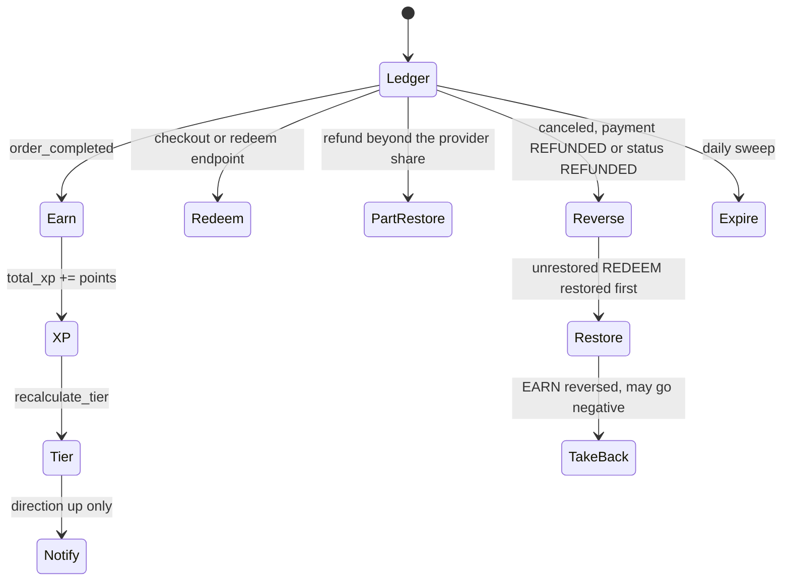

# Loyalty

Loyalty is an **append-only points ledger** plus an XP counter that drives
tiers. A customer's balance is always the sum of their
`PointsTransaction` rows — there is no cached balance column — and every
mutation happens under a lock on the customer's own row, because award,
reverse, redeem and expire can all run concurrently through Celery.

One method, `LoyaltyService.is_enabled()`, decides whether the program runs
at all, and it gates earning, reversing and redeeming together. That method
reads two tiers, which the gate section below sets out.

## Diagram



## How it works

### The ledger

`loyalty/models/transaction.py: PointsTransaction` holds a signed `points`
integer, a `transaction_type`, an optional `reference_order`, a description
and an optional `created_by` for admin adjustments. Types are `EARN`,
`REDEEM`, `EXPIRE`, `ADJUST` and `BONUS`; positive for earn and bonus,
negative for redeem, expire and a negative adjust.

`LoyaltyService.get_user_balance` sums the ledger through
`PointsTransaction.objects.get_balance`. XP is separate: `UserAccount.total_xp`
is a counter that only earning and reversal move, floored at zero on the way
down. Redemption never touches it, so spending points cannot cost a customer
a tier.

`loyalty/models/tier.py: LoyaltyTier` is a translatable, sortable model with
a **unique** `required_level`, a `points_multiplier` (minimum 1.0) and an
icon. Levels are derived, not stored: `get_user_level` is
`1 + total_xp // LOYALTY_XP_PER_LEVEL`, and `get_user_tier` returns the
highest tier whose `required_level` the customer has reached.

### Earning

`LoyaltyService.calculate_item_points(product, quantity, tier_multiplier)`:

```
floor(price_basis * LOYALTY_POINTS_FACTOR * product.points_coefficient * quantity
      [* tier_multiplier])
+ (product.points * quantity)
```

`price_basis` is chosen by `LOYALTY_PRICE_BASIS`, one of four
`PriceBasis` values — net, net after markdown, gross before markdown, or the
final sale price (the default). The tier multiplier applies only when
`LOYALTY_TIER_MULTIPLIER_ENABLED` is on **and** the multiplier exceeds 1.0.

`award_order_points(order_id)` runs inside a transaction and does five things
in order:

1. Returns 0 when `is_enabled()` is false or the order has no user.
2. Returns 0 for a wholesale-priced order unless the merchant opted in —
   see the B2B interaction below.
3. Takes `select_for_update` on the **customer row**. Under `task_acks_late`
   a task can be redelivered and run twice in parallel; without the lock both
   pass the idempotency check before either commits, and points double.
4. Returns 0 if `EARN` rows already exist for the order — the idempotency
   check the lock protects.
5. Bulk-creates one `EARN` row per order item, increments `total_xp` with an
   `F()` expression (a plain read-modify-write loses updates under
   concurrency), refreshes the instance, and recalculates the tier from the
   **fresh** XP.

`check_new_customer_bonus` is separate, gated on
`LOYALTY_NEW_CUSTOMER_BONUS_ENABLED`, also under the customer row lock, and
writes a `BONUS` row worth `LOYALTY_NEW_CUSTOMER_BONUS_POINTS` only when the
customer has no prior `EARN` rows outside this order. The bonus does not
affect XP, so no further tier recalculation is needed.

`loyalty/tasks.py: process_order_points` calls both, in that order, but the
bonus is **conditional**: it runs only when the award returned more than
zero points and the order has a user. A genuine first order whose items
compute to zero points — a zero `points_coefficient`, a zero
`LOYALTY_POINTS_FACTOR`, an entirely free basket — therefore earns no
welcome bonus either.

### Reversing

Two things happen to an order's points when its money goes back, at
different moments.

**Spent points come back in parts, with the refund.** A refund is in the
value of what came back, and the provider's money is paid back first
(`OrderService.refund_order`, see
[Order lifecycle](/dev/flows/order-lifecycle#refunds)). Only the excess
goes back onto the order's gift cards and points, split in proportion to
what each has not got back. The points share is
`LoyaltyService.restore_spent_points(order, points, refund_attempt=...)`:
a positive `ADJUST` naming the refund attempt
(`PointsTransaction.refund_attempt`), never more than is still spent on
the order, under the user row lock so a racing cancel cannot restore the
same points twice. XP is not touched. `PaymentLedger.stored_value` reads
what is still owed from these rows (REDEEM less positive ADJUST), valued
at the order's loyalty discount in proportion.

**Earned points are reversed once.** `loyalty/signals.py` listens on
`order_completed` (award) and reverses on these signals, skipping guest
orders and dispatching through `tenant.celery.dispatch_on_commit` so the
tenant schema rides the message:

| Receiver | Reverses when |
|---|---|
| `handle_order_canceled_loyalty` | `order_canceled` |
| `handle_order_refunded_loyalty` | `order_refunded`, when `payment_status` is REFUNDED, or after a chargeback when refunds and chargebacks cover everything received (`PaymentLedger.fully_returned`) |
| `handle_order_stored_value_returned_loyalty` | `order_stored_value_returned`, when `payment_status` is REFUNDED: the refund that returned the last of the gift cards and points |
| `handle_order_charged_back_loyalty` | `order_charged_back`, once refunds and chargebacks cover everything received |
| `handle_order_status_refunded_loyalty` | `order_status_changed` to the REFUNDED order status, the manual RETURNED to REFUNDED step |

A partial refund reverses no earned points. The reversal is all-or-nothing
and runs once per order, so taking it on the first slice would never take
the rest, and taking all of it for a small goodwill refund would wipe the
points of an order the shopper keeps. REFUNDED comes from the ledgers, not
from the path that made the refund: `PaymentLedger.refund_status`
(`order/payment_ledger.py`) sets it once refunds and chargebacks cover what
was received **and** the gift cards and points are back.

`reverse_order_points(order_id)` is careful about order of operations:

1. Locks the customer row.
2. Returns 0 if the order has no `EARN`, `REDEEM` or `BONUS` rows.
3. Returns 0 if `ADJUST` rows that name no refund attempt already exist
   for the order — the idempotency guard. The part-restores above name
   their attempt, so they do not count as a reversal.
4. **Restores the redemption first**, less what part-refunds already
   restored, as a positive `ADJUST`; not for an order that was charged back
   (the customer took the money back through their bank, so the points
   they spent stay spent). Doing it first also stops a lowered balance from
   blocking the earn reversal. This does not touch XP.
5. Reverses each `EARN`, then the order's new-customer `BONUS`, as
   negative `ADJUST` rows. With `LOYALTY_REFUND_ALLOWS_NEGATIVE_BALANCE`
   on (the default, `settings.py`), the whole earning comes off even when
   the customer has spent it, and the balance goes negative: later
   earnings pay it off, and a negative balance fails the redemption check
   (`points_amount > balance`), so earning, spending and then refunding
   cannot keep the points. Off, each reversal is clamped at the current
   balance and the clamp is logged as a warning.
6. Subtracts the reversed `EARN` total from XP, floored at zero, and
   recalculates the tier.

### Redeeming

`_validate_and_price_redemption` is the single validator behind both the
preview and the write, so the amount a payment intent is created for and the
amount later persisted on the order cannot drift. It checks that the program
is enabled, the points amount is positive, the currency is supported (EUR or
USD), the balance covers it, and the resulting discount does not exceed
`max_discount` — which every caller sets to the **products total**, excluding
shipping and payment fees.

The rate is `LOYALTY_REDEMPTION_RATIO_<CURRENCY>`: points divided by the
ratio give the discount.

`preview_redemption` prices without writing and is used by
`cart/views/cart.py: create_payment_intent` and by the order-create
verification. `redeem_points` takes the lock (`lock=True` inside the
order-create transaction means a later redeem in the same transaction cannot
fail on balance), enforces **one redemption per order** under that lock, writes
the negative `REDEEM` row, and stores `loyalty_points_redeemed` and
`loyalty_discount` in the order metadata.

Two entry points reach it: order creation (`order/services.py`, both paths,
where the points to redeem arrive with the checkout payload) and
`POST /api/v1/loyalty/redeem`, which additionally requires the order to belong
to the caller and to still be `PENDING` — redeeming against a settled order
would burn points for nothing.

### Tiers and the promotion notification

`recalculate_tier(user)` writes `loyalty_tier` only when it actually changes.
A `pre_save` receiver snapshots the previous tier id so the `post_save`
receiver can detect a real transition without a second query; inserts snapshot
`None`, so a newly created customer who happens to spawn with a tier gets no
"tier up" notification.

`dispatch_tier_changed` derives a direction from `required_level` through a
cache-backed `{tier_id: required_level}` map (invalidated by any `LoyaltyTier`
save), and sends the `loyalty_tier_changed` signal on commit with `up`, `down`
or `same`. `notify_tier_up_live` reacts to **`up` only** — telling someone they
lost status is gratuitously negative — and queues a live notification whose
tier name is re-read fresh rather than trusted from dispatch time.

### Expiry

`process_expiration` is a no-op when `LOYALTY_POINTS_EXPIRATION_DAYS` is 0,
which is the default. Otherwise it groups expirable `EARN` rows by customer,
locks each customer row, and writes one `EXPIRE` row per expirable earn —
**capped at the balance the customer actually holds**. Expiring the full
original earn amount when it was partly spent would drive the balance
negative. A zero-amount `EXPIRE` marker is still written so the earn is not
reconsidered on the next run.

Nothing expires while the programme is off, and that time does not count
towards a point's age. `loyalty.models.LoyaltyPause` (on
`core/models.py: FeaturePauseModel`, at most one open span) records each span
the store had loyalty off; `LoyaltyService.sync_pause` opens and closes them,
queued by `tenant/switches.py: on_switch_change` whenever `LOYALTY_ENABLED` or
`Tenant.loyalty_enabled` really changes and run first by the sweep itself.
The cutoff is `FeaturePauseModel.active_cutoff(now, days)`: the moment from
which `LOYALTY_POINTS_EXPIRATION_DAYS` of time **with the programme on** has
passed, so an `EARN` older than it has been live for longer than the window.

### Scheduling

The expiry sweep is a per-tenant fanout, because beat runs in the public
schema. `settings.py` registers one beat entry,
`process-loyalty-points-expiration`, pointing at
`tenant.tasks.fanout_process_points_expiration` and scheduled daily at 03:00.

`tenant/celery.py: run_for_all_tenants` does not enter schemas itself. It
iterates the active, non-public, non-suspended tenants and sends **one
message per tenant**, each stamped with a `_schema_name` header; the
subtasks enter their own schema later, in the worker.

That entry is `core/tasks.py: MonitoredTask`, which every loyalty task uses
and which **subclasses `TenantTask`** — so `apply_async` stamps the header
and `__call__` enters the tenant on the way in, while the base adds
success/failure logging with secret-looking kwargs masked. `__call__` uses
`tenant_context` with the real `Tenant` row for a tenant schema, and
`schema_context` only for the public schema or when no row matches. The
distinction is load-bearing: `schema_context` alone installs a bare
`FakeTenant`, under which every `tenant.credentials` helper reads as
unconfigured. A loyalty task dispatched without that base would execute
against whatever schema the worker happens to be in.

### The two-tier gate

| Tier | Where | Effect |
|---|---|---|
| Plan | `Tenant.loyalty_enabled` | `tenant/permissions.py: IsLoyaltyEnabled` answers **404** on every loyalty endpoint, `agent/me/loyalty` included |
| Runtime | `LOYALTY_ENABLED` extra-setting, ships `False` | `tenant/permissions.py: IsLoyaltyRuntimeEnabled` answers **404** on the same endpoints; `LoyaltyService.is_enabled()` in the service |

`LoyaltyService.is_enabled()` checks **both** — `tenant_plan_allows("loyalty_enabled")`
and the setting — and it is called from `award_order_points`,
`_validate_and_price_redemption` (which raises), `get_product_potential_points`
and the expiry sweep. `reverse_order_points` deliberately does **not** check
it: an order cancelled or refunded while the programme is off must still
give back what it redeemed and take back what it earned, or the balances are
wrong when loyalty comes back.

The docstring says why the plan half is checked in the service rather than
only at the endpoints: points are earned and redeemed through order signals
and order create, and order create runs with **no permission classes** because
it must serve guest checkout. An endpoint-only gate would be bypassed by the
path that matters.

### The B2B interaction

`B2BService.loyalty_allowed()` reads `B2B_LOYALTY_ENABLED` and governs **both
halves**. The reason is in its docstring: the points basis is the retail
price, so a wholesale order would otherwise earn retail-basis points and let
them be redeemed as a further discount on already-negotiated prices — a retail
program subsidising wholesale. Off by default, and one switch so the two
halves can never disagree.

It is enforced in two places:

- **Earning**: `award_order_points` returns 0 when
  `order.metadata["b2b_pricing"]` is set and the switch is off. Order create
  stamps that marker whenever group pricing applied.
- **Redeeming**: `B2BService.suppresses_loyalty(cart)` is true for a cart
  actually bound to wholesale pricing while the switch is off, and the
  requested points are zeroed at payment-intent creation and at the top of
  both order-create paths — before any pricing maths, so the verified intent
  amount, the order total and the redemption all agree.

### Storefront

| Surface | File |
|---|---|
| Programme page | `app/pages/loyalty-program.vue` |
| Account page | `app/pages/account/loyalty/` |
| Route gate | `app/middleware/loyalty-enabled.ts` |
| Data | `app/composables/useLoyalty.ts` |
| Proxies | `server/api/loyalty/summary.get.ts`, `transactions.get.ts`, `tiers.get.ts`, `settings.get.ts`, `product/` |

The route gate is `createFeatureGate('loyalty')` (`app/utils/routeGate.ts`):
it reads the `loyalty` store feature synchronously from `TenantConfig.features`,
which Django folds from the plan flag and the setting, makes no settings
request and has no fallback (see the failure mode below).

`useLoyalty` uses `useRequestFetch`, not a bare `$fetch`. The
comments record why: Nitro stamps `host: "localhost"` on an internal request,
`server/middleware/0.tenant.ts` then fails to resolve a store and answers 404,
and the page becomes unreachable for every tenant that has loyalty switched
on.

The cart payload's `b2bPricing.allowLoyalty` flag hides both the
points-earned promise and the redemption widget on a wholesale cart, so the
storefront never advertises a reward the backend will not grant.

## Invariants

- **No double award.** The customer row is locked before the idempotency
  check, so a redelivered task cannot slip past it.
- **The ledger is append-only.** Corrections are new `ADJUST` rows; nothing is
  updated or deleted.
- **Balance is derived, never cached.** XP is the only counter, and only
  earning and reversal move it.
- **Redemption never touches XP**, so a refund restores points without
  changing the tier.
- **Only a full return reverses the earning.** The refund receivers return
  unless `payment_status` is REFUNDED (or refunds and chargebacks cover
  everything received); spent points come back in parts, named by their
  refund attempt.
- **A refund may take the balance negative** while
  `LOYALTY_REFUND_ALLOWS_NEGATIVE_BALANCE` is on; a negative balance
  cannot redeem.
- **One redemption per order**, enforced under the user lock in the service
  and again in the view.
- **Reversal restores the redemption before reversing the earn**, or the
  lowered balance clamps the reversal short.
- **Expiry never exceeds the held balance.**
- **`is_enabled()` gates award and redeem together.** A programme that is off
  hands out and takes in no points; reversal runs regardless, so the ledger
  stays right.
- **The time the programme is off does not count towards expiry.**
- **`B2B_LOYALTY_ENABLED` gates earning and redeeming together.**
- **Every loyalty task carries its tenant schema** through `MonitoredTask`,
  which extends `TenantTask`.

## Failure modes

- **Points never arrive.** The award runs on `order_completed`, not on order
  creation, and skips guest orders. Then check both gate tiers, then the
  wholesale marker in `order.metadata`.
- **A partial refund left the earned points alone.** Expected: they go
  with the refund that makes the payment REFUNDED, or with the REFUNDED
  order status. Spent points come back only from the part of a refund
  beyond the provider's money.
- **A customer's balance is negative.** A refunded order took back points
  they had already spent (`LOYALTY_REFUND_ALLOWS_NEGATIVE_BALANCE` on).
  Redemption is refused until later earnings bring it above zero.
- **A reversal is clamped.** Only with
  `LOYALTY_REFUND_ALLOWS_NEGATIVE_BALANCE` off; logged as a warning naming
  the expected and actual amounts.
- **A tier-up notification never fires.** Check the direction — downgrades and
  lateral moves are silent by design — and the tier-level cache, which is
  invalidated by any `LoyaltyTier` save but otherwise lives for its TTL.
- **Redemption rejected at checkout.** Insufficient balance, an unsupported
  currency, a discount above the products total, or the program disabled.
  `_validate_and_price_redemption` raises with the specific message and the
  preview surfaces it before payment.
- **Points expire that should not have.** `LOYALTY_POINTS_EXPIRATION_DAYS`
  defaults to 0, which disables expiry entirely; a non-zero value is a
  merchant decision.
- **The loyalty page 404s for a store that has it on.** The route gate
  (`app/middleware/loyalty-enabled.ts: createFeatureGate('loyalty')`) reads
  the `loyalty` store feature synchronously from the tenant config, with no
  settings request and no fallback, so a tenant config that did not load
  takes the page with it. Right after the merchant switches loyalty on, a
  pod can serve its old tenant config until the `store_pages` purge moves
  the store's epoch (see [Caches & purging](/dev/operations/caches#the-tenant-config-epoch)).

## Related

- [B2B](/dev/flows/b2b)
- [Checkout and payment](/dev/flows/checkout-and-payment)
- [Order lifecycle](/dev/flows/order-lifecycle)
- [Celery and background jobs](/dev/django/celery)
- [Notifications and email](/dev/flows/notifications-and-email)

## Source

| File | Role |
|---|---|
| `grooveshop-django-api/loyalty/models/transaction.py` | `PointsTransaction`, the ledger |
| `grooveshop-django-api/loyalty/models/tier.py` | `LoyaltyTier`, `required_level`, multiplier |
| `grooveshop-django-api/loyalty/models/pause.py` | `LoyaltyPause`, the spans the programme was off |
| `grooveshop-django-api/core/models.py` | `FeaturePauseModel`: `open_at`, `close_at`, `active_cutoff` |
| `grooveshop-django-api/tenant/switches.py` | `on_switch_change`, the hook that queues `sync_loyalty_pause` |
| `grooveshop-django-api/loyalty/enum.py` | `TransactionType`, `PriceBasis` |
| `grooveshop-django-api/loyalty/services.py` | `is_enabled`, award, `reverse_order_points`, `restore_spent_points`, redeem, tiers, expiry, bonus |
| `grooveshop-django-api/loyalty/signals.py` | Order hooks (reversal on cancel, on REFUNDED through `order_refunded` or `order_stored_value_returned`, on a chargeback that completes the return, and on the REFUNDED status), tier-change detection, tier-up notification |
| `grooveshop-django-api/order/payment_ledger.py` | `PaymentLedger.refund_status`, which decides when an order is REFUNDED; `stored_value`, what the order's points are still owed |
| `grooveshop-django-api/loyalty/tasks.py` | `process_order_points`, `reverse_order_points`, expiry, tier-up notification |
| `grooveshop-django-api/loyalty/views/loyalty.py` | Summary, transactions, redeem, product points, tiers |
| `grooveshop-django-api/loyalty/urls.py` | Endpoint paths |
| `grooveshop-django-api/core/tasks.py` | `MonitoredTask`, which extends `TenantTask` |
| `grooveshop-django-api/tenant/tasks.py` | `fanout_process_points_expiration` |
| `grooveshop-django-api/tenant/celery.py` | `run_for_all_tenants`, `TenantTask` schema entry |
| `grooveshop-django-api/tenant/permissions.py` | `IsLoyaltyEnabled` |
| `grooveshop-django-api/b2b/services.py` | `loyalty_allowed`, `suppresses_loyalty` |
| `grooveshop-django-api/order/services.py` | Redemption at order create, wholesale suppression |
| `grooveshop-django-api/cart/views/cart.py` | Preview redemption at payment-intent creation |
| `grooveshop-django-api/settings.py` | `LOYALTY_*` defaults (`LOYALTY_REFUND_ALLOWS_NEGATIVE_BALANCE` included), beat schedule |
| `grooveshop-storefront-ui-node-nuxt/app/middleware/loyalty-enabled.ts` | Fail-open two-tier gate |
| `grooveshop-storefront-ui-node-nuxt/app/composables/useLoyalty.ts` | Summary, transactions, tiers, settings |
| `grooveshop-storefront-ui-node-nuxt/server/api/loyalty/` | Storefront proxies |
