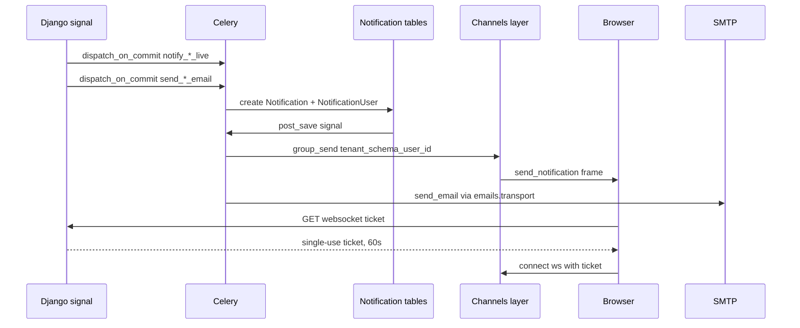

# Notifications & email

Every customer-facing event has up to two deliveries: a database
notification that reaches the browser over a WebSocket, and an email.
They are dispatched from the same signal receiver and suppressed
together, because a customer who gets one and not the other reads it as a
bug. Guests are the deliberate exception — they have no account to
address a toast to, so they get the email only.

Both channels are asynchronous. Nothing in a request path sends mail or
pushes a socket message directly; every dispatch is a Celery task, and
every one of them lands after the creating transaction commits. Most
reach that through `tenant.celery.dispatch_on_commit`. The two
order-created emails are the exception in mechanism only: they call
`.delay()` directly, but `handle_order_post_save` has already deferred the
`order_created` signal itself to `transaction.on_commit`, so they still
enqueue post-commit.

## Diagram

## How it works

### The notification model

`Notification` (`notification/models/notification.py`) is a translatable
row: `link`, `kind`, `category`, `priority`, `notification_type`,
`expiry_date`, and per-language `title` / `message` through parler.
`NotificationUser` (`notification/models/user.py`) is the join to a user
with `seen` and `seen_at` — one notification can fan out to many users.

`notification_type` is a `CharField` that names `NotificationTypeEnum` in
`choices` but is not constrained in the database, so an ad-hoc admin
broadcast needs no migration. Every event fired from application code uses a
member of `notification/enum.py: NotificationTypeEnum`. That enum is the
one place new event types are added, and it reaches the storefront as a
typed union through the OpenAPI contract.

`notification/services.py: create_user_notification` is the only
sanctioned creator. It takes a `{language_code: {title, message}}` map,
writes one translation row per locale in `PARLER_LANGUAGES[SITE_ID]`,
falls back `en` then `el` for a locale the caller did not supply, skips
an entry that resolves empty, and creates the `NotificationUser` row
inside one atomic block.

### WebSocket delivery

`NotificationUser` post-save fires `notification/signals.py:
handle_notification_created`, which serialises the row plus its
translations (cached 60 seconds, so a broadcast to N users does not issue
N translation queries) and enqueues `send_notification_task`. That task
reads the worker connection's schema, builds the group name through
`notification/groups.py: user_group` and calls `group_send`.

**The group name is `tenant_{schema_name}_user_{user_id}`.** The schema
segment is what stops tenant A's user 42 receiving tenant B's user 42's
messages on a shared Redis channel layer. Every sender and the consumer
use the same helper; nothing builds the string by hand.

`notification/consumers.py: NotificationConsumer` joins that group on
connect and is server-push only — client frames are read and discarded.
An anonymous scope is accepted and then closed with code 4003, because
Channels requires the handshake to complete before an application close
code can be delivered. `force_logout` is a second handler on the same
consumer: `user/signals.py` broadcasts it after Knox tokens are revoked,
and it closes with 4003 so every open tab re-authenticates.

The route is `ws/notifications/` (`asgi/__init__.py`), wrapped in
`AllowedHostsOriginValidator` → `TenantWebsocketMiddleware` →
`TokenAuthMiddlewareStack`.

### WebSocket auth is a single-use ticket

Knox tokens and cookies are **not** accepted on the socket URL.
`POST /api/v1/websocket/ticket`
(`notification/views/websocket.py: create_websocket_ticket`) requires an
authenticated HTTP request, refuses if the user has no live Knox token,
and returns a URL-safe ticket of 32 bytes of entropy (a 43-character
string) cached against the user's primary key for 60 seconds
(`WS_TICKET_TTL_SECONDS`).

`core/middleware/channels.py: TokenAuthMiddleware` reads `?ticket=` and
consumes it with an atomic Redis `GETDEL` — a compare-then-delete has a
window in which two concurrent connects both succeed. It then re-checks
that a live Knox token still exists, so a password change between minting
and connecting denies the connection even though the ticket is valid.

The consumption runs inside `tenant_context(tenant)` using the tenant the
WebSocket middleware already resolved. Without that binding the cache key
would be built with whatever schema prefix the executor thread last left
behind, the lookup would miss, and a legitimate connection would be
closed as anonymous. Cross-tenant replay is structural rather than
checked: both the ticket cache key and the Knox token table are
schema-scoped, so a ticket minted on one tenant finds nothing on another.

The storefront side is `app/plugins/websocket.client.ts`. It fetches a
ticket through `server/api/websocket/user/ticket.get.ts`, connects to
`wss://{apiDomain}/ws/notifications/?ticket=…`, disables automatic
reconnect (the ticket is spent) and reconnects manually with exponential
backoff, fetching a fresh ticket each time. A `BroadcastChannel` keeps
tabs in step.

### The email system

Every email is an **email type** (`emails/types.py: EmailType`), declared
in its domain app's `emails.py` (`order/emails.py`, `product/emails.py`,
`user/emails.py`, `tenant/emails.py`, ...) through `emails.declare`. A type
names its template pair (`core/templates/emails/<directory>/<name>.html` and
`.txt`), its subject (a gettext msgid with named fields), the builder that
reads the domain for its context, a `sample` the preview renders, its
recipients and its gates. `EmailsConfig.ready` collects the declarations and
`emails.registry` refuses a type with no template pair, and a template file
that no type names in a directory the catalogue uses, so a template cannot
exist without a type. `base/email_base.html` is the shared layout.

A task never builds a message: it calls `emails.send.send_email(key, obj)`,
which checks the gates and the store's switch, finds the recipients, skips a
marketing mail the recipient opted out of, renders through
`emails.render.render` in the recipient's language, builds the headers and
hands the message to `emails.transport`, the only module that builds one
(`tests/unit/emails/test_only_transport_sends.py` fails for any other). The
admin preview (`emails/preview.py`, on an email's page under Settings → Emails) calls the same
`render`: for a real order through `order.emails.preview_object`, which finds
the refund, receipt, dispute or shipment the email is about, else from the
type's `sample`. The preview is therefore the mail that is sent, subject and
context included. The builders read the order's lines inside
`translation.override`: parler fixes a model's language when the instance is
created, so lines loaded before the override named every product in the
worker's language. The full reference is the Django repository's
`docs/emails.md`.

**The platform's own mail** (`Owner.PLATFORM`) is sent from the `public`
schema whatever store is bound: the billing notices to a store's owner
(`platform.billing_*`, in the store's default locale), the staff password
reset (`platform.staff_password_reset`, in the asked store's language, with the
link on the host that asked), and the operators' alerts to `ADMINS`
(`platform.billing_stage_copy`, `platform.health_alert`,
`platform.backup_failed`, in the platform's language). They carry the
platform's name, logo and contact address and the sender `"{SITE_NAME}"
<DEFAULT_FROM_EMAIL>`, are required (no switch), and are listed on no store's
email page. `mail_admins` is not called anywhere in the project.

**Account emails** (allauth: sign-in code, email confirmation, password
reset, security notices, MFA and connected-account notices) are 19 email
types, `account.*`, `mfa.*` and `social.*` (`user/emails.py`), required and
customer-facing. Their templates live in
`core/templates/emails/{account,mfa,social}/`, each an HTML and a text
file. `UserAccountAdapter.send_mail` maps allauth's template prefix to the
type (an unmapped prefix raises, so a mail a later allauth adds cannot go
out unbranded) and queues `send_allauth_email_task`, which calls
`send_email`: the pipeline renders with `build_email_context`, so
`SITE_NAME` and `SITE_URL` name the store, and sends with the store's
`From`. The send is in a task because allauth's own `send_mail` talks SMTP
inside the view, where a transient 421 became a 500 on sign-up. The
subject is the type's msgid; allauth's `[store name]` prefix is gone.
allauth's own `current_site` is not in the context and must not be:
`SITE_ID` is one store's `Site` row, and every other store would sign its
mail with that name.

### The email log and the transports

Every outcome of `send_email` is a row of `EmailLog` (`emails/models.py`,
written by `emails/log.py`), in the schema the mail is sent under: a store's
rows in its own schema, a platform type's in `public`. The row is created
`QUEUED` before the transport runs, then becomes `sent` or `failed`; a
closed gate, a switched-off type, no recipient or an opt-out is one row with
that status. It holds the type key, the language, the subject, a keyed hash
of the address and a masked form (`j***@e***.com`), the provider and its
message id, and the failure's class and SMTP or HTTP code. It holds no
address and no body, and a provider's error text is never stored, because it
can quote the recipient. Rows older than `EMAIL_LOG_RETENTION_DAYS` (store
setting, 90, `0` keeps) are deleted nightly with their provider events; see
[Data retention](/dev/operations/data-retention).

`settings.EMAIL_TRANSPORT` picks the one transport that carries the mail:
`smtp` (Django's backend over the `EMAIL_HOST*` relay) or `resend` (Resend's
HTTP API, `emails/resend.py`). Resend returns a message id, which is stored
and sent back in the webhook; SMTP returns none. A message posted to Resend
carries `Idempotency-Key` (the log row's uuid) and two hidden tags,
`schema` and `log`, never a header. **Which team's key signs the request is
decided by the sending domain**: a store that sends from its own verified
domain uses the key on its `Tenant` row and, with none, fails instead of
borrowing the platform's (the platform's team does not own that domain);
every other store and every platform type uses `RESEND_API_KEY`. A timeout,
a connection error, a 5xx and a 429 are retried by the calling task; any
other 4xx is permanent. Selecting `resend` while a store with its own verified domain has no key is refused: `migration_preflight` fails the deploy (`emails.E001`), the tenant admin refuses the save, and both dashboards flag the store. Production still sends over SMTP until the switch in
[Resend setup](/dev/operations/resend) is made.

### Provider events, the webhook and suppression

What Resend reports about a message arrives at `POST /resend/webhook/`
(`emails/webhooks.py`), mounted on every host. The delivery is verified on
the raw body (`emails/webhooks.py`, through the Standard Webhooks library:
HMAC-SHA256 over the id, timestamp and body, within a five-minute tolerance)
with the secret of the host it reached: the
store's own `Tenant.resend_webhook_secret` on a store's host, the platform's
`RESEND_WEBHOOK_SECRET` on the platform host, never one for the other. The
view then queues `emails.tasks.process_provider_event` and answers 200. The
task routes the event by its signed `schema` tag (a store's endpoint speaks
only for that store), finds the `EmailLog` row by both the `log` tag and the
provider id, records the event once per `svix-id`, and moves the row's status
forward only. A permanent bounce adds an `EmailSuppression` for every email, a
spam complaint one for marketing only plus an `EmailOptOut`. `send_email` asks
the list before it renders: a suppressed address gets a `skipped_suppressed`
row, and a required mail to a fully suppressed address is also logged as a
warning. Setup and failure modes: [Resend setup](/dev/operations/resend).

### Tenant branding

Every email context is built by
`core/utils/email_context.py: build_email_context`, which supplies
`SITE_NAME`, `SITE_URL`, `INFO_EMAIL`, `STATIC_BASE_URL`, `SITE_LOGO_URL`,
`THEME` and `LANGUAGE_CODE` from the active tenant and the email's language and merges the caller's keys on top.
Routing every task through it is what made the per-tenant logo branch in
`email_base.html` live; before that, every tenant's mail silently carried
the platform logo.

`_email_logo_url` uses the tenant's logo when set, the platform's static
logo **only** for the platform tenant, and an empty string otherwise — the
base template then renders the store name as a text wordmark, so an
unbranded tenant's mail never wears another store's brand.

Envelope addressing comes from `emails/sender.py: from_address`,
and the sending domain decides it, not the merchant's preference. A tenant
whose own domain is verified on the relay — `Tenant.from_email` set **and**
`Tenant.from_email_verified` ticked — sends as `"{store name}" <from_email>`.
Every other tenant sends as `"{store name}" <DEFAULT_FROM_EMAIL>`: the
platform envelope the relay can sign, with the merchant's brand in the
sender line and their own address in `Reply-To` via `store_reply_to`.

`from_email_verified` **is** the safety property, which is why it is
platform-only and absent from `TENANT_SELF_EDITABLE_FIELDS` — a store
operator can propose a `from_email`, but only the platform can certify
that the relay holds a DKIM key for that domain. Putting an unsignable
address in `From` fails DMARC alignment and lands the mail in spam.

Transactional mail carries `List-ID` and a `mailto:` `List-Unsubscribe`
from `emails/headers.py: build_transactional_list_headers`.
`List-Unsubscribe-Post=One-Click` is deliberately omitted — there is no
programmatic unsubscribe for a receipt, and advertising one without a
matching endpoint penalises the sender.

**Marketing mail** is different: every `Kind.MARKETING` type carries the
full RFC 8058 pair (`emails/headers.py: build_list_unsubscribe_headers`)
whose URL is `emails/optout.py: unsubscribe_url`, a signed, store-scoped
token for that type. A mailbox provider POSTs it
(`POST /api/v1/emails/unsubscribe/<token>`), which records `EmailOptOut`
for that type only. A GET of the same URL never opts anyone out: it
redirects to the storefront confirm page.

A link in a mail BODY (today only the re-engagement email) is
`optout.confirm_url`: the storefront page `/email/unsubscribe/<token>`,
which does nothing on load (link scanners prefetch body links) and offers
two buttons: "stop these emails" (the same POST) and "stop all marketing
emails" (`POST /api/v1/emails/unsubscribe/<token>/all`, through
`user/services/subscription.py: unsubscribe_from_all_marketing`: every
marketing type, the account's `marketing_opted_out_at` and its active topic
subscriptions). `send_email` reads `EmailOptOut` for every marketing send;
no task filters on its own. See `grooveshop-django-api/docs/emails.md`.

Only the customer lifts an opt-out, from the storefront account's email
page ("Store emails", `app/composables/useEmailPreferences.ts` in both
designs): `GET`/`PATCH /api/v1/user/email-preferences`
(`user/views/email_preferences.py`, proxied by
`server/api/user/email-preferences.{get,patch}.ts`) lists the marketing types
the store sends (`emails/preferences.py: offered_types`) and applies the
choices through `user/services/subscription.py: set_marketing_preferences`.
Turning a type on splits a `*` row into one row per other type, so the other
choices stand. The split writes a row for EVERY marketing type, offered or
not, so a type the store does not send today keeps its opt-out and
`marketing_opted_out_at` (cleared only when no row is left) stays set.

### Language selection

`Order.language_code` is captured at creation from the active request
locale (`OrderService._seed_language_code`, validated against
`settings.LANGUAGES`). Every customer-facing order email wraps its render
in `translation.override(get_order_language(order))`
(`core/utils/i18n.py`), which falls back to the user's language and then
to the store's: `store_language()` is the bound tenant's
`default_locale`, and `settings.LANGUAGE_CODE` only where no store is
bound (the public schema). A guest product alert stores the visitor's
`X-Language` in `ProductAlert.language_code` (`active_language_code`,
empty when none was stated or it is not served) and its email uses it,
else the store's language.

**Emails to the store render in the store's language**, subject included:
`send_admin_new_order_email`, the B2B application, dispute, low-stock,
review-pending and stale-ACS alerts all wrap their render in
`translation.override(store_language())` (`order/tasks.py`,
`b2b/tasks.py`, `product/tasks.py`, `shipping_acs/tasks.py`), never in
the worker's active locale. So do the contact-form and feedback
notifications (`contact/tasks.py`), which also set the submitter's address
as `Reply-To` after validating it as one bare address.

### Link language

A storefront link opens the storefront in the language the email is
written in. The storefront runs @nuxtjs/i18n `prefix_except_default`, so
the one rule lives in `core/utils/tenant_urls.py:
storefront_locale_prefix`: a link gets a `/<code>` prefix only when the
tenant serves that language and it is not the unprefixed locale;
otherwise it has no prefix.

- **Served locales** — `tenant_storefront_locales` mirrors the
  storefront's `shared/i18n/tenantLocales.ts: tenantAllowedLocales`:
  `Tenant.available_locales` filtered to `STOREFRONT_LOCALES`, or
  `[default_locale]` when the list is empty. `STOREFRONT_LOCALES`
  mirrors the storefront's `SUPPORTED_LOCALES` (`el`, `en`). It is a
  second list, kept in step by hand: a language added to
  `settings.LANGUAGES` has no storefront routes until the storefront
  serves it.
- **Unprefixed locale** — `STOREFRONT_DEFAULT_LOCALE` (`el`), which
  mirrors the storefront's build-time `DEFAULT_LOCALE`. It is a constant
  rather than `settings.LANGUAGE_CODE`, because env can override that
  setting without a storefront rebuild. The coupling is written down once,
  beside `STOREFRONT_LOCALES`. Change both repos in the same release.

`get_tenant_frontend_url(path, *, language)` requires the language. Every
caller passes the value it hands `translation.override`, so the link and
the copy cannot disagree. `build_email_context(*, language, ...)` makes
`SITE_URL` the localized home page, and the templates that append
`/account/orders/...` to it inherit the prefix. A merchant-facing email
passes `store_language()`, the language it renders in.
`get_tenant_base_url` is still the bare origin, for callers that need a
host rather than a page (`List-ID`, Meta's base check).

allauth builds its email links (`activate_url`, `password_reset_url`,
`signup_url`) from `HEADLESS_FRONTEND_URLS` before it knows who the
recipient is. `UserAccountAdapter.send_mail` decides the email's
language and each type's builder localizes those three keys with
`localize_storefront_url`. The language is the user's (`get_user_language`)
when allauth's context names one. Otherwise it is the visitor's
(`resolve_request_language(self.request)`), as for the unknown-account and
account-already-exists emails. allauth's `BaseAdapter` reads
`self.request` from `allauth.core.context.request`, which
`AccountMiddleware` sets.

In-app notifications are the exception: a notification is read in
whatever language its viewer is browsing, so `Notification.link` stores a
**locale-neutral path**. It has no host and no locale prefix, for example
`/account/orders/42`, and may carry a query and a fragment. Tasks build it
with `core/utils/tenant_urls.py: storefront_path`. The field is a
`CharField` with `validate_storefront_path`, and
`notification/services.py: create_user_notification` runs that validator
too, because `objects.create` skips field validators. The storefront opens
the path under the viewer's current locale with `useLocalePath()`
(`useNotificationsBell`, which both designs' bells share:
`app/components/User/NotificationsBell.vue` and the webside design's
`app/components/variants/webside/User/NotificationsBell.vue`). Migration `notification.0017_notification_link_storefront_path`
rewrote the absolute links stored before this change to neutral paths.
It cleared links that pointed at a host outside the tenant's domains.

### What the order-received email says

`send_order_confirmation_email` (`order/tasks.py`) sends
`order_payment_confirmed` for an online payment that has completed, and
`order_received` otherwise. The second states only what is true when it
is sent:

| Context value | Set when | Renders |
|---|---|---|
| `order.is_paid` | the store has the money, including a transfer already marked received | the "payment is confirmed" opening and the **Paid** status; an unpaid order shows no status line |
| `collected_on_delivery` | the pay-way is collected on delivery (`COURIER_CASH`, `CARRIER_TERMINAL`) | the opening without "waiting for payment" |
| `payment_instructions` | not paid, and the settlement is `OFFLINE_TRANSFER` or `CARRIER_TERMINAL` | "How to complete your payment" with `PayWay.instructions` |
| `payment_reference_needed` | not paid, and the settlement is `OFFLINE_TRANSFER` | the "include your order number in the payment reference" line |
| `expects_payment_confirmation` | not paid, and the pay-way is not collected on delivery | the promise of a second email; COD stays Pending until the carrier pays out, so it gets none |

Cash or card to the courier needs nothing from the shopper and gets no
instructions. Every order-received email ends with the line saying the
store will email as the order progresses. The subject is
`Order Received - #{order_id}` («Λάβαμε την Παραγγελία σας! — #…» in
Greek). `tests/integration/order/test_received_email_wording.py` pins each
row.

### Escaping admin-authored HTML

`PayWay.instructions` is authored in the admin WYSIWYG editor, so it is
HTML. The `.html` template renders it with `|safe`
(`order_received.html`). The `.txt` template cannot render the same value
— Django autoescapes `.txt` templates too, so the customer would see
literal `&lt;div&gt;`. The task therefore precomputes
`unescape(strip_tags(payment_instructions))` and the text template
renders **that** with `|safe`, purely to stop the plain-text template
re-escaping the `&`, `<` and `>` that survived
(`order_received.txt`). Any new admin-authored HTML field needs the same
pair.

### Dedup of email and toast per event

Both channels dedupe, by different mechanisms, and are suppressed
together.

- **Per-event reservation flags** on `order.metadata` guard each email
  task: `confirmation_email_sent_at`, `payment_failed_email_sent`,
  `invoice_email_sent`, `shipping_notification_email_sent`, and
  `status_update_email_sent_<STATUS>` per transition. Tasks reserve
  before sending and release on permanent failure so an operator can
  retry.
- **The refund confirmation is one email per refund, not per order.**
  `handle_order_refunded` queues `send_refund_confirmation_email(refund_id)`
  on commit for each REFUND row of the payment ledger, so an order
  refunded in parts sends one email per part. The task claims its refund
  before sending by inserting a `RefundNotification`
  (`order/models/refund_notification.py`, one-to-one with the refund, so
  the database decides between two workers handed the same refund) and
  deletes the claim on permanent failure. A refund the ledger already
  holds never signals again, so the webhook that reports a refund the
  platform made sends no second email.
- **The confirmation email additionally holds a Redis execution lock**
  (`order:confirm_email_lock:<id>`, 90s). The permanent guard is a
  timestamp written *after* the send; the lock covers the window before
  it. The old design set a boolean before sending, so an OOM-killed
  worker blocked the email forever.
- **Chained transitions** call
  `OrderService._suppress_customer_status_notifications`, which
  pre-stamps the email reservation key **and** `suppress_status_ws_<status>`.
  `handle_order_status_changed` reads the second one and skips the live
  dispatch, so the two channels stay in lockstep.
- **PENDING and PROCESSING never reach the customer.**
  `handle_order_status_changed` skips them for email;
  `order/notifications.py: _ORDER_STATUS_COPY` has no entry for them, so
  `notify_order_status_changed_live` returns a skip. They are internal
  milestones already covered by the order-received or payment-confirmed
  message.
- **The shipped email self-gates on three conditions.** It is dispatched
  from two events — `order_status_changed` reaching SHIPPED, and
  `order_shipment_dispatched` when tracking first lands — and sends only
  when `status == SHIPPED`, a tracking number exists **and** a shipping
  carrier is set. Whichever
  fires first returns a no-op `True` **without** reserving the flag, so
  the second one can send. Reserving on the deferral would block the real
  send permanently.

### Which events emit what

| Event | Email | Live notification |
|---|---|---|
| Order created, offline or already paid | `send_order_confirmation_email` (`order_received`) | `notify_order_created_live` |
| Order created, online and unpaid | none, deferred to payment | `notify_order_created_live` |
| Order created, any | `send_admin_new_order_email` to the merchant | — |
| Payment succeeded (Stripe `payment_intent.succeeded`) | `send_order_confirmation_email` (`order_payment_confirmed`) | `notify_payment_confirmed_live` |
| Payment succeeded (Stripe `checkout.session.completed`) | `send_order_confirmation_email` | none — this handler dispatches no toast |
| Payment succeeded (Viva) | `send_order_confirmation_email` | none — the toast is Stripe-specific |
| Payment failed | `send_payment_failed_email` | `notify_payment_failed_live` |
| → PENDING, → PROCESSING | none | none |
| → SHIPPED with tracking | `send_shipping_notification_email` | SHIPPED toast |
| → DELIVERED | `send_order_status_update_email` | DELIVERED toast |
| → COMPLETED | `send_order_status_update_email` | COMPLETED toast |
| → CANCELED | `send_order_status_update_email` | CANCELED toast |
| → RETURNED, → REFUNDED | `send_order_status_update_email` | none |
| Refund recorded | `send_refund_confirmation_email` | `notify_order_refunded_live` |
| Retail receipt registered with myDATA | `send_invoice_email`, chained from `send_invoice_to_mydata` once the MARK is on the PDF (never for an unregistered receipt) | — |
| Retail credit document registered with myDATA | `send_credit_email` (`credit_email_sent_<id>` flag) | — |
| Stripe or Viva dispute opened; dispute lost (chargeback) | `send_dispute_notification_email` to the store contact address (`lost=True` for a loss) | — |
| Reservation expired without an order | `send_checkout_abandonment_emails` | — |
| ACS parcel out for delivery | `acs_out_for_delivery` | `ACS_OUT_FOR_DELIVERY` |
| BoxNow parcel at locker | `boxnow_parcel_at_locker` | `BOXNOW_PARCEL_AT_LOCKER` |
| ACS shipment stale | `stale_shipments_alert` to operators | — |
| Carrier rejected a shipment, or a verified webhook failed to apply | `ops.shipment_rejected`, `ops.webhook_failed` through `shipping/alerts.py` | — |

There is no standalone "tracking available" toast. It used to fire at
voucher mint — the same premature moment as the old shipped email — and
was removed with it as redundant against the SHIPPED toast.

### Celery delivery and retries

Every email and live-notification task extends
`core/tasks.py: MonitoredTask`, which extends
`tenant/celery.py: TenantTask`. `TenantTask.apply_async` stamps a
`_schema_name` header (preferring an explicit one from the caller) and
`__call__` re-enters that schema — via `tenant_context` with the real
`Tenant` row, not `schema_context`, because a bare `FakeTenant` carries
no credential fields and every `tenant.credentials.*` read would see the
store as unconfigured. `MonitoredTask` adds success and failure logging
with arguments scrubbed by `_safe_repr`.

Retry policy differs by intent. The six **reservation-guarded** customer
emails — confirmation, payment failed, refund confirmation, status update,
shipping notification and invoice — use
`max_retries=3, default_retry_delay=300`, catch broadly, and release the
reservation on permanent failure (the flag, or for the refund email its
`RefundNotification` claim). The rest do not follow that shape:
the merchant and dispute emails and the two sweep tasks use
`autoretry_for=(Exception,)` with backoff and jitter and hold no
reservation flag at all, `send_invoice_to_mydata` uses
`max_retries=5, default_retry_delay=120`, and the two B2B profile emails
use `max_retries=5` with backoff and jitter. Live-notification tasks
(`order/notifications.py: TASK_DEFAULTS`) retry **only** on
`OperationalError` with backoff and jitter: `IntegrityError` will not
resolve on retry, and re-running a partially completed task would create
a second `Notification` row because the helper is not idempotent.

`dispatch_on_commit` is the standard enqueue — it defers to
`transaction.on_commit` so a worker never sees a row the creating
transaction has not committed.

### The production relay

Until `EMAIL_TRANSPORT=resend` is set (see [Resend setup](/dev/operations/resend)),
transactional mail goes through **Resend's SMTP relay**, configured entirely as
explicit `env` entries on all four Django containers (backend,
celery-worker, celery-beat, flower) in
`grooveshop-infrastructure/manifests/app-constructs/grooveshop/base/backend.yaml`.
`env` beats every `envFrom`, so the relay configuration cannot be shadowed
by a key that drifts back into `backend-secrets`.

Three details are counter-intuitive enough to be worth stating, each of
which cost a production incident:

- **The port is 2465, not 465.** Hetzner blocks outbound 25 and 465 from
  both cluster nodes — a connect attempt times out at 12s, while 587, 2465
  and 2587 answer in 0.11s. 2465 is Resend's documented implicit-TLS
  alternate, so the TLS posture is unchanged: encrypted from the first
  byte, with none of the plaintext-EHLO or STARTTLS-stripping surface that
  moving to 587 would have introduced. `EMAIL_USE_SSL=True` and
  `EMAIL_USE_TLS=False` are both set explicitly, because Django treats
  them as mutually exclusive and `settings.py` refuses to boot if both are
  on.
- **`EMAIL_TIMEOUT` must be set.** Django's default is `None`, meaning no
  socket timeout at all: a relay that accepts the connection and then goes
  quiet blocks the Celery worker that ran the send, forever, with nothing
  in the logs and no failed task result. `settings.py` defaults it to 20s
  so no deployment can inherit the `None`.
- **The relay credential is a boot dependency of every management
  command.** `settings.py` raises `ImproperlyConfigured` when
  `EMAIL_HOST_PASSWORD` is still `changeme` under
  `SYSTEM_ENV=production`, so the Argo PreSync hook — which sends no mail —
  names the `resend-smtp` Secret explicitly. It used to receive the
  password implicitly through `backend-secrets`, and removing the dead
  Gmail keys from that Secret broke every deploy until the dependency was
  made visible.

**Per-tenant sending domains.** `webside.gr` is verified on Resend with
DKIM selector `resend`; the Return-Path rides `rsend.webside.gr` in
eu-west-1 (`send.webside.gr` is published too), which is a subdomain of
the From domain, so SPF aligns under DMARC's relaxed default while DKIM
signs `d=webside.gr` directly. Onboarding another tenant's domain is the
same three steps every time: add the domain in Resend, publish the DKIM
TXT and the two CNAMEs it returns, then tick `from_email_verified` on the
tenant row. **Leave the apex MX and apex SPF alone** — inbound mail for
addresses like `info@` and `orders@` is Cloudflare Email Routing and has
nothing to do with sending; adding Resend's MX would break it.

### Mailpit on staging

Staging routes all outbound mail into an in-cluster Mailpit instance:
`EMAIL_BACKEND`, `EMAIL_HOST=mailpit`, `EMAIL_PORT=1025` and
`EMAIL_USE_TLS=False` are patched onto the backend and celery-worker
deployments in
`grooveshop-infrastructure/manifests/app-constructs/grooveshop/overlays/staging/`.
The credentials are deliberately **not** patched — they stay whatever the
sealed secret holds, and Mailpit accepts them regardless because it runs
with `MP_SMTP_AUTH_ACCEPT_ANY`. Mail therefore does not leave the cluster,
so a staging refresh cannot email real customers. See
[Staging](/dev/operations/staging).

## Invariants

- **Channel-layer group names come from `notification/groups.py:
  user_group`.** Never build `tenant_…_user_…` by hand.
- **The socket accepts only a ticket.** No Knox token in a URL, no
  cookie. Tickets are single-use, 60 seconds, consumed with `GETDEL`.
- **`create_user_notification` is the only creator.** It owns the
  translation fan-out and the atomic write that triggers delivery.
- **Email and toast are suppressed together**, through the paired
  metadata flags.
- **Reserve before send; release on permanent failure.** A deferral that
  will legitimately re-fire must not reserve.
- **Customer-facing mail wraps in `translation.override(get_order_language(order))`;
  merchant and operator mail does not.**
- **Admin-authored HTML renders `|safe` in `.html` and
  `unescape(strip_tags(...))|safe` in `.txt`.**
- **Operational alerts are `ops.*` email types sent to `store_operators()`**,
  never to `settings.ADMINS`; a store with no address skips them.
- **Guests get email, not toasts.** `_load_order` drops an order with no
  `user_id`; the email uses `order.email`.
- **A webhook delivery is verified on the raw body with the secret of the
  host it reached, before anything is parsed**, and a store's secret can never
  write into another store.
- **A send leaves an `EmailLog` row whatever happens**, and no column of it
  holds an address, a body or a provider's error text.
- **A store with its own verified domain never sends with the platform's
  Resend key.** `emails.sender.own_sender()` decides, and a missing store key
  is `ResendNotConfigured`, not a fallback.

## Failure modes

- **Socket closes 4003 immediately.** Either the ticket was already
  consumed (a reconnect reusing a dead URL — automatic reconnect is off
  for this reason), the user's account was deactivated, or their Knox
  tokens were revoked. A missing tenant is **not** a cause here: the
  tenant middleware runs first and closes 4004 before the ticket is ever
  read.
- **Socket closes 4004.** `tenant/middleware_ws.py` found no active
  tenant for the host. See [Multi-tenancy](/dev/platform/multi-tenancy).
- **No toast but the email arrived.** Expected for a guest order. For a
  signed-in customer, check whether the transition is in
  `_ORDER_STATUS_COPY` and whether `suppress_status_ws_<status>` was
  pre-stamped by a chained transition.
- **Two near-identical emails seconds apart.** A chained transition was
  added without `silent_for_customer` or the suppression helper.
- **The email never arrives and the flag is set.** The reservation was
  claimed and the send then failed permanently. The task logs the
  failure; `_release_*` helpers clear the flag so a resend is possible.
- **The subject line is wrong but the template is right.** Every
  non-empty `core.Translation` row overrides the compiled catalogue in
  every pod and worker (`core/rosetta_storage.py: apply_db_overlay`), and
  a fresh `manage.py shell` does not apply the overlay, so it will insist
  the catalogue is fine. The rendered subject is in the worker log line
  and in the order's history note. `manage.py translation_overlay_audit -l el`
  lists every override side by side with the text served without it.
  A fuzzy entry, makemessages' guess, never becomes an override:
  `import_po_to_translations` skips it, and saving one in Rosetta stores
  an empty row, which also withdraws an earlier override of the key. In
  April 2026 imported guesses retitled the English "Order Received" email
  "Order Delivered". Each pod logs `Translation overlay applied for <lang>:
  N rows, M change …` once it has applied the overlay, and the M rows are
  the ones changing what customers read.
- **A store's mail fails with `ResendNotConfigured` and the log row is
  `failed`.** The store has its own verified domain (`from_email` and
  `from_email_verified`) and no `resend_api_key`, or, for any other store or
  a platform type, `RESEND_API_KEY` is empty. Fix the credential; the task does
  not retry it.
- **A row stays `queued`.** The process died between creating the row and the
  transport answering; the mail may or may not have left.
- **Plain-text mail shows raw markup.** An admin-authored HTML field was
  rendered into a `.txt` template without the strip-and-unescape step.
- **A notification task retries forever on the same error.** Only
  `OperationalError` is retryable by design; anything else is a bug being
  surfaced rather than masked.

## Source

| File | Role |
|---|---|
| `grooveshop-django-api/notification/models/notification.py` | `Notification` fields, expiry |
| `grooveshop-django-api/notification/models/user.py` | `NotificationUser`, seen state |
| `grooveshop-django-api/notification/enum.py` | Kind, category, priority, `NotificationTypeEnum` |
| `grooveshop-django-api/notification/services.py` | `create_user_notification` and locale fallback |
| `grooveshop-django-api/notification/signals.py` | Post-save fan-out and the translation cache |
| `grooveshop-django-api/notification/tasks.py` | `send_notification_task`, `group_send` |
| `grooveshop-django-api/notification/groups.py` | `user_group` name format |
| `grooveshop-django-api/notification/consumers.py` | `NotificationConsumer`, `force_logout`, close codes |
| `grooveshop-django-api/notification/views/websocket.py` | Ticket minting, TTL, Knox liveness check |
| `grooveshop-django-api/core/middleware/channels.py` | `GETDEL` ticket consumption, tenant binding |
| `grooveshop-django-api/asgi/__init__.py` | WebSocket routing and middleware stack |
| `grooveshop-django-api/emails/types.py`, `emails/registry.py` | `EmailType` and the catalogue of every email |
| `grooveshop-django-api/emails/send.py`, `emails/render.py`, `emails/transport.py` | `send_email`, `render`, the one sender |
| `grooveshop-django-api/emails/resend.py` | The Resend HTTP client: which team's key, the request, the error text |
| `grooveshop-django-api/emails/log.py`, `emails/status.py`, `emails/tasks.py` | The `EmailLog` writes, the status enum, the retention sweep and the event task |
| `grooveshop-django-api/emails/webhooks.py`, `emails/events.py`, `emails/suppression.py` | The webhook receiver, the signature check, the event's effect, the suppression list |
| `grooveshop-django-api/emails/models.py` | `EmailLog`, `EmailEvent`, `EmailSuppression`, `EmailSwitch`, `EmailOptOut` |
| `grooveshop-django-api/emails/preview.py` | The admin preview of any registered email |
| `grooveshop-django-api/tenant/emails.py`, `core/emails.py` | The platform's own email types (billing, staff reset, health, backup) |
| `grooveshop-django-api/core/utils/email_context.py` | `build_email_context`, tenant logo resolution |
| `grooveshop-django-api/core/utils/i18n.py` | `get_order_language`, `get_user_language` |
| `grooveshop-django-api/core/utils/tenant_urls.py` | `STOREFRONT_LOCALES`, `STOREFRONT_DEFAULT_LOCALE`, `storefront_locale_prefix`, `get_tenant_frontend_url`, `localize_storefront_url`, `storefront_path` |
| `grooveshop-django-api/user/adapter.py` | `UserAccountAdapter.send_mail` (allauth prefix to email type, queues the send) |
| `grooveshop-django-api/user/emails.py` | the 19 allauth email types, `AllauthMail`, `ALLAUTH_TYPES`, link localization |
| `grooveshop-django-api/notification/migrations/0017_notification_link_storefront_path.py` | Link field change and the rewrite of existing links |
| `grooveshop-storefront-ui-node-nuxt/app/components/User/NotificationsBell.vue` | Opens a notification path under the viewer's locale |
| `grooveshop-django-api/emails/sender.py` | `from_address`, `reply_to`, `store_reply_to` |
| `grooveshop-django-api/emails/recipients.py` | `store_operators`, `store_operator_addresses` (the store's own inbox list) |
| `grooveshop-django-api/emails/headers.py` | `build_list_unsubscribe_headers`, `build_transactional_list_headers` |
| `grooveshop-django-api/order/tasks.py` | Every order email task and its reservation helpers, `_claim_refund_email` |
| `grooveshop-django-api/order/emails.py` | The order email types and builders (subject, context), `ORDER_EMAIL_KEYS` |
| `grooveshop-django-api/contact/tasks.py` | The store's contact-form and feedback notifications |
| `grooveshop-django-api/emails/views.py` | The unsubscribe endpoints (one-click, "all", and the GET redirect to the confirm page) |
| `grooveshop-django-api/user/views/email_preferences.py` | The customer's marketing email choices, the one place an opt-out is lifted |
| `grooveshop-django-api/user/services/subscription.py` | `set_marketing_preferences` and `unsubscribe_from_all_marketing` |
| `grooveshop-django-api/emails/preferences.py` | `offered_types`, the marketing types the store sends |
| `grooveshop-storefront-ui-node-nuxt/app/composables/useEmailPreferences.ts` | The account's "Store emails" list and switches, for both designs |
| `grooveshop-storefront-ui-node-nuxt/server/api/user/email-preferences.get.ts` | Proxy for `GET /api/v1/user/email-preferences` |
| `grooveshop-storefront-ui-node-nuxt/server/api/user/email-preferences.patch.ts` | Proxy for `PATCH /api/v1/user/email-preferences` |
| `grooveshop-django-api/order/models/refund_notification.py` | `RefundNotification`, the claim on one refund's email |
| `grooveshop-django-api/order/notifications.py` | `_ORDER_STATUS_COPY` and the five live-notification tasks |
| `grooveshop-django-api/core/tasks.py` | `MonitoredTask` |
| `grooveshop-django-api/tenant/celery.py` | `TenantTask`, `dispatch_on_commit` |
| `grooveshop-django-api/core/templates/emails/` | Every template pair and `base/email_base.html` |
| `grooveshop-storefront-ui-node-nuxt/app/plugins/websocket.client.ts` | Connect, reconnect, cross-tab broadcast |
| `grooveshop-storefront-ui-node-nuxt/server/api/websocket/user/ticket.get.ts` | Ticket proxy |
| `grooveshop-infrastructure/manifests/app-constructs/grooveshop/overlays/staging/` | Mailpit patches |
