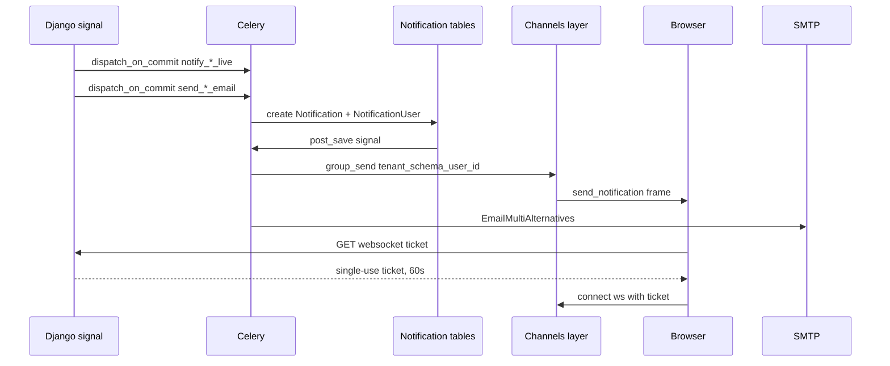

# Notifications & email

Every customer-facing event has up to two deliveries: a database
notification that reaches the browser over a WebSocket, and an email.
They are dispatched from the same signal receiver and suppressed
together, because a customer who gets one and not the other reads it as a
bug. Guests are the deliberate exception — they have no account to
address a toast to, so they get the email only.

Both channels are asynchronous. Nothing in a request path sends mail or
pushes a socket message directly; every dispatch is a Celery task, and
every one of them lands after the creating transaction commits. Most
reach that through `tenant.celery.dispatch_on_commit`. The two
order-created emails are the exception in mechanism only: they call
`.delay()` directly, but `handle_order_post_save` has already deferred the
`order_created` signal itself to `transaction.on_commit`, so they still
enqueue post-commit.

## Diagram

## How it works

### The notification model

`Notification` (`notification/models/notification.py`) is a translatable
row: `link`, `kind`, `category`, `priority`, `notification_type`,
`expiry_date`, and per-language `title` / `message` through parler.
`NotificationUser` (`notification/models/user.py`) is the join to a user
with `seen` and `seen_at` — one notification can fan out to many users.

`notification_type` is a `CharField` that names `NotificationTypeEnum` in
`choices` but is not constrained in the database, so an ad-hoc admin
broadcast needs no migration. Every event fired from application code uses a
member of `notification/enum.py: NotificationTypeEnum`. That enum is the
one place new event types are added, and it reaches the storefront as a
typed union through the OpenAPI contract.

`notification/services.py: create_user_notification` is the only
sanctioned creator. It takes a `{language_code: {title, message}}` map,
writes one translation row per locale in `PARLER_LANGUAGES[SITE_ID]`,
falls back `en` then `el` for a locale the caller did not supply, skips
an entry that resolves empty, and creates the `NotificationUser` row
inside one atomic block.

### WebSocket delivery

`NotificationUser` post-save fires `notification/signals.py:
handle_notification_created`, which serialises the row plus its
translations (cached 60 seconds, so a broadcast to N users does not issue
N translation queries) and enqueues `send_notification_task`. That task
reads the worker connection's schema, builds the group name through
`notification/groups.py: user_group` and calls `group_send`.

**The group name is `tenant_{schema_name}_user_{user_id}`.** The schema
segment is what stops tenant A's user 42 receiving tenant B's user 42's
messages on a shared Redis channel layer. Every sender and the consumer
use the same helper; nothing builds the string by hand.

`notification/consumers.py: NotificationConsumer` joins that group on
connect and is server-push only — client frames are read and discarded.
An anonymous scope is accepted and then closed with code 4003, because
Channels requires the handshake to complete before an application close
code can be delivered. `force_logout` is a second handler on the same
consumer: `user/signals.py` broadcasts it after Knox tokens are revoked,
and it closes with 4003 so every open tab re-authenticates.

The route is `ws/notifications/` (`asgi/__init__.py`), wrapped in
`AllowedHostsOriginValidator` → `TenantWebsocketMiddleware` →
`TokenAuthMiddlewareStack`.

### WebSocket auth is a single-use ticket

Knox tokens and cookies are **not** accepted on the socket URL.
`POST /api/v1/websocket/ticket`
(`notification/views/websocket.py: create_websocket_ticket`) requires an
authenticated HTTP request, refuses if the user has no live Knox token,
and returns a URL-safe ticket of 32 bytes of entropy (a 43-character
string) cached against the user's primary key for 60 seconds
(`WS_TICKET_TTL_SECONDS`).

`core/middleware/channels.py: TokenAuthMiddleware` reads `?ticket=` and
consumes it with an atomic Redis `GETDEL` — a compare-then-delete has a
window in which two concurrent connects both succeed. It then re-checks
that a live Knox token still exists, so a password change between minting
and connecting denies the connection even though the ticket is valid.

The consumption runs inside `tenant_context(tenant)` using the tenant the
WebSocket middleware already resolved. Without that binding the cache key
would be built with whatever schema prefix the executor thread last left
behind, the lookup would miss, and a legitimate connection would be
closed as anonymous. Cross-tenant replay is structural rather than
checked: both the ticket cache key and the Knox token table are
schema-scoped, so a ticket minted on one tenant finds nothing on another.

The storefront side is `app/plugins/websocket.client.ts`. It fetches a
ticket through `server/api/websocket/user/ticket.get.ts`, connects to
`wss://{apiDomain}/ws/notifications/?ticket=…`, disables automatic
reconnect (the ticket is spent) and reconnects manually with exponential
backoff, fetching a fresh ticket each time. A `BroadcastChannel` keeps
tabs in step.

### The email system

Templates live under `core/templates/emails/<category>/` as
`.html` + `.txt` pairs, and `core/email/registry.py` discovers them by
scanning the **filesystem**, not a configured list — a config that named
three categories while nine directories existed had made twelve live
templates invisible to the admin preview. `base/email_base.html` is the
shared layout and is excluded.

| Directory | Templates |
|---|---|
| `order/` | `order_received`, `order_payment_confirmed`, `payment_failed`, `order_shipped`, `order_delivered`, `order_completed`, `order_canceled`, `order_returned`, `order_refunded`, `order_status_generic`, `order_pending_reminder`, `invoice_issued`, `dispute_notification`, `admin_new_order`, `acs_out_for_delivery`, `boxnow_parcel_at_locker` |
| `cart/` | `checkout_abandoned` |
| `giftcard/` | `gift_card_delivery`, `gift_card_purchase_receipt`, `gift_card_expiry_reminder` |
| `product/` | `price_drop_alert`, `restock_alert`, `low_stock_alert` |
| `b2b/` | `business_profile_approved`, `business_profile_rejected`, `admin_new_business_profile` |
| `billing/` | `expiring`, `expired`, `suspended` |
| `shipping_acs/` | `stale_shipments_alert`, `unprinted_vouchers_alert` |
| `user/` | `data_export_ready`, `inactive_user_email_template` |
| `subscription/` | `confirmation` |

### Tenant branding

Every email context is built by
`core/utils/email_context.py: build_email_context`, which supplies
`SITE_NAME`, `SITE_URL`, `INFO_EMAIL`, `STATIC_BASE_URL`, `SITE_LOGO_URL`
and `THEME` from the active tenant and merges the caller's keys on top.
Routing every task through it is what made the per-tenant logo branch in
`email_base.html` live; before that, every tenant's mail silently carried
the platform logo.

`_email_logo_url` uses the tenant's logo when set, the platform's static
logo **only** for the platform tenant, and an empty string otherwise — the
base template then renders the store name as a text wordmark, so an
unbranded tenant's mail never wears another store's brand.

Envelope addressing comes from `tenant/credentials.py`: `tenant_from_email`
keeps the platform sender in `From` with the store name as display name,
because only the platform domain is SPF/DKIM-authorised on the relay, and
puts the merchant's address in `Reply-To` via `tenant_reply_to`.

Transactional mail carries `List-ID` and a `mailto:` `List-Unsubscribe`
from `user/utils/subscription.py: build_transactional_list_headers`.
`List-Unsubscribe-Post=One-Click` is deliberately omitted — there is no
programmatic unsubscribe for a receipt, and advertising one without a
matching endpoint penalises the sender.

### Language selection

`Order.language_code` is captured at creation from the active request
locale (`OrderService._seed_language_code`, validated against
`settings.LANGUAGES`). Every customer-facing order email wraps its render
in `translation.override(get_order_language(order))`
(`core/utils/i18n.py`), which falls back to the user's language and then
to `settings.LANGUAGE_CODE`.

**Admin and merchant emails skip the override.**
`send_admin_new_order_email` has no `translation.override` block at all,
so it renders in whatever locale is active on the worker — correct,
because it is addressed to the store operator, not to the customer who
placed the order. The same holds for the operational alerts in
`shipping/alerts.py`, which render at call time.

### Escaping admin-authored HTML

`PayWay.instructions` is authored in the admin WYSIWYG editor, so it is
HTML. The `.html` template renders it with `|safe`
(`order_received.html`). The `.txt` template cannot render the same value
— Django autoescapes `.txt` templates too, so the customer would see
literal `&lt;div&gt;`. The task therefore precomputes
`unescape(strip_tags(payment_instructions))` and the text template
renders **that** with `|safe`, purely to stop the plain-text template
re-escaping the `&`, `<` and `>` that survived
(`order_received.txt`). Any new admin-authored HTML field needs the same
pair.

### Dedup of email and toast per event

Both channels dedupe, by different mechanisms, and are suppressed
together.

- **Per-event reservation flags** on `order.metadata` guard each email
  task: `confirmation_email_sent_at`, `payment_failed_email_sent`,
  `refund_confirmation_email_sent`, `invoice_email_sent`,
  `shipping_notification_email_sent`, and
  `status_update_email_sent_<STATUS>` per transition. Tasks reserve
  before sending and release on permanent failure so an operator can
  retry.
- **The confirmation email additionally holds a Redis execution lock**
  (`order:confirm_email_lock:<id>`, 90s). The permanent guard is a
  timestamp written *after* the send; the lock covers the window before
  it. The old design set a boolean before sending, so an OOM-killed
  worker blocked the email forever.
- **Chained transitions** call
  `OrderService._suppress_customer_status_notifications`, which
  pre-stamps the email reservation key **and** `suppress_status_ws_<status>`.
  `handle_order_status_changed` reads the second one and skips the live
  dispatch, so the two channels stay in lockstep.
- **PENDING and PROCESSING never reach the customer.**
  `handle_order_status_changed` skips them for email;
  `order/notifications.py: _ORDER_STATUS_COPY` has no entry for them, so
  `notify_order_status_changed_live` returns a skip. They are internal
  milestones already covered by the order-received or payment-confirmed
  message.
- **The shipped email self-gates on three conditions.** It is dispatched
  from two events — `order_status_changed` reaching SHIPPED, and
  `order_shipment_dispatched` when tracking first lands — and sends only
  when `status == SHIPPED`, a tracking number exists **and** a shipping
  carrier is set. Whichever
  fires first returns a no-op `True` **without** reserving the flag, so
  the second one can send. Reserving on the deferral would block the real
  send permanently.

### Which events emit what

| Event | Email | Live notification |
|---|---|---|
| Order created, offline or already paid | `send_order_confirmation_email` (`order_received`) | `notify_order_created_live` |
| Order created, online and unpaid | none, deferred to payment | `notify_order_created_live` |
| Order created, any | `send_admin_new_order_email` to the merchant | — |
| Payment succeeded (Stripe `payment_intent.succeeded`) | `send_order_confirmation_email` (`order_payment_confirmed`) | `notify_payment_confirmed_live` |
| Payment succeeded (Stripe `checkout.session.completed`) | `send_order_confirmation_email` | none — this handler dispatches no toast |
| Payment succeeded (Viva) | `send_order_confirmation_email` | none — the toast is Stripe-specific |
| Payment failed | `send_payment_failed_email` | `notify_payment_failed_live` |
| → PENDING, → PROCESSING | none | none |
| → SHIPPED with tracking | `send_shipping_notification_email` | SHIPPED toast |
| → DELIVERED | `send_order_status_update_email` | DELIVERED toast |
| → COMPLETED | `send_order_status_update_email` | COMPLETED toast |
| → CANCELED | `send_order_status_update_email` | CANCELED toast |
| → RETURNED, → REFUNDED | `send_order_status_update_email` | none |
| Refund recorded | `send_refund_confirmation_email` | `notify_order_refunded_live` |
| Invoice generated | `send_invoice_email`, chained after myDATA when enabled | — |
| Stripe dispute opened | `send_dispute_notification_email` to staff | — |
| Pending order, 24h+, online only | `check_pending_orders` reminder, up to 3 with widening intervals | — |
| Reservation expired without an order | `send_checkout_abandonment_emails` | — |
| ACS parcel out for delivery | `acs_out_for_delivery` | `ACS_OUT_FOR_DELIVERY` |
| BoxNow parcel at locker | `boxnow_parcel_at_locker` | `BOXNOW_PARCEL_AT_LOCKER` |
| ACS voucher unprinted, 15:45 and on rejection | `unprinted_vouchers_alert` to operators | — |
| ACS shipment stale | `stale_shipments_alert` to operators | — |
| Carrier rejected a shipment, or a verified webhook failed to apply | `shipping/alerts.py` ops alert | — |

There is no standalone "tracking available" toast. It used to fire at
voucher mint — the same premature moment as the old shipped email — and
was removed with it as redundant against the SHIPPED toast.

### Celery delivery and retries

Every email and live-notification task extends
`core/tasks.py: MonitoredTask`, which extends
`tenant/celery.py: TenantTask`. `TenantTask.apply_async` stamps a
`_schema_name` header (preferring an explicit one from the caller) and
`__call__` re-enters that schema — via `tenant_context` with the real
`Tenant` row, not `schema_context`, because a bare `FakeTenant` carries
no credential fields and every `tenant.credentials.*` read would see the
store as unconfigured. `MonitoredTask` adds success and failure logging
with arguments scrubbed by `_safe_repr`.

Retry policy differs by intent. The six **reservation-guarded** customer
emails — confirmation, payment failed, refund confirmation, status update,
shipping notification and invoice — use
`max_retries=3, default_retry_delay=300`, catch broadly, and release the
reservation flag on permanent failure. The rest do not follow that shape:
the merchant and dispute emails and the two sweep tasks use
`autoretry_for=(Exception,)` with backoff and jitter and hold no
reservation flag at all, `send_invoice_to_mydata` uses
`max_retries=5, default_retry_delay=120`, and the two B2B profile emails
use `max_retries=5` with backoff and jitter. Live-notification tasks
(`order/notifications.py: TASK_DEFAULTS`) retry **only** on
`OperationalError` with backoff and jitter: `IntegrityError` will not
resolve on retry, and re-running a partially completed task would create
a second `Notification` row because the helper is not idempotent.

`dispatch_on_commit` is the standard enqueue — it defers to
`transaction.on_commit` so a worker never sees a row the creating
transaction has not committed.

### Mailpit on staging

Staging routes all outbound mail into an in-cluster Mailpit instance:
`EMAIL_BACKEND`, `EMAIL_HOST=mailpit`, `EMAIL_PORT=1025` and
`EMAIL_USE_TLS=False` are patched onto the backend and celery-worker
deployments in
`grooveshop-infrastructure/manifests/app-constructs/grooveshop/overlays/staging/`.
The credentials are deliberately **not** patched — they stay whatever the
sealed secret holds, and Mailpit accepts them regardless because it runs
with `MP_SMTP_AUTH_ACCEPT_ANY`. Mail therefore does not leave the cluster,
so a staging refresh cannot email real customers. See
[Staging](/dev/operations/staging).

## Invariants

- **Channel-layer group names come from `notification/groups.py:
  user_group`.** Never build `tenant_…_user_…` by hand.
- **The socket accepts only a ticket.** No Knox token in a URL, no
  cookie. Tickets are single-use, 60 seconds, consumed with `GETDEL`.
- **`create_user_notification` is the only creator.** It owns the
  translation fan-out and the atomic write that triggers delivery.
- **Email and toast are suppressed together**, through the paired
  metadata flags.
- **Reserve before send; release on permanent failure.** A deferral that
  will legitimately re-fire must not reserve.
- **Customer-facing mail wraps in `translation.override(get_order_language(order))`;
  merchant and operator mail does not.**
- **Admin-authored HTML renders `|safe` in `.html` and
  `unescape(strip_tags(...))|safe` in `.txt`.**
- **Operational alerts go to `tenant_admin_recipients()`**, never to
  `settings.ADMINS` directly.
- **Guests get email, not toasts.** `_load_order` drops an order with no
  `user_id`; the email uses `order.email`.

## Failure modes

- **Socket closes 4003 immediately.** Either the ticket was already
  consumed (a reconnect reusing a dead URL — automatic reconnect is off
  for this reason), the user's account was deactivated, or their Knox
  tokens were revoked. A missing tenant is **not** a cause here: the
  tenant middleware runs first and closes 4004 before the ticket is ever
  read.
- **Socket closes 4004.** `tenant/middleware_ws.py` found no active
  tenant for the host. See [Multi-tenancy](/dev/platform/multi-tenancy).
- **No toast but the email arrived.** Expected for a guest order. For a
  signed-in customer, check whether the transition is in
  `_ORDER_STATUS_COPY` and whether `suppress_status_ws_<status>` was
  pre-stamped by a chained transition.
- **Two near-identical emails seconds apart.** A chained transition was
  added without `silent_for_customer` or the suppression helper.
- **The email never arrives and the flag is set.** The reservation was
  claimed and the send then failed permanently. The task logs the
  failure; `_release_*` helpers clear the flag so a resend is possible.
- **The subject line is wrong but the template is right.** Every
  non-empty `core.Translation` row overrides the compiled catalogue in
  every pod and worker (`core/rosetta_storage.py: apply_db_overlay`), and
  a fresh `manage.py shell` does not apply the overlay, so it will insist
  the catalogue is fine. The rendered subject is in the worker log line
  and in the order's history note. `manage.py translation_overlay_audit -l el`
  lists every override side by side.
- **Plain-text mail shows raw markup.** An admin-authored HTML field was
  rendered into a `.txt` template without the strip-and-unescape step.
- **A notification task retries forever on the same error.** Only
  `OperationalError` is retryable by design; anything else is a bug being
  surfaced rather than masked.

## Source

| File | Role |
|---|---|
| `grooveshop-django-api/notification/models/notification.py` | `Notification` fields, expiry |
| `grooveshop-django-api/notification/models/user.py` | `NotificationUser`, seen state |
| `grooveshop-django-api/notification/enum.py` | Kind, category, priority, `NotificationTypeEnum` |
| `grooveshop-django-api/notification/services.py` | `create_user_notification` and locale fallback |
| `grooveshop-django-api/notification/signals.py` | Post-save fan-out and the translation cache |
| `grooveshop-django-api/notification/tasks.py` | `send_notification_task`, `group_send` |
| `grooveshop-django-api/notification/groups.py` | `user_group` name format |
| `grooveshop-django-api/notification/consumers.py` | `NotificationConsumer`, `force_logout`, close codes |
| `grooveshop-django-api/notification/views/websocket.py` | Ticket minting, TTL, Knox liveness check |
| `grooveshop-django-api/core/middleware/channels.py` | `GETDEL` ticket consumption, tenant binding |
| `grooveshop-django-api/asgi/__init__.py` | WebSocket routing and middleware stack |
| `grooveshop-django-api/core/email/registry.py` | Filesystem template discovery |
| `grooveshop-django-api/core/email/config.py` | Per-template metadata for the admin preview |
| `grooveshop-django-api/core/utils/email_context.py` | `build_email_context`, tenant logo resolution |
| `grooveshop-django-api/core/utils/i18n.py` | `get_order_language`, `get_user_language` |
| `grooveshop-django-api/tenant/credentials.py` | `tenant_from_email`, `tenant_reply_to`, `tenant_admin_recipients` |
| `grooveshop-django-api/user/utils/subscription.py` | `build_transactional_list_headers` |
| `grooveshop-django-api/order/tasks.py` | Every order email task and its reservation helpers |
| `grooveshop-django-api/order/notifications.py` | `_ORDER_STATUS_COPY` and the five live-notification tasks |
| `grooveshop-django-api/core/tasks.py` | `MonitoredTask` |
| `grooveshop-django-api/tenant/celery.py` | `TenantTask`, `dispatch_on_commit` |
| `grooveshop-django-api/core/templates/emails/` | Every template pair and `base/email_base.html` |
| `grooveshop-storefront-ui-node-nuxt/app/plugins/websocket.client.ts` | Connect, reconnect, cross-tab broadcast |
| `grooveshop-storefront-ui-node-nuxt/server/api/websocket/user/ticket.get.ts` | Ticket proxy |
| `grooveshop-infrastructure/manifests/app-constructs/grooveshop/overlays/staging/` | Mailpit patches |
