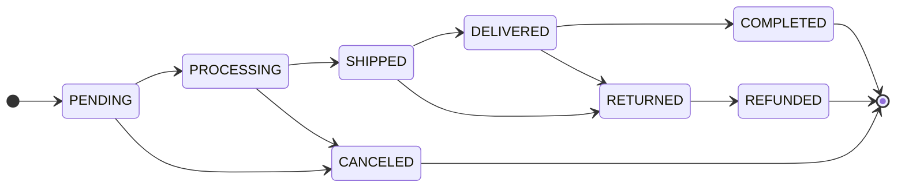
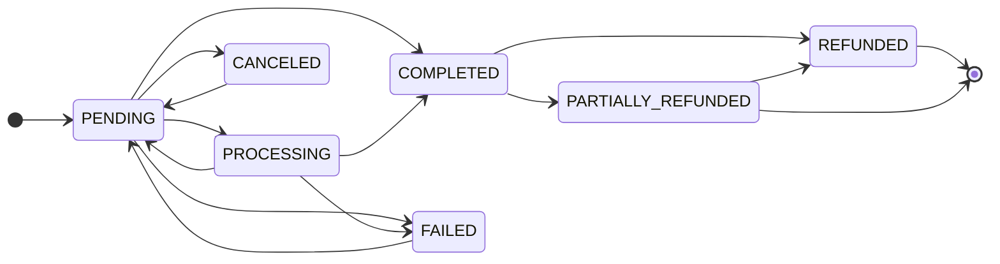

# Order lifecycle

An order carries two independent states. `Order.status` is fulfilment and
is guarded by a transition table; `Order.payment_status` is money and has
no table at all — it is assigned directly by whoever learns the truth,
except after a refund, when it is derived from the payment ledger (see
Refunds below). Decoupling them is what lets a cash-on-delivery parcel be
SHIPPED while payment is still PENDING, and it is why nothing should ever
derive one from the other.

The exhaustive reference, including the audit history behind each rule,
is [Order system](/dev/django/reference/order-system). This page is the
operational view: who moves what, and what each move sets off.

## Diagram

Payment moves on its own:

The edges back into PENDING are real: `payment_intent.requires_action`
relaxes PROCESSING or PENDING back to PENDING, and
`POST /api/v1/order/{id}/retry-payment` accepts FAILED, PENDING or
CANCELED and mints a fresh intent. Nothing leaves COMPLETED except a
refund, and PARTIALLY_REFUNDED leaves only through further refunds, any
number of them, until nothing is left to refund.

## How it works

### The fulfilment table is the only writer

`OrderService.update_order_status` (`order/services.py`) takes a row
lock, re-reads the committed status, validates the pair against
`allowed_transitions`, then writes `status` and `status_updated_at`. No
other code should assign `order.status` — the exception is the Viva
webhook, which flips PENDING to PROCESSING inline because it already
holds the row lock and knows the prior state.

Terminal states are COMPLETED, CANCELED and REFUNDED; they have no exit.
RETURNED reaches REFUNDED and nothing else — and only when money moved.
CANCELED and RETURNED are the two statuses after which nothing will ever
be collected (`PAYMENT_CLOSING_STATUSES`, `order/enum/status.py`), so
`Order.save()` settles a still-unpaid `payment_status` to CANCELED on
either transition (`Order.settle_unpaid_payment`) and the order is closed
for good; a paid return keeps COMPLETED until the refund. Before this
rule reached RETURNED, 34 refused cash-on-delivery parcels on tenant #1
read payment "Pending" forever (`0058_settle_returned_unpaid_orders`).

### Who moves each transition

| From → To | Moved by | Code path |
|---|---|---|
| PENDING → PROCESSING | Online payment webhook | `OrderService.handle_payment_succeeded`, `viva_webhook._handle_payment_created`, `handle_stripe_checkout_completed` |
| PENDING → PROCESSING | Carrier voucher mint (collected-on-delivery) | `AcsService._advance_pending_order_to_processing`, `BoxNowService._advance_pending_order_to_processing` |
| PENDING/PROCESSING → SHIPPED | Carrier event (`in_transit`, `at_destination`, `out_for_delivery`, `attempted`; or a `new` shipment whose tracking history holds a non-print checkpoint) | `AcsService._apply_order_status_transition`, `AcsService._has_left_sender`, `BoxNowService._apply_order_status_transition` |
| PENDING/PROCESSING → SHIPPED | Admin attaching tracking | `OrderService.add_tracking_info`, `POST /api/v1/order/{id}/add_tracking` |
| SHIPPED → DELIVERED | Carrier event | Both carriers' `_apply_order_status_transition` |
| DELIVERED → COMPLETED | Automatic, when paid: inline on the carrier DELIVERED and the COD reconcile, and hourly for anything paid outside those two moments | `OrderService.maybe_advance_to_completed`, `order.tasks.complete_paid_delivered_orders` |
| SHIPPED/DELIVERED → RETURNED | Carrier event (`returned`, `lost`) | `AcsService.order_status_for_shipment_state` |
| → CANCELED | Customer, staff, the cleanup task, or the ACS replay for a voucher retired before dispatch | `OrderService.cancel_order`, `AcsService._cancel_order_for_dead_shipment` |
| RETURNED → REFUNDED | Staff, manually; refused with `RefundOutstandingError` while `PaymentLedger.refund_open` holds. The admin action reports the refusal; `update_status` has no handler for it and answers 500 | `POST /api/v1/order/{id}/update_status`, the `mark_as_refunded` admin action |
| Any | Staff, manually | `OrderViewSet.update_status`, admin bulk actions in `order/admin.py` |

Carriers can skip steps. A parcel that goes from PROCESSING straight to
DELIVERED or RETURNED between two polls is bridged through SHIPPED first,
and on the RETURNED path that hop is customer-silent — "your order is on
its way" seconds before "your order was returned" is worse than nothing.

### Side effects per transition

`handle_order_post_save` (`order/signals/handlers.py`) is the single
fan-out point. It defers every dispatch to `transaction.on_commit` and
re-enters the owning tenant's schema first, because a save made inside a
webhook's `schema_context` commits after that context has already
unwound.

| Event | Side effects |
|---|---|
| Order created | `order_created` → confirmation email (offline and already-paid only), merchant new-order email, `notify_order_created_live`, history note, cart clear unless `awaits_online_payment` |
| Payment succeeded | A CHARGE row on the payment ledger (written before any guard, so a stale or repeated event and a charge on a CANCELED order still leave theirs), `mark_as_paid`, PROCESSING advance with the customer notification suppressed, carrier dispatch on commit, confirmation email, `notify_payment_confirmed_live`, Redis payment-status publish |
| Payment failed | `payment_status=FAILED`, failure email, `notify_payment_failed_live`. No stock movement |
| → PROCESSING | `order_paid` when already paid → cart clear, Meta CAPI Purchase. No customer email, no toast |
| → SHIPPED | `order_shipped`, history row, `send_shipping_notification_email` (self-gates), SHIPPED toast, and the retail receipt: `generate_order_invoice` once for a RECEIPT order while `MYDATA_ENABLED` and `MYDATA_AUTO_SUBMIT` are on (`order/invoicing.py: receipt_issuable`; ΕΛΠ art. 13(a): issued at the start of the shipment), registered with myDATA (11.1) and only then emailed |
| Tracking first set | `order_shipment_dispatched` → the same shipping email, which sends whichever condition completes second |
| → DELIVERED | `order_delivered`, status email, DELIVERED toast, then the COMPLETED auto-advance for paid orders |
| → COMPLETED | `order_completed` → loyalty points earned, status email, COMPLETED toast. Nothing is issued for an `INVOICE` order: invoices are issued by hand in timologio |
| → CANCELED | `order_canceled` → carrier voucher cascade (skipped when the cancel already asked the courier), credit of whatever gift-card value has not come back yet, loyalty reversal, status email, CANCELED toast |
| Refund recorded | `order_refunded`, once per REFUND ledger row, carrying that refund's `amount` and the `refund` row → a refund email queued for that row, `notify_order_refunded_live`, Meta CAPI Refund, history row, and the loyalty reversal once `payment_status` is REFUNDED. With auto-issuing on, one retail credit document (myDATA 11.4) per refund recorded after the receipt row was created, once the receipt has a MARK (`order/credit_documents.py: create_pending_credits`, task `issue_pending_credits`); a returned COD parcel whose payment settles to CANCELED gets one settlement credit |
| Stored value returned | `order_stored_value_returned`, once per settled `STORED_VALUE` refund attempt → a staff history NOTE, the credit reconciliation (the same `create_pending_credits`), and the loyalty reversal once `payment_status` is REFUNDED. No email, no toast |
| Status, payment status or tracking changed | `push_order_event_to_gateway` when `AGENT_GATEWAY_INTERNAL_URL` is set |

The gateway push is one `POST /internal/events/order-status` carrying
`schemaName`, `orderUuid`, `status`, `paymentStatus` and `trackingNumber`,
authenticated with `X-Internal-Token`
(`order/tasks.py: push_order_event_to_gateway`). The gateway matches the
UUID against its agent checkout sessions; an order placed outside one is
acknowledged with 204 and goes no further
(`grooveshop-agent-gateway/internal/server/internalapi.go`). A 5xx makes
Celery retry, which is how at-least-once delivery to agent platforms is
achieved. See [Agentic commerce](/dev/flows/agentic-commerce).

### Notification suppression on chained transitions

Three paths move the order twice in a row, and without help the customer
would get two near-identical messages milliseconds apart:

1. Carrier DELIVERED then the COMPLETED auto-advance.
2. Payment succeeded moving PENDING to PROCESSING immediately before the
   confirmation email.
3. An admin attaching tracking, which walks PENDING to PROCESSING to
   SHIPPED.

`OrderService._suppress_customer_status_notifications(order, status)`
pre-stamps two metadata keys: the email task's own reservation key, and
`suppress_status_ws_<status>` which `handle_order_status_changed` reads.
Internal state still flows — the signal fires, history is written, the
post-save chain runs. Only the customer-visible dispatches are skipped.

PENDING and PROCESSING are categorically silent for customers anyway
(`handle_order_status_changed` skips them, and `_ORDER_STATUS_COPY` in
`order/notifications.py` has no entry for either), so the load-bearing
case is the COMPLETED suppression on the DELIVERED auto-advance.

### Timestamps

`Order.save()` owns three columns and will not let a partial save drop
them. Django writes an `auto_now` column only when it appears in
`update_fields`, so every `save(update_fields=[...])` used to leave
`updated_at` at the creation time. `Order.save()` now adds `updated_at`
to any explicit `update_fields`, adds `status_updated_at` when the status
changed, and adds `pay_way_key` when the snapshot moved.

That is not cosmetic. `updated_at` is an exposed API filter
(`order/filters.py`), so "orders changed since X" silently omitted every
status change; and `auto_cancel_stuck_pending_orders` selects its
failed-payment bucket on `updated_at`, so a grace window meant to run
from the failure was measured from creation instead.

Do **not** add a `payment_status_updated_at` column. The requirement it
would serve is already met by `updated_at` plus the `OrderHistory` rows
that `log_payment_update` writes on every payment transition.

### Cancellation

`OrderService.cancel_order` is the only correct entry point. Its
keyword-only `customer_initiated` decides who has the last word on the
parcel: a customer cancel is held to the courier's answer, a staff or
system cancel is not. It defaults to `True`, so a new caller that forgets
to choose gets the strict behaviour.

The locked part (`_cancel_order_locked`) is the same for everyone. It
locks the row, refuses anything outside PENDING and PROCESSING
(`Order.can_be_canceled`), releases outstanding reservations, then
restores stock by **netting the order's own `StockLog` movements** rather
than by its line quantities — an `OrderItem` created outside checkout
never decremented anything, so restoring per listed item invented stock.
Cancelling twice is a no-op because the first restore's INCREMENT rows
net out. It then writes `metadata["cancellation"]` and saves CANCELED. Only after
that has committed does `cancel_order` refund, when `refund_payment` is
true (`_refund_canceled_order`, see Refunds below), so no transaction is
open across the provider call.

Entry points:

| Caller | Route | `customer_initiated` |
|---|---|---|
| Customer or guest | `POST /api/v1/order/{id}/cancel` (`OrderViewSet.cancel`; guests authorise with `?uuid=`) | `True` |
| Store staff | The same action (the view passes `not is_store_staff(user)`), or the `mark_as_canceled` bulk action in `order/admin.py` | `False` |
| Automatic | `auto_cancel_stuck_pending_orders`, always with `refund_payment=False` | `False` |
| Carrier-driven | `AcsService._cancel_order_for_dead_shipment`, for a voucher already retired | `False` |

#### A customer cancel asks the courier first

An order keeps PENDING or PROCESSING from the moment its voucher exists
until a tracking poll sees the parcel move, so in that window the courier
may already hold it. `OrderService._ask_courier_to_cancel` runs before the
row is locked and outside any transaction, because it is a carrier HTTP
call: it re-reads the status (an order that will not cancel gets the usual
status error and the courier is not asked), then calls
`ShippingService.cancel_shipment`, the same carrier path a staff cancel
uses. An order with no shipment has nothing to ask and goes on.

| Courier's answer | Exception | Response from the cancel endpoint |
|---|---|---|
| Confirmed, or no shipment | — | 200; the outcome is written to `metadata["cancellation"]["shipment_cancel"]` up front |
| Refused (an ACS voucher on an issued pickup list, a BoxNow parcel past `NEW`, any other carrier business error) | `ParcelWithCourierError` | 400, `error.type` `parcel_with_courier` |
| No answer (unreachable, timeout, 5xx, an auth-layer rejection such as ACS's sporadic 406, missing credentials, the same cancel already in flight) | `CourierUnreachableError` | 503, `error.type` `courier_unreachable` |
| Anything else raised while asking (a fault of ours) | propagates as itself | 500, logged at ERROR |

On a refusal or no answer nothing changes: no status, no refund, no
shipment change, no history row. The body is
`{"detail": <translated message>, "error": {"type": ...}}`
(`order/enum/cancel_error.py: OrderCancelErrorType`); clients branch on
`error.type`, never on `detail`. The split rides the carrier exception
hierarchy in `shipping/exceptions.py` (see
[Shipping](/dev/flows/shipping)), so order code never imports a carrier.

Because the courier is asked before the lock, the order can move on while
it answers (most likely a staff status edit). The locked re-check then
refuses the cancel with the usual status error, but the shipment is
already canceled. `_note_shipment_canceled_without_order` logs an ERROR,
which fires the logged-errors alert, and leaves a staff-only NOTE saying
the order needs a new voucher. An order that another request canceled in
the meantime needs neither.

The storefront route `server/api/orders/[id]/cancel.post.ts` returns
Django's body for any 4xx and for the documented 503 only
(`server/utils/error.ts: forwardUpstreamDocumentedError`, validated with
the generated `zOrderCancelError`), because a thrown error's body is
stripped in production. `app/components/Storefront/Account/OrderDetail.vue`
maps each `error.type` to its own message (`CANCEL_REFUSAL_KEYS`): the
parcel is with the courier, so contact the store about a return; or the
courier could not be reached, so try again in a few minutes.

#### Staff and system cancels are best-effort at the courier

These cancel first and ask the courier afterwards, through
`OrderService.cancel_attached_shipment`. That cascade also fires from the
`order_canceled` receiver, so every path that produces CANCELED reaches the
courier; a `shipment_cancel` breadcrumb on the metadata stops it
double-firing, and a customer cancel, which already asked, writes that
breadcrumb before the save. A carrier refusal never stops the cancel: it
is logged, kept in `metadata["cancellation"]["shipment_cancel"]["error"]`,
left as a staff-only `OrderHistory` NOTE (the order is canceled but the
parcel may still be delivered), and the admin **Cancel selected orders and
restore stock** action shows it as an error message.

#### `canBeCanceled`

The order list and detail serialize `can_be_canceled` from
`Order.can_be_canceled_by_customer`: the status rule AND
`ShippingService.can_cancel_shipment(order)`. The second half reads local
rows only, never the carrier: `AcsService.can_cancel_voucher` (false once
the voucher is on a pickup list) and `BoxNowService.can_cancel_shipment`
(false once a parcel with a `parcel_id` is past `NEW`), the same guards the
carriers apply before they call the courier. A `True` is not a promise;
the cancel still asks the courier. Staff and system cancels keep
`Order.can_be_canceled`, the status rule alone. `OrderQuerySet.for_list()`
includes `with_shipments()`, so the list reads the flag without a query
per order. There is no `canBeCanceled` list filter: a status-only filter
beside a carrier-aware field listed orders whose own flag said no.

### Refunds

Every refund, made in the admin, by a cancel or in a provider's dashboard,
ends the same way: a REFUND row on the payment ledger, or value written
back onto the order's gift cards and points, and `payment_status` derived
from both. The exhaustive reference is §7.2 and §7.3 of
[Order system](/dev/django/reference/order-system).

#### The payment ledger

`PaymentTransaction` (`order/models/payment_transaction.py`) is the only
record of money a provider or a courier moved for an order. It is
append-only, like `GiftCardTransaction`: a row is never updated, and the
foreign key to the order is `PROTECT`. Rows are written only through
`order/payment_ledger.py: PaymentLedger`, and every writer holds the order
row lock.

| Column | Meaning |
|---|---|
| `kind` | From `order/enum/payment_transaction.py: PaymentTransactionKind`: `CHARGE` (a provider captured money), `COD_COLLECTION` (a courier collected cash), `REFUND` (a provider paid it back, or the merchant paid cash back), `CHARGEBACK` (a lost dispute took it back, written when the dispute closes) and `REFUND_REVERSAL` (a refund the ledger counted that the provider later reported failed) |
| `amount` | Always positive; the kind gives the direction |
| `provider` | `stripe`, `viva_wallet`, `acs_cod`, `boxnow_cod`, or `manual` on a REFUND of cash the merchant paid back |
| `provider_reference` | The provider's own id for the movement: PaymentIntent, Viva transaction, refund id, voucher or parcel. A Stripe dashboard refund has no id in `charge.refunded`, so it carries the event id |
| `charge` | On a REFUND, CHARGEBACK or REFUND_REVERSAL, the payment it acts on; null otherwise. A check constraint enforces both |
| `description` | The reason given for a refund |

`UNIQUE (provider, provider_reference, kind)`
(`unique_payment_transaction_reference`) is every writer's idempotency: a
delivery the provider repeats records nothing the second time, and the
`record_*` methods say so by returning `created=False`.

| Kind | Writers |
|---|---|
| CHARGE | `OrderService.handle_payment_succeeded` (the event's `amount_received`), `handle_stripe_checkout_completed` (`amount_total`), `viva_webhook._handle_payment_created` (the verified amount), and `PaymentLedger.ensure_charge`, which reads a capture the ledger lacks from the provider once, when a refund first needs it |
| COD_COLLECTION | `OrderService.settle_cod_payment`, in the same atomic step as the payment status (see [Shipping](/dev/flows/shipping)) |
| REFUND | `OrderService.refund_order`, `handle_stripe_charge_refunded` and `viva_webhook._handle_reversal_created`, through `PaymentLedger.record_refund`; cash paid back through `PaymentLedger.record_cod_refund` |
| REFUND_REVERSAL | `handle_stripe_refund_failed` (`refund.failed`, `refund.updated`, `charge.refund.updated`), through `PaymentLedger.record_refund_reversal` |
| CHARGEBACK | `PaymentLedger.record_chargeback`, from `handle_stripe_dispute_closed` (a lost dispute) and `viva_webhook._record_viva_chargeback` (a 1797 of a Refund Claimed type, or a lost-dispute status) |

What the order paid with gift cards and loyalty points is not on this
ledger. `PaymentLedger.stored_value` reads it from the gift-card ledger
(the order's REDEEM total less its REFUND_CREDIT total; `GiftCardService.credit_refund` splits a credit between the cards) and the points ledger (REDEEM less
positive ADJUST rows, valued in proportion to the order's loyalty
discount), never from a counter.

**One function decides the payment status after a refund.**
`PaymentLedger.refund_status`: COMPLETED when nothing is refunded (net of
reversals) and no stored value went back; REFUNDED once refunds plus
chargebacks cover what was received **and** the stored value is back;
PARTIALLY_REFUNDED between. `record_refund`, `record_refund_reversal` and
`OrderService._return_stored_value` write it in the same step as their
rows, so no path decides it for itself. What can still be refunded through
a provider (`PaymentLedger.refundable`) is computed payment by payment,
from CHARGE and COD_COLLECTION rows, less what refunds and chargebacks took
and what live refund attempts hold; `stored_value_refundable` is what can
still go back onto gift cards and points; `refundable_value` is both.
`refund_open` adds the order paid through a registered provider whose
capture the ledger never recorded, without a provider call, so it is cheap
enough to decide whether the admin draws the Refund button.
`Order.amount_due` is what the customer owes and is never consulted for a
refund; `Order.remaining_amount` is 0 once the payment is settled, so a
refund never creates an amount owed (`order/models/order.py`).

Orders paid before the ledger existed were backfilled from what their rows
prove (`order/migrations/0067_backfill_payment_transactions.py`); §7.3 of
[Order system](/dev/django/reference/order-system) lists what the backfill
could not reconstruct.

#### Refund paths

| Path | Effect |
|---|---|
| The staff **Refund (amount, reason)** detail action (`order/admin.py: OrderAdmin.refund_payment`, form `RefundOrderForm`) | Offered wherever `PaymentLedger.refund_open` holds, whatever the order's status, to staff with the order's change permission (`has_refund_permission`); a CANCELED order whose automatic refund was declined is refunded here too. The amount is the **value** the customer returned and defaults to `refundable_value`; the help text says how it splits between the provider and the gift cards and points. A **How it was paid back** field appears only while collected cash is left, and is required when the plan reaches it. It reports one of three outcomes (all of it, part and the rest declined, nothing) and writes an admin log entry whenever value moved, because a staff identity lives in the platform schema and cannot be a foreign key on the tenant's rows. It changes neither the order status nor the stock |
| A cancel (`cancel_order` → `_refund_canceled_order`) | After the cancel has committed, `refund_order(amount=None)`: everything still refundable, for an order with a `payment_id` and a pay way that is paid or still holds refundable money. A refusal before any provider call (a dispute open, nothing left, no credentials) is written to the order's history in plain words and returned as `refund_info["refunded"] = False`; `refund_info["dispute_open"]` says the refund waits for the dispute |
| The admin's `mark_as_canceled` bulk action | The same path. It calls `cancel_order(order, customer_initiated=False)` with no `refund_payment` argument, and the parameter **defaults to `True`**, so bulk-cancelling a paid order does refund it |
| `POST /api/v1/order-items/{id}/restock` (`order/views/item.py: restock`) | Staff only, on a DELIVERED, COMPLETED or RETURNED order (`RETURN_HANDLING_STATUSES`). Puts returned units back in stock and records them on the line (`refunded_quantity`, `is_refunded`). It **moves no money**: a line's snapshot price is not what the customer paid for it (tax, shared discounts, shipping), so money is decided at order level |
| Stripe `charge.refunded` (`order/signals/handlers.py: handle_stripe_charge_refunded`) | Brings the ledger up to the charge's cumulative `amount_refunded`, net of reversals: records the charge first if the ledger lacks it, then the difference as one REFUND keyed on the event id. A refund this app made, a redelivery and an older event arriving late add nothing; an event raised before a recorded failure is ignored (`PaymentLedger.reversed_after`) |
| Stripe `refund.failed` and its siblings (`handle_stripe_refund_failed`) | One REFUND_REVERSAL keyed on the refund id, capped at what the ledger holds as refunded on that charge; `payment_status` derived again; a staff NOTE and the `refund_failed` operational email (`OPS_ALERT_REFUND_FAILED_ENABLED`). The refund's consequences stand: the email, the gift-card credit and points released, the credit document |
| Viva event 1797 (`order/views/viva_webhook.py: _handle_reversal_created`) | A refund made anywhere, the Viva dashboard included; see below |

**`refund_order(order, amount=None, reason="", *, repayment_reference="")`**
(`order/services.py`) runs in three steps, so that **no transaction is
open while a provider answers**: every connection kills a session idle in
a transaction after ten seconds (`idle_in_transaction_session_timeout`), and
a refund made at the provider and rolled back here is money lost to the
books.

1. **Claim** (`_claim_refund`, under the order row lock, committed). It
   refuses, as a `PaymentError` and before any provider call, an amount
   that is not positive or exceeds `refundable_value`, an order with
   nothing left, a dispute that is open (`DisputeOpenError`), cash shares
   without a `repayment_reference` or with one already booked. A request
   that repeats a live attempt (the same amount, or everything once the
   live attempts hold everything) resumes it instead (`_attempts_to_resume`);
   for a provider without idempotent refunds (`idempotent_refunds` False:
   Viva) the repeat is refused, because a lost answer cannot be told from a
   refund never made. Otherwise the value is split: **the provider is
   paid back first**, payment by payment, oldest first
   (`PaymentLedger.plan_refund`), one `RefundAttempt` of kind `PROVIDER`
   per share, and only the excess becomes one `RefundAttempt` of kind
   `STORED_VALUE` (`order/models/refund_attempt.py`). A live attempt
   (`PENDING` and younger than `ATTEMPT_RESERVATION`, one hour) holds its
   amount back, so a second refund cannot take the same money.
2. **Call** the provider for each provider share with
   `idempotency_key=f"refund-{attempt.idempotency_key}"` and no
   transaction open (`_make_refund`). A refusal marks the attempt
   `DECLINED` and frees its amount; an unknown outcome (a timeout, a
   dropped connection, a 5xx, Viva accepting without a `TransactionId`)
   keeps it `PENDING` and writes a staff NOTE saying the refund may have
   been made. The shares after a declined one are never called and are
   released, and the stored-value share runs only when every provider share
   was made.
3. **Record**, under the lock again: `record_refund` (or `record_cod_refund`
   for cash) writes the REFUND row and settles the attempt; `_make_refund`
   then signals `order_refunded` for a row it created. A webhook that booked the refund while the call was in
   flight has already settled the attempt (`record_refund` settles the
   oldest live attempt for the same charge and amount), so step 3 books and
   signals nothing. The stored-value share is
   `_return_stored_value`, one transaction under the order lock: it reads
   what is still owed from the gift-card and points ledgers, splits the
   amount between cards and points in proportion to what each has not got
   back (`GiftCardService.credit_refund(order, amount, refund_attempt=...)`,
   `LoyaltyService.restore_spent_points`), settles the attempt, derives
   `payment_status` and sends `order_stored_value_returned`. The last
   refund returns exactly what is left, so nothing is lost to rounding.

It returns a `RefundResult`: `refunded` (the provider money that moved),
`stored` (the value put back onto gift cards and points), `refund_ids` and
`declined` (the provider's answer for the share it did not make, `None`
when every share was), with `complete`, `value_returned` and
`paid_something` as the questions callers ask. `declined["error"]` can
carry raw provider text, so it goes to logs and staff screens, never to a
customer. An order whose capture the ledger never recorded is read from the
provider once (`PaymentLedger.ensure_charge`); a capture the provider
cannot confirm refuses the refund with a staff NOTE.

Stripe answers `succeeded` for a partial refund as for a full one, so a
provider's refund status never decides the payment status; the ledger's
sums do. `succeeded` and `pending` are recorded
(`StripePaymentProvider._ACCEPTED_REFUND_STATUSES`); any other status is a
refusal, which records nothing and leaves Stripe's refund id and status in
the NOTE (`Refund via <provider> was not processed: …`). Stripe amounts
are integers in the currency's own smallest unit and go through
`order/payment.py: money_from_minor_units`.

**Viva 1797.** The event's `TransactionId` is the refund, a transaction
of its own; `ParentId` names the payment it reverses.
`_verify_viva_reversal` reads everything from Retrieve Transaction, never
from the unauthenticated body: the transaction must carry one of the
order's issued order codes, have status `F`, a refund or void type
(`VIVA_REFUND_TRANSACTION_TYPE_IDS`) or a Refund Claimed type
(`VIVA_REFUND_CLAIMED_TRANSACTION_TYPE_IDS`), and a negative amount, whose
absolute value is the amount. A Refund Claimed type is the cardholder's
bank taking the money back, so it is booked as a CHARGEBACK
(`_record_viva_chargeback`), not a REFUND. An unreadable answer raises, so Viva retries and the
multi-tenant candidate loop moves on. The refund is attached to the
order's own CHARGE row whose reference is `ParentId`: `ParentId` can only
refuse, never grant. `record_refund` keys the REFUND on the refund
transaction id, so the 1797 Viva sends for a refund `refund_order` made,
and every redelivery, changes nothing, and it settles the live attempt
that made it. `VivaWebhookEvent.outcome` records `skipped` for every
refusal and `processed` for a booked refund. The tenant's Viva account
must have the *Transaction Reversal Created* webhook subscribed, or no
dashboard refund reaches the order (see [Onboarding](/dev/operator/onboarding)).

**The `order_refunded` contract** (`order/signals/__init__.py`): it is sent
once per REFUND row the ledger took and always carries `amount`, a `Money`
holding what this refund paid back, and `refund`, that row. The receivers
that use them declare them as required arguments, so a sender that leaves
one out raises. The history row, the toast, the Meta `Refund` event and the
retail credit reconciliation fire on every refund. The email is one per
refund: `handle_order_refunded` queues `send_refund_confirmation_email(refund.pk)`
on commit, and the task claims the refund before it sends by inserting a
`RefundNotification` (`order/models/refund_notification.py`, one-to-one
with the REFUND row). It states the amount refunded and, for a partial
refund, what remains. A value that went back onto gift cards and points has
no REFUND row: it sends `order_stored_value_returned`, whose receivers write
a staff history NOTE, dispatch the credit reconciliation and, on REFUNDED,
the loyalty reversal; no email and no toast.

**Loyalty.** The points the order **earned** are reversed once, all or
nothing, when the order is canceled, reaches REFUNDED (through either
signal), is marked REFUNDED, or a lost dispute completes the return
(`order_charged_back`, once `PaymentLedger.fully_returned` holds;
`loyalty/signals.py`). The spent points are not restored on a
charged-back order. A partial refund
reverses none of them. `LoyaltyService.reverse_order_points` restores the
spent points a refund has not restored yet, then takes the earning back:
with `LOYALTY_REFUND_ALLOWS_NEGATIVE_BALANCE` on (the default) the whole
earning, even below zero, and a negative balance refuses every redemption
until later earnings pay it off; off, clamped at zero. See
[Loyalty](/dev/flows/loyalty).

`Order.status` is never moved by a refund. The table only reaches REFUNDED
from RETURNED, and that move is refused with `RefundOutstandingError`
while `PaymentLedger.refund_open` holds (`update_order_status`): the status
drives the loyalty reversal and a "refund processed" status email, which
must not go out with money still held.

**Cancelled but still paid.** A cancel whose refund was refused or
declined leaves the order CANCELED with its payment COMPLETED, or
PARTIALLY_REFUNDED part-way, and the reason in a staff NOTE. The order
list's **Refund** filter, value "Cancelled but still paid"
(`order/admin.py: RefundOwedFilter`, `OrderQuerySet.refund_owed`), lists
exactly those orders, and the staff Refund action refunds them.

### VAT on an order

Every order line stores the VAT rate it was sold at
(`order/models/item.py: OrderItem.vat_rate`). Both checkout paths pass the
rate the cart priced the line with, and `OrderItem.save()` snapshots the
product's current rate for any other writer; lines older than the column
were backfilled from their product (`order/migrations/0065_backfill_orderitem_vat_rate.py`).
Nothing reads `product.vat` for an order again, so editing, re-pointing or
deleting a `Vat` row leaves existing orders' documents alone.

Every line also stores the part of the order's discount it carries
(`order/models/item.py: OrderItem.discount_allocation`). A promotion lands
on the lines it covers, not on every line: the engine splits each applied
promotion over the cart lines in its scope
(`promotion/services.py: PromotionEngine._clamp`, reported as
`CartDiscountResult.line_discounts`), both checkout paths freeze that on the
order lines (`order/services.py: OrderService._snapshot_line_discounts`), and
the loyalty redemption, being order-wide, is spread over the value left on
every line (`order/discounts.py: spread_by_remaining_value`). One rule
(`order/discounts.py: allocate_capped`, largest remainder to the cent)
serves the cart preview, the payment intent and order creation. Orders that
predate the column, or were created by the previous release during its
rollout, get the proportional allocation from `heal_discount_allocation`
(`order/discount_snapshot.py`, migration `order/migrations/0073_backfill_orderitem_discount_allocation.py`
and the `heal_discount_allocation` command); until then the tax documents
refuse the order instead of billing a total the customer never owed.

`order/taxation.py: order_vat_lines` is the one rule. It yields the goods
lines at their snapshotted rates (less the line's discount allocation, read
by `order/discounts.py: discounted_line_gross`), then shipping, then the
payment-method fee. Shipping and the fee take the goods' rate; a basket that
mixes rates splits each charge over the rates in proportion to the value of
the goods charged at each, after their discounts (`_rate_weights`, largest
remainder to the cent; AADE circular Εγκ. 10/1987). Each line is split
into a net rounded half-up and the VAT left of its gross
(`split_gross`), then summed. The invoice (`order/invoicing.py`), its
persisted totals and the myDATA payload (`order/mydata/builder.py`) all
consume those lines, so they agree to the cent, and the cart's VAT figure
rounds the same way. A charge on an order with no goods raises
`ValueError`, which the invoice task, the admin actions and the myDATA
submit each report.

A receipt row, once created, keeps the breakdown and totals it was issued
with, MARK or not: a retry after a failed render and a forced regeneration
reuse them (`order/invoicing.py: _persist_invoice_row`), because a new
receipt is computed net of everything refunded before it (provider and
cash refunds net of reversals, plus value returned onto gift cards and
points: `refunded_before_receipt`) and what is refunded later is credited,
so recomputing would count a later refund twice. Correcting a line's
`vat_rate` therefore changes only a receipt not yet issued. For the same reason the order item
admin offers `vat_rate` for correction only until the order's invoice
carries a MARK, and hides it on the add page, where `save()` snapshots the
product's rate. The full rationale, with the legal references, is in
[Order system](/dev/django/reference/order-system).

### Staff-added order lines

`POST /api/v1/order-items` is staff-only, and the line price is never a
request field: `OrderItemViewSet.perform_create` stores
`_line_price(order, product)` (`order/views/item.py`). That is the figure
checkout stores, VAT included and after the product discount: the
product's `final_price`, never its net `price`, which left a staff-added
line under-priced by its VAT on the invoice and in myDATA. An order priced
for a wholesale group at checkout (`metadata["b2b_pricing"]`) prices the
new line for that same group, through `B2BPricingService.resolve_single`,
not for the buyer's group today. If that group no longer exists the line
is refused with a 400 on `order` rather than sold at retail. See
[B2B](/dev/flows/b2b).

### Auto-cancel of stuck pending orders

`order/tasks.py: auto_cancel_stuck_pending_orders` runs every 15 minutes
through the tenant fanout (`settings.py`, beat entry
`auto-cancel-stuck-pending-orders`). Two buckets, and only the second is
restricted to online settlement:

| Bucket | Selector | Window |
|---|---|---|
| Failed payment | `status=PENDING`, `payment_status=FAILED`, `updated_at` older than the cutoff. No settlement filter | `ORDER_AUTO_CANCEL_FAILED_PAYMENT_MINUTES`, default 30 |
| Never completed | `status=PENDING`, `payment_status=PENDING`, `created_at` older than the cutoff, `pay_way__settlement=online` | `ORDER_AUTO_CANCEL_PENDING_HOURS`, default 24 |

Note which timestamp each bucket reads: the failed bucket measures the
grace window from `updated_at`, so it runs from the failure, while the
never-completed bucket measures from `created_at`.

Both windows are `EXTRA_SETTINGS_DEFAULTS` rows (`settings.py`), read
through `Setting.get`, so a merchant can change them without a deploy.

Collect-on-delivery orders are excluded from the **never-completed**
bucket by its positive settlement filter, which also excludes orders
whose `pay_way` is null; they legitimately sit PENDING until the carrier
remits. The failed-payment bucket carries no such filter, but an offline
order has nothing that can report a FAILED payment, so it does not select
one in practice. Orders carrying `AMOUNT_MISMATCH_FLAG` are excluded from
both buckets and logged — a charged customer must not be auto-cancelled
without a refund.

Each cancel re-fetches under `select_for_update(skip_locked=True)`, so
two beat workers cannot both close the same order, and delegates to
`cancel_order` with `refund_payment=False`.

This task is the **only** thing that returns stock held by a failed
online payment. Nothing happens at the moment the payment fails.

Because an unpaid online order holds stock for the whole never-completed
window, how many one customer can have waiting is bounded per store:
`OrderService._enforce_unpaid_order_limit`, step 2.3 of
`create_order_from_cart_offline`, refuses a new order with an online
settlement when the account (or, for a guest, the email, compared
case-insensitively among guest orders) already has
`ORDER_MAX_UNPAID_ONLINE_ORDERS` orders at `status=PENDING`,
`payment_status=PENDING` with `pay_way__settlement=online` (default 5, `0`
turns it off). It is counted under the cart row lock, so two carts of one
customer racing can overshoot by the number in flight. See
[Checkout & payment](/dev/flows/checkout-and-payment).

## Invariants

- **Never assign `order.status` to cancel.** Going through
  `OrderService.cancel_order` is what releases stock, cascades to the
  carrier, writes history and sends the email.
- **A customer cancel changes nothing the courier did not agree to.**
  Only `CarrierError` subclasses are the courier's answer
  (`_ask_courier_to_cancel`); any other exception is ours and propagates.
  `customer_initiated` is decided by the caller from what it already knows
  (`is_store_staff` in the view), never inferred inside the service.
- **`canBeCanceled` never calls a carrier.** It reads the same local
  guards the carriers apply before they call out, so it stays cheap on
  every order read.
- **Money moved for an order is recorded once, on the append-only
  ledger,** keyed on the provider's own id
  (`unique_payment_transaction_reference`). What can still be refunded is
  read from it under the order row lock, never from `Order.amount_due`
  or a provider's refund status.
- **`PaymentLedger.refund_status` is the one place that decides REFUNDED
  versus PARTIALLY_REFUNDED.** No path writes either for itself; a refund
  is as many `refund_order` calls as it takes, never past the remainder.
- **`refund_order` reports what moved, never a yes/no.** A split refund
  declined part-way keeps and reports the shares already made, and every
  caller (the staff action, `cancel_order`) says so.
- **No transaction is open while a provider answers a refund.** The
  claim commits a `RefundAttempt` first; its UUID is the provider's
  idempotency key, and a provider without idempotent refunds is never
  asked twice for one attempt.
- **A refund is in the value of what came back, the provider first.**
  Gift cards and points get only the excess, in proportion to what each
  has not got back, read from their own ledgers under their row locks.
- **`order_refunded` fires once per REFUND row and always carries `amount`
  and `refund`; the earned loyalty points are reversed once, with the
  refund that makes the payment REFUNDED.**
- **REFUNDED cannot be set while money is refundable**
  (`RefundOutstandingError`).
- **One refund email per REFUND row,** claimed by inserting its
  `RefundNotification` before the send, never decided by comparing counts.
- **Restocking moves no money.** `restock` is stock only; money is decided
  at order level.
- **An order's tax documents never re-read the catalogue's VAT.** The
  invoice and myDATA split each line at `OrderItem.vat_rate` and tax
  shipping and the fee at the goods' rates (`order/taxation.py`).
- **Read status with `values()`, not `refresh_from_db(fields=...)`.**
  The latter leaves other columns deferred and `Order.__init__` lazy-loads
  them while snapshotting `_original_tracking_number`, which recurses
  through the manager. Every hot path in `order/services.py`,
  `shipping_acs/services.py` and `order/tasks.py` follows this.
- **A settled payment state is final.** `SETTLED_PAYMENT_STATUSES` is
  enforced in `OrderService.handle_payment_failed`,
  `_apply_polled_payment_status`, `PayWayService.check_payment_status`,
  the Viva handlers and `handle_stripe_checkout_completed`. Providers do
  not guarantee event order, and a refunded Stripe intent still reports
  `succeeded` forever.
- **Chained transitions suppress the intermediate customer
  notification**, never the internal state.
- **`Order.pay_way_key` is the customer-facing label,
  `Order.payment_method` is the gateway that took the money.** Never
  render `payment_method` — real customers saw "acs_cod".
- **Shipment dispatch is deferred to `transaction.on_commit`** inside
  `ShippingService.dispatch_create_shipment_task`, with the tenant schema
  captured before the callback is registered.
- **Payment landing on a CANCELED order is recorded and alerted, never
  fulfilled.**
- **Guests get emails, not toasts.** Live notifications are account-bound
  and `_load_order` drops guest orders silently; the email goes to
  `order.email` regardless.

## Failure modes

- **Order stuck at PROCESSING with a voucher.** The carrier reported a
  state the table rejected. Both carriers log the rejected pair at
  WARNING with the order id; `manage.py reconcile_acs_order_status`
  reports ACS drift and repairs it only when passed `--apply`. For a
  retired voucher that replay runs the real cancel, stock included.
- **Order stuck at DELIVERED although paid.** The inline auto-advance
  runs at two moments only; `complete_paid_delivered_orders` sweeps the
  rest every hour, silently for the customer.
- **Returned cash-on-delivery order reads payment "Pending".** Only
  possible for rows older than `0058_settle_returned_unpaid_orders`; the
  RETURNED transition now settles the payment itself.
- **Order stuck at PENDING with no voucher.** The carrier permanently
  rejected the shipment. The shipment row sits at `pending_creation` and
  `shipping/alerts.py: alert_admins_shipment_creation_failed` emails the
  tenant's operators immediately; `check_stale_acs_shipments` catches
  what that missed after 24 hours.
- **Customer reports two near-identical emails.** A new chained
  transition was added without `silent_for_customer` or
  `_suppress_customer_status_notifications`.
- **Customer reports a wrong subject line.** Check the database
  translation overlay before the template: every non-empty
  `core.Translation` row overrides the compiled catalogue in every pod
  (`core/rosetta_storage.py: apply_db_overlay`), and a fresh
  `manage.py shell` does not apply it. `manage.py translation_overlay_audit -l el`
  lists the overrides side by side.
- **`updated_at` filters miss status changes.** Fixed in `Order.save()`;
  if it reappears, something is writing the row with `.update()` or
  bypassing `save()`.
- **An order was repaired by hand in a shell.** Signals were bypassed.
  Roll the status back to PENDING and drive it through
  `OrderService.cancel_order` so the canonical path fires.
- **A customer says the cancel button was refused.** A 400
  `parcel_with_courier` means the courier refused (the voucher is on a
  pickup list, or the BoxNow parcel is past `NEW`): the order is untouched
  and the return is arranged by the store. A 503 `courier_unreachable`
  means the courier gave no answer; the customer retries, and the WARNING
  logged by `_ask_courier_to_cancel` carries the carrier error.
- **Staff note "its shipment was canceled, but the order itself was not
  canceled".** The order moved on while the courier answered a customer
  cancel. The order is live with no voucher: create a new one if it is
  still to ship.
- **A refund made in the Viva dashboard never reached the order.** Check
  that the tenant's Viva account subscribes *Transaction Reversal
  Created*, then the `VivaWebhookEvent` row for the refund's transaction
  id: `skipped` names a refusal in `_handle_reversal_created`, and the
  WARNING or ERROR beside it says which. A `ParentId` that is none of the
  order's own payments is logged at ERROR and skipped.
- **The Refund action says "cannot exceed the refundable amount".** The
  ledger holds less than staff expected: an earlier refund (in-app or a
  dashboard refund the webhook recorded) already took part of it. The
  order page's **Payment Transactions** tab lists every row.
- **"N of M refunded; the rest was declined".** A refund split across two
  payments (an order paid twice under two Viva codes) was declined on the
  second. The first share is recorded and emailed, the provider's reason
  is in the order's history, and the rest stays refundable: run the action
  again once the cause is fixed, or refund it in the Viva dashboard.
- **A Stripe refund left the order COMPLETED.** Stripe answered a status
  other than `succeeded` or `pending`; the NOTE on the order carries
  Stripe's refund id and status. The attempt is DECLINED, so a retry from
  the admin is a new attempt under a new key.
- **"Refund via … has an unknown outcome".** The provider timed out or
  failed with a 5xx; the attempt stays PENDING for an hour and holds its
  amount. The provider's webhook books the refund if it was made; a Stripe
  retry within the hour resumes the attempt and Stripe returns the refund
  it made; a Viva retry is refused until the attempt expires or the 1797
  arrives. Check the provider's dashboard first.
- **A Stripe refund was reported failed days later.** A REFUND_REVERSAL
  row, a staff NOTE and the `refund_failed` email; the money is
  refundable again and the customer must be paid another way.
- **A cancelled order is still paid.** The provider declined the cancel's
  refund, or a dispute is open. The **Refund** filter's "Cancelled but
  still paid" lists every such order; refund it with the staff action.
- **A part refund left the gift card and the points alone.** By design
  when the provider's money covered it: stored value gets only what is
  refunded beyond the provider's share.
- **"Mark selected orders as refunded" skipped an order.** Money paid for
  it is still refundable (`RefundOutstandingError`); refund it first.
- **An invoice registered with myDATA before the VAT snapshot shipped is
  re-rendered.** Its stored figures predate the shipping and fee VAT
  split, so the PDF prints those figures beside the new reference rows.
  A registered document cannot be corrected retroactively; leave it.

## Source

| File | Role |
|---|---|
| `grooveshop-django-api/order/enum/status.py` | `OrderStatus`, `PaymentStatus`, `SETTLED_PAYMENT_STATUSES`, `RETURN_HANDLING_STATUSES` |
| `grooveshop-django-api/order/payment_ledger.py` | `PaymentLedger`: `captured`, `refunded`, `refundable`, `stored_value`, `stored_value_refundable`, `refundable_value`, `refund_open`, `refund_status`, `plan_refund`, `record_charge`, `record_cod_collection`, `record_refund`, `record_cod_refund`, `record_refund_reversal`, `settle_attempt`, `ensure_charge` |
| `grooveshop-django-api/order/models/refund_attempt.py` | `RefundAttempt` (kinds `PROVIDER`, `STORED_VALUE`; `PENDING`, `SETTLED`, `DECLINED`), `ATTEMPT_RESERVATION` |
| `grooveshop-django-api/order/models/payment_transaction.py` | `PaymentTransaction`, its unique and check constraints |
| `grooveshop-django-api/order/enum/payment_transaction.py` | `PaymentTransactionKind` |
| `grooveshop-django-api/order/models/refund_notification.py` | `RefundNotification`, the claim on one refund's email |
| `grooveshop-django-api/order/migrations/0067_backfill_payment_transactions.py` | Ledger backfill for orders paid before it existed |
| `grooveshop-django-api/order/enum/cancel_error.py` | `OrderCancelErrorType`: `parcel_with_courier`, `courier_unreachable` |
| `grooveshop-django-api/order/exceptions.py` | `OrderCancellationError`, `ParcelWithCourierError`, `CourierUnreachableError`, `DisputeOpenError`, `RefundOutstandingError` |
| `grooveshop-django-api/order/models/order.py` | `Order.save()` timestamp rules, `mark_as_paid`, `can_be_canceled`, `can_be_canceled_by_customer`, `awaits_online_payment`, `calculate_order_total_amount`, `AMOUNT_MISMATCH_FLAG` |
| `grooveshop-django-api/order/managers/order.py` | `with_shipments`, `for_list`, `refund_owed` |
| `grooveshop-django-api/order/services.py` | `update_order_status` table, `_suppress_customer_status_notifications`, `maybe_advance_to_completed`, `cancel_order`, `_ask_courier_to_cancel`, `_note_shipment_canceled_without_order`, `cancel_attached_shipment`, `_refund_canceled_order`, `refund_order`, `_claim_refund`, `_attempts_to_resume`, `_make_refund`, `_return_stored_value`, `RefundResult`, `_note_refund_declined`, `add_tracking_info` |
| `grooveshop-django-api/order/payment.py` | `refund_payment` per provider, `StripePaymentProvider._ACCEPTED_REFUND_STATUSES`, `money_from_minor_units`, `VIVA_REFUND_TRANSACTION_TYPE_IDS` |
| `grooveshop-django-api/order/views/viva_webhook.py` | `_verify_viva_reversal`, `_handle_reversal_created`, `_record_viva_chargeback` |
| `grooveshop-django-api/order/signals/handlers.py` | `handle_order_post_save` fan-out, `handle_order_refunded`, `handle_order_stored_value_returned`, `handle_stripe_charge_refunded`, `handle_stripe_refund_failed` and every other domain receiver |
| `grooveshop-django-api/order/signals/__init__.py` | The twelve order signals and the `order_refunded` contract |
| `grooveshop-django-api/order/tasks.py` | `auto_cancel_stuck_pending_orders`, `check_pending_orders`, `push_order_event_to_gateway`, every email task, `send_refund_confirmation_email` and `_claim_refund_email` |
| `grooveshop-django-api/order/views/order.py` | `cancel` and its 400/503 refusals, `update_status`, `add_tracking`, permission map |
| `grooveshop-django-api/order/serializers/order.py` | `can_be_canceled` sourced from `can_be_canceled_by_customer` |
| `grooveshop-django-api/order/views/item.py` | `restock`, and `_line_price` for a staff-added line |
| `grooveshop-django-api/order/admin.py` | `refund_payment`, `RefundOrderForm`, `has_refund_permission`, `RefundOwedFilter`, `PaymentTransactionInline`; `mark_as_canceled` and its courier and refund error messages; `OrderItemAdmin` freezing `vat_rate` once the invoice has a MARK |
| `grooveshop-django-api/order/models/item.py` | `OrderItem.vat_rate` and the snapshot in `save()` |
| `grooveshop-django-api/order/taxation.py` | `order_vat_lines`, `split_gross`, `_rate_weights` |
| `grooveshop-django-api/order/discounts.py` | `allocate_capped`, `discounted_line_gross`, `spread_by_remaining_value` |
| `grooveshop-django-api/order/discount_snapshot.py` | `heal_discount_allocation` |
| `grooveshop-django-api/order/invoicing.py` | Receipt totals from the VAT lines net of `refunded_before_receipt`, `_persist_invoice_row` keeping an existing row's figures, `_refuse_if_fully_refunded`, `receipt_issuable`, `render_credit_pdf` |
| `grooveshop-django-api/order/credit_documents.py` | `create_pending_credits` (REFUND rows and settled `STORED_VALUE` attempts after the receipt row), `credit_breakdown` (cumulative net, never past the receipt), settlement credit |
| `grooveshop-django-api/order/models/retail_credit.py` | `RetailCredit`, `CreditCounter` |
| `grooveshop-django-api/order/mydata/builder.py` | myDATA lines and summary from the same VAT lines |
| `grooveshop-django-api/shipping/services.py` | `ShippingService.cancel_shipment`, `can_cancel_shipment` |
| `grooveshop-django-api/shipping/exceptions.py` | `CarrierError`, `CarrierUnavailableError` |
| `grooveshop-django-api/giftcard/signals.py` | Gift-card credit on cancel |
| `grooveshop-django-api/giftcard/services.py` | `GiftCardService.credit_refund`, in parts, capped per card under its row lock |
| `grooveshop-django-api/loyalty/services.py` | `restore_spent_points`, `reverse_order_points` and `LOYALTY_REFUND_ALLOWS_NEGATIVE_BALANCE` |
| `grooveshop-django-api/order/models/history.py` | `OrderHistory.log_status_change`, `log_payment_update`, `log_refund`, `log_note` |
| `grooveshop-django-api/order/notifications.py` | `_ORDER_STATUS_COPY` and the live-notification tasks |
| `grooveshop-django-api/order/payment_events.py` | Redis pub/sub payment-status publish |
| `grooveshop-django-api/loyalty/signals.py` | Earn on COMPLETED; reverse on CANCELED, on REFUNDED reached through `order_refunded` or `order_stored_value_returned`, on the REFUNDED status, and on `order_charged_back` once everything received is returned |
| `grooveshop-django-api/settings.py` | `CELERY_BEAT_SCHEDULE` entries and their cadences |
| `grooveshop-agent-gateway/internal/server/internalapi.go` | `POST /internal/events/order-status` |
| `grooveshop-storefront-ui-node-nuxt/server/api/orders/[id]/cancel.post.ts` | Cancel proxy that returns the typed refusal body |
| `grooveshop-storefront-ui-node-nuxt/server/utils/error.ts` | `forwardUpstreamClientError`, `forwardUpstreamDocumentedError` |
| `grooveshop-storefront-ui-node-nuxt/app/components/Storefront/Account/OrderDetail.vue` | Cancel button gated on `canBeCanceled`, `CANCEL_REFUSAL_KEYS` |
