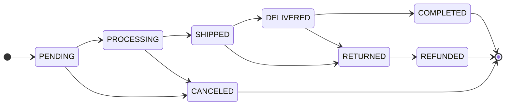
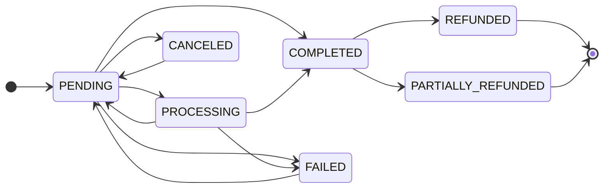

# Order lifecycle

An order carries two independent states. `Order.status` is fulfilment and
is guarded by a transition table; `Order.payment_status` is money and has
no table at all — it is assigned directly by whoever learns the truth.
Decoupling them is what lets a cash-on-delivery parcel be SHIPPED while
payment is still PENDING, and it is why nothing should ever derive one
from the other.

The exhaustive reference, including the audit history behind each rule,
is [Order system](/dev/django/reference/order-system). This page is the
operational view: who moves what, and what each move sets off.

## Diagram

Payment moves on its own:

The edges back into PENDING are real: `payment_intent.requires_action`
relaxes PROCESSING or PENDING back to PENDING, and
`POST /api/v1/order/{id}/retry-payment` accepts FAILED, PENDING or
CANCELED and mints a fresh intent. Nothing leaves COMPLETED except a
refund.

## How it works

### The fulfilment table is the only writer

`OrderService.update_order_status` (`order/services.py`) takes a row
lock, re-reads the committed status, validates the pair against
`allowed_transitions`, then writes `status` and `status_updated_at`. No
other code should assign `order.status` — the exception is the Viva
webhook, which flips PENDING to PROCESSING inline because it already
holds the row lock and knows the prior state.

Terminal states are COMPLETED, CANCELED and REFUNDED; they have no exit.
RETURNED reaches REFUNDED and nothing else.

### Who moves each transition

| From → To | Moved by | Code path |
|---|---|---|
| PENDING → PROCESSING | Online payment webhook | `OrderService.handle_payment_succeeded`, `viva_webhook._handle_payment_created`, `handle_stripe_checkout_completed` |
| PENDING → PROCESSING | Carrier voucher mint (collected-on-delivery) | `AcsService._advance_pending_order_to_processing`, `BoxNowService._advance_pending_order_to_processing` |
| PENDING/PROCESSING → SHIPPED | Carrier event | `AcsService._apply_order_status_transition`, `BoxNowService._apply_order_status_transition` |
| PENDING/PROCESSING → SHIPPED | Admin attaching tracking | `OrderService.add_tracking_info`, `POST /api/v1/order/{id}/add_tracking` |
| SHIPPED → DELIVERED | Carrier event | Both carriers' `_apply_order_status_transition` |
| DELIVERED → COMPLETED | Automatic, when paid | `OrderService.maybe_advance_to_completed` |
| SHIPPED/DELIVERED → RETURNED | Carrier event (`returned`, `lost`) | `AcsService.order_status_for_shipment_state` |
| → CANCELED | Customer, staff, or the cleanup task | `OrderService.cancel_order` |
| RETURNED → REFUNDED | Staff, manually | `POST /api/v1/order/{id}/update_status` |
| Any | Staff, manually | `OrderViewSet.update_status`, admin bulk actions in `order/admin.py` |

Carriers can skip steps. A parcel that goes from PROCESSING straight to
DELIVERED or RETURNED between two polls is bridged through SHIPPED first,
and on the RETURNED path that hop is customer-silent — "your order is on
its way" seconds before "your order was returned" is worse than nothing.

### Side effects per transition

`handle_order_post_save` (`order/signals/handlers.py`) is the single
fan-out point. It defers every dispatch to `transaction.on_commit` and
re-enters the owning tenant's schema first, because a save made inside a
webhook's `schema_context` commits after that context has already
unwound.

| Event | Side effects |
|---|---|
| Order created | `order_created` → confirmation email (offline and already-paid only), merchant new-order email, `notify_order_created_live`, history note, cart clear unless `awaits_online_payment` |
| Payment succeeded | `mark_as_paid`, PROCESSING advance with the customer notification suppressed, carrier dispatch on commit, confirmation email, `notify_payment_confirmed_live`, Redis payment-status publish |
| Payment failed | `payment_status=FAILED`, failure email, `notify_payment_failed_live`. No stock movement |
| → PROCESSING | `order_paid` when already paid → cart clear, Meta CAPI Purchase. No customer email, no toast |
| → SHIPPED | `order_shipped`, history row, `send_shipping_notification_email` (self-gates), SHIPPED toast |
| Tracking first set | `order_shipment_dispatched` → the same shipping email, which sends whichever condition completes second |
| → DELIVERED | `order_delivered`, status email, DELIVERED toast, then the COMPLETED auto-advance for paid orders |
| → COMPLETED | `order_completed` → invoice generation when `document_type == INVOICE`, loyalty points earned, status email, COMPLETED toast |
| → CANCELED | `order_canceled` → carrier voucher cascade, stock restore, loyalty reversal, status email, CANCELED toast |
| Refund recorded | `order_refunded` → refund email, `notify_order_refunded_live`, loyalty reversal, Meta CAPI Refund, history row |
| Status, payment status or tracking changed | `push_order_event_to_gateway` when `AGENT_GATEWAY_INTERNAL_URL` is set |

The gateway push is one `POST /internal/events/order-status` carrying
`schemaName`, `orderUuid`, `status`, `paymentStatus` and `trackingNumber`,
authenticated with `X-Internal-Token`
(`order/tasks.py: push_order_event_to_gateway`). The gateway matches the
UUID against its agent checkout sessions; an order placed outside one is
acknowledged with 204 and goes no further
(`grooveshop-agent-gateway/internal/server/internalapi.go`). A 5xx makes
Celery retry, which is how at-least-once delivery to agent platforms is
achieved. See [Agentic commerce](/dev/flows/agentic-commerce).

### Notification suppression on chained transitions

Three paths move the order twice in a row, and without help the customer
would get two near-identical messages milliseconds apart:

1. Carrier DELIVERED then the COMPLETED auto-advance.
2. Payment succeeded moving PENDING to PROCESSING immediately before the
   confirmation email.
3. An admin attaching tracking, which walks PENDING to PROCESSING to
   SHIPPED.

`OrderService._suppress_customer_status_notifications(order, status)`
pre-stamps two metadata keys: the email task's own reservation key, and
`suppress_status_ws_<status>` which `handle_order_status_changed` reads.
Internal state still flows — the signal fires, history is written, the
post-save chain runs. Only the customer-visible dispatches are skipped.

PENDING and PROCESSING are categorically silent for customers anyway
(`handle_order_status_changed` skips them, and `_ORDER_STATUS_COPY` in
`order/notifications.py` has no entry for either), so the load-bearing
case is the COMPLETED suppression on the DELIVERED auto-advance.

### Timestamps

`Order.save()` owns three columns and will not let a partial save drop
them. Django writes an `auto_now` column only when it appears in
`update_fields`, so every `save(update_fields=[...])` used to leave
`updated_at` at the creation time. `Order.save()` now adds `updated_at`
to any explicit `update_fields`, adds `status_updated_at` when the status
changed, and adds `pay_way_key` when the snapshot moved.

That is not cosmetic. `updated_at` is an exposed API filter
(`order/filters.py`), so "orders changed since X" silently omitted every
status change; and `auto_cancel_stuck_pending_orders` selects its
failed-payment bucket on `updated_at`, so a grace window meant to run
from the failure was measured from creation instead.

Do **not** add a `payment_status_updated_at` column. The requirement it
would serve is already met by `updated_at` plus the `OrderHistory` rows
that `log_payment_update` writes on every payment transition.

### Cancellation

`OrderService.cancel_order` is the only correct entry point. It locks the
row, refuses anything outside PENDING and PROCESSING
(`Order.can_be_canceled`), releases outstanding reservations, then
restores stock by **netting the order's own `StockLog` movements** rather
than by its line quantities — an `OrderItem` created outside checkout
never decremented anything, so restoring per listed item invented stock.
Cancelling twice is a no-op because the first restore's INCREMENT rows
net out.

It then writes `metadata["cancellation"]`, saves CANCELED, and cascades
to the carrier through `OrderService.cancel_attached_shipment`. That
cascade also fires from the `order_canceled` receiver, so an admin form
save that sets the status directly still reaches the courier; a
`shipment_cancel` breadcrumb on the metadata stops it double-firing.

Entry points:

| Caller | Route |
|---|---|
| Customer or guest | `POST /api/v1/order/{id}/cancel` (`OrderViewSet.cancel`; guests authorise with `?uuid=`) |
| Staff | The same action, or the `mark_as_canceled` bulk action in `order/admin.py` |
| Automatic | `auto_cancel_stuck_pending_orders`, always with `refund_payment=False` |

### Refunds

**There is no admin refund button and no `refund_order` action on the
order viewset.** `order/urls.py` registers no such path, and
`OrderViewSet` has no such method. `OrderService.refund_order` exists but
has exactly one production caller: `cancel_order`, when
`refund_payment=True` and the order is paid. `PayWayService.refund_payment`
has no production caller at all.

What does exist:

| Path | Effect |
|---|---|
| `POST /api/v1/order-items/{id}/refund` (`order/views/item.py: refund`) | Staff only. Requires the order in DELIVERED, COMPLETED or RETURNED. Restocks the units and raises `refunded_quantity`. Does not touch `Order.payment_status` |
| Cancel a paid order with `refundPayment` true | Calls the provider's refund API through `OrderService.refund_order`, writes `payment_status`, appends to `metadata["refunds"]`, fires `order_refunded` |
| The admin's `mark_as_canceled` bulk action | The same path. It calls `cancel_order(order)` with no `refund_payment` argument, and the parameter **defaults to `True`** — so bulk-cancelling a paid order does issue a provider refund. This is the closest thing to an admin refund button, and it is not labelled as one |
| Stripe `charge.refunded` webhook | Full refund → REFUNDED and `order_refunded` fires; partial → PARTIALLY_REFUNDED and **no signal**, so no email |
| Viva event 1797 | Verified against Viva, then REFUNDED and `order_refunded` fires. A partial reversal carrying gift-card value issues **no** gift-card credit and logs at ERROR, because the event does not say how much came back |

`Order.status` is never moved automatically by a refund. The table only
reaches REFUNDED from RETURNED, and deciding that the goods came back is
a business call an operator makes from the order page.

### Auto-cancel of stuck pending orders

`order/tasks.py: auto_cancel_stuck_pending_orders` runs every 15 minutes
through the tenant fanout (`settings.py`, beat entry
`auto-cancel-stuck-pending-orders`). Two buckets, and only the second is
restricted to online settlement:

| Bucket | Selector | Window |
|---|---|---|
| Failed payment | `status=PENDING`, `payment_status=FAILED`, `updated_at` older than the cutoff. No settlement filter | `ORDER_AUTO_CANCEL_FAILED_PAYMENT_MINUTES`, default 30 |
| Never completed | `status=PENDING`, `payment_status=PENDING`, `created_at` older than the cutoff, `pay_way__settlement=online` | `ORDER_AUTO_CANCEL_PENDING_HOURS`, default 24 |

Note which timestamp each bucket reads: the failed bucket measures the
grace window from `updated_at`, so it runs from the failure, while the
never-completed bucket measures from `created_at`.

Both windows are `EXTRA_SETTINGS_DEFAULTS` rows (`settings.py`), read
through `Setting.get`, so a merchant can change them without a deploy.

Collect-on-delivery orders are excluded from the **never-completed**
bucket by its positive settlement filter, which also excludes orders
whose `pay_way` is null; they legitimately sit PENDING until the carrier
remits. The failed-payment bucket carries no such filter, but an offline
order has nothing that can report a FAILED payment, so it does not select
one in practice. Orders carrying `AMOUNT_MISMATCH_FLAG` are excluded from
both buckets and logged — a charged customer must not be auto-cancelled
without a refund.

Each cancel re-fetches under `select_for_update(skip_locked=True)`, so
two beat workers cannot both close the same order, and delegates to
`cancel_order` with `refund_payment=False`.

This task is the **only** thing that returns stock held by a failed
online payment. Nothing happens at the moment the payment fails.

## Invariants

- **Never assign `order.status` to cancel.** Going through
  `OrderService.cancel_order` is what releases stock, cascades to the
  carrier, writes history and sends the email.
- **Read status with `values()`, not `refresh_from_db(fields=...)`.**
  The latter leaves other columns deferred and `Order.__init__` lazy-loads
  them while snapshotting `_original_tracking_number`, which recurses
  through the manager. Every hot path in `order/services.py`,
  `shipping_acs/services.py` and `order/tasks.py` follows this.
- **A settled payment state is final.** `SETTLED_PAYMENT_STATUSES` is
  enforced in `OrderService.handle_payment_failed`,
  `_apply_polled_payment_status`, `PayWayService.check_payment_status`,
  the Viva handlers and `handle_stripe_checkout_completed`. Providers do
  not guarantee event order, and a refunded Stripe intent still reports
  `succeeded` forever.
- **Chained transitions suppress the intermediate customer
  notification**, never the internal state.
- **`Order.pay_way_key` is the customer-facing label,
  `Order.payment_method` is the gateway that took the money.** Never
  render `payment_method` — real customers saw "acs_cod".
- **Shipment dispatch is deferred to `transaction.on_commit`** inside
  `ShippingService.dispatch_create_shipment_task`, with the tenant schema
  captured before the callback is registered.
- **Payment landing on a CANCELED order is recorded and alerted, never
  fulfilled.**
- **Guests get emails, not toasts.** Live notifications are account-bound
  and `_load_order` drops guest orders silently; the email goes to
  `order.email` regardless.

## Failure modes

- **Order stuck at PROCESSING with a voucher.** The carrier reported a
  state the table rejected. Both carriers log the rejected pair at
  WARNING with the order id; `manage.py reconcile_acs_order_status`
  reports ACS drift and repairs it only when passed `--apply`.
- **Order stuck at PENDING with no voucher.** The carrier permanently
  rejected the shipment. The shipment row sits at `pending_creation` and
  `shipping/alerts.py: alert_admins_shipment_creation_failed` emails the
  tenant's operators immediately; `check_stale_acs_shipments` catches
  what that missed after 24 hours.
- **Customer reports two near-identical emails.** A new chained
  transition was added without `silent_for_customer` or
  `_suppress_customer_status_notifications`.
- **Customer reports a wrong subject line.** Check the database
  translation overlay before the template: every non-empty
  `core.Translation` row overrides the compiled catalogue in every pod
  (`core/rosetta_storage.py: apply_db_overlay`), and a fresh
  `manage.py shell` does not apply it. `manage.py translation_overlay_audit -l el`
  lists the overrides side by side.
- **`updated_at` filters miss status changes.** Fixed in `Order.save()`;
  if it reappears, something is writing the row with `.update()` or
  bypassing `save()`.
- **An order was repaired by hand in a shell.** Signals were bypassed.
  Roll the status back to PENDING and drive it through
  `OrderService.cancel_order` so the canonical path fires.

## Source

| File | Role |
|---|---|
| `grooveshop-django-api/order/enum/status.py` | `OrderStatus`, `PaymentStatus`, `SETTLED_PAYMENT_STATUSES` |
| `grooveshop-django-api/order/models/order.py` | `Order.save()` timestamp rules, `mark_as_paid`, `can_be_canceled`, `awaits_online_payment`, `calculate_order_total_amount`, `AMOUNT_MISMATCH_FLAG` |
| `grooveshop-django-api/order/services.py` | `update_order_status` table, `_suppress_customer_status_notifications`, `maybe_advance_to_completed`, `cancel_order`, `refund_order`, `add_tracking_info` |
| `grooveshop-django-api/order/signals/handlers.py` | `handle_order_post_save` fan-out and every domain receiver |
| `grooveshop-django-api/order/signals/__init__.py` | The ten order signals |
| `grooveshop-django-api/order/tasks.py` | `auto_cancel_stuck_pending_orders`, `check_pending_orders`, `push_order_event_to_gateway`, every email task |
| `grooveshop-django-api/order/views/order.py` | `cancel`, `update_status`, `add_tracking`, permission map |
| `grooveshop-django-api/order/views/item.py` | The order-item refund action |
| `grooveshop-django-api/order/models/history.py` | `OrderHistory.log_status_change`, `log_payment_update`, `log_refund`, `log_note` |
| `grooveshop-django-api/order/notifications.py` | `_ORDER_STATUS_COPY` and the live-notification tasks |
| `grooveshop-django-api/order/payment_events.py` | Redis pub/sub payment-status publish |
| `grooveshop-django-api/loyalty/signals.py` | Earn on COMPLETED, reverse on CANCELED and REFUNDED |
| `grooveshop-django-api/settings.py` | `CELERY_BEAT_SCHEDULE` entries and their cadences |
| `grooveshop-agent-gateway/internal/server/internalapi.go` | `POST /internal/events/order-status` |
