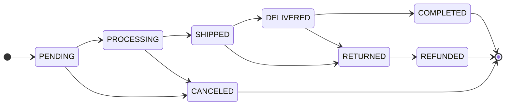
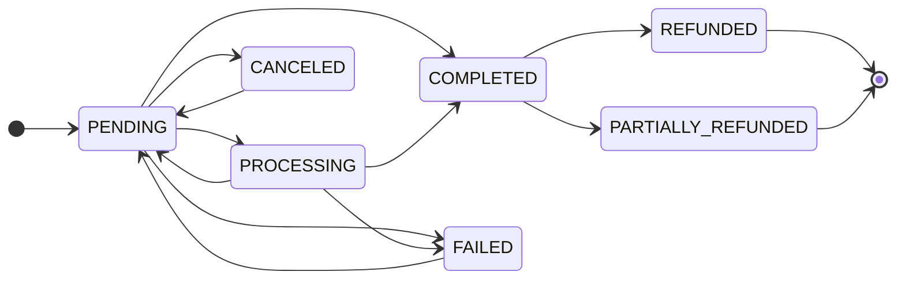

# Order lifecycle

An order carries two independent states. `Order.status` is fulfilment and
is guarded by a transition table; `Order.payment_status` is money and has
no table at all — it is assigned directly by whoever learns the truth.
Decoupling them is what lets a cash-on-delivery parcel be SHIPPED while
payment is still PENDING, and it is why nothing should ever derive one
from the other.

The exhaustive reference, including the audit history behind each rule,
is [Order system](/dev/django/reference/order-system). This page is the
operational view: who moves what, and what each move sets off.

## Diagram

Payment moves on its own:

The edges back into PENDING are real: `payment_intent.requires_action`
relaxes PROCESSING or PENDING back to PENDING, and
`POST /api/v1/order/{id}/retry-payment` accepts FAILED, PENDING or
CANCELED and mints a fresh intent. Nothing leaves COMPLETED except a
refund.

## How it works

### The fulfilment table is the only writer

`OrderService.update_order_status` (`order/services.py`) takes a row
lock, re-reads the committed status, validates the pair against
`allowed_transitions`, then writes `status` and `status_updated_at`. No
other code should assign `order.status` — the exception is the Viva
webhook, which flips PENDING to PROCESSING inline because it already
holds the row lock and knows the prior state.

Terminal states are COMPLETED, CANCELED and REFUNDED; they have no exit.
RETURNED reaches REFUNDED and nothing else — and only when money moved.
CANCELED and RETURNED are the two statuses after which nothing will ever
be collected (`PAYMENT_CLOSING_STATUSES`, `order/enum/status.py`), so
`Order.save()` settles a still-unpaid `payment_status` to CANCELED on
either transition (`Order.settle_unpaid_payment`) and the order is closed
for good; a paid return keeps COMPLETED until the refund. Before this
rule reached RETURNED, 34 refused cash-on-delivery parcels on tenant #1
read payment "Pending" forever (`0058_settle_returned_unpaid_orders`).

### Who moves each transition

| From → To | Moved by | Code path |
|---|---|---|
| PENDING → PROCESSING | Online payment webhook | `OrderService.handle_payment_succeeded`, `viva_webhook._handle_payment_created`, `handle_stripe_checkout_completed` |
| PENDING → PROCESSING | Carrier voucher mint (collected-on-delivery) | `AcsService._advance_pending_order_to_processing`, `BoxNowService._advance_pending_order_to_processing` |
| PENDING/PROCESSING → SHIPPED | Carrier event (`in_transit`, `at_destination`, `out_for_delivery`, `attempted`; or a `new` shipment whose tracking history holds a non-print checkpoint) | `AcsService._apply_order_status_transition`, `AcsService._has_left_sender`, `BoxNowService._apply_order_status_transition` |
| PENDING/PROCESSING → SHIPPED | Admin attaching tracking | `OrderService.add_tracking_info`, `POST /api/v1/order/{id}/add_tracking` |
| SHIPPED → DELIVERED | Carrier event | Both carriers' `_apply_order_status_transition` |
| DELIVERED → COMPLETED | Automatic, when paid: inline on the carrier DELIVERED and the COD reconcile, and hourly for anything paid outside those two moments | `OrderService.maybe_advance_to_completed`, `order.tasks.complete_paid_delivered_orders` |
| SHIPPED/DELIVERED → RETURNED | Carrier event (`returned`, `lost`) | `AcsService.order_status_for_shipment_state` |
| → CANCELED | Customer, staff, the cleanup task, or the ACS replay for a voucher retired before dispatch | `OrderService.cancel_order`, `AcsService._cancel_order_for_dead_shipment` |
| RETURNED → REFUNDED | Staff, manually | `POST /api/v1/order/{id}/update_status`, the `mark_as_refunded` admin action |
| Any | Staff, manually | `OrderViewSet.update_status`, admin bulk actions in `order/admin.py` |

Carriers can skip steps. A parcel that goes from PROCESSING straight to
DELIVERED or RETURNED between two polls is bridged through SHIPPED first,
and on the RETURNED path that hop is customer-silent — "your order is on
its way" seconds before "your order was returned" is worse than nothing.

### Side effects per transition

`handle_order_post_save` (`order/signals/handlers.py`) is the single
fan-out point. It defers every dispatch to `transaction.on_commit` and
re-enters the owning tenant's schema first, because a save made inside a
webhook's `schema_context` commits after that context has already
unwound.

| Event | Side effects |
|---|---|
| Order created | `order_created` → confirmation email (offline and already-paid only), merchant new-order email, `notify_order_created_live`, history note, cart clear unless `awaits_online_payment` |
| Payment succeeded | `mark_as_paid`, PROCESSING advance with the customer notification suppressed, carrier dispatch on commit, confirmation email, `notify_payment_confirmed_live`, Redis payment-status publish |
| Payment failed | `payment_status=FAILED`, failure email, `notify_payment_failed_live`. No stock movement |
| → PROCESSING | `order_paid` when already paid → cart clear, Meta CAPI Purchase. No customer email, no toast |
| → SHIPPED | `order_shipped`, history row, `send_shipping_notification_email` (self-gates), SHIPPED toast |
| Tracking first set | `order_shipment_dispatched` → the same shipping email, which sends whichever condition completes second |
| → DELIVERED | `order_delivered`, status email, DELIVERED toast, then the COMPLETED auto-advance for paid orders |
| → COMPLETED | `order_completed` → invoice generation when `document_type == INVOICE`, loyalty points earned, status email, COMPLETED toast |
| → CANCELED | `order_canceled` → carrier voucher cascade (skipped when the cancel already asked the courier), gift-card credit, loyalty reversal, status email, CANCELED toast |
| Refund recorded | `order_refunded` (always with the `amount` of this refund) → refund email, `notify_order_refunded_live`, Meta CAPI Refund, history row; the gift-card credit and the loyalty reversal only once `payment_status` is REFUNDED |
| Status, payment status or tracking changed | `push_order_event_to_gateway` when `AGENT_GATEWAY_INTERNAL_URL` is set |

The gateway push is one `POST /internal/events/order-status` carrying
`schemaName`, `orderUuid`, `status`, `paymentStatus` and `trackingNumber`,
authenticated with `X-Internal-Token`
(`order/tasks.py: push_order_event_to_gateway`). The gateway matches the
UUID against its agent checkout sessions; an order placed outside one is
acknowledged with 204 and goes no further
(`grooveshop-agent-gateway/internal/server/internalapi.go`). A 5xx makes
Celery retry, which is how at-least-once delivery to agent platforms is
achieved. See [Agentic commerce](/dev/flows/agentic-commerce).

### Notification suppression on chained transitions

Three paths move the order twice in a row, and without help the customer
would get two near-identical messages milliseconds apart:

1. Carrier DELIVERED then the COMPLETED auto-advance.
2. Payment succeeded moving PENDING to PROCESSING immediately before the
   confirmation email.
3. An admin attaching tracking, which walks PENDING to PROCESSING to
   SHIPPED.

`OrderService._suppress_customer_status_notifications(order, status)`
pre-stamps two metadata keys: the email task's own reservation key, and
`suppress_status_ws_<status>` which `handle_order_status_changed` reads.
Internal state still flows — the signal fires, history is written, the
post-save chain runs. Only the customer-visible dispatches are skipped.

PENDING and PROCESSING are categorically silent for customers anyway
(`handle_order_status_changed` skips them, and `_ORDER_STATUS_COPY` in
`order/notifications.py` has no entry for either), so the load-bearing
case is the COMPLETED suppression on the DELIVERED auto-advance.

### Timestamps

`Order.save()` owns three columns and will not let a partial save drop
them. Django writes an `auto_now` column only when it appears in
`update_fields`, so every `save(update_fields=[...])` used to leave
`updated_at` at the creation time. `Order.save()` now adds `updated_at`
to any explicit `update_fields`, adds `status_updated_at` when the status
changed, and adds `pay_way_key` when the snapshot moved.

That is not cosmetic. `updated_at` is an exposed API filter
(`order/filters.py`), so "orders changed since X" silently omitted every
status change; and `auto_cancel_stuck_pending_orders` selects its
failed-payment bucket on `updated_at`, so a grace window meant to run
from the failure was measured from creation instead.

Do **not** add a `payment_status_updated_at` column. The requirement it
would serve is already met by `updated_at` plus the `OrderHistory` rows
that `log_payment_update` writes on every payment transition.

### Cancellation

`OrderService.cancel_order` is the only correct entry point. Its
keyword-only `customer_initiated` decides who has the last word on the
parcel: a customer cancel is held to the courier's answer, a staff or
system cancel is not. It defaults to `True`, so a new caller that forgets
to choose gets the strict behaviour.

The locked part (`_cancel_order_locked`) is the same for everyone. It
locks the row, refuses anything outside PENDING and PROCESSING
(`Order.can_be_canceled`), releases outstanding reservations, then
restores stock by **netting the order's own `StockLog` movements** rather
than by its line quantities — an `OrderItem` created outside checkout
never decremented anything, so restoring per listed item invented stock.
Cancelling twice is a no-op because the first restore's INCREMENT rows
net out. It then writes `metadata["cancellation"]`, saves CANCELED, and
refunds a paid order when `refund_payment` is true (see Refunds below).

Entry points:

| Caller | Route | `customer_initiated` |
|---|---|---|
| Customer or guest | `POST /api/v1/order/{id}/cancel` (`OrderViewSet.cancel`; guests authorise with `?uuid=`) | `True` |
| Store staff | The same action (the view passes `not is_store_staff(user)`), or the `mark_as_canceled` bulk action in `order/admin.py` | `False` |
| Automatic | `auto_cancel_stuck_pending_orders`, always with `refund_payment=False` | `False` |
| Carrier-driven | `AcsService._cancel_order_for_dead_shipment`, for a voucher already retired | `False` |

#### A customer cancel asks the courier first

An order keeps PENDING or PROCESSING from the moment its voucher exists
until a tracking poll sees the parcel move, so in that window the courier
may already hold it. `OrderService._ask_courier_to_cancel` runs before the
row is locked and outside any transaction, because it is a carrier HTTP
call: it re-reads the status (an order that will not cancel gets the usual
status error and the courier is not asked), then calls
`ShippingService.cancel_shipment`, the same carrier path a staff cancel
uses. An order with no shipment has nothing to ask and goes on.

| Courier's answer | Exception | Response from the cancel endpoint |
|---|---|---|
| Confirmed, or no shipment | — | 200; the outcome is written to `metadata["cancellation"]["shipment_cancel"]` up front |
| Refused (an ACS voucher on an issued pickup list, a BoxNow parcel past `NEW`, any other carrier business error) | `ParcelWithCourierError` | 400, `error.type` `parcel_with_courier` |
| No answer (unreachable, timeout, 5xx, an auth-layer rejection such as ACS's sporadic 406, missing credentials, the same cancel already in flight) | `CourierUnreachableError` | 503, `error.type` `courier_unreachable` |
| Anything else raised while asking (a fault of ours) | propagates as itself | 500, logged at ERROR |

On a refusal or no answer nothing changes: no status, no refund, no
shipment change, no history row. The body is
`{"detail": <translated message>, "error": {"type": ...}}`
(`order/enum/cancel_error.py: OrderCancelErrorType`); clients branch on
`error.type`, never on `detail`. The split rides the carrier exception
hierarchy in `shipping/exceptions.py` (see
[Shipping](/dev/flows/shipping)), so order code never imports a carrier.

Because the courier is asked before the lock, the order can move on while
it answers (most likely a staff status edit). The locked re-check then
refuses the cancel with the usual status error, but the shipment is
already canceled. `_note_shipment_canceled_without_order` logs an ERROR,
which fires the logged-errors alert, and leaves a staff-only NOTE saying
the order needs a new voucher. An order that another request canceled in
the meantime needs neither.

The storefront route `server/api/orders/[id]/cancel.post.ts` returns
Django's body for any 4xx and for the documented 503 only
(`server/utils/error.ts: forwardUpstreamDocumentedError`, validated with
the generated `zOrderCancelError`), because a thrown error's body is
stripped in production. `app/components/Storefront/Account/OrderDetail.vue`
maps each `error.type` to its own message (`CANCEL_REFUSAL_KEYS`): the
parcel is with the courier, so contact the store about a return; or the
courier could not be reached, so try again in a few minutes.

#### Staff and system cancels are best-effort at the courier

These cancel first and ask the courier afterwards, through
`OrderService.cancel_attached_shipment`. That cascade also fires from the
`order_canceled` receiver, so every path that produces CANCELED reaches the
courier; a `shipment_cancel` breadcrumb on the metadata stops it
double-firing, and a customer cancel, which already asked, writes that
breadcrumb before the save. A carrier refusal never stops the cancel: it
is logged, kept in `metadata["cancellation"]["shipment_cancel"]["error"]`,
left as a staff-only `OrderHistory` NOTE (the order is canceled but the
parcel may still be delivered), and the admin **Cancel selected orders and
restore stock** action shows it as an error message.

#### `canBeCanceled`

The order list and detail serialize `can_be_canceled` from
`Order.can_be_canceled_by_customer`: the status rule AND
`ShippingService.can_cancel_shipment(order)`. The second half reads local
rows only, never the carrier: `AcsService.can_cancel_voucher` (false once
the voucher is on a pickup list) and `BoxNowService.can_cancel_shipment`
(false once a parcel with a `parcel_id` is past `NEW`), the same guards the
carriers apply before they call the courier. A `True` is not a promise;
the cancel still asks the courier. Staff and system cancels keep
`Order.can_be_canceled`, the status rule alone. `OrderQuerySet.for_list()`
includes `with_shipments()`, so the list reads the flag without a query
per order. There is no `canBeCanceled` list filter: a status-only filter
beside a carrier-aware field listed orders whose own flag said no.

### Refunds

**There is no admin refund button and no `refund_order` action on the
order viewset.** `order/urls.py` registers no such path, and
`OrderViewSet` has no such method. `OrderService.refund_order` exists but
has exactly one production caller: `cancel_order`, when
`refund_payment=True` and the order is paid.

What does exist:

| Path | Effect |
|---|---|
| `POST /api/v1/order-items/{id}/refund` (`order/views/item.py: refund`) | Staff only. Requires the order in DELIVERED, COMPLETED or RETURNED. Restocks the units and raises `refunded_quantity`. Does not touch `Order.payment_status` |
| Cancel a paid order with `refundPayment` true | Calls the provider's refund API through `OrderService.refund_order`, writes `payment_status`, appends to `metadata["refunds"]`, fires `order_refunded` |
| The admin's `mark_as_canceled` bulk action | The same path. It calls `cancel_order(order, customer_initiated=False)` with no `refund_payment` argument, and the parameter **defaults to `True`** — so bulk-cancelling a paid order does issue a provider refund. This is the closest thing to an admin refund button, and it is not labelled as one |
| Stripe `charge.refunded` webhook (`order/signals/handlers.py: handle_stripe_charge_refunded`) | Full refund → REFUNDED and `order_refunded` fires with the refunded amount; partial → PARTIALLY_REFUNDED and **no signal**, so no email |
| Viva event 1797 (`order/views/viva_webhook.py: _handle_reversal_created`) | A refund made anywhere, the Viva dashboard included, booked as partial or full; see below |

**What a refund books comes from the provider.** `Order.paid_amount` is
the amount owed when the order was created, not what the provider holds.
`refund_order` with `amount=None` records and signals the amount the
provider reports it paid back; a part refund is compared with
`PaymentProvider.captured_amount`, read **before** refunding, and an
unreadable figure refuses the refund instead of leaving money returned
and the order unbooked. `PaymentStatus.after_refund(refunded, captured)`
(`order/enum/status.py`) picks PARTIALLY_REFUNDED while part of the
capture remains and REFUNDED once nothing does; `refund_order` applies it
too, because a provider answers REFUNDED for a partial refund as well. A
refund the provider did not make changes nothing on the order: no
`payment_status` write, no `metadata["refunds"]` entry, no signal, just a
staff-only NOTE. Stripe amounts are integers in the currency's own
smallest unit and go through `order/payment.py: money_from_minor_units`,
which takes the exponent from `moneyed` instead of assuming two decimals.

**Viva 1797.** The event's `TransactionId` is the refund, a transaction
of its own; `ParentId` names the payment it reverses.
`_verify_viva_refund` reads everything from Retrieve Transaction, never
from the unauthenticated body: the transaction must carry one of the
order's issued order codes, have status `F`, a refund or void type
(`VIVA_REFUND_TRANSACTION_TYPE_IDS`; the "Refund Claimed" chargeback types
are deliberately absent) and a negative amount, whose absolute value is
the refund. An unreadable answer raises, so Viva retries and the
multi-tenant candidate loop moves on. The handler then requires `ParentId`
to be the order's `payment_id`, skips a refund id already in
`metadata["refunds"]` (Viva also notifies the refunds `refund_order`
makes), accepts only a COMPLETED or PARTIALLY_REFUNDED order, and adds the
refund to the earlier ones before `after_refund` compares the total with
the captured amount. `VivaWebhookEvent.outcome` records what really
happened: `skipped` for every refusal above, `processed` for a booked
refund. The tenant's Viva account must have the *Transaction Reversal
Created* webhook subscribed, or no dashboard refund reaches the order (see
[Onboarding](/dev/operator/onboarding)).

**The `order_refunded` contract** (`order/signals/__init__.py`): it
always carries `amount`, a `Money` holding what this refund paid back,
and the receivers that use it declare it as a required argument, so a
sender that leaves it out raises. The history row, the toast and the
Meta `Refund` event fire on every refund; the refund email is reserved
once per order (`order/tasks.py: send_refund_confirmation_email`), so a
second partial refund sends none. Whatever hangs off the
order's total is released only once, with the refund that makes the
order REFUNDED: the gift-card redemption
(`giftcard/signals.py: handle_order_refunded_giftcard`) and the loyalty
points (`loyalty/signals.py: handle_order_refunded_loyalty`). A partial
refund is paid back by the provider first, so a slice of the redemption
on top of it would hand back more than that refund was worth.

`Order.status` is never moved automatically by a refund. The table only
reaches REFUNDED from RETURNED, and deciding that the goods came back is
a business call an operator makes with the admin's **Mark selected orders
as returned** and **Mark selected orders as refunded** actions.

### VAT on an order

Every order line stores the VAT rate it was sold at
(`order/models/item.py: OrderItem.vat_rate`). Both checkout paths pass the
rate the cart priced the line with, and `OrderItem.save()` snapshots the
product's current rate for any other writer; lines older than the column
were backfilled from their product (`order/migrations/0065_backfill_orderitem_vat_rate.py`).
Nothing reads `product.vat` for an order again, so editing, re-pointing or
deleting a `Vat` row leaves existing orders' documents alone.

`order/taxation.py: order_vat_lines` is the one rule. It yields the goods
lines at their snapshotted rates (after the order-level discount
allocation in `order/discounts.py`), then shipping, then the payment-method
fee. Shipping and the fee take the goods' rate; a basket that mixes rates
splits each charge over the rates in proportion to the goods' value at
each (`_rate_weights`, largest remainder to the cent). Each line is split
into a net rounded half-up and the VAT left of its gross
(`split_gross`), then summed. The invoice (`order/invoicing.py`), its
persisted totals and the myDATA payload (`order/mydata/builder.py`) all
consume those lines, so they agree to the cent, and the cart's VAT figure
rounds the same way. A charge on an order with no goods raises
`ValueError`, which the invoice task, the admin actions and the myDATA
submit each report.

A regenerated invoice without a myDATA MARK is recomputed from the lines;
one with a MARK reuses its stored breakdown and totals
(`order/invoicing.py: _persist_invoice_row`). For the same reason the order item
admin offers `vat_rate` for correction only until the order's invoice
carries a MARK, and hides it on the add page, where `save()` snapshots the
product's rate. The full rationale, with the legal references, is in
[Order system](/dev/django/reference/order-system).

### Auto-cancel of stuck pending orders

`order/tasks.py: auto_cancel_stuck_pending_orders` runs every 15 minutes
through the tenant fanout (`settings.py`, beat entry
`auto-cancel-stuck-pending-orders`). Two buckets, and only the second is
restricted to online settlement:

| Bucket | Selector | Window |
|---|---|---|
| Failed payment | `status=PENDING`, `payment_status=FAILED`, `updated_at` older than the cutoff. No settlement filter | `ORDER_AUTO_CANCEL_FAILED_PAYMENT_MINUTES`, default 30 |
| Never completed | `status=PENDING`, `payment_status=PENDING`, `created_at` older than the cutoff, `pay_way__settlement=online` | `ORDER_AUTO_CANCEL_PENDING_HOURS`, default 24 |

Note which timestamp each bucket reads: the failed bucket measures the
grace window from `updated_at`, so it runs from the failure, while the
never-completed bucket measures from `created_at`.

Both windows are `EXTRA_SETTINGS_DEFAULTS` rows (`settings.py`), read
through `Setting.get`, so a merchant can change them without a deploy.

Collect-on-delivery orders are excluded from the **never-completed**
bucket by its positive settlement filter, which also excludes orders
whose `pay_way` is null; they legitimately sit PENDING until the carrier
remits. The failed-payment bucket carries no such filter, but an offline
order has nothing that can report a FAILED payment, so it does not select
one in practice. Orders carrying `AMOUNT_MISMATCH_FLAG` are excluded from
both buckets and logged — a charged customer must not be auto-cancelled
without a refund.

Each cancel re-fetches under `select_for_update(skip_locked=True)`, so
two beat workers cannot both close the same order, and delegates to
`cancel_order` with `refund_payment=False`.

This task is the **only** thing that returns stock held by a failed
online payment. Nothing happens at the moment the payment fails.

## Invariants

- **Never assign `order.status` to cancel.** Going through
  `OrderService.cancel_order` is what releases stock, cascades to the
  carrier, writes history and sends the email.
- **A customer cancel changes nothing the courier did not agree to.**
  Only `CarrierError` subclasses are the courier's answer
  (`_ask_courier_to_cancel`); any other exception is ours and propagates.
  `customer_initiated` is decided by the caller from what it already knows
  (`is_store_staff` in the view), never inferred inside the service.
- **`canBeCanceled` never calls a carrier.** It reads the same local
  guards the carriers apply before they call out, so it stays cheap on
  every order read.
- **`order_refunded` always carries `amount`, and the gift-card
  redemption and loyalty points come back only on REFUNDED**, once, with
  the last refund.
- **An order's tax documents never re-read the catalogue's VAT.** The
  invoice and myDATA split each line at `OrderItem.vat_rate` and tax
  shipping and the fee at the goods' rates (`order/taxation.py`).
- **Read status with `values()`, not `refresh_from_db(fields=...)`.**
  The latter leaves other columns deferred and `Order.__init__` lazy-loads
  them while snapshotting `_original_tracking_number`, which recurses
  through the manager. Every hot path in `order/services.py`,
  `shipping_acs/services.py` and `order/tasks.py` follows this.
- **A settled payment state is final.** `SETTLED_PAYMENT_STATUSES` is
  enforced in `OrderService.handle_payment_failed`,
  `_apply_polled_payment_status`, `PayWayService.check_payment_status`,
  the Viva handlers and `handle_stripe_checkout_completed`. Providers do
  not guarantee event order, and a refunded Stripe intent still reports
  `succeeded` forever.
- **Chained transitions suppress the intermediate customer
  notification**, never the internal state.
- **`Order.pay_way_key` is the customer-facing label,
  `Order.payment_method` is the gateway that took the money.** Never
  render `payment_method` — real customers saw "acs_cod".
- **Shipment dispatch is deferred to `transaction.on_commit`** inside
  `ShippingService.dispatch_create_shipment_task`, with the tenant schema
  captured before the callback is registered.
- **Payment landing on a CANCELED order is recorded and alerted, never
  fulfilled.**
- **Guests get emails, not toasts.** Live notifications are account-bound
  and `_load_order` drops guest orders silently; the email goes to
  `order.email` regardless.

## Failure modes

- **Order stuck at PROCESSING with a voucher.** The carrier reported a
  state the table rejected. Both carriers log the rejected pair at
  WARNING with the order id; `manage.py reconcile_acs_order_status`
  reports ACS drift and repairs it only when passed `--apply`. For a
  retired voucher that replay runs the real cancel, stock included.
- **Order stuck at DELIVERED although paid.** The inline auto-advance
  runs at two moments only; `complete_paid_delivered_orders` sweeps the
  rest every hour, silently for the customer.
- **Returned cash-on-delivery order reads payment "Pending".** Only
  possible for rows older than `0058_settle_returned_unpaid_orders`; the
  RETURNED transition now settles the payment itself.
- **Order stuck at PENDING with no voucher.** The carrier permanently
  rejected the shipment. The shipment row sits at `pending_creation` and
  `shipping/alerts.py: alert_admins_shipment_creation_failed` emails the
  tenant's operators immediately; `check_stale_acs_shipments` catches
  what that missed after 24 hours.
- **Customer reports two near-identical emails.** A new chained
  transition was added without `silent_for_customer` or
  `_suppress_customer_status_notifications`.
- **Customer reports a wrong subject line.** Check the database
  translation overlay before the template: every non-empty
  `core.Translation` row overrides the compiled catalogue in every pod
  (`core/rosetta_storage.py: apply_db_overlay`), and a fresh
  `manage.py shell` does not apply it. `manage.py translation_overlay_audit -l el`
  lists the overrides side by side.
- **`updated_at` filters miss status changes.** Fixed in `Order.save()`;
  if it reappears, something is writing the row with `.update()` or
  bypassing `save()`.
- **An order was repaired by hand in a shell.** Signals were bypassed.
  Roll the status back to PENDING and drive it through
  `OrderService.cancel_order` so the canonical path fires.
- **A customer says the cancel button was refused.** A 400
  `parcel_with_courier` means the courier refused (the voucher is on a
  pickup list, or the BoxNow parcel is past `NEW`): the order is untouched
  and the return is arranged by the store. A 503 `courier_unreachable`
  means the courier gave no answer; the customer retries, and the WARNING
  logged by `_ask_courier_to_cancel` carries the carrier error.
- **Staff note "its shipment was canceled, but the order itself was not
  canceled".** The order moved on while the courier answered a customer
  cancel. The order is live with no voucher: create a new one if it is
  still to ship.
- **A refund made in the Viva dashboard never reached the order.** Check
  that the tenant's Viva account subscribes *Transaction Reversal
  Created*, then the `VivaWebhookEvent` row for the refund's transaction
  id: `skipped` names a refusal in `_handle_reversal_created`, and the
  WARNING or ERROR beside it says which.
- **A part refund left the gift card and the points alone.** By design:
  they come back with the refund that makes the payment REFUNDED.
- **An invoice registered with myDATA before the VAT snapshot shipped is
  re-rendered.** Its stored figures predate the shipping and fee VAT
  split, so the PDF prints those figures beside the new reference rows.
  A registered document cannot be corrected retroactively; leave it.

## Source

| File | Role |
|---|---|
| `grooveshop-django-api/order/enum/status.py` | `OrderStatus`, `PaymentStatus`, `PaymentStatus.after_refund`, `SETTLED_PAYMENT_STATUSES` |
| `grooveshop-django-api/order/enum/cancel_error.py` | `OrderCancelErrorType`: `parcel_with_courier`, `courier_unreachable` |
| `grooveshop-django-api/order/exceptions.py` | `OrderCancellationError`, `ParcelWithCourierError`, `CourierUnreachableError` |
| `grooveshop-django-api/order/models/order.py` | `Order.save()` timestamp rules, `mark_as_paid`, `can_be_canceled`, `can_be_canceled_by_customer`, `awaits_online_payment`, `calculate_order_total_amount`, `AMOUNT_MISMATCH_FLAG` |
| `grooveshop-django-api/order/managers/order.py` | `with_shipments`, `for_list` |
| `grooveshop-django-api/order/services.py` | `update_order_status` table, `_suppress_customer_status_notifications`, `maybe_advance_to_completed`, `cancel_order`, `_ask_courier_to_cancel`, `_note_shipment_canceled_without_order`, `cancel_attached_shipment`, `refund_order`, `add_tracking_info` |
| `grooveshop-django-api/order/payment.py` | `PaymentProvider.captured_amount`, `money_from_minor_units`, `VIVA_REFUND_TRANSACTION_TYPE_IDS` |
| `grooveshop-django-api/order/views/viva_webhook.py` | `_verify_viva_refund`, `_handle_reversal_created` |
| `grooveshop-django-api/order/signals/handlers.py` | `handle_order_post_save` fan-out, `handle_order_refunded`, `handle_stripe_charge_refunded` and every other domain receiver |
| `grooveshop-django-api/order/signals/__init__.py` | The ten order signals and the `order_refunded` contract |
| `grooveshop-django-api/order/tasks.py` | `auto_cancel_stuck_pending_orders`, `check_pending_orders`, `push_order_event_to_gateway`, every email task |
| `grooveshop-django-api/order/views/order.py` | `cancel` and its 400/503 refusals, `update_status`, `add_tracking`, permission map |
| `grooveshop-django-api/order/serializers/order.py` | `can_be_canceled` sourced from `can_be_canceled_by_customer` |
| `grooveshop-django-api/order/views/item.py` | The order-item refund action |
| `grooveshop-django-api/order/admin.py` | `mark_as_canceled` and its courier and refund error messages; `OrderItemAdmin` freezing `vat_rate` once the invoice has a MARK |
| `grooveshop-django-api/order/models/item.py` | `OrderItem.vat_rate` and the snapshot in `save()` |
| `grooveshop-django-api/order/taxation.py` | `order_vat_lines`, `split_gross`, `_rate_weights` |
| `grooveshop-django-api/order/invoicing.py` | Invoice totals from the VAT lines, `_persist_invoice_row` reusing frozen figures after a MARK |
| `grooveshop-django-api/order/mydata/builder.py` | myDATA lines and summary from the same VAT lines |
| `grooveshop-django-api/shipping/services.py` | `ShippingService.cancel_shipment`, `can_cancel_shipment` |
| `grooveshop-django-api/shipping/exceptions.py` | `CarrierError`, `CarrierUnavailableError` |
| `grooveshop-django-api/giftcard/signals.py` | Gift-card credit on cancel and on a full refund |
| `grooveshop-django-api/order/models/history.py` | `OrderHistory.log_status_change`, `log_payment_update`, `log_refund`, `log_note` |
| `grooveshop-django-api/order/notifications.py` | `_ORDER_STATUS_COPY` and the live-notification tasks |
| `grooveshop-django-api/order/payment_events.py` | Redis pub/sub payment-status publish |
| `grooveshop-django-api/loyalty/signals.py` | Earn on COMPLETED; reverse on CANCELED, on a full refund and on the REFUNDED status |
| `grooveshop-django-api/settings.py` | `CELERY_BEAT_SCHEDULE` entries and their cadences |
| `grooveshop-agent-gateway/internal/server/internalapi.go` | `POST /internal/events/order-status` |
| `grooveshop-storefront-ui-node-nuxt/server/api/orders/[id]/cancel.post.ts` | Cancel proxy that returns the typed refusal body |
| `grooveshop-storefront-ui-node-nuxt/server/utils/error.ts` | `forwardUpstreamClientError`, `forwardUpstreamDocumentedError` |
| `grooveshop-storefront-ui-node-nuxt/app/components/Storefront/Account/OrderDetail.vue` | Cancel button gated on `canBeCanceled`, `CANCEL_REFUSAL_KEYS` |
