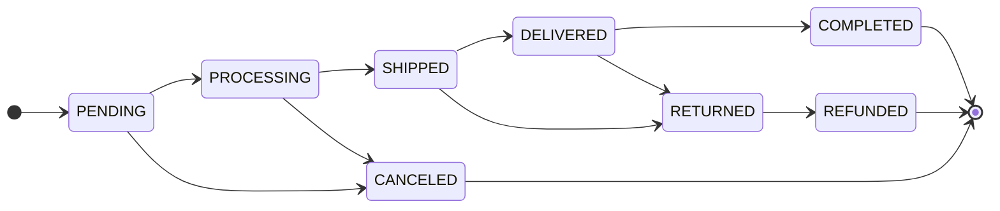
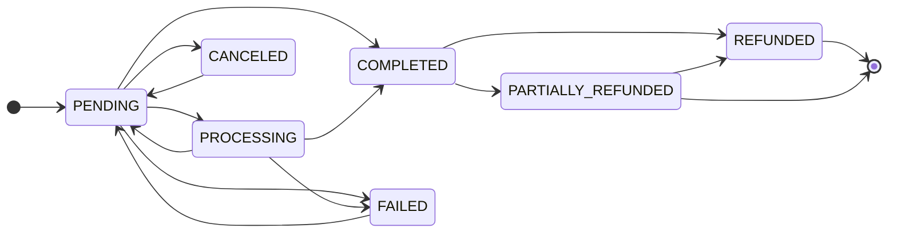
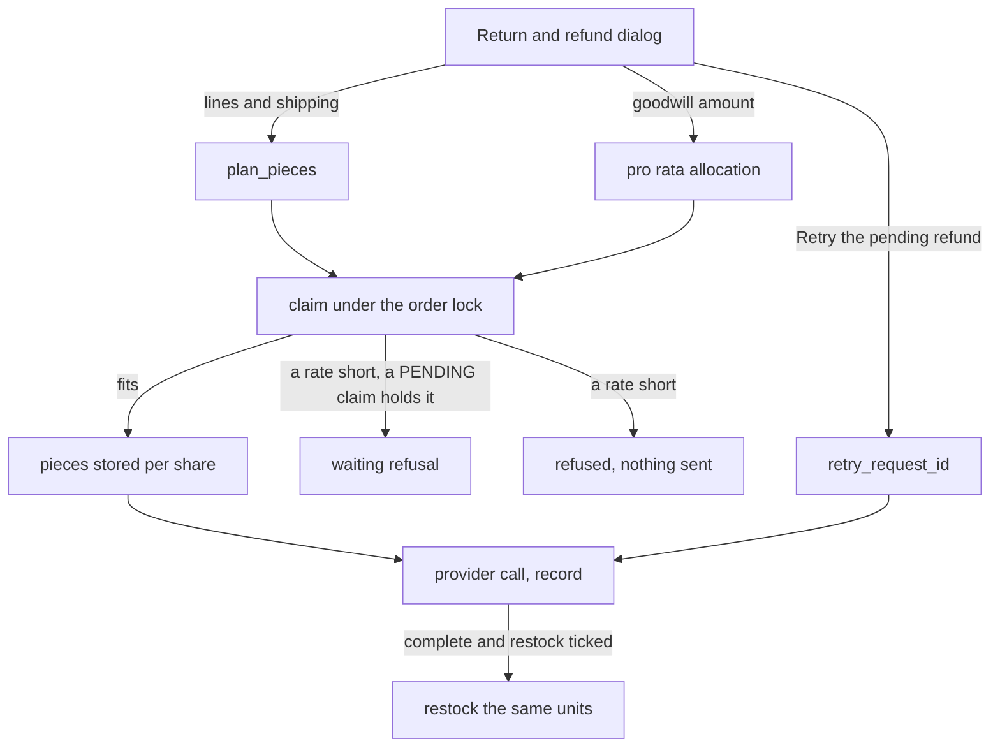

# Order lifecycle

An order carries two independent states. `Order.status` is fulfilment and
is guarded by a transition table; `Order.payment_status` is money and has
no table at all — it is assigned directly by whoever learns the truth,
except after a refund, when it is derived from the payment ledger (see
Refunds below). Decoupling them is what lets a cash-on-delivery parcel be
SHIPPED while payment is still PENDING, and it is why nothing should ever
derive one from the other.

The exhaustive reference, including the audit history behind each rule,
is [Order system](/dev/django/reference/order-system). This page is the
operational view: who moves what, and what each move sets off.

## Diagram

Payment moves on its own:

The edges back into PENDING are real: `payment_intent.requires_action`
relaxes PROCESSING or PENDING back to PENDING, and
`POST /api/v1/order/{id}/retry-payment` accepts FAILED, PENDING or
CANCELED and mints a fresh intent. Nothing leaves COMPLETED except a
refund, and PARTIALLY_REFUNDED leaves only through further refunds, any
number of them, until nothing is left to refund.

## How it works

### The fulfilment table is the only writer

`OrderService.update_order_status` (`order/services.py`) takes a row
lock, re-reads the committed status, validates the pair against
`allowed_transitions`, then writes `status` and `status_updated_at`. No
other code should assign `order.status` — the exception is the Viva
webhook, which flips PENDING to PROCESSING inline because it already
holds the row lock and knows the prior state.

Terminal states are COMPLETED, CANCELED and REFUNDED; they have no exit.
RETURNED reaches REFUNDED and nothing else — and only when money moved.
CANCELED and RETURNED are the two statuses after which nothing will ever
be collected (`PAYMENT_CLOSING_STATUSES`, `order/enum/status.py`), so
`Order.save()` settles a still-unpaid `payment_status` to CANCELED on
either transition (`Order.settle_unpaid_payment`) and the order is closed
for good; a paid return keeps COMPLETED until the refund. Before this
rule reached RETURNED, 34 refused cash-on-delivery parcels on tenant #1
read payment "Pending" forever (`0058_settle_returned_unpaid_orders`).

### Who moves each transition

| From → To | Moved by | Code path |
|---|---|---|
| PENDING → PROCESSING | Online payment webhook | `OrderService.handle_payment_succeeded`, `viva_webhook._handle_payment_created`, `handle_stripe_checkout_completed` |
| PENDING → PROCESSING | Carrier voucher mint (collected-on-delivery) | `AcsService._advance_pending_order_to_processing`, `BoxNowService._advance_pending_order_to_processing` |
| PENDING/PROCESSING → SHIPPED | Carrier event (`in_transit`, `at_destination`, `out_for_delivery`, `attempted`; or a `new` shipment whose tracking history holds a non-print checkpoint) | `AcsService._apply_order_status_transition`, `AcsService._has_left_sender`, `BoxNowService._apply_order_status_transition` |
| PENDING/PROCESSING → SHIPPED | Admin attaching tracking | `OrderService.add_tracking_info`, `POST /api/v1/order/{id}/add_tracking` |
| SHIPPED → DELIVERED | Carrier event | Both carriers' `_apply_order_status_transition` |
| DELIVERED → COMPLETED | Automatic, when paid: inline on the carrier DELIVERED and the COD reconcile, and hourly for anything paid outside those two moments | `OrderService.maybe_advance_to_completed`, `order.tasks.complete_paid_delivered_orders` |
| SHIPPED/DELIVERED → RETURNED | Carrier event (`returned`, `lost`) | `AcsService.order_status_for_shipment_state` |
| → CANCELED | Customer, staff, the cleanup task, or a carrier sync for a shipment cancelled before dispatch (ACS voucher retired, BoxNow `canceled` parcel). Only `cancel_order` does it | `OrderService.cancel_order`, `OrderService.cancel_for_dead_shipment` |
| RETURNED → REFUNDED | Staff, manually; refused with `RefundOutstandingError` while `PaymentLedger.refund_open` holds. The admin action reports the refusal; `update_status` answers `409 refund_outstanding` naming what is left | `POST /api/v1/order/{id}/update_status`, the `mark_as_refunded` admin action |
| Any pair the table allows | Staff, manually. A CANCELED request is refused: `update_status` answers 400 `cancel_through_cancel_action` (`update_order_status` raises `InvalidStatusTransitionError` for it) | `OrderViewSet.update_status`, admin bulk actions in `order/admin.py` |

Carriers can skip steps. A parcel that goes from PROCESSING straight to
DELIVERED or RETURNED between two polls is bridged through SHIPPED first,
and on the RETURNED path that hop is customer-silent — "your order is on
its way" seconds before "your order was returned" is worse than nothing.

### Side effects per transition

`handle_order_post_save` (`order/signals/handlers.py`) is the single
fan-out point. It defers every dispatch to `transaction.on_commit` and
re-enters the owning tenant's schema first, because a save made inside a
webhook's `schema_context` commits after that context has already
unwound.

| Event | Side effects |
|---|---|
| Order created | `order_created` → confirmation email (offline and already-paid only), merchant new-order email, `notify_order_created_live`, history note, cart clear unless `awaits_online_payment` |
| Payment succeeded | A CHARGE row on the payment ledger (written before any guard, so a stale or repeated event and a charge on a CANCELED order still leave theirs), `mark_as_paid`, PROCESSING advance with the customer notification suppressed, carrier dispatch on commit, confirmation email, `notify_payment_confirmed_live`, Redis payment-status publish |
| Payment failed | `payment_status=FAILED`, failure email, `notify_payment_failed_live`. No stock movement |
| → PROCESSING | `order_paid` when already paid → cart clear, Meta CAPI Purchase. No customer email, no toast |
| → SHIPPED | `order_shipped`, history row, `send_shipping_notification_email` (self-gates), SHIPPED toast, and the retail receipt: `generate_order_invoice` once for a RECEIPT order while `MYDATA_ENABLED` and `MYDATA_AUTO_SUBMIT` are on (`order/invoicing.py: receipt_issuable`; ΕΛΠ art. 13(a): issued at the start of the shipment), registered with myDATA (11.1) and only then emailed |
| Tracking first set | `order_shipment_dispatched` → the same shipping email, which sends whichever condition completes second |
| → DELIVERED | `order_delivered`, status email, DELIVERED toast, then the COMPLETED auto-advance for paid orders |
| → COMPLETED | `order_completed` → loyalty points earned, status email, COMPLETED toast. Nothing is issued for an `INVOICE` order: invoices are issued by hand in timologio |
| → CANCELED | Written by `cancel_order`, which also runs the carrier voucher cascade itself (skipped when the cancel already asked the courier). `order_canceled` → credit of whatever gift-card value has not come back yet, loyalty reversal, status email, CANCELED toast |
| Refund recorded | `order_refunded`, once per REFUND ledger row, carrying that refund's `amount` and the `refund` row → a refund email queued for that row, `notify_order_refunded_live`, Meta CAPI Refund, history row, and the loyalty reversal once `payment_status` is REFUNDED. With auto-issuing on, one retail credit document (myDATA 11.4) per refund recorded after the receipt row was created, once the receipt has a MARK, for the goods part of the refund at the VAT split stored when its money was claimed (`order/credit_documents.py: create_pending_credits`, task `issue_pending_credits`; see [Credit allocation](#credit-allocation)); a returned COD parcel whose payment settles to CANCELED gets one settlement credit |
| Stored value returned | `order_stored_value_returned`, once per settled `STORED_VALUE` refund attempt → a staff history NOTE, the credit reconciliation (the same `create_pending_credits`), and the loyalty reversal once `payment_status` is REFUNDED. No email, no toast |
| Status, payment status or tracking changed | `push_order_event_to_gateway` when `AGENT_GATEWAY_INTERNAL_URL` is set |

The gateway push is one `POST /internal/events/order-status` carrying
`schemaName`, `orderUuid`, `status`, `paymentStatus` and `trackingNumber`,
authenticated with `X-Internal-Token`
(`order/tasks.py: push_order_event_to_gateway`). The gateway matches the
UUID against its agent checkout sessions; an order placed outside one is
acknowledged with 204 and goes no further
(`grooveshop-agent-gateway/internal/server/internalapi.go`). A 5xx makes
Celery retry, which is how at-least-once delivery to agent platforms is
achieved. See [Agentic commerce](/dev/flows/agentic-commerce).

### Notification suppression on chained transitions

Three paths move the order twice in a row, and without help the customer
would get two near-identical messages milliseconds apart:

1. Carrier DELIVERED then the COMPLETED auto-advance.
2. Payment succeeded moving PENDING to PROCESSING immediately before the
   confirmation email.
3. An admin attaching tracking, which walks PENDING to PROCESSING to
   SHIPPED.

`OrderService._suppress_customer_status_notifications(order, status)`
pre-stamps two metadata keys: the email task's own reservation key, and
`suppress_status_ws_<status>` which `handle_order_status_changed` reads.
Internal state still flows — the signal fires, history is written, the
post-save chain runs. Only the customer-visible dispatches are skipped.

PENDING and PROCESSING are categorically silent for customers anyway
(`handle_order_status_changed` skips them, and `_ORDER_STATUS_COPY` in
`order/notifications.py` has no entry for either), so the load-bearing
case is the COMPLETED suppression on the DELIVERED auto-advance.

### Timestamps

`Order.save()` owns three columns and will not let a partial save drop
them. Django writes an `auto_now` column only when it appears in
`update_fields`, so every `save(update_fields=[...])` used to leave
`updated_at` at the creation time. `Order.save()` now adds `updated_at`
to any explicit `update_fields`, adds `status_updated_at` when the status
changed, and adds `pay_way_key` when the snapshot moved.

That is not cosmetic. `updated_at` is an exposed API filter
(`order/filters.py`), so "orders changed since X" silently omitted every
status change; and `auto_cancel_stuck_pending_orders` selects its
failed-payment bucket on `updated_at`, so a grace window meant to run
from the failure was measured from creation instead.

Do **not** add a `payment_status_updated_at` column. The requirement it
would serve is already met by `updated_at` plus the `OrderHistory` rows
that `log_payment_update` writes on every payment transition.

### Cancellation

`OrderService.cancel_order` is the only way an order is cancelled:
`update_order_status` refuses CANCELED and the staff `update_status`
endpoint answers 400 `cancel_through_cancel_action`. Its
keyword-only `customer_initiated` decides who has the last word on the
parcel: a customer cancel is held to the courier's answer, a staff or
system cancel is not. It defaults to `True`, so a new caller that forgets
to choose gets the strict behaviour.

The locked part (`_cancel_order_locked`) is the same for everyone. It
locks the row, refuses anything outside PENDING and PROCESSING
(`Order.can_be_canceled`), releases outstanding reservations, then
restores stock by **netting the order's own `StockLog` movements** rather
than by its line quantities — an `OrderItem` created outside checkout
never decremented anything, so restoring per listed item invented stock.
Cancelling twice is a no-op because the first restore's INCREMENT rows
net out. It then writes `metadata["cancellation"]` and saves CANCELED. Only after
that has committed does `cancel_order` refund, when `refund_payment` is
true (`_refund_canceled_order`, see Refunds below), so no transaction is
open across the provider call.

Entry points:

| Caller | Route | `customer_initiated` |
|---|---|---|
| Customer or guest | `POST /api/v1/order/{id}/cancel` (`OrderViewSet.cancel`; guests authorise with `?uuid=`, for `GUEST_ORDER_ACCESS_DAYS` after the order) | `True` |
| Store staff | The same action (the view passes `not is_store_staff(user)`), or the `mark_as_canceled` bulk action in `order/admin.py` | `False` |
| Automatic | `auto_cancel_stuck_pending_orders`, always with `refund_payment=False` | `False` |
| Carrier-driven | `OrderService.cancel_for_dead_shipment`, called by the ACS status sync for a retired voucher and by BoxNow for a `canceled` parcel event (only while the order is PENDING or PROCESSING). Always `refund_payment=False` | `False` |

#### A customer cancel asks the courier first

An order keeps PENDING or PROCESSING from the moment its voucher exists
until a tracking poll sees the parcel move, so in that window the courier
may already hold it. `OrderService._ask_courier_to_cancel` runs before the
row is locked and outside any transaction, because it is a carrier HTTP
call: it re-reads the status (an order that will not cancel gets the usual
status error and the courier is not asked), then calls
`ShippingService.cancel_shipment`, the same carrier path a staff cancel
uses. An order with no shipment has nothing to ask and goes on.

| Courier's answer | Exception | Response from the cancel endpoint |
|---|---|---|
| Confirmed, or no shipment | — | 200; the outcome is written to `metadata["cancellation"]["shipment_cancel"]` up front |
| Refused (an ACS voucher on an issued pickup list, a BoxNow parcel past `NEW`, any other carrier business error) | `ParcelWithCourierError` | 400, `error.type` `parcel_with_courier` |
| No answer (unreachable, timeout, 5xx, an auth-layer rejection such as ACS's sporadic 406, missing credentials, the same cancel already in flight) | `CourierUnreachableError` | 503, `error.type` `courier_unreachable` |
| Anything else raised while asking (a fault of ours) | propagates as itself | 500, logged at ERROR |

On a refusal or no answer nothing changes: no status, no refund, no
shipment change, no history row. The body is
`{"detail": <translated message>, "error": {"type": ...}}`
(`order/enum/cancel_error.py: OrderCancelErrorType`); clients branch on
`error.type`, never on `detail`. The split rides the carrier exception
hierarchy in `shipping/exceptions.py` (see
[Shipping](/dev/flows/shipping)), so order code never imports a carrier.

Because the courier is asked before the lock, the order can move on while
it answers (most likely a staff status edit). The locked re-check then
refuses the cancel with the usual status error, but the shipment is
already canceled. `_note_shipment_canceled_without_order` logs an ERROR,
which fires the logged-errors alert, and leaves a staff-only NOTE saying
the order needs a new voucher. An order that another request canceled in
the meantime needs neither.

The storefront route `server/api/orders/[id]/cancel.post.ts` returns
Django's body for any 4xx and for the documented 503 only
(`server/utils/error.ts: forwardUpstreamDocumentedError`, validated with
the generated `zOrderCancelError`), because a thrown error's body is
stripped in production. `app/components/Storefront/Account/OrderDetail.vue`
maps each `error.type` to its own message (`CANCEL_REFUSAL_KEYS`): the
parcel is with the courier, so contact the store about a return; or the
courier could not be reached, so try again in a few minutes.

#### Staff and system cancels are best-effort at the courier

These cancel first and ask the courier afterwards, through
`OrderService.cancel_attached_shipment`, called by `cancel_order` itself:
`cancel_order` is the only path that produces CANCELED, so every cancel
reaches the courier. A customer cancel, which already asked, writes the
`shipment_cancel` breadcrumb on the metadata before the save so the
cascade skips. A carrier refusal never stops the cancel: it
is logged, kept in `metadata["cancellation"]["shipment_cancel"]["error"]`,
left as a staff-only `OrderHistory` NOTE (the order is canceled but the
parcel may still be delivered), and the admin **Cancel selected orders and
restore stock** action shows it as an error message.

#### `canBeCanceled`

The order list and detail serialize `can_be_canceled` from
`Order.can_be_canceled_by_customer`: the status rule AND
`ShippingService.can_cancel_shipment(order)`. The second half reads local
rows only, never the carrier: `AcsService.can_cancel_voucher` (false once
the voucher is on a pickup list) and `BoxNowService.can_cancel_shipment`
(false once a parcel with a `parcel_id` is past `NEW`), the same guards the
carriers apply before they call the courier. A `True` is not a promise;
the cancel still asks the courier. Staff and system cancels keep
`Order.can_be_canceled`, the status rule alone. `OrderQuerySet.for_list()`
includes `with_shipments()`, so the list reads the flag without a query
per order. There is no `canBeCanceled` list filter: a status-only filter
beside a carrier-aware field listed orders whose own flag said no.

### Refunds

Every refund, made in the admin, by a cancel or in a provider's dashboard,
ends the same way: a REFUND row on the payment ledger, or value written
back onto the order's gift cards and points, and `payment_status` derived
from both. The exhaustive reference is §7.2 and §7.3 of
[Order system](/dev/django/reference/order-system).

#### The payment ledger

`PaymentTransaction` (`order/models/payment_transaction.py`) is the only
record of money a provider or a courier moved for an order. It is
append-only, like `GiftCardTransaction`: a row is never updated, and the
foreign key to the order is `PROTECT`. Rows are written only through
`order/payment_ledger.py: PaymentLedger`, and every writer holds the order
row lock.

| Column | Meaning |
|---|---|
| `kind` | From `order/enum/payment_transaction.py: PaymentTransactionKind`: `CHARGE` (a provider captured money), `COD_COLLECTION` (a courier collected cash), `OFFLINE_COLLECTION` (stored as `OFFLINE`: a staff member confirmed a bank transfer arrived), `REFUND` (a provider paid it back, or the merchant paid cash or a transfer back), `CHARGEBACK` (a lost dispute took it back, written when the dispute closes) and `REFUND_REVERSAL` (a refund the ledger counted that the provider later reported failed) |
| `amount` | Always positive; the kind gives the direction |
| `provider` | `stripe`, `viva_wallet`, `acs_cod`, `boxnow_cod`, `bank_transfer` on an OFFLINE_COLLECTION (keyed on the bank's reference, so one transfer cannot pay two orders), or `manual` on a REFUND the merchant paid back |
| `provider_reference` | The provider's own id for the movement: PaymentIntent, Viva transaction, refund id, voucher or parcel. A Stripe refund, whoever made it, is keyed on its refund id (`re_...`) |
| `charge` | On a REFUND, CHARGEBACK or REFUND_REVERSAL, the payment it acts on; null otherwise. A check constraint enforces both |
| `description` | The reason given for a refund |

`UNIQUE (provider, provider_reference, kind)`
(`unique_payment_transaction_reference`) is every writer's idempotency: a
delivery the provider repeats records nothing the second time, and the
`record_*` methods say so by returning `created=False`.

| Kind | Writers |
|---|---|
| CHARGE | `OrderService.handle_payment_succeeded` (the event's `amount_received`), `handle_stripe_checkout_completed` (`amount_total`), `viva_webhook._handle_payment_created` (the verified amount), and `PaymentLedger.ensure_charge`, which reads a capture the ledger lacks from the provider once, when a refund first needs it |
| COD_COLLECTION | `OrderService.settle_cod_payment`, in the same atomic step as the payment status (see [Shipping](/dev/flows/shipping)) |
| OFFLINE_COLLECTION | `OrderService.confirm_offline_payment`, the admin's **Confirm payment received** detail action (`order/admin.py`, offered by `has_confirm_payment_permission` only on a PENDING `PaySettlement.OFFLINE_TRANSFER` order), through `PaymentLedger.record_offline_collection`. Under the order lock it refuses any other settlement, a payment not PENDING, an empty reference and an amount other than `amount_due`; it writes the row, marks the order paid, adds an `OrderHistory` entry and an admin log entry, and moves PENDING to PROCESSING |
| REFUND | `OrderService.refund_order` (step 3 through `OrderService.book_share`, which the reconciliation and the admin's **Record refund outcome** also use), `handle_stripe_refund_made` and `viva_webhook._handle_reversal_created`, through `PaymentLedger.record_refund`; cash or a confirmed transfer the merchant paid back through `PaymentLedger.record_cod_refund` (`is_cash_collection` covers both) |
| REFUND_REVERSAL | `handle_stripe_refund_failed` (`refund.failed`, `refund.updated`, `charge.refund.updated`), through `PaymentLedger.record_refund_reversal` |
| CHARGEBACK | `PaymentLedger.record_chargeback`, from `handle_stripe_dispute_closed` (a lost dispute) and `viva_webhook._record_viva_chargeback` (a 1797 of a Refund Claimed type, or a lost-dispute status) |

What the order paid with gift cards and loyalty points is not on this
ledger. `PaymentLedger.stored_value` reads it from the gift-card ledger
(the order's REDEEM total less its REFUND_CREDIT total; `GiftCardService.credit_refund` splits a credit between the cards) and the points ledger (REDEEM less
positive ADJUST rows, valued in proportion to the order's loyalty
discount), never from a counter.

**One function decides the payment status after a refund.**
`PaymentLedger.refund_status`: COMPLETED when nothing is refunded (net of
reversals) and no stored value went back; REFUNDED once refunds plus
chargebacks cover what was received **and** the stored value is back;
PARTIALLY_REFUNDED between. `record_refund`, `record_refund_reversal` and
`OrderService._return_stored_value` write it in the same step as their
rows, so no path decides it for itself. What can still be refunded through
a provider (`PaymentLedger.refundable`) is computed payment by payment,
from the receipt rows (CHARGE, COD_COLLECTION and OFFLINE_COLLECTION, `_RECEIPT_KINDS`), less what refunds and chargebacks took
and what live refund attempts hold; `stored_value_refundable` is what can
still go back onto gift cards and points; `refundable_value` is both.
`refund_open` adds the order paid through a registered provider whose
capture the ledger never recorded, and any order with a live (`PENDING`)
refund attempt of either kind, even one that holds everything that was
left, without a provider call, so it is cheap enough to decide whether the
admin draws the **Return and refund** button (where such an attempt is
retried or pointed to **Record refund outcome**) and whether the order may
be closed as REFUNDED; `RefundOutstandingError` then reports the refundable
value plus what the live attempts hold.
`Order.amount_due` is what the customer owes and is never consulted for a
refund; `Order.remaining_amount` is 0 once the payment is settled, so a
refund never creates an amount owed (`order/models/order.py`).

Orders paid before the ledger existed were backfilled from what their rows
prove (`order/migrations/0067_backfill_payment_transactions.py`); §7.3 of
[Order system](/dev/django/reference/order-system) lists what the backfill
could not reconstruct.

#### Refund paths

| Path | Effect |
|---|---|
| The staff **Return and refund** detail action (`order/admin.py: OrderAdmin.refund_payment`, form `ReturnOrderForm`) | Offered wherever `PaymentLedger.refund_open` holds, whatever the order's status, to staff with the order's change permission (`has_refund_permission`); a CANCELED order whose automatic refund was declined is refunded here too. The staff member picks units per order line and the shipping (a [refund by lines](#refund-by-lines)), or a **Goodwill amount** instead (a bare `amount`, never both), a `RefundReason` and a note; the amount help text says how the remaining value splits between the provider and the gift cards and points. A **How it was paid back** field appears only while collected cash is left, and is required when the plan reaches it and the request does not resume a claim (`OrderService.resumes_a_refund`). It reports one of three outcomes (all of it, part and the rest declined, nothing) and writes an admin log entry whenever value moved, because a staff identity lives in the platform schema and cannot be a foreign key on the tenant's rows. It never changes the order status, and changes the stock only through its restock switch, after a complete refund (`OrderAdmin._restock`) |
| A cancel (`cancel_order` → `_refund_canceled_order`) | After the cancel has committed, `refund_order(amount=None)`: everything still refundable, for an order with a `payment_id` and a pay way that is paid or still holds refundable money. A refusal before any provider call (a dispute open, nothing left, no credentials) is written to the order's history in plain words and returned as `refund_info["refunded"] = False`; `refund_info["dispute_open"]` says the refund waits for the dispute |
| The admin's `mark_as_canceled` bulk action | The same path. It calls `cancel_order(order, customer_initiated=False)` with no `refund_payment` argument, and the parameter **defaults to `True`**, so bulk-cancelling a paid order does refund it |
| `POST /api/v1/order-items/{id}/restock` (`order/views/item.py: restock`) and the **Restock returned items** detail action (`OrderAdmin.restock_returned`, `RestockReturnedForm`) | Staff only, on a DELIVERED, COMPLETED or RETURNED order (`RETURN_HANDLING_STATUSES`). Puts returned units back in stock and records them on the line (`refunded_quantity`, `is_refunded`), both through `OrderItem.refund` (`order/models/item.py`), which the return dialog's restock switch calls too. It **moves no money**: a line's snapshot price is not what the customer paid for it (tax, shared discounts, shipping), so money is decided at order level |
| Stripe `refund.created` / `refund.updated` (`order/signals/handlers.py: handle_stripe_refund_made`) | One REFUND per Stripe refund id (`re_...`), the key the in-app refund, the reconciliation lookup and `refund.failed` all use, so a refund is one row however it arrives. Whether it counts is read from Stripe's current state (`StripePaymentProvider.retrieve_refund`), never from the event: `succeeded` and `pending` book (`_ACCEPTED_REFUND_STATUSES`), anything else books nothing. A refund carrying our attempt key in `metadata.refund_attempt` settles exactly that attempt (`RefundAttempt.objects.with_provider_key`); one without it (a dashboard refund) settles the PENDING attempt of the same charge and amount, whatever its age, or is booked as a refund nobody claimed. A refund of a payment the ledger does not hold yet raises, so Stripe redelivers it. A Stripe error on the read propagates for the same reason |
| Stripe `charge.refunded` (`handle_stripe_charge_refunded`) | Books no order refund: its cumulative `amount_refunded` names no refund. It only voids a purchased gift card once the refunds reach the purchase amount |
| Stripe `refund.failed` and its siblings (`handle_stripe_refund_failed`) | Acts only on a refund Stripe NOW reports `failed` or `canceled` (`retrieve_refund`). One REFUND_REVERSAL keyed on the refund id, capped at what the ledger holds as refunded on that charge; `payment_status` derived again; a staff NOTE and the `ops.refund_failed` operational email (the store's switch). The refund's allocation is scaled down by everything reversed (`credit_allocation.free_reversed`): a credit not issued yet is issued for what stands, one already issued stays and is listed by the store dashboard until an accountant cancels it, and a refund the receipt was netted by leaves the receipt understated (see [Credit allocation](#credit-allocation)). The customer email, the gift-card credit and the points released stand |
| Viva event 1797 (`order/views/viva_webhook.py: _handle_reversal_created`) | A refund made anywhere, the Viva dashboard included; see below |

**`refund_order(order, amount=None, reason="", *, repayment_reference="", lines=(), include_shipping=False, reason_code="", retry_request_id=None)`**
(`order/services.py`) runs in three steps, so that **no transaction is
open while a provider answers**: every connection kills a session idle in
a transaction after ten seconds (`idle_in_transaction_session_timeout`), and
a refund made at the provider and rolled back here is money lost to the
books.

1. **Claim** (`_claim_refund`, under the order row lock, committed). It
   refuses, as a `PaymentError` and before any provider call, an amount
   that is not positive or exceeds `refundable_value`, an order with
   nothing left, a dispute that is open (`DisputeOpenError`), cash shares
   without a `repayment_reference` or with one already booked. A request
   that repeats a live attempt (the same amount, or everything once the
   live attempts hold everything) resumes it instead (`_attempts_to_resume`);
   for a provider without idempotent refunds (`idempotent_refunds` False:
   Viva) the repeat is refused, because a lost answer cannot be told from a
   refund never made, and so is the repeat of an **overdue** attempt
   (`RefundAttempt.is_overdue`, below), because Stripe may have forgotten
   its key. Otherwise the value is split: **the provider is
   paid back first**, payment by payment, oldest first
   (`PaymentLedger.plan_refund`), one `RefundAttempt` of kind `PROVIDER`
   per share, and only the excess becomes one `RefundAttempt` of kind
   `STORED_VALUE` (`order/models/refund_attempt.py`). A `PENDING` attempt,
   whatever its age, holds its amount back (`RefundAttempt.objects.live()`),
   so a second refund cannot take the same money; only a settled or declined
   attempt lets go. Before any attempt is written, `credit_allocation.allocate_order`
   decides the order's older unallocated sources, and the claim is refused
   while one stays undecided. The new attempts are then allocated over the
   receipt's VAT rates (`OrderService._allocate_claim`): for a bare amount,
   the duplicate-payment excess first, which owes no credit, the rest pro rata
   over the headroom; for a refund by lines, the lines' own pieces
   (`_allocate_lines_claim`, see [Refund by lines](#refund-by-lines)). A claim
   that would take excess a still-PENDING claim holds, or that the headroom
   cannot hold, is refused before any provider call (see
   [Credit allocation](#credit-allocation)).
2. **Call** the provider for each provider share with
   `idempotency_key=f"refund-{attempt.idempotency_key}"` and no
   transaction open (`_make_refund`). A refusal marks the attempt
   `DECLINED` and frees its amount; an unknown outcome (a timeout, a
   dropped connection, a 5xx, Viva accepting without a `TransactionId`)
   keeps it `PENDING` and writes a staff NOTE saying the refund may have
   been made; see [Unknown outcomes](#unknown-outcomes) for what resolves
   it. Stripe's `refund_payment` writes the attempt's key into the refund's
   `metadata` (`refund_attempt`), which is how the webhook and the lookup
   find the attempt a refund was made for. The shares after a declined one are never called and are
   released, and the stored-value share runs only when every provider share
   was made.
3. **Record**, under the lock again: `record_refund` (or `record_cod_refund`
   for cash) writes the REFUND row and settles the attempt; `_make_refund`
   then signals `order_refunded` for a row it created. This step is `OrderService.book_share`, which re-reads the
   attempt under the lock and books only for one still `PENDING`. A webhook
   that booked the refund while the call was in flight has already settled
   the attempt (the attempt its metadata key names, or for a refund without
   one the `PENDING` attempt of the same charge and amount, whatever its
   age), so step 3 books and signals nothing; a refund the provider made
   for an attempt staff declined meanwhile is booked as a refund nobody
   claimed and never revives the attempt. The stored-value share is
   `_return_stored_value`, one transaction under the order lock: it reads
   what is still owed from the gift-card and points ledgers, splits the
   amount between cards and points in proportion to what each has not got
   back (`GiftCardService.credit_refund(order, amount, refund_attempt=...)`,
   `LoyaltyService.restore_spent_points`), settles the attempt, derives
   `payment_status` and sends `order_stored_value_returned`. The last
   refund returns exactly what is left, so nothing is lost to rounding.

It returns a `RefundResult`: `refunded` (the provider money that moved),
`stored` (the value put back onto gift cards and points), `refund_ids` and
`declined` (the provider's answer for the share it did not make, `None`
when every share was), with `complete`, `value_returned` and
`paid_something` as the questions callers ask. `declined["error"]` can
carry raw provider text, so it goes to logs and staff screens, never to a
customer. An order whose capture the ledger never recorded is read from the
provider once (`PaymentLedger.ensure_charge`); a capture the provider
cannot confirm refuses the refund with a staff NOTE.

Stripe answers `succeeded` for a partial refund as for a full one, so a
provider's refund status never decides the payment status; the ledger's
sums do. `succeeded` and `pending` are recorded
(`StripePaymentProvider._ACCEPTED_REFUND_STATUSES`); any other status is a
refusal, which records nothing and leaves Stripe's refund id and status in
the NOTE (`Refund via <provider> was not processed: …`). Stripe amounts
are integers in the currency's own smallest unit and go through
`order/payment.py: money_from_minor_units`.

**Viva 1797.** The event's `TransactionId` is the refund, a transaction
of its own; `ParentId` names the payment it reverses.
`_verify_viva_reversal` reads everything from Retrieve Transaction, never
from the unauthenticated body: the transaction must carry one of the
order's issued order codes, have status `F`, a refund or void type
(`VIVA_REFUND_TRANSACTION_TYPE_IDS`) or a Refund Claimed type
(`VIVA_REFUND_CLAIMED_TRANSACTION_TYPE_IDS`), and a negative amount, whose
absolute value is the amount. A Refund Claimed type is the cardholder's
bank taking the money back, so it is booked as a CHARGEBACK
(`_record_viva_chargeback`), not a REFUND. An unreadable answer raises, so Viva retries and the
multi-tenant candidate loop moves on. The refund is attached to the
order's own CHARGE row whose reference is `ParentId`: `ParentId` can only
refuse, never grant. `record_refund` keys the REFUND on the refund
transaction id, so the 1797 Viva sends for a refund `refund_order` made,
and every redelivery, changes nothing, and it settles the live attempt
that made it. `VivaWebhookEvent.outcome` records `skipped` for every
refusal and `processed` for a booked refund. The tenant's Viva account
must have the *Transaction Reversal Created* webhook subscribed, or no
dashboard refund reaches the order (see [Onboarding](/dev/operator/onboarding)).

**The `order_refunded` contract** (`order/signals/__init__.py`): it is sent
once per REFUND row the ledger took and always carries `amount`, a `Money`
holding what this refund paid back, and `refund`, that row. The receivers
that use them declare them as required arguments, so a sender that leaves
one out raises. The history row, the toast, the Meta `Refund` event and the
retail credit reconciliation fire on every refund. The email is one per
refund: `handle_order_refunded` queues `send_refund_confirmation_email(refund.pk)`
on commit, and the task claims the refund before it sends by inserting a
`RefundNotification` (`order/models/refund_notification.py`, one-to-one
with the REFUND row). It states the amount refunded and, for a partial
refund, what remains. A value that went back onto gift cards and points has
no REFUND row: it sends `order_stored_value_returned`, whose receivers write
a staff history NOTE, dispatch the credit reconciliation and, on REFUNDED,
the loyalty reversal; no email and no toast.

**Loyalty.** The points the order **earned** are reversed once, all or
nothing, when the order is canceled, reaches REFUNDED (through either
signal), is marked REFUNDED, or a lost dispute completes the return
(`order_charged_back`, once `PaymentLedger.fully_returned` holds;
`loyalty/signals.py`). The spent points are not restored on a
charged-back order. A partial refund
reverses none of them. `LoyaltyService.reverse_order_points` restores the
spent points a refund has not restored yet, then takes the earning back:
with `LOYALTY_REFUND_ALLOWS_NEGATIVE_BALANCE` on (the default) the whole
earning, even below zero, and a negative balance refuses every redemption
until later earnings pay it off; off, clamped at zero. See
[Loyalty](/dev/flows/loyalty).

`Order.status` is never moved by a refund. The table only reaches REFUNDED
from RETURNED, and that move is refused with `RefundOutstandingError`
while `PaymentLedger.refund_open` holds (`update_order_status`): the status
drives the loyalty reversal and a "refund processed" status email, which
must not go out with money still held.

**Cancelled but still paid.** A cancel whose refund was refused or
declined leaves the order CANCELED with its payment COMPLETED, or
PARTIALLY_REFUNDED part-way, and the reason in a staff NOTE. The order
list's **Refund** filter, value "Cancelled but still paid"
(`order/admin.py: RefundOwedFilter`, `OrderQuerySet.refund_owed`), lists
exactly those orders, and the staff **Return and refund** action refunds them.

#### Refund by lines

A refund names either order lines (and the shipping) or a bare amount, never
both. A refund by lines derives its amount from the figures the order froze
and stores where it sits on the VAT rates as its own allocation rows, so its
retail credit carries exactly the lines' rates: returning one 13% item of a
24%/13% order credits 13% only. A bare amount is a **goodwill refund**,
allocated pro rata over the headroom as before. The full rule set is "Refund
by lines" and "The Return and refund dialog" in §7.2 of
[Order system](/dev/django/reference/order-system); this is the map.

1. **Pieces** (`order/refund_lines.py: plan_pieces`). A goods line is worth
   `price` x `quantity` less its `discount_allocation`
   (`order/discounts.py: discounted_line_gross`) at its own `vat_rate`.
   Units are priced cumulatively (`_units_value`: the first *k* units are
   worth `gross * k / n`, half-up to the cent, the last taking the
   remainder), so a line refunded in steps adds up to exactly its value.
   Shipping is split per rate the way `order/taxation.py: order_vat_lines`
   splits it, one piece per rate, and is refundable once. The payment fee is
   not a line option. Each piece is a `credit_allocation.Piece` (kind, rate,
   gross, line, units).
2. **What a line has had back is value, not units**
   (`refund_lines.held_values`): the sum of its allocation rows of every
   source that holds its value (`CreditAllocation.objects.holding()`:
   settled, or PENDING however old, never declined; no timer), against its
   discounted gross. `covered_units` turns that into the units no longer on
   offer, and the next units are priced from what is left. A declined share
   frees its units at once. `OrderItem.refunded_quantity` is a different
   count: units put back on the shelf. A goodwill refund holds no line.
3. **Points** (`CreditAllocation.points`). A stored-value share keeps only
   its gift-card part as room (`credit_allocation.scale_pieces`, with
   `PaymentLedger.split_stored_value`) and the points part in `points`: never
   room, never credit, never read by `headroom`, `counting()` or the credit
   documents, but counted by `holding()`, so a line refunded in full partly
   in points is never offered again. Settling the share scales the points to
   what came back (`credit_allocation.scale_points`).
4. **The claim** (`OrderService._claim_refund` → `_allocate_lines_claim`).
   Under the order lock the lines are locked in pk order and the pieces are
   laid over the refund's shares in order, the provider's charges first, then
   gift cards and points (`credit_allocation.split_over_shares`), and stored
   with each share (`credit_allocation.store`) before any provider is called.
   Every share of the request carries the same `RefundAttempt.request_id`.
5. **Per-rate room.** Every rate of the pieces must fit its own headroom
   (`credit_allocation.by_rate`, `first_short_rate`). A short rate is refused
   with "The receipt of this order holds only … at …% VAT" (a goodwill
   amount can still be made). When only a claim still PENDING keeps the rate
   short (`credit_allocation.room_blockers`: it would fit with that claim
   released), the refusal is the waiting one instead
   (`OrderService._waiting_error`, "Another refund of this order is waiting
   for … to be settled"), naming only the claims that block; a goodwill
   amount gets the same waiting refusal.
6. **No duplicate payment out of lines.** The lines are goods, owed in full
   at their own rates, so the share is all goods (`goods_claimed` equals its
   amount), `PaymentLedger.refundable_excess` is left where it was, and the
   duplicate stays refundable as a bare amount.
7. **Retry** (`retry_request_id`). A request by lines is always planned
   fresh; it never matches a live attempt by amount (`_resumable` excludes
   shares with a `request_id`). The dialog offers **Retry the pending
   refund** for the newest request with a live PENDING share
   (`refund_lines.pending_request`); the retry calls only those shares again
   under their own idempotency keys (`_pending_request_shares`) and claims
   nothing else. `OrderService.unresumable_reason` is the one rule for both
   the locked path (`_require_resumable`) and the dialog, which disables the
   switch and shows the reason: a PENDING cash share, a provider without
   idempotent refunds (`provider_supports(..., "idempotent_refunds")`, Viva)
   or an overdue attempt. A settled or declined share of the request never
   blocks it. `OrderService.resumes_a_refund` answers the same question
   without the lock, so the dialog asks a retry for no cash reference.
8. **Reasons** (`order/models/refund_attempt.py: RefundReason`, stored in
   `RefundAttempt.reason_code`; `reason` is the note). The ledger and the
   history show `"<label>: <note>"` in the staff member's language
   (`OrderService._reason_text`). Older refunds keep their free text and an
   empty `reason_code`.
9. **Restock** (`OrderAdmin._restock`, `OrderItem.refund`). The dialog's
   switch restocks the same units only when the refund was complete
   (`RefundResult.complete` and `paid_something`); otherwise it warns. A line
   worth nothing (a free gift) refunds no money and can be returned for the
   shelf alone with the switch on; without it the form refuses. A retry
   cannot restock.

The dialog (`ReturnOrderForm`) quotes the lines once, at submit
(`requested_amount`); a refund that lands meanwhile changes their value, and
the service then refuses with a `PaymentError`, never a server error. The
line help text shows units left, the value left on the whole line and its
rate, not a per-unit price.

`RefundAttempt.reason_code`, `request_id` and `CreditAllocation.points` were
added by `order/migrations/0105_refund_reason_request_and_points.py`, additive
only.

#### Unknown outcomes

A provider attempt still `PENDING` after `REFUND_RECONCILE_AFTER_MINUTES`
(`settings.py`, an env setting, default 60; it must stay under the 24 hours
Stripe remembers an idempotency key) is **overdue**
(`order/models/refund_attempt.py: reconcile_after`,
`RefundAttempt.objects.overdue()`, `RefundAttempt.is_overdue`). The window
only decides when the answer is looked for: it never frees the money, and an
overdue attempt is never sent to the provider again. Three things resolve a
`PENDING` attempt, each through the paths a refund made in one go takes
(`OrderService.book_share` settles; a `DECLINED` status frees the amount and
the allocation):

1. **The provider's webhook**: `refund.created` / `refund.updated` or Viva
   1797, through `PaymentLedger.record_refund`.
2. **The hourly lookup**: beat entry `reconcile-pending-refunds` →
   `tenant.tasks.fanout_reconcile_pending_refunds` (suspended stores
   included) → `order.tasks.reconcile_pending_refunds` →
   `order/refund_reconciliation.py: reconcile_overdue`, which asks
   `PaymentProvider.find_refunds` for each overdue attempt (`order/payment.py`).
   **Stripe** lists the PaymentIntent's refunds (the list call filters by
   `payment_intent`, not by metadata) and keeps the one whose
   `metadata.refund_attempt` is the attempt's `provider_key`: `succeeded`
   and `pending` settle, `failed` and `canceled` decline, `requires_action`
   decides nothing. **Viva** lists `GET /api/transactions/?ordercode=`
   (Basic auth) for each of the order's codes (`viva_webhook.order_viva_codes`)
   and keeps the children of the payment (`ParentId`) of a refund or void
   `TransactionTypeId` (`VIVA_REFUND_TRANSACTION_TYPE_IDS`) for exactly the
   attempt's amount: `StatusId` `F` settles, `E` declines. A Viva refund
   names no attempt (`refunds_carry_attempt` is False), so one the ledger
   already holds is not given to a second attempt. Only one candidate for
   exactly the amount decides; none, several, an unreadable provider, a
   missing credential or a cash share (no provider) leave the attempt
   `PENDING`. An attempt that raises is logged and counted unresolved, and
   the rest go on.
3. **Staff**: the order's **Record refund outcome** detail action
   (`order/admin.py: OrderAdmin.record_refund_outcome`,
   `RecordRefundOutcomeForm`), offered only while an attempt of the order is
   overdue (`has_record_refund_outcome_permission`), calls
   `refund_reconciliation.record_outcome`. It refuses an attempt that is not
   overdue. "Made" needs a reference: on a provider charge the provider must
   confirm it (`PaymentProvider.confirm_refund`: Stripe retrieves the refund
   and checks its PaymentIntent, amount and status; Viva finds it among the
   payment's refunds, ignoring case) and it is booked under the provider's
   spelling; a refund the provider cannot find or reports failed is refused,
   and so is a reference already on the ledger (compared ignoring case). On
   a cash share the reference is the repayment reference. "Not made"
   declines the attempt. Both write an `OrderHistory` note with the user;
   the admin also writes a `LogEntry`.

A `STORED_VALUE` attempt is never overdue: no provider is involved, and
repeating the refund of the same amount resumes it (`_attempts_to_resume`);
the stored-value share of a refund by lines is resumed by the retry of its
request instead (`retry_request_id`, see [Refund by lines](#refund-by-lines)).
One older than the window is **stalled** (`RefundAttempt.objects.stalled()`).
The store dashboard lists both kinds (`admin/dashboard/store/widgets.py:
StoreAlerts._unknown_refunds`, "Refunds with an unknown outcome", and
`_unfinished_returns`, "Gift card and points refunds left unfinished"; both
need `order.change_order`).

#### Credit allocation

A retail credit (myDATA 11.4) must credit exactly the VAT rates its refund
belongs to, and AADE cannot check it against the receipt, so the split is
**stored when the money is claimed, booked or decided**, under the order
lock, and the credit is issued from it alone
(`order/credit_documents.py: credit_breakdown(..., allocation)`). The order
in which credits are issued can no longer change one. The full rule set, with
every edge case, is the "VAT split" part of the credit documents section in
[Order system](/dev/django/reference/order-system); the invariants are
replayed by `tests/integration/order/test_credit_invariants.py`.

- **The rows.** `CreditAllocation` (`order/models/credit_allocation.py`,
  migration `0102_credit_allocation`): one row per VAT rate per source, gross.
  Exactly one source column is set (a check constraint): `refund_attempt` (a
  share of `refund_order`, allocated in `_claim_refund`), `refund` (a booked
  refund no attempt claimed, allocated in `PaymentLedger.record_refund`) or
  `decision` (a goods-returned `ChargebackDecision`, allocated in
  `decide_chargebacks`). `moved_at` is when the money moved, empty while in
  flight. The source's first row also carries `goods_claimed`, `uncovered`,
  `understated` and the two `*_acknowledged_at` stamps. A refund by lines
  writes one row per piece instead (`item`, `kind` goods or shipping,
  `rate`, `quantity`, and `points` for the part that went back as points;
  see [Refund by lines](#refund-by-lines)). `counting()` is the rows that
  hold room; `holding()` adds the points-only rows of a refund by lines,
  which hold a line's value but no room.
- **Decided or undecided.** A source with no row is undecided: it owes
  nothing yet and is never credited. A row of amount zero says it owes
  nothing (a duplicate payment given back, a share reversed in full, nothing
  taxable, no room left).
- **Headroom is a plain sum** (`credit_allocation.headroom`): the receipt's
  gross per rate (the order's VAT lines before a receipt exists), less the
  allocations of every source not declined whose money moves at or after the
  receipt row (an in-flight claim counts), less the credits issued, each
  counted by its own `vat_breakdown`.
- **The duplicate-payment excess goes first and owes no credit**
  (`PaymentLedger.refundable_excess`, `excess_held`): what the ledger holds
  above what the order is still for (`calculate_order_total_amount()` less
  `credit_allocation.goods_returned`), capped at what the provider still holds
  (captures less refunds less every dispute). It is read at the source's own
  moment: a claimed refund when it was made, a refund nobody claimed at its
  ledger row.
- **A PENDING claim holds.** When releasing every `PENDING` claim would give
  a source more room or more excess than it gets now, the source stays
  undecided (`allocate_source` returns `False`). `credit_allocation.allocate_order`
  decides oldest first and stops at the first undecided source. While one
  remains, the receipt is deferred (`order/invoicing.py: ReceiptDeferred`,
  `metadata["receipt_deferred"]`, the dashboard's "Receipts waiting for a
  refund"), the settlement credit of a closed order waits, and a new claim
  is refused naming the claims that block (`blocking_claims`,
  `excess_holders`, `describe_blockers`). The admin's **Issue receipt
  (myDATA)** says the receipt is deferred instead of scheduling it.
- **Chargebacks.** A lost dispute never moves the excess: `held` does not take
  it off and `goods_returned` ignores decisions, so a goods-kept chargeback
  is a loss, never credited, and never eats a duplicate payment. A
  goods-returned one is a credit source at its decision, capped to the
  headroom. The settlement credit waits until every chargeback of the order
  is decided. `PaymentLedger.overcharge_held`, behind `Order.overcharged_at`,
  is a different figure: it counts what disputes took and the goods of a
  returned chargeback.
- **Points owe no credit** (they are a discount the receipt never held;
  `PaymentLedger.split_stored_value`); value returned onto a gift card does.
- **Money past the receipt** is kept as `uncovered`, noted on the order and
  listed on the store dashboard ("Refunded money beyond the receipt",
  `credit_allocation.beyond_receipt_orders`), and the order list's
  **Refund books** filter (`BooksFilter`, `books=beyond_receipt`) finds it.
- **Reversals.** `credit_allocation.free_reversed` scales the refund's
  allocation by everything reversed (the duplicate part first, then the
  uncovered part, then room), so a credit not issued yet is for what stands.
  A credit already issued stands and is listed ("A refunded credit document
  was reversed", `reversed_credits`, needs `order.view_retailcredit`) until
  it is cancelled in myDATA. A refund the receipt was netted by leaves the
  receipt short (`understated`, "Receipts short of goods the customer
  kept", `understated_orders`).
- **Acknowledging.** The order action **Acknowledge receipt differences**
  (`OrderAdmin.acknowledge_uncovered` → `credit_allocation.acknowledge_uncovered`)
  stamps `uncovered_acknowledged_at` and `understated_acknowledged_at`, each
  on its own, and writes who to the order's history.
- **The backfill.** Beat entry `allocate-credit-sources`, every five minutes
  → `tenant.tasks.fanout_allocate_credit_sources` (suspended stores included)
  → `order.tasks.allocate_credit_sources` →
  `order/credit_allocation_backfill.py: backfill_credit_allocations`, which
  runs `allocate_order` for every order with a source that owes a credit and
  has no allocation, requests the credit documents of orders with a receipt,
  and issues the receipt of a deferred order once nothing is undecided. So a
  source that waited for a claim is decided within five minutes of the claim
  resolving, whichever path resolved it.

### VAT on an order

Every order line stores the VAT rate it was sold at
(`order/models/item.py: OrderItem.vat_rate`). Both checkout paths pass the
rate the cart priced the line with, and `OrderItem.save()` snapshots the
product's current rate for any other writer; lines older than the column
were backfilled from their product (`order/migrations/0065_backfill_orderitem_vat_rate.py`).
Every product has a rate: `Product.vat` is NOT NULL in the database and
`on_delete=PROTECT` (`product/models/product.py`), so no line is ever
snapshotted from a missing rate and there is no 0% fallback anywhere on the
path. Nothing reads `product.vat` for an order again, so editing, re-pointing or
deleting a `Vat` row leaves existing orders' documents alone.

Every line also stores the part of the order's discount it carries
(`order/models/item.py: OrderItem.discount_allocation`). A promotion lands
on the lines it covers, not on every line: the engine splits each applied
promotion over the cart lines in its scope
(`promotion/services.py: PromotionEngine._clamp`, reported as
`CartDiscountResult.line_discounts`), both checkout paths freeze that on the
order lines (`order/services.py: OrderService._snapshot_line_discounts`), and
the loyalty redemption, being order-wide, is spread over the value left on
every line (`order/discounts.py: spread_by_remaining_value`). One rule
(`order/discounts.py: allocate_capped`, largest remainder to the cent)
serves the cart preview, the payment intent and order creation. Orders that
predate the column, or were created by the previous release during its
rollout, get the proportional allocation from `heal_discount_allocation`
(`order/discount_snapshot.py`, migration `order/migrations/0073_backfill_orderitem_discount_allocation.py`
and the `heal_discount_allocation` command); until then the tax documents
refuse the order instead of billing a total the customer never owed.

`order/taxation.py: order_vat_lines` is the one rule. It yields the goods
lines at their snapshotted rates (less the line's discount allocation, read
by `order/discounts.py: discounted_line_gross`), then shipping, then the
payment-method fee. Shipping and the fee take the goods' rate; a basket that
mixes rates splits each charge over the rates in proportion to the value of
the goods charged at each, after their discounts (`_rate_weights`, largest
remainder to the cent; AADE circular Εγκ. 10/1987). Each line is split
into a net rounded half-up and the VAT left of its gross
(`split_gross`), then summed. The invoice (`order/invoicing.py`), its
persisted totals and the myDATA payload (`order/mydata/builder.py`) all
consume those lines, so they agree to the cent, and the cart's VAT figure
rounds the same way. A charge on an order with no goods raises
`ValueError`, which the invoice task, the admin actions and the myDATA
submit each report.

A receipt row, once created, keeps the breakdown and totals it was issued
with, MARK or not: a retry after a failed render and a forced regeneration
reuse them (`order/invoicing.py: _persist_invoice_row`), because a new
receipt is computed net of everything returned before it, at each source's
stored allocation (`refunded_before_receipt`, `_net_of`: provider and cash
refunds net of reversals, value returned onto gift cards, and chargebacks
staff decided came with the goods back; never a duplicate payment given back,
never points) and what is refunded later is credited,
so recomputing would count a later refund twice. Correcting a line's
`vat_rate` therefore changes only a receipt not yet issued. For the same reason the order item
admin offers `vat_rate` for correction only until the order's invoice
carries a MARK; a correction rewrites the order's `OrderVatLine` rows
(`order/vat_snapshot.py: write_vat_lines`), which the turnover report reads.
The admin cannot add a line (see below). The full rationale, with the legal references, is in
[Order system](/dev/django/reference/order-system).

### A placed order's lines are a record

A line's product, quantity and price decide `amount_due`, the VAT lines
(`OrderVatLine`, written once at checkout by `order/vat_snapshot.py`), the
invoice and the stock taken, and nothing recomputes those when a line is
edited. So no surface edits one:

- **The admin.** `OrderItemInline` is read-only with no add or delete;
  `OrderItemAdmin` shows the product, quantity, price and restock counters
  read-only and offers neither add nor delete (staff can still annotate a
  line and correct its `vat_rate`, above). `OrderAdmin.has_add_permission` is
  false, so there is no "Add order": an order is placed by checkout, which
  prices it, takes the stock, reserves the discounts and writes the VAT
  lines. `shipping_price` and `amount_due` are read-only on the order form,
  like the discounts and the gift-card amount (`order/admin.py`).
- **The API.** The staff write routes of `order-items` (`POST`, `PUT`,
  `PATCH`, `DELETE`) were removed; `order/urls.py` mounts only `GET` list and
  detail and `POST order-items/{id}/restock`. The one change made to a line
  after checkout is a restock.
- **The snapshot.** `OrderItem.product_name` (the product's name in the
  order's `language_code`, then its parler fallback chain, then any language:
  `order/models/item.py: product_name_for`) and `OrderItem.sku` are written
  when the line is created, like `vat_rate`; `save()` fills them for any
  writer that does not, and `bulk_create` callers pass them. The invoice, the
  order emails (the `item.product_name` template variable), the admin, the order-item API
  (`productName`, `sku`) and its `product__name` / `product__sku` filters read
  the snapshot, so renaming or re-coding a product cannot rewrite a receipt,
  an email or a history already issued. The nested `product` object of the
  order API is still the live product (the storefront links to it); a
  consumer that prints a placed line's name reads `productName`. The
  storefront's order detail and checkout success pages do, in every design
  (`app/components/Storefront/Account/OrderDetail.vue`,
  `app/components/Storefront/CheckoutSuccess.vue` and their copies under
  `app/components/variants/webside/`).
- **The rollout.** Both columns are NOT NULL with `db_default=''`
  (`order/migrations/0100_order_overcharged_at_and_line_snapshot.py`);
  migration 0101 copies the current product into every existing line. The
  previous release keeps inserting lines with `''` while it still serves, so
  run `manage.py backfill_line_snapshots --all-tenants`
  (`order/line_snapshot.py`, idempotent) immediately after the rollout of a
  deploy that ships the columns. Until it has run, such a line prints a blank
  name in its emails and a blank name and SKU on its invoice; nothing falls
  back to the live product.

### An order paid twice

`order/payment_ledger.py: PaymentLedger.sync_overcharge` runs for every new
ledger row, under the order lock. It sets `Order.overcharged_at` while
`PaymentLedger.overcharge_held` is positive: what the ledger holds (captured,
less refunded, less charged back) above what the order is still for
(`calculate_order_total_amount()` less the goods already returned, by refunds
and by chargebacks staff decided came back), by more than
`PAYMENT_AMOUNT_TOLERANCE`. It clears it when a refund, a reversal or a
chargeback brings the sums back. The refund that gives the extra back is
judged against a related but different figure, `excess_held`, which owes no
credit document (see [Credit allocation](#credit-allocation)). On
the change from clear to set it logs ERROR, writes a note on the order and
sends the `ops.overcharged` operational email once (`order/emails.py`); a
redelivered provider row is not new and never reaches it. Both CHARGE rows
stay, the order keeps its first `payment_id` (Viva `_handle_payment_created`
and Stripe `checkout.session.completed` stop after booking the second
payment, so there is no second confirmation email), and nothing is refunded
automatically: which payment to give back is a person's call. Staff see the
"Orders paid twice" dashboard row (`admin/dashboard/store/widgets.py`), the
order list's **Overcharge** filter (`?overcharged=yes`,
`OrderQuerySet.overcharged`) and the read-only **Overcharged at** field, and
clear the flag by refunding the excess as a goodwill amount with the order's
**Return and refund** action (a refund by lines never takes the excess).

A second Stripe intent is booked through its order binding:
`payment_intent.succeeded` finds the order by `payment_id`, and an intent the
order no longer names (a second tab, or an older intent paid after a retry
opened a newer one) is found by the binding metadata the server wrote on it
(`OrderService._bound_order_uuid`: purpose `order`, this order's uuid, this
tenant), so it is booked and flagged like any second payment. The staff **Return and refund** action plans a refund against the order's payments oldest
first (`PaymentLedger.plan_refund`), so it cannot target the second payment
by itself. The refund and
dispute events find the order through the ledger's CHARGE row for the intent
(`order/signals/handlers.py: _locked_order_for_stripe_intent`), so an event on
the second intent reaches the ledger and moves the flag. The full rule is §7.3
of [Order system](/dev/django/reference/order-system).

### Auto-cancel of stuck pending orders

`order/tasks.py: auto_cancel_stuck_pending_orders` runs every 15 minutes
through the tenant fanout (`settings.py`, beat entry
`auto-cancel-stuck-pending-orders`). Two buckets, and only the second is
restricted to online settlement:

| Bucket | Selector | Window |
|---|---|---|
| Failed payment | `status=PENDING`, `payment_status=FAILED`, `updated_at` older than the cutoff. No settlement filter | `ORDER_AUTO_CANCEL_FAILED_PAYMENT_MINUTES`, default 30 |
| Never completed | `status=PENDING`, `payment_status=PENDING`, `pay_way__settlement=online`, and the payment hold over (`order/payment_hold.py: expired_unpaid_online_orders`) | `Order.payment_hold_expires_at` (else `created_at` plus `ORDER_ONLINE_PAYMENT_HOLD_MINUTES`, default 30) plus `ORDER_ONLINE_PAYMENT_GRACE_MINUTES`, default 5 |

Note which timestamp each bucket reads: the failed bucket measures the
grace window from `updated_at`, so it runs from the failure, while the
never-completed bucket reads the payment's own expiry. Every path that
opens a payment (the hosted Viva payment order or Stripe Checkout Session,
and `PayWayService.process_payment` for `create_payment_intent` and
`retry-payment`) hands the provider the hold as its expiry and stores the
expiry the provider reports in `Order.payment_hold_expires_at`, so the
stock is released only once the payment can no longer succeed. A retry
can move the hold later, never past `created_at` plus
`ORDER_ONLINE_PAYMENT_MAX_HOLD_MINUTES` (default 60). A Stripe
PaymentIntent has no expiry of its own, so the sweep cancels it at Stripe
first; one Stripe will not cancel (processing, succeeded) keeps the order
open for its webhook. After each sweep, `ORDER_UNPAID_ONLINE_ALERT_THRESHOLD`
(default 25, `0` off) or more still-unpaid online orders log
`orders:unpaid_online_spike` at WARNING.

Both windows are `EXTRA_SETTINGS_DEFAULTS` rows (`settings.py`), read
through `Setting.get`, so a merchant can change them without a deploy.

Collect-on-delivery orders are excluded from the **never-completed**
bucket by its positive settlement filter, which also excludes orders
whose `pay_way` is null; they legitimately sit PENDING until the carrier
remits. The failed-payment bucket carries no such filter, but an offline
order has nothing that can report a FAILED payment, so it does not select
one in practice. Orders carrying `AMOUNT_MISMATCH_FLAG` are excluded from
both buckets and logged — a charged customer must not be auto-cancelled
without a refund.

Each cancel re-fetches under `select_for_update(skip_locked=True)`, so
two beat workers cannot both close the same order, and delegates to
`cancel_order` with `refund_payment=False`.

This task is the **only** thing that returns stock held by a failed
online payment. Nothing happens at the moment the payment fails.

Because an unpaid online order holds stock for the whole never-completed
window, how many one customer can have waiting is bounded per store:
`OrderService._enforce_unpaid_order_limit`, step 2.3 of
`create_order_from_cart_offline`, refuses a new order with an online
settlement when the account (or, for a guest, the email, compared
case-insensitively among guest orders) already has
`ORDER_MAX_UNPAID_ONLINE_ORDERS` orders at `status=PENDING`,
`payment_status=PENDING` with `pay_way__settlement=online` (default 5, `0`
turns it off). It is counted under the cart row lock, so two carts of one
customer racing can overshoot by the number in flight. See
[Checkout & payment](/dev/flows/checkout-and-payment).

## Invariants

- **Never assign `order.status` to cancel.** Going through
  `OrderService.cancel_order` is what releases stock, cascades to the
  carrier, writes history and sends the email.
- **A customer cancel changes nothing the courier did not agree to.**
  Only `CarrierError` subclasses are the courier's answer
  (`_ask_courier_to_cancel`); any other exception is ours and propagates.
  `customer_initiated` is decided by the caller from what it already knows
  (`is_store_staff` in the view), never inferred inside the service.
- **`canBeCanceled` never calls a carrier.** It reads the same local
  guards the carriers apply before they call out, so it stays cheap on
  every order read.
- **Money moved for an order is recorded once, on the append-only
  ledger,** keyed on the provider's own id
  (`unique_payment_transaction_reference`). What can still be refunded is
  read from it under the order row lock, never from `Order.amount_due`
  or a provider's refund status.
- **`PaymentLedger.refund_status` is the one place that decides REFUNDED
  versus PARTIALLY_REFUNDED.** No path writes either for itself; a refund
  is as many `refund_order` calls as it takes, never past the remainder.
- **`refund_order` reports what moved, never a yes/no.** A split refund
  declined part-way keeps and reports the shares already made, and every
  caller (the staff action, `cancel_order`) says so.
- **No transaction is open while a provider answers a refund.** The
  claim commits a `RefundAttempt` first; its UUID is the provider's
  idempotency key, and a provider without idempotent refunds is never
  asked twice for one attempt. An overdue attempt is never asked again.
- **A PENDING attempt holds its money and its allocation until it is
  settled or declined**; time frees nothing, and nothing is decided on a
  guess (`RefundAttempt.objects.live()`, `credit_allocation.allocate_source`).
- **A credit's VAT split is fixed when its money is claimed, booked or
  decided**, and the credit is issued from that allocation only; the
  duplicate-payment excess owes no credit, a lost dispute never moves it,
  and credits are net of provider reversals (`order/credit_allocation.py`).
- **A refund is in the value of what came back, the provider first.**
  Gift cards and points get only the excess, in proportion to what each
  has not got back, read from their own ledgers under their row locks.
- **`order_refunded` fires once per REFUND row and always carries `amount`
  and `refund`; the earned loyalty points are reversed once, with the
  refund that makes the payment REFUNDED.**
- **REFUNDED cannot be set while money is refundable**
  (`RefundOutstandingError`).
- **One refund email per REFUND row,** claimed by inserting its
  `RefundNotification` before the send, never decided by comparing counts.
- **Restocking moves no money.** `restock` is stock only; money is decided
  at order level. The return dialog restocks only after a complete refund.
- **A refund by lines credits exactly its lines' rates.** Its pieces are
  stored as its allocation when it is claimed, each rate must fit its own
  headroom, it never takes the duplicate-payment excess, and no line is held
  past its value: what a line has had back is value (points included),
  never a unit count (`order/refund_lines.py`, `_allocate_lines_claim`).
- **A refund by lines is resumed only by name.** Only `retry_request_id`
  calls its shares again, under their own keys, and only where
  `unresumable_reason` allows it.
- **A placed order's lines and amounts are a record.** No admin surface or
  API route edits a line's product, quantity or price, or the order's
  `amount_due`; the name and SKU printed for a line are its own snapshot.
- **A net overpayment is flagged, never silently booked or refunded.**
  `Order.overcharged_at` is set only while captured, less refunded, less
  charged back exceeds what the order is still for by more than
  `PAYMENT_AMOUNT_TOLERANCE` (`PaymentLedger.overcharge_held`), and follows
  the ledger in both directions.
- **An order's tax documents never re-read the catalogue's VAT.** The
  invoice and myDATA split each line at `OrderItem.vat_rate` and tax
  shipping and the fee at the goods' rates (`order/taxation.py`).
- **Read status with `values()`, not `refresh_from_db(fields=...)`.**
  The latter leaves other columns deferred and `Order.__init__` lazy-loads
  them while snapshotting `_original_tracking_number`, which recurses
  through the manager. Every hot path in `order/services.py`,
  `shipping_acs/services.py` and `order/tasks.py` follows this.
- **A settled payment state is final.** `SETTLED_PAYMENT_STATUSES` is
  enforced in `OrderService.handle_payment_failed`,
  `_apply_polled_payment_status`, `PayWayService.check_payment_status`,
  the Viva handlers and `handle_stripe_checkout_completed`. Providers do
  not guarantee event order, and a refunded Stripe intent still reports
  `succeeded` forever.
- **Chained transitions suppress the intermediate customer
  notification**, never the internal state.
- **`Order.pay_way_key` is the customer-facing label,
  `Order.payment_method` is the gateway that took the money.** Never
  render `payment_method` — real customers saw "acs_cod".
- **Shipment dispatch is deferred to `transaction.on_commit`** inside
  `ShippingService.dispatch_create_shipment_task`, with the tenant schema
  captured before the callback is registered.
- **Payment landing on a CANCELED order is recorded and alerted, never
  fulfilled.**
- **Guests get emails, not toasts.** Live notifications are account-bound
  and `_load_order` drops guest orders silently; the email goes to
  `order.email` regardless.

## Failure modes

- **Order stuck at PROCESSING with a voucher.** The carrier reported a
  state the table rejected. Both carriers log the rejected pair at
  WARNING with the order id; `manage.py reconcile_acs_order_status`
  reports ACS drift and repairs it only when passed `--apply`. For a
  retired voucher that replay runs the real cancel, stock included.
- **Order stuck at DELIVERED although paid.** The inline auto-advance
  runs at two moments only; `complete_paid_delivered_orders` sweeps the
  rest every hour, silently for the customer.
- **Returned cash-on-delivery order reads payment "Pending".** Only
  possible for rows older than `0058_settle_returned_unpaid_orders`; the
  RETURNED transition now settles the payment itself.
- **Order stuck at PENDING with no voucher.** The carrier permanently
  rejected the shipment. The shipment row sits at `pending_creation` and
  `shipping/alerts.py: alert_admins_shipment_creation_failed` emails the
  tenant's operators immediately; `check_stale_acs_shipments` catches
  what that missed after 24 hours.
- **Customer reports two near-identical emails.** A new chained
  transition was added without `silent_for_customer` or
  `_suppress_customer_status_notifications`.
- **Customer reports a wrong subject line.** Check the database
  translation overlay before the template: every non-empty
  `core.Translation` row overrides the compiled catalogue in every pod
  (`core/rosetta_storage.py: apply_db_overlay`), and a fresh
  `manage.py shell` does not apply it. `manage.py translation_overlay_audit -l el`
  lists the overrides side by side.
- **`updated_at` filters miss status changes.** Fixed in `Order.save()`;
  if it reappears, something is writing the row with `.update()` or
  bypassing `save()`.
- **An order was repaired by hand in a shell.** Signals were bypassed.
  Roll the status back to PENDING and drive it through
  `OrderService.cancel_order` so the canonical path fires.
- **A customer says the cancel button was refused.** A 400
  `parcel_with_courier` means the courier refused (the voucher is on a
  pickup list, or the BoxNow parcel is past `NEW`): the order is untouched
  and the return is arranged by the store. A 503 `courier_unreachable`
  means the courier gave no answer; the customer retries, and the WARNING
  logged by `_ask_courier_to_cancel` carries the carrier error.
- **Staff note "its shipment was canceled, but the order itself was not
  canceled".** The order moved on while the courier answered a customer
  cancel. The order is live with no voucher: create a new one if it is
  still to ship.
- **A refund made in the Viva dashboard never reached the order.** Check
  that the tenant's Viva account subscribes *Transaction Reversal
  Created*, then the `VivaWebhookEvent` row for the refund's transaction
  id: `skipped` names a refusal in `_handle_reversal_created`, and the
  WARNING or ERROR beside it says which. A `ParentId` that is none of the
  order's own payments is logged at ERROR and skipped.
- **Return and refund says "cannot exceed the refundable amount".** The
  ledger holds less than staff expected: an earlier refund (in-app or a
  dashboard refund the webhook recorded) already took part of it. The
  order page's **Payment Transactions** tab lists every row.
- **"N of M refunded; the rest was declined".** A refund split across two
  payments (an order paid twice under two Viva codes) was declined on the
  second. The first share is recorded and emailed, the provider's reason
  is in the order's history, and the rest stays refundable: run the action
  again once the cause is fixed, or refund it in the Viva dashboard.
- **A Stripe refund left the order COMPLETED.** Stripe answered a status
  other than `succeeded` or `pending`; the NOTE on the order carries
  Stripe's refund id and status. The attempt is DECLINED, so a retry from
  the admin is a new attempt under a new key.
- **"Refund via … has an unknown outcome".** The provider timed out or
  failed with a 5xx; the attempt stays PENDING and holds its amount and its
  allocation until something resolves it. The provider's webhook books the
  refund if it was made; a Stripe retry before the attempt is overdue
  resumes it and Stripe returns the refund it made; a Viva retry, and any
  retry of an overdue attempt, is refused. Once overdue, the hourly
  `reconcile_pending_refunds` asks the provider; what it cannot decide is on
  the store dashboard ("Refunds with an unknown outcome") for staff to
  resolve with **Record refund outcome**. See [Unknown outcomes](#unknown-outcomes).
- **"Another refund of this order is waiting for … to be settled".** A
  source of the order is undecided because a `PENDING` claim holds room or
  excess it needs, the new refund would take excess a `PENDING` claim
  holds, or a rate the new claim needs is short only because of a `PENDING`
  claim (`room_blockers`). The message names the blocking claims; resolve
  them (record the outcome, repeat a stalled gift card and points refund, or
  retry a refund by lines) and refund again.
- **"The receipt of this order holds only … more across its VAT rates".**
  The claim's goods part does not fit the headroom; nothing was sent to a
  provider. Check the order's credits and allocations before refunding more.
- **"The receipt of this order holds only … more at …% VAT, less than these
  lines are worth".** A refund by lines needs room at a rate the earlier
  credits and claims have taken (`first_short_rate`); nothing was sent. A
  goodwill amount, allocated pro rata, can still be refunded.
- **Retry the pending refund is disabled.** `unresumable_reason` refused it:
  Viva (no idempotency key), an overdue attempt, or a PENDING cash share.
  The webhook, `reconcile_pending_refunds` or **Record refund outcome**
  resolves it. The dialog stays offered while the request is PENDING, even
  when it holds everything that was left (`refund_open`).
- **A line is still offered after its refund.** One of the refund's shares
  was declined (a second charge, or the stored-value share), so the value
  that share held is free again; `held_values` shows what each line holds.
- **A shipped order has no receipt and `metadata["receipt_deferred"]`.** The
  receipt waits for an undecided source. `allocate_credit_sources` issues it
  within five minutes of the blocking claim resolving; the dashboard's
  "Receipts waiting for a refund" names the claim.
- **A Stripe refund was reported failed days later.** A REFUND_REVERSAL
  row, a staff NOTE and the `refund_failed` email; the money is
  refundable again and the customer must be paid another way. A credit
  already issued for it stays and is listed on the dashboard until an
  accountant cancels it in myDATA.
- **A cancelled order is still paid.** The provider declined the cancel's
  refund, or a dispute is open. The **Refund** filter's "Cancelled but
  still paid" lists every such order; refund it with the staff action.
- **A part refund left the gift card and the points alone.** By design
  when the provider's money covered it: stored value gets only what is
  refunded beyond the provider's share.
- **"Mark selected orders as refunded" skipped an order.** Money paid for
  it is still refundable (`RefundOutstandingError`); refund it first.
- **An invoice registered with myDATA before the VAT snapshot shipped is
  re-rendered.** Its stored figures predate the shipping and fee VAT
  split, so the PDF prints those figures beside the new reference rows.
  A registered document cannot be corrected retroactively; leave it.

## Source

| File | Role |
|---|---|
| `grooveshop-django-api/order/enum/status.py` | `OrderStatus`, `PaymentStatus`, `SETTLED_PAYMENT_STATUSES`, `RETURN_HANDLING_STATUSES` |
| `grooveshop-django-api/order/payment_ledger.py` | `PaymentLedger`: `captured`, `refunded`, `refundable`, `stored_value`, `stored_value_refundable`, `split_stored_value`, `refundable_value`, `refund_open`, `refund_status`, `held`, `excess_held`, `refundable_excess`, `overcharge_held`, `sync_overcharge`, `plan_refund`, `record_charge`, `record_cod_collection`, `record_refund`, `record_cod_refund`, `record_refund_reversal`, `settle_attempt`, `ensure_charge` |
| `grooveshop-django-api/order/models/refund_attempt.py` | `RefundAttempt` (kinds `PROVIDER`, `STORED_VALUE`; `PENDING`, `SETTLED`, `DECLINED`; `reason_code`, `request_id`), `RefundReason`, `reconcile_after`, `live`, `overdue`, `stalled`, `with_provider_key`, `provider_key` |
| `grooveshop-django-api/order/refund_lines.py` | `plan_pieces`, `held_values`, `covered_units`, `request_of`, `pending_request`: a refund by lines |
| `grooveshop-django-api/order/migrations/0105_refund_reason_request_and_points.py` | `RefundAttempt.reason_code`, `request_id`, `CreditAllocation.points` |
| `grooveshop-django-api/order/refund_reconciliation.py` | `reconcile`, `reconcile_overdue`, `record_outcome`: resolving an attempt whose outcome is unknown |
| `grooveshop-django-api/order/models/credit_allocation.py` | `CreditAllocation`: per-rate allocation of a credit source, `item`, `kind`, `quantity` and `points` of a refund by lines, `goods_claimed`, `uncovered`, `understated` and their acknowledgements; `counting()`, `holding()` |
| `grooveshop-django-api/order/migrations/0102_credit_allocation.py` | The `CreditAllocation` table, created empty |
| `grooveshop-django-api/order/credit_allocation.py` | `Piece`, `split_over_shares`, `scale_pieces`, `scale_points`, `by_rate`, `first_short_rate`, `room_blockers`, `headroom`, `allocate_source`, `allocate_order`, `undecided`, `owing_sources`, `goods_returned`, `blocking_claims`, `excess_holders`, `describe_blockers`, `free_reversed`, `reversed_credits`, `uncovered_orders`, `beyond_receipt_orders`, `understated_orders`, `acknowledge_uncovered`, `link_attempt` |
| `grooveshop-django-api/order/credit_allocation_backfill.py` | `backfill_credit_allocations`, behind the five-minute `allocate_credit_sources` task |
| `grooveshop-django-api/tenant/tasks.py` | `fanout_reconcile_pending_refunds`, `fanout_allocate_credit_sources` (both `include_suspended=True`) |
| `grooveshop-django-api/order/models/payment_transaction.py` | `PaymentTransaction`, its unique and check constraints |
| `grooveshop-django-api/order/enum/payment_transaction.py` | `PaymentTransactionKind` |
| `grooveshop-django-api/order/models/refund_notification.py` | `RefundNotification`, the claim on one refund's email |
| `grooveshop-django-api/order/migrations/0067_backfill_payment_transactions.py` | Ledger backfill for orders paid before it existed |
| `grooveshop-django-api/order/enum/cancel_error.py` | `OrderCancelErrorType`: `parcel_with_courier`, `courier_unreachable` |
| `grooveshop-django-api/order/exceptions.py` | `OrderCancellationError`, `ParcelWithCourierError`, `CourierUnreachableError`, `DisputeOpenError`, `RefundOutstandingError` |
| `grooveshop-django-api/order/models/order.py` | `Order.save()` timestamp rules, `mark_as_paid`, `can_be_canceled`, `can_be_canceled_by_customer`, `awaits_online_payment`, `calculate_order_total_amount`, `AMOUNT_MISMATCH_FLAG` |
| `grooveshop-django-api/order/managers/order.py` | `with_shipments`, `for_list`, `refund_owed` |
| `grooveshop-django-api/order/services.py` | `update_order_status` table, `_suppress_customer_status_notifications`, `maybe_advance_to_completed`, `cancel_order`, `_ask_courier_to_cancel`, `_note_shipment_canceled_without_order`, `cancel_attached_shipment`, `_refund_canceled_order`, `refund_order`, `_claim_refund`, `_allocate_claim`, `_allocate_lines_claim`, `_waiting_error`, `_reason_text`, `_attempts_to_resume`, `_pending_request_shares`, `unresumable_reason`, `_require_resumable`, `resumes_a_refund`, `_make_refund`, `book_share`, `_return_stored_value`, `RefundResult`, `_note_refund_declined`, `confirm_offline_payment`, `add_tracking_info` |
| `grooveshop-django-api/order/payment.py` | `refund_payment` per provider (Stripe writes `metadata.refund_attempt`), `find_refunds` and `confirm_refund` per provider, `StripePaymentProvider.retrieve_refund`, `refund_attempt_key`, `_ACCEPTED_REFUND_STATUSES`, `money_from_minor_units`, `VIVA_REFUND_TRANSACTION_TYPE_IDS` |
| `grooveshop-django-api/order/views/viva_webhook.py` | `_verify_viva_reversal`, `_handle_reversal_created`, `_record_viva_chargeback` |
| `grooveshop-django-api/order/signals/handlers.py` | `handle_order_post_save` fan-out, `handle_order_refunded`, `handle_order_stored_value_returned`, `handle_stripe_refund_made`, `handle_stripe_charge_refunded` (gift card purchases only), `handle_stripe_refund_failed` and every other domain receiver |
| `grooveshop-django-api/order/signals/__init__.py` | The twelve order signals and the `order_refunded` contract |
| `grooveshop-django-api/order/tasks.py` | `auto_cancel_stuck_pending_orders`, `push_order_event_to_gateway`, every email task, `send_refund_confirmation_email` and `_claim_refund_email`, `generate_order_invoice` and `_set_receipt_deferred`, `reconcile_pending_refunds`, `allocate_credit_sources` |
| `grooveshop-django-api/order/views/order.py` | `cancel` and its 400/503 refusals, `update_status`, `add_tracking`, permission map |
| `grooveshop-django-api/order/serializers/order.py` | `can_be_canceled` sourced from `can_be_canceled_by_customer` |
| `grooveshop-django-api/order/views/item.py`, `order/urls.py` | `OrderItemViewSet`: read-only list and detail, and `restock` |
| `grooveshop-django-api/product/models/product.py` | `Product.vat`: NOT NULL, `on_delete=PROTECT` |
| `grooveshop-django-api/order/line_snapshot.py`, `order/management/commands/backfill_line_snapshots.py` | The line name and SKU backfill |
| `grooveshop-django-api/admin/dashboard/store/widgets.py` | The "Orders paid twice" row; `StoreAlerts`: `_unknown_refunds`, `_unfinished_returns`, `_deferred_receipts`, `_reversed_credits`, `_uncovered_refunds`, `_understated_receipts` |
| `grooveshop-django-api/order/admin.py` | `refund_payment`, `ReturnOrderForm`, `_restock`, `restock_returned`, `RestockReturnedForm`, `has_refund_permission`, `RefundOwedFilter`, `PaymentTransactionInline`; `mark_as_canceled` and its courier and refund error messages; `OrderItemAdmin` freezing `vat_rate` once the invoice has a MARK; `OverchargedFilter`; `BooksFilter`, `ChargebackDecisionFilter`; `record_refund_outcome`, `RecordRefundOutcomeForm`, `acknowledge_uncovered`, `decide_chargeback`, `issue_receipt_now` and its deferral message; no add on `OrderAdmin`, read-only `OrderItemInline` and `OrderItemAdmin` |
| `grooveshop-django-api/order/models/item.py` | `OrderItem.vat_rate`, `product_name`, `sku` and their snapshot in `save()`; `product_name_for`; `OrderItem.refund`, the one restock path |
| `grooveshop-django-api/order/taxation.py` | `order_vat_lines`, `split_gross`, `_rate_weights` |
| `grooveshop-django-api/order/discounts.py` | `allocate_capped`, `discounted_line_gross`, `spread_by_remaining_value` |
| `grooveshop-django-api/order/discount_snapshot.py` | `heal_discount_allocation` |
| `grooveshop-django-api/order/invoicing.py` | Receipt totals from the VAT lines net of `refunded_before_receipt` at each source's allocation (`_net_of`), `ReceiptDeferred`, `_persist_invoice_row` keeping an existing row's figures, `_refuse_if_fully_refunded`, `receipt_issuable`, `render_credit_pdf` |
| `grooveshop-django-api/order/credit_documents.py` | `create_pending_credits` (REFUND rows and settled `STORED_VALUE` attempts after the receipt row, each from its allocation and net of reversals; goods-returned chargebacks), `credit_breakdown` (exactly the allocation's rates, cumulative net, never past the receipt), settlement credit |
| `grooveshop-django-api/order/models/retail_credit.py` | `RetailCredit`, `CreditCounter` |
| `grooveshop-django-api/order/mydata/builder.py` | myDATA lines and summary from the same VAT lines |
| `grooveshop-django-api/shipping/services.py` | `ShippingService.cancel_shipment`, `can_cancel_shipment` |
| `grooveshop-django-api/shipping/exceptions.py` | `CarrierError`, `CarrierUnavailableError` |
| `grooveshop-django-api/giftcard/signals.py` | Gift-card credit on cancel |
| `grooveshop-django-api/giftcard/services.py` | `GiftCardService.credit_refund`, in parts, capped per card under its row lock |
| `grooveshop-django-api/loyalty/services.py` | `restore_spent_points`, `reverse_order_points` and `LOYALTY_REFUND_ALLOWS_NEGATIVE_BALANCE` |
| `grooveshop-django-api/order/models/history.py` | `OrderHistory.log_status_change`, `log_payment_update`, `log_refund`, `log_note` |
| `grooveshop-django-api/order/notifications.py` | `_ORDER_STATUS_COPY` and the live-notification tasks |
| `grooveshop-django-api/order/payment_events.py` | Redis pub/sub payment-status publish |
| `grooveshop-django-api/loyalty/signals.py` | Earn on COMPLETED; reverse on CANCELED, on REFUNDED reached through `order_refunded` or `order_stored_value_returned`, on the REFUNDED status, and on `order_charged_back` once everything received is returned |
| `grooveshop-django-api/settings.py` | `CELERY_BEAT_SCHEDULE` entries and their cadences, `REFUND_RECONCILE_AFTER_MINUTES` |
| `grooveshop-agent-gateway/internal/server/internalapi.go` | `POST /internal/events/order-status` |
| `grooveshop-storefront-ui-node-nuxt/server/api/orders/[id]/cancel.post.ts` | Cancel proxy that returns the typed refusal body |
| `grooveshop-storefront-ui-node-nuxt/server/utils/error.ts` | `forwardUpstreamClientError`, `forwardUpstreamDocumentedError` |
| `grooveshop-storefront-ui-node-nuxt/app/components/Storefront/Account/OrderDetail.vue` | Cancel button gated on `canBeCanceled`, `CANCEL_REFUSAL_KEYS`; each line printed by its `productName` |
| `grooveshop-storefront-ui-node-nuxt/app/components/Storefront/CheckoutSuccess.vue`, `app/components/variants/webside/Storefront/` | The checkout success lines and the webside copies, by `productName` |
