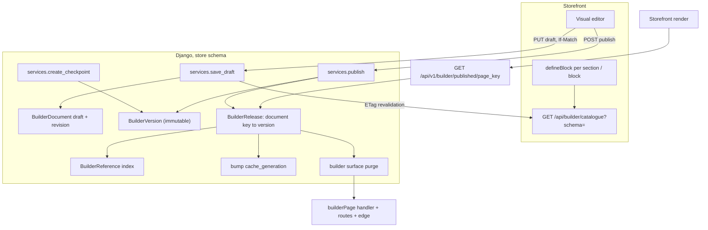

# Page builder: documents and releases

A store's theme, section groups (header, footer, announcement bar), templates
and merchant-made pages are **documents**: versioned JSON that staff edit in
the storefront's visual editor and publish together. The data, the versions,
the permissions and the publish live in Django (`builder/`, a tenant app).
The **block catalogue belongs to the storefront**, as the texts catalogue
does: each section or block is declared once there with its settings schema,
and Django validates every write against it and adds the checks only it can
make.

The Django side is described in depth in the synced
[Storefront page builder reference](/dev/django/reference/builder); this page
is the end-to-end flow of the data side. The storefront's own part, the block
catalogue and the editor's staff session, is [Page builder foundation](/dev/flows/page-builder). The editor and the storefront's catalogue endpoint
are the storefront's part of the same epic (storefront #289), and are marked
below where this page depends on them.

## Diagram

## How it works

### 1. Documents, versions, releases

- A **document** has a key (`theme`, `group:<name>`, `template:<name>`,
  `page:<slug>`), a **draft** and a per-language **overlay**, and a revision
  that moves with every change (`builder/models.py: BuilderDocument`).
- A **version** is an immutable snapshot of one document, numbered per
  document; only named saves and publishes make one. Autosaves never do.
- A **release** is an immutable map from document key to version. It is the
  only thing the public storefront reads. Publishing theme, header and home
  together is one release, and a rollback is a new release pointing at older
  versions. History is never rewritten.

### 2. A save

`PUT /api/v1/builder/documents/<key>/draft` with the revision in `If-Match`.
`builder/services.py: save_draft` checks permission, asks for the catalogue
(`builder/storefront.py: fetch_catalogue`, held per process and revalidated
by ETag), validates the document in full (`builder/validation.py`) and writes
under a row lock. A stale revision is a `409 revision_conflict` carrying the
current revision and who saved it. With no catalogue to check against
nothing is saved (`503 storefront_unavailable`): there is no fallback.

### 3. What is validated

The storefront's catalogue entry for each block supplies the settings JSON
Schema, the allowed children, limits, where it may be placed, which settings
are translatable or references, a feature gate and the rich-text settings.
Django adds the store's own limits (settings), that a reference exists in this
schema (checked at publish, so a draft can outlive a deleted product), that a
feature-gated block's feature is on, and that rich text survives the sanitiser
policy. Every problem is `{path, code, message}`, the path a JSON pointer into
what was sent.

### 4. A publish

`services.publish` validates every named draft (references included) and
reports every problem with its document, then in one transaction creates the
versions, takes the per-store lock, numbers one release and rebuilds the
reference index. The release is the previous one with the named keys
repointed.

### 5. What a release moves

`tenant/signals.py: bump_generation_on_builder_release` moves
`Tenant.cache_generation` in the release's transaction.
`core/cache/surfaces.py` registers the `builder` surface
(`invalidated_by=("builder.BuilderRelease",)`): the storefront's
`builderPage` handler (a handler name the storefront's cached route must
carry), every cached route of the store, and `invalidates_tenant_config=True`,
which moves the storefront's tenant epoch; the Cloudflare edge purge follows.
Draft saves purge nothing.

### 6. The public read

`GET /api/v1/builder/published/<page_key>?locale=` returns the theme, the
section groups and the page of that key (else the template of that name)
from the current release, **resolved for the locale in Django**: the overlay
merged, disabled nodes dropped with their children. It never reads a draft and
never calls the storefront. The result is cached under
`builder:<schema>:r<release>:<page_key>:<locale>`: immutable per release,
never purged.

### 7. Who may

`builder` is in `STORE_SETTINGS_APP_LABELS` and `STAFF_READ_ONLY_APP_LABELS`
(`tenant/role_scopes.py`): Admin and Owner edit and publish, Staff only look.

### 8. Scheduled publishing

A publish can wait for a time (`builder/scheduling.py`,
`BuilderScheduledPublish`). `POST /api/v1/builder/schedules` checks exactly
what a publish checks, now, and **freezes** the drafts as versions held by the
schedule, so what goes live is what was checked whatever is edited meanwhile; a
time without an offset is read in the store's timezone. A beat task,
`builder.tasks.run_due_publishes`, fans out per store every minute
(`tenant/tasks.py: fanout_run_due_builder_publishes`) and releases each due
schedule in its own transaction under the per-store release lock with
`select_for_update`, the status change inside it, so a retry, an overlapping
sweep or a second worker finds it spent. At that moment references are checked
again and the documents must still exist; a schedule that can no longer be
released is `failed` with the problems recorded, never half done. Otherwise it
is the ordinary release, so the cache generation and the `builder` surface move
then. A failure reaches a person: the store-staff email
`ops.builder_schedule_failed` (`builder/emails.py`, listed on the store's Emails
page, Greek and English) and a danger alert on the store dashboard
(`admin/dashboard/store/widgets.py: StoreAlerts`) until someone acknowledges it
(`POST schedules/<id>/acknowledge`, or the admin action in Content, Page
builder, Scheduled publishes). Moving and cancelling a pending schedule is
`PATCH` and `DELETE schedules/<id>`.

### 9. The media library

`MediaAsset` (`builder/models.py`) is an image in the store's library; an
image setting is a `media` reference to its id, never a URL. The storefront
gets the size a browser shows (EXIF orientation applied, so it can reserve
space and size `srcset`), a focal point, the alt text per language
(a parler translation, because the row stands alone, unlike a block's JSON
overlay) and `path`, what media-stream serves
(`media/<schema>/uploads/builder/<name>`). `builder/media_services.py` is
the only writer: raster images only, within `BUILDER_MEDIA_MAX_BYTES` and
`BUILDER_MEDIA_MAX_PIXELS`. A used asset cannot be deleted
(`409 media_in_use`, from the reference index), and changing a used asset's
alt or focal point moves the cache generation and the `builder` surface,
because a release is immutable and the media is resolved at render. The
public `GET /api/v1/builder/media/resolve?ids=&locale=` answers only for
assets the current release uses.

### 10. Signing in to the editor

The editor runs on the store's host, where nobody is signed in as staff.
`Content -> Edit storefront` in the store admin
(`builder/admin_views.py`) mints a single-use ticket (Redis, one minute,
`GETDEL` to spend it) and redirects to `/_builder?ticket=`. The storefront's
server posts it to `POST /api/v1/builder/staff-session` and receives a
`PlatformStaffToken` of scope `builder`: never renewed, ended at its expiry,
and refused outside the builder's routes
(`tenant/api_tokens.py`). The role and `is_staff` are re-checked on every
request, so losing either ends a session at once. The storefront keeps the
token in its own HttpOnly cookie, separate from the customer session.

## Invariants

- **The storefront owns the block catalogue.** A new block or setting is one
  storefront change; Django has no copy of a block's schema.
- **No catalogue, no save.** A held copy outlives a failed revalidation; with
  none held the write is refused.
- **Releases and versions are immutable.** Only whole unreleased checkpoints
  are ever deleted, by retention.
- **Document content is never re-cased.** Its keys are the storefront's; only
  the envelope is camelCased (`builder/rendering.py`).
- **A staff session is short and narrow**: one ticket spends once, the token
  is not renewed and works on the builder's routes only.
- **A publish is atomic**: every document valid, one release, or nothing.
- **The published read is a pure function of the release number and the
  locale**, which is why its cache needs no purge.

## Failure modes

- **Storefront down at save time**: the editor's save answers 503; the draft
  already stored is unchanged.
- **A reference deleted after publish**: the page still renders, the storefront
  shows the block empty; the next publish of that document is refused until the
  reference is fixed.
- **A block type bumped by a storefront deploy**: drafts at the old version are
  refused at save and publish (`block_version_outdated`) until the editor
  upgrades them; published versions keep rendering, because the storefront
  upgrades them when it renders.
- **Two editors**: the second save is refused with the first editor's name.

## Source

| File | Role |
|---|---|
| `grooveshop-django-api/builder/models.py` | Documents, versions, releases, reference index |
| `grooveshop-django-api/builder/services.py` | The only writer: save, checkpoint, restore, discard, publish, rollback, delete page |
| `grooveshop-django-api/builder/validation.py` | Every rule, as pointer and code |
| `grooveshop-django-api/builder/storefront.py` | The catalogue client |
| `grooveshop-django-api/builder/references.py` | Reference existence and the index |
| `grooveshop-django-api/builder/published.py` | The public read, cached per release |
| `grooveshop-django-api/builder/views.py` | Staff and public routes |
| `grooveshop-django-api/builder/rendering.py` | Parser and renderer that leave document keys alone |
| `grooveshop-django-api/builder/scheduling.py` | Schedule, move, cancel, the sweep, acknowledging a failure |
| `grooveshop-django-api/builder/tasks.py` | `run_due_publishes`, the per-store sweep |
| `grooveshop-django-api/builder/emails.py` | `ops.builder_schedule_failed` |
| `grooveshop-django-api/builder/media_services.py` | The media library's only writer |
| `grooveshop-django-api/builder/media_api.py` | Library routes and the public resolve |
| `grooveshop-django-api/builder/staff_session.py` | Ticket and builder session token |
| `grooveshop-django-api/builder/session_api.py` | `POST` / `DELETE builder/staff-session` |
| `grooveshop-django-api/builder/admin_views.py` | `Edit storefront` |
| `grooveshop-django-api/tenant/api_tokens.py` | Token scope enforcement |
| `grooveshop-django-api/core/storefront.py` | `base_url`, `StorefrontUnavailable` shared with `texts` |
| `grooveshop-django-api/core/cache/surfaces.py` | The `builder` surface |
| `grooveshop-django-api/tenant/signals.py` | `bump_generation_on_builder_release` |
| `grooveshop-django-api/tenant/role_scopes.py` | Roles |
| `grooveshop-django-api/settings.py` | `BUILDER_*` settings |
