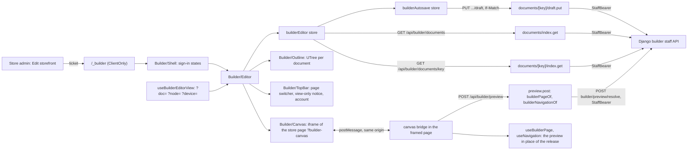

# Page builder editor

The editor is where a store's staff compose its pages. It is a route of the
storefront itself, `/_builder` on the store's own host, opened from the store
admin with a single-use ticket ([Page builder foundation](/dev/flows/page-builder),
section 9). It reads and writes builder documents through staff-only proxy
routes that forward the staff token to Django
([Page builder data](/dev/flows/page-builder-data)).

It is built in slices. Today it opens a page with the store's section groups,
shows their outline, changes their structure (move, duplicate, hide, remove)
and the settings of any section or block with undo and redo, draws every
change in a live preview of the store's real page, where a section is selected
and changed in place, and saves every change as it goes. Publishing and
history follow; each slice extends this page.

## Diagram

## How it works

### 1. Who opens it, and in which mode

The page signs in as before (`useBuilderSession`), then mounts the editor with
the session. The session states the staff member's role in the store:
`staff`, `admin`, `owner`, or `superuser` for a platform superuser
(`BUILDER_STAFF_ROLES`; the storefront's schema refuses any other value).

`admin`, `owner` and `superuser` edit (`BUILDER_EDITING_ROLES`). STAFF open the
editor read-only: the outline and every page are browsable, the top bar shows a
"View only" notice that says why, and no control that writes is offered. Django
refuses STAFF writes either way. The store exposes it as `canEdit`
(`app/stores/builderEditor.ts`).

### 2. The platform's look, not the store's

The editor is not the store. On a store's host Nuxt UI's `primary` is the
store's brand, so the editor sets its own palette from `appConfig.builder`
(`app/layouts/builder.vue`, `updateAppConfig`), and the store's design, theme
tokens and font faces are left off its page: `isBuilderEditorPath`
(`shared/utils/builderEditor.ts`) is checked by `app/plugins/design.ts`,
`app/plugins/tenant-theme.ts`, `server/plugins/tenant-theme.ts` and
`server/plugins/tenant-fonts.ts`. It matches `/_builder` in every language
and nothing else. Staff leave the editor by a full page load, which gives the
storefront its own look back. The store's design is what the preview shows.

### 3. Reading and saving documents

Three staff routes, each behind `requireBuilderStaff` (401 without a session),
forwarding the token as `StaffBearer`, answered `private, no-store` and never
cached:

| Route | Django | Answers |
|---|---|---|
| `GET /api/builder/documents` | `GET builder/documents`, every page at Django's largest page size | the whole list: key, kind, draft revision, published version, whether the draft has unpublished changes, who saved last |
| `GET /api/builder/documents/<key>` | `GET builder/documents/<key>` | the envelope and the working copy, `draft` and its overlay `i18n`, the content untouched |
| `PUT /api/builder/documents/<key>/draft` | `PUT builder/documents/<key>/draft`, `If-Match` passed on | the saved document; Django's 409 `revision_conflict` and 400 `invalid_document` as they are, and its documented 503 `storefront_unavailable` (`forwardUpstreamDocumentedError`) |

The save checks the body by its structure only (`ZodBuilderDraftWrite`: the
draft's shape and the overlay's `i18n[locale][node][pointer]`) and `If-Match`
as a revision number; what a block's settings may hold is Django's check,
against this build's catalogue.

A key is checked against Django's own pattern first
(`BUILDER_DOCUMENT_KEY_PATTERN`). Django's 4xx answers come back as they are.

### 4. Opening a page

`useBuilderEditorStore().open(key)` reads the list, then the page and every
section group the store has (`group:header`, `group:mobile`, `group:footer`;
`BUILDER_EDITOR_GROUPS`) that it has not opened yet. Each working copy is
checked by its structure (`ZodBuilderDraft`, `ZodBuilderOverlay`): ids Django
accepts, and each `order` / `blockOrder` naming every node of its map exactly
once. Every node is brought to its block's current version (`upgradeDraft`,
`app/utils/builderWorkingCopy.ts`), the only version Django accepts in a save.
A copy that fails either is not opened (`unreadable`), so it can never be
saved back mangled. The editor also shows `notFound` (with a way back to the home page)
and `error` (with a retry).

### 5. The outline

`Builder/Outline` draws one `UTree` per document, top to bottom as the
storefront draws them: the groups above the page, the page, the groups below
it (`BUILDER_EDITOR_GROUPS_BELOW_PAGE`). `builderOutline`
(`app/utils/builderOutline.ts`) lists each document's sections and their blocks
in order. A row is named by its node's own title when it has one, "New
arrivals" rather than "Product grid": the first non-empty of the block's
`editor.title` settings (`defineBlock`; editor-only, never in the catalogue).
Otherwise it shows the block's name. A hidden node is dimmed and says so to a
screen reader. A row's reference is `<document key>/<node id>`
(`builderNodeRef`).

### 6. Changing the structure

The toolbar under the outline (`Builder/NodeActions`) acts on the selected
node through `useBuilderSelection`: move up and down (also Alt+Arrow), duplicate
(the node, its blocks and their translations under fresh ids, refused where the
parent's `maxBlocks` or a type's `maxPerTemplate` would be exceeded:
`canDuplicateNode`), hide from shoppers or show again (`disabled`), and
remove after a confirmation (with every translation of the removed nodes). Each
is a pure function of the working copy (`app/utils/builderWorkingCopy.ts`).

Every change goes through `useBuilderEditorStore().change`, which records it
for undo (`BUILDER_HISTORY_LIMIT` steps, across every open document, kept
through saves) and hands the document to the autosave. Undo and redo are in the
top bar and on Cmd/Ctrl+Z, Shift+Cmd/Ctrl+Z and Cmd/Ctrl+Y, never while a text
field has focus, which keeps its own undo. Undoing a change of another page
opens that page. STAFF get none of this.

### 7. Settings

The settings pane (`Builder/Inspector`, the right sidebar; a drawer below the
`lg` breakpoint) shows a form for the selected node (`Builder/SettingsForm`).
The form is not written per block: `builderSettingsFields`
(`app/utils/builderSettingsFields.ts`) reads the block's settings schema as the
catalogue publishes it (`blockSettingsJsonSchema`, `shared/builder/jsonSchema.ts`,
the same JSON Schema Django validates with) and gives each setting a control
(`Builder/SettingField`), in the order the schema declares them:

| Schema | Control |
|---|---|
| a string up to `BUILDER_TEXTAREA_MIN_LENGTH` characters, or longer | one line, or a growing text area |
| an enum | segmented buttons up to `BUILDER_SEGMENTED_CHOICE_MAX` choices, else a select; an enum of fixed routes (`LINK_ROUTES`) names the pages |
| a boolean | a switch; an optional one offers Default, On, Off |
| a number, or a union of numbers | a number field with the schema's bounds |
| `BUILDER_FIELD_PATTERNS` `hexColor`, `icon`, `httpsUrl` | a colour picker with its hex value, an icon name, an address |
| a link (`builderField.link`) | no link, a store page, or an external address; a link to a record is shown read only until the record picker |
| a reference (`refs`) | the record's id (a number), until the record picker |
| a list of strings | rows that can be added, reordered and removed, up to `maxItems` |
| an object | a group of its own fields |
| rich text | not editable yet (it comes with the rich-text editor) |

An optional setting offers Default, which takes it out of the node so the
section component falls back to its own default (`setNodeSetting`; an empty
text or list is taken out too). The form checks the settings against the
block's Zod schema as the merchant types and shows the issue on its field;
a save Django refuses (`invalid_document`) shows each problem on the field its
JSON pointer names (`builderProblemSettingPath`, `fieldForSettingPath`).
Typing into one field is one undo step: changes to the same setting of the
same node within `BUILDER_HISTORY_COALESCE_MS` of each other are merged
(`change(key, next, { coalesce })`). STAFF see the form with every control
disabled.

The settings are the draft's own values, in the store's default language;
their translations follow with the translation slice.

### 8. Saving

`useBuilderAutosaveStore` (`app/stores/builderAutosave.ts`) saves a changed
document `BUILDER_AUTOSAVE_DELAY_MS` after the last change: the whole working
copy, against the revision it was made on. One save per document is on its way
at a time. The top bar's status line says where the most urgent document stands.

| Answer | What the editor does |
|---|---|
| 200 | Takes the new revision; saves again at once if the copy changed meanwhile. |
| 409 `revision_conflict` | Stops saving that document and opens `Builder/ConflictDialog`: who saved, when, which sections differ (`changedSections`), then **keep mine** (saved over theirs against their revision, whatever ours holds) or **load theirs** (their copy replaces ours; that document's history is dropped). |
| 400 `invalid_document` | Marks the refused nodes in the outline (`builderProblemNodeId` reads each problem's JSON pointer) and says so; the next change saves again. |
| 401 | Keeps the copy in this browser (`keepBuilderRecovery`, `app/utils/builderRecovery.ts`) and says the session ended. |
| no answer, 5xx (503 `storefront_unavailable` included) | Keeps the copy in this browser and tries again after each of `BUILDER_AUTOSAVE_RETRY_MS`; then stops and offers to try again. |
| any other 4xx | Keeps the copy and says the save failed; offers to try again. |

Leaving the page (`pagehide`, or the tab hidden) saves what waits, with
`keepalive` so the request outlives it. A copy kept in this browser is offered
back by `Builder/RecoveryNotice` when the document next opens, read once per
document (what the running session keeps is never offered to itself), with a
warning when the document has been saved since. The editor warns
`BUILDER_SESSION_WARNING_MS` before the staff session ends.

### 9. The live preview

The middle pane (`Builder/Canvas`) frames the store's real page for the open
document, at its own address with `?builder-canvas` (`builderDocumentPath`:
a template at its page type's route, a page the store made at its slug), so
every design draws the preview with its own components and chrome.

- **Framing.** Only that request, from a live staff session, may be framed,
  and only by the store's own pages; every answer to it is private
  ([Security model](/dev/platform/security), "Framing"). The frame is
  sandboxed (`allow-same-origin allow-scripts`): it cannot navigate the
  editor, open windows or send forms.
- **Messages.** The editor and the framed page talk by `postMessage` on the
  same origin, each taking a message only from the window it expects, on
  `BUILDER_CANVAS_CHANNEL`, and only if it parses
  (`shared/schemas/builderCanvas.ts`). The canvas says `ready`; the editor
  sends the working copies of the page and its section groups, then again on
  every change; the canvas answers `drawn` or `failed` (it keeps what it
  drew last, and the editor offers to try again).
- **Drawing.** The framed page's bridge (`app/builder/canvas/bridge.ts`,
  started by `app/plugins/builder-canvas.client.ts` once the page has
  hydrated, and loaded only there) asks `POST /api/builder/preview`, one
  request for a burst of changes (`BUILDER_CANVAS_PREVIEW_DELAY_MS`), the
  answer of an overtaken request dropped. The route asks Django to resolve
  the copies (`POST builder/preview/resolve`): each stands in for the current
  release's document of its key and is resolved for the request's language by
  the code the published reads use, so there is one implementation of a
  document in a language. The answer has `published/<pageKey>`'s shape and
  goes through what the published routes run (`builderPageOf`,
  `builderNavigationOf`, `server/utils/builderPage.ts`).
  The answer goes into `useBuilderCanvasPreview`, which `useBuilderPage` and
  `useNavigation` read before the release. On the canvas a page the store has
  not published is drawn empty until the preview arrives, never answered as
  a 404.
- **Selecting.** On the canvas each section of the page is wrapped in an
  element that carries its node id (`BUILDER_CANVAS_NODE_ATTRIBUTE`,
  `PageSection/Renderer.vue`). The wrapper is `display: contents`, so the
  store's grids and gaps are unchanged, and it does not depend on a design
  passing attributes to its root; a shopper's page has none. A click on a
  section selects it (`pick`), whatever it was on; a selection made in the
  outline is sent to the canvas (`select`), which brings it into view, its
  top just under the store's pinned header (whatever is `sticky` or `fixed`
  at the top of the viewport, measured there, in every design), and keeps it
  in view when a move or a duplicate redraws the page. The canvas scrolls its
  own window only. The canvas
  reports where the section under the pointer and the selected one are drawn
  (`boxes`, the box of each wrapper's contents, once per frame on every
  scroll, resize or redraw), and the editor draws their outlines and, over
  the selected one, the same toolbar as the sidebar (`Builder/NodeActions`),
  scaled with the frame. The store's page is never painted on. A section
  group's nodes and a section that renders nothing are selected from the
  outline.
- **Links.** A link outside the sections never navigates the preview: one to
  a page the editor builds opens that page in the editor
  (`builderDocumentAt`); any other says it is not built here.
- **Widths.** Phone, tablet, desktop or the full pane
  (`BUILDER_PREVIEW_DEVICES`, `?device=`); a width wider than the pane is
  scaled down, so a desktop page keeps its desktop layout.

The editor and the canvas are the page builder's own pages, not a shopper's
visit (`useBuilderSurface`, `app/plugins/builder-surface.ts`, read once from
the address the page loaded at): no analytics, ad pixels, consent banner,
sign-in prompt, landing attribution or interaction timing, and never indexed.

### 10. The address keeps the view

`useBuilderEditorView` keeps the document (`?doc=`), the selected node
(`?node=`) and the preview's width (`?device=`) in the address, so a reload, a shared link or Back restores the
view. Opening another page is a history step; selecting a node or a width
replaces the current entry. A value that is not a document key or a node reference is read
as absent.

### 11. Names

The editor's names for blocks, section groups and page types live in
`app/builder/labels/el.json` and `en.json`, merged into a composer of their own
(`useBuilderLabels`), not the global locale files: no public page carries them,
and the store's text editor does not offer them. The same files name every setting (`settings`, with optional help), every
choice a setting offers (`options`, by the setting's name) and every fixed
route a link may name (`routes`). `test/unit/app/builder/labels.spec.ts`
fails when a block, group, page type, setting, choice or route lacks a name in
either language, a name is blank, or a name is left for something that no
longer exists. The editor's own interface
strings are its components' `<i18n>` blocks.

## Invariants

- No editor code in the public bundle: the page renders inside `<ClientOnly>`,
  and the block definitions (with their Zod schemas) are imported only by the
  editor (`app/utils/builderEditorBlocks.ts`).
- Every `/api/builder/**` staff route reads the session through
  `requireBuilderStaff` and is never cached.
- The editor never opens a working copy it cannot read whole.
- STAFF are never offered a control that writes.
- A settings form is generated from the block's schema; no block has a form of
  its own, and a new setting needs only its names.
- No change is lost silently: it is saved, kept in this browser, or waits on the
  staff member's choice (a conflict, a refusal, a failed save).
- A save always names the revision it was made on; Django refuses a stale one.
- The preview draws the working copy through the pipeline that draws a release,
  so what it shows is what publishing would serve.
- No page of the page builder counts as a shopper's visit.

## Failure modes

| Symptom | Cause |
|---|---|
| "Page not found" | The address names a document the store does not have (`?doc=`), or it was deleted. |
| "This page can't be opened" | A working copy fails `ZodBuilderDraft`; the console logs `builder:document_unreadable` with the failing paths. |
| "The page didn't load" | Django could not be asked, or answered an error; logged as `builder:open`. |
| Signed out on every request | The staff token expired (a working day) or was revoked; open the editor from the admin again. The unsaved changes are offered back. |
| "Offline, retrying" that does not clear | Django is unreachable, or cannot reach the storefront's catalogue (503 `storefront_unavailable`). |
| "Someone else saved" | Another session saved the document in between; the dialog asks which version to keep. |
| "The preview didn't update" | `POST /api/builder/preview` failed (logged by the route); the canvas shows the last version it drew. |
| The preview stays on "Drawing the preview" | The framed page never said `ready`: framing refused (an expired staff session answers `frame-ancestors 'none'`) or its bridge did not start. |
| A setting says it isn't valid | Its value fails the block's schema; the save that follows is refused by Django and the field names its problem. |

## Source

| File | What |
|---|---|
| `grooveshop-storefront-ui-node-nuxt/app/pages/_builder.vue` | The route |
| `grooveshop-storefront-ui-node-nuxt/app/layouts/builder.vue` | The editor's palette |
| `grooveshop-storefront-ui-node-nuxt/app/components/Builder/Shell.vue` | Sign-in states |
| `grooveshop-storefront-ui-node-nuxt/app/components/Builder/Editor.vue` | Panes and document states |
| `grooveshop-storefront-ui-node-nuxt/app/components/Builder/TopBar.vue` | Exit, page switcher, view-only notice, account |
| `grooveshop-storefront-ui-node-nuxt/app/components/Builder/DocumentSwitcher.vue` | The page switcher |
| `grooveshop-storefront-ui-node-nuxt/app/components/Builder/Outline.vue` | The outline |
| `grooveshop-storefront-ui-node-nuxt/app/components/Builder/NodeActions.vue` | The selection's toolbar |
| `grooveshop-storefront-ui-node-nuxt/app/components/Builder/Canvas.vue` | The preview frame, widths, link following |
| `grooveshop-storefront-ui-node-nuxt/app/builder/canvas/bridge.ts` | The framed page's half of the preview |
| `grooveshop-storefront-ui-node-nuxt/app/plugins/builder-canvas.client.ts` | Starts the bridge on the canvas |
| `grooveshop-storefront-ui-node-nuxt/app/plugins/builder-surface.ts` | Whether a page is the editor or its canvas |
| `grooveshop-storefront-ui-node-nuxt/app/composables/useBuilderCanvas.ts` | `useBuilderSurface`, `useBuilderCanvasPreview` |
| `grooveshop-storefront-ui-node-nuxt/server/api/builder/preview.post.ts` | The preview of working copies |
| `grooveshop-storefront-ui-node-nuxt/server/utils/builderPage.ts` | One pipeline for a release and a preview |
| `grooveshop-storefront-ui-node-nuxt/shared/schemas/builderCanvas.ts` | The messages between editor and canvas |
| `grooveshop-storefront-ui-node-nuxt/app/components/Builder/Inspector.vue` | The settings pane |
| `grooveshop-storefront-ui-node-nuxt/app/components/Builder/SettingsForm.vue` | A node's settings form and its problems |
| `grooveshop-storefront-ui-node-nuxt/app/components/Builder/SettingField.vue` | One setting's control |
| `grooveshop-storefront-ui-node-nuxt/app/components/Builder/LinkField.vue` | A link setting |
| `grooveshop-storefront-ui-node-nuxt/app/utils/builderSettingsFields.ts` | Settings fields from a block's schema |
| `grooveshop-storefront-ui-node-nuxt/shared/builder/jsonSchema.ts` | A block's settings as JSON Schema |
| `grooveshop-storefront-ui-node-nuxt/app/components/Builder/History.vue` | Undo, redo, save status |
| `grooveshop-storefront-ui-node-nuxt/app/components/Builder/ConflictDialog.vue` | Keep mine or load theirs |
| `grooveshop-storefront-ui-node-nuxt/app/components/Builder/RecoveryNotice.vue` | Unsaved changes offered back |
| `grooveshop-storefront-ui-node-nuxt/app/stores/builderAutosave.ts` | The autosave |
| `grooveshop-storefront-ui-node-nuxt/app/composables/useBuilderSelection.ts` | The selected node and its changes |
| `grooveshop-storefront-ui-node-nuxt/app/utils/builderWorkingCopy.ts` | Structural and settings changes, upgrade, comparison |
| `grooveshop-storefront-ui-node-nuxt/app/utils/builderRecovery.ts` | The copy kept in this browser |
| `grooveshop-storefront-ui-node-nuxt/server/api/builder/documents/[key]/draft.put.ts` | The save |
| `grooveshop-storefront-ui-node-nuxt/app/stores/builderEditor.ts` | Documents, working copies, role, `canEdit`, undo history |
| `grooveshop-storefront-ui-node-nuxt/app/composables/useBuilderEditorView.ts` | The address state |
| `grooveshop-storefront-ui-node-nuxt/app/composables/useBuilderLabels.ts` | Names of blocks, groups, page types, settings, choices, routes |
| `grooveshop-storefront-ui-node-nuxt/app/utils/builderOutline.ts` | Outline rows and node references |
| `grooveshop-storefront-ui-node-nuxt/server/api/builder/documents/index.get.ts` | Document list |
| `grooveshop-storefront-ui-node-nuxt/server/api/builder/documents/[key]/index.get.ts` | One document |
| `grooveshop-storefront-ui-node-nuxt/shared/schemas/builderEditor.ts` | Key and working-copy schemas |
| `grooveshop-storefront-ui-node-nuxt/shared/utils/builderEditor.ts` | `isBuilderEditorPath` |
