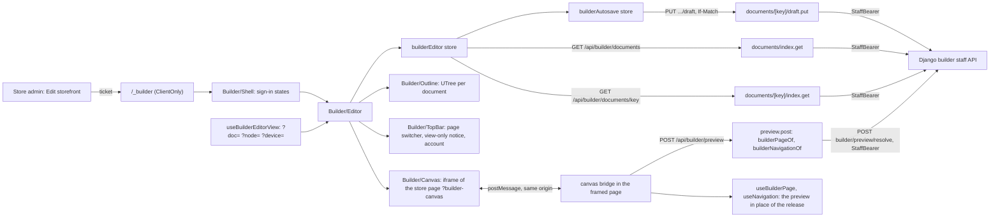

# Page builder editor

The editor is where a store's staff compose its pages. It is a route of the
storefront itself, `/_builder` on the store's own host, opened from the store
admin with a single-use ticket ([Page builder foundation](/dev/flows/page-builder),
section 9). It reads and writes builder documents through staff-only proxy
routes that forward the staff token to Django
([Page builder data](/dev/flows/page-builder-data)).

It is built in slices. Today it opens a page with the store's section groups,
shows their outline, changes their structure (move, also by dragging a row of
the outline, duplicate, hide, remove)
and the settings of any section or block, in any language the store serves,
with undo and redo, draws every
change in a live preview of the store's real page, where a section is selected
and changed in place, saves every change as it goes, and publishes the page
and its section groups together, now or at a time it schedules. It also edits
the store's theme and the lists and records a block shows. Each slice extends
this page.

## Diagram

## How it works

### 1. Who opens it, and in which mode

The page signs in as before (`useBuilderSession`), then mounts the editor with
the session. The session states the staff member's role in the store:
`staff`, `admin`, `owner`, or `superuser` for a platform superuser
(`BUILDER_STAFF_ROLES`; the storefront's schema refuses any other value).

`admin`, `owner` and `superuser` edit (`BUILDER_EDITING_ROLES`). STAFF open the
editor read-only: the outline and every page are browsable, the top bar shows a
"View only" notice that says why, and no control that writes is offered. Django
refuses STAFF writes either way. The store exposes it as `canEdit`
(`app/stores/builderEditor.ts`).

### 2. The platform's look, not the store's

The editor is not the store. On a store's host Nuxt UI's `primary` is the
store's brand, so the editor sets its own palette from `appConfig.builder`
(`app/layouts/builder.vue`, `updateAppConfig`), and the store's design, theme
tokens and font faces are left off its page: `isBuilderEditorPath`
(`shared/utils/builderEditor.ts`) is checked by `app/plugins/design.ts`,
`server/plugins/tenant-theme.ts` and `server/plugins/tenant-fonts.ts`. It matches `/_builder` in every language
and nothing else. Staff leave the editor by a full page load, which gives the
storefront its own look back. The store's design is what the preview shows.

### 3. Reading and saving documents

Three staff routes, each behind `requireBuilderStaff` (401 without a session),
forwarding the token as `StaffBearer`, answered `private, no-store` and never
cached:

| Route | Django | Answers |
|---|---|---|
| `GET /api/builder/documents` | `GET builder/documents`, every page at Django's largest page size | the whole list: key, kind, draft revision, published version, whether the draft has unpublished changes, who saved last |
| `GET /api/builder/documents/<key>` | `GET builder/documents/<key>` | the envelope and the working copy, `draft` and its overlay `i18n`, the content untouched |
| `PUT /api/builder/documents/<key>/draft` | `PUT builder/documents/<key>/draft`, `If-Match` passed on | the saved document; Django's 409 `revision_conflict` and 400 `invalid_document` as they are, and its documented 503 `storefront_unavailable` (`forwardUpstreamDocumentedError`) |

The save checks the body by its structure only (`ZodBuilderDraftWrite`: the
draft's shape and the overlay's `i18n[locale][node][pointer]`) and `If-Match`
as a revision number; what a block's settings may hold is Django's check,
against this build's catalogue.

A key is checked against Django's own pattern first
(`BUILDER_DOCUMENT_KEY_PATTERN`). Django's 4xx answers come back as they are.

### 4. Opening a page

`useBuilderEditorStore().open(key)` reads the list, then the page and every
section group the store has (`group:header`, `group:mobile`, `group:footer`;
`BUILDER_EDITOR_GROUPS`) that it has not opened yet. Each working copy is
checked by its structure (`ZodBuilderDraft`, `ZodBuilderOverlay`): ids Django
accepts, and each `order` / `blockOrder` naming every node of its map exactly
once. Every node is brought to its block's current version (`upgradeDraft`,
`app/utils/builderWorkingCopy.ts`), the only version Django accepts in a save.
A copy that fails either is not opened (`unreadable`), so it can never be
saved back mangled. The editor also shows `notFound` (with a way back to the home page)
and `error` (with a retry).

### 5. The outline

`Builder/Outline` draws one `Builder/OutlineTree` (a flat `UTree`, `nested: false`) per document, top to bottom as the
storefront draws them: the groups above the page, the page, the groups below
it (`BUILDER_EDITOR_GROUPS_BELOW_PAGE`). `builderOutline`
(`app/utils/builderOutline.ts`) lists each document's sections and their blocks
in order. A row is named by its node's own title when it has one, "New
arrivals" rather than "Product grid": the first non-empty of the block's
`editor.title` settings (`defineBlock`; editor-only, never in the catalogue).
Otherwise it shows the block's name. A hidden node is dimmed and says so to a
screen reader. A row's reference is `<document key>/<node id>`
(`builderNodeRef`).

### 6. Changing the structure

The toolbar under the outline (`Builder/NodeActions`) acts on the selected
node through `useBuilderSelection`: move up and down (also Alt+Arrow), duplicate
(the node, its blocks and their translations under fresh ids, refused where the
parent's `maxBlocks` or a type's `maxPerTemplate` would be exceeded:
`canDuplicateNode`), hide from shoppers or show again (`disabled`), and
remove after a confirmation (with every translation of the removed nodes). Each
is a pure function of the working copy (`app/utils/builderWorkingCopy.ts`).

A row of the outline is also dragged by its handle (its icon, which turns into
a grip on hover and always shows one on a touch screen) to a new place among
its siblings: a section among the sections of its document, a block among the
blocks of its parent, never into another parent or document, as Move up and
Move down do. While a row is dragged, the rows under every sibling are folded
away, so a drop between two siblings is never a drop among one's blocks
(`builderOutlineDrag`, `builderOutlineDropIndex` in
`app/utils/builderOutline.ts`). The drag is Sortable.js through VueUse's
`useSortable` (`@vueuse/integrations`), the path Nuxt UI documents for
`UTree`; the dragged row's DOM move is undone and the outline redrawn from the
document. Keyboard users move with Alt+Arrow or the toolbar, the
single-pointer alternative WCAG 2.5.7 asks for.

Every move, from the toolbar, the shortcut or a drag, goes through
`useBuilderEditorStore().move(key, nodeId, to)` (`canMoveNode`, `moveNode`
take the target place among the siblings) and is announced through Nuxt's
`useAnnouncer` and the `<NuxtAnnouncer>` of the builder layout: "Hero
carousel moved to position 3 of 13".

Every change goes through `useBuilderEditorStore().change`, which records it
for undo (`BUILDER_HISTORY_LIMIT` steps, across every open document, kept
through saves) and hands the document to the autosave. Undo and redo are in the
top bar and on Cmd/Ctrl+Z, Shift+Cmd/Ctrl+Z and Cmd/Ctrl+Y, never while a text
field has focus, which keeps its own undo. Undoing a change of another page
opens that page. STAFF get none of this.

### 7. Adding sections and blocks

The add-section library (`Builder/Library.vue`) opens from the "+" of each
document in the outline (a section at its end), from the selection's toolbar
("Add below": a sibling right after it; "Add inside": a block at the end of a
node that takes blocks), and from the preview: a "+" on the bottom edge of
the section under the pointer and of the selected one adds a section right
below it, and one on the top edge of the first section adds one above it, so
every place between sections is one click away. The "+" stays while the
pointer is on it, though the pointer has left the frame, and STAFF get none. Where it was opened is
the library store's target (`useBuilderLibraryStore`: a document and a
`BuilderInsertPoint`, a parent and an index).

- **What it offers** (`builderLibraryOffers`, `app/utils/builderWorkingCopy.ts`):
  at the top of a document, the sections that may sit there
  (`builderPlacementAllowed`, `shared/builder/placement.ts`, a mirror of
  Django's `_placement_allowed`, tested against the same cases,
  `test/fixtures/builder/placement-cases.json`, which Django vendors); inside
  a node, the block types it allows, while nesting is allowed that deep. Never
  a deprecated block, and only one with a preset to insert. Shown but refused,
  with the reason on the card: a block whose store feature is off, one the
  document already holds as many of as its `maxPerTemplate`, and anything once
  the parent holds its `maxBlocks`. It only filters what is offered; Django
  checks it all again on save.
- **The dialog**: a tab per category (`editor.category`, editor-only, named in
  the labels; blocks inside a node have none), a search that ignores accents,
  and a grid of cards the arrow keys move through. Each card carries a
  schematic of the block (`BUILDER_SCHEMATICS`, `app/utils/builderSchematics.ts`,
  one per block type, drawn in the editor's palette). Full screen on a phone,
  and it closes the drawer it was opened from.
- **What it inserts** (`builderPresetNode`, `app/utils/builderLibrary.ts`): the
  block's `default` preset (`presets` in the catalogue): its settings, its text
  from the labels in the language a draft is written in (`presets.<type>.<preset>`,
  never the editor's language), and its child blocks, each from its own type's
  default preset, every node under a fresh id. The new node is selected and drawn
  in the preview. `test/unit/app/builder/presets.spec.ts` holds every block's
  default preset to what a save accepts. A block that needs an image has none
  until the media picker, and is not offered (`gallery_image`, `hero_slide`).
- **A block whose store feature is off.** The published pages leave it out
  (`parseDocument` skips it as `feature_disabled`, with a warning), so turning a
  feature off never leaves a dead section live. A draft that holds one is refused
  on save; the inspector says so on that node, with the feature's name and a
  one-click "Remove". For ADMIN and OWNER it also offers "Turn on" and the feature's name,
  which opens the store admin's page for the first setting that is off in a new
  tab: `GET /api/builder/features` (Django's `builder/features`, staff only, never
  cached: `{ features: { <name>: { on, turnOnUrl } } }`), asked once a node is
  refused for its feature. `turnOnUrl` is null when the plan keeps the feature
  off (only the platform can change that) or for any other role, and then only
  "Remove" is offered.

### 8. Settings

The settings pane (`Builder/Inspector`, the right sidebar; a drawer below the
`lg` breakpoint) shows a form for the selected node (`Builder/SettingsForm`).
The form is not written per block: `builderSettingsFields`
(`app/utils/builderSettingsFields.ts`) reads the block's settings schema as the
catalogue publishes it (`blockSettingsJsonSchema`, `shared/builder/jsonSchema.ts`,
the same JSON Schema Django validates with) and gives each setting a control
(`Builder/SettingField`), in the order the schema declares them:

| Schema | Control |
|---|---|
| a string up to `BUILDER_TEXTAREA_MIN_LENGTH` characters, or longer | one line, or a growing text area |
| an enum | segmented buttons up to `BUILDER_SEGMENTED_CHOICE_MAX` choices, else a select; an enum of fixed routes (`LINK_ROUTES`) names the pages |
| a boolean | a switch; an optional one offers Default, On, Off |
| a number, or a union of numbers | a number field with the schema's bounds |
| `BUILDER_FIELD_PATTERNS` `hexColor`, `icon`, `httpsUrl` | a colour picker with its hex value, an icon name, an address |
| a link (`builderField.link`) | no link, a store page, an external address, or a product, category, post or page picked by name (`Builder/RecordPicker`) |
| a reference (`refs`) | the record picker for its kind: a product, category, blog category, page or content page, saved as its id or key |
| a list of strings | rows that can be added, reordered and removed, up to `maxItems` |
| an object | a group of its own fields |
| rich text | Nuxt UI's editor (`UEditor`, TipTap), writing HTML (`Builder/RichTextField`): bold, italic, underline, strikethrough, headings h2 to h4 (`BUILDER_RICH_TEXT_HEADING_LEVELS`), lists, quote, divider and links to an `https://` address or a store path (`builderRichTextLinkAllowed`); no code and no images. All of it is markup Django's sanitiser keeps, so a save never refuses it (`unsupported_markup`). An emptied field is no text (the editor's own `isEmpty`: no text and no divider). It loads only when a rich text setting is shown (`LazyBuilderRichTextField`), and keeps its own undo while it has focus |

An optional setting offers Default, which takes it out of the node so the
section component falls back to its own default (`setNodeSetting`; an empty
text or list is taken out too). The form checks the settings against the
block's Zod schema as the merchant types and shows the issue on its field;
a save Django refuses (`invalid_document`) shows each problem on the field its
JSON pointer names (`builderProblemSettingPath`, `fieldForSettingPath`).
Typing into one field is one undo step: changes to the same setting of the
same node within `BUILDER_HISTORY_COALESCE_MS` of each other are merged
(`change(key, next, { coalesce })`). STAFF see the form with every control
disabled.

The record picker (`Builder/RecordPicker`, `app/utils/builderRecordPicker.ts`)
finds records as the staff member types, `BUILDER_LINK_SEARCH_DELAY_MS` after
the last key, through `GET /api/builder/link-search` (Django's
`builder/link-search`: only what a link may point at, grouped by kind, at most
`BUILDER_LINK_SEARCH_LIMIT` of each). It names the record a setting already
holds through `GET /api/builder/link-labels` (Django's `builder/link-labels`)
and warns when that record can no longer be linked (`active: false`: a
publish refuses the page with `reference_not_found` until the link is changed,
and a page already published drops the link when it is drawn). Both routes are staff only, never
cached, and ask in the editor's language: Django matches and names records
in that language, else in the store's default.

#### Another language of the store

Every document is written in the platform's default language
(`DEFAULT_LOCALE`, Django's `PARLER_DEFAULT_LANGUAGE_CODE`); its other
languages live in the working copy's overlay, `i18n[locale][node id][pointer]`,
one entry per translatable setting (each block's `translatable` pointers).
A setting with no entry falls back to the draft's text, as the published pages
read it.

For a store that serves more than one language, the top bar's
`Builder/LocaleSwitcher` chooses the language being edited
(`useBuilderEditorView().locale`, `?locale=`, only a language the store
serves). Each language other than the draft's says how many settings of the
page still need translating into it (`builderMissingTranslations`: a
translatable setting with text in the draft and none in that language). In
another language:

- a translatable field shows its translation, with the draft's text as its
  placeholder and a "Not translated" badge until it has one; typing writes the
  overlay (`setNodeTranslation`, `app/utils/builderTranslation.ts`) and never
  the draft, and emptying it takes the entry out, so the setting falls back;
- every other field shows the draft's value, read only, as "Same in every
  language": layout is never per language;
- the form checks what the language reads (`builderTranslatedSettings`: the
  draft with its translations in place) against the block's schema, and a
  save Django refuses shows each problem of that language's overlay
  (`/i18n/<locale>/<id>/<pointer>`) on its field;
- the settings pane names the language ("Translating: English");
- the preview draws the store page in that language (`/en/…?builder-canvas`),
  so the page asks for the preview in it (`X-Language`) and draws its own texts
  in it too.

The outline keeps naming nodes by their draft titles.

### 9. Saving

`useBuilderAutosaveStore` (`app/stores/builderAutosave.ts`) saves a changed
document `BUILDER_AUTOSAVE_DELAY_MS` after the last change: the whole working
copy, against the revision it was made on. One save per document is on its way
at a time. The top bar's status line says where the most urgent document stands.

| Answer | What the editor does |
|---|---|
| 200 | Takes the new revision; saves again at once if the copy changed meanwhile. |
| 409 `revision_conflict` | Stops saving that document and opens `Builder/ConflictDialog`: who saved, when, which sections differ (`changedSections`), then **keep mine** (saved over theirs against their revision, whatever ours holds) or **load theirs** (their copy replaces ours; that document's history is dropped). |
| 400 `invalid_document` | Marks the refused nodes in the outline (`builderProblemNodeId` reads each problem's JSON pointer) and says so; the next change saves again. |
| 401 | Keeps the copy in this browser (`keepBuilderRecovery`, `app/utils/builderRecovery.ts`) and says the session ended. |
| no answer, 5xx (503 `storefront_unavailable` included) | Keeps the copy in this browser and tries again after each of `BUILDER_AUTOSAVE_RETRY_MS`; then stops and offers to try again. |
| any other 4xx | Keeps the copy and says the save failed; offers to try again. |

Leaving the page (`pagehide`, or the tab hidden) saves what waits, with
`keepalive` so the request outlives it. A copy kept in this browser is offered
back by `Builder/RecoveryNotice` when the document next opens, read once per
document (what the running session keeps is never offered to itself), with a
warning when the document has been saved since. The editor warns
`BUILDER_SESSION_WARNING_MS` before the staff session ends.

#### Publishing

ADMIN and OWNER publish from the top bar (`Builder/Publish`; STAFF see no
button, and a dot on it says something has changes). The dialog lists the
page, the section groups drawn around it and, last, the store's theme
(`BUILDER_THEME_DOCUMENT`, which every page draws with; `keys` in
`Builder/Publish.vue`), each with whether it has changes
to publish: a draft Django holds as unpublished (`hasUnpublishedChanges`) or a
change not saved yet. Those with changes are picked to begin with; one without
cannot be picked. An optional note goes with the release (as long as the
generated `zPublishWriteRequest` allows). The theme goes out with the rest, now
or at a time, and the list of publishes to come names it:
`documentLabel` (`app/composables/useBuilderLabels.ts`, `documents.theme` in
`app/builder/labels/{el,en}.json`) calls it "Theme: colours, corners, fonts"
wherever a document is named (the presence notice, the history, the schedules),
where it was "/theme".

After a release that holds the theme Django purges the `builder` surface
(`invalidated_by=("builder.BuilderRelease",)`, `src/core/cache/surfaces.py`), which
is registered with `invalidates_tenant_config`, and moves the store's cache
generation (`tenant.signals`), so every cached page of the store is re-keyed and
shows the new look, and the store's emails read the new primary colour. Nothing
else is needed from the storefront.

Publishing first saves the picked documents and waits for those saves
(`useBuilderAutosaveStore().settle`): Django releases the drafts it holds, so a
change still waiting out the autosave delay is saved now, and one that cannot
be saved (refused, retrying, in conflict, signed out) stops the publish with
nothing published, naming the documents. Then `POST /api/builder/publish`
(Django's `builder/publish`, `{ documents, note }`) releases them together, or
none of them:

| Answer | What the editor does |
|---|---|
| 201 | Reads the list and each published document's envelope again (`useBuilderEditorStore().refresh`), closes the dialog and says which release went live. |
| 400 `invalid_document` | Lists every problem by document (the generated `zBuilderDocumentInvalidError`, the one schema the autosave reads too: Django's OpenAPI types this body only as an error), each with "Show", which opens its document and selects the node its pointer names. A theme problem (`insufficient_contrast`, from a failing rule of severity `error`: Django refuses those alone) has no node: its Show opens the theme panel on the rule, see below. |
| any other | Says the publish did not happen, with Django's reason (`useApiError`). |

Before that, as the dialog opens and whenever the picks change, the editor
saves the picked documents the same way and asks `POST
/api/builder/publish/check` (Django's `builder/publish/check`, which writes
nothing): `{ ok, changed, problems }`. Its problems are listed like a refusal,
and Publish stays disabled while there are any; a check overtaken by a newer
one is dropped. Django answers `nothing_to_publish` (with no `document`) when
the picks equal the live release.

**The theme's contrast at publish.** A problem of the theme document is showable
(`showable`): `show` calls `showThemeRule(problem.params.rule)`, which opens the
panel (`openPanel('theme')`), closes the dialog and gives the focus to the rule's
row, `theme-rule-<id>` (`Builder/ThemePanel.vue`, each row `tabindex="-1"`). The dialog
gives the focus back to the Publish button as it closes, so
`onCloseAutoFocus` (the dialog's `content`) prevents that and focuses the rule
instead. While the theme is picked, `themeWarnings` evaluates the working copy
against the design's rules (`evaluateContrastRules`, `themeContrastRulesFor`,
the panel's own function) and shows a `UAlert` with a count and a Show for the
first failing rule of severity `warning`. It never disables Publish: Django
refuses only error rules (`check_before_release`, `src/builder/validation.py`);
a warning is the editor's.

*Known gap.* Django's refusal message names the rule by its id ("The colours of
body-text-light have a contrast of 1.57, below the required minimum"), not by the name
the theme panel gives it, because the panel's names are the storefront's and the
dialog shows Django's message as it does for every other problem (django-api
issue 686).

**At a set time.** "When" offers now or a time (`UInputDate`, to the minute,
none in the past). The time is the staff member's wall clock in their own
zone, named under the field, sent with an explicit offset
(`toZoned(..).toAbsoluteString()`): the store's timezone is not exposed.
`POST /api/builder/schedules` (`{ documents, scheduledFor, note }`) validates
and freezes the drafts now; Django releases exactly that version then.

**Scheduled publishes.** The dialog lists the store's pending schedules
(`GET /api/builder/schedules?status=pending`: time, documents, note, author),
each cancellable (`DELETE /api/builder/schedules/<id>`, 409
`schedule_not_pending` once it ran), and the failed ones nobody has
acknowledged yet (`?status=failed`, `acknowledgedAt` empty), each with the
problems Django recorded (`failure`, untyped in the schema, read with
the generated `Schedule.failure`) and "Got it" (`POST
/api/builder/schedules/<id>/acknowledge`), which also takes it off the store
dashboard.

### 10. The live preview

The middle pane (`Builder/Canvas`) frames the store's real page for the open
document, at its own address with `?builder-canvas` (`builderDocumentPath`:
a template at its page type's route, a page the store made at its slug), so
every design draws the preview with its own components and chrome.

- **Framing.** Only that request, from a live staff session, may be framed,
  and only by the store's own pages; every answer to it is private
  ([Security model](/dev/platform/security), "Framing"). The frame is
  sandboxed (`allow-same-origin allow-scripts`): it cannot navigate the
  editor, open windows or send forms.
- **Messages.** The editor and the framed page talk by `postMessage` on the
  same origin, each taking a message only from the window it expects, on
  `BUILDER_CANVAS_CHANNEL`, and only if it parses
  (`shared/schemas/builderCanvas.ts`). The canvas says `ready`; the editor
  sends the working copies of the page and its section groups, then again on
  every change; the canvas answers `drawn` or `failed` (it keeps what it
  drew last, and the editor offers to try again).
- **Drawing.** The framed page's bridge (`app/builder/canvas/bridge.ts`,
  started by `app/plugins/builder-canvas.client.ts` once the page has
  hydrated, and loaded only there) asks `POST /api/builder/preview`, one
  request for a burst of changes (`BUILDER_CANVAS_PREVIEW_DELAY_MS`), the
  answer of an overtaken request dropped. The route asks Django to resolve
  the copies (`POST builder/preview/resolve`): each stands in for the current
  release's document of its key and is resolved for the request's language by
  the code the published reads use, so there is one implementation of a
  document in a language. The answer has `published/<pageKey>`'s shape and
  goes through what the published routes run (`builderPageOf`,
  `builderNavigationOf`, `server/utils/builderPage.ts`).
  The answer goes into `useBuilderCanvasPreview`, which `useBuilderPage` and
  `useNavigation` read before the release. On the canvas a page the store has
  not published is drawn empty until the preview arrives, never answered as
  a 404.
- **Selecting.** On the canvas each section of the page is wrapped in an
  element that carries its node id (`BUILDER_CANVAS_NODE_ATTRIBUTE`,
  `PageSection/Renderer.vue`). The wrapper is `display: contents`, so the
  store's grids and gaps are unchanged, and it does not depend on a design
  passing attributes to its root; a shopper's page has none. A click on a
  section selects it (`pick`), whatever it was on; a selection made in the
  outline is sent to the canvas (`select`), which brings it into view, its
  top just under the store's pinned header (whatever is `sticky` or `fixed`
  at the top of the viewport, measured there, in every design), and keeps it
  in view when a move or a duplicate redraws the page. The canvas scrolls its
  own window only. The canvas
  reports where the section under the pointer and the selected one are drawn
  (`boxes`, the box of each wrapper's contents, clipped to the width the
  frame shows so a row that scrolls sideways is outlined on screen, once per
  frame on every scroll, resize or redraw), and the editor draws their outlines and, over
  the selected one, the same toolbar as the sidebar (`Builder/NodeActions`),
  scaled with the frame. The store's page is never painted on. A section
  group's nodes and a section that renders nothing are selected from the
  outline.
- **Links.** A link outside the sections never navigates the preview: one to
  a page the editor builds opens that page in the editor
  (`builderDocumentAt`); any other says it is not built here.
- **Widths.** Phone, tablet, desktop or the full pane
  (`BUILDER_PREVIEW_DEVICES`, `?device=`); a width wider than the pane is
  scaled down, so a desktop page keeps its desktop layout.

The editor and the canvas are the page builder's own pages, not a shopper's
visit (`useBuilderSurface`, `app/plugins/builder-surface.ts`, read once from
the address the page loaded at): no analytics, ad pixels, consent banner,
sign-in prompt, landing attribution or interaction timing, and never indexed.

### 11. The address keeps the view

`useBuilderEditorView` keeps the document (`?doc=`), the selected node
(`?node=`), the language being edited (`?locale=`, absent for the draft's)
and the preview's width (`?device=`) in the address, so a reload, a shared link or Back restores the
view. Opening another page is a history step; selecting a node or a width
replaces the current entry. A value that is not a document key or a node reference is read
as absent.

### 12. Names

The editor's names for blocks, section groups and page types live in
`app/builder/labels/el.json` and `en.json`, merged into a composer of their own
(`useBuilderLabels`), not the global locale files: no public page carries them,
and the store's text editor does not offer them. The same files name every setting (`settings`, with optional help), every
choice a setting offers (`options`, by the setting's name) and every fixed
route a link may name (`routes`). `test/unit/app/builder/labels.spec.ts`
fails when a block, group, page type, setting, choice or route lacks a name in
either language, a name is blank, or a name is left for something that no
longer exists. The editor's own interface
strings are its components' `<i18n>` blocks.

### 13. Version history

The top bar's history panel (`Builder/VersionHistory.vue`, store
`useBuilderHistoryStore`) lists what Django keeps of the open document, newest
first, a page at a time (`BUILDER_VERSIONS_PAGE_SIZE`), grouped by calendar day
(`builderHistoryRows`, `groupBuilderHistoryByDay`):

| Row | Where it comes from |
|---|---|
| **Draft** (Current) | The document's own state, shown while it has unpublished changes (`hasUnpublishedChanges`). Not a stored version. |
| **Saved version N** | A `checkpoint`: a named save (`POST documents/<key>/checkpoint`, the panel's "Save a named version" with an optional note). Autosaves never make one. |
| **Published version N** | A `publish` version. The one the store serves now (`publishedVersion`) carries a **Live** badge. |
| **Version N: restored from version M** | A `restore` version: Django records one when a version is put back (`restoredFrom` names the source M), unless the newest version already holds that content. |

A version is read when asked for (`GET .../versions/<number>`), made a working
copy this build can draw (`readBuilderWorkingCopy`, the function that opens a
document) and **previewed** in a fullscreen modal (`Builder/VersionPreview.vue`)
that mounts the editor's canvas with a read-only `preview` copy standing in for
the page: the same preview pipeline, but nothing in it selects, adds or moves.
A version this editor cannot read whole is not opened.

**Restore** (`POST .../versions/<number>/restore`) always lands as the DRAFT,
never as the live page; publishing is its own step. It asks first, then:

1. saves what the editor holds (`useBuilderAutosaveStore().save`) and refuses
   (`unsaved`) while that is not stored, because a restore over unsaved work
   would lose it;
2. when the draft differs from what is live, keeps it as a named version
   ("Before restoring version N"), so a restore costs no work;
3. restores against the draft revision the editor holds (`If-Match`); a 409
   `revision_conflict` restores nothing and opens the same conflict dialog an
   autosave conflict does (section 9: who saved, what differs, keep mine or
   load theirs), through `useBuilderAutosaveStore().reportConflict`;
4. takes the restored draft as the document's new base (`takeTheirs`): that
   document's undo history is dropped, because undoing into a copy that is no
   longer the base of anything would bring the old draft back as new changes.

Django does not check the version against today's catalogue (the storefront
may have moved on); the editor upgrades old blocks when it opens the draft and
publishing validates.

### 14. Sharing a preview

The top bar's share dialog (`Builder/ShareDialog.vue`, store
`useBuilderShareStore`) makes a link that shows the SAVED drafts of the open
page and its section groups to someone without an account. Making one first
saves the editor's changes and refuses (`unsaved`) while they are not stored,
since the link freezes what Django holds. The answer carries the token **once**
(Django keeps only its hash); the dialog shows the address with a copy button
and lists the open links (`GET preview-links`, no token) with a Revoke action.
Only roles that edit see it.

The address is `/_builder/preview/<token>?page=<slug>`
(`builderSharePath`; the language prefix is the editor's):

- `GET /api/builder/shared/<token>?page=<slug>` is **public**: the token is the
  only credential and no staff session is read. It asks Django's
  `builder/preview/<token>/<slug>` and answers the same `BuilderPreviewResponse`
  the editor's preview does, through one function (`builderPreviewOf`): the
  page under `page:<slug>`, the menus from the frozen groups.
- `app/pages/_builder-preview/[token].vue` puts that answer in
  `useBuilderCanvasPreview` (the seam `useBuilderPage` and `useNavigation`
  read) and mounts the body the store serves that page with
  (`builderShareBody`: a page type's own body, `brand-page` for the brand
  pages, `custom-page` for a page the store made), so **every design draws
  it**. The path is set with `definePageMeta` and the directory starts with an
  underscore, so it is no custom-page slug.
- The page is a `share` surface (`builderSurfaceOf`): no analytics, no consent
  banner, `robots: false`, out of the sitemap, in no route rule so
  `private, no-store` like the editor, and the data route adds
  `X-Robots-Tag: noindex, nofollow`.
- Django answers 404 `preview_link_expired` for a token that is unknown,
  revoked or past its time (one answer, so a probe learns nothing) and
  `page_not_published` for a page neither the link nor the release has; the
  page says the link is no longer valid, with a 404.

### 15. Who else is editing

`Builder/PresenceNotice.vue` (store `useBuilderPresenceStore`) tells Django
which documents the editor has open, the page and its section groups, at once,
when they change, and every `BUILDER_PRESENCE_HEARTBEAT_MS` (a third of
Django's `BUILDER_PRESENCE_TTL_SECONDS`, 45 s by default), through
`POST /api/builder/presence`. The answer lists the other staff on each
document; the notice (`role="status"`, so it is announced) names them per
document. Leaving (`pagehide`, unmounting) lets go of the documents with
`DELETE /api/builder/presence`; a person whose beats stop lapses on their own.
Every staff role beats, because looking is a reason to be seen.

It is a **hint, never a lock**: saving is still decided by the draft's
revision (section 9). A heartbeat that fails clears the notice and is logged
once per streak; the editor works on.

### 16. The theme

The theme is a builder document like a page. The outline's theme button opens it
in the settings pane (`panel === 'theme'` in `BuilderInspector`, kept in the
address as `?panel=theme`), and `BuilderThemePanel` edits it: each colour scheme,
light and dark, with its colours, then the corners, the page width and the three
faces. A colour with a scale makes its eleven shades as it is picked. The action
colour follows the primary while `actionLinked` is on.

Every change goes through the editor store, so it is undone, saved and drawn in
the preview like any other. The panel lists the contrast each pair of the store's
design must keep (`themeContrastRulesFor`), with a Fix on every rule that fails
(`fixContrast`). On Groove Volt the neutral colour paints borders and badges, not
text, so only the action and accent colours have rules. The theme is published
from the Publish dialog like any other document (see Publishing): it is listed last
and picked when it has unpublished or unsaved changes.

Two rules are **warnings** about the accent on the muted ground, `accent-muted-light`
and `accent-muted-dark` (3:1, large text, WCAG SC 1.4.3), labelled "Accent on the
muted ground, light / dark" in the panel (`Builder/ThemePanel.vue`). A band draws the
accent as large text there: the newsletter band's accent heading and the showcase
hero's accent line. They hold in both groups of designs; the muted ground is a
design token on Groove Volt (`VOLT_MUTED_BACKGROUND`) and, for a store with its own
templates, white in the light scheme and the store's neutral 900 in the dark
(`MUTED_BACKGROUND`), both in `shared/builder/documentRoots.ts`. The text paints
`--ui-secondary-text`, never closer to the ground than the accent, so a rule
checks the accent itself. The panel lists a warning and offers its Fix; the Publish dialog shows the
failing ones with a count while the theme is picked, and they never block
(see Publishing).

### 17. Data settings

A block's lists and records are data settings (`builderField.query` and
`builderField.ref`), which `BuilderSettingField` draws by their kind. A `query` is
`BuilderQueryField`: the mode the source allows, then the filters and the size,
capped by the field. It writes the whole descriptor, which is closed, so a key
left out is a key the list does not have. A hand-picked list and a single record
use `BuilderRecordList` and `BuilderRecordPicker`.

A product rule also carries the **Stock** select (`QueryField.vue`, product source,
`filter` mode only): `any`, `inStockFirst` or `inStockOnly` from
`PRODUCT_STOCK_MODES`. `any` is the absence of the `stock` key, so the select takes
the key out of the descriptor (`builderQueryPatch` drops a key set to `undefined`)
and an untouched list equals a reset one. A hand-picked list has no select. What
the key does downstream is in [Page builder foundation](/dev/flows/page-builder#9-product-stock-colour-schemes-and-design-parts).

The editor stores only the descriptor or the id. The page route reads the data
(`resolveBuilderData`), and the canvas keeps a node the published page would hide
so it can still be selected.

### 18. Page settings

A page or a template carries root settings of its own, beside its sections:
`PAGE_ROOT` in `shared/builder/documentRoots.ts`, which
`builderDocumentRootsFor` gives the `page` and `template` kinds (the theme has
its own root, a section group none). Every field is an optional, translatable
string, and the catalogue publishes the root under `documentKinds`, so Django
validates a draft's `settings` against the same schema:

| Key | Max | What reads it |
|---|---|---|
| `seoTitle` | 70 | `<title>` and `og:title` (`useBuilderPage`, `tagPriority: 'high'`, so it beats the page's own `useSeoMeta`) |
| `seoDescription` | 300 | `description` and `og:description`, the same way |
| `seoKeywords` | 255 | nothing: stored, never emitted (search engines ignore keywords) |
| `heading` | `BUILDER_PAGE_HEADING_MAX_LENGTH` (120) | the h1 a body draws where it would otherwise draw the store's name |

The SEO limits are the model's (`SeoTranslationModel`), so a save the editor
accepts is one the database does. A page drawn `below-content` (the
`template:blog-post` bands, `useBuilderPage('blog-post', { placement:
'below-content' })` in `app/components/Storefront/BlogPost.vue` and its webside twin) emits no head
tags at all, so its `seoTitle` and `seoDescription` never override the
article's own: the panel still offers them.

**The panel.** The outline's "Page settings" button (`Builder/Outline.vue`)
calls `openPanel('page')`, kept in the address as `?panel=page`
(`useBuilderEditorView`), and `Builder/Inspector.vue` shows
`Builder/PageSettings.vue` in place of a node's settings, with the
"Translating" badge in another language. `builderPageSettingFields`
(`app/utils/builderPageSettings.ts`) lists the root's translatable string
properties in schema order with their `maxLength`; it leaves `heading` out
unless the document is in `BUILDER_HEADING_DOCUMENTS` (`shared/constants/builder.ts`,
today `template:home`). A field up to `BUILDER_TEXTAREA_MIN_LENGTH` is one line,
a longer one a growing text area, each with a `length/max` counter. Labels and
help come from `documentSettings` in `app/builder/labels/{el,en}.json`
(`useBuilderLabels().documentSettingLabel` / `documentSettingHelp`). A
document kind with no root shows "This document has no page settings of its
own".

**Writing.** In the default language a field writes the draft's `settings`
(`setBuilderPageSetting`; an empty text takes the key out, and a draft left
with none drops `settings`). In another language it writes the overlay under
`BUILDER_DOCUMENT_NODE_ID` (`@document`) through `setNodeTranslation`, with the
draft's text as the placeholder; emptying it removes the entry. Every change
goes through `store.change(..)`, coalesced per language and key, so it is
undone, autosaved and checked like a node's settings. A save Django refuses
names `/settings/<key>` or `/i18n/<locale>/@document/<pointer>`, which
`builderProblemPageSetting` maps back to the field.

**A translation with no draft settings.** `setNodeTranslation` writes the
`@document` overlay whether or not the draft has `settings` (the panel drops
an empty one). Django registers `@document` for every kind that has a root
(`src/builder/validation.py: _check_root`), so `_check_node_overlay` checks such
an overlay against the root's schema over no settings, and
`src/builder/published.py: resolve_document` answers the translation alone. A
kind with no root still refuses it as `unknown_node`.

**Reading.** Django's `src/builder/published.py: resolve_document` starts from
the draft's root settings and overlays the language's `@document` entries
(`localised`), so a field not translated into a language falls back to the
default language's text on the live page too. `useBuilderPage`
(`app/composables/useBuilderPage.ts`) returns `seoTitle`, `seoDescription`
and `heading`; an unset field emits no tag at all.

**The heading.** `app/components/Storefront/Home.vue` and its webside twin
`app/components/variants/webside/Storefront/Home.vue` draw `heading`, or the store's name
when it is empty, as the page's h1 only when no section owns one
(`shared/pageSections.ts: sectionsProvideHeading`), and in both designs that
h1 is `sr-only`: read by search engines and screen readers, never seen, since
the hero sections own the visible top of the page. A store with no `heading`
keeps its name as the h1, as before.

## Invariants

- No editor code in the public bundle: the page renders inside `<ClientOnly>`,
  and the block definitions (with their Zod schemas) are imported only by the
  editor (`app/utils/builderEditorBlocks.ts`). The drag library is imported by
  `Builder/OutlineTree.vue` alone, which only the outline mounts
  (`test/unit/source-rules/drag-library-stays-in-the-editor.spec.ts`), so it
  ships in the `/_builder` page's chunk. The rich text editor is mounted by
  `Builder/RichTextField.vue` alone, and only by the settings form
  (`test/unit/source-rules/rich-text-editor-stays-in-the-editor.spec.ts`); it
  is its own chunk, which only the `/_builder` chunk loads.
- Every `/api/builder/**` staff route reads the session through
  `requireBuilderStaff` and is never cached.
- The editor never opens a working copy it cannot read whole.
- STAFF are never offered a control that writes.
- A settings form is generated from the block's schema; no block has a form of
  its own, and a new setting needs only its names.
- What the library inserts is what a save accepts: every offered block's
  default preset, with its text, parses with its schema.
- A block whose store feature is off is never drawn on a published page.
- No change is lost silently: it is saved, kept in this browser, or waits on the
  staff member's choice (a conflict, a refusal, a failed save).
- A save always names the revision it was made on; Django refuses a stale one.
- The preview draws every open working copy through the pipeline that draws a
  release, so it shows what publishing all of them would serve. A publish
  releases only the documents picked in its dialog, so a change left unpicked
  is in the preview and not in the release.
- No page of the page builder counts as a shopper's visit.
- A restore lands as a draft, after the editor's own changes are saved and a
  draft with changes is kept as a version; it never changes the live page.
- A share link shows only what was saved when it was made, is read without any
  staff session, and is never cached or indexed.
- A presence heartbeat never blocks or changes a save.

## Failure modes

| Symptom | Cause |
|---|---|
| "Page not found" | The address names a document the store does not have (`?doc=`), or it was deleted. |
| "This page can't be opened" | A working copy fails `ZodBuilderDraft`; the console logs `builder:document_unreadable` with the failing paths. |
| "The page didn't load" | Django could not be asked, or answered an error; logged as `builder:open`. |
| Signed out on every request | The staff token expired (a working day) or was revoked; open the editor from the admin again. The unsaved changes are offered back. |
| "Offline, retrying" that does not clear | Django is unreachable, or cannot reach the storefront's catalogue (503 `storefront_unavailable`). |
| "Someone else saved" | Another session saved the document in between; the dialog asks which version to keep. |
| "The preview didn't update" | `POST /api/builder/preview` failed (logged by the route); the canvas shows the last version it drew. |
| The conflict dialog opens when restoring a version | The draft's revision moved since the editor read it (409 `revision_conflict`); nothing was restored. Keep mine or load theirs, then restore again. |
| "Your changes aren't saved yet" when restoring or sharing | The autosave has not stored the document (pending, retrying, refused); the action waits for it. |
| A share link says "This link is no longer valid" | Expired, revoked or unknown token, or the page is in neither the link nor the release. |
| No "is editing" notice though two people are in | The heartbeat fails (logged once as `presence heartbeat failed`), or Django's `BUILDER_PRESENCE_TTL_SECONDS` is below two beats. |
| The preview stays on "Drawing the preview" | The framed page never said `ready`: framing refused (an expired staff session answers `frame-ancestors 'none'`) or its bridge did not start. |
| A setting says it isn't valid | Its value fails the block's schema; the save that follows is refused by Django and the field names its problem. |

## Source

| File | What |
|---|---|
| `grooveshop-storefront-ui-node-nuxt/app/pages/_builder.vue` | The route |
| `grooveshop-storefront-ui-node-nuxt/app/layouts/builder.vue` | The editor's palette |
| `grooveshop-storefront-ui-node-nuxt/app/components/Builder/Shell.vue` | Sign-in states |
| `grooveshop-storefront-ui-node-nuxt/app/components/Builder/Editor.vue` | Panes and document states |
| `grooveshop-storefront-ui-node-nuxt/app/components/Builder/TopBar.vue` | Exit, page switcher, view-only notice, account |
| `grooveshop-storefront-ui-node-nuxt/app/components/Builder/DocumentSwitcher.vue` | The page switcher |
| `grooveshop-storefront-ui-node-nuxt/app/components/Builder/Outline.vue` | The outline |
| `grooveshop-storefront-ui-node-nuxt/app/components/Builder/ThemePanel.vue` | The theme |
| `grooveshop-storefront-ui-node-nuxt/app/components/Builder/PageSettings.vue` | The page settings panel |
| `grooveshop-storefront-ui-node-nuxt/app/utils/builderPageSettings.ts` | The panel's fields; reading and writing a root setting |
| `grooveshop-storefront-ui-node-nuxt/shared/builder/documentRoots.ts` | `PAGE_ROOT`: a page's and a template's root settings |
| `grooveshop-storefront-ui-node-nuxt/shared/constants/builder.ts` | `BUILDER_HEADING_DOCUMENTS`, `BUILDER_PAGE_HEADING_MAX_LENGTH`, `BUILDER_DOCUMENT_NODE_ID` |
| `grooveshop-storefront-ui-node-nuxt/app/builder/labels/en.json`, `app/builder/labels/el.json` | `documentSettings` labels and help |
| `grooveshop-storefront-ui-node-nuxt/app/composables/useBuilderPage.ts` | The live page's `seoTitle`, `seoDescription` and `heading` |
| `grooveshop-storefront-ui-node-nuxt/app/components/Storefront/Home.vue`, `app/components/variants/webside/Storefront/Home.vue` | The home page's h1, both designs |
| `grooveshop-django-api/src/builder/published.py` | `resolve_document`: the root settings with the language's overlay |
| `grooveshop-django-api/src/builder/validation.py`, `src/builder/pointers.py` | `_check_root` registers `@document` for every kind that has a root, with or without `settings`; `_check_node_overlay` |
| `grooveshop-storefront-ui-node-nuxt/app/components/Storefront/BlogPost.vue`, `app/components/variants/webside/Storefront/BlogPost.vue` | The `below-content` blog-post bands, which set no head tags |
| `grooveshop-storefront-ui-node-nuxt/app/components/Builder/QueryField.vue` | A list setting |
| `grooveshop-storefront-ui-node-nuxt/app/components/Builder/RecordList.vue` | A hand-picked list |
| `grooveshop-storefront-ui-node-nuxt/app/components/Builder/OutlineTree.vue` | One document's rows, dragged to reorder |
| `grooveshop-storefront-ui-node-nuxt/app/components/Builder/NodeActions.vue` | The selection's toolbar |
| `grooveshop-storefront-ui-node-nuxt/app/components/Builder/Canvas.vue` | The preview frame, widths, link following |
| `grooveshop-storefront-ui-node-nuxt/app/builder/canvas/bridge.ts` | The framed page's half of the preview |
| `grooveshop-storefront-ui-node-nuxt/app/plugins/builder-canvas.client.ts` | Starts the bridge on the canvas |
| `grooveshop-storefront-ui-node-nuxt/app/plugins/builder-surface.ts` | Whether a page is the editor or its canvas |
| `grooveshop-storefront-ui-node-nuxt/app/composables/useBuilderCanvas.ts` | `useBuilderSurface`, `useBuilderCanvasPreview` |
| `grooveshop-storefront-ui-node-nuxt/server/api/builder/preview.post.ts` | The preview of working copies |
| `grooveshop-storefront-ui-node-nuxt/server/utils/builderPage.ts` | One pipeline for a release and a preview |
| `grooveshop-storefront-ui-node-nuxt/shared/schemas/builderCanvas.ts` | The messages between editor and canvas |
| `grooveshop-storefront-ui-node-nuxt/app/components/Builder/Library.vue` | The add-section library |
| `grooveshop-storefront-ui-node-nuxt/app/components/Builder/Schematic.vue` | A library card's picture |
| `grooveshop-storefront-ui-node-nuxt/app/stores/builderLibrary.ts` | Where the library is open |
| `grooveshop-storefront-ui-node-nuxt/app/utils/builderLibrary.ts` | A preset as a node |
| `grooveshop-storefront-ui-node-nuxt/app/utils/builderSchematics.ts` | The library's schematics |
| `grooveshop-storefront-ui-node-nuxt/shared/builder/placement.ts` | Where a section may sit |
| `grooveshop-storefront-ui-node-nuxt/app/components/Builder/Inspector.vue` | The settings pane |
| `grooveshop-storefront-ui-node-nuxt/app/components/Builder/Publish.vue` | Publishing the page and its groups |
| `grooveshop-storefront-ui-node-nuxt/server/api/builder/publish.post.ts` | The publish |
| `grooveshop-storefront-ui-node-nuxt/server/api/builder/publish/check.post.ts` | What a publish would do, writing nothing |
| `grooveshop-storefront-ui-node-nuxt/server/api/builder/schedules/` | Scheduled publishes: list, create, cancel, acknowledge |
| `grooveshop-storefront-ui-node-nuxt/app/components/Builder/LocaleSwitcher.vue` | The language being edited |
| `grooveshop-storefront-ui-node-nuxt/app/utils/builderTranslation.ts` | Translations: read, write, merge, count what is missing |
| `grooveshop-storefront-ui-node-nuxt/server/api/builder/features.get.ts` | Which features are on, and where this person turns one on |
| `grooveshop-storefront-ui-node-nuxt/app/components/Builder/SettingsForm.vue` | A node's settings form and its problems |
| `grooveshop-storefront-ui-node-nuxt/app/components/Builder/SettingField.vue` | One setting's control |
| `grooveshop-storefront-ui-node-nuxt/app/components/Builder/LinkField.vue` | A link setting |
| `grooveshop-storefront-ui-node-nuxt/app/components/Builder/RichTextField.vue` | A rich text setting |
| `grooveshop-storefront-ui-node-nuxt/app/utils/builderRichText.ts` | The links rich text takes |
| `grooveshop-storefront-ui-node-nuxt/app/components/Builder/RecordPicker.vue` | A record picked by name |
| `grooveshop-storefront-ui-node-nuxt/app/utils/builderRecordPicker.ts` | The picker's records, groups and labels |
| `grooveshop-storefront-ui-node-nuxt/server/api/builder/link-search.get.ts` | Records that match what is typed |
| `grooveshop-storefront-ui-node-nuxt/server/api/builder/link-labels.get.ts` | The names of the records a document names |
| `grooveshop-storefront-ui-node-nuxt/app/utils/builderSettingsFields.ts` | Settings fields from a block's schema |
| `grooveshop-storefront-ui-node-nuxt/shared/builder/jsonSchema.ts` | A block's settings as JSON Schema |
| `grooveshop-storefront-ui-node-nuxt/app/components/Builder/History.vue` | Undo, redo, save status |
| `grooveshop-storefront-ui-node-nuxt/app/components/Builder/ConflictDialog.vue` | Keep mine or load theirs |
| `grooveshop-storefront-ui-node-nuxt/app/components/Builder/RecoveryNotice.vue` | Unsaved changes offered back |
| `grooveshop-storefront-ui-node-nuxt/app/stores/builderAutosave.ts` | The autosave |
| `grooveshop-storefront-ui-node-nuxt/app/composables/useBuilderSelection.ts` | The selected node and its changes |
| `grooveshop-storefront-ui-node-nuxt/app/utils/builderWorkingCopy.ts` | Structural and settings changes, upgrade, comparison |
| `grooveshop-storefront-ui-node-nuxt/app/utils/builderRecovery.ts` | The copy kept in this browser |
| `grooveshop-storefront-ui-node-nuxt/server/api/builder/documents/[key]/draft.put.ts` | The save |
| `grooveshop-storefront-ui-node-nuxt/app/stores/builderEditor.ts` | Documents, working copies, role, `canEdit`, undo history |
| `grooveshop-storefront-ui-node-nuxt/app/composables/useBuilderEditorView.ts` | The address state |
| `grooveshop-storefront-ui-node-nuxt/app/composables/useBuilderLabels.ts` | Names of blocks, groups, page types, settings, choices, routes |
| `grooveshop-storefront-ui-node-nuxt/app/utils/builderOutline.ts` | Outline rows, node references, where a dragged row may land |
| `grooveshop-storefront-ui-node-nuxt/server/api/builder/documents/index.get.ts` | Document list |
| `grooveshop-storefront-ui-node-nuxt/server/api/builder/documents/[key]/index.get.ts` | One document |
| `grooveshop-storefront-ui-node-nuxt/shared/schemas/builderEditor.ts` | Key and working-copy schemas |
| `grooveshop-storefront-ui-node-nuxt/shared/utils/builderEditor.ts` | `isBuilderEditorPath` |
| `grooveshop-storefront-ui-node-nuxt/app/components/Builder/VersionHistory.vue` | The history panel, restore and named save |
| `grooveshop-storefront-ui-node-nuxt/app/components/Builder/VersionPreview.vue` | A version in the read-only canvas |
| `grooveshop-storefront-ui-node-nuxt/app/stores/builderHistory.ts` | Reading, saving and restoring versions |
| `grooveshop-storefront-ui-node-nuxt/app/utils/builderHistory.ts` | The rows of a history and their days |
| `grooveshop-storefront-ui-node-nuxt/server/api/builder/documents/[key]/versions/index.get.ts` | A page of the history |
| `grooveshop-storefront-ui-node-nuxt/server/api/builder/documents/[key]/versions/[number]/restore.post.ts` | Restore as draft |
| `grooveshop-storefront-ui-node-nuxt/server/api/builder/documents/[key]/checkpoint.post.ts` | A named save |
| `grooveshop-storefront-ui-node-nuxt/app/components/Builder/ShareDialog.vue` | Make, copy and revoke a share link |
| `grooveshop-storefront-ui-node-nuxt/app/stores/builderShare.ts` | The links, made after a save |
| `grooveshop-storefront-ui-node-nuxt/app/pages/_builder-preview/[token].vue` | The share link's page |
| `grooveshop-storefront-ui-node-nuxt/app/utils/builderShare.ts` | The body that draws each page of a link |
| `grooveshop-storefront-ui-node-nuxt/server/api/builder/shared/[token].get.ts` | The public read of a link |
| `grooveshop-storefront-ui-node-nuxt/server/api/builder/preview-links/index.post.ts` | Make a link |
| `grooveshop-storefront-ui-node-nuxt/server/utils/builderPreview.ts` | One preview pipeline for the editor and a link |
| `grooveshop-storefront-ui-node-nuxt/app/components/Builder/PresenceNotice.vue` | The heartbeat and the notice |
| `grooveshop-storefront-ui-node-nuxt/app/stores/builderPresence.ts` | Who else is on the documents |
| `grooveshop-storefront-ui-node-nuxt/server/api/builder/presence/index.post.ts` | The heartbeat |
