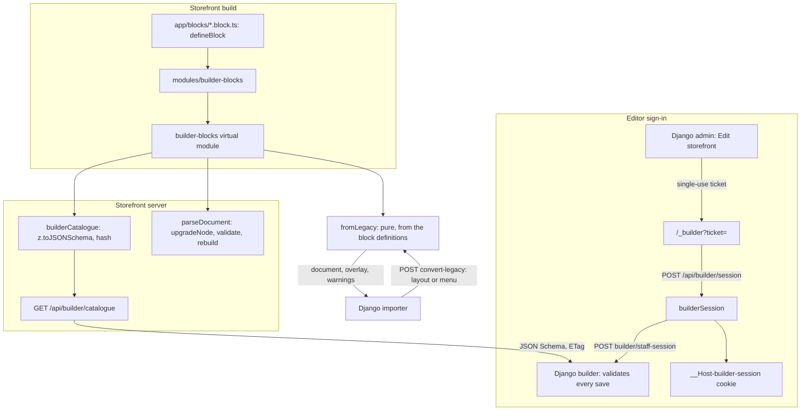

# Page builder foundation

The page builder lets a store compose its pages from typed sections and
blocks. The design is split by who knows what: the **storefront owns every
block** (its settings schema, which settings are translatable or references,
its limits and children, how an older version is upgraded) and publishes them
as a catalogue; **Django stores documents and validates every save against
that catalogue**, adding only the checks it alone can make. This page covers
what exists in the storefront: the catalogue, the port of `page_config`'s
sections and navigation menus to blocks, the converter Django's importer calls,
and the staff session. The Django side (documents, versions, releases) is in
[Page builder data](/dev/flows/page-builder-data). The editor and the rendering
switch come after it.

It follows the pattern of [Store-editable texts](/dev/flows/store-texts): a
build-time collection, a public tenant-free endpoint whose content hash is its
ETag, and a Django side that keeps its own copy and refuses to save without
one.

## Diagram



## How it works

### 1. One declaration per block

A section or block is a default-exported `defineBlock({...})` in
`app/blocks/<type>.block.ts` (`shared/builder/defineBlock.ts`). It carries:

- `type` (lower snake case), `version` (an integer, bumped by a breaking
  change) and `kinds`: where it may sit, as a `section` of a page or a `block`
  inside another node.
- `schema`: a Zod object, the settings.
- `translatable` and `refs`: JSON pointers into the settings. A translatable
  setting may be written per language; a ref names another record
  (`product`, `category`, `blogCategory`, `page`, `contentPage`, `media` or
  `menu`) that Django checks exists. A pointer may name a whole string-array or
  object setting (`/bullets`, `/prompt`): the overlay value then replaces it
  whole, and is validated against that sub-schema. There are no wildcards.
- `limits` (`maxBlocks`, `maxPerTemplate`), `children` (`allowed` types,
  `maxDepth`), `groups`, `templates`, `feature` (a store feature that must be
  on), `deprecated`, `presets` and `childList`: the list prop of the section
  component each allowed child feeds (`sectionProps`, below).
- `upgrade`: `upgrade[n]` turns a version `n` node into one for version `n + 1`.

A definition holds **data only, never a component**: the server reads every
definition and must not bundle rendering code. The renderer maps `type` to its
component on the client. `defineBlock` refuses a malformed declaration when it
loads (a bad type, a gap in the upgrade chain, a pointer that names no
setting), so it stops the build or the first test rather than reaching a store.

`modules/builder-blocks/` collects the files into the Nitro virtual module
`#builder-blocks`, server bundle only. A new file needs a server restart in
dev.

### 2. The catalogue

`server/utils/builderCatalogue.ts: buildBlockCatalogue` turns the definitions
into the catalogue when the server loads: each schema through
`z.toJSONSchema` with `target: 'draft-2020-12'` and `io: 'input'`, every object
closed (`additionalProperties: false`), blocks sorted by type, and a hash of
the content. It refuses a set that contradicts itself: two blocks of one type,
or an allowed child that is missing or cannot be a `block`.

`io: 'input'` is deliberate: Django validates what the editor saves, in which a
field with a default may be absent; the output type would require it. The
input conversion leaves objects open, so every object is closed explicitly. A
setting JSON Schema cannot state (a `Date`, a transform) fails the load instead
of publishing a gap.

`GET /api/builder/catalogue?schema=<schema>`
(`server/api/builder/catalogue.get.ts`) answers

```json
{ "hash": "…",
  "blocks": [{
    "type": "…", "version": 1, "accepts": [1], "schema": {},
    "translatable": ["/title"], "refs": {"/productId": "product"},
    "limits": {}, "children": {"allowed": []}, "kinds": ["section"]
  }],
  "documentKinds": { "page": { "schema": {}, "translatable": ["/seoTitle"] }, "template": { "...": "..." } },
  "templates": ["about", "blog", "…"] }
```

with `groups`, `templates`, `feature` and `deprecated` of a block only when set, and
`ETag: "<hash>"`. Like the texts catalogue it is public, tenant-free (listed in
`server/utils/tenantBypass.ts`), has no Nitro cache, and answers 304 to a
matching `If-None-Match`; the body is a constant of the server bundle, so it is
immutable per build. `?schema=` names the store's design and is validated, but
every design offers every block today. With no block defined it is
`{ "hash", "blocks": [] }`, which Django answers by refusing every save: there
is no fallback.

`documentKinds` says what a kind of document carries at its root: a page's and a
template's SEO copy (`seoTitle` 70, `seoDescription` 300, `seoKeywords` 255, all
translatable, the model's limits; `shared/builder/documentRoots.ts`). The theme
and a group carry none, and Django refuses a `settings` key on them. The overlay
names the root settings by the reserved node id `@document`. `templates` lists
the page types the storefront's static routes render (`STATIC_LAYOUT_ROUTES`,
sorted): a layout of one is the document `template:<pageType>`, any other the
custom page `page:<pageType>`; a block's `templates` restriction names these. Both
are part of the hash.

`accepts` is the current version alone. Django holds one schema per type, so it
cannot validate an older version; an older node is upgraded on read and by the
editor on load, and is always saved at the current version.

### 3. Documents: upgrade, parse

A document is `{ settings?, sections: { id: node }, order: [id] }`; a node is
`{ type: "name@version", disabled?, settings, blocks?, blockOrder? }`, ids are
`[A-Za-z0-9_-]{1,64}`, and nesting is capped at three levels
(`shared/constants/builder.ts`).

`shared/builder/upgrade.ts: upgradeNode` applies `upgrade[n]` from the node's
version up to the current one. It is pure (each step gets a copy), usable by
the server and the editor, and throws a `BlockUpgradeError` with a code for a
node it cannot bring up: a malformed or foreign type, a version newer than the
build, or a version no step reaches.

`server/utils/builderDocument.ts: parseDocument(raw, kind)` is the single producer
of document data for rendering. It also reads the root `settings` of a page or
a template against `documentKinds` (invalid ones are left out with a warning).
For each node it upgrades, checks the block's kind
and allowed children and the depth, validates the settings with the block's
schema, and rebuilds the node from the parse, so a key the schema does not know
never reaches a component. Only what `order` and each `blockOrder` name is
kept, in that order. A node it cannot use is left out with a
`log.warn({ tag: 'builder', message: 'node skipped', node, reason })`, its
children with it; a document that is not one renders as empty. It never throws
for one bad node. Zod stays on the server, out of the client bundle.

### 4. The port of `page_config`

Every section type that has a component is a block at version 1, in
`app/blocks/<type>.block.ts`: 36 sections and 12 child blocks. Settings are the
camelCase Zod of `page_config/section_schemas.py` (the shared shapes are in
`shared/builder/fields.ts: builderField`); `title` is a translatable setting only
where the component reads it; every array of objects is a list of child blocks
(`stat`, `hero_slide`, `testimonial`, `faq_item`, `feature_item`, `gallery_image`,
`timeline_entry`, `trust_badge`, `partner`, `bullet`, and a media band's
`spec_card` holding `spec_row`); an array of plain strings stays a setting. Image
URLs stay bare strings at version 1.

The section components are unchanged. `server/utils/builderProps.ts:
sectionProps(node)` turns a parsed node back into the props the component gets
today: its settings, plus each list of child blocks (a disabled one left out)
under the prop `childList` names. Equal props to one component is an equal render,
and the same function feeds the page-heading rules (`HEADING_SECTION_TYPES`,
`heroCarouselHeading`) once pages come from the builder.

Not ported: the eight types of the retired delta_sigma design (`page_hero`,
`feature_lists`, `option_selector`, `comparison_table`, `flow_steps`,
`reference_cards`, `project_register`, `vendor_cards`; no component since that
design was removed, no stored row anywhere), and the response time and subject
list `contact_panel`'s schema also carried (no component reads them).

### 5. The legacy converter

Django's importer turns a stored `page_config` layout or navigation menu into a
document through the storefront; the rules live here once and Django keeps no
copy. `POST /api/builder/convert-legacy`
(`server/api/builder/convert-legacy.post.ts`, `shared/builder/fromLegacy.ts`,
`fromLegacyMenu.ts`) is pure and needs no code per block: it reads the block
definitions (`childList`, the settings, `translatable`).

Request, for a layout: `{ schema?, kind: "template"|"page", key, defaultLocale,
legacy: { seo, sections: [{ id: <PageSection.uuid>, type, title, isVisible, props
(stored, snake_case), i18n }] } }`. Answer: `{ document: { settings?, sections,
order }, i18n: { locale: { nodeId | "@document": { pointer: value } } }, warnings }`,
or 422 `{ code: "unconvertible", errors: [{ path, code, message }] }` for the whole
layout (an unknown block type, or settings that fail the block's own schema; every
reason is listed, nothing is converted in part). 400 for a malformed request.

- A list of objects a block feeds from `childList` becomes child blocks with ids
  `<parentId>-<n>` (from 1, in `childList` declaration order, at every depth); a
  prop with a setting becomes that setting; anything else is dropped with a warning.
- `isVisible: false` is `disabled: true`.
- A section's translations become the overlay: `title` and translatable settings
  by node id, a translated list of objects per child by position. The default
  language's SEO is the document `settings`, the other languages' the `@document`
  overlay.
- Warnings, with stable codes: `dropped_setting` (a prop with no setting),
  `dropped_title` (a title on a block that reads none), `dropped_override` (a
  translation of a non-translatable key), `list_length_mismatch` (a translated
  list of another length, matched by position), `invalid_list`.
- A menu is `kind: "group"` with `legacy: { id?, slot, columns? | links? }`: see
  the next section.

Internal: server to server with `X-Cache-Purge-Token` (the secret the purge route
uses, `requireInternalToken`), tenant-free, never cached.

The proof is a set of request/response fixtures, `test/fixtures/builder/legacy/*.json`
(the nodes written by hand, not by the converter). `builderPortFixtures.spec.ts`
replays each through the converter and proves that the props the legacy section
gives its component, parsed as the page-config route parses them, equal what the
converted node gives back through `sectionProps`. Django's importer replays the
same files.

### 6. Navigation menus

A menu is a group document of one section: `header_menu`, `mobile_menu` or
`footer_menu` (each restricted to its group), whose children are `nav_link`
blocks; the footer's are `footer_column` blocks holding the links, three levels
deep. A link names exactly one target, never a typed path: `page` (a page type),
`contentPage` (a slug), `route` (one of `NAVIGATION_ROUTES`: `/`, `/products`,
`/blog`, `/contact`, `/offers`, `/gift-cards`, `/loyalty-program`, `/feedback`) or
`href` (https). The catalogue states it as a `oneOf`, so Django refuses a link with
none or two; `page` and `contentPage` are references Django checks. A link's label
is the effective one per language, strict.

`server/utils/builderNavigation.ts: navigationItems` turns a parsed group document
into the `NavLink` / `NavColumn` shapes the chrome reads (`useNavigation`,
`shared/types/navigation.ts`). **A link whose page or content page is not
published is hidden, and a footer column left with no visible link goes with it**;
the document keeps them, as the read-time omission always did. A content page
resolves through the legal routes (`LEGAL_ROUTE_BY_SLUG`) rather than to
`/info/<slug>`, which would redirect; a page type a static route renders links to
that route (`home` to `/`). The caller supplies the sets of published page types
and content page slugs from the release.

### 7. The editor's staff session

The editor runs on the store's own host, at `/_builder`. A staff member opens
it from Django's admin, which mints a **single-use ticket**.

1. The browser lands on `/_builder?ticket=…`
   (`app/pages/_builder.vue`, `app/composables/useBuilderSession.ts`). The page
   takes the ticket off the address first, so it does not outlive its one use in
   the history, a reload or a `Referer`.
2. It posts it to `POST /api/builder/session`
   (`server/api/builder/session.post.ts`), which exchanges it with Django
   server to server: `POST {apiBaseUrl}/builder/staff-session` `{ ticket }` →
   `{ token, expiresAt, staff: { id, name, role } }`, or 400
   `{ code: "invalid_ticket" }`, returned as it is.
3. `server/utils/builderSession.ts` seals the answer in its **own cookie**,
   `__Host-builder-session`: HttpOnly, Secure, SameSite=Strict, `Path=/`, no
   Domain (the `__Host-` prefix makes a browser enforce that), with a
   `Max-Age` of the time left to `expiresAt`. It is separate from the customer
   session. The browser is told `{ staff, expiresAt }`, never the token.
4. `GET /api/builder/session` says who is signed in (a reload, a second tab) or
   401. `DELETE` revokes the token at Django (`DELETE {apiBaseUrl}/builder/staff-session`
   with the token as `StaffBearer`; a 401 or 404 means it is already revoked) and
   expires the cookie. If Django cannot be asked, the cookie is still expired
   and the request then fails with 502, so the token may live on until
   `expiresAt`. A request without a session has nothing to revoke.
5. Every future `/api/builder/**` route calls `requireBuilderStaff(event)`: 401
   without a live session, else the staff member and an
   `Authorization: StaffBearer <token>` header for the Django call.
   (`StaffBearer`, not `Bearer`: Knox owns that keyword for customer tokens.)

The shell page is a placeholder (a Nuxt UI dashboard frame, the staff name and
a sign-out button); the editor replaces it.

## Invariants

- A definition holds data, never a component; the server bundle carries no
  rendering code for blocks.
- The catalogue is a constant of the build: one answer for every store, its
  hash the ETag. Django never saves without a catalogue.
- Every object schema in the catalogue is closed.
- A section renders from `sectionProps(node)` exactly the props `page_config` gave
  it; the port's fixtures prove it for every ported type.
- The converter is pure and the only copy of the import rules: the same request
  gives the same bytes, and everything it answers already passes the catalogue.
- `parseDocument` rebuilds nodes from the parse; unknown keys never reach a
  component, and one bad node never takes a page down.
- **Only `server/api/builder/**` and `builderSession.ts` may read the staff
  cookie, and no builder route is cached.** The storefront's SSR and handler
  caches hold anonymous renders, replayed to every visitor; a cached route that
  read the cookie would serve one staff member's view to the next visitor
  (`test/unit/source-rules/builder-session-is-private.spec.ts`).
- `/_builder` is in no route rule: `isCachedSsrRoute` is false for it, so it
  gets a per-request nonce CSP and `private, no-store`, and `robots: false`
  keeps it out of indexes and the sitemap.
- Reading the staff session never mints a cookie, and a cookie that holds no
  live session is expired on the spot.

## Failure modes

| Symptom | Cause |
|---|---|
| A save is refused for an unknown type | The catalogue is empty or the block's file is missing: production serves an empty catalogue until blocks are defined |
| The build or first test fails with `defineBlock(<type>): …` | A malformed declaration (type, version, upgrade chain or a pointer) |
| The server fails to load with "is defined twice" or "allows … inside it" | Two blocks of one type, or an allowed child that is missing or not a `block` |
| A page renders without a section and logs `node skipped` | An unknown or newer type, settings that fail the schema, a misplaced block or an upgrade that cannot run |
| The importer gets 422 `unconvertible` for a layout | A section of a type with no block (the retired delta_sigma types, a misspelt type), or props that fail the block's schema: the errors name the section |
| The importer reports `dropped_setting`, `dropped_title` or `dropped_override` | A stored prop, title or translation had nowhere to go in the block (no component read it, or it is not translatable); nothing renders differently |
| A menu link or footer column is missing from the chrome | Its page or content page is not published in the current release: hidden at render, kept in the document |
| `/_builder` shows "You are not signed in" | No staff cookie: the editor was opened without a ticket, the session ended, or the cookie expired |
| `/_builder` shows the link is no longer valid | Django answered `invalid_ticket`: the ticket expired, was already used, or was minted for another store |

## Source

| File | What |
|---|---|
| `grooveshop-storefront-ui-node-nuxt/shared/builder/defineBlock.ts` | `defineBlock` and its load-time checks |
| `grooveshop-storefront-ui-node-nuxt/shared/builder/upgrade.ts` | `upgradeNode`, `parseVersionedType`, `BlockUpgradeError` |
| `grooveshop-storefront-ui-node-nuxt/shared/types/builder.ts` | Definition, document and catalogue types |
| `grooveshop-storefront-ui-node-nuxt/shared/constants/builder.ts` | Kinds, reference kinds, document kinds, `NAVIGATION_ROUTES`, the depth cap, id and type patterns |
| `grooveshop-storefront-ui-node-nuxt/shared/builder/fields.ts` | `builderField`: the setting shapes the blocks share |
| `grooveshop-storefront-ui-node-nuxt/shared/builder/documentRoots.ts` | What a page and a template carry at their root (SEO copy) |
| `grooveshop-storefront-ui-node-nuxt/app/blocks/` | The blocks: one `<type>.block.ts` per section or child block |
| `grooveshop-storefront-ui-node-nuxt/server/utils/builderProps.ts` | `sectionProps`: a parsed node as the props of the unchanged component |
| `grooveshop-storefront-ui-node-nuxt/shared/builder/fromLegacy.ts` | `convertLegacyLayout`: a legacy layout as a document and overlay |
| `grooveshop-storefront-ui-node-nuxt/shared/builder/fromLegacyMenu.ts` | `convertLegacyMenu`: a legacy menu as a group document |
| `grooveshop-storefront-ui-node-nuxt/server/api/builder/convert-legacy.post.ts` | `POST /api/builder/convert-legacy` |
| `grooveshop-storefront-ui-node-nuxt/server/utils/internalAuth.ts` | `requireInternalToken`: the shared secret check |
| `grooveshop-storefront-ui-node-nuxt/server/utils/builderNavigation.ts` | `navigationItems`: the menus the chrome reads, hidden links dropped |
| `grooveshop-storefront-ui-node-nuxt/shared/types/navigation.ts` | `NavLink`, `NavColumn` |
| `grooveshop-storefront-ui-node-nuxt/test/fixtures/builder/legacy/` | Request/response fixtures of the converter, replayed by Django too |
| `grooveshop-storefront-ui-node-nuxt/test/unit/server/utils/builderPortFixtures.spec.ts` | The port proof: equal props to every component |
| `grooveshop-storefront-ui-node-nuxt/shared/builder-blocks.d.ts` | The `#builder-blocks` virtual module type |
| `grooveshop-storefront-ui-node-nuxt/modules/builder-blocks/index.ts` | Collects `app/blocks/**/*.block.ts` into the virtual module |
| `grooveshop-storefront-ui-node-nuxt/server/utils/builderCatalogue.ts` | `buildBlockCatalogue`, the served document |
| `grooveshop-storefront-ui-node-nuxt/server/utils/builderDocument.ts` | `parseDocument` |
| `grooveshop-storefront-ui-node-nuxt/server/api/builder/catalogue.get.ts` | `GET /api/builder/catalogue` |
| `grooveshop-storefront-ui-node-nuxt/server/utils/tenantBypass.ts` | The catalogue is tenant-free |
| `grooveshop-storefront-ui-node-nuxt/server/utils/builderSession.ts` | The staff cookie, `requireBuilderStaff` |
| `grooveshop-storefront-ui-node-nuxt/server/api/builder/session.post.ts` | Ticket exchange and sign-in |
| `grooveshop-storefront-ui-node-nuxt/server/api/builder/session.get.ts` | Who is signed in |
| `grooveshop-storefront-ui-node-nuxt/server/api/builder/session.delete.ts` | Sign-out |
| `grooveshop-storefront-ui-node-nuxt/shared/constants/builderSession.ts` | The cookie name |
| `grooveshop-storefront-ui-node-nuxt/shared/schemas/builderSession.ts` | Ticket body, Django's answer, the cookie's content |
| `grooveshop-storefront-ui-node-nuxt/app/pages/_builder.vue` | The staff shell page |
| `grooveshop-storefront-ui-node-nuxt/app/components/Builder/Shell.vue` | The placeholder dashboard frame |
| `grooveshop-storefront-ui-node-nuxt/app/composables/useBuilderSession.ts` | Ticket sign-in, session lookup, sign-out |
| `grooveshop-storefront-ui-node-nuxt/test/unit/source-rules/builder-session-is-private.spec.ts` | Source rule: only the builder routes read the staff cookie |
