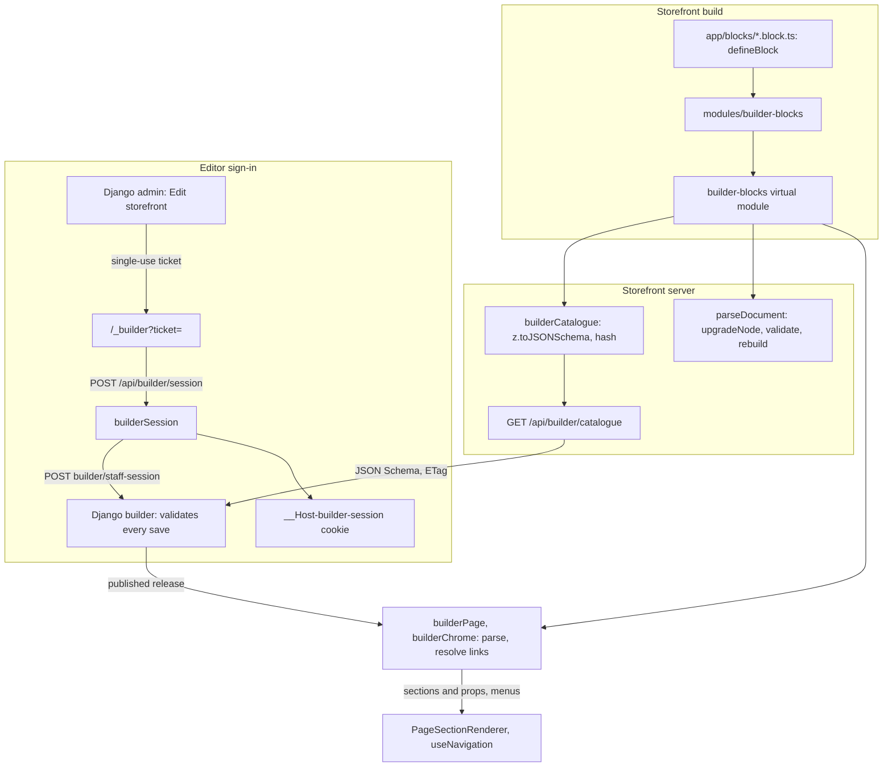

# Page builder foundation

The page builder lets a store compose its pages from typed sections and
blocks. The design is split by who knows what: the **storefront owns every
block** (its settings schema, which settings are translatable or references,
its limits and children, how an older version is upgraded) and publishes them
as a catalogue; **Django stores documents and validates every save against
that catalogue**, adding only the checks it alone can make. This page covers
what exists in the storefront: the catalogue, the links of a block, the blocks
and the navigation menus, how pages and menus are rendered from the builder, and
the staff session. The Django side (documents, versions, releases) is in
[Page builder data](/dev/flows/page-builder-data). The editor is in
[Page builder editor](/dev/flows/page-builder-editor).

It follows the pattern of [Store-editable texts](/dev/flows/store-texts): a
build-time collection, a public tenant-free endpoint whose content hash is its
ETag, and a Django side that keeps its own copy and refuses to save without
one.

## Diagram



## How it works

### 1. One declaration per block

A section or block is a default-exported `defineBlock({...})` in
`app/blocks/<type>.block.ts` (`shared/builder/defineBlock.ts`). It carries:

- `type` (lower snake case), `version` (an integer, bumped by a breaking
  change) and `kinds`: where it may sit, as a `section` of a page or a `block`
  inside another node.
- `schema`: a Zod object, the settings.
- `translatable` and `refs`: JSON pointers into the settings. A translatable
  setting may be written per language; a ref names another record
  (`product`, `category`, `blogCategory`, `blogPost`, `page`, `contentPage` or
  `media`) that Django checks exists. A pointer may name a whole
  string-array setting (`/bullets`) or a leaf inside an object (`/prompt/title`):
  the overlay value then replaces it, and is validated against that sub-schema.
  These two have no wildcards.
- `linkRefs`: not declared. `defineBlock` derives it from the schema: the
  pointers of every setting made with `builderField.link()` (`/ctaLink`,
  `/prompt/ctaLink`, `/slides/*/to`, where `*` stands for every list entry). See
  section 5 below.
- `limits` (`maxBlocks`, `maxPerTemplate`), `children` (`allowed` types,
  `maxDepth`), `groups`, `templates`, `feature` (a store feature that must be
  on), `deprecated`, `presets` and `childList`: the list prop of the section
  component each allowed child feeds (`sectionProps`, below).
- `upgrade`: `upgrade[n]` turns a version `n` node into one for version `n + 1`.

A definition holds **data only, never a component**: the server reads every
definition and must not bundle rendering code. The renderer maps `type` to its
component on the client. `defineBlock` refuses a malformed declaration when it
loads (a bad type, a gap in the upgrade chain, a pointer that names no
setting), so it stops the build or the first test rather than reaching a store.

`modules/builder-blocks/` collects the files into the Nitro virtual module
`#builder-blocks`, server bundle only. A new file needs a server restart in
dev.

### 2. The catalogue

`server/utils/builderCatalogue.ts: buildBlockCatalogue` turns the definitions
into the catalogue when the server loads: each schema through
`z.toJSONSchema` with `target: 'draft-2020-12'` and `io: 'input'`, every object
closed (`additionalProperties: false`), blocks sorted by type, and a hash of
the content. It refuses a set that contradicts itself: two blocks of one type,
or an allowed child that is missing or cannot be a `block`.

`io: 'input'` is deliberate: Django validates what the editor saves, in which a
field with a default may be absent; the output type would require it. The
input conversion leaves objects open, so every object is closed explicitly. A
setting JSON Schema cannot state (a `Date`, a transform) fails the load instead
of publishing a gap.

`GET /api/builder/catalogue?schema=<schema>`
(`server/api/builder/catalogue.get.ts`) answers

```json
{ "hash": "…",
  "blocks": [{
    "type": "…", "version": 1, "accepts": [1], "schema": {},
    "translatable": ["/title"], "refs": {"/productId": "product"}, "linkRefs": ["/ctaLink"],
    "limits": {}, "children": {"allowed": []}, "kinds": ["section"]
  }],
  "documentKinds": { "page": { "schema": {}, "translatable": ["/seoTitle"], "linkRefs": [] }, "template": { "...": "..." } },
  "templates": ["about", "blog", "…"] }
```

with `groups`, `templates`, `feature` and `deprecated` of a block only when set, and
`ETag: "<hash>"`. Every block and every root states `linkRefs` (`[]` for none):
Django refuses a catalogue that leaves the key out, since it would index no link. Like the texts catalogue it is public, tenant-free (listed in
`server/utils/tenantBypass.ts`), has no Nitro cache, and answers 304 to a
matching `If-None-Match`; the body is a constant of the server bundle, so it is
immutable per build. `?schema=` names the store's design and is validated, but
every design offers every block today. With no block defined it is
`{ "hash", "blocks": [] }`, which Django answers by refusing every save: there
is no fallback.

`documentKinds` says what a kind of document carries at its root: a page's and a
template's SEO copy (`seoTitle` 70, `seoDescription` 300, `seoKeywords` 255, all
translatable, the model's limits; `shared/builder/documentRoots.ts`). The theme
and a group carry none, and Django refuses a `settings` key on them. The overlay
names the root settings by the reserved node id `@document`. `templates` lists
the page types the storefront's static routes render (`STATIC_LAYOUT_ROUTES`,
sorted): a layout of one is the document `template:<pageType>`, any other the
custom page `page:<pageType>`; a block's `templates` restriction names these. Both
are part of the hash.

`accepts` is the current version alone. Django holds one schema per type, so it
cannot validate an older version; an older node is upgraded on read and by the
editor on load, and is always saved at the current version.

### 3. Documents: upgrade, parse

A document is `{ settings?, sections: { id: node }, order: [id] }`; a node is
`{ type: "name@version", disabled?, settings, blocks?, blockOrder? }`, ids are
`[A-Za-z0-9_-]{1,64}`, and nesting is capped at three levels
(`shared/constants/builder.ts`).

`shared/builder/upgrade.ts: upgradeNode` applies `upgrade[n]` from the node's
version up to the current one. It is pure (each step gets a copy), usable by
the server and the editor, and throws a `BlockUpgradeError` with a code for a
node it cannot bring up: a malformed or foreign type, a version newer than the
build, or a version no step reaches.

`server/utils/builderDocument.ts: parseDocument(raw, kind)` is the single producer
of document data for rendering. It also reads the root `settings` of a page or
a template against `documentKinds` (invalid ones are left out with a warning).
For each node it upgrades, checks the block's kind
and allowed children and the depth, validates the settings with the block's
schema, and rebuilds the node from the parse, so a key the schema does not know
never reaches a component. Only what `order` and each `blockOrder` name is
kept, in that order. A node it cannot use is left out with a
`log.warn({ tag: 'builder', message: 'node skipped', node, reason })`, its
children with it; a document that is not one renders as empty. It never throws
for one bad node. Zod stays on the server, out of the client bundle.

### 4. Blocks and the section components

Every section type is a block in `app/blocks/<type>.block.ts`, with the child
blocks its lists need (`stat`, `hero_slide`, `testimonial`, `faq_item`,
`feature_item`, `gallery_image`, `timeline_entry`, `trust_badge`, `partner`,
`bullet`, and a media band's `spec_card` holding `spec_row`); an array of plain
strings stays a setting. Settings are camelCase, the shared shapes in
`shared/builder/fields.ts: builderField`; `title` is a translatable setting only
where the component reads it. Image URLs are bare strings at version 1.

Section components never read blocks. `shared/builder/props.ts:
sectionProps(node)` turns a parsed node into the component's props: its
settings, plus each list of child blocks (a disabled one left out) under the
prop `childList` names. The same function feeds the page-heading rules
(`HEADING_SECTION_TYPES`, `HEADING_FROM_PROPS`, `heroCarouselHeading`).

Two sections read the store's own data instead of settings. `hero_showcase`
(`app/blocks/hero_showcase.block.ts`, `app/components/PageSection/HeroShowcase.vue`)
is a heading in two lines (`heading`, `headingAccent`, both in the page's one h1:
`hero_showcase` is in `HEADING_SECTION_TYPES` and `sectionsHeadingText` joins the
two; it is also in `HEADING_FROM_PROPS`, like `hero_banner`, so it owns the page's
h1 only when its props give a heading: `ownsHeading` in `shared/pageSections.ts`
asks `propsHeading`, and a hero with neither line leaves the page its own h1, as
`contact_panel`, which always draws one, does not), a sub-line, a `media` picture with a `mobileImage`, an explicit
`imageDecorative`, an `imageLink`, the store search (`showSearch`), two buttons
and one `product` ref drawn by `Product/Spotlight.vue` (`showAddToCart`). The
component lays one list of parts out in the order a phone reads them and places
them in two columns by CSS grid on a desk. It draws nothing for a part it cannot
have: no search or product with the `catalogue` feature off, no buy button with
`cart` off, no picture for a missing media ref, no product for a `product` ref
that did not resolve to a record (a sold-out product stays and offers the
restock alert in place of the buy button), and a button needs both its text and
its link (a link `resolveLinks` removed leaves no button). The picture is a link
only when something names it (its description, else the heading). Every link
it draws goes through `useLinkTo()` (`app/composables/useLinkTo.ts`), the one
rule for a section's, band's or banner's link: an absolute URL (`hasProtocol`)
as it is, which `NuxtLink` draws as an external link with
`rel="noopener noreferrer"`; a store path through `localePath(pathLocation(..))`,
query and hash kept. `localePath` given an external URL as a location made a
partner's offer a route of the store. On a phone the layout is one
`grid-cols-[minmax(0,1fr)]` track (the implicit `auto` track grew to the
widest part's min-content and pushed the page sideways); the two buttons are
equal columns at Nuxt UI's `md` text size with `xs` padding, so a label of about
16 Greek letters keeps one line, and a longer one wraps inside its button (the
label is our own span, since Nuxt UI's truncates). `Product/Spotlight.vue`
becomes a grid below `sm` (`max-sm:contents` on its text column and price
row) so the way to buy takes a row of its own across the card: beside the
price a design's button (138 to 166px) was cut off at 320px.
`store_assurances` (`app/blocks/store_assurances.block.ts`,
`app/components/PageSection/StoreAssurances.vue`, `useStoreAssurances`) states
four rows (delivery with the dispatch cutoff under it, free shipping with each
carrier's price below the threshold, returns, ways to pay) from
`useStoreAssuranceFacts`, the one reader of those facts, which the product page's
assurances (`useProductAssurances`) read too. Every fact is `null` when the store
has not said it (no rate with delivery days, no threshold, `returnWindowDays` of
0, no active pay way), its row is left out, and the section draws nothing when
no row is left. The block declares `feature: 'cart'`, so a store without the
cart does not get it, and the facts make no request for such a store.
`blog_categories` is at version 2: a `layout` (`slider` or `tiles`),
`subheading`, `ctaText` and `ctaLink` beside its `title`; `upgradeBlogCategories`
carries a version 1 node over. The `tiles` layout is the platform's
`PageSection/BlogCategoryTiles.vue` in every design.

`test/unit/server/utils/builderRealBlocks.spec.ts` holds every real block to
the rules that do not depend on the block: a consistent catalogue, no link that
is translatable, rich text marked, every schema closed.

### 5. Links

A link setting never holds a typed internal path. `builderField.link()`
(`shared/builder/fields.ts`) is exactly one of three closed shapes:

| Shape | Means |
|---|---|
| `{ "href": "https://…" }` | An external URL (https only). |
| `{ "route": "/offers" }` | A fixed route that points at no record: one of `LINK_ROUTES` (the navigation routes and the two account entrances, `/account/login` and `/account/signup`). |
| `{ "ref": { "kind": K, "id": ID } }` | A record. `K` is `product`, `category`, `blogCategory` or `blogPost` with an integer id, `page` with a page type, or `contentPage` with a slug. |

Why: a record renamed after a page was written would leave a stale address in
every page that linked it (a redirect at best, a 404 for a content page slug).
A link by record is resolved to its address when the page is read, so it
follows the rename.

- **`linkRefs`.** The setting carries one JSON Schema keyword (`x-builder-link`),
  and `defineBlock` lists every marked setting of a block as its `linkRefs`
  (`shared/builder/linkPointers.ts`). Django collects the `ref` values at those
  pointers, so a release is refused for a link to something that does not exist,
  and "where is this used" knows them. A block cannot gain a link Django does not
  check.
- **A link is never translatable.** No `linkRefs` pointer is, or sits under, a
  `translatable` pointer, on a block or a document root
  (`builderRealBlocks.spec.ts` pins it, and Django refuses such a catalogue). That is why
  `features_grid` translates the text of its prompt (`/prompt/title`, `/prompt/text`,
  `/prompt/ctaText`) and not the object that also holds its link.
- **Resolving a link.** See the rendering section: `resolveLinks` turns each link
  into the path it has now, and section components still receive a string.
- **A link to a switched-off feature is taken out too.** `resolveLinks`
  computes the store path a link stands for (`storePath`: a `route`, or the
  address of a page, content page or record) and asks
  `isFeaturePathBlocked(path, targets.blocked)` (`shared/utils/gatedRoutes.ts`)
  of every one, a published page too (it can be `/blog` itself). An `href` is
  someone else's page and no feature of the store gates it. `targets.blocked`
  is `blockedFeaturePaths(tenant)` (`readLinkTargets`), the paths
  `FEATURE_GATED_ROUTES` says the store does not serve. A blocked `/blog`
  also blocks `/blog/<anything>`, matched on a segment boundary and with the
  locale prefix removed. The link is removed like a link to a record that is gone, so
  the component draws no call to action. `FEATURE_GATED_ROUTES` is the same
  table the menus and the sitemap read.

### 6. Navigation menus

A menu is a group document of one section: `header_menu`, `mobile_menu` or
`footer_menu` (each restricted to its group), whose children are `nav_link`
blocks; the footer's are `footer_column` blocks holding the links, three levels
deep. A link names exactly one target, never a typed path: `page` (a page type),
`contentPage` (a slug), `route` (one of `NAVIGATION_ROUTES`: `/`, `/products`,
`/blog`, `/contact`, `/offers`, `/gift-cards`, `/loyalty-program`, `/feedback`) or
`href` (https). The catalogue states it as a `oneOf`, so Django refuses a link with
none or two; `page` and `contentPage` are references Django checks. A link's label
is the effective one per language, strict.

`shared/builder/navigation.ts: navigationItems` turns a parsed group document
into the `NavLink` / `NavColumn` shapes the chrome reads (`useNavigation`,
`shared/types/navigation.ts`). **A link whose page or content page is not
published is hidden, and a footer column left with no visible link goes with it**;
the document keeps them, as the read-time omission always did. A content page
resolves through the legal routes (`LEGAL_ROUTE_BY_SLUG`) rather than to
`/info/<slug>`, which would redirect; a page type a static route renders links to
that route (`home` to `/`). The caller supplies the sets of published page types
and content page slugs from the release.

The header menu's links to `/products` and `/blog` open dropdown panels of live
categories, in both designs, and the phone menu has sections for them. That is not
part of the document: `app/utils/menuDropdown.ts` maps a link's path to its
dropdown (`menuDropdownFor`, locale prefix removed), so an operator's own row
for the listing keeps its panel under the operator's label. The panels read
`useCategoryMenu` and `useBlogCategoryMenu`, each its own request cut down by
`transform` to what the menus draw (`categoryMenu`, `blogCategoryMenu`: at most
eight roots, and for the shop at most eight children each; at most eight blog
topics), and each gated on its store feature, so a store without the feature
asks for nothing.

- **Two entries per section.** `withDropdownToggles` draws a section with
  `children` as two entries: the link (`data-menu-section`) and an adjacent
  button that carries the panel (`data-menu-section`, `data-menu-toggle`;
  WAI-ARIA's disclosure navigation). One entry could not be both: Nuxt UI draws
  an entry with a panel and a `to` as Reka's trigger on an `<a>`, which Enter
  followed instead of opening. A section with no `children` (none, the feature
  off, the read failed) is one plain link with its `slot` dropped, so no arrow
  opens an empty panel. A closed section's button states no `aria-controls`
  (Reka assigns the id in `onMounted`, so the server HTML carried an empty
  IDREF); an open one keeps Reka's.
- **Who opens and closes a panel.** `useMenuPanels` (`app/composables/useMenuPanels.ts`)
  keeps the menu's one `v-model` and is driven by pointer and click handlers on
  an element AROUND the lazily hydrated menu (`onPointermove`, `onPointerleave`,
  `onPointerdown`, `onPointerup`, `onClickCapture`; `onEscapeKeyDown` is the
  menu's `content` handler). The wrapper hydrates with the page and the menu
  does not (`hydrate-on-interaction` with `pointermove`, `pointerdown` and
  `focusin`, held by `test/unit/source-rules/navigation-menu-hydration.spec.ts`:
  Reka opens on `pointermove`, never `pointerenter`), so with Reka owning the click
  the first tap after a load only hydrated the menu and opened nothing. The
  wrapper therefore owns hover, tap and click: a touch toggles on its `pointerup`
  and its own click is swallowed; a click is stopped before Reka's trigger toggles
  it back; the mouse opens on the name or the button and closes 150 ms after it left
  both and the panel. Reka's hover is switched off (`disable-hover-trigger`,
  `disable-pointer-leave-close`) because two hover machines fought. Reka's
  trigger guards are ported with the section standing for the trigger: a click
  within 300 ms of the mouse opening the panel leaves it open
  (`hasPointerMoveOpenedRef`; only the movement that opens starts the window),
  and a panel a click or Escape closed is not reopened by the mouse until it
  left the section and came back (`wasClickCloseRef`, `wasEscapeCloseRef`). A
  key's click (`detail` 0) always acts. Escape on a panel the mouse opened closes
  it where the focus is.
- **The current section.** `currentMark(active, to, currentPath)` is the one rule
  for `aria-current` in the headers, the tab bars and the account sidebar:
  `page` when the entry leads to the page on screen (query aside), `location`
  when the page is inside its section (a product under Shop), nothing otherwise.
  `withCurrentPage(items, currentPath)` applies it to a menu.
- **Sign-in links.** `useAuthLinks().authLink(name, { hash })` returns a location
  object for an auth page carrying `next`: on an auth page the `next` it came
  with (`returnPath`: a path of this site that is not itself an auth page,
  `isAuthPagePath`), elsewhere the page (`returnTarget(route)`). The destination
  is the PATH only unless the page opts in with `definePageMeta({ signInReturn })`
  (`app/types/global.d.ts`): `'path-and-query'` for view state worth keeping
  (the product and blog listings, search and six account lists: addresses,
  favourite products and posts, notifications, orders, reviews), `'nowhere'` for
  the four one-time-token pages (unsubscribe, the alert and newsletter
  confirmations, a share preview). A query can hold a payment
  session or a token and `next` lands in an address, a history and a `Referer`,
  so the default is deny. Every writer and reader of `next` goes through these
  (the auth middleware, `app/plugins/auth.ts`, the flow forms);
  `test/unit/source-rules/auth-links-keep-next.spec.ts` holds every link to an
  auth page to the accessor.
- **The tab bar.** `useBottomNavItems({ tabs, icons, accountAvatar, includeCart,
  onAccount })` gives both designs' entries: the default's Home, Search, Saved,
  Cart and Account, or the tabs a design asks for (webside: Home, Shop, Blog,
  Cart, Account). Each tab shows while its page serves (`useGatedRoute`: Search
  and Shop `catalogue`, Saved `favourites`, Blog `blog`, Cart `cart`), the bar by
  the `mobileBottomNav` store preference. The Cart tab carries the count; the
  Account tab shows the shopper's picture when the design asks. `active` is
  decided from the route name and `currentMark` marks one tab. The default
  bar's active pill shrinks to what is left of the dock and shows its icon alone
  below a 21rem dock (`@container/dock`).

### 7. Rendering pages and menus from the builder

Pages and menus come from the store's published release.

- **A page.** `GET /api/builder/pages/<pageKey>`
  (`server/api/builder/pages/[pageKey].get.ts`, the cached handler `builderPage`)
  reads Django's `GET builder/published/<key>?locale=`, then `parseDocument`,
  `resolveLinks` and `sectionProps`, and answers `{ page: { settings?, sections: [{ id,
  componentType, props }] } | null }`. `settings` is the page's SEO copy in the
  page's language. A page the store has not built is Django's `page_not_published`:
  `{ page: null }`, cached because it is data. Any other failure, a 5xx included,
  propagates and is never cached, so a page that cannot be fetched is not taken for
  one that does not exist. `useBuilderPage(pageKey)` (`app/composables/useBuilderPage.ts`)
  is the one composable the page bodies use; its payload key carries the page and
  the language. On a client navigation the data rides the route's `_payload.json`;
  without one the client calls the route above.
- **The menus.** `GET /api/builder/navigation` (`builderChrome`) reads
  `builder/published` and the published content page slugs, and answers the menus
  as `navigationItems` shapes. `useNavigation` reads them. A menu that cannot be
  read is empty, never the built-in menu; the built-in menu stays only for a slot
  the store never configured.
- **Links.** `server/utils/builderLinks.ts: resolveLinks` turns each link setting
  into the path (or URL) it stands for: an `href` or a `route` as it is; a record
  as its current address (`shared/utils/entityPaths.ts`, the one module that
  writes these routes, also used by `useUrls` and the menus). The slugs of the
  records come from ONE `GET builder/link-targets` call (`product`, `category`,
  `blogPost`, `blogCategory` as comma-separated ids; Django answers at most 100 ids
  of a kind, so a page naming more makes one call per hundred; no call when no
  link names a record by id). A slug does not vary by language, so the call
  carries none. The published pages are read only when a link names a page or a
  content page. A link to a record that is gone, or a page or content page that is
  not published, is left out of the props, so a component draws no call to action
  rather than one that leads nowhere. A read that fails fails the page. Section
  components still receive a plain string.
- **Records.** A block's `builderField.query` and `builderField.ref` settings are
  read by `resolveBuilderData` (`server/utils/builderData/resolve.ts: readData`)
  between the parse and `resolveLinks`. A kind or list whose store feature is off
  is not asked for: `DATA_FEATURES` (`shared/constants/builder.ts`) maps each
  record kind and list source to the feature without which Django serves none of
  it (`catalogue` for products and categories, `blog` for posts and blog
  categories, `promotions` for the offers, none for media), `readData` takes the
  store's `featureOn` (`storeFeatureOf(event)`), and a record of such a kind
  resolves as gone and a list as empty. This is for the settings of a block
  that is not itself the feature (a hero's product); a block that is the feature
  is left out of the document earlier by its own `feature`. A refused read is
  never cached, so without this every render of such a page would ask again.
  The reads are `cachedRead` functions (`builderDataProduct`, `builderDataCategory`,
  `builderDataBlogPost`, `builderDataBlogCategory`, `builderDataPromotion`,
  `builderDataMedia`, `server/utils/builderData/loaders.ts`), cached
  `DATA_CACHE_SECONDS` (60) without `swr`; the links add `builderDataSlug` and
  `builderDataTargets`.
- **Cache.** Both handlers are cached 5 minutes with a stale hour, keyed on the
  store, the language and the epoch; Django's purge after a release names them
  (`src/core/cache/surfaces.py`, the `builder` surface), so renaming a handler stops a
  release reaching visitors until the TTL runs out. A rename of a record shows
  within that TTL, with no release.
- **The sitemap** lists the published pages (`publishedPagesForHost`).

### 8. The editor's staff session

The editor runs on the store's own host, at `/_builder`. A staff member opens
it from Django's admin, which mints a **single-use ticket**.

1. The browser lands on `/_builder?ticket=…`
   (`app/pages/_builder.vue`, `app/composables/useBuilderSession.ts`). The page
   takes the ticket off the address first, so it does not outlive its one use in
   the history, a reload or a `Referer`.
2. It posts it to `POST /api/builder/session`
   (`server/api/builder/session.post.ts`), which exchanges it with Django
   server to server: `POST {apiBaseUrl}/builder/staff-session` `{ ticket }` →
   `{ token, expiresAt, staff: { id, name, role } }`, or 400
   `{ code: "invalid_ticket" }`, returned as it is.
3. `server/utils/builderSession.ts` seals the answer in its **own cookie**,
   `__Host-builder-session`: HttpOnly, Secure, SameSite=Strict, `Path=/`, no
   Domain (the `__Host-` prefix makes a browser enforce that), with a
   `Max-Age` of the time left to `expiresAt`. It is separate from the customer
   session. The browser is told `{ staff, expiresAt }`, never the token.
4. `GET /api/builder/session` says who is signed in (a reload, a second tab) or
   401. `DELETE` revokes the token at Django (`DELETE {apiBaseUrl}/builder/staff-session`
   with the token as `StaffBearer`; a 401 or 404 means it is already revoked) and
   expires the cookie. If Django cannot be asked, the cookie is still expired
   and the request then fails with 502, so the token may live on until
   `expiresAt`. A request without a session has nothing to revoke.
5. Every future `/api/builder/**` route calls `requireBuilderStaff(event)`: 401
   without a live session, else the staff member and an
   `Authorization: StaffBearer <token>` header for the Django call.
   (`StaffBearer`, not `Bearer`: Knox owns that keyword for customer tokens.)

The shell page is a placeholder (a Nuxt UI dashboard frame, the staff name and
a sign-out button); the editor replaces it.

### 9. Product stock, colour schemes and design parts

**The `stock` key.** A product rule (`DATA_DESCRIPTORS.product`,
`shared/builder/dataSources.ts`) takes an optional `stock` from
`PRODUCT_STOCK_MODES` (`shared/constants/builder.ts`): `any`, `inStockFirst`,
`inStockOnly`. A descriptor without the key is `any`, so an untouched list and a
reset one are the same document: `Builder/QueryField.vue` takes the key
out for `any`. A hand-picked list has no `stock`. The key then runs
end to end:

1. The editor writes it (`QueryField.vue`, the **Stock** select, product source,
   `filter` mode only).
2. Django validates it on save (`src/builder/data_sources.py`: `PRODUCT_STOCK`,
   `_stock`; any other value is `invalid_data_value`, and a `picked` list with a
   `stock` key is refused as an unknown key). It adds no facet to the list's
   `BuilderReference` row, which is why a stock flip purges by any list (see
   [Caches and purging](/dev/operations/caches#stock-flips-and-the-page-builder)).
3. The storefront turns it into Django's query
   (`server/utils/builderData/queries.ts: productQuery`): `inStockFirst` orders by
   `-availabilityPriority,<ordering>` (the product list's `availability_priority`
   first, then the merchant's order), `inStockOnly` adds `inStock=true`.
4. A band's automatic "see all" keeps the rule when the listing has a twin of it:
   `productRailStockQuery` (`app/utils/productRail.ts`) adds `?inStock=true` for
   `inStockOnly`, and `inStockFirst` has none. `ProductsGrid.vue` and
   `ProductsSlider.vue` use it, and a link the operator set wins. A post list's
   automatic "see all" leads to the category its rule names (`useBlogCategoryNames`
   gives each category's name and path, `BlogPosts.vue: allPostsLink`) and to the
   blog otherwise; the post carousel still goes to the blog.

**A forced light or dark band.** `colorScheme` (`SECTION_COLOR_SCHEMES`: `light`,
`dark`; empty means the page's) is a setting of the product and post bands
(`builderField.productRail` and `blogRail`) and of `hero_showcase`
(`builderField.colorScheme`). `colorSchemeClass` (`app/utils/colorScheme.ts`)
puts Nuxt UI's `light` or `dark` class and `text-default` on the band: the class
switches every token inside, and the text colour is on the band because `body`
paints in the page's scheme. For the band to get the STORE's colours and not the
stylesheet's, `themeCss` (`shared/theme/compile.ts`) writes each scheme for the
forced subtree as well: `html:root, html .light { ... } html.dark, html .dark { ... }`.
The innermost class wins because each declares the scheme on its own element.
`test/helpers/themeCascade.ts` computes what an element inside a forced band
gets from the real stylesheets, and `schemes.spec.ts` pins it.

**Design parts.** A shared component can draw one piece of itself in the store's
own design. `resolvePart(key, tenantSchema)` (`app/utils/variantRegistry.ts`)
returns a `DesignPart` (`component` and a `props` function from `DesignPartInput`
to the props that component takes) for a `DesignPartKey`
(`product_add_to_cart`, `product_restock_alert`): `part:<key>@<schema>` in
`partVariants`, else `partDefaults`. `Product/Spotlight.vue` is the same in every
design and draws the buy button or the restock alert through it, because the
two designs' controls take different props and an attribute one does not declare
would fall through onto its root.

**Announcement tokens.** The bar's text may name `{freeShippingThreshold}` and
`{dispatchCutoff}` (`ANNOUNCEMENT_TOKENS`, `shared/utils/announcementBar.ts`).
`useAnnouncementBar` fills them in the render, so the server and the browser print
the same sentence: the threshold from `useFreeShippingInfo` (read only when some
wording of the bar names it) and the cutoff from the typed settings
(`parseDispatchCutoff`). `fillAnnouncementTokens` replaces a token that has a value
and leaves any other `{word}` as typed. A bar whose wording for this visitor (the
locale's text and short text) names a token with no value is `null`, so the chrome
draws nothing: neither a hole nor a raw token reaches a visitor.

**The search shortcut.** Ctrl+K / Cmd+K and "/" belong to ONE search field of a
page. `useSearchShortcut(header, open)` (`app/composables/useSearchShortcut.ts`)
registers each field in `useState`; the owner is the header's field when there
is one, else the first other, and only the owner answers the keys. A section's
field (the hero's, the search band's) therefore never opens a second palette, and
a design whose header has no search field still has the shortcut.

**The dock.** The phone's fixed bars (the tab bar, the sticky add-to-cart bar,
the cookie notice, the assistant button) stack by custom properties in
`app/assets/css/main.css`: `--dock-inset` (the safe-area inset, or the funding
strip's `--dock-edge` when larger), `--dock-base`, `--dock-tabbar`, `--dock-bar`,
`--dock-fab`, `--dock-stack` and `--dock-top`. A bar marks itself
`data-dock="tabbar" | "bar" | "fab"` and `:root:has([data-dock=...])` turns its
height on. A design that draws its bars edge to edge adds `data-dock-flush`: they
have no gap, the bottom-most stands on the screen's edge and pads the rest of the
inset inside itself, and the sticky bar stands on the tab bar (`--dock-floor`,
`--dock-floor-pad`). The default layout's footer clears the dock with
`--dock-inset + --dock-tabbar + --dock-bar` (`app/layouts/default.vue`).

**Phone product cards and targets.** Webside's product card is a named container
below `sm` (`max-sm:@container/card`) and answers to ITS width, not the screen's,
because the listing and the bands put it in two columns on a phone
(`grid-cols-2`): below `3xs` the price and the buy button stack and the button
becomes a 44px icon (its label `sr-only`), and below 8.625rem the price takes a
row and the button the full width. The listing's page numbers are links
(`pageLink`). A product that cannot be bought gets a neutral, subtle, disabled
button with the label "Unavailable" in both designs' buy buttons, and the product
page draws no quantity control for it. Every control of the product page is a
44px target on a phone: a control in the flow carries `max-sm:min-h-11` (an icon
alone also `max-sm:min-w-11`), one floating over a picture keeps its size and
takes a 44px hit area from an `::after`;
`test/unit/source-rules/product-page-targets.spec.ts` checks both designs' pages
and galleries.

## Invariants

- A definition holds data, never a component; the server bundle carries no
  rendering code for blocks.
- The catalogue is a constant of the build: one answer for every store, its
  hash the ETag. Django never saves without a catalogue.
- Every object schema in the catalogue is closed.
- A section renders from `sectionProps(node)`: components never read blocks.
- A document stores where a link goes, never a typed internal path, and no link
  is ever translatable. What a page links to is always the current address.
- A store feature that is off takes away what depends on it: a block with that
  `feature` is left out, a record of a kind in `DATA_FEATURES` is read as gone and
  its list as empty, and a link to a path `FEATURE_GATED_ROUTES` blocks is removed.
  None of them asks Django for what it would refuse.
- A forced colour scheme is a class on the band and the theme writes both schemes
  for its subtree; a band never sets a colour of its own.
- `parseDocument` rebuilds nodes from the parse; unknown keys never reach a
  component, and one bad node never takes a page down.
- **Only `server/api/builder/**` and `builderSession.ts` may read the staff
  cookie, and no builder route is cached.** The storefront's SSR and handler
  caches hold anonymous renders, replayed to every visitor; a cached route that
  read the cookie would serve one staff member's view to the next visitor
  (`test/unit/source-rules/builder-session-is-private.spec.ts`).
- `/_builder` is in no route rule: `isCachedSsrRoute` is false for it, so it
  gets a per-request nonce CSP and `private, no-store`, and `robots: false`
  keeps it out of indexes and the sitemap.
- Reading the staff session never mints a cookie, and a cookie that holds no
  live session is expired on the spot.

## Failure modes

| Symptom | Cause |
|---|---|
| A save is refused for an unknown type | The catalogue is empty or the block's file is missing: production serves an empty catalogue until blocks are defined |
| The build or first test fails with `defineBlock(<type>): …` | A malformed declaration (type, version, upgrade chain or a pointer) |
| The server fails to load with "is defined twice" or "allows … inside it" | Two blocks of one type, or an allowed child that is missing or not a `block` |
| A page renders without a section and logs `node skipped` | An unknown or newer type, settings that fail the schema, a misplaced block or an upgrade that cannot run |
| A call to action is missing from a page | Its link names a record that is gone, or a page or content page that is not published: left out at render, kept in the document |
| A hero has no search, product or buy button | The `catalogue` feature (search, product) or `cart` (buy button) is off, or the `product` ref is gone: left out at render |
| The shopping promises band is missing | The store has no cart, or none of its four facts is known (no delivery days, no free-shipping threshold, no return window, no active pay way) |
| The announcement bar is missing | Its wording for this locale names `{freeShippingThreshold}` or `{dispatchCutoff}` and the store has no value for it |
| A menu link or footer column is missing from the chrome | Its page or content page is not published in the current release: hidden at render, kept in the document |
| `/_builder` shows "You are not signed in" | No staff cookie: the editor was opened without a ticket, the session ended, or the cookie expired |
| `/_builder` shows the link is no longer valid | Django answered `invalid_ticket`: the ticket expired, was already used, or was minted for another store |

## Source

| File | What |
|---|---|
| `grooveshop-storefront-ui-node-nuxt/shared/builder/defineBlock.ts` | `defineBlock` and its load-time checks |
| `grooveshop-storefront-ui-node-nuxt/shared/builder/upgrade.ts` | `upgradeNode`, `parseVersionedType`, `BlockUpgradeError` |
| `grooveshop-storefront-ui-node-nuxt/shared/types/builder.ts` | Definition, document and catalogue types |
| `grooveshop-storefront-ui-node-nuxt/shared/constants/builder.ts` | Kinds, reference kinds, document kinds, `NAVIGATION_ROUTES`, the depth cap, id and type patterns |
| `grooveshop-storefront-ui-node-nuxt/shared/builder/fields.ts` | `builderField`: the setting shapes the blocks share |
| `grooveshop-storefront-ui-node-nuxt/shared/builder/documentRoots.ts` | What a page and a template carry at their root (SEO copy) |
| `grooveshop-storefront-ui-node-nuxt/app/blocks/` | The blocks: one `<type>.block.ts` per section or child block |
| `grooveshop-storefront-ui-node-nuxt/shared/builder/props.ts` | `sectionProps`: a parsed node as the props of the unchanged component |
| `grooveshop-storefront-ui-node-nuxt/shared/builder/linkPointers.ts` | `linkPointers`: the link settings of a schema, as `linkRefs` |
| `grooveshop-storefront-ui-node-nuxt/shared/builder/linkSettings.ts` | `mapLinkSettings`: rewrite the link settings of a node |
| `grooveshop-storefront-ui-node-nuxt/shared/utils/entityPaths.ts` | The routes of the records a link names |
| `grooveshop-storefront-ui-node-nuxt/shared/utils/gatedRoutes.ts` | `FEATURE_GATED_ROUTES`, `blockedFeaturePaths`, `isFeaturePathBlocked`: the one table of routes a switched-off feature takes away |
| `grooveshop-storefront-ui-node-nuxt/app/blocks/hero_showcase.block.ts`, `app/components/PageSection/HeroShowcase.vue`, `app/components/Product/Spotlight.vue` | The hero with a picture, search and one product |
| `grooveshop-storefront-ui-node-nuxt/app/blocks/store_assurances.block.ts`, `app/components/PageSection/StoreAssurances.vue`, `app/composables/useStoreAssurances.ts`, `app/composables/useStoreAssuranceFacts.ts` | The shopping promises band and the facts it shares with the product page |
| `grooveshop-storefront-ui-node-nuxt/app/blocks/blog_categories.block.ts`, `app/components/PageSection/BlogCategories.vue`, `app/components/PageSection/BlogCategoryTiles.vue` | Blog categories as a slider or tiles |
| `grooveshop-storefront-ui-node-nuxt/shared/constants/builder.ts` | `PRODUCT_STOCK_MODES`, `SECTION_COLOR_SCHEMES`, `DATA_FEATURES`, `DATA_CACHE_SECONDS` |
| `grooveshop-storefront-ui-node-nuxt/server/utils/builderData/queries.ts`, `server/utils/builderData/resolve.ts`, `server/utils/builderData/loaders.ts` | A product rule as Django's query; reading records, skipped for a feature that is off; the cached reads |
| `grooveshop-storefront-ui-node-nuxt/app/utils/productRail.ts` | `productRailStockQuery`: where an in-stock band's "see all" opens |
| `grooveshop-storefront-ui-node-nuxt/app/utils/colorScheme.ts`, `shared/theme/compile.ts`, `test/helpers/themeCascade.ts` | `colorSchemeClass`; the theme written for a forced subtree; the cascade the tests compute |
| `grooveshop-storefront-ui-node-nuxt/app/utils/variantRegistry.ts` | `resolvePart`, `DesignPartKey`, the design parts |
| `grooveshop-storefront-ui-node-nuxt/shared/utils/announcementBar.ts`, `app/composables/useAnnouncementBar.ts` | The announcement bar's tokens |
| `grooveshop-storefront-ui-node-nuxt/app/composables/useSearchShortcut.ts` | One owner for the search shortcuts |
| `grooveshop-storefront-ui-node-nuxt/app/composables/useLinkTo.ts`, `shared/pageSections.ts` | `useLinkTo`; `HEADING_SECTION_TYPES`, `HEADING_FROM_PROPS`, `ownsHeading` |
| `grooveshop-storefront-ui-node-nuxt/app/composables/useAuthLinks.ts`, `app/utils/auth.ts`, `app/types/global.d.ts`, `app/utils/route.ts` | `authLink`, `returnPath`, `returnTarget`, `signInReturn`, `isAuthPagePath` |
| `grooveshop-storefront-ui-node-nuxt/test/unit/source-rules/navigation-menu-hydration.spec.ts`, `auth-links-keep-next.spec.ts`, `product-page-targets.spec.ts` | Source rules for the menus' hydration events, the auth links and the 44px targets |
| `grooveshop-storefront-ui-node-nuxt/app/utils/menuDropdown.ts`, `app/composables/useMenuPanels.ts`, `app/composables/useCategoryMenu.ts`, `app/composables/useBlogCategoryMenu.ts`, `app/composables/useBottomNavItems.ts`, `app/assets/css/main.css` | The header's dropdown panels, the menus' category reads, the tab bar's entries, the dock's custom properties |
| `grooveshop-storefront-ui-node-nuxt/server/utils/builderLinks.ts` | `collectLinkRefs`, `resolveLinks`, `readLinkTargets` |
| `grooveshop-storefront-ui-node-nuxt/server/utils/builderTargets.ts` | The published pages and content pages a link or a menu may name |
| `grooveshop-storefront-ui-node-nuxt/server/api/builder/pages/[pageKey].get.ts` | `GET /api/builder/pages/<pageKey>`: a published page, links resolved |
| `grooveshop-storefront-ui-node-nuxt/server/api/builder/navigation.get.ts` | `GET /api/builder/navigation`: the menus |
| `grooveshop-storefront-ui-node-nuxt/app/composables/useBuilderPage.ts` | The page bodies' one data composable |
| `grooveshop-storefront-ui-node-nuxt/shared/builder/navigation.ts` | `navigationItems`: the menus the chrome reads, hidden links dropped |
| `grooveshop-storefront-ui-node-nuxt/shared/types/navigation.ts` | `NavLink`, `NavColumn` |
| `grooveshop-storefront-ui-node-nuxt/test/unit/server/utils/builderRealBlocks.spec.ts` | The rules every real block keeps |
| `grooveshop-storefront-ui-node-nuxt/test/fixtures/builder/seeds/` | The documents a new store starts with (`{key, document, i18n}`), vendored by Django |
| `grooveshop-storefront-ui-node-nuxt/shared/builder-blocks.d.ts` | The `#builder-blocks` virtual module type |
| `grooveshop-storefront-ui-node-nuxt/modules/builder-blocks/index.ts` | Collects `app/blocks/**/*.block.ts` into the virtual module |
| `grooveshop-storefront-ui-node-nuxt/server/utils/builderCatalogue.ts` | `buildBlockCatalogue`, the served document |
| `grooveshop-storefront-ui-node-nuxt/server/utils/builderDocument.ts` | `parseDocument` |
| `grooveshop-storefront-ui-node-nuxt/server/api/builder/catalogue.get.ts` | `GET /api/builder/catalogue` |
| `grooveshop-storefront-ui-node-nuxt/server/utils/tenantBypass.ts` | The catalogue is tenant-free |
| `grooveshop-storefront-ui-node-nuxt/server/utils/builderSession.ts` | The staff cookie, `requireBuilderStaff` |
| `grooveshop-storefront-ui-node-nuxt/server/api/builder/session.post.ts` | Ticket exchange and sign-in |
| `grooveshop-storefront-ui-node-nuxt/server/api/builder/session.get.ts` | Who is signed in |
| `grooveshop-storefront-ui-node-nuxt/server/api/builder/session.delete.ts` | Sign-out |
| `grooveshop-storefront-ui-node-nuxt/shared/constants/builderSession.ts` | The cookie name |
| `grooveshop-storefront-ui-node-nuxt/shared/schemas/builderSession.ts` | Ticket body, Django's answer, the cookie's content |
| `grooveshop-storefront-ui-node-nuxt/app/pages/_builder.vue` | The staff shell page |
| `grooveshop-storefront-ui-node-nuxt/app/components/Builder/Shell.vue` | The placeholder dashboard frame |
| `grooveshop-storefront-ui-node-nuxt/app/composables/useBuilderSession.ts` | Ticket sign-in, session lookup, sign-out |
| `grooveshop-storefront-ui-node-nuxt/test/unit/source-rules/builder-session-is-private.spec.ts` | Source rule: only the builder routes read the staff cookie |
