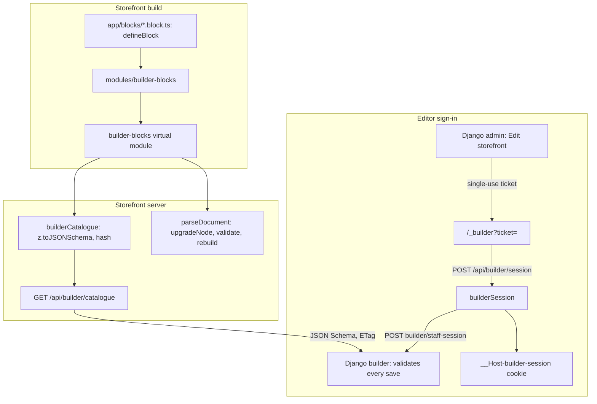

# Page builder foundation

The page builder lets a store compose its pages from typed sections and
blocks. The design is split by who knows what: the **storefront owns every
block** (its settings schema, which settings are translatable or references,
its limits and children, how an older version is upgraded) and publishes them
as a catalogue; **Django stores documents and validates every save against
that catalogue**, adding only the checks it alone can make. This page covers
the foundation that exists in the storefront: the catalogue and the staff
session. The editor, the Django `builder` app's documents, versions and
releases, and the rendering switch come after it.

It follows the pattern of [Store-editable texts](/dev/flows/store-texts): a
build-time collection, a public tenant-free endpoint whose content hash is its
ETag, and a Django side that keeps its own copy and refuses to save without
one.

## Diagram



## How it works

### 1. One declaration per block

A section or block is a default-exported `defineBlock({...})` in
`app/blocks/<type>.block.ts` (`shared/builder/defineBlock.ts`). It carries:

- `type` (lower snake case), `version` (an integer, bumped by a breaking
  change) and `kinds`: where it may sit, as a `section` of a page or a `block`
  inside another node.
- `schema`: a Zod object, the settings.
- `translatable` and `refs`: JSON pointers into the settings. A translatable
  setting may be written per language; a ref names another record
  (`product`, `category`, `page`, `media` or `menu`) that Django checks exists.
- `limits` (`maxBlocks`, `maxPerTemplate`), `children` (`allowed` types,
  `maxDepth`), `groups`, `templates`, `feature` (a store feature that must be
  on), `deprecated`, `presets` and `hydrate` (`eager`, `visible` or `idle`).
- `upgrade`: `upgrade[n]` turns a version `n` node into one for version `n + 1`.

A definition holds **data only, never a component**: the server reads every
definition and must not bundle rendering code. The renderer maps `type` to its
component on the client. `defineBlock` refuses a malformed declaration when it
loads (a bad type, a gap in the upgrade chain, a pointer that names no
setting), so it stops the build or the first test rather than reaching a store.

`modules/builder-blocks/` collects the files into the Nitro virtual module
`#builder-blocks`, server bundle only. A new file needs a server restart in
dev.

### 2. The catalogue

`server/utils/builderCatalogue.ts: buildBlockCatalogue` turns the definitions
into the catalogue when the server loads: each schema through
`z.toJSONSchema` with `target: 'draft-2020-12'` and `io: 'input'`, every object
closed (`additionalProperties: false`), blocks sorted by type, and a hash of
the content. It refuses a set that contradicts itself: two blocks of one type,
or an allowed child that is missing or cannot be a `block`.

`io: 'input'` is deliberate: Django validates what the editor saves, in which a
field with a default may be absent; the output type would require it. The
input conversion leaves objects open, so every object is closed explicitly. A
setting JSON Schema cannot state (a `Date`, a transform) fails the load instead
of publishing a gap.

`GET /api/builder/catalogue?schema=<schema>`
(`server/api/builder/catalogue.get.ts`) answers

```json
{ "hash": "…", "blocks": [{
  "type": "…", "version": 1, "accepts": [1], "schema": {},
  "translatable": ["/title"], "refs": {"/productId": "product"},
  "limits": {}, "children": {"allowed": []}, "kinds": ["section"]
}] }
```

with `groups`, `templates`, `feature` and `deprecated` only when set, and
`ETag: "<hash>"`. Like the texts catalogue it is public, tenant-free (listed in
`server/utils/tenantBypass.ts`), has no Nitro cache, and answers 304 to a
matching `If-None-Match`; the body is a constant of the server bundle, so it is
immutable per build. `?schema=` names the store's design and is validated, but
every design offers every block today. With no block defined it is
`{ "hash", "blocks": [] }`, which Django answers by refusing every save: there
is no fallback.

`accepts` is the current version alone. Django holds one schema per type, so it
cannot validate an older version; an older node is upgraded on read and by the
editor on load, and is always saved at the current version.

### 3. Documents: upgrade, parse

A document is `{ sections: { id: node }, order: [id] }`; a node is
`{ type: "name@version", disabled?, settings, blocks?, blockOrder? }`, ids are
`[A-Za-z0-9_-]{1,64}`, and nesting is capped at three levels
(`shared/constants/builder.ts`).

`shared/builder/upgrade.ts: upgradeNode` applies `upgrade[n]` from the node's
version up to the current one. It is pure (each step gets a copy), usable by
the server and the editor, and throws a `BlockUpgradeError` with a code for a
node it cannot bring up: a malformed or foreign type, a version newer than the
build, or a version no step reaches.

`server/utils/builderDocument.ts: parseDocument` is the single producer of
document data for rendering. For each node it upgrades, checks the block's kind
and allowed children and the depth, validates the settings with the block's
schema, and rebuilds the node from the parse, so a key the schema does not know
never reaches a component. Only what `order` and each `blockOrder` name is
kept, in that order. A node it cannot use is left out with a
`log.warn({ tag: 'builder', message: 'node skipped', node, reason })`, its
children with it; a document that is not one renders as empty. It never throws
for one bad node. Zod stays on the server, out of the client bundle.

### 4. The editor's staff session

The editor runs on the store's own host, at `/_builder`. A staff member opens
it from Django's admin, which mints a **single-use ticket**.

1. The browser lands on `/_builder?ticket=…`
   (`app/pages/_builder.vue`, `app/composables/useBuilderSession.ts`). The page
   takes the ticket off the address first, so it does not outlive its one use in
   the history, a reload or a `Referer`.
2. It posts it to `POST /api/builder/session`
   (`server/api/builder/session.post.ts`), which exchanges it with Django
   server to server: `POST {apiBaseUrl}/builder/staff-session` `{ ticket }` →
   `{ token, expiresAt, staff: { id, name, role } }`, or 400
   `{ code: "invalid_ticket" }`, returned as it is.
3. `server/utils/builderSession.ts` seals the answer in its **own cookie**,
   `__Host-builder-session`: HttpOnly, Secure, SameSite=Strict, `Path=/`, no
   Domain (the `__Host-` prefix makes a browser enforce that), with a
   `Max-Age` of the time left to `expiresAt`. It is separate from the customer
   session. The browser is told `{ staff, expiresAt }`, never the token.
4. `GET /api/builder/session` says who is signed in (a reload, a second tab) or
   401; `DELETE` expires the cookie. Django's token is not revoked on sign-out
   (there is no endpoint for it); it stays valid only until `expiresAt`.
5. Every future `/api/builder/**` route calls `requireBuilderStaff(event)`: 401
   without a live session, else the staff member and an
   `Authorization: Bearer <token>` header for the Django call.

The shell page is a placeholder (a Nuxt UI dashboard frame, the staff name and
a sign-out button); the editor replaces it.

## Invariants

- A definition holds data, never a component; the server bundle carries no
  rendering code for blocks.
- The catalogue is a constant of the build: one answer for every store, its
  hash the ETag. Django never saves without a catalogue.
- Every object schema in the catalogue is closed.
- `parseDocument` rebuilds nodes from the parse; unknown keys never reach a
  component, and one bad node never takes a page down.
- **Only `server/api/builder/**` and `builderSession.ts` may read the staff
  cookie, and no builder route is cached.** The storefront's SSR and handler
  caches hold anonymous renders, replayed to every visitor; a cached route that
  read the cookie would serve one staff member's view to the next visitor
  (`test/unit/source-rules/builder-session-is-private.spec.ts`).
- `/_builder` is in no route rule: `isCachedSsrRoute` is false for it, so it
  gets a per-request nonce CSP and `private, no-store`, and `robots: false`
  keeps it out of indexes and the sitemap.
- Reading the staff session never mints a cookie, and a cookie that holds no
  live session is expired on the spot.

## Failure modes

| Symptom | Cause |
|---|---|
| A save is refused for an unknown type | The catalogue is empty or the block's file is missing: production serves an empty catalogue until blocks are defined |
| The build or first test fails with `defineBlock(<type>): …` | A malformed declaration (type, version, upgrade chain or a pointer) |
| The server fails to load with "is defined twice" or "allows … inside it" | Two blocks of one type, or an allowed child that is missing or not a `block` |
| A page renders without a section and logs `node skipped` | An unknown or newer type, settings that fail the schema, a misplaced block or an upgrade that cannot run |
| `/_builder` shows "You are not signed in" | No staff cookie: the editor was opened without a ticket, the session ended, or the cookie expired |
| `/_builder` shows the link is no longer valid | Django answered `invalid_ticket`: the ticket expired, was already used, or was minted for another store |

## Source

| File | What |
|---|---|
| `grooveshop-storefront-ui-node-nuxt/shared/builder/defineBlock.ts` | `defineBlock` and its load-time checks |
| `grooveshop-storefront-ui-node-nuxt/shared/builder/upgrade.ts` | `upgradeNode`, `parseVersionedType`, `BlockUpgradeError` |
| `grooveshop-storefront-ui-node-nuxt/shared/types/builder.ts` | Definition, document and catalogue types |
| `grooveshop-storefront-ui-node-nuxt/shared/constants/builder.ts` | Kinds, reference kinds, hydration modes, the depth cap, id and type patterns |
| `grooveshop-storefront-ui-node-nuxt/shared/builder-blocks.d.ts` | The `#builder-blocks` virtual module type |
| `grooveshop-storefront-ui-node-nuxt/modules/builder-blocks/index.ts` | Collects `app/blocks/**/*.block.ts` into the virtual module |
| `grooveshop-storefront-ui-node-nuxt/server/utils/builderCatalogue.ts` | `buildBlockCatalogue`, the served document |
| `grooveshop-storefront-ui-node-nuxt/server/utils/builderDocument.ts` | `parseDocument` |
| `grooveshop-storefront-ui-node-nuxt/server/api/builder/catalogue.get.ts` | `GET /api/builder/catalogue` |
| `grooveshop-storefront-ui-node-nuxt/server/utils/tenantBypass.ts` | The catalogue is tenant-free |
| `grooveshop-storefront-ui-node-nuxt/server/utils/builderSession.ts` | The staff cookie, `requireBuilderStaff` |
| `grooveshop-storefront-ui-node-nuxt/server/api/builder/session.post.ts` | Ticket exchange and sign-in |
| `grooveshop-storefront-ui-node-nuxt/server/api/builder/session.get.ts` | Who is signed in |
| `grooveshop-storefront-ui-node-nuxt/server/api/builder/session.delete.ts` | Sign-out |
| `grooveshop-storefront-ui-node-nuxt/shared/constants/builderSession.ts` | The cookie name |
| `grooveshop-storefront-ui-node-nuxt/shared/schemas/builderSession.ts` | Ticket body, Django's answer, the cookie's content |
| `grooveshop-storefront-ui-node-nuxt/app/pages/_builder.vue` | The staff shell page |
| `grooveshop-storefront-ui-node-nuxt/app/components/Builder/Shell.vue` | The placeholder dashboard frame |
| `grooveshop-storefront-ui-node-nuxt/app/composables/useBuilderSession.ts` | Ticket sign-in, session lookup, sign-out |
| `grooveshop-storefront-ui-node-nuxt/test/unit/source-rules/builder-session-is-private.spec.ts` | Source rule: only the builder routes read the staff cookie |
