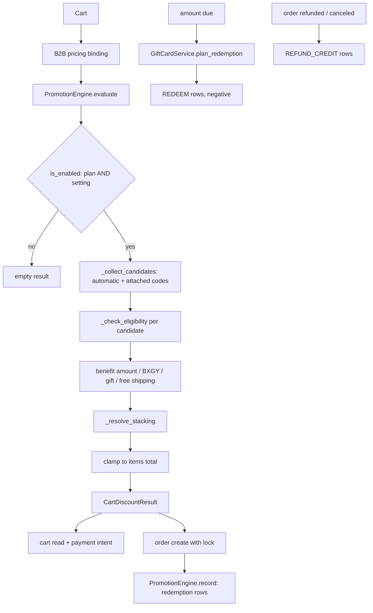

# Promotions and gift cards

Two features that both reduce what a shopper pays, and that are deliberately
**not** the same kind of thing. A promotion is a **discount**: it reduces the
order's taxable value and is evaluated fresh against the cart every time.
A gift card is a **payment instrument**: an accounting liability with an
append-only ledger, redeemed against the amount due, never against the goods
value.

The order they apply in is fixed and stated in `promotion/services.py`:
product markdown (already inside `Product.final_price`) → promotions →
loyalty redemption → gift-card payment.

## Diagram

## How it works

### One engine, four callers, one answer

`PromotionEngine.evaluate(cart)` is the only place a discount is computed.
Four surfaces call it: the cart serializer (preview), the payment-intent
amount, `CouponService.apply` when a code is attached, and
`OrderService._evaluate_promotions` — which both order-create paths, the
intent-first one and the offline one, go through. The verification guard and
the recorded discount are not two calls: they are one locked evaluation
inside `create_order_from_cart`, whose result feeds both the
`PaymentAmountMismatchError` check and `record`. The
module docstring states the contract — **all of them must agree to the cent**,
and `PaymentAmountMismatchError` is the alarm that fires when they do not.

`lock=True` takes `select_for_update` on the candidate `Promotion` rows and
is used **only** inside the order-create transaction, so usage-limit
enforcement is race-free. Preview surfaces evaluate without locks; the
order-create recomputation with the lock held is the source of truth.

### What a promotion is

`promotion/models/promotion.py: Promotion` is a translatable rule with:

| Axis | Field | Values |
|---|---|---|
| Trigger | `trigger` | `AUTOMATIC` (every eligible cart) or `CODE` (needs a coupon) |
| Benefit | `benefit_type` | `PERCENTAGE`, `FIXED_AMOUNT`, `FREE_SHIPPING`, `BXGY`, `FREE_GIFT` |
| Target | `target_scope` | `ORDER`, `PRODUCTS`, `CATEGORIES` |

Bundles are deliberately **not** a benefit type: the enum's comment calls
them a catalog construct — a composite product with component stock — not a
cart rule.

Conditions are `min_quantity` (eligible units after scope and exclusions),
`min_subtotal` (VAT-inclusive items total), `first_order_only`,
`usage_limit_total`, `usage_limit_per_customer`, plus exclusions
(`excluded_products`, `excluded_categories`, `exclude_discounted_products`).
Category targeting includes subcategories automatically — `_descendant_index`
expands every candidate's categories from **one** descendant query and hangs
the result on the in-memory instance for that evaluation only.

`Promotion.clean()` enforces the shape rules: a percentage benefit between 0
and 100, a positive fixed amount, `ends_at` after `starts_at`, BXGY needing
both quantities and a get-discount between 0 and 100, and a free gift needing
at least one gift unit. `is_live` is `is_active` plus the schedule window.

### Coupon codes

`PromotionCode` belongs to a `CODE` promotion and carries its own
`usage_limit` (1 for single-use bulk codes), an optional `assigned_to` user
or `assigned_to_email` for personal coupons, and `is_active`. Codes are
stored uppercase — `save()` normalises — and looked up that way.

`CartPromotionCode` is the attachment. The schema allows several rows per
cart so multi-code checkout can ship later without a migration, but
`CouponService.apply` enforces **one coupon per cart in v1**: applying a new
code deletes the previous row.

`CouponService.apply` refuses an unknown or inactive code with
`discount_code_invalid`, a non-live promotion with the precise window reason,
and — after attaching — re-evaluates; if the cart itself makes the code
ineligible, it **detaches the code again** and raises with the exact reason
rather than leaving a dead code on the cart.

Rejection reasons are a closed vocabulary, `CouponRejectionReason`, whose
values follow the ACP discount-extension error vocabulary verbatim so the
agent gateway can pass them through unchanged.

`CartDiscountResult.blocking_rejections` filters one reason out:
`combination_disallowed` is **not** blocking. A code that lost the stacking
comparison to a better automatic promotion charges the shopper *less* than the
code alone would have, and the cart preview already showed that outcome.

### Stacking and priority

`_resolve_stacking` is short and total:

- Stackable promotions combine, ordered by `priority` then primary key
  (lower priority applies first).
- Non-stackable promotions apply **alone**.
- The best single non-stackable competes against the **sum** of the
  stackables, and whichever discounts more wins.
- Every loser that came from a code is reported as
  `combination_disallowed`.

Free shipping never takes part: it has no amount to conflict over, so
`stackable` is ignored and it always combines. Free gifts are likewise
non-monetary.

After stacking, the chosen entries are clamped so the running discount never
exceeds the items total.

### Recording

`PromotionEngine.record(order, result)` must run in the same transaction and
under the same locks as the `evaluate(lock=True)` that produced the result.
It writes a `PromotionRedemption` per applied promotion — **including
zero-amount rows for free shipping and free gifts**, without which their
usage limits would count nothing — and mirrors a summary into
`order.metadata` under `promotions`, `promotion_gifts` and
`promotion_free_shipping`. `PromotionRedemption` is the usage-limit ledger;
counting it under the promotion lock is what makes limit enforcement
race-free.

`CouponService.clear_after_order(cart)` detaches the code once the order
exists — the redemption rows are the durable record.

Gifts add parcel weight. `gift_weight_grams` exists because shipping quotes
are weight-banded, and every surface that prices shipping must include the
gift or the courier upcharges the voucher later.

### Near misses

An **automatic** promotion blocked only by its minimum subtotal is reported
as a `NearMissEntry` with the exact remaining amount, which powers the
storefront's "add X more to unlock" teaser. Codes never produce near misses —
they produce a rejection — and an empty cart never produces one.

### The offers page

`GET /api/v1/promotion` (`promotion/views.py: PublicPromotionListView`) lists
what a shopper can act on: every live automatic promotion, plus code
promotions that have at least one **publicly advertisable** code. Personal
coupons, single-use codes and promotions that have hit `usage_limit_total`
are excluded, so the page never advertises an offer the cart would then
refuse. Results are ordered `priority, id` — the same order the engine
applies them in, so the page reads top to bottom the way a cart accumulates.

The storefront page is `app/pages/offers/index.vue`, gated by
`app/middleware/promotions-enabled.ts`, and its proxy
`server/api/promotions/index.get.ts` uses `useBackendFetch` (a raw `$fetch`
carries no `X-Forwarded-Host` and would resolve the public schema, giving
every tenant an empty list).

`/offers` is indexable, so it also has an entry in
`server/plugins/sitemap-tenant-gate.ts: GATED_ROUTES` — plan flag
`promotionsEnabled` plus setting `PROMOTIONS_ENABLED`. Without that entry a
store with promotions off advertised a URL it then 404s. The other gated
storefront routes (`/gift-cards`, `/gift-cards/success`, `/feedback`) carry
`robots: false` and never reach a sitemap at all; removing that noindex from
one of them means adding it to this table.

### Gift cards: a ledger, not a balance column

`giftcard/models.py` is explicit: balance is **always** derived by summing
`GiftCardTransaction.amount`, floored at zero. There is no cached balance
column to drift.

Ledger kinds are signed: `ISSUE`, `REFUND_CREDIT` and a positive `ADJUST`
add; `REDEEM`, `EXPIRE` and a negative `ADJUST` remove. The table is
append-only — corrections are new `ADJUST` rows, never edits.

Two partial unique constraints anchor idempotency:
`(gift_card, order)` for `REDEEM`, and the same pair for `REFUND_CREDIT`, so
a retried order-create cannot double-redeem and racing refund tasks cannot
double-credit.

A card is redeemable when it is `ACTIVE`, unexpired, and has a positive
balance. Expiry defaults to `GIFT_CARD_VALIDITY_DAYS` after issue (the field
help text notes the Greek five-year rule); empty means never.

### Redemption planning

`plan_redemption(codes, amount_due, lock=...)` computes how much the given
cards can settle, **smallest balance first** so near-empty cards drain, and
returns a `RedemptionPlan`. The same maths runs at payment-intent creation,
at order-create verification and at the actual redemption — parity or
`PaymentAmountMismatchError`.

Two refusals are worth knowing:

- A card whose balance currency differs from the order currency is **refused
  by code**, naming the card. There is no FX rate anywhere in the codebase,
  and silently treating a 100 USD card as 100 EUR extinguished more liability
  than instrument.
- Partial coverage is trimmed so the provider remainder is never a
  sub-minimum sliver below `MIN_PROVIDER_CHARGE`; the trimmed value stays on
  the card. The loop iterates because popping a fully-trimmed card changes
  the remainder again.

`record_plan` writes the negative `REDEEM` rows and mirrors the split into
`order.metadata["gift_cards"]`; `redeem` is plan-with-lock plus record in one
step.

### Purchase, delivery and refund

A storefront purchase is a `GiftCardPurchase`, deliberately **not** an
`Order` — orders drag stock, shipping, courier dispatch and the AADE
retail-receipt pipeline behind them, all wrong for a multi-purpose voucher.

`complete_purchase` is webhook-driven and idempotent through its status
guard. It flips the purchase to `PAID`, mints the card through `issue`,
queues the buyer's receipt, and queues delivery **only when there is no
`deliver_at` or it has already passed**.

Refunds go back to the source cards. `giftcard/signals.py` listens on
`order_refunded` and `order_canceled` and queues
`credit_refund_to_gift_cards`, passing the **actual refunded amount** —
crediting the full redemption for a partial refund would put money on the
card that was never returned. The provider refund only ever covers the
provider-charged remainder.

Three daily sweeps run, each reached through a per-tenant fanout wrapper
rather than scheduled directly — beat fires in the public schema, where the
gift-card tables are empty. The beat entries point at
`tenant.tasks.fanout_deliver_scheduled_gift_cards`,
`fanout_send_gift_card_expiry_reminders` and `fanout_expire_gift_cards`,
which dispatch `giftcard.tasks.deliver_scheduled_gift_cards`,
`send_gift_card_expiry_reminders` (each card warned exactly once via
`expiry_reminder_sent_at`; `GIFT_CARD_EXPIRY_REMINDER_DAYS` of 0 disables)
and `expire_gift_cards` per schema. Expiry runs at 03:00 Athens, the other
two at 06:00.

### The gates

Both features are two-tier and both service layers check the plan tier
themselves, not just at the endpoint. The reason is the same in both
docstrings: order create runs with **no permission classes** (it must serve
guest checkout), so an endpoint-only gate is bypassed entirely by the path
that matters.

| Feature | Plan flag | Runtime setting | Service check |
|---|---|---|---|
| Promotions | `Tenant.promotions_enabled` | `PROMOTIONS_ENABLED` (default off) | `PromotionEngine.is_enabled` |
| Gift cards | `Tenant.gift_cards_enabled` | `GIFT_CARDS_ENABLED` (default off) | `GiftCardService.is_enabled` |

Endpoints answer **404**, never 403: `PublicPromotionListView` chains
`IsPromotionsEnabled` and `IsPromotionsRuntimeEnabled`, and `GiftCardViewSet`
chains `IsGiftCardsEnabled`, adding `IsAuthenticated` on exactly one action,
`mine`. Everything else, including `purchase_status`, is `AllowAny` and
relies on a tight throttle instead.

On the storefront, `app/middleware/promotions-enabled.ts` and
`app/middleware/gift-cards-enabled.ts` apply the same two tiers. Both ship
the runtime default **off** and both fail **open** on a settings-endpoint
outage (`onError: true`) — an outage must not take the page down for stores
whose plan enables it, and Django still gates the data.

## Invariants

- **Preview and charge agree to the cent.** Every surface calls the same
  `evaluate`, and order create recomputes under a lock.
- **Money is never created.** The discount is clamped to the items total;
  a gift card's plan is clamped to the amount due and its balance.
- **The gift-card ledger is append-only.** Never update or delete a
  transaction; write an `ADJUST`.
- **One coupon per cart** in v1, enforced in `CouponService.apply`.
- **Free shipping always combines**; `stackable` does not apply to it.
- **Non-monetary applications still write redemption rows**, or their usage
  limits count nothing.
- **A wholesale cart does not stack retail promotions** unless
  `B2B_ALLOW_PROMOTIONS` is on — see [B2B](/dev/flows/b2b).
- **Gift cards reduce what the provider is charged, not the taxable order
  value.** The card sale itself is never submitted to myDATA.
- **A disabled feature 404s.** Both tiers, both services, both storefront
  middlewares.

## Failure modes

- **The offers page is stale after editing a promotion.** The `promotions`
  cache surface in `core/cache/surfaces.py` declares **no `invalidated_by` at
  all**, so it takes the `CacheSurface` default of an empty tuple. Signal
  wiring in `core/cache/invalidation.py` only ever connects the models a
  surface lists, so no signal, admin hook or save purges it — the
  `promotion` app ships no signals module at all, `promotion/apps.py`
  defines no `ready()`, and nothing under `promotion/` calls
  `CacheService.purge`.
  Its `django_patterns` is
  also empty, because `PublicPromotionListView` is a plain `APIView` with no
  response cache; the entries that exist are the Nuxt `PublicPromotionList`
  handler and the rendered `/offers` route. **Purging is a manual operator
  action** after any promotion, code or schedule edit. Contrast the
  `recommendations` surface, which lists four models in `invalidated_by`.
- **An admin-issued gift card is never emailed.** `giftcard/admin.py:
  save_model` routes a new card through `GiftCardService.issue`, which mints
  the code and the `ISSUE` row and sends nothing. `deliver_scheduled_gift_cards`
  only picks up cards with a **non-null** `deliver_at` in the past, so a card
  issued with the field blank is never swept either. The two ways it reaches
  the recipient are the admin's **Resend delivery email** detail action (which
  clears `delivered_at` and dispatches `deliver_gift_card_email`) and setting
  a `deliver_at` so the sweep finds it. Purchased cards are unaffected —
  `complete_purchase` dispatches delivery itself.
- **A coupon silently does nothing.** Check `is_active` on both the code and
  the promotion, `is_live` (the schedule window), the assignment fields for a
  personal coupon, and then stacking — a code that lost to a better automatic
  promotion is reported as `combination_disallowed` and is deliberately
  non-blocking.
- **Payment amount mismatch at order create.** Something repriced between the
  intent and the order: a promotion's window closed, a usage limit filled, a
  gift card was spent elsewhere, or a wholesale binding changed. The locked
  recomputation is right and the intent is stale.
- **A partial refund credits the whole redemption.** Only if the `amount`
  kwarg is dropped on the way to `_queue_refund_credit`; the `order_refunded`
  contract treats an absent amount as a **full** refund.
- **A gift card in the wrong currency blocks checkout.** By design — the
  error names the card. There is no conversion path.

## Related

- [Checkout and payment](/dev/flows/checkout-and-payment)
- [Order lifecycle](/dev/flows/order-lifecycle)
- [B2B](/dev/flows/b2b)
- [Loyalty](/dev/flows/loyalty)
- [Caches and purging](/dev/operations/caches)

## Source

| File | Role |
|---|---|
| `grooveshop-django-api/promotion/models/promotion.py` | `Promotion`, conditions, `clean()`, `is_live` |
| `grooveshop-django-api/promotion/models/code.py` | `PromotionCode`, assignment, usage limit |
| `grooveshop-django-api/promotion/models/cart_code.py` | `CartPromotionCode`, one-per-cart in v1 |
| `grooveshop-django-api/promotion/models/redemption.py` | `PromotionRedemption`, the usage ledger |
| `grooveshop-django-api/promotion/enum.py` | Trigger, benefit, scope, rejection vocabulary |
| `grooveshop-django-api/promotion/services.py` | `PromotionEngine`, `CouponService`, stacking, recording |
| `grooveshop-django-api/promotion/views.py` | `PublicPromotionListView` and its two gates |
| `grooveshop-django-api/cart/views/cart.py` | `apply_coupon`, `remove_coupon`, payment-intent evaluation |
| `grooveshop-django-api/order/services.py` | Locked evaluation, `record`, `clear_after_order` |
| `grooveshop-django-api/giftcard/models.py` | `GiftCard`, `GiftCardTransaction`, `GiftCardPurchase` |
| `grooveshop-django-api/giftcard/services.py` | Issue, plan, record, refund credit, expiry |
| `grooveshop-django-api/giftcard/signals.py` | Refund and cancel credit-back |
| `grooveshop-django-api/giftcard/tasks.py` | Delivery, receipts, reminders, expiry, refund credit |
| `grooveshop-django-api/giftcard/admin.py` | `save_model` issuing, Resend delivery action |
| `grooveshop-django-api/giftcard/views.py` | `check`, `purchase`, `purchase_status`, `mine` |
| `grooveshop-django-api/core/cache/surfaces.py` | The `promotions` surface, which declares no `invalidated_by` |
| `grooveshop-django-api/tenant/permissions.py` | The plan and runtime permission classes |
| `grooveshop-storefront-ui-node-nuxt/app/pages/offers/index.vue` | The offers page |
| `grooveshop-storefront-ui-node-nuxt/app/middleware/promotions-enabled.ts` | Two-tier route gate |
| `grooveshop-storefront-ui-node-nuxt/app/middleware/gift-cards-enabled.ts` | Two-tier route gate |
| `grooveshop-storefront-ui-node-nuxt/server/api/promotions/index.get.ts` | Cached offers proxy |
| `grooveshop-storefront-ui-node-nuxt/server/api/giftcard/` | Check, purchase, status, mine |
| `grooveshop-storefront-ui-node-nuxt/server/plugins/sitemap-tenant-gate.ts` | `/offers` sitemap gating |
