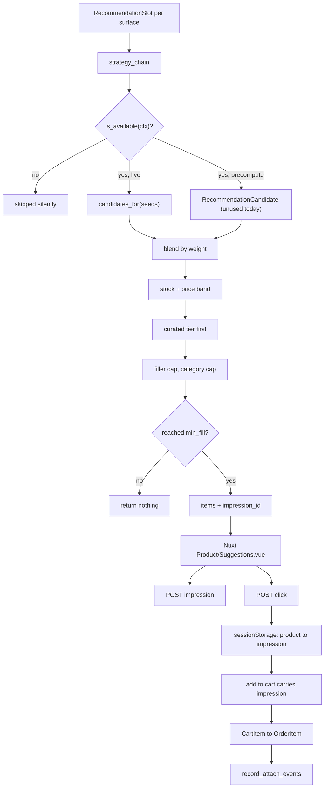

# Recommendations

Suggestions are produced by a chain of strategies, configured per
**surface**, blended by score, and cut to a limit — with one hard rule above
the maths: a merchant-curated relation always sorts above anything the
engine inferred. The feedback loop is three event kinds sharing one
`impression_id`, and the commercially interesting one, `attach`, is written
server-side when an order is created and never accepted from a client.

The deep design document lives at
[Product recommendations engine](/dev/django/reference/recommendations-engine).
This page is the cross-service path: what runs where, and what breaks.

## Diagram

## How it works

### Merchant relations are the input a catalogue cannot infer

`product/enum/relation.py: RelationType` is the vocabulary: `similar`,
`complementary`, `accessory`, `replacement`, `bundle`. Its docstring makes
the argument — "related" means a different thing to a fashion store, a
nursery and a phone shop, and none of it is derivable from the catalogue, so
the merchant states it and the engine reads it.

Relations are **directional**: the case belongs on the phone's page, not the
other way round. A merchant who wants both directions creates both rows. The
type also decides which surface a relation is useful on — a `replacement`
matters on an out-of-stock page, a `complementary` in the cart — and what
label the storefront renders.

### The strategy contract

`recommendation/strategies/base.py` defines a small ABC plus a
`@register_strategy` class decorator and a module-level `_REGISTRY`,
mirroring the shipping-carrier pattern. A strategy declares `code` (a
`StrategyCode` member — the enum is what slot configuration is validated
against, so an unregistered code can never be configured), `label`,
`min_plan` and `precompute`.

The idea that is not borrowed from the carriers is `is_available(ctx)`. A
strategy is asked whether it can answer **well** for this store before it is
asked to answer at all, and one that cannot returns nothing rather than
noise. That is what makes the engine safe for a store with zero orders —
which is every store on its first day.

`TenantContext` is what a strategy is allowed to know: plan, product count,
whether brands, tags and attributes are populated, order counts, and whether
a semantic embedder exists. `recommendation/context.py` builds it from cheap
`EXISTS` and `COUNT` queries, caches it for five minutes under the
schema-scoped default cache key `recs:tenant_context`, and strategies read it
rather than running those queries themselves.

Plan gating is by **rank**, not equality: `plan_allows` treats `min_plan` as
"this plan or above", and an unknown plan ranks as `TenantPlan.TRIAL`, the
lowest of the four (`trial`, `basic`, `pro`, `enterprise`), so a typo in a
`Tenant` row degrades the capability set instead of unlocking everything.
All four registered strategies declare `min_plan = TenantPlan.TRIAL`, so
none of them is plan-gated in practice yet.

Registered today (`recommendation/strategies/__init__.py`):

| Code | Module | Precompute | Notes |
|---|---|---|---|
| `curated` | `curated.py` | no | `ProductRelation` only; never declines; leads most preset chains |
| `variant_group` | `variant_group.py` | no | Same `ProductVariantGroup`; nothing for a product with no group |
| `category` | `category.py` | no | Same category, then siblings, then the parent subtree; exactly three queries whatever the seed count |
| `popular` | `popular.py` | no | Store-wide filler, one query, scores below every real signal |

`StrategyCode` also declares `attributes`, `semantic`, `co_purchase` and
`co_view`. Presets may name them; `_available_chain` logs at debug and skips
a code with no registered class, so a preset can name a later step's
strategy and it simply starts contributing the day it ships.

### Two-stage retrieval

`RecommendationCandidate` is the offline table: top-K candidates per
(product, strategy), unique on `(product, candidate, strategy)`, with a check
constraint forbidding self-reference and a read index on
`(product, strategy, -score)`.

`recommendation/candidates.py: compute_candidates_for_product` asks every
**precomputing** available strategy for `CANDIDATES_PER_STRATEGY` candidates
and replaces that seed's rows atomically (delete then `bulk_create`).

Live is the right default for anything that is one cheap ORM query: it is
always fresh — a product created a minute ago appears beside its category
siblings immediately — and costs no more than the table read would.
Precompute is for answers that are expensive to derive, where the offline
table is what keeps the request path constant-cost at any catalogue size.

Query cost is bounded by the **number of strategies in the chain, never the
number of seeds**. Live strategies override `candidates_for` to answer the
whole seed set in a fixed number of queries; the cart surface seeds with
every basket line, and the per-seed loop measurably pushed cart detail from
30 to 42 queries as items were added.

Rebuilds are scheduled by `recommendation/signals.py` through
`tenant.celery.dispatch_on_commit` on `Product` save and on `ProductRelation`
save or delete (a relation change rebuilds the **source** product).
`_NOISE_FIELDS` skips saves that only touch `view_count`, `click_score` or
`updated_at`.

**None of this moves any data today.** No registered strategy sets
`precompute = True`, so `compute_candidates_for_product` skips every
strategy and always writes zero rows, and the engine's precomputed branch
never has a code to read. `recompute_all_candidates` exists in
`recommendation/tasks.py` but nothing calls it: there is no fanout wrapper
in `tenant/tasks.py` and no `CELERY_BEAT_SCHEDULE` entry. The table and its
rebuild machinery are wired and waiting for the first precomputing
strategy; treat this whole section as future-tense until one ships.

### The online engine

`recommendation/engine.py: suggest(ctx)` does six things in order.

1. **Load the slot** for the surface. Missing row means a tenant provisioned
   before the engine existed; `_slot` falls back to the vertical preset in
   memory and never persists it.
2. **Filter the chain** to strategies that are registered and available.
3. **Collect** rows — live strategies answer the seed set directly;
   precomputed ones are one `IN` query, with a synchronous cold-path compute
   for a seed that has never been computed.
4. **Blend.** `weighted = slot.weights.get(code, 1.0) * row.score`, summed per
   candidate. A candidate nominated by more than one seed gets
   `BASKET_BONUS` per extra hit — two cart lines both pointing at the same
   product is what turns "more of the same" into "complete the order". The
   `reason` shown is the single strongest contribution.
5. **Guard.** One query for live facts about candidates and seeds. Anything
   out of stock is dropped. When the slot sets `price_band_ratio`, a
   candidate must sit within that ratio of at least one seed's final price.
6. **Rank and diversify.** The sort key is
   `(not curated, -score, product_id)` — see below. `popular` is capped at
   `FILLER_CAP` items, and off the product page no single category may take
   more than `limit - 1` slots. Below `slot.min_fill` the function returns an
   **empty list**, because one lonely suggestion looks broken.

`suggest` returns product ids plus a reason, never serialized products.
Hydration happens in the view through `recommendation/hydrate.py` so pricing
context and locale are applied per request while the engine stays cacheable.

### Curated is a tier, not a score

`_Merged.curated` carries the comment that justifies it: blending is
additive, so a candidate three inferred strategies agree on can out-sum a
curated one. Measured on staging, `variant_group + category + popular` came
to 2.2 against a curated 1.0 + 0.5. A merchant saying "show the pot with this
plant" must not lose to that, so **anything with a curated contribution sorts
before anything without one**, and the blended score orders within each tier.

### Slots, surfaces and presets

`Surface` is the unit of configuration, because the right suggestion differs
by where the shopper is: `pdp`, `cart`, `out_of_stock`, `empty_cart`,
`order_email`.

`RecommendationSlot` is one row per surface per tenant: `strategy_chain`
(ordered list of codes), `weights` (code to weight in 0..1, missing defaults
to 1.0), `limit`, `min_fill`, `price_band_ratio`, `enabled`. The JSON fields
carry a JSON Schema validator (`recommendation/json_schemas.py`: known
strategy codes, no duplicates, weights in 0..1), and the model's `clean()`
adds the checks that span fields: every weighted code is in the chain, and
`min_fill` may not exceed `limit`. A bad chain is a field error in the
admin, which also edits both fields through the schema-driven editor,
rather than a 500 — and a shell or a preset seeding a bad row is caught the
same way.

`recommendation/presets.py` keys a per-surface chain, weights and limits by
`tenant.models.StoreVertical`. Chain order is priority, not tier — a preset
freely names an unregistered code ahead of a registered one, and the
unregistered one simply starts contributing the day it ships. Two chains do
not lead with `curated`: both fashion chains that have a variant group lead
with `variant_group`, and the `empty_cart` surface is `popular` alone on
every vertical. `min_fill` differs by
surface on purpose — a product-page strip of one looks broken so it wants
two, while a cart cross-sell of one complementary item is a legitimate "add
this one thing".

Seeding is `get_or_create` and **never overwrites a merchant's edit**. The
only way back to a preset is the slot admin's explicit "Reset to preset",
which writes exactly `PRESET_FIELDS`.

`backfill_recommendation_slots` seeds missing rows for every active tenant
(or one `--schema`, optionally forcing a `--vertical`, with `--dry-run`). The
Argo CD PreSync job runs it as **step 4 of 4** on every deploy, so tenants
that predate the engine — or a surface added in a later release — get their
rows without a manual step.

### The two-tier gate

| Tier | Where | Effect |
|---|---|---|
| Plan | `Tenant.recommendations_enabled` (default `False`) | `tenant/permissions.py: IsRecommendationsEnabled` answers **404** on both recommendation endpoints |
| Runtime | `PRODUCT_SUGGESTIONS_ENABLED` extra-setting (ships `False`) | `tenant/permissions.py: IsRecommendationsRuntimeEnabled` answers **404** on both endpoints too; the pages that mount a strip check it before asking |

The cart's suggestions are not part of the cart payload: the cart page and
the cart drawer ask `GET /api/v1/recommendations?surface=cart&seeds=<ids>`
like every other strip, so the plan tier covers them too.

Plus a third, finer gate: which **strategies** run depends on
`RecommendationStrategy.min_plan` against the tenant's `plan`. The comment on
`Tenant.recommendations_enabled` puts it exactly — the flag is "the feature
exists for this store", the plan rank is "how smart it is allowed to be".

On the storefront a strip is gated where it is mounted, not in route
middleware, on the one `productSuggestions` store feature Django folds from
both tiers: `app/components/Storefront/ProductDetail.vue`,
`app/components/Storefront/Cart.vue` and `app/components/Cart/Drawer.vue`
each read `useStoreFeature('productSuggestions')`.

### Impressions are client-reported

`GET /api/v1/recommendations` **writes nothing**. It mints an
`impression_id` per response as a correlation id; the impression itself is
reported by the client through `POST /api/v1/recommendations/events` when the
strip actually becomes visible. The view's docstring gives the reason:
"served" is not "shown" — a strip below the fold that nobody scrolls to must
not count against a strategy's click-through rate. It also lets the storefront
cache the response body per (surface, seed) without cache fills inflating the
counts.

`recommendation/events.py: record_events` revalidates every enum rather than
trusting the task payload, because the payload crossed a broker, and it
**refuses `attach` outright** — that kind is derived from orders.

On the storefront, `app/composables/useRecommendationTracking.ts` posts both
kinds with `keepalive: true` and swallows failures. The Nuxt proxy
`server/api/analytics/recommendation-event.post.ts` rate-limits per
(tenant host, client IP) at 60 per minute with an explicit TTL on every hit —
the storage driver's default is the hour-long cache TTL and would silently
widen the window — and forwards the cart headers so the event carries the
same identity the basket does. Django throttles the same endpoint
independently at 120 per minute (`recommendation_event` in `settings.py`),
so the proxy limit is the one that bites first.

### Carried-impression attribution

Three identities can tie an order line back to an impression. They are tried
in precedence order and the winner is recorded in
`RecommendationEvent.matched_by`:

| `matched_by` | Identity | Window |
|---|---|---|
| `impression` | The impression id the **line itself carries** | none — it is exact |
| `cart` | Same `cart_uuid` from `metadata.cart_snapshot` | `RECOMMENDATION_ATTACH_CART_WINDOW_HOURS` |
| `user` | Same signed-in customer | `RECOMMENDATION_ATTACH_USER_WINDOW_DAYS` |

The carried path is the one that works for a guest on a first visit, who has
neither a cart nor a customer identity at the moment the strip is shown. It
runs end to end:

1. `trackClick` calls `useRecommendationAttribution().remember(productId, impressionId)`,
   which stores the pair in per-tab `sessionStorage` with a one-hour TTL.
2. The add-to-cart call consumes it and sends it as
   `recommendationImpressionId`, landing on
   `cart/models/item.py: CartItem.recommendation_impression_id`.
3. Order creation copies it onto `order/models/item.py:
   OrderItem.recommendation_impression_id` (`order/services.py`, both
   creation paths).
4. `record_attach_events` reads `order.items.values_list("product_id",
   "recommendation_impression_id")` and matches `Q(impression_id=…,
   product_id=…)` **per line** — a bare `IN` would sweep in the strip's other
   products, which the order may hold for unrelated reasons.

Attribution is idempotent: the unique constraint on
`(order, product, impression_id)` for `kind="attach"` makes a retried task a
no-op. Events are recorded on **every plan**: `record_events` carries no
plan check, so the platform keeps a usable signal from the cheapest stores.

### The storefront strip

`app/components/Product/Suggestions.vue` takes a `surface`, a `seedId` and
optional overrides. It fetches `server/api/products/[id]/recommendations.get.ts`,
which is a cached handler keyed by `tenantCacheKey` over host, seed, locale
and query, with a 5-minute fresh window and a 30-minute stale window, so the
engine's answer for a product is shared by every viewer. What is per viewer is
applied elsewhere: wholesale prices by `useB2BPricing` on the client, and the
impression by the strip when it is shown.

The cart page passes `seedIds` (the cart's product ids) and the strip asks
the store-wide route `server/api/recommendations.get.ts` with `surface=cart`
and `seeds`. That route is the same cached handler name, `productRecommendations`,
that Django's `recommendations` cache surface purges, so a product, relation or
slot edit reaches the cart too. It sorts and de-duplicates the seeds before it
keys the entry or calls Django, so two baskets of the same products share one
answer; the strip is `hydrate-on-visible`, so a visitor who never scrolls to
it costs no request. The cart drawer asks the same way for two suggestions,
only while it is open, and again when the basket changed while it was shut.
Neither reads anything from the cart payload, and both report impressions and
clicks like every other strip. An empty basket asks nothing (Django refuses a
seedless cart surface); the empty cart's strip is the `empty_cart` surface,
which needs no seed.

Wholesale prices on a cart suggestion are applied per viewer on the client,
as everywhere (`useShopperPrice` in the product card, `useB2BPricing` in the
drawer and in webside's strip); the cached body is anonymous.

## Invariants

- **Curated outranks everything.** A candidate with any curated contribution
  sorts before one without, whatever the blended scores
  (`engine.py: _Merged.curated`).
- **Below `min_fill`, show nothing.** The engine returns an empty list and
  the storefront renders nothing.
- **The read endpoint writes no events.** `impression_id` is a correlation
  id; the impression is a separate client call.
- **`attach` is server-side only.** `record_events` drops it; only
  `record_attach_events` writes it.
- **Attach is idempotent** through the partial unique constraint, so the task
  is safe to retry.
- **Seeding never overwrites.** `backfill_recommendation_slots` is
  `get_or_create`; only "Reset to preset" re-applies a preset.
- **A strategy that cannot answer well returns nothing**, and must call
  `super().is_available(ctx)` before adding its own reason to decline.
- **Query cost is bounded by chain length, not seed count.** A live strategy
  that does not override `candidates_for` is a bug on the cart surface.
- **`RecommendationCandidate` is absent from the cache surface's
  `invalidated_by`** on purpose: its rows are rebuilt by queryset delete plus
  `bulk_create`, and a per-row receiver would purge once per product across a
  whole-catalogue pass. A full pass is expected to purge once, explicitly,
  when it finishes — there is no such pass scheduled today.

## Failure modes

- **Empty strips on a store that has the feature on.** Check `min_fill`
  against what the chain can actually produce, then the stock guard — every
  out-of-stock candidate is dropped — then `price_band_ratio` on the cart
  slot.
- **A new tenant shows nothing until the next deploy.** Slots are seeded by
  the PreSync job's step 4/4 and at provisioning. `_slot` falls back to the
  in-memory preset so the engine still answers, but a merchant editing "the
  slot" in admin will not find a row.
- **A merchant's curated relation does not appear.** The rebuild is dispatched
  on `ProductRelation` save through `dispatch_on_commit`; if Celery is behind,
  the curated strategy is live rather than precomputed, so the relation should
  still show on the next request. Check `to_product.active` and
  `to_product.is_deleted` — the query filters both.
- **Stale strips after curating.** Django's `recommendations` cache surface
  purges `*recs:*` and the Nuxt `productRecommendations` handler on writes to
  `Product`, `ProductCategory`, `ProductRelation` and `RecommendationSlot`.
  The Nuxt handler's own 5-minute window is the other half.
- **Attach rows missing for guest orders.** Without a carried impression,
  attribution needs a cart snapshot or a signed-in user. An order with none of
  the three — an agent-placed order with no cart, a guest whose snapshot is
  missing — has nothing to match and returns zero, by design.
- **Attribution silently degrading.** `sessionStorage` can throw in private
  mode; `useRecommendationAttribution` catches and continues, so the carried
  path falls back to the cart and customer windows. The add-to-cart itself is
  unaffected.
- **A configured strategy never contributing.** Either it is not registered in
  `recommendation/strategies/__init__.py`, or `is_available` is declining — the
  `TenantContext` is the place to look, and it is cached for five minutes.

## Related

- [Product recommendations engine](/dev/django/reference/recommendations-engine)
- [Caches and purging](/dev/operations/caches)
- [Celery and background jobs](/dev/django/celery)
- [Order lifecycle](/dev/flows/order-lifecycle)

## Source

| File | Role |
|---|---|
| `grooveshop-django-api/recommendation/models.py` | `RecommendationSlot`, `RecommendationCandidate`, `RecommendationEvent` |
| `grooveshop-django-api/recommendation/enum.py` | `Surface`, `StrategyCode`, `EventKind`, `AttachMatch` |
| `grooveshop-django-api/recommendation/engine.py` | Merge, guard, curated tier, diversify, `min_fill` |
| `grooveshop-django-api/recommendation/candidates.py` | Offline rebuild for one seed |
| `grooveshop-django-api/recommendation/context.py` | `TenantContext` and its cache |
| `grooveshop-django-api/recommendation/strategies/` | Registry, base class, the four registered strategies |
| `grooveshop-django-api/recommendation/presets.py` | Vertical presets, `PRESET_FIELDS`, reset |
| `grooveshop-django-api/recommendation/events.py` | `record_events`, `record_attach_events` |
| `grooveshop-django-api/recommendation/tasks.py` | Per-product and nightly rebuilds, event and attach tasks |
| `grooveshop-django-api/recommendation/signals.py` | Rebuild scheduling, order-created hook |
| `grooveshop-django-api/recommendation/views.py` | The two endpoints and their gates |
| `grooveshop-django-api/recommendation/serializers.py` | Seed and limit caps, event request shape |
| `grooveshop-django-api/recommendation/management/commands/backfill_recommendation_slots.py` | PreSync seeding |
| `grooveshop-django-api/product/enum/relation.py` | `RelationType` |
| `grooveshop-django-api/cart/models/item.py`, `order/models/item.py` | The carried impression id |
| `grooveshop-django-api/core/cache/surfaces.py` | The `recommendations` surface |
| `grooveshop-storefront-ui-node-nuxt/app/components/Product/Suggestions.vue` | The strip |
| `grooveshop-storefront-ui-node-nuxt/app/composables/useRecommendationTracking.ts` | Impression and click reporting |
| `grooveshop-storefront-ui-node-nuxt/app/composables/useRecommendationAttribution.ts` | Per-tab carry of the impression |
| `grooveshop-storefront-ui-node-nuxt/server/api/products/[id]/recommendations.get.ts` | Cached read proxy |
| `grooveshop-storefront-ui-node-nuxt/server/api/recommendations.get.ts` | Cached read proxy for the empty cart and for a basket of `seeds` (the cart page and drawer) |
| `grooveshop-storefront-ui-node-nuxt/app/composables/useProductSuggestions.ts` | The strip's fetch: seed, basket, `enabled`, impression |
| `grooveshop-storefront-ui-node-nuxt/server/api/analytics/recommendation-event.post.ts` | Rate-limited event proxy |
| `grooveshop-infrastructure/manifests/app-constructs/grooveshop/prepare-helm/templates/job.yaml` | PreSync step 4/4 |
