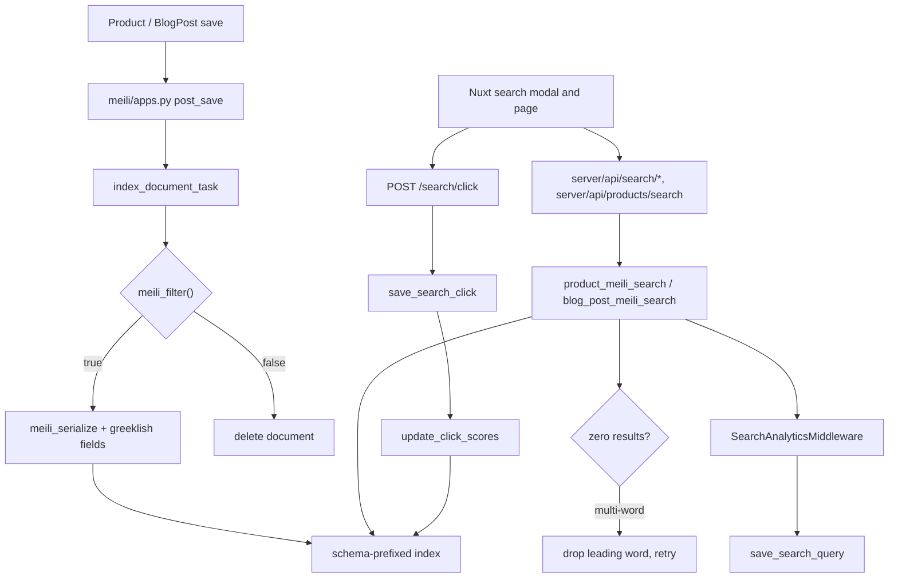

# Search

Search is Meilisearch, one index per model **per tenant schema**, and every
Greek-to-Latin accommodation happens at **index time**. Queries reach the
engine exactly as the shopper typed them — no rewriting, no variant
expansion, no space-joined alternates. That single decision explains the
shape of the whole flow: the transliteration module, the extra searchable
attributes on each model, the typo-tolerance thresholds, and why the only
query-side rescue is dropping one leading word.

Two models are indexed: `ProductTranslation` and `BlogPostTranslation`.
Everything else on this page follows from those two.

## Diagram

## How it works

### The index mixin

`meili/models.py: IndexMixin` is the abstract base. A model declares a
nested `MeiliMeta` with `searchable_fields`, `filterable_fields`,
`displayed_fields`, `sortable_fields`, `ranking_rules`, `synonyms`,
`typo_tolerance`, `faceting`, `pagination` and `search_cutoff_ms`;
`get_meili_settings()` turns that into a `MeiliIndexSettings` dataclass and
`meili/_client.py: Client.with_settings` posts it to the engine.

Index names are tenant-scoped by construction:
`IndexMixin.get_meili_index_name()` reads `connection.schema_name` and
returns `{schema}__{base_name}`, falling back to the bare base name on the
public schema. Index creation is deliberately **not** done at class-load
time — `meili/apps.py` explains why: `ready()` runs in the public schema,
so an auto-create there would produce a bare `ProductTranslation` index no
tenant ever reads.

Two hooks a model overrides:

- `meili_filter()` decides whether an instance belongs in the index at all.
- `get_additional_meili_fields()` returns computed attributes — this is
  where every Greeklish shadow field is produced.

`get_meilisearch_queryset()` is the bulk-indexing queryset and is declared
on the mixin. `get_search_result_queryset()` is the hit-hydration queryset
and is **not** part of the mixin: each indexed model defines its own
(`product/models/product.py`, `blog/models/post.py`) and
`meili/querysets.py` reaches it through `getattr`. It is what keeps the
product and blog views from paying extra queries per hit.

### Index-time Greeklish, in three layers

`search/transliteration.py` holds the whole story, and its module docstring
is the rationale: Meilisearch has no custom analyzers, treats the query as
one phrase, considers only the first ten words, and its default `last`
matching strategy relaxes words from the **end** only — so the first word is
effectively mandatory. Expanding a Latin query into space-joined Greek
variants therefore guaranteed zero results. Indexing the Latin forms instead
guarantees a match.

| Layer | Function | Indexed as | Applies to |
|---|---|---|---|
| Canonical fold | `greeklish_shadow` | `*_greeklish` | every searchable Greek field |
| Word-initial voiced stops | `greeklish_shadow_alt` | `*_greeklish_alt` | every searchable Greek field |
| Full convention bag | `greeklish_variants` | `*_greeklish_variants` | short fields only |

The canonical fold targets the dominant phonetic convention. The `_alt`
layer exists because word-initial μπ / ντ / γκ are pronounced b / d / g, and
"bataria" against "mpataria" costs three typos — more than Meilisearch ever
allows, at any word length. The variant bag is a port of the Solr
GreekLatinGenerator table, bounded by `MAX_VARIANT_EXPANSIONS`, and is
indexed only for titles, names and attribute text: expanding every
description word would bloat the index and pollute ranking.

Each helper returns `None` when the result adds nothing — a shadow identical
to the source field, or a variant identical to the canonical fold — so the
attributes cost nothing on Latin-only content.

The wiring is per model. `ProductTranslation.get_additional_meili_fields`
produces `name_greeklish`, `name_greeklish_alt`, `name_greeklish_variants`,
the description pair, and the same three layers again for
`attribute_names` and `attribute_values_text`. `BlogPostTranslation` does
the same for title, subtitle and body, with variants on title and subtitle
only.

### Typo tolerance must match across indexes

Both models declare the identical block, and the comment in
`product/models/product.py` says why: the storefront shows both result
lists for one query side by side, and mismatched thresholds would make the
same word typo-tolerant in one list and not the other. Both
use `oneTypo: 4` and `twoTypos: 8`. The historical `{3, 5}` gave five-letter
words a two-typo budget, which let first-character noise match. Convention
differences are the variant bags' job, not the typo budget's.

A model that declares no `typo_tolerance` gets the client default in
`meili/_client.py` instead, which is `{5, 9}` — so silence is not agreement.

### The two read endpoints

`search/urls.py` registers five paths. Two of them run queries:

| Path | View | Gate |
|---|---|---|
| `search/product` | `product_meili_search` | `AllowAny` |
| `search/blog/post` | `blog_post_meili_search` | `IsBlogEnabled` |

A third, `search/federated` (one `multi_search` over both indexes), was
removed on 2026-10-25; the storefront searches products and blog posts
separately and shows the two lists side by side.

Product search parses every filter defensively — `_parse_optional_int`,
`_parse_optional_float`, `_parse_int_csv` all raise a 400 rather than let a
`ValueError` become a 500 on a public endpoint. Sorting goes through
`_PRODUCT_SORT_FIELD_MAP`, which maps the camelCase value the API accepts
onto the snake_case name the index actually exposes as a sortable
attribute; anything not in the map is dropped, both to prevent
filter-injection into the query DSL and because passing the camelCase name
straight through silently did nothing. Facets are restricted the same way by
`_ALLOWED_PRODUCT_FACETS`.

Both views go through the model managers into `meili/querysets.py`, which
uses the client's plain read-only `search_client`. Tenant isolation on
query traffic therefore rests on the schema-prefixed index name alone, not
on a token rule. `meili/_client.py: Client.search_client_for_schema` can
mint a Meilisearch tenant token scoped to `{"{schema}__*": {}}`, but no
search view calls it, so do not assume the token is a second line of
defence.

Blog search is **refused, not filtered**, for a store whose plan has the
blog off: `IsBlogEnabled` answers 404. The gate has to be on the view,
because indexing knows nothing about the plan flag —
`BlogPostTranslation.meili_filter` gates on `is_published` alone — so the
documents exist either way. The storefront does not ask in that case:
`server/api/search/index.get.ts` skips the blog request when
`eventStoreFeature(event, 'blog')` is off, and
`app/composables/useStorefrontSearch.ts` disables it through
`useStoreFeature('blog')`, so product search keeps working.

### Attribute filters and their facet counts

A shopper who ticks Black and White under Colour and 2 m under Length
means (Black OR White) AND 2 m. The storefront sends one flat list
(`attributeValues=10,11,20`), so the grouping happens in Django:
`product/attribute_selection.py: AttributeSelection.from_value_ids` groups
the ids by the attribute each value belongs to. **OR within one
attribute, AND across attributes**, and every surface that filters by
attribute value reads the selection through it, so they cannot drift:

| Surface | How the selection is applied |
|---|---|
| `GET /api/v1/search/product` (`product_meili_search`) | `filter_search`: one `attribute_values IN [...]` clause per attribute; Meilisearch ANDs the elements of a filter list |
| `GET /api/v1/product` (`attributeValue_In`, `product/filters/product.py`) | `filter_products`: one subquery per attribute, ids parsed as integers (garbage is a 400), a product carrying two values of one attribute listed once |

An id that belongs to no attribute (a deleted value in a stale link) stays
a group of its own and matches nothing, so the request lists nothing
rather than silently losing the filter, as an unknown category does. The
agent gateway sends no attribute filter.

**Facet counts are disjunctive.** An attribute's own selection does not
shrink its own counts, or the alternatives to the value you picked would
vanish; the other attributes' selections still narrow them. When the
request asks for the `attribute_values` facet, `filter_search` registers
each attribute as a facet group (`meili/querysets.py:
IndexQuerySet.filter_facet_group`), and `IndexQuerySet.search` sends one
`multi-search` request: the main query plus one count-only query
(`limit: 0`) per selected attribute, with that attribute's own clause left
out. The count queries repeat the main query's text, matching strategy
and locales, so they match the same documents. Only the unselected
siblings are read from a count query; a selected value keeps the main
query's count, which is already its disjunctive count. Without a
selection, or without the facet requested, it stays a single query, so a
filtered listing costs `1 + N` engine queries in one round trip, `N`
being the attributes with a selection.

The storefront's attribute facet query
(`app/composables/useProductSearchData.ts`) sends the selected
`attributeValues` along with `facets=attribute_values`, and its cache key
includes them, so a selected colour narrows the sizes' counts and leaves
the other colours' counts alone.

### The relaxed-query retry

`_relaxed_query(query)` returns the query with its **leading** word removed,
or `None` for a single-word query. Both read views use the same
pattern: run the search, and if it returned nothing and a relaxed form
exists, run it again and report the relaxed string back in the
`relaxed_query` response field so the UI can say what it actually searched
for.

The leading word is the only shape Meilisearch cannot rescue on its own —
its `last` strategy already relaxes trailing words. A leading word that
matches nothing is an unindexed transliteration convention, a pasted slug
fragment, or a typo beyond tolerance.

### Indexing lifecycle

`meili/apps.py: MeiliConfig.ready()` discovers every concrete model with
`IndexMixin` in its MRO and connects `post_save` / `post_delete` with
`weak=False` — the receivers are closures defined inside `ready()`, and
Django's default weak references would garbage-collect them and silently
stop all indexing.

Either way the outcome is the same: qualifying instances are indexed,
non-qualifying ones have any existing document **deleted**, so a
deactivated product stops being searchable instead of lingering. Where the
`meili_filter()` branch runs differs by path. Outside `DEBUG`, and when
`MEILI_ASYNC_INDEXING` allows, the handler dispatches through
`tenant.celery.dispatch_on_commit` to `meili/tasks.py:
index_document_task` **unconditionally**, and the task itself calls
`meili_filter()` and deletes on a false. Only the synchronous
DEBUG / no-Celery path branches before dispatching. `MeiliTask`, the task's
base class, carries the tenant schema on the message. Task waits are bounded at five seconds so a backlogged
engine cannot pin a worker slot; the timeout raises and the task retries
with backoff.

### Analytics

`search/middleware.py: SearchAnalyticsMiddleware` records a `SearchQuery`
row for every response that answers exactly 200 from one of the two
query routes of `search/urls.py` (`search-product`, `search-blog-post`,
mapped to a content type in `_QUERY_ROUTES`). The `federated` content
type remains on `SearchQuery` and in the analytics filters only for rows
recorded before that endpoint's removal on 2026-10-25. The route is read from `request.resolver_match` once the view has answered.
It used to be a `/search/` substring in the path, which also matched the
admin's command palette (`/admin/search/`). That recorded every keystroke
as an empty storefront search, and on the platform host it sent the task
to a schema with no `search_query` table.

The middleware parses the response body for `results`,
`estimatedTotalHits` and the `queryId` the view minted, and mints a uuid
itself when the body carried none. It then fires
`search/tasks.py: save_search_query` with `.delay()`: fire and forget, off
the response path. The task retries only on a lost connection
(`OperationalError`, `InterfaceError`), because a `DataError` fails the
same way every time. Such a retry can follow a write that was already
committed, so the task writes with `get_or_create` keyed on the uuid and
the second attempt finds the row instead of inserting another.

`session_key` is `core/sessions.py: persisted_session_key`, which gives
the key of a session that is actually stored, else `""`. Until a session
loads, Django's `session_key` is the raw `sessionid` cookie: a
227-character one failed the insert on the column's 40 characters. The
recommendation events use the same helper. Client IP is
`trusted_client_ip` (the visitor Cloudflare vouched for) when present.
Otherwise it is the **rightmost** `X-Forwarded-For` entry when
`REMOTE_ADDR` is a private address, because that is the one the trusted
proxy appended.

Clicks are attributed by the `query_id` the search response carried.
`search_click` validates and dispatches `save_search_click`, which retries
on a private `_SearchQueryNotSavedYet` exception — the query row is written
asynchronously too, so a fast click can arrive before it exists.

`update_click_scores` is the ranking feedback loop. It counts clicks per
result over `CLICK_SCORE_WINDOW_DAYS`, keeps only results with at least
`CLICK_SCORE_MIN_CLICKS` (a single click is noise, not preference), caps at
`CLICK_SCORE_MAX_ITEMS` per type, writes the counts to the `click_score`
model field and pushes a **partial document update** to Meilisearch so
ranking reflects it without a resync. Both models list `click_score:desc` in
their `ranking_rules`; products also rank `in_stock:desc` above it and
`discount_percent:desc` below.

`anonymize_old_search_queries` scrubs rows past the retention window,
keeping the aggregate value. It nulls `ip_address` and the user FK, and
sets `user_agent` and `session_key` to the **empty string** rather than
null. The empty string is how "already scrubbed" is spelled, and it is
what the task's own exclusion clause keys on, so do not relax either
column back to null.

`SearchQuery.processing_time_ms` is Meilisearch's own processing time,
which `search/views.py: _record_engine_time` adds up on the request over
every engine call (a relaxed retry included). It travels on the request,
never in the response body, so that it stays out of the public OpenAPI
contract.

### Management commands and the deploy hook

The sync and settings commands live in `meili/management/commands/` and are
covered in depth at
[Meilisearch management commands](/dev/django/reference/search/management-commands).
The one to know here is `meilisearch_apply_settings`, which the Argo CD
PreSync job runs as step 3 of 4 on every deploy
(`grooveshop-infrastructure/manifests/app-constructs/grooveshop/prepare-helm/templates/job.yaml`).
Index settings are a convergence step, not a one-off.

`IndexMixin.update_meili_settings` calls `create_index` **before** the
settings call on purpose: Meilisearch auto-creates a missing index on a
settings task with no `primaryKey`, after which every document addition
fails with `index_primary_key_multiple_candidates_found`. That is exactly
the order of events on a brand-new tenant, where the PreSync hook runs
before any sync. `create_index` also repairs an already-damaged, key-less
index in place.

### The search key

`settings.py` reads `MEILI_SEARCH_KEY` into `MEILISEARCH["SEARCH_KEY"]`, and
`meili/_settings.py` falls back to the master key when it is unset so local
and CI keep working. The `Client` builds two engine clients: a master-key
one for administration and indexing, and a read-only `search_client` for
query traffic, so the master key never serves an untrusted path.

**The search key never leaves Django.** The storefront holds no Meilisearch
credential and never talks to the engine: `server/api/search/*` and
`server/api/products/search.get.ts` proxy to Django, which queries the
engine. The Nuxt tree carries no Meilisearch dependency, no client, no host
and no key — the name survives only in type declarations and comments.

### The storefront side

| Route | Behaviour |
|---|---|
| `server/api/search/index.get.ts` | The search modal's: runs the product and blog searches in parallel with one limit and offset and returns both, or a null pair for an empty query; skips the blog search when the store has no blog |
| `server/api/products/search.get.ts` | `defineCachedRoute`, 60 s, **`swr: false`**, keyed with `tenantCacheKey` over every filter |
| `server/api/search/blog-posts.get.ts` | The search page's guides, paged on their own: `defineCachedRoute`, 60 s, **`swr: false`**, keyed with `tenantCacheKey` |
| `server/api/search/trending.get.ts` | Proxies the 24-hour trending list |
| `server/api/search/click.post.ts` | Forwards the click, answers 202 |

The product-search cache is deliberately not stale-while-revalidate: results
are sort- and filter-sensitive, and a stale entry can serve the wrong order
after a backend change until it revalidates.

`app/composables/useSearchClickTracking.ts` posts the click with
`keepalive: true` so it survives the navigation it triggers, and swallows
every failure — tracking must never affect the shopper. It no-ops without a
`queryId`.

## Invariants

- **Queries are never rewritten.** Not into Greek variants, not into
  space-joined alternates. Recall is bought at index time or not at all
  (`search/transliteration.py` module docstring).
- **`minWordSizeForTypos` is identical on every searchable index.** Today
  that is `{4, 8}` on both `ProductTranslation` and `BlogPostTranslation`,
  whose result lists the storefront shows side by side for one query.
  Changing one without the other makes the same word typo-tolerant in one
  list and not the other.
- **Every index name is `{schema}__{base}`** on a tenant schema; the public
  schema gets the bare base name. That prefix is the only tenant boundary
  on query traffic.
- **Only the read-only key serves queries.** The master key is for
  administration and indexing.
- **A save that fails `meili_filter` deletes the document.** Returning early
  would leave stale data searchable forever.
- **Sort and facet parameters are allowlisted** and mapped to real index
  attribute names before they reach the query DSL.
- **Attribute values combine OR within an attribute and AND across
  attributes**, on every surface, through `AttributeSelection` alone.
  Never filter on the flat `attribute_values` list directly.
- **An attribute's facet counts ignore its own selection** and honour
  every other filter.
- **Analytics never block a response.** Every write is a Celery dispatch, and
  every failure is logged, not raised.

## Failure modes

- **A blog post is searchable before it is published.**
  `BlogPostTranslation.meili_filter` returns `master.is_published` once it
  has a master to read (it returns false for an unset `master_id` and
  catches a missing row), and the blog view filters on
  `is_published = true`. But `blog/managers/post.py: published()` — what
  every public blog endpoint uses — additionally requires `published_at` to
  be null or already past. A post scheduled for next week with
  `is_published` already set is therefore indexed and findable now, while
  its own detail page is not. Either gate `meili_filter` on the schedule
  too, or accept it deliberately.
- **Index drift** (settings changed in code, documents missing after a
  restore, a new tenant with empty indexes): re-run
  `meilisearch_sync_index` for one model or `meilisearch_sync_all_indexes`
  for everything, per tenant. `meilisearch_apply_settings` converges
  settings without touching documents.
- **A store passes ten tenants and indexes start vanishing.** Meilisearch
  paginates `GET /indexes` at twenty by default. `Client.get_indexes` pages
  explicitly for exactly this reason; the un-paged version left departed
  tenants' documents alive, skipped indexes on drop, and made `create_index`
  enqueue a create that failed with `index_already_exists` — which
  `update_meili_settings` turns into a raise, failing every deploy.
- **Tests never touch the engine.** `tests/conftest.py` and
  `tests_mt/conftest.py` set `MEILISEARCH["OFFLINE"] = True`; the signal
  handlers, `update_click_scores`' push, and the tenant-token minting all
  short-circuit on it. A test that asserts on index content is asserting on
  nothing.
- **Zero results on a Greeklish query that should match.** Check whether the
  field carries a `*_greeklish_variants` bag — long fields deliberately do
  not — and whether the query's first word is the unmatched one, in which
  case the relaxed retry should already have rescued it.
- **A filtered listing shows nothing although each picked value has
  products.** Check that no picked id is a deleted value: an unknown id is
  a group of its own and matches nothing, on purpose.
- **Attribute counts shrink to the picked values.** The facet request
  left out `attributeValues`, or asked without
  `facets=attribute_values`, so no facet groups were registered.
- **A new search endpoint records nothing.** Analytics follow the route,
  not the path. Add a new query route's `name` to
  `SearchAnalyticsMiddleware._QUERY_ROUTES` with the content type it
  records. A route left out of it (`search-click`, `search-trending`,
  `search-analytics`) is never recorded.

## Related

- [Search API reference](/dev/django/reference/api/search)
- [CONTAINS operator](/dev/django/reference/search/contains-operator)
- [Meilisearch management commands](/dev/django/reference/search/management-commands)
- [Multi-tenancy](/dev/platform/multi-tenancy)
- [Caches and purging](/dev/operations/caches)

## Source

| File | Role |
|---|---|
| `grooveshop-django-api/meili/models.py` | `IndexMixin`, `MeiliMeta`, `get_meili_index_name`, serialization |
| `grooveshop-django-api/meili/_client.py` | Master and search clients, tenant tokens, index settings, paged `get_indexes` |
| `grooveshop-django-api/meili/querysets.py` | `IndexQuerySet.search`, `filter_facet_group` and the disjunctive-facet `multi-search`, hit hydration through each model's `get_search_result_queryset` |
| `grooveshop-django-api/product/attribute_selection.py` | `AttributeSelection`: grouping, `filter_search`, `filter_products` |
| `grooveshop-django-api/product/filters/product.py` | `attributeValue_In` on the product list |
| `grooveshop-django-api/meili/_settings.py` | Search-key fallback |
| `grooveshop-django-api/meili/apps.py` | Signal wiring, index-or-delete branch |
| `grooveshop-django-api/meili/tasks.py` | `index_document_task`, `delete_document_task`, `reindex_model_task` |
| `grooveshop-django-api/meili/management/commands/` | Sync, settings, drop, inspect |
| `grooveshop-django-api/search/transliteration.py` | The three Greeklish layers |
| `grooveshop-django-api/search/views.py` | Product, blog, click, analytics, trending |
| `grooveshop-django-api/search/middleware.py` | `SearchAnalyticsMiddleware` |
| `grooveshop-django-api/search/tasks.py` | Query and click persistence, `update_click_scores`, anonymisation |
| `grooveshop-django-api/core/sessions.py` | `persisted_session_key`, the session key of a stored session only |
| `grooveshop-django-api/search/models.py` | `SearchQuery`, `SearchClick` |
| `grooveshop-django-api/product/models/product.py` | `ProductTranslation.MeiliMeta`, Greeklish fields, ranking rules |
| `grooveshop-django-api/blog/models/post.py` | `BlogPostTranslation.MeiliMeta`, `meili_filter` |
| `grooveshop-django-api/blog/managers/post.py` | `published()` — the schedule gate search does not apply |
| `grooveshop-storefront-ui-node-nuxt/server/api/search/` | Storefront proxies |
| `grooveshop-storefront-ui-node-nuxt/server/api/products/search.get.ts` | Cached product search |
| `grooveshop-storefront-ui-node-nuxt/app/composables/useProductSearchData.ts` | Category and attribute facet queries, the attribute one carrying the selection |
| `grooveshop-storefront-ui-node-nuxt/app/composables/useStorefrontSearch.ts` | The search page: product and guide searches, each paged on its own |
| `grooveshop-storefront-ui-node-nuxt/app/composables/useSearchClickTracking.ts` | Click attribution |
| `grooveshop-storefront-ui-node-nuxt/app/components/Search/` | Modal, input, guide card |
| `grooveshop-infrastructure/manifests/app-constructs/grooveshop/prepare-helm/templates/job.yaml` | PreSync step 3/4 |
