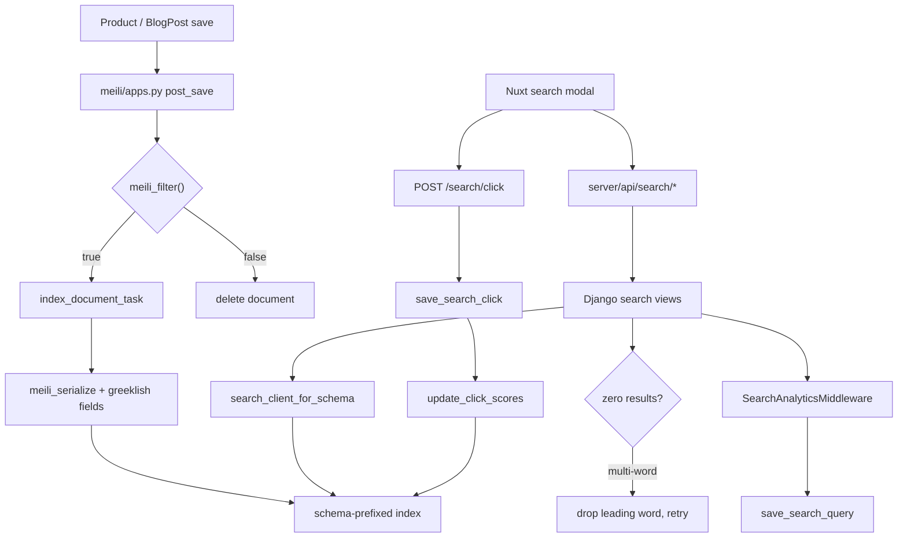

# Search

Search is Meilisearch, one index per model **per tenant schema**, and every
Greek-to-Latin accommodation happens at **index time**. Queries reach the
engine exactly as the shopper typed them — no rewriting, no variant
expansion, no space-joined alternates. That single decision explains the
shape of the whole flow: the transliteration module, the extra searchable
attributes on each model, the typo-tolerance thresholds, and why the only
query-side rescue is dropping one leading word.

Two models are indexed: `ProductTranslation` and `BlogPostTranslation`.
Everything else on this page follows from those two.

## Diagram

## How it works

### The index mixin

`meili/models.py: IndexMixin` is the abstract base. A model declares a
nested `MeiliMeta` with `searchable_fields`, `filterable_fields`,
`displayed_fields`, `sortable_fields`, `ranking_rules`, `synonyms`,
`typo_tolerance`, `faceting`, `pagination` and `search_cutoff_ms`;
`get_meili_settings()` turns that into a `MeiliIndexSettings` dataclass and
`meili/_client.py: Client.with_settings` posts it to the engine.

Index names are tenant-scoped by construction:
`IndexMixin.get_meili_index_name()` reads `connection.schema_name` and
returns `{schema}__{base_name}`, falling back to the bare base name on the
public schema. Index creation is deliberately **not** done at class-load
time — `meili/apps.py` explains why: `ready()` runs in the public schema,
so an auto-create there would produce a bare `ProductTranslation` index no
tenant ever reads.

Two hooks a model overrides:

- `meili_filter()` decides whether an instance belongs in the index at all.
- `get_additional_meili_fields()` returns computed attributes — this is
  where every Greeklish shadow field is produced.

`get_meilisearch_queryset()` and `get_search_result_queryset()` are the
bulk-indexing and hit-hydration querysets; the second is what keeps the
federated view from running four queries per hit.

### Index-time Greeklish, in three layers

`search/transliteration.py` holds the whole story, and its module docstring
is the rationale: Meilisearch has no custom analyzers, treats the query as
one phrase, considers only the first ten words, and its default `last`
matching strategy relaxes words from the **end** only — so the first word is
effectively mandatory. Expanding a Latin query into space-joined Greek
variants therefore guaranteed zero results. Indexing the Latin forms instead
guarantees a match.

| Layer | Function | Indexed as | Applies to |
|---|---|---|---|
| Canonical fold | `greeklish_shadow` | `*_greeklish` | every searchable Greek field |
| Word-initial voiced stops | `greeklish_shadow_alt` | `*_greeklish_alt` | every searchable Greek field |
| Full convention bag | `greeklish_variants` | `*_greeklish_variants` | short fields only |

The canonical fold targets the dominant phonetic convention. The `_alt`
layer exists because word-initial μπ / ντ / γκ are pronounced b / d / g, and
"bataria" against "mpataria" costs three typos — more than Meilisearch ever
allows, at any word length. The variant bag is a port of the Solr
GreekLatinGenerator table, bounded by `MAX_VARIANT_EXPANSIONS`, and is
indexed only for titles, names and attribute text: expanding every
description word would bloat the index and pollute ranking.

Each helper returns `None` when the result adds nothing — a shadow identical
to the source field, or a variant identical to the canonical fold — so the
attributes cost nothing on Latin-only content.

The wiring is per model. `ProductTranslation.get_additional_meili_fields`
produces `name_greeklish`, `name_greeklish_alt`, `name_greeklish_variants`,
the description pair, and the same three layers again for
`attribute_names` and `attribute_values_text`. `BlogPostTranslation` does
the same for title, subtitle and body, with variants on title and subtitle
only.

### Typo tolerance must match across indexes

Both models declare the identical block, and the comment in
`product/models/product.py` says why: they feed the same federated search,
so a looser threshold on one index would make its hits win on noise. Both
use `oneTypo: 4` and `twoTypos: 8`. The historical `{3, 5}` gave five-letter
words a two-typo budget, which let first-character noise match. Convention
differences are the variant bags' job, not the typo budget's.

A model that declares no `typo_tolerance` gets the client default in
`meili/_client.py` instead, which is `{5, 9}` — so silence is not agreement.

### The three read endpoints

`search/urls.py` registers six paths. Three of them run queries:

| Path | View | Gate |
|---|---|---|
| `search/product` | `product_meili_search` | `AllowAny` |
| `search/blog/post` | `blog_post_meili_search` | `IsBlogEnabled` |
| `search/federated` | `federated_search` | `AllowAny` |

Product search parses every filter defensively — `_parse_optional_int`,
`_parse_optional_float`, `_parse_int_csv` all raise a 400 rather than let a
`ValueError` become a 500 on a public endpoint. Sorting goes through
`_PRODUCT_SORT_FIELD_MAP`, which maps the camelCase value the API accepts
onto the snake_case name the index actually exposes as a sortable
attribute; anything not in the map is dropped, both to prevent
filter-injection into the query DSL and because passing the camelCase name
straight through silently did nothing. Facets are restricted the same way by
`_ALLOWED_PRODUCT_FACETS`.

The federated view is the interesting one. It builds a `multi_search` with
federation weights — products 1.0, blog posts 0.7 — and executes it through
a **schema-scoped** read client:
`meili/_client.py: Client.search_client_for_schema` mints a Meilisearch
tenant token from the search key with search rules `{"{schema}__*": {}}`, so
the engine itself refuses cross-tenant index access even if query-building
code ever mis-prefixes an index name. It falls back to the unscoped search
client in three documented cases: the public schema, no dedicated search key
provisioned, and `OFFLINE` mode.

Blog gating in federated search is a **drop, not a refusal**. The view is
not gated on `IsBlogEnabled`, because 404-ing it would take product search
down with it for a blog-disabled store. Instead the blog index is only added
to the federation when `tenant_plan_allows("blog_enabled")` is true. This is
necessary because indexing knows nothing about the plan flag —
`BlogPostTranslation.meili_filter` gates on `is_published` alone — so the
documents exist either way.

### The relaxed-query retry

`_relaxed_query(query)` returns the query with its **leading** word removed,
or `None` for a single-word query. All three read views use the same
pattern: run the search, and if it returned nothing and a relaxed form
exists, run it again and report the relaxed string back in the
`relaxed_query` response field so the UI can say what it actually searched
for.

The leading word is the only shape Meilisearch cannot rescue on its own —
its `last` strategy already relaxes trailing words. A leading word that
matches nothing is an unindexed transliteration convention, a pasted slug
fragment, or a typo beyond tolerance.

The federated retry rebuilds fresh query dicts rather than mutating the
already-submitted ones.

### Indexing lifecycle

`meili/apps.py: MeiliConfig.ready()` discovers every concrete model with
`IndexMixin` in its MRO and connects `post_save` / `post_delete` with
`weak=False` — the receivers are closures defined inside `ready()`, and
Django's default weak references would garbage-collect them and silently
stop all indexing.

On save the handler branches on `meili_filter()`: qualifying instances are
indexed, non-qualifying ones have any existing document **deleted**, so a
deactivated product stops being searchable instead of lingering. Outside
`DEBUG`, and when `MEILI_ASYNC_INDEXING` allows, the work is dispatched
through `tenant.celery.dispatch_on_commit` to `meili/tasks.py:
index_document_task`, whose base class `MeiliTask` carries the tenant schema
on the message. Task waits are bounded at five seconds so a backlogged
engine cannot pin a worker slot; the timeout raises and the task retries
with backoff.

### Analytics

`search/middleware.py: SearchAnalyticsMiddleware` records a `SearchQuery`
row for every successful request whose path contains `/search/`, minus the
two non-query endpoints (`/trending`, `/analytics`) it excludes explicitly.
It parses the response body for `results`, `estimatedTotalHits`,
`processingTimeMs` and the `queryId` the view minted, then fires
`search/tasks.py: save_search_query` with `.delay()` — fire and forget, off
the response path. Client IP comes from the **rightmost** `X-Forwarded-For`
entry when `REMOTE_ADDR` is a private address, because that is the one the
trusted proxy appended.

Clicks are attributed by the `query_id` the search response carried.
`search_click` validates and dispatches `save_search_click`, which retries
on a private `_SearchQueryNotSavedYet` exception — the query row is written
asynchronously too, so a fast click can arrive before it exists.

`update_click_scores` is the ranking feedback loop. It counts clicks per
result over `CLICK_SCORE_WINDOW_DAYS`, keeps only results with at least
`CLICK_SCORE_MIN_CLICKS` (a single click is noise, not preference), caps at
`CLICK_SCORE_MAX_ITEMS` per type, writes the counts to the `click_score`
model field and pushes a **partial document update** to Meilisearch so
ranking reflects it without a resync. Both models list `click_score:desc` in
their `ranking_rules`; products also rank `in_stock:desc` above it and
`discount_percent:desc` below.

`anonymize_old_search_queries` nulls the IP, user agent, session key and
user FK on rows past the retention window, keeping the aggregate value.

### Management commands and the deploy hook

The sync and settings commands live in `meili/management/commands/` and are
covered in depth at
[Meilisearch management commands](/dev/django/reference/search/management-commands).
The one to know here is `meilisearch_apply_settings`, which the Argo CD
PreSync job runs as step 3 of 4 on every deploy
(`grooveshop-infrastructure/manifests/app-constructs/grooveshop/prepare-helm/templates/job.yaml`).
Index settings are a convergence step, not a one-off.

`IndexMixin.update_meili_settings` calls `create_index` **before** the
settings call on purpose: Meilisearch auto-creates a missing index on a
settings task with no `primaryKey`, after which every document addition
fails with `index_primary_key_multiple_candidates_found`. That is exactly
the order of events on a brand-new tenant, where the PreSync hook runs
before any sync. `create_index` also repairs an already-damaged, key-less
index in place.

### The search key

`settings.py` reads `MEILI_SEARCH_KEY` into `MEILISEARCH["SEARCH_KEY"]`, and
`meili/_settings.py` falls back to the master key when it is unset so local
and CI keep working. The `Client` builds two engine clients: a master-key
one for administration and indexing, and a read-only `search_client` for
query traffic, so the master key never serves an untrusted path.

**The search key never leaves Django.** The storefront holds no Meilisearch
credential and never talks to the engine: `server/api/search/*` and
`server/api/products/search.get.ts` proxy to Django, which queries the
engine. A grep for a Meilisearch client, host or key in the Nuxt tree finds
only generated response types.

### The storefront side

| Route | Behaviour |
|---|---|
| `server/api/search/index.get.ts` | Runs the product and blog searches in parallel and returns both, or a null pair for an empty query |
| `server/api/search/federated.get.ts` | Straight proxy, validated with the generated `zFederatedSearchResponse` |
| `server/api/products/search.get.ts` | `defineCachedEventHandler`, 60 s, **`swr: false`**, keyed with `tenantCacheKey` over every filter |
| `server/api/search/trending.get.ts` | Proxies the 24-hour trending list |
| `server/api/search/click.post.ts` | Forwards the click, answers 202 |

The product-search cache is deliberately not stale-while-revalidate: results
are sort- and filter-sensitive, and a stale entry can serve the wrong order
after a backend change until it revalidates.

`app/composables/useSearchClickTracking.ts` posts the click with
`keepalive: true` so it survives the navigation it triggers, and swallows
every failure — tracking must never affect the shopper. It no-ops without a
`queryId`.

## Invariants

- **Queries are never rewritten.** Not into Greek variants, not into
  space-joined alternates. Recall is bought at index time or not at all
  (`search/transliteration.py` module docstring).
- **`minWordSizeForTypos` is identical on every index that shares a
  federation.** Today that is `{4, 8}` on both `ProductTranslation` and
  `BlogPostTranslation`. Changing one without the other lets the looser
  index win on noise.
- **Every index name is `{schema}__{base}`**, and query traffic goes through
  a tenant-token client scoped to that prefix.
- **Only the read-only key serves queries.** The master key is for
  administration and indexing.
- **A save that fails `meili_filter` deletes the document.** Returning early
  would leave stale data searchable forever.
- **Sort and facet parameters are allowlisted** and mapped to real index
  attribute names before they reach the query DSL.
- **Analytics never block a response.** Every write is a Celery dispatch, and
  every failure is logged, not raised.

## Failure modes

- **A blog post is searchable before it is published.**
  `BlogPostTranslation.meili_filter` returns `master.is_published` and
  nothing else, and both the blog and federated views filter on
  `is_published = true`. But `blog/managers/post.py: published()` — what
  every public blog endpoint uses — additionally requires `published_at` to
  be null or already past. A post scheduled for next week with
  `is_published` already set is therefore indexed and findable now, while
  its own detail page is not. Either gate `meili_filter` on the schedule
  too, or accept it deliberately.
- **Index drift** (settings changed in code, documents missing after a
  restore, a new tenant with empty indexes): re-run
  `meilisearch_sync_index` for one model or `meilisearch_sync_all_indexes`
  for everything, per tenant. `meilisearch_apply_settings` converges
  settings without touching documents.
- **A store passes ten tenants and indexes start vanishing.** Meilisearch
  paginates `GET /indexes` at twenty by default. `Client.get_indexes` pages
  explicitly for exactly this reason; the un-paged version left departed
  tenants' documents alive, skipped indexes on drop, and made `create_index`
  enqueue a create that failed with `index_already_exists` — which
  `update_meili_settings` turns into a raise, failing every deploy.
- **Tests never touch the engine.** `tests/conftest.py` and
  `tests_mt/conftest.py` set `MEILISEARCH["OFFLINE"] = True`; the signal
  handlers, `update_click_scores`' push, and the tenant-token minting all
  short-circuit on it. A test that asserts on index content is asserting on
  nothing.
- **Zero results on a Greeklish query that should match.** Check whether the
  field carries a `*_greeklish_variants` bag — long fields deliberately do
  not — and whether the query's first word is the unmatched one, in which
  case the relaxed retry should already have rescued it.
- **Search analytics full of non-searches.** The middleware's exclusion list
  is a suffix match on `/trending` and `/analytics`; a new non-query
  endpoint under `/search/` must be added to `_NON_QUERY_SEARCH_SUFFIXES`.

## Related

- [Search API reference](/dev/django/reference/api/search)
- [CONTAINS operator](/dev/django/reference/search/contains-operator)
- [Meilisearch management commands](/dev/django/reference/search/management-commands)
- [Multi-tenancy](/dev/platform/multi-tenancy)
- [Caches and purging](/dev/operations/caches)

## Source

| File | Role |
|---|---|
| `grooveshop-django-api/meili/models.py` | `IndexMixin`, `MeiliMeta`, `get_meili_index_name`, serialization |
| `grooveshop-django-api/meili/_client.py` | Master and search clients, tenant tokens, index settings, paged `get_indexes` |
| `grooveshop-django-api/meili/_settings.py` | Search-key fallback |
| `grooveshop-django-api/meili/apps.py` | Signal wiring, index-or-delete branch |
| `grooveshop-django-api/meili/tasks.py` | `index_document_task`, `delete_document_task`, `reindex_model_task` |
| `grooveshop-django-api/meili/management/commands/` | Sync, settings, drop, inspect |
| `grooveshop-django-api/search/transliteration.py` | The three Greeklish layers |
| `grooveshop-django-api/search/views.py` | Product, blog, federated, click, analytics, trending |
| `grooveshop-django-api/search/middleware.py` | `SearchAnalyticsMiddleware` |
| `grooveshop-django-api/search/tasks.py` | Query and click persistence, `update_click_scores`, anonymisation |
| `grooveshop-django-api/search/models.py` | `SearchQuery`, `SearchClick` |
| `grooveshop-django-api/product/models/product.py` | `ProductTranslation.MeiliMeta`, Greeklish fields, ranking rules |
| `grooveshop-django-api/blog/models/post.py` | `BlogPostTranslation.MeiliMeta`, `meili_filter` |
| `grooveshop-django-api/blog/managers/post.py` | `published()` — the schedule gate search does not apply |
| `grooveshop-storefront-ui-node-nuxt/server/api/search/` | Storefront proxies |
| `grooveshop-storefront-ui-node-nuxt/server/api/products/search.get.ts` | Cached product search |
| `grooveshop-storefront-ui-node-nuxt/app/composables/useSearchClickTracking.ts` | Click attribution |
| `grooveshop-storefront-ui-node-nuxt/app/components/Search/` | Modal, input, result tile |
| `grooveshop-infrastructure/manifests/app-constructs/grooveshop/prepare-helm/templates/job.yaml` | PreSync step 3/4 |
