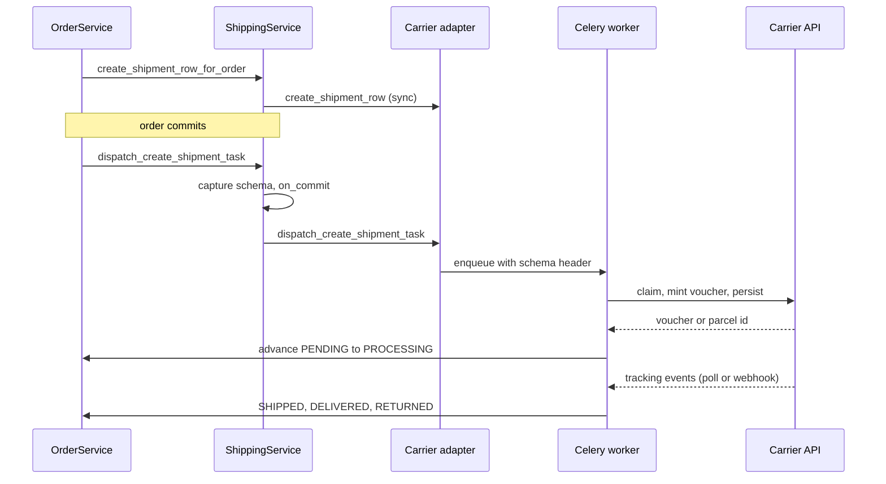

# Shipping

A carrier is an adapter class plus a database row. The adapter
(`shipping/interfaces.py: ShippingCarrierInterface`) is code registered
at app start; the row (`shipping/models/provider.py: ShippingProvider`)
is the runtime switch and capability declaration. Nothing above the
shipping layer imports a provider app — the order flow, the serializers,
the pay-way filter and the pricing calculator all go through
`shipping/services.py: ShippingService`, which resolves the row and then
the adapter. Price, availability and weight cap live in a third piece,
the per-tenant `shipping/models/rate.py: ShippingRate` table, one row per
(provider, country, kind). Adding a courier is one app plus one provider
row plus its rates.

Three adapters exist today: ACS Courier (`shipping_acs/`, REST, polled),
BoxNow (`shipping_boxnow/`, REST plus webhook) and the merchant-fulfilled
`flat_rate` (`shipping/carriers/flat_rate.py`, lifecycle only: no API,
no label, no tracking).

## Diagram

## How it works

### The adapter contract

`ShippingCarrierInterface` declares the methods every carrier must have,
even as no-ops. The abstract ones are `create_shipment`,
`cancel_shipment`, `fetch_label_bytes`, `fetch_tracking_events`,
`shipment_for_order`, `serialize_shipment` and `validate_order_payload`.
The optional hooks are where a carrier states what it is:

| Hook | Purpose |
|---|---|
| `payload_keys` | Which non-`Order` keys the carrier reads out of the create-order body (`boxnow_locker_id`, `acs_station_external_id`, …) |
| `live_quote` | Optional live price for a rate (`rate`, `country_code`, `region_id`, `weight_grams`, `currency`). The default returns `None`, meaning "charge the rate's `price`". Only ACS overrides it |
| `is_kind_enabled` | Per-kind gate a carrier controls itself, e.g. ACS Smartpoint |
| `create_shipment_row` | Persist the child row synchronously during checkout |
| `dispatch_create_shipment_task` | Enqueue the Celery task that talks to the carrier API |
| `supported_settlements` | Which settlements the carrier can physically perform |
| `filter_pay_ways` | Derived from the above; overriding it directly is almost always wrong |

`supported_settlements` is a capability declaration, not a preference.
ACS returns `{online, courier_cash, offline_transfer}` — a courier takes
cash at a door. BoxNow returns `{online, carrier_terminal}` — nobody
meets the shopper at a locker, so `courier_cash` money would never be
collected. Merchant preferences belong in `PayWayShippingExclusion` rows,
which `PayWayService.filter_by_carrier` applies on top and which change
without a deploy.

Registration is `@register_provider` at `AppConfig.ready()` time into the
module-level `_REGISTRY` in `shipping/interfaces.py`. Re-registering the
same code overwrites, which is how test doubles are swapped in.

### Provider rows, and the factory trap

`ShippingProvider` carries `code` (matching the adapter), `is_active` as
the master switch, `supports_home_delivery` / `supports_pickup_point`,
`live_mode`, `priority`, a `metadata` JSON bag and two logo fields
(pickup-point rows prefer `logo_pickup_point` and fall back to `logo`).

**`shipping/factories.py: ShippingProviderFactory` sets
`django_get_or_create = ("code",)`.** Every other declared attribute —
`is_active`, `supports_home_delivery`, `supports_pickup_point`,
`live_mode`, `priority`, `metadata` — is passed as a `defaults` value, and
`get_or_create` ignores `defaults` when the row already exists. So a
factory call that names `is_active=True` against a code a seed migration
already created returns the **seeded** row unchanged, flags and all, and
the test or fixture silently runs against the wrong configuration. If you
need a provider in a specific state, assert or set the flags explicitly
after the factory call.

### Rates: `ShippingRate`

`ShippingRate` is tenant-scoped and is the **only** source of shipping
price, availability and weight cap. There is no settings fallback: the
six legacy `EXTRA_SETTINGS` keys (`CHECKOUT_SHIPPING_PRICE`,
`FREE_SHIPPING_THRESHOLD`, `BOXNOW_SHIPPING_PRICE`,
`BOXNOW_FREE_SHIPPING_THRESHOLD`, `ACS_SHIPPING_PRICE`,
`ACS_FREE_SHIPPING_THRESHOLD`) and `metadata["supported_countries"]` are
no longer read by anything.

| Field | Meaning |
|---|---|
| `provider` | FK to `ShippingProvider`, `related_name="rates"` |
| `country` | FK to the shared `country.Country` (`PROTECT`, `related_name="+"`), the same cross-schema shape as `Order.country` |
| `kind` | `ShippingKind` |
| `price` | `MoneyField` |
| `free_shipping_threshold` | `MoneyField`, nullable: `NULL` means never free |
| `max_weight_grams` | Nullable: `NULL` means no cap |
| `is_active` | Pauses the rate without losing the price |

It is unique on `(provider, country, kind)` and indexed on
`(country, is_active)`. `clean()` rejects a kind the provider does not
support, a currency other than the tenant's `default_currency`, and a
negative price. `HistoricalRecords` keeps the price audit trail. The
admin edits rates through an Unfold `ShippingRateInline` on
`ShippingProviderAdmin` with a plain country select: an autocomplete
would 403, because the country admin is platform-only.

Countries and regions stay global reference data (`SHARED_APPS`). Every
ISO 3166-1 country is seeded (`country/migrations/0012_seed_iso_countries.py`),
so every country is *selectable* in the rate inline, and only a rate
makes it *shippable* for one store.

**Destination VAT and customs are not handled.** VAT is one rate per
product with no country dimension (`vat/`), so a rate to another EU
country charges the product's own rate, not the destination's (no OSS),
and a non-EU destination gets no customs data on the voucher. Opening
such a country is a compliance decision that this code does not make
for the merchant. `shipping/migrations/0011_convert_legacy_pricing_to_rates.py`
converted each tenant's old setting values into rates for the countries
in its old `supported_countries` (else GR), so no store started offering
a new country by accident; a new tenant runs the same migration and gets
a GR `flat_rate` home-delivery rate.

### The single gate: `active_rate`

Every availability decision goes through
`ShippingService.active_rate(provider_code, kind, country_code)`: an
active rate, on an active provider, with a registered adapter, for a kind
the provider supports and the adapter's `is_kind_enabled` allows. The
rest is built on it:

| Method | Role |
|---|---|
| `quote(...) -> Money` | Price, evaluated in a fixed order: availability (`ShippingUnavailableError`), weight cap (`ShippingWeightExceededError`), free-shipping threshold, then the adapter's `live_quote` or the rate's `price` |
| `assert_available(...)` | Availability and cap without a price; used when a free-shipping promotion zeroes the cost, so a promo can never ship to a country the store does not serve |
| `shippable_country_codes()` | Countries with at least one active rate, ordered by `Country.sort_order`; backs `GET /api/v1/country?shippable=true` (`country/filters.py`), which returns nothing on the platform host |
| `resolve_home_delivery_provider(country_code)` | The active home-delivery carrier with the lowest `priority` for that country |
| `available_options(country_code)` | Checkout options; the country is required (400 without it) |
| `free_shipping_info(country_code)` | The "free shipping from X" promise; defaults to the first shippable country and echoes the `country_code` it used |

The exceptions live in `shipping/exceptions.py`.

### Method offering at checkout

`ShippingService.available_options` iterates the active rates for the
requested country and emits one row per rate that passes
`active_rate`. Each row carries the quoted price, `country_code`,
`max_weight_grams` and `exceeds_max_weight`, the kind-aware logo URL,
and the pay-ways that combination can settle — resolved by calling the
same `PayWayService.filter_by_carrier` the checkout calls, so the
delivery step can never advertise a method the payment step would
refuse. An over-cap option is **listed and flagged, not dropped**, so a
heavy cart to a capped destination (BoxNow Cyprus, 4000 g) gets a
disabled option with a reason instead of a silently empty step. Rows
sort by `(priority, provider_code)`.

Order pricing goes through the same service. `OrderService.shipping_cost`
is the single entry point for every caller (order creation, the
payment-intent computation in `cart/views/cart.py`) and calls
`ShippingService.quote`. A bare `home_delivery` request resolves through
`resolve_home_delivery_provider`, and `_resolve_shipping_provider` uses
the **same helper** to set the order's FK — otherwise the order would be
priced against one carrier's rate and served by another.

### Dispatch on transaction commit

`ShippingService.dispatch_create_shipment_task` captures
`connection.schema_name` and then wraps the per-carrier dispatch in
`transaction.on_commit`. Both halves matter. Without the deferral the
worker looks up the order on a different connection before the creating
transaction has committed and gives up permanently, because
`Order.DoesNotExist` is not retryable. Without the captured schema, an
`on_commit` that fires after the request's tenant context has unwound
dispatches against the public schema and fails the same way.

The shipment **row** is created synchronously during checkout
(`create_shipment_row_for_order`); only the carrier API call is deferred.

## ACS Courier

### Voucher creation

`AcsService.create_voucher_for_order` is a three-phase design so the
carrier API call never happens with a Postgres row lock held:

1. **Claim** — short atomic block: lock the shipment, short-circuit if a
   `voucher_no` exists, sync `cod_amount`, stamp
   `metadata["mint_started_at"]`.
2. **API call** — no lock, no open transaction.
3. **Persist** — fresh atomic block with `select_for_update` and a race
   re-check; a voucher that lost the race is deleted at ACS and the
   winner's row returned.

The claim TTL is 300 seconds (`_MINT_CLAIM_TTL_SECONDS`). It was 90 until
a slow ACS round trip let a second worker re-mint and leak an orphan
voucher. A stale claim with no `voucher_no` logs loudly, naming
`Reference_Key1` so the orphan can be found in the ACS dashboard.

### The contract is cash-on-delivery only

Every voucher is minted with `Charge_Type = COD`, whatever the order's
pay way. What varies is the amount: `cod_amount` is synced to the order
total **only** for `COURIER_CASH` pay-ways. An online-paid or
locker-settled order ships at `0,00` so the courier collects nothing at
the door.

Two encodings on the wire are easy to get wrong:

- **`Cod_Ammount` is Greek-locale.** ACS reads a dot as a thousands
  separator, so `"47.01"` becomes 4701 and trips the cash cap. The value
  is quantised to two places and written comma-decimal, always, even at
  zero.
- **`Cod_Payment_Way` is omitted when the amount is zero.** Sending `0`
  (cash) tells the driver to collect nothing, which some log as a
  confused proof-of-delivery entry.

`Delivery_Notes` carries `Order.customer_notes` through
`shipping/services.py: sanitize_delivery_notes`, which collapses
whitespace runs and caps at 500 characters — an embedded carriage return
can be read as a record separator by ACS.

### Pricing and station countries

ACS is the only adapter with a `live_quote`: it returns
`_fetch_live_quote` only when `ACS_DYNAMIC_PRICING_ENABLED` is on, and
`None` when the setting is off or the live call fails, in which case
`quote` charges the rate's `price`. The free-shipping threshold is
applied before `live_quote` is ever called.

The station sync in `shipping_acs/tasks.py` covers the countries that
have an active ACS rate; `AcsService.sync_stations(country=...)` takes
the country as a required argument. The voucher uses `order.country_id`
and `live_quote` receives the real destination country and region, so
no ACS path assumes Greece: which countries ACS serves is rate data.
The `ACS_SUPPORTED_COUNTRIES` setting and `shipping_acs/config.py:
default_country` are gone.

### Labels and the pickup list

`Print_Type` defaults to **1, thermal/roll** (`shipping_acs/config.py:
print_type`), overridable per tenant through
`ShippingProvider.metadata["print_type"]`. Value 2 is the laser layout,
four vouchers per A4. ACS accepts nothing else.

**`_mark_label_printed` is the one choke point.** Every label download —
the order API, the carrier adapter, both admin paths — goes through
`AcsService.fetch_label_bytes`, which stamps `label_printed_at` on the
cache-hit path as well as the miss, and is idempotent (first print
wins). That is why "printed" means the same thing to the 15:45
pre-flight and the 16:30 manifest whichever button the merchant used.

**Bulk print is ours, not ACS's.** `ACS_Print_Voucher` takes a single
`Voucher_No` and no alias in the manual prints more than one, so
`AcsService.fetch_labels_pdf` makes N calls — each already cached for an
hour by `fetch_label_bytes` — and concatenates the pages with `pypdf`
into one document. One file is one job on the thermal roll, which is the
point: the operation that unblocks a manifest is "print everything
outstanding", and doing it one change page at a time is how the voucher
that gets missed holds back every other parcel that day. WeasyPrint was
already a dependency but renders HTML to PDF and cannot concatenate
existing documents, hence the new pin.

Two failure shapes are deliberate, and pinned by
`tests/unit/shipping_acs/test_admin_bulk_print_labels.py`:

- **A voucher that fails is collected and named, never raised.** It
  returns `(pdf_bytes, failures)`, each failure carrying
  `shipment_id`/`order_id`/`voucher_no`/`error`; a row with no voucher
  yet is reported without an API call. Letting one bad row abort the
  batch would reproduce the all-or-nothing failure this path exists to
  cure.
- **An empty merge returns `b""`, not a valid PDF of nothing.**
  `shipping_acs/admin.py: bulk_print_labels` then returns `None` so the
  browser gets no download and the per-failure `message_user` errors
  stand — a zero-page PDF would read as a successful print.

The action pairs with the existing `label_printed_at` /
`EmptyFieldListFilter` on the changelist, which is how the merchant
selects exactly the unprinted rows.

**The pickup list is mandatory.** A voucher that is not on an issued
pickup list is not presented to the courier for collection, so the parcel
never moves. `AcsService.issue_daily_pickup_list` runs Mon–Fri at 16:30
Athens, guarded by a Redis `cache.add` mutex so the beat task and the
admin "issue now" view cannot double-issue. It is the same three-phase
shape as the voucher mint.

Two ACS behaviours make this fragile, and both are handled:

- **ACS rejects the whole list if any voucher on it is unprinted**, and
  offers no partial issue. `warn_unprinted_acs_vouchers` runs at 15:45,
  45 minutes earlier, and emails the tenant's operators the exact orders
  that still need a label. The remedy both that mail and the 16:30
  failure mail point at is the bulk print action above — one filter, one
  selection, one PDF.
- **ACS scopes a list to that day's pickup date.** On one production run
  the manifest covered 2 of 9 candidates. Vouchers minted on earlier days
  are simply not on it, and **they are not swept up by a later list** —
  they need a list issued for their own pickup date. So the persist step
  reads back the manifest's actual membership
  (`ACS_Pickup_List_Display_Voucher`) and links only those, logging the
  ones left behind. Linking every candidate would file them under a
  manifest the courier never received them on and hide them from the run
  that could still get them collected.

A response with no `PickupList_No` is not automatically a failure. Two
exits are tried before the raise, in this order:

1. **ACS may have built the manifest and not echoed the number back.**
   Observed 2026-09-02: the call created list `9803819281` over two
   vouchers and answered without a `PickupList_No`, and believing the
   response left the manifest invisible to us while ACS refused to
   reprint those labels. `_adopt_pickup_lists_from_acs` asks ACS what it
   actually holds for the date first, and returns the adopted list.
2. **An empty pickup day is not a refusal.** The call takes a date and
   no voucher list, so the local candidate query is only a pre-flight.
   When *every* candidate row is a voucher ACS will never collect —
   `last_event_at is None`, `created_at` older than
   `ACS_STALE_SHIPMENT_DAYS`, and not a re-mint — and
   `Unprinted_Found` is falsy, the service logs the vouchers at WARNING
   and returns `None`. A single live candidate still makes the refusal a
   hard failure, because then something genuinely was waiting.

The re-mint exclusion is load-bearing. `created_at` dates the **row**,
not the voucher, and `reset_shipment_for_remint` leaves it untouched, so
a voucher minted today on a month-old row whose predecessor never
scanned would read as dead on day one. That reset records
`metadata["previous_vouchers"]`, which identifies exactly those rows and
needs no migration; a `voucher_minted_at` column is the honest model and
would also fix the same `created_at` fallback in
`check_stale_acs_shipments`.

When it does raise, the ERROR log names every candidate as
`<voucher> (order #<id>)`, not just `len(candidates)`. ACS can refuse
with `Unprinted_Found=0` and an empty `Error_Message`, and a bare count
cannot be acted on — working out which parcel blocked the manifest meant
re-running the candidate query by hand against production.

### Tracking and order status

`poll_acs_tracking_batch` runs every 15 minutes through the tenant
fanout, with a distributed mutex and a per-sub-task stagger to stay under
the carrier's rate cap. `AcsService.poll_shipment_tracking` is split into
read, API call and persist so a slow response cannot lose
`last_polled_at`.

`order_status_for_shipment_state` is the pure mapping from carrier state
to order status, shared by the live poll and the reconcile command so
they cannot drift. `in_transit`, `at_destination`, `out_for_delivery` and
`attempted` all mean SHIPPED — a failed attempt is proof the parcel left
(prod order 267 sat at PROCESSING for the ten days ACS held it at the
branch before that state joined the set). `_apply_order_status_transition`
then performs it, bridging through SHIPPED when the carrier jumped
straight to DELIVERED or RETURNED, and for DELIVERED it calls
`maybe_advance_to_completed` so an already-paid order lands on COMPLETED
in the same pass. A `canceled` shipment state — produced only by the
admin retire action or a voucher cancel, never by tracking — routes the
order through `OrderService.cancel_order` instead
(`_cancel_order_for_dead_shipment`), so stock is restored and the payment
settled exactly as a staff cancel would; a bare status write stranded prod
order 248 with its unit still counted as sold.

The summary alone is not enough to know the parcel has left. ACS reports
`shipment_status=5`, `delivery_flag=0` and no non-delivery reason for a
parcel waiting at a Smartpoint or in the branch's hands, and the mapping
keeps the current state for that triplet — which is still `new` when the
pickup happened between two polls. `poll_shipment_tracking` therefore
lifts a `new` shipment to `in_transit` when `ACS_TrackingDetails` holds
any checkpoint that is not a print (`_has_left_sender`,
`_PRE_DISPATCH_CHECKPOINT_PREFIXES`); a voucher that was printed and
never handed over carries only print checkpoints and stays `new`.

`acs_send_arrival_notification` emails and notifies the shopper when the
parcel goes out for delivery.

### COD payout reconciliation

`reconcile_acs_cod_payouts` runs daily at 02:30 Athens and upserts
`AcsCodPayout` rows from the ACS beneficiary endpoint, idempotent on
`(voucher_no, cod_payment_date)`.

**The wire schema has no `Voucher_No` column.** The voucher number
arrives in `POD`; `Customer_RefNo_1` and `Customer_RefNo_2` echo the
`Reference_Key1/2` sent at mint (`order.id` and `order.uuid`) and are the
fallback match keys. An implementation that assumed `Voucher_No` silently
skipped every real payout row for ten weeks.

A matched row flips the order through
`AcsService._mark_cod_order_paid_if_pending`, which moves
`payment_status` from PENDING to COMPLETED: `mark_as_paid` with
`payment_method="acs_cod"`, then `order_paid` so the Meta CAPI Purchase
dispatch runs, then the DELIVERED to COMPLETED auto-advance. The nightly
task passes `silent_for_customer=True` — the shopper paid the courier in
person and already had the DELIVERED notification. The backfill command
passes it only when given `--silent`, which is why that flag matters
below.

Unattributable rows are still persisted (it is real money) and reported
separately: `unmatched` means a legible voucher nobody recognises,
usually a voucher created by hand in the ACS portal; `skipped` means no
voucher could be read at all. Backfill a missed date with
`manage.py reconcile_acs_cod --days N --silent` — `--silent` is mandatory
for backfills or weeks-old orders email their customers.

`alert_unremitted_cod_payouts` runs at 03:00, half an hour later so an
overnight payout is already recorded. It finds COD parcels delivered more
than `ACS_COD_REMITTANCE_ALERT_DAYS` (default 10) days ago with no payout
row. Nothing else looks for these: the poller and the staleness digest
both exclude terminal states, and a delivered-but-unpaid parcel is
precisely a delivered parcel.

## BoxNow

`BoxNowService.create_shipment_for_order` uses the same three-phase claim
design. Lockers are synced nightly into `BoxNowLocker` by
`sync_boxnow_lockers` (per-tenant fanout — the table is tenant-scoped)
and served to the picker through `GET /api/v1/shipping/boxnow/lockers`
and `.../nearest`.

### Countries: Greece and Cyprus

One BoxNow partner account serves both networks; the Cyprus lockers come
from the same `/destinations` catalogue, each row carrying its
`country`. The sync stores it on `BoxNowLocker.country_code`, which has
no default: a destination without a country is skipped and counted as
`skipped_no_country` instead of being filed as Greek. The shipment
payload is unchanged, because `locationId` alone identifies the locker.

`BoxNowCarrier.validate_order_payload` looks the chosen
`boxnow_locker_id` up by `external_id`. A locker whose country differs
from the order's country is a field error on `boxnow_locker_id`. A locker
that is not in the table yet is **accepted** with a WARNING log, because
the nightly sync lags BoxNow's own map by up to a day.

Cyprus availability and its 4 kg cap are data, not code: a BoxNow
pickup-point rate for CY with `max_weight_grams=4000`.

On the storefront, `shared/utils/boxnow-widget.ts` (import-free) is the
single source for the widget per country: `BOXNOW_WIDGET_COUNTRIES` maps
GR to `https://widget-v5.boxnow.gr` and CY to `https://widget-v5.boxnow.cy`,
each with its `countryCode` query value and the lowercase country name
the widget posts back as `boxnowCountry`. `BOXNOW_FRAME_ORIGINS` and
`boxNowWidgetCountry(alpha2)` derive from it, and so do the CSP
`frame-src` and `BOXNOW_ALLOWED_ORIGINS` in `shared/utils/csp.ts`,
including the redirect origins the iframe hops through. Adding a country
is one verified line there plus a rate.
`app/composables/useBoxNowWidget.ts: buildBoxNowIframeUrl` builds the
host and `countryCode` for the delivery country and the page locale, and
throws for a country with no mapping, so checkout disables BoxNow rather
than loading the wrong map. `parseBoxNowSelectedLocker` compares
`boxnowCountry` case-insensitively and returns
`boxnowLockerCountryCode`. Changing the delivery country clears the
chosen locker.

The webhook is `POST /boxnow/webhook/`, registered at the URL root rather
than under `api/v1/` so BoxNow reaches it without a language prefix or
auth headers (`core/urls.py`). Its only gate is HMAC-SHA256:

- The signed payload is the **raw bytes of the top-level `data` object**,
  extracted from the request body by brace-walking without any JSON
  re-serialise cycle (`shipping_boxnow/webhook.py: extract_data_substring`),
  because whitespace and key order are part of the signature.
- `verify_signature` rejects anything that is not 64 hex digits on shape
  before comparing, because `hmac.compare_digest` raises `TypeError` on
  other types and that reached the client as a 500 on an endpoint BoxNow
  retries.
- The tenant is resolved by searching each active schema for the
  `parcelId`, then the signature is checked against **that tenant's**
  `box_now_webhook_secret`. There is no platform fallback; an
  unconfigured tenant answers 503.

Response contract, because BoxNow retries until 200: 200 accepted
(including duplicates), 400 malformed, 401 bad signature, 500 transient,
503 misconfigured.

`BoxNowService.apply_webhook_event` dedupes on the CloudEvents `id`
(`webhook_message_id`) **and** on a SHA-256 fingerprint of the signed
`data` bytes, so a replay under a forged id still collides. It applies a
state change only when the event is newer than `last_event_at`, so a
late-arriving `in-depot` cannot overwrite `delivered`.
`poll_boxnow_tracking_batch` runs every 15 minutes as defence in depth,
because the webhook URL is partner-managed by BoxNow support and a single
misconfiguration would freeze parcel state silently.

`delivered` is proof of payment for `carrier_terminal` orders:
`_mark_cod_order_paid_on_delivery` moves the order's **payment status**
from PENDING to COMPLETED with `payment_method="boxnow_cod"`. It does not
move `Order.status`, which the carrier events drive separately.
`final-destination` triggers `boxnow_send_arrival_notification`.

## Invariants

- **Nothing above the shipping layer imports `shipping_acs` or
  `shipping_boxnow`.** Go through `ShippingService`.
- **`dispatch_create_shipment_task` is wrapped in
  `transaction.on_commit`** with the schema captured beforehand.
- **The voucher mint is claim, call, persist** — never an open
  transaction across the carrier API call.
- **A carrier declares settlements, never preferences.** Preferences are
  `PayWayShippingExclusion` rows.
- **`ShippingRate` is the only source of shipping price, availability and
  weight cap.** No settings fallback, no carrier-side pricing; a carrier
  may only refine a rate through `live_quote`.
- **Every availability check goes through `ShippingService.active_rate`**:
  options, quotes, promo free shipping, the shippable-country filter and
  order validation cannot disagree about what a store ships.
- **`OrderService.shipping_cost` and `_resolve_shipping_provider` resolve
  `home_delivery` through `resolve_home_delivery_provider`**, so the price
  charged and the carrier assigned always agree.
- **A BoxNow locker must be in the order's country**; an unsynced locker is
  accepted, a mismatched one is not.
- **Operational alerts go to `tenant_admin_recipients()`**, not to
  `settings.ADMINS`. `shipping/alerts.py: send_ops_alert` falls back to
  the platform list only on the public schema or when the tenant carries
  no contact address, and returns `False` (logged) when there is no
  recipient at all. These are merchant-operations mails: "fix the address
  and re-dispatch".
- **An ACS voucher that missed its pickup list stays uncollected** until
  a list is issued for its own pickup date.
- **A pickup day with nothing live waiting is a `None`, not a raise**,
  and one live candidate is enough to make a refusal a failure again.
- **Exactly one task owns a dead voucher: `check_stale_acs_shipments`.**
  Every other task that trips over one defers to it rather than raising
  a second alarm.
- **Cancelling an order cascades to the carrier from two entry points**,
  guarded by the `shipment_cancel` breadcrumb so it fires once.

## Failure modes

- **Transient ACS 403/406.** Roughly 2% of tracking polls return a
  sporadic 406 that self-heals. `AcsAuthError` is retryable for exactly
  this reason; only a persistent rejection means a bad key or an IP that
  is not allowlisted.
- **Orphan voucher.** A worker died between the ACS mint and the local
  save. The next mint logs a stale-claim WARNING naming
  `Reference_Key1=<order id>`; search the ACS dashboard for it and retire
  the duplicate.
- **Pickup list not issued.** Three shapes. ACS rejected unprinted
  vouchers: the 15:45 warning already named them and the 16:30 failure
  mails them again with the ACS message, through
  `_alert_unprinted_vouchers(blocked=True)`; the fix is the bulk print
  action plus a manual re-issue. Or the response carried no
  number, in which case the adopt path asks ACS what it actually holds.
  Or ACS named nothing unprinted at all — then `_unprinted_rows` is
  empty, `_alert_unprinted_vouchers` returns early and **no email goes
  out**: either the day was empty and the service already returned
  `None` (a `noop`, nobody to tell), or a live candidate was waiting and
  the ERROR log plus the failed task row are deliberately the whole
  record. There is no separate refusal email; a dead voucher belongs to
  `check_stale_acs_shipments`, and a second alarm on a later schedule
  for a problem another task already reports is noise.
- **Stale shipment.** `check_stale_acs_shipments` runs daily at 09:00 and
  emails the tenant's operators about non-terminal shipments with no
  event for `ACS_STALE_SHIPMENT_DAYS` (default 3) days, plus mints stuck
  at `pending_creation` for over 24 hours. It claims rows with
  `stale_alert_sent` before sending and rolls the claim back if the mail
  fails; the poller re-arms the flag when a new event arrives. Dead
  vouchers are retired by a human through the admin's retire action,
  which cancels locally and stops the poller without calling
  `ACS_Delete_Voucher`. This task is the **only** reporter of a dead
  voucher: `issue_daily_acs_pickup_list` finds the same rows (they stay
  candidates until listed or terminal) and deliberately stays silent.
- **Carrier permanently rejects a shipment.** Bad address, unacceptable
  destination station, invalid locker id. The task logs and gives up, the
  shipment strands at `pending_creation`, the order strands at PENDING,
  and `alert_admins_shipment_creation_failed` emails the operators the
  same moment. One production order sat silently for ten days before this
  alert existed.
- **Verified BoxNow webhook that cannot be applied.** The endpoint has
  already answered 200, so BoxNow will not retry and the transition is
  lost. `alert_admins_webhook_processing_failed` makes the drop loud.
- **Order refused with "no active rate".** The country, kind or carrier
  has no active `ShippingRate`, or the provider or kind is switched off.
  The serializer answers a field-scoped 400; the fix is a rate row, not
  code.
- **Heavy cart to a capped destination.** `quote` raises
  `ShippingWeightExceededError`; checkout already showed the option as
  disabled through `exceeds_max_weight`.
- **Cancel cascade refused.** ACS will not delete a voucher already on a
  pickup list; BoxNow will not cancel a parcel already accepted at a
  locker. The rejection is swallowed and recorded on
  `metadata["cancellation"]["shipment_cancel"]` so an operator can see
  why and arrange the return out of band.

## Source

| File | Role |
|---|---|
| `grooveshop-django-api/shipping/interfaces.py` | `ShippingCarrierInterface`, `_REGISTRY`, `register_provider`, `all_payload_keys` |
| `grooveshop-django-api/shipping/services.py` | `ShippingService` dispatcher, `active_rate`, `quote`, `assert_available`, `shippable_country_codes`, `resolve_home_delivery_provider`, `available_options`, `free_shipping_info`, `sanitize_delivery_notes` |
| `grooveshop-django-api/shipping/exceptions.py` | `ShippingUnavailableError`, `ShippingWeightExceededError` |
| `grooveshop-django-api/shipping/models/provider.py` | `ShippingProvider` fields and kind-aware logo resolution |
| `grooveshop-django-api/shipping/models/rate.py` | `ShippingRate`: fields, constraints, `clean()` |
| `grooveshop-django-api/shipping/migrations/0011_convert_legacy_pricing_to_rates.py` | Settings-to-rates conversion per tenant |
| `grooveshop-django-api/shipping/admin.py` | `ShippingRateInline` on `ShippingProviderAdmin` |
| `grooveshop-django-api/shipping/carriers/flat_rate.py` | Merchant-fulfilled, lifecycle-only adapter |
| `grooveshop-django-api/country/filters.py` | `?shippable=true` |
| `grooveshop-django-api/order/services.py` | `OrderService.shipping_cost`, `_resolve_shipping_provider` |
| `grooveshop-django-api/shipping/factories.py` | `django_get_or_create = ("code",)` — the defaults trap |
| `grooveshop-django-api/shipping/alerts.py` | `send_ops_alert` and the two operational alerts |
| `grooveshop-django-api/shipping/utils.py` | `compute_total_weight_grams` |
| `grooveshop-django-api/shipping/urls.py` | Options, free-shipping-info, providers |
| `grooveshop-django-api/shipping_acs/services.py` | Voucher mint, cancel, pickup list, polling, COD reconcile, status mapping, `fetch_label_bytes` / `fetch_labels_pdf` |
| `grooveshop-django-api/shipping_acs/admin.py` | `bulk_print_labels`, `issue_pickup_list_now`, `retire_shipments` and the `label_printed_at` empty filter |
| `grooveshop-django-api/shipping_acs/tasks.py` | Every ACS beat task and its alerts |
| `grooveshop-django-api/shipping_acs/config.py` | `print_type` and other clamped provider-metadata reads |
| `grooveshop-django-api/shipping_acs/carrier.py` | ACS adapter, `live_quote`, `supported_settlements`, `is_kind_enabled` |
| `grooveshop-django-api/shipping_boxnow/webhook.py` | Raw-bytes `data` extraction and HMAC verification |
| `grooveshop-django-api/shipping_boxnow/views/webhook.py` | Tenant resolution and the response contract |
| `grooveshop-django-api/shipping_boxnow/services.py` | Shipment creation, `apply_webhook_event`, locker sync (`skipped_no_country`), COD on delivery |
| `grooveshop-django-api/shipping_boxnow/carrier.py` | BoxNow adapter, `supported_settlements`, the locker-country check in `validate_order_payload` |
| `grooveshop-django-api/shipping_boxnow/models/locker.py` | `BoxNowLocker.country_code`, no default |
| `grooveshop-django-api/pay_way/services.py` | `filter_by_carrier`, `filter_by_shipping_kind` |
| `grooveshop-django-api/settings.py` | Beat cadences for every carrier task |
| `grooveshop-storefront-ui-node-nuxt/shared/shipping/index.ts` | Checkout method to carrier mapping |
| `grooveshop-storefront-ui-node-nuxt/app/components/Checkout/StepShipping.vue` | The delivery step, over-cap and error states, locker pickers |
| `grooveshop-storefront-ui-node-nuxt/shared/utils/boxnow-widget.ts` | `BOXNOW_WIDGET_COUNTRIES`, `BOXNOW_FRAME_ORIGINS`, `boxNowWidgetCountry` |
| `grooveshop-storefront-ui-node-nuxt/shared/utils/csp.ts` | `frame-src` and `BOXNOW_ALLOWED_ORIGINS`, derived from the above |
| `grooveshop-storefront-ui-node-nuxt/app/composables/useBoxNowWidget.ts` | `buildBoxNowIframeUrl`, `parseBoxNowSelectedLocker` |
| `grooveshop-storefront-ui-node-nuxt/app/components/Checkout/BoxNowLockerPicker.vue` | The widget iframe, per delivery country and locale |
