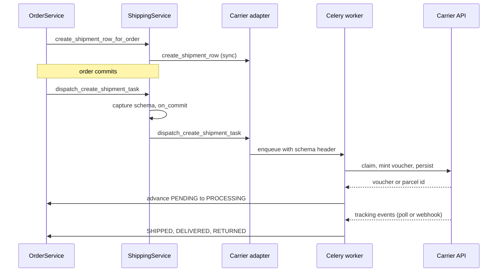
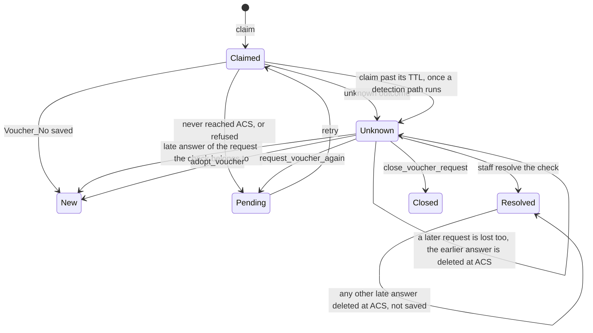
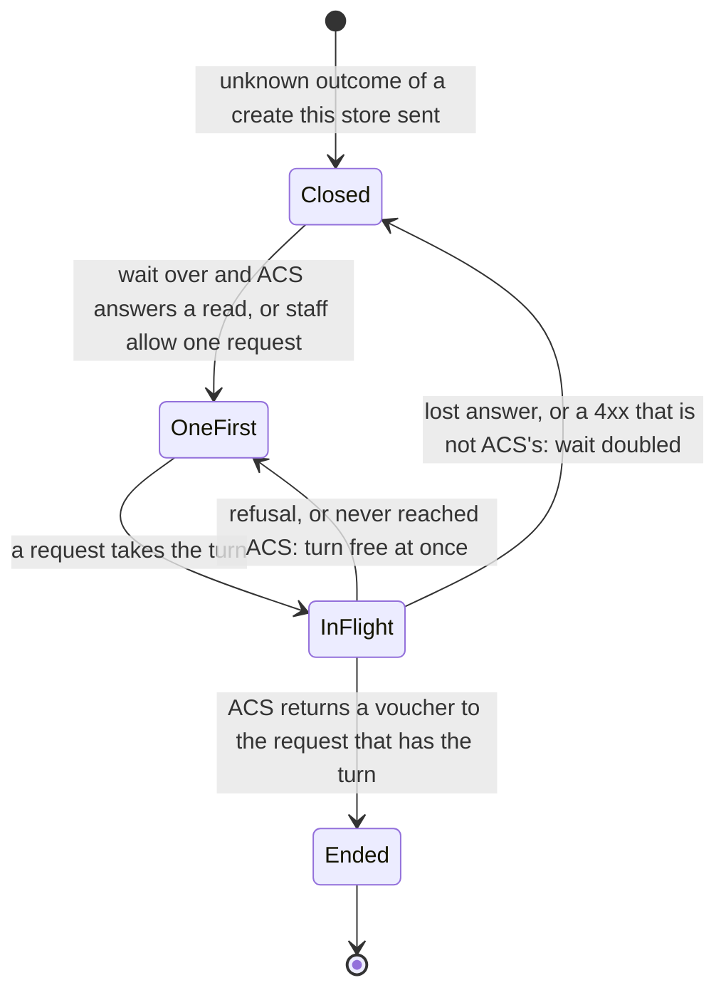

# Shipping

A carrier is an adapter class plus a database row. The adapter
(`src/shipping/interfaces.py: ShippingCarrierInterface`) is code registered
at app start; the row (`src/shipping/models/provider.py: ShippingProvider`)
is the runtime switch and capability declaration. Nothing above the
shipping layer imports a provider app — the order flow, the serializers,
the pay-way filter and the pricing calculator all go through
`src/shipping/services.py: ShippingService`, which resolves the row and then
the adapter. Price, availability and weight cap live in a third piece,
the per-tenant `src/shipping/models/rate.py: ShippingRate` table, one row per
(provider, zone, kind), where a zone (`src/shipping/models/zone.py:
ShippingZone`) is a whole country or some of its regions. Adding a courier is
one app plus one provider row plus its rates.

Three adapters exist today: ACS Courier (`shipping_acs/`, REST, polled),
BoxNow (`shipping_boxnow/`, REST plus webhook) and the merchant-fulfilled
`flat_rate` (`src/shipping/carriers/flat_rate.py`, lifecycle only: no API,
no label, no tracking).

## Diagram

## How it works

### The adapter contract

`ShippingCarrierInterface` declares the methods every carrier must have,
even as no-ops. The abstract ones are `create_shipment`,
`cancel_shipment`, `has_label`, `fetch_label_bytes`, `fetch_tracking_events`,
`serialize_shipment` and `validate_order_payload`.
The optional hooks are where a carrier states what it is, so no code
outside the carrier apps imports one (the import contract "a carrier app is
reached only through shipping" holds with no exception). Settings still name
a carrier where they configure it: its beat entries in
`src/settings/schedule.py` and its API settings in `src/settings/integrations.py`.

| Hook | Purpose |
|---|---|
| `checkout_fields` | The request fields the checkout takes for the carrier, by name. Those in `location_keys` are its pickup point (`boxnow_locker_id`, `acs_station_external_id`, …), on the quote and the order; the rest are order options (`acs_charge_type`). The order view hands what the body sent to the carrier as the payload |
| `field_rank` | Where the carrier's fields sit among the carriers' in every API body (BOX NOW, then ACS) |
| `shipment_relation`, `order_detail_prefetches` | The reverse one-to-one from `Order` to its shipment row, which `shipment_for_order` reads and the order lists join, and what the order detail prefetches below it |
| `order_shipment_field` | Its own typed field on the order detail (`boxnowShipment`, `acsShipment`), next to the generic `shipment` |
| `shipment_state`, `last_reported_at` | The state the order changelist labels; the last report the follow-up rule reads |
| `admin_order_inline`, `admin_order_search_fields`, `admin_order_list_filters` | What the order admin adds for the carrier |
| `tracking_url_template` | Its public tracking page, the order's `trackingUrl` |
| `api_urlconf`, `webhook_urlconf` | Its storefront API, mounted by `shipping.urls`, and the endpoints its courier calls, mounted at the root by `shipping.webhook_urls` |
| `create_demo_shipment` | The shipment a demo account's order shipped under (`shipping.demo`) |
| `live_quote` | Optional live price for a rate (`rate`, `country_code`, `region_id`, `weight_grams`, `currency`). The default returns `None`, meaning "charge the rate's `price`". Only ACS overrides it |
| `is_kind_enabled` | Per-kind gate a carrier controls itself, e.g. ACS Smartpoint |
| `create_shipment_row` | Persist the child row synchronously during checkout |
| `dispatch_create_shipment_task` | Enqueue the Celery task that talks to the carrier API |
| `supported_settlements` | Which settlements the carrier can physically perform |
| `filter_pay_ways` | Derived from the above; overriding it directly is almost always wrong |
| `can_cancel_shipment` | Whether the carrier would still accept a cancel, judged from local rows only, never a carrier call. It must be the same rule the carrier's `cancel_shipment` checks before it calls out, because the order's `canBeCanceled` reads it. The default `True` suits a carrier with no cancel rule (the merchant's own delivery) |

`supported_settlements` is a capability declaration, not a preference.
ACS returns `{online, courier_cash, offline_transfer}` — a courier takes
cash at a door. BoxNow returns `{online, carrier_terminal}` — nobody
meets the shopper at a locker, so `courier_cash` money would never be
collected. Merchant preferences belong in `PayWayShippingExclusion` rows,
which `PayWayService.filter_by_carrier` applies on top and which change
without a deploy.

Registration is `@register_provider` at `AppConfig.ready()` time into the
module-level `_REGISTRY` in `src/shipping/interfaces.py`. Re-registering the
same code overwrites, which is how test doubles are swapped in.

### Provider rows, and the factory trap

`ShippingProvider` carries `code` (matching the adapter), `is_active` as
the master switch, `supports_home_delivery` / `supports_pickup_point`,
`live_mode`, `priority`, a `metadata` JSON bag and two logo fields
(pickup-point rows prefer `logo_pickup_point` and fall back to `logo`).

**`src/shipping/factories.py: ShippingProviderFactory` sets
`django_get_or_create = ("code",)`.** Every other declared attribute —
`is_active`, `supports_home_delivery`, `supports_pickup_point`,
`live_mode`, `priority`, `metadata` — is passed as a `defaults` value, and
`get_or_create` ignores `defaults` when the row already exists. So a
factory call that names `is_active=True` against a code a seed migration
already created returns the **seeded** row unchanged, flags and all, and
the test or fixture silently runs against the wrong configuration. If you
need a provider in a specific state, assert or set the flags explicitly
after the factory call.

### Rates: `ShippingRate`

`ShippingRate` is tenant-scoped and is the **only** source of shipping
price, availability and weight cap. There is no settings fallback: the
six legacy `EXTRA_SETTINGS` keys (`CHECKOUT_SHIPPING_PRICE`,
`FREE_SHIPPING_THRESHOLD`, `BOXNOW_SHIPPING_PRICE`,
`BOXNOW_FREE_SHIPPING_THRESHOLD`, `ACS_SHIPPING_PRICE`,
`ACS_FREE_SHIPPING_THRESHOLD`) and `metadata["supported_countries"]` are
no longer read by anything.

| Field | Meaning |
|---|---|
| `provider` | FK to `ShippingProvider`, `related_name="rates"` |
| `zone` | FK to the store's `ShippingZone` (`CASCADE`, `related_name="rates"`): the destination the price applies to ([Shipping zones](#shipping-zones)) |
| `kind` | `ShippingKind` |
| `price` | `MoneyField` |
| `free_shipping_threshold` | `MoneyField`, nullable: `NULL` means never free |
| `max_weight_grams` | Nullable: `NULL` means no cap |
| `delivery_days_min` / `delivery_days_max` | Nullable, both or neither: the delivery estimate in business days after dispatch |
| `is_active` | Pauses the rate without losing the price |

It is unique on `(provider, zone, kind)`. `clean()` rejects a kind the
provider does not support, a currency other than the tenant's
`default_currency`, and a negative price. `HistoricalRecords` keeps the
price audit trail. The admin edits rates through an Unfold
`ShippingRateInline` on `ShippingZoneAdmin`, the page where the destination
is (Settings → Shipping Zones);
`ShippingProviderAdmin` keeps only the pay-way exclusions inline.

Countries and regions stay global reference data (`SHARED_APPS`). Every
ISO 3166-1 country is seeded (`src/country/migrations/0012_seed_iso_countries.py`),
so every country is *selectable* for a zone, and only a rate in one of its
zones makes it *shippable* for one store.

### Shipping zones

A store's `ShippingZone` (`src/shipping/models/zone.py`) has a staff-facing
`name` (unique), one `country` (cross-schema FK, `PROTECT`,
`related_name="+"`) and `regions` through `ShippingZoneRegion`, whose
`region` is unique: in one store a region is in one zone at most.

- A zone with no regions is the country's **base zone** (one per country,
  `shipping.zones.zone_errors`).
- A zone with regions covers only those, and **overrides the base zone for
  them**. "The islands cost more" is a region zone with its own rates;
  "no delivery to Crete" is a region zone with no home-delivery rate. There
  is no surcharge: a zone's rates carry the price, threshold, weight cap and
  delivery days, so a price has one source.

Resolution is one module, `src/shipping/zones.py`:

| Function | Role |
|---|---|
| `zone_for(country, region)` | The region zone holding the region, else the base zone; without a region, the base zone |
| `destination_rates(country, region)` | The rates that apply: home delivery from `zone_for`, pickup point from the base zone (a pickup point has no `Region`, so it is judged by country) |
| `standing_destinations(countries)` | Where a read that knows no region judges each country, every country in two queries: its base zone for the deliveries it offers, and, for a home delivery it does not offer, each region zone that does (offered rates only, `offered`) |
| `HomeCoverage` | Where home delivery reaches, read in one pass, counting a rate only when its carrier passes the quote's gate (`carrier_offers`): backs `?shippable=` on the region lists, `?homeDelivery=` on the countries and `UserAddress.shippable` |
| `destination_errors(...)` | `region_not_served` / `country_not_served` for a home address no home delivery reaches |
| `zone_errors`, `rate_kind_errors` | The admin's rules: one base zone per country, regions of the zone's country, a region in one zone, pickup rates on base zones only |

Every gate below reads `destination_rates`, and the quote and both
order-creation paths pass the order's region for a home delivery. The quote
resolves the carrier once and hands it to the order
(`CheckoutQuote.shipping_choice`, `OrderService._assign_shipping_provider`),
so the price charged and the carrier assigned come from the same zone, and
the automatic pick considers only carriers the quote's gate takes
(`carrier_offers`). A carrier that has the rate elsewhere in the country but not in
the region's zone raises `ShippingRegionUnavailableError` (a
`ShippingUnavailableError`), answered as the quote refusal
`shipping_region_unavailable`. A home delivery that names no carrier, to a
region no carrier's zone reaches, is refused the same way:
`resolve_home_delivery_provider` then names the country's carrier.

API additions:

- `GET /shipping/options?regionId=`: the region's zone; without it, the base
  zone (a checkout before the shopper picks a region);
- `?shippable=true|false` on `GET /region` and
  `GET /region/<alpha2>/get_regions_by_country_alpha_2`
  (`src/region/filters.py`): the regions home delivery reaches; on the
  platform host `true` lists none;
- `?homeDelivery=true` on `GET /country` (`src/country/filters.py`): the
  countries a home delivery reaches (`HomeCoverage.reached`), the address
  book's picker; `shippable` also counts pickup points, so a lockers-only
  country is shippable but takes no saved address;
- `UserAddress.shippable` (read-only, `src/user/serializers/address.py`). A
  write that moves an address where no home delivery reaches is a 400
  (`region_not_served` on `region`, `country_not_served` on `country`); an
  address kept from before a zone change reads `false`, can still be edited
  in place, and the storefront marks it and does not let checkout choose it;
- order creation refuses a region no home delivery reaches with
  `region_not_served` on `regionId`
  (`OrderCreateFromCartSerializer._validate_home_address`);
- `regionCodes` on each `GET /shipping/policy` row: the regions it applies
  to, empty for a whole-country row.

The surfaces with no address (`/shipping/policy`, `/shipping/free-shipping-info`,
`/shipping/product/<id>`, the cart's `freeShippingProgress`) are judged for
`initial_country_code()` at its `standing_destinations`, so a country served
at home only in some regions advertises those regions' prices, each policy
row naming its regions. The `shipping` and `regions_countries` cache
surfaces both declare `ShippingZone`, `ShippingZoneRegion`,
`ShippingProvider` and `AcsStation`. A write no signal reports marks every
surface that declares its model (`core.cache.invalidation.mark_model_stale`):
`src/shipping/signals.py` marks a region-set change, which is written with
`bulk_create`, and the station and locker syncs mark their deactivating
`update`. A change to a carrier credential on `Tenant`
(`tenant.credentials.CARRIER_CREDENTIAL_FIELDS`) queues
`shipping.tasks.purge_carrier_gate_surfaces` in the store's schema.

A zone's regions are written by `ShippingZone.set_regions`, which refuses a
set the zones' rules refuse. Where region zones hold every region of a country,
no home address is priced by its base zone, so the base zone's home rates count
nowhere (`shipping.zones.reaching`); its pickup points still apply.

The agent gateway lists regions with `shippable=true`
(`grooveshop-agent-gateway/internal/django/client_shipping.go`) and quotes a
home address with its region before a carrier is chosen, so the options are
the region's zone's. It treats `shipping_region_unavailable` as a refusal of
the delivery (`internal/checkout/pricing.go`), and `region_not_served` or
`region_required` on `regionId` as a refusal of the destination
(`internal/django/client_checkout.go`), named at UCP's `address_region` and
ACP's `state`. A country whose regions the store serves none of is refused
at the country (`internal/checkout/region.go`).

The move from `ShippingRate.country` to `zone` shipped in three releases
(`src/shipping/migrations/0022_shipping_zone.py` to
`src/shipping/migrations/0028_shipping_rate_drop_country_column.py`): the first
created one base zone per country a store had rates for and wrote both columns,
the second made `zone` required and took `country` out of the code, the third
dropped the column. The reference of the move is the Django repository's
`docs/order/shipping-zones.md`.

**Destination VAT and customs are not handled.** VAT is one rate per
product with no country dimension (`src/vat/`), so a rate to another EU
country charges the product's own rate, not the destination's (no OSS),
and a non-EU destination gets no customs data on the voucher. Opening
such a country is a compliance decision that this code does not make
for the merchant. `src/shipping/migrations/0011_convert_legacy_pricing_to_rates.py`
converted each tenant's old setting values into rates for the countries
in its old `supported_countries` (else GR), so no store started offering
a new country by accident; a new tenant runs the same migration and gets
a GR `flat_rate` home-delivery rate.

### The single gate: `active_rate`

Every availability decision goes through
`ShippingService.active_rate(provider_code, kind, country_code, region_id)`:
an active rate in the destination's zone, on an active provider, with a registered adapter, for a kind
the provider supports and the adapter's `is_kind_enabled` allows. The
rest is built on it:

| Method | Role |
|---|---|
| `quote(...) -> Money` | Price, evaluated in a fixed order: availability (`ShippingUnavailableError`), weight cap (`ShippingWeightExceededError`), free-shipping threshold (judged on `OrderQuoteService.threshold_value`, see [Checkout and payment](/dev/flows/checkout-and-payment#_4-shipping-method-decides-which-pay-ways-exist)), then the adapter's `live_quote` or the rate's `price` |
| `assert_available(...)` | Availability and cap without a price; used when a free-shipping promotion zeroes the cost, so a promo can never ship to a country the store does not serve |
| `shippable_country_codes()` | Countries with at least one active rate whose carrier passes the quote's gate (`shipping.zones.offered`; one adapter answer per carrier and kind, `kind_enabled_countries`), ordered by `Country.sort_order`; backs `GET /api/v1/country?shippable=true` (`src/country/filters.py`), which returns nothing on the platform host |
| `resolve_home_delivery_provider(country_code, weight_grams, region_id)` | The active home-delivery carrier with the lowest `priority` in the destination's zone; when none is in the region's zone, the country's, so the refusal names the region |
| `available_options(country_code, region_id)` | Checkout options; the country is required (400 without it), the region picks the zone |
| `free_shipping_info(country_code)` | The store's standing "free shipping from X" promise, for a page with no cart; defaults to `initial_country_code()` and echoes the `country_code` it used |
| `free_threshold_rates(country_code, weight_grams, items)` | The rates that ship free above a threshold, on the `active_rate` gate, lowest threshold first; with a cart's weight and items, only those that can carry it. Feeds `free_shipping_info` and the cart's `freeShippingProgress` ([Promotions](/dev/flows/promotions-and-gift-cards#free-shipping-one-distance)) |
| `initial_country_code()` | The first `shippable_country_codes()` entry, the country a caller with no address is judged for |
| `product_shipping_from(product)` | The cheapest delivery of one product bought on its own, for the product page ([below](#the-product-page-s-shipping-price)) |

The exceptions live in `src/shipping/exceptions.py`.

The same module roots the carrier error hierarchy. Every carrier app's
errors derive from `CarrierError` (`AcsError`, `BoxNowError`), and the
ones that mean "the courier gave no answer" derive from
`CarrierUnavailableError` as well: `AcsRetryableError` (and with it
`AcsAuthError`), `AcsConfigError`, `BoxNowRetryableError`,
`BoxNowAuthError` and `BoxNowConfigError`. Order code tells a refusal
from an outage by these two classes alone, without importing a carrier:
a customer cancel answers 400 `parcel_with_courier` for a `CarrierError`
and 503 `courier_unreachable` for a `CarrierUnavailableError`
([Order lifecycle](/dev/flows/order-lifecycle)). A new carrier gets the
same behaviour by deriving its errors the same way.

The other endpoints that call a carrier tell the two apart the same way,
through `src/shipping/api_errors.py: unanswered`: the BoxNow nearest-locker
lookup, ACS address validation and every staff cancel endpoint (the
carriers' own `cancelBoxNowShipment` and `cancelAcsShipment`, and the
order's `shipment_cancel`). A carrier that gives no answer is a 503
`carrier_unavailable` whose `detail` is written for a client; the carrier's
own text goes to the log, never into the body. A refusal raised with no
carrier call because the same work is already running
(`CarrierBusyError`, raised as `BoxNowBusyError` or `AcsBusyError`: a mint
or cancel in flight, a BoxNow creation still settling) is a 409
`carrier_request_in_progress` whose `detail` says what to wait for.
`CarrierBusyError` is a `CarrierUnavailableError`, so Celery retries it and
a customer cancel still answers `courier_unreachable`. A carrier's real
refusal keeps its 400.

#### Lock order: the order, then the shipment

A carrier path that needs both rows locks them through
`src/shipping/locks.py: lock_with_order`: the order first, then the shipment,
never one joined `select_for_update().select_related("order")` (one statement
that locks the shipment's row before its order's, which deadlocks against a
staff cancel that locks the order first). A path that only touches the shipment
locks the shipment alone and does not write the order in that transaction. An
order cancel holds no shipment lock at all: it commits, then asks the courier
([Order lifecycle](/dev/flows/order-lifecycle#staff-and-system-cancels-are-best-effort-at-the-courier)).
ACS's `cancel_voucher` never reads or writes the order, so it locks the
shipment alone. BoxNow and ACS use the same function.

### Method offering at checkout

`ShippingService.available_options` iterates the active rates of the
requested destination (`destination_rates`) and emits one row per rate that passes
`active_rate`. Each row carries the quoted price, `country_code`,
`max_weight_grams` and `exceeds_max_weight`, the kind-aware logo URL,
and the pay-ways that combination can settle — resolved by calling the
same `PayWayService.filter_by_carrier` the checkout calls, so the
delivery step can never advertise a method the payment step would
refuse. An over-cap option is **listed and flagged, not dropped**, so a
heavy cart to a capped destination (BoxNow Cyprus, 4000 g) gets a
disabled option with a reason instead of a silently empty step. Rows
sort by `(priority, provider_code)`.

Order pricing goes through the same service. `OrderQuoteService.shipping_cost`
(`src/order/checkout/quote.py`) is the single entry point for every caller
(`POST /cart/quote` in `src/cart/views/cart.py`, and order creation) and
calls `ShippingService.quote`; `OrderQuoteService.quote` hands it the
threshold value, so the quote and the order agree for the same pricing inputs. The inputs can change
between two requests (a price, a promotion, a rate), and then the later total
differs: every order is created with the quote's `expectedTotal`, which is
required, and only at that total (409 `total_changed`
otherwise; see [Checkout and payment](/dev/flows/checkout-and-payment#one-total-the-checkout-quote)).
The `shippingOptions` of the quote are the `available_options` rows priced as an
order would be, each with `waivedBy`. A delivery that cannot be priced is a
`ShippingRefusedError` (an `InvalidOrderDataError`): the quote answers it with
a code of its own (`shipping_unavailable`, `shipping_parcel_too_large`,
`shipping_weight_exceeded`, `src/shipping/enum/refusal.py`), order creation
with `invalid_order_data` and `fieldErrors`. A
live carrier price is resolved before the order-create transaction and read
from the adapter's cache inside it (`ShippingService.resolve_live_price`). A bare `home_delivery` request resolves through
`resolve_home_delivery_provider`, and `_resolve_shipping_provider` uses
the **same helper** to set the order's FK — otherwise the order would be
priced against one carrier's rate and served by another.

### The product page's shipping price

`GET /api/v1/shipping/product/<product_id>` answers what shipping one
product costs bought on its own, for the product page's assurances box
(the store preference `productAssurances`, every design).
`ShippingService.product_shipping_from(product)` prices a cart holding one
unit of it and nothing else, as checkout would, for a shopper not known
yet:

1. The country is `initial_country_code()`, the one checkout preselects.
2. `PromotionEngine.evaluate_single_unit(product)` runs the cart's own
   classification, stacking and clamp over a one-line cart priced at
   `final_price`, with the live automatic promotions only (no code; a
   `first_order_only` promotion is left out, as for any anonymous cart).
3. The order value is `OrderQuoteService.threshold_value` of that price
   after the discount, so a carrier's threshold is judged as checkout
   judges it, and the promotion's `free_shipping` waives every carrier.
4. `available_options` prices every offered delivery with the parcel the
   cart would ship (the product plus the promotions' gifts, `gift_pairs`).
   A row flagged `exceeds_max_weight` or `exceeds_parcel_size` cannot carry
   it and does not count; a live-priced carrier (ACS) is asked for the
   parcel's weight bracket.

The response is `{estimate}`: the cheapest `price` with its `currency`,
`free` (`price` is 0), `countryCode`, and `freeShippingThreshold`, the
lowest threshold of `free_threshold_rates(country, weight_grams, items)`,
the carriers that can take the product. `estimate` is `null` when the store
ships nowhere or no delivery it offers can take the product; a missing or
inactive product is a 404. It is not a field of the product, which would
tie the product cache to every rate and promotion.

The Django view (`ProductShippingView`) is cached by `@cache_methods`, and
the storefront's route by Nitro under the name `shipping.product`, per store
and product. Three surfaces purge both, since three kinds of edit move the
answer: `shipping` (a rate or a provider), `products` (the product's price,
weight or size) and `promotions`. The names are
`PRODUCT_SHIPPING_VIEW` and `PRODUCT_SHIPPING_HANDLER` in
`src/shipping/cache_surfaces.py`. A live ACS price can move within the TTL.

On the storefront, `useProductAssurances(productId)` puts the line on the
delivery row: "Μεταφορικά από 1,99 € · δωρεάν άνω των 39,90 €", the price
alone when no carrier that takes the product ships free, or "Δωρεάν
μεταφορικά". It is the note under the delivery days, or the row's own text
when the store entered no delivery days, and never sits under the ways to
pay, where it would read as the cash-on-delivery fee. A cart that already
has a route to free shipping leaves the line out: the product page's
free-shipping notice shows the cart's own distance instead.

### Dispatch on transaction commit

`ShippingService.dispatch_create_shipment_task` captures
`connection.schema_name` and then wraps the per-carrier dispatch in
`transaction.on_commit`. Both halves matter. Without the deferral the
worker looks up the order on a different connection before the creating
transaction has committed and gives up permanently, because
`Order.DoesNotExist` is not retryable. Without the captured schema, an
`on_commit` that fires after the request's tenant context has unwound
dispatches against the public schema and fails the same way.

The shipment **row** is created synchronously during checkout
(`create_shipment_row_for_order`); only the carrier API call is deferred.

## ACS Courier

### Voucher creation

`AcsService.create_voucher_for_order` is a three-phase design so the
carrier API call never happens with a Postgres row lock held:

1. **Claim** — short atomic block: lock the shipment, short-circuit if a
   `voucher_no` exists, sync `cod_amount`, stamp
   `metadata["mint_started_at"]`.
2. **API call** — no lock, no open transaction.
3. **Persist** — fresh atomic block with `select_for_update` and a race
   re-check. A voucher no shipment uses (it lost the race, or its answer
   is stale) is recorded in `metadata["orphan_vouchers"]` under the lock,
   and the block commits.
4. **Delete the unused voucher** (`_delete_unused_voucher`) — no lock, no
   open transaction. Deleted at ACS, the number comes off the list; any
   failure keeps it there and, best effort, records it at once as a voucher
   matching no order (`source=refused_delete`). If that record fails too,
   an ERROR log and `orphan_vouchers` still hold the number (see below).

The claim TTL is 300 seconds (`_MINT_CLAIM_TTL_SECONDS`). It was 90 until
a slow ACS round trip let a second worker re-mint and leak an orphan
voucher. A claim older than the TTL with no `voucher_no` means the request
is still in flight or a worker stopped after it may have left. Expiry alone
changes nothing: the shipment enters the unknown-outcome state below only
when a detection path runs: the claim check of the next
`create_voucher_for_order` for that order, `reset_shipment_for_remint` (the
admin's "Issue ACS voucher now" on a canceled shipment), or
`AcsService._record_expired_claims`, which the pickup-list refusal hook
(`_raise_unrecognised_vouchers`) and `delete_unrecognised_voucher` call.
Until one runs, the alert and the dashboard counter lag.

### A voucher request with an unknown outcome

`ACS_Create_Voucher` has no idempotency key, and no documented ACS call
finds a voucher by our reference before it is on a pickup list. A request
whose answer was lost may therefore have created a voucher, and sending it
again may create a second one. So such a request is never sent again by
the code: the shipment waits for staff.

**One HTTP retry rule for both carriers.** Both clients send through the one
session `src/shipping/carrier_http.py: carrier_session()`, whose adapter
follows `CARRIER_RETRY`, and neither mounts a retry of its own. A request that
never connected (a connect timeout, a refused connection) is sent again
whatever its method, since nothing reached the courier. A GET is also sent
again after a 5xx or a lost answer. A POST or PUT never is once it may have
reached the courier, because neither courier can tell a re-sent write from a
new one; the client raises its own error and the caller decides. ACS sends
only POSTs, so for ACS the rule is "retry only a connect failure"
(`AcsClient.worst_case_request_seconds` reads the connect budget from
`CARRIER_RETRY`). A client built with an injected session keeps that session's
own policy.

**Which failure leads where.** The client classifies a failure where it is
raised (`AcsClient._exchange`, `_never_connected` in `src/shipping_acs/client.py`):

| Failure | Raised as | The claim |
|---|---|---|
| A connect timeout; a connection refused or a failed DNS lookup (no connection ever existed); the request cap, raised before the POST | `AcsRetryableError` | released; Celery retries |
| HTTP 403 / 406 | `AcsAuthError` | released; Celery retries |
| An ACS refusal (`ACSExecution_HasError`, a value-row `Error_Message`) | `AcsAPIError` | released; `ops.shipment_rejected`; no retry |
| Any other HTTP 4xx (a proxy's or a gateway's: the manual has 200, 403 and 406 only) | `AcsUndocumentedHttpError`, an `AcsAPIError` | released; no retry; staff are told to send it again, not to fix an address (see the voucher hold below) |
| A read timeout; any other connection error; any 5xx; a 200 whose body is not JSON | `AcsOutcomeUnknownError`, a subclass of `AcsRetryableError` so reads keep retrying | **unknown** |
| An exception the client does not classify; a 200 with neither `Voucher_No` nor `Error_Message` | | **unknown** |
| A claim older than its TTL | | **unknown once detected** (see the paragraph above): by itself it only marks the claim expired |

`create_voucher_for_order` turns an unknown outcome into
`AcsShipment.voucher_request_unknown_at` (a column, not a new
`shipment_state`: `ShipmentStateEnum` is in `schema.yml`, so a new value
would be a two-release API change). On entering the state it drops the
claim, writes an order note, sends `ops.acs_voucher_request_unknown` once and
raises `AcsVoucherRequestUnknownError`. While the column is set, every
call raises the same error: the task (it returns `status:
voucher_request_unknown`, with no retry and no second alert), its retries, a
re-dispatch and the admin "Issue ACS voucher now", which refuses with a
message first. The stale digest's stranded-mint class excludes these
shipments (`src/shipping_acs/attention.py: voucher_request_unknown_q`), because
its remedy is exactly what must not happen to them.

**Ways out of the state** (all in `src/shipping_acs/services.py`):

- `AcsService.adopt_voucher(shipment, voucher_no, user=..., confirmed_by_hand="")`:
  staff found the voucher in the ACS portal. Refused
  (`AcsVoucherResolutionError`) when the shipment is not waiting or its order
  no longer needs a voucher, when any shipment carries the number (its voucher,
  a multipart child, `previous_vouchers`, `orphan_vouchers`), or when
  `_confirm_voucher_at_acs` cannot confirm it. ACS must first hold the voucher
  for the store: a row from `ACS_Trackingsummary`, or an open
  `AcsUnrecognisedVoucher` named by a refused pickup list (`source=pickup_list`;
  a `refused_delete` row is not evidence). One exception: a `refused_delete`
  row whose `duplicate_of` is this shipment is accepted with `confirmed_by_hand`
  even when the summary is empty. The **only automatic yes** is the summary's
  `recipient` equal to the `Recipient_Name` the lost request sent
  (`_recipient_sent`: the recorded request, else the `AcsApiCall`, else the
  order as it is), compared without accents, case or extra spaces, when no
  other waiting shipment (`voucher_requests_waiting`) sent the same name. A
  different or masked name, no recipient, a voucher known only from a refused
  pickup list, or a twin order are all refused with a message; a non-empty
  `confirmed_by_hand` overrides them (after the "ACS holds it" check), is
  recorded as `confirmed_by: staff` and written to the order note. The checks
  run again under the row lock, and a concurrent adopt of the same number gets
  the same refusal instead of an `IntegrityError`. No create is sent.

  Observation, read-only on production, 2026-11-10 (not a guarantee of ACS's
  behaviour). Source: the comment "After merge: what was checked, and where"
  on grooveshop-django-api pull request 626, which records 8 vouchers.
  `ACS_Trackingsummary` returned `recipient` unmasked, and it matched the
  order's recipient name in 8 of 8. `consignee`
  is a different field (who received the parcel), not the recipient. A retired
  voucher returned an empty summary. The manual's own example masks every
  personal value, so the comparison stays a refusal-with-override, not an
  assumption.
- `AcsService.request_voucher_again(shipment, user=..., note=...)`: staff
  found no voucher. Refused when the order no longer needs a voucher. Clears
  the column, notes the order and queues the mint once after the commit
  (`dispatch_on_commit`).
- `AcsService.close_voucher_request(shipment, user=..., note=...)`: for a
  shipment that `attention.needs_no_voucher` (state `CANCELED`, or the order
  `CANCELED` / `REFUNDED`). Needs a note, refuses an order that still needs its
  voucher, clears the column, notes the order, sends nothing to ACS. Such a
  shipment stays in `voucher_requests_unknown()` (counted) until closed, but is
  not in `voucher_requests_waiting()`.
- An unknown state belongs to a request: `_set_voucher_request_unknown`
  moves the claim (`mint_started_at`) into `metadata["unknown_request"]`, and
  `_forget_voucher_request_unknown` clears both. In `create_voucher_for_order`
  Phase 3 an answer is saved (and clears the state) only when the row still
  holds its claim, or the pending check is its own request's
  (`unknown_request` equals its claim). Otherwise it is stale: staff
  resolved the check (request again, close, adopt another voucher), or a
  **later** request took the check (it was lost too), or no identity was
  recorded. A stale answer is not saved, and not offered for adoption: Phase
  3 records it in `metadata["orphan_vouchers"]`, and Phase 4 deletes it at
  ACS and settles its unrecognised row as `deleted`. If the delete fails,
  for any reason, the number stays in `orphan_vouchers` and
  `_keep_unrecognised_vouchers` records it at once as an
  `AcsUnrecognisedVoucher` with `source=refused_delete` and `duplicate_of` the
  shipment. It reopens a row staff had marked `checked` (a `deleted` or
  `adopted` row keeps its resolution and gains the link only). That record is
  best effort, after Phase 3 has committed: if it fails, an ERROR log
  ("could not be recorded as a voucher matching no order", with the number)
  and `metadata["orphan_vouchers"]` on the shipment are all that keep the
  number, so the list of vouchers matching no order may miss it; search the
  logs for that line or read `orphan_vouchers`.
- **What staff must still not do.** If staff delete the voucher in the ACS
  portal *before* resolving the check, the check is still open and is that
  request's own, so Phase 3 saves the dead number; staff resolve first, then
  delete (portal or `Delete at ACS`).
- **A request releases or loses only its own claim** (`_voucher_request_lost`
  checks the row still holds the claim it was sent under). An old request
  that ends unknown *after* staff resolved its check, and whose claim was
  not recorded as unknown, writes one order note and sends one
  `ops.acs_voucher_request_unknown` alert with the `after_resolution`
  wording ("ACS may hold one more voucher for this order"), once per claim
  (`metadata["late_unknown_alerted"]`). It sets no state and adds no
  dashboard count: there is no number to list.
  The note and alert say to delete any voucher the shipment does not use, so
  staff must first let the new request finish (worst case about 78 s at the
  default `ACS_HTTP_TIMEOUT`, `worst_case_request_seconds`; the mint claim TTL
  is 300 s): a new request's voucher can be visible at ACS before the shipment
  saves it, and deleting it would leave a dead number on the shipment.
- `reset_shipment_for_remint` clears the column beside a real voucher and
  keeps it on a shipment with no voucher. It refuses while a mint claim is
  younger than its TTL (the shipment was canceled with a request out: a
  stale answer would now be deleted, and a refused re-mint would leave no
  voucher). An expired claim becomes the unknown state, committed, and the
  reset raises `AcsVoucherRequestUnknownError`, so nothing is queued; the
  admin's "Issue ACS voucher now" shows the check guidance
  (`voucher_check_message`).

**Vouchers matching no order.** A refused `ACS_Issue_Pickup_List` names every
unprinted voucher of the account. A number that is neither a shipment's
voucher nor a child of one is kept as an `AcsUnrecognisedVoucher`
(`_raise_unrecognised_vouchers`, `vouchers_matching_no_shipment`); the first
time it is named, `ops.acs_unrecognised_vouchers` is sent, and the task result
lists it under `unrecognised`. While a mint is in flight (a claim younger than
its TTL) the run records nothing. A shipment that saves the number, by a mint
or by `adopt_voucher`, resolves the row as `adopted`. Staff resolve the rest:

- `delete_unrecognised_voucher(row, user=..., note=...)` calls
  `ACS_Delete_Voucher` and resolves the row as `deleted`, keeping the note.
  It first turns every expired mint claim into the unknown state
  (`_record_expired_claims`). Under the row's lock it refuses when a
  shipment's own voucher or multipart child is the number, while a mint is in
  flight, and while any shipment in `voucher_requests_waiting()` exists (the
  voucher may be that order's lost one, and a deleted voucher can no longer be
  adopted); the refusal names the orders. A shipment that needs no voucher
  does not hold it back, and a recorded duplicate (`orphan_vouchers`,
  `previous_vouchers`) may be deleted. A mint that deleted its own duplicate
  resolves the row through `_settle_unrecognised_vouchers`. ACS's own
  refusal, for a voucher already on a pickup list, is raised as it is and the
  row stays open.
- `mark_unrecognised_voucher_checked` resolves it as `checked`, with a note.

Nothing is deleted automatically: a voucher made in ACS's own portal looks
the same as an orphan.

**Where staff see it.** The shipment admin
(`src/shipping_acs/admin.py: AcsShipmentAdmin`) has the detail actions
`adopt_voucher`, `request_voucher_again`, `close_voucher_request` and the `voucher_unknown` value of
the "Needs attention" filter; `AcsUnrecognisedVoucherAdmin` has `delete_at_acs`
and `mark_checked`. The store dashboard counts both
(`src/admin/dashboard/store/queries.py`, `acs_voucher_requests_unknown` and
`acs_unrecognised_vouchers`); the cache key of that dict is versioned, so a
pod never reads the old shape.

### The voucher hold: requests wait while ACS is failing

The previous section stops one order after one lost answer. An ACS that
answers 5xx, or accepts connections and hangs, would do that to every order
placed while it lasts: one portal check and one email each. So the first lost
answer begins a **voucher hold** for the store. While it is closed no
`ACS_Create_Voucher` is sent; once one request first is allowed, only the
request that takes the turn is. The waiting requests are a known outcome
(nothing reached ACS), not an unknown one: they are stamped, not marked for
a check, and a task sends them once ACS returns a voucher. The rule that an
unknown request is never sent again by code is untouched, and every 5xx is
still an unknown outcome.

The state is one row, `AcsVoucherHold`, in the store's schema (the ACS
credentials are per tenant, so one store's hold never holds another's). It is
not a cache key: a cache flush or an unreachable Redis must not reopen it,
staff read it in the admin, and each span stays as a record. At most one row is
in force (`ended_at` empty), enforced by the constraint
`acs_voucher_hold_one_in_force`.

`Closed` is `trial_allowed_at` empty: nothing is sent. `OneFirst` is
`trial_allowed_at` set and no turn taken: the next request takes the turn.
`InFlight` is the turn taken (`trial_request`, until `trial_until`): every
other request is held. A hold with nothing left to send stays in `OneFirst`
(the next order's request goes alone, and its voucher ends the hold) and is
not a dashboard row.

**What begins it.** Only the unknown outcome of a create this store *sent*
(`AcsService._voucher_request_lost` calls `voucher_hold.record_unknown_outcome`).
An expired claim does not: that is a worker that stopped at least 300 seconds
ago and says nothing about ACS now. Other aliases are not held: the reads fail
far more often and cost nothing, and `ACS_Delete_Voucher` and
`ACS_Issue_Pickup_List` run once a day or by hand.

**Where a request is held.** Twice, so an outage costs the requests in flight
and not the ones queued behind them:

1. Before the claim, in `create_voucher_for_order` Phase 1 (`voucher_hold.holding()`):
   the shipment gets `voucher_request_held_at` (the first stamp stays: it is how
   long the order has waited), no claim is taken, `AcsVoucherRequestHeldError`
   is raised.
2. Inside the request slot, as the last thing before the POST
   (`AcsClient._admit_voucher_request` calls `voucher_hold.admit`): a request
   that waited for its slot behind the one that failed is decided after that
   failure was recorded. The claim it took is released and the shipment is
   stamped in one save. A hold that cannot be read sends nothing and is
   retried (`AcsVoucherRequestNotSentError`).

`AcsVoucherRequestHeldError` is an `AcsVoucherRequestNotSentError`, which is an
`AcsRetryableError`, so `_outcome_is_known` is true for it. It never sets
`voucher_request_unknown_at`, writes no `last_error`, sends no alert, and
writes no `AcsApiCall` row (a request stopped at its slot is not a call).
`create_acs_voucher_for_order` returns `voucher_request_held` without using its
retries, which an outage outlasts.

#### The rule table

The rule is the table in the docstring of `src/shipping_acs/voucher_hold.py`;
`create_voucher_for_order` only reports which row happened. The last column is
for the request that has the turn.

| Outcome (function) | The order | The hold, when the request has the turn |
|---|---|---|
| ACS returns a voucher (`record_voucher`) | saved; the save clears `voucher_request_held_at` | **ends**: creating a voucher works |
| ACS refuses in its own envelope: `ACSExecution_HasError`, a value-row `Error_Message` (`record_refusal`) | rejected, staff's to fix, no longer held | stays "one request first", the turn free at once |
| An HTTP 4xx that is not ACS's envelope (`record_no_answer`) | a held order stays held while a hold is in force; with none, or if it was not held, rejected and staff are told to send it again | **closes again, the wait doubled**. Begins no hold |
| Unknown outcome (`record_unknown_outcome`) | unknown state, no longer held | closes again, the wait doubled |
| Never reached ACS: a connection never made, 403/406 (`record_not_sent`) | stays held if it was | stays "one request first", the turn free at once |
| Stopped before its turn: the request cap, a hold that could not be read | stays held if it was | unchanged: it never had the turn |

**The turn belongs to the request that took it.** `AcsVoucherHold.trial_request`
is `<shipment pk>:<that request's mint claim>` (`AcsService._request_id`): the
claim alone is a timestamp, unique per shipment only. `AcsClient.create_voucher`
carries it as `request_id` to `voucher_hold.admit`, and every report to the hold
names its request. Only the owner settles the turn (`_has_the_turn`). Another
request of the store can still be out while the turn is taken (it left before
the hold began, or its own turn ended with its lease and the next request took
it). Its outcome is its own order's and leaves the hold as it is:

- its voucher does not end the hold (a decision, not a measurement: it left
  before the lost answer the hold began with, so it shows nothing newer);
- its refusal, its 4xx and its "never reached ACS" free and double nothing;
- its unknown outcome begins a hold when there is none. On a hold in force it is
  only recorded as the last failure (a closed hold waits from it again).

**The lease and the tick.** `admit` takes the turn for
`client.worst_case_request_seconds` (78 seconds at the default
`ACS_HTTP_TIMEOUT`, the slot's own lease), under a row lock
(`select_for_update`, so across workers whoever locks first takes it and the
rest are held). The sweep runs every 300 seconds, so a turn nobody gave back (a
worker that stopped) is over before the next tick; a test fails if
`ACS_HTTP_TIMEOUT` is raised to where that stops being true. Every known outcome
gives the turn back at once. A request whose lease ran out still has the turn
until another request takes it, so its late answer still decides.

**The wait.** `AcsVoucherHold.retry_after` is `last_failure_at` plus
`ACS_VOUCHER_HOLD_RETRY_SECONDS * 2 ** failed_trials`, capped at
`ACS_VOUCHER_HOLD_RETRY_MAX_SECONDS` (300, 600, 1200, 2400, 3600 seconds at the
defaults). Only a failure of the request that has the turn adds to
`failed_trials`.

#### The sweep: `issue_held_acs_vouchers`

A held request outlives the task's retries, and there was no task that issues
missing vouchers, so `src/shipping_acs/tasks.py: issue_held_acs_vouchers` is the
one retry. Beat entry `issue-held-acs-vouchers` runs
`tenant.tasks.fanout_issue_held_acs_vouchers` every 5 minutes per store
(`expires: 240`); it skips a store without ACS credentials. Per store:

- **Closed:** nothing before `retry_after`. Then
  `AcsService.acs_answers_a_read()` asks `ACS_Get_Pickup_Lists` for today: it
  writes nothing, needs nothing of ours and the store's key already calls it. A
  day with no pickup list is an answer too (observed, read only). If it fails,
  nothing else is sent. If it answers, `voucher_hold.allow_trial()` opens
  "one request first".
- **One request first, no request in flight:** dispatch **one** held request.
- **One request first, turn taken (or closed again meanwhile):** dispatch
  nothing.
- **No hold:** dispatch every held request, at most `max_per_run` (100) a run,
  spaced by `ACS_POLL_DISPATCH_SPACING_SECONDS` so they do not queue for a
  request slot and spend their retries on it.

The queue is `src/shipping_acs/attention.py: voucher_requests_held`: stamped,
without a voucher, not of unknown outcome, not an order that no longer needs a
voucher. **Rotation:** the sweep writes `AcsShipment.voucher_request_retried_at`
before it dispatches and chooses the order tried longest ago (never tried first,
then held longest, then pk). So no order is the one request sent first on every
tick, whatever becomes of it. A separate column, not a re-stamp of
`voucher_request_held_at`, which is how long the order has waited; it is
excluded from the shipment's history like `last_polled_at`.

**Staff.** `AcsVoucherHoldAdmin.allow_one_request` ("ACS answers again: send one
request", `permissions=["change"]`, a POST dialog) calls `allow_trial()` and
acts on its answer: a second press while one request is already allowed changes
nothing, writes no admin log entry and dispatches nothing. Otherwise it writes
the log entry and dispatches `issue_held_acs_vouchers` on commit. It skips the
wait and the read, not the one-request rule. The shipment filter value
`voucher_held` and the read-only `voucher_request_held_at` field are in
`src/shipping_acs/admin.py`; the dashboard row is `acs_voucher_holds` in
`src/admin/dashboard/store/queries.py` (cache key `store:attention:v3`), drawn while
the hold is closed or requests wait behind it
(`attention.voucher_holds_holding_requests`).

#### With request identity (`unknown_request`)

- A held request takes **no claim**, so no `unknown_request` can name it; held
  before the claim, neither `_release_mint_claim` nor `_voucher_request_lost` is
  called. Stopped at its slot, it releases only the claim it took a moment
  earlier.
- The request sent first is a mint like any other, with its own claim. If its
  answer is lost, `_voucher_request_lost` reports it to the hold and
  `_set_voucher_request_unknown` records `metadata["unknown_request"]` = that
  claim and clears the held stamp.
- `_release_mint_claim` settles the held stamp only while the row holds the
  request's own claim, and of Phase 3's three outcomes only "saved" clears it
  (together with the voucher). A stale answer saves nothing and leaves the
  stamp, which by then belongs to a later request.
- A held request is never "in flight" for the reset, the pickup-list run or a
  delete (`AcsService._mint_in_flight()`).
- `voucher_request_unknown_at`, `unknown_request` and `mint_started_at` are
  written only where they were before.

#### A bare HTTP 4xx: `AcsUndocumentedHttpError`

The manual documents 200, 403 and 406, so a 400/401/404/429 is a proxy's or a
gateway's. `AcsClient._exchange` raises `AcsUndocumentedHttpError`
(`src/shipping_acs/exceptions.py`, an `AcsAPIError`) for any other 4xx, so it is
no longer told from ACS's refusal by `raw` being empty. Like every 4xx it is a
known outcome, but it says nothing about the order, so staff are not told to fix
an address. While a hold is in force a held order stays held, and the task
returns `voucher_request_held`. With no hold in force (or for an order that was
not held) the stamp is cleared and `alert_admins_shipment_creation_failed` says
to send the request again, so nothing is repeated tick after tick unnoticed.
`record_no_answer` returns whether a hold is in force; a hold that cannot be
read counts as in force.

**Before the claim**, `create_voucher_for_order` ends with the stamp: kept for
`AcsConfigError`, a claim inside its TTL, a hold, and any other error; cleared
for `ShipmentAwaitingPaymentError` (raised after the block commits), an
`AcsVoucherRequestUnknownError`, and the saved voucher.

**Not verified.** ACS itself: everything runs against a fake HTTP session, so
whether a real outage looks like the cases tested (which status, how long a
hang) is unknown. That `ACS_Get_Pickup_Lists` keeps answering while
`ACS_Create_Voucher` fails (or fails with it) was not observed; both are handled
by sending one request first. What ACS sends for a refusal that is not a
validation error is treated as a refusal. Two workers racing for the one request
rely on the row lock and were tested on one connection only. A held order that
gets the same 4xx from a proxy every time while a hold is in force is tried
again at each turn it gets.

### The contract is cash-on-delivery only

Every voucher is minted with `Charge_Type = COD`, whatever the order's
pay way. What varies is the amount: `cod_amount` is synced to the order
total **only** for `COURIER_CASH` pay-ways. An online-paid or
locker-settled order ships at `0,00` so the courier collects nothing at
the door.

Two encodings on the wire are easy to get wrong:

- **`Cod_Ammount` is Greek-locale.** ACS reads a dot as a thousands
  separator, so `"47.01"` becomes 4701 and trips the cash cap. The value
  is quantised to two places and written comma-decimal, always, even at
  zero.
- **`Cod_Payment_Way` is omitted when the amount is zero.** Sending `0`
  (cash) tells the driver to collect nothing, which some log as a
  confused proof-of-delivery entry.

`Delivery_Notes` carries `Order.customer_notes` through
`src/shipping/services.py: sanitize_delivery_notes`, which collapses
whitespace runs and caps at 500 characters — an embedded carriage return
can be read as a record separator by ACS.

### Pricing and station countries

ACS is the only adapter with a `live_quote`: it returns
`_fetch_live_quote` only when `ACS_DYNAMIC_PRICING_ENABLED` is on, and
`None` when the setting is off or the live call fails, in which case
`quote` charges the rate's `price`. The free-shipping threshold is
applied before `live_quote` is ever called.

The station sync in `src/shipping_acs/tasks.py` covers the countries that
have an active ACS rate; `AcsService.sync_stations(country=...)` takes
the country as a required argument. The voucher uses `order.country_id`
and `live_quote` receives the real destination country and region, so
no ACS path assumes Greece: which countries ACS serves is rate data.
The `ACS_SUPPORTED_COUNTRIES` setting and `src/shipping_acs/config.py:
default_country` are gone.

### The storefront's pickup-point picker

A carrier whose adapter sets `usesGenericPicker: true` (ACS) is picked in
one modal, `Checkout/GenericLockerPicker.vue` and webside's copy, whose
logic is `useLockerPicker`. It reads only the carrier's whole catalogue
(`carrier.fetchAll`, `GET /api/shipping/lockers/acs?country=`: every
active Smartpoint of the country, cached an hour with six hours of
stale-while-revalidate), loaded once per country while the modal is open,
and everything else runs in the browser:

- **Search** sits above the map and the list, so the first screen (the
  map) is searchable. Each word the shopper types must start a word of the
  locker's name, address, city or postcode, compared in one folded form
  (`app/utils/lockerSearch.ts`): case, Greek accents, final sigma and the
  common Greeklish spellings meet («Πειραιάς», «peiraias», «pireas»). The
  list shows the matches (30 at most, then "type more") and the map frames
  them.
- **An address.** A search that names no locker («Καλαμά 25») is placed
  by the carrier's own geocoder (`ShippingCarrier.geocode`; ACS through
  its address validation, `POST /api/shipping/acs/address-validation`),
  after a 700 ms pause: as typed, then with the checkout's city, since ACS
  places a street only with its city or postcode. The address becomes
  the origin, with a dot on the map. A search that still finds nothing
  frames the origin (the postcode or the shopper's position); with no
  origin at all, the map keeps the view it had.
- **Origin.** The checkout postcode is the starting point (the middle of
  its lockers, or of its three-digit area when it has none), until the
  shopper shares their position. Rows are sorted by distance from the
  origin; with no search the list shows the nearest and the map frames
  them around it. A postcode whose area has no placed locker gives no
  origin (`postcodeCentre` returns `null`): with no position and no
  search, the list asks the shopper to search and the map shows the whole
  catalogue.
- **Location** (`useShopperLocation`) is one coarse fix on the
  shopper's click on "My location", which clears the search first.
  Opening the picker never asks, except
  when the browser already reports the permission as granted, where it
  asks nothing and the map centres by itself. Denied and no fix in time
  each leave a line under the search, and a browser without geolocation
  shows no button; the search works in every case. The storefront's
  `Permissions-Policy` must allow `geolocation=(self)`.

A catalogue that fails to load is an error with a retry. The bulk route
refuses to cache an empty answer (503), so a store whose stations have not
synced yet recovers on the first request after the sync.
A store without ACS credentials is skipped by the sync (rows an earlier
sync left stay, but nothing refreshes them) and its checkout never offers
ACS. Django's station routes answer it a plain 404
(`AcsStationViewSet.initial`,
`grooveshop-django-api/src/shipping_acs/views/station.py`), which the bulk
route forwards when it asks Django, so a stray request there is a warning,
not a server error. A catalogue the bulk route cached before the
credentials were removed is served until that entry expires.

### Labels and the pickup list

`Print_Type` defaults to **1, thermal/roll** (`src/shipping_acs/config.py:
print_type`), overridable per tenant through
`ShippingProvider.metadata["print_type"]`. Value 2 is the laser layout,
four vouchers per A4. ACS accepts nothing else.

**`_mark_label_printed` is the one choke point.** Every label download —
the order API, the carrier adapter, both admin paths — goes through
`AcsService.fetch_label_bytes`, which stamps `label_printed_at` on the
cache-hit path as well as the miss, and is idempotent (first print
wins). That is why "printed" means the same thing to the 16:30
manifest whichever button the merchant used.

**Bulk print is ours, not ACS's.** `ACS_Print_Voucher` takes a single
`Voucher_No` and no alias in the manual prints more than one, so
`AcsService.fetch_labels_pdf` makes N calls — each already cached for an
hour by `fetch_label_bytes` — and concatenates the pages with `pypdf`
into one document. One file is one job on the thermal roll, which is the
point: printing is what lets ACS collect a parcel, the operation that
unblocks a manifest is "print everything outstanding", and doing it one
change page at a time is how a voucher gets missed. WeasyPrint was
already a dependency but renders HTML to PDF and cannot concatenate
existing documents, hence the new pin.

Two failure shapes are deliberate, and pinned by
`tests/unit/shipping_acs/test_admin_bulk_print_labels.py`:

- **A voucher that fails is collected and named, never raised.** It
  returns `(pdf_bytes, failures)`, each failure carrying
  `shipment_id`/`order_id`/`voucher_no`/`error`; a row with no voucher
  yet is reported without an API call. Letting one bad row abort the
  batch would reproduce the all-or-nothing failure this path exists to
  cure.
- **An empty merge returns `b""`, not a valid PDF of nothing.**
  `src/shipping_acs/admin.py: bulk_print_labels` then returns `None` so the
  browser gets no download and the per-failure `message_user` errors
  stand — a zero-page PDF would read as a successful print.

The action pairs with the existing `label_printed_at` /
`EmptyFieldListFilter` on the changelist, which is how the merchant
selects exactly the unprinted rows.

**The pickup list is a manifest, not a precondition.** ACS scans a parcel
as collected on the day its label is printed, whether or not a pickup list
was issued, Saturdays included, when no list runs at all. Measured on
production from 2026-09-21 to 2026-10-10, 43 of 45 parcels were collected
with no pickup list. The list is the day's record of what ACS accepted.
`AcsService.issue_daily_pickup_list` runs Mon–Fri at 16:30
Athens, guarded by a Redis `cache.add` mutex so the beat task and the
admin "issue now" view cannot double-issue. It is the same three-phase
shape as the voucher mint.

Two ACS behaviours shape it:

- **ACS rejects the whole list if any voucher on it is unprinted**, and
  offers no partial issue. The merchant prints labels the next morning,
  so the 16:30 run is refused on most days. The service raises
  `AcsUnprintedVouchersError`; `issue_daily_acs_pickup_list` catches it,
  writes an `OrderHistory` note on each held-back order
  (`_note_unprinted_on_orders`) and returns `{"status":
  "blocked_unprinted", ...}`. No email and no failed task, because the
  refusal is routine and needs no action. To issue a list anyway, the
  bulk print action above, then the admin "issue now" button.
- **ACS scopes a list to that day's pickup date.** On one production run
  the manifest covered 2 of 9 candidates. Vouchers minted on earlier days
  are simply not on it, and **they are not swept up by a later list** —
  they need a list issued for their own pickup date. So the persist step
  reads back the manifest's actual membership
  (`ACS_Pickup_List_Display_Voucher`) and links only those, logging the
  ones left behind. Linking every candidate would file them under a
  manifest ACS never put them on.

A response with no `PickupList_No` is not automatically a failure. Two
exits are tried before the raise, in this order:

1. **ACS may have built the manifest and not echoed the number back.**
   Observed 2026-09-02: the call created list `9803819281` over two
   vouchers and answered without a `PickupList_No`, and believing the
   response left the manifest invisible to us while ACS refused to
   reprint those labels. `_adopt_pickup_lists_from_acs` asks ACS what it
   actually holds for the date first, and returns the adopted list.
2. **An empty pickup day is not a refusal.** The call takes a date and
   no voucher list, so the local candidate query is only a pre-flight.
   When *every* candidate row is a voucher ACS will never collect —
   `last_event_at is None`, `created_at` older than
   `ACS_STALE_SHIPMENT_DAYS`, and not a re-mint — and
   `Unprinted_Found` is falsy, the service logs the vouchers at WARNING
   and returns `None`. A single live candidate still makes the refusal a
   hard failure, because then something genuinely was waiting.

The re-mint exclusion is load-bearing. `created_at` dates the **row**,
not the voucher, and `reset_shipment_for_remint` leaves it untouched, so
a voucher minted today on a month-old row whose predecessor never
scanned would read as dead on day one. That reset records
`metadata["previous_vouchers"]`, which identifies exactly those rows and
needs no migration; a `voucher_minted_at` column is the honest model and
would also fix the same `created_at` fallback in
`check_stale_acs_shipments`.

When it does raise, the ERROR log names every candidate as
`<voucher> (order #<id>)`, not just `len(candidates)`. ACS can refuse
with `Unprinted_Found=0` and an empty `Error_Message`, and a bare count
cannot be acted on — working out which parcel blocked the manifest meant
re-running the candidate query by hand against production.

### Tracking and order status

`poll_acs_tracking_batch` runs every 15 minutes through the tenant
fanout, with a distributed mutex and a per-sub-task stagger to stay under
the carrier's rate cap. `AcsService.poll_shipment_tracking` is split into
read, API call and persist so a slow response cannot lose
`last_polled_at`.

`order_status_for_shipment_state` is the pure mapping from carrier state
to order status, shared by the live poll and the reconcile command so
they cannot drift. `in_transit`, `at_destination`, `out_for_delivery` and
`attempted` all mean SHIPPED — a failed attempt is proof the parcel left
(prod order 267 sat at PROCESSING for the ten days ACS held it at the
branch before that state joined the set). `_apply_order_status_transition`
then performs it, bridging through SHIPPED when the carrier jumped
straight to DELIVERED or RETURNED, and for DELIVERED it calls
`maybe_advance_to_completed` so an already-paid order lands on COMPLETED
in the same pass. A `canceled` shipment state — produced only by the
admin retire action or a voucher cancel, never by tracking — routes the
order through `OrderLifecycleService.cancel_for_dead_shipment` instead, a real
`cancel_order` (stock restored, reservation released, cancellation
recorded) with `refund_payment=False`: nobody asked for it, so a paid
order is logged at WARNING and left for staff to refund by hand.
The courier is not asked to cancel, since the shipment already is: the
order records `shipment_cancel = {attempted: false, dispatched: true}`
(`SHIPMENT_ALREADY_CANCELED` in `src/order/lifecycle/service.py`), so no courier
call runs inside the sync's transaction. An order whose status no
longer allows a cancel raises `OrderNotCancelableError`, which BoxNow's
sync drops with a warning; any other `OrderCancellationError` is a
cancel that failed on the way and is not caught, so the parcel event
and the shipment's state roll back. BoxNow does not send the webhook
again (the endpoint answered 200 before the event was applied): the
operators are alerted, and the tracking poll, which keeps reading a
shipment that is not in a final state (`poll_boxnow_tracking_batch` in
`src/shipping_boxnow/tasks.py`), applies the event on a later run.
BoxNow does not. A `canceled` parcel event (webhook or tracking poll) is
recorded on the shipment and moves no order
(`BoxNowService._apply_order_status_transition`): BoxNow defines it as
"canceled by the sender", and the sender is the store, so the parcel was
canceled on purpose (a wrong locker, a re-issue). `OrderLifecycleService.cancel_for_dead_shipment`
has ACS as its only caller. The open order keeps its status, stock and
payment and is flagged for follow-up at once: `canceled_shipment_q` on the
carrier adapter (`src/shipping_boxnow/carrier.py`, aggregated by
`ShippingService.canceled_shipment_q`) feeds `src/order/lifecycle/follow_up.py`, which
flags an order that is PENDING or PROCESSING, not awaiting its online
payment (`awaiting_online_payment_q`), whatever its age. That rule is
independent of the age rule (`ORDER_FOLLOW_UP_DAYS`), so an order that
meets both stays flagged for its age after the first one clears. The
canceled-parcel part clears when the order leaves those statuses or when
the admin's "Create BoxNow parcel now" calls
`BoxNowService.reset_shipment_for_reissue`, which sets the shipment to
`PENDING_CREATION` before `create_boxnow_shipment_for_order` is dispatched:
the flag can therefore clear while no new parcel exists yet, and a P-coded
BoxNow refusal raises the usual shipment-creation alert instead. A P410 (a
duplicate order number) on a re-issue still does: the lookup that follows
it finds only the canceled parcel, which is never taken over (see
[Creations whose answer was lost](#creations-whose-answer-was-lost)). ACS
has no such rule.

The summary alone is not enough to know the parcel has left. ACS reports
`shipment_status=5`, `delivery_flag=0` and no non-delivery reason for a
parcel waiting at a Smartpoint or in the branch's hands, and the mapping
keeps the current state for that triplet — which is still `new` when the
pickup happened between two polls. `poll_shipment_tracking` therefore
lifts a `new` shipment to `in_transit` when `ACS_TrackingDetails` holds
any checkpoint that is not a print (`_has_left_sender`,
`_PRE_DISPATCH_CHECKPOINT_PREFIXES`); a voucher that was printed and
never handed over carries only print checkpoints and stays `new`.

`acs_send_arrival_notification` emails and notifies the shopper when the
parcel goes out for delivery.

### COD payout reconciliation

`reconcile_acs_cod_payouts` runs daily at 02:30 Athens and upserts
`AcsCodPayout` rows from the ACS beneficiary endpoint, idempotent on
`(voucher_no, cod_payment_date)`.

**The wire schema has no `Voucher_No` column.** The voucher number
arrives in `POD`; `Customer_RefNo_1` and `Customer_RefNo_2` echo the
`Reference_Key1/2` sent at mint (`order.id` and `order.uuid`) and are the
fallback match keys. An implementation that assumed `Voucher_No` silently
skipped every real payout row for ten weeks.

A matched row flips the order through
`AcsService._mark_cod_order_paid_if_pending`, which moves
`payment_status` from PENDING to COMPLETED: `mark_as_paid` with
`payment_method="acs_cod"`, then `order_paid` so the Meta CAPI Purchase
dispatch runs, then the DELIVERED to COMPLETED auto-advance. The nightly
task passes `silent_for_customer=True` — the shopper paid the courier in
person and already had the DELIVERED notification. The backfill command
passes it only when given `--silent`, which is why that flag matters
below.

**The status flip and its ledger row are one step.**
`_mark_cod_order_paid_if_pending` calls
`src/order/services.py: OrderService.settle_cod_payment`, which locks the
order, re-reads its payment status under the lock and, only if it is still
PENDING, runs `mark_as_paid` and writes a `COD_COLLECTION` row on the
payment ledger (provider `acs_cod`, the voucher number, the voucher's
`cod_amount`; nothing for a zero amount) in one atomic block. A failed
ledger insert rolls the status back, so the next payout run still sees
PENDING instead of skipping an order that is paid but unrecorded. It
returns `True` only to the call that settled the order, and only that call
sends `order_paid` and attempts the auto-advance, so the nightly reconcile
and the staff **Record COD received outside ACS** action
(`src/shipping_acs/admin.py`, `AcsService.record_cod_received_outside_acs`,
which goes through the same method) settle one order once.

Unattributable rows are still persisted (it is real money) and reported
separately: `unmatched` means a legible voucher nobody recognises,
usually a voucher created by hand in the ACS portal; `skipped` means no
voucher could be read at all. Backfill a missed date with
`manage.py reconcile_acs_cod --days N --silent` — `--silent` is mandatory
for backfills or weeks-old orders email their customers.

`alert_unremitted_cod_payouts` runs at 03:00, half an hour later so an
overnight payout is already recorded. It finds COD parcels delivered more
than `ACS_COD_REMITTANCE_ALERT_DAYS` (default 10) days ago with no payout
row. Nothing else looks for these: the poller and the staleness digest
both exclude terminal states, and a delivered-but-unpaid parcel is
precisely a delivered parcel.

## BoxNow

`BoxNowService.create_shipment_for_order` uses the same three-phase claim
design. Lockers are synced nightly into `BoxNowLocker` by
`sync_boxnow_lockers` (per-tenant fanout — the table is tenant-scoped)
and served to the picker through `GET /api/v1/shipping/boxnow/lockers`
and `.../nearest`.

### Creations whose answer was lost

BoxNow refuses a second creation for one `orderNumber` (the order id) with
P410, so a P410 means BoxNow already holds a request under that number:
either an earlier attempt reached it and its answer was lost (the HTTP
layer re-sends a POST only when it never connected, never once it may have
reached BoxNow, see the one retry rule above, so this is a task retry or a
worker that died before saving), or a parcel canceled before a re-issue.
Only a live `new` parcel is ever taken over, so the re-issue case still
alerts. Every decision
below looks the order up with `GET /api/v1/parcels?orderNumber=`, once per
payment mode and over every page, and makes no BoxNow call inside a
transaction. The full rules are in the
[BoxNow reference](/dev/django/reference/order/shipping-boxnow).

- **A P410 takes the parcel over.** Exactly one live `new` parcel with no
  cancel requested, for the same locker, `paymentMode` and COD amount, is
  saved as the shipment's parcel (`_take_over_existing_parcel`, then the
  usual persist). Anything else (nothing listed, only canceled parcels,
  one past `new`, several) is the P410 refusal and the creation alert,
  whose message says what BoxNow lists.
- **A cancel with no parcel number asks BoxNow first**
  (`_cancel_unrecorded_parcel`). A creation never sent (an unpaid order)
  cancels locally with no call. One that was sent looks the order up:
  nothing live cancels locally, one live `new` parcel is cancelled at
  BoxNow by id, anything else is refused. A creation in flight, or a
  lookup that fails, refuses the cancel; it never reads as "nothing
  there".
- **An uncertain creation settles before an empty lookup is trusted.** A
  creation that failed after its request may have left (no answer, an
  unclassified error, a P410 whose take-over saved nothing) stamps
  `metadata["creation_uncertain_at"]`. For `BOXNOW_CREATION_SETTLE_SECONDS`
  (env, default 600) after it, a cancel that finds nothing refuses with a
  `BoxNowBusyError` instead of cancelling locally. Only a saved or found
  parcel ends the stamp early.
- **The sweep settles what stays uncertain.**
  `settle_uncertain_boxnow_creations` (every 15 minutes, per store,
  suspended stores too) runs `BoxNowService.settle_uncertain_creation` for
  each shipment with no parcel whose stamp is older than the settle time.
  A canceled order's cancel is finished. For a live order, one parcel
  BoxNow lists for its terms is saved; nothing listed sends the creation
  alert, unless the creation task already alerted staff; anything else
  goes to staff with what BoxNow lists. A refused lookup or refused
  credentials go to staff (the credentials alert at most once per
  `BOXNOW_CREDENTIALS_ALERT_INTERVAL_SECONDS`, default a day); no answer
  waits for the next run.
- **A canceled order never gets a live parcel.** A creation reads the
  order's status before it starts and again when it saves: a parcel
  created for an order canceled meanwhile is recorded under
  `metadata["minted_after_cancel"]` and cancelled at BoxNow by id.
- **The tracking poll names the payment mode.** BoxNow's `paymentMode`
  defaults to `prepaid`, so `sync_shipment_state` passes the shipment's
  own mode; without it a COD parcel's states never reached the shop.
- **A 429 is waited out.** BoxNow's `Retry-After` (else
  `BOXNOW_RATE_LIMIT_DEFAULT_SECONDS`, capped at
  `BOXNOW_RETRY_AFTER_MAX_SECONDS`) is recorded per store; every BoxNow
  task retries no sooner, and the poll and the sweep skip their runs until
  it is over.

### Countries: Greece and Cyprus

One BoxNow partner account serves both networks; the Cyprus lockers come
from the same `/destinations` catalogue, each row carrying its
`country`. The sync stores it on `BoxNowLocker.country_code`, which has
no default: a destination without a country is skipped and counted as
`skipped_no_country` instead of being filed as Greek. The shipment
payload is unchanged, because `locationId` alone identifies the locker.

`BoxNowCarrier.validate_order_payload` looks the chosen
`boxnow_locker_id` up by `external_id` (`deliverable_pickup_point`), and
order creation refuses an unfit locker on that field with a code
(`OrderCreateFromCartSerializer._deliver_to_pickup_point`): one the table
does not hold, even after one live resync of the catalogue, is
`pickup_point_unknown`; one in another country than the order's is
`pickup_point_in_another_country`; on BOX NOW's live network, one without
a compartment of the order's size is `pickup_point_too_small`, and one
whose sizes are not known is `pickup_point_size_unknown`.

Cyprus availability and its 4 kg cap are data, not code: a BoxNow
pickup-point rate for CY with `max_weight_grams=4000`.

On the storefront, a BOX NOW locker is picked in the same picker as an ACS
Smartpoint (`GenericLockerPicker.vue` in both designs, `useLockerPicker`);
BOX NOW's own map widget is not used. The carrier adapter
(`shared/shipping/providers/boxnow.ts`) sets `sizesLockers`, so the picker
waits until the quote has a row for the pickup (`awaitingSize`, while
a new quote is pending too) and asks `/api/shipping/lockers/boxnow` for
the lockers of that row's `compartmentSize` (the size the cart packs
into). A row with no size, on a store on BOX NOW's stage network where
lockers have none, lists every locker. The route caches per store,
country and size; an empty list of one size is an answer (the picker says
no locker fits this order), while an empty unfiltered catalogue is a 503
that is never cached. A new size (the cart changed) loads the list again,
and lockers of another carrier or size never stay on screen. A locker with
`limitedAvailability` is marked as having few free compartments. When the
quote (`POST /api/v1/cart/quote`, top-level `code`) or order creation
refuses the locker (any of the codes above), the checkout clears the
chosen point (`clearPickupPoint` in `app/utils/checkoutOrder.ts`), goes
back to the delivery step and shows the reason under the picker, so the
shopper picks another. Changing the delivery country clears the chosen
locker too.

The webhook is `POST /boxnow/webhook/`, registered at the URL root rather
than under `api/v1/` so BoxNow reaches it without a language prefix or
auth headers (`src/shipping_boxnow/webhook_urls.py`, mounted by
`src/shipping/webhook_urls.py`). Its only gate is HMAC-SHA256:

- The signed payload is the **raw bytes of the top-level `data` object**,
  extracted from the request body by brace-walking without any JSON
  re-serialise cycle (`src/shipping_boxnow/webhook.py: extract_data_substring`),
  because whitespace and key order are part of the signature.
- `verify_signature` rejects anything that is not 64 hex digits on shape
  before comparing, because `hmac.compare_digest` raises `TypeError` on
  other types and that reached the client as a 500 on an endpoint BoxNow
  retries.
- The tenant is resolved by searching each active schema for the
  `parcelId`, then the signature is checked against **that tenant's**
  `box_now_webhook_secret`. There is no platform fallback; an
  unconfigured tenant answers 503.

Response contract, because BoxNow retries until 200: 200 accepted
(including duplicates), 400 malformed, 401 bad signature, 500 transient,
503 misconfigured.

`BoxNowService.apply_webhook_event` dedupes on the CloudEvents `id`
(`webhook_message_id`) **and** on a SHA-256 fingerprint of the signed
`data` bytes, so a replay under a forged id still collides. It applies a
state change only when the event is newer than `last_event_at`, so a
late-arriving `in-depot` cannot overwrite `delivered`.
`poll_boxnow_tracking_batch` runs every 15 minutes as defence in depth,
because the webhook URL is partner-managed by BoxNow support and a single
misconfiguration would freeze parcel state silently.

`delivered` is proof of payment for `carrier_terminal` orders:
`_mark_cod_order_paid_on_delivery` moves the order's **payment status**
from PENDING to COMPLETED with `payment_method="boxnow_cod"`, through
`OrderService.settle_cod_payment` like ACS, so the status and its
`COD_COLLECTION` ledger row (provider `boxnow_cod`, the parcel id,
`amount_to_be_collected`) are written together or not at all, and
`order_paid` is sent only by the call that settled it. It does not
move `Order.status`, which the carrier events drive separately.
`final-destination` triggers `boxnow_send_arrival_notification`.

## Invariants

- **Nothing above the shipping layer imports `shipping_acs` or
  `shipping_boxnow`.** Go through `ShippingService`.
- **`dispatch_create_shipment_task` is wrapped in
  `transaction.on_commit`** with the schema captured beforehand.
- **The voucher mint is claim, call, persist** — never an open
  transaction across the carrier API call.
- **A carrier declares settlements, never preferences.** Preferences are
  `PayWayShippingExclusion` rows.
- **`ShippingRate` is the only source of shipping price, availability and
  weight cap.** No settings fallback, no carrier-side pricing; a carrier
  may only refine a rate through `live_quote`.
- **Every availability check goes through `ShippingService.active_rate`**:
  options, quotes, promo free shipping, the shippable-country filter and
  order validation cannot disagree about what a store ships.
- **`OrderQuoteService.shipping_cost` and
  `OrderService._resolve_shipping_provider` resolve `home_delivery` through
  `resolve_home_delivery_provider`**, so the price charged and the carrier
  assigned always agree; a missing `shippingKind` is a home delivery for both
  (`OrderQuoteService.delivery_kind`).
- **A BoxNow locker must be in the order's country**; an unsynced locker is
  accepted, a mismatched one is not.
- **Operational alerts are `ops.*` email types** sent through
  `emails.send_email` to `store_operators()` (the store's contact and owner
  addresses), never to `settings.ADMINS`. A store with neither address skips
  the mail (logged). A store switches each alert off in `EmailSwitch`. These
  are merchant-operations mails: "fix the address and re-dispatch".
- **Collection does not depend on the pickup list.** A voucher that
  missed its own day's list is never added to a later one and is
  collected all the same once printed. An unprinted-voucher refusal is a
  `blocked_unprinted` status plus order notes, never an email or a
  failed task.
- **A pickup day with nothing live waiting is a `None`, not a raise**,
  and one live candidate is enough to make a refusal a failure again.
- **While a store's voucher hold is closed no `ACS_Create_Voucher` is sent,
  and once one request first is allowed only one is.**
  A request is held twice (before its claim and inside its request slot), and
  only the request that has the turn, `AcsVoucherHold.trial_request`, settles
  it; only its voucher ends the hold. The rule table is in
  `src/shipping_acs/voucher_hold.py`.
- **A voucher request with an unknown outcome is never sent again by code.**
  Staff end it with `adopt_voucher` or `request_voucher_again`, and a late
  answer of the very request it belongs to ends it too (the mint's persist
  phase clears it; any other late answer is deleted at ACS). An expired mint claim enters it, once detected, instead of
  minting. Only a retired shipment or a canceled or refunded order may be
  closed without a voucher.
- **Exactly one task owns a dead voucher: `check_stale_acs_shipments`.**
  Every other task that trips over one defers to it rather than raising
  a second alarm.
- **A customer cancel asks the carrier first; staff and system cancels
  ask afterwards.** A customer cancel goes on only when the courier
  confirms or there is no shipment. A staff or system cancel cascades to
  the carrier from `cancel_order`, the only path that cancels an order,
  guarded by the `shipment_cancel` breadcrumb so it fires once.
- **Both carriers' cancel is idempotent on a canceled shipment**
  (`AcsService.cancel_voucher`, `BoxNowService.cancel_shipment`), so a
  customer who retries after a cancel that stopped half way is not
  refused.
- **A COD order's payment status and its `COD_COLLECTION` ledger row are
  written in one atomic step under the order lock**
  (`OrderService.settle_cod_payment`), with the status read under that
  lock. A failed insert rolls the status back, so a payout retry never
  skips an order that is paid but unrecorded, and two callers settle one
  order once.

## Failure modes

- **Transient ACS 403/406.** Roughly 2% of tracking polls return a
  sporadic 406 that self-heals. `AcsAuthError` is retryable for exactly
  this reason; only a persistent rejection means a bad key or an IP that
  is not allowlisted.
- **A voucher request with no answer.** A worker died between the ACS mint
  and the local save, or ACS timed out or answered 5xx. The shipment enters
  the unknown-outcome state and staff are emailed once; they check the ACS
  portal and adopt the voucher or request again (see above). A voucher
  that surfaces on a refused pickup list and matches no shipment becomes an
  `AcsUnrecognisedVoucher`.
- **ACS is failing for everyone.** The first lost answer begins the hold and
  needs a check. A request already in flight when the hold began, and a later
  request sent first that also loses its answer, each end unknown too: every
  one is its own order to check at the portal. The next requests are stamped
  `voucher_request_held_at` and wait; `issue_held_acs_vouchers` asks ACS a read
  after the wait, sends one request first, and sends the rest once a voucher
  comes back (see "The voucher hold"). A lost answer of the first request
  closes the hold again with the wait doubled, up to an hour.
- **Pickup list not issued.** Three shapes. ACS rejected unprinted
  vouchers: routine, not a failure. The task returns `blocked_unprinted`
  and notes each held-back order with the ACS message; nobody is
  emailed, and the parcels are collected once printed. A list can still
  be issued after the bulk print with a manual re-issue. Or the response
  carried no number, in which case the adopt path asks ACS what it
  actually holds. Or ACS named nothing unprinted at all — then the
  service does not raise `AcsUnprintedVouchersError` and **no email goes
  out**: either the day was empty and the service already returned
  `None` (a `noop`, nobody to tell), or a live candidate was waiting and
  the ERROR log plus the failed task row are deliberately the whole
  record. There is no separate refusal email; a dead voucher belongs to
  `check_stale_acs_shipments`, and a second alarm on a later schedule
  for a problem another task already reports is noise.
- **Stale shipment.** `check_stale_acs_shipments` runs daily at 09:00 and
  emails the tenant's operators about non-terminal shipments with no
  event for `ACS_STALE_SHIPMENT_DAYS` (default 3) days, plus mints stuck
  at `pending_creation` for over 24 hours. It claims rows with
  `stale_alert_sent` before sending and rolls the claim back if the mail
  fails; the poller re-arms the flag when a new event arrives. Dead
  vouchers are retired by a human through the admin's retire action,
  which cancels locally and stops the poller without calling
  `ACS_Delete_Voucher`. This task is the **only** reporter of a dead
  voucher: `issue_daily_acs_pickup_list` finds the same rows (they stay
  candidates until listed or terminal) and deliberately stays silent.
- **Carrier permanently rejects a shipment.** Bad address, unacceptable
  destination station, invalid locker id. The task logs and gives up, the
  shipment strands at `pending_creation`, the order strands at PENDING,
  and `alert_admins_shipment_creation_failed` emails the operators the
  same moment. One production order sat silently for ten days before this
  alert existed.
- **Verified BoxNow webhook that cannot be applied.** The endpoint has
  already answered 200, so BoxNow will not retry and the transition is
  lost. `alert_admins_webhook_processing_failed` makes the drop loud.
- **Order refused with "no active rate".** The country, kind or carrier
  has no active `ShippingRate`, or the provider or kind is switched off.
  The serializer answers a field-scoped 400; the fix is a rate row, not
  code.
- **Heavy cart to a capped destination.** `quote` raises
  `ShippingWeightExceededError`; checkout already showed the option as
  disabled through `exceeds_max_weight`.
- **Cancel refused by the courier.** ACS will not delete a voucher
  already on a pickup list; BoxNow will not cancel a parcel past `NEW`.
  For a customer cancel the whole cancel is refused (400
  `parcel_with_courier`) and nothing changes. For a staff or system cancel
  the order is canceled anyway, and the rejection is recorded on
  `metadata["cancellation"]["shipment_cancel"]`, written as a staff-only
  history note and shown as an error by the admin cancel action, so an
  operator can arrange the return out of band.
- **Courier unreachable during a customer cancel.** Any
  `CarrierUnavailableError` (the transient ACS 406 included) answers 503
  `courier_unreachable` and changes nothing; the customer tries again.
- **Courier unreachable on a staff endpoint.** A staff cancel, the BoxNow
  nearest-locker lookup or ACS address validation answers 503
  `carrier_unavailable`, or 409 `carrier_request_in_progress` while the
  same work is already running; the carrier's error text is logged, not
  returned.

## Source

| File | Role |
|---|---|
| `grooveshop-django-api/src/shipping/interfaces.py` | `ShippingCarrierInterface` (including `can_cancel_shipment` and `checkout_fields`), `_REGISTRY`, `register_provider`, `providers_by_field_rank` |
| `grooveshop-django-api/src/shipping/urls.py`, `grooveshop-django-api/src/shipping/webhook_urls.py`, `grooveshop-django-api/src/shipping_boxnow/webhook_urls.py` | Every registered carrier's `api_urlconf` and `webhook_urlconf`, mounted by `src/core/urls.py` |
| `grooveshop-django-api/src/shipping/demo.py` | `ShipmentRow` and `event_times`, what each carrier's `demo.py` writes a demo shipment from |
| `grooveshop-django-api/src/shipping/services.py` | `ShippingService` dispatcher, `active_rate`, `quote`, `assert_available`, `shippable_country_codes`, `resolve_home_delivery_provider`, `available_options`, `free_shipping_info`, `free_threshold_rates`, `initial_country_code`, `sanitize_delivery_notes`, `cancel_shipment`, `can_cancel_shipment` |
| `grooveshop-django-api/src/shipping/exceptions.py` | `ShippingUnavailableError`, `ShippingRegionUnavailableError`, `ShippingWeightExceededError`, `CarrierError`, `CarrierUnavailableError`, `CarrierBusyError` |
| `grooveshop-django-api/src/shipping/api_errors.py` | `CarrierUnavailable` (503 `carrier_unavailable`), `CarrierBusy` (409 `carrier_request_in_progress`), `unanswered` |
| `grooveshop-django-api/src/shipping_acs/exceptions.py` | ACS errors on the carrier hierarchy, including `AcsOutcomeUnknownError`, `AcsVoucherRequestUnknownError`, `AcsVoucherResolutionError`, `AcsUndocumentedHttpError`, `AcsVoucherRequestNotSentError` and `AcsVoucherRequestHeldError` |
| `grooveshop-django-api/src/shipping_acs/voucher_hold.py` | The voucher hold's state machine and the rule table: `admit`, `allow_trial`, `record_voucher`, `record_refusal`, `record_no_answer`, `record_not_sent`, `record_unknown_outcome` |
| `grooveshop-django-api/src/shipping_acs/models/voucher_hold.py` | `AcsVoucherHold`: the one-in-force constraint, `trial_request`, `retry_after`, `holds` |
| `grooveshop-django-api/src/shipping_boxnow/exceptions.py` | BoxNow errors on the carrier hierarchy |
| `grooveshop-django-api/src/shipping/models/provider.py` | `ShippingProvider` fields and kind-aware logo resolution |
| `grooveshop-django-api/src/shipping/models/rate.py` | `ShippingRate`: fields, constraints, `clean()` |
| `grooveshop-django-api/src/shipping/models/zone.py` | `ShippingZone`, `ShippingZoneRegion` |
| `grooveshop-django-api/src/shipping/zones.py` | `zone_for`, `destination_rates`, `HomeCoverage`, `destination_errors`, `zone_errors`, `rate_kind_errors` |
| `grooveshop-django-api/src/shipping/signals.py` | `zone_regions_changed` |
| `grooveshop-django-api/src/region/filters.py` | `?shippable=` on the region lists |
| `grooveshop-django-api/src/user/serializers/address.py` | `UserAddress.shippable` and the write refusal |
| `grooveshop-django-api/src/shipping/migrations/0024_shipping_rate_zone_backfill.py` | One base zone per country, each rate put in it |
| `grooveshop-django-api/src/shipping/migrations/0011_convert_legacy_pricing_to_rates.py` | Settings-to-rates conversion per tenant |
| `grooveshop-django-api/src/shipping/admin.py` | `ShippingZoneAdmin` with `ShippingRateInline`; `ShippingProviderAdmin` |
| `grooveshop-django-api/src/shipping/carriers/flat_rate.py` | Merchant-fulfilled, lifecycle-only adapter |
| `grooveshop-django-api/src/country/filters.py` | `?shippable=true` |
| `grooveshop-django-api/src/order/checkout/quote.py` | `OrderQuoteService.shipping_cost`, `threshold_value`, `delivery_kind`, `resolve_live_shipping` |
| `grooveshop-django-api/src/order/services.py` | `OrderService._resolve_shipping_provider`, `_resolve_live_shipping`, `settle_cod_payment` |
| `grooveshop-django-api/src/order/payments/payment_ledger.py` | `PaymentLedger.record_cod_collection` |
| `grooveshop-django-api/src/shipping/factories.py` | `django_get_or_create = ("code",)` — the defaults trap |
| `grooveshop-django-api/src/shipping/alerts.py`, `src/shipping/emails.py`, `src/shipping_acs/emails.py` | The two carrier alerts (`alert_admins_*`) and the ops email types they and the ACS tasks send |
| `grooveshop-django-api/src/shipping/locks.py` | `lock_with_order`: the one lock order for an order and its shipment |
| `grooveshop-django-api/src/shipping/utils.py` | `compute_total_weight_grams` |
| `grooveshop-django-api/src/shipping/urls.py` | Options, free-shipping-info, policy, the product's shipping price, providers |
| `grooveshop-django-api/src/shipping/views.py` | `ProductShippingView` and the other public shipping reads |
| `grooveshop-django-api/src/shipping/cache_surfaces.py` | The `shipping` surface, `PRODUCT_SHIPPING_VIEW`, `PRODUCT_SHIPPING_HANDLER` (also purged by the `products` and `promotions` surfaces) |
| `grooveshop-django-api/src/promotion/engine/evaluation.py` | `PromotionEngine.evaluate_single_unit` |
| `grooveshop-storefront-ui-node-nuxt/server/api/shipping/product/[product_id].get.ts` | The product's shipping price route, cached as `shipping.product` |
| `grooveshop-storefront-ui-node-nuxt/app/composables/useProductAssurances.ts` | The delivery row and its shipping line, for every design |
| `grooveshop-django-api/src/shipping_acs/services.py` | Voucher mint, cancel and `can_cancel_voucher`, pickup list, polling, COD reconcile (`_mark_cod_order_paid_if_pending`, `record_cod_received_outside_acs`), status mapping, `fetch_label_bytes` / `fetch_labels_pdf` |
| `grooveshop-django-api/src/shipping_acs/admin.py` | `bulk_print_labels`, `issue_pickup_list_now`, `retire_shipments`, `record_cod_received_outside_acs`, `adopt_voucher`, `request_voucher_again`, `close_voucher_request`, the `voucher_unknown` and `voucher_held` filter values, `AcsUnrecognisedVoucherAdmin` (`delete_at_acs`, `mark_checked`), `AcsVoucherHoldAdmin` (`allow_one_request`) and the `label_printed_at` empty filter |
| `grooveshop-django-api/src/shipping/carrier_http.py` | `CARRIER_RETRY` and `carrier_session`: the one HTTP retry rule of both carrier clients |
| `grooveshop-django-api/src/shipping_acs/client.py` | `AcsClient._exchange` and `_never_connected`: which transport failures are `AcsOutcomeUnknownError` |
| `grooveshop-django-api/src/shipping_acs/attention.py` | `voucher_request_unknown_q`, `voucher_requests_unknown`, `voucher_requests_waiting`, `needs_no_voucher`, `unrecognised_vouchers`, `voucher_request_held_q`, `voucher_requests_held`, `voucher_holds_holding_requests` |
| `grooveshop-django-api/src/shipping_acs/models/` | `AcsShipment.voucher_request_unknown_at`, `voucher_request_held_at`, `voucher_request_retried_at`, `AcsUnrecognisedVoucher`, `AcsVoucherHold` |
| `grooveshop-django-api/src/admin/dashboard/store/queries.py` | The ACS counters of the dashboard, including `acs_voucher_holds` and `acs_voucher_hold_since` |
| `grooveshop-django-api/src/admin/navigation.py` | `store_sidebar`: the ACS voucher holds menu entry under Shipping |
| `grooveshop-django-api/src/shipping_acs/tasks.py` | Every ACS beat task and its alerts, including `issue_held_acs_vouchers` |
| `grooveshop-django-api/src/settings/schedule.py`, `grooveshop-django-api/src/settings/integrations.py` | The `issue-held-acs-vouchers` beat entry (schedule), `ACS_VOUCHER_HOLD_RETRY_SECONDS`, `ACS_VOUCHER_HOLD_RETRY_MAX_SECONDS` (integrations) |
| `grooveshop-django-api/src/shipping_acs/config.py` | `print_type` and other clamped provider-metadata reads |
| `grooveshop-django-api/src/shipping_acs/views/station.py` | The station routes the picker and the gateway read; 404 for a store without ACS credentials |
| `grooveshop-django-api/src/shipping_acs/carrier.py` | ACS adapter, `live_quote`, `supported_settlements`, `is_kind_enabled` |
| `grooveshop-django-api/src/shipping_boxnow/webhook.py` | Raw-bytes `data` extraction and HMAC verification |
| `grooveshop-django-api/src/shipping_boxnow/views/webhook.py` | Tenant resolution and the response contract |
| `grooveshop-django-api/src/shipping_boxnow/services.py` | Shipment creation, the P410 take-over (`_take_over_existing_parcel`), `settle_uncertain_creation`, `apply_webhook_event`, locker sync (`skipped_no_country`), COD on delivery, `cancel_shipment` (`_cancel_unrecorded_parcel`) and `can_cancel_shipment` |
| `grooveshop-django-api/src/shipping_boxnow/tasks.py` | Creation task, `settle_uncertain_boxnow_creations`, the tracking poll, the 429 wait (`BoxNowTask`) |
| `grooveshop-django-api/src/settings/integrations.py` | `BOXNOW_CREATION_SETTLE_SECONDS`, `BOXNOW_CREDENTIALS_ALERT_INTERVAL_SECONDS`, `BOXNOW_RATE_LIMIT_DEFAULT_SECONDS`, `BOXNOW_RETRY_AFTER_MAX_SECONDS` |
| `grooveshop-django-api/src/shipping_boxnow/carrier.py` | BoxNow adapter, `supported_settlements`, the locker-country check in `validate_order_payload` |
| `grooveshop-django-api/src/shipping_boxnow/models/locker.py` | `BoxNowLocker.country_code`, no default |
| `grooveshop-django-api/src/pay_way/services.py` | `filter_by_carrier`, `filter_by_shipping_kind` |
| `grooveshop-django-api/src/settings/schedule.py` | Beat cadences for every carrier task |
| `grooveshop-storefront-ui-node-nuxt/shared/shipping/index.ts` | Checkout method to carrier mapping |
| `grooveshop-storefront-ui-node-nuxt/app/components/Checkout/StepShipping.vue`, `app/components/Checkout/DeliveryAddress.vue` | The delivery step, over-cap and error states, locker pickers, and the home-delivery address |
| `grooveshop-storefront-ui-node-nuxt/app/components/Checkout/GenericLockerPicker.vue`, `grooveshop-storefront-ui-node-nuxt/app/components/variants/webside/Checkout/GenericLockerPicker.vue` | The picker modal, default and webside designs: search, location button, map and list |
| `grooveshop-storefront-ui-node-nuxt/app/composables/useLockerPicker.ts` | Every carrier's picker logic: catalogue load per country (and per cart size for BOX NOW), search, origin, distances, map focus |
| `grooveshop-storefront-ui-node-nuxt/shared/shipping/providers/boxnow.ts` | The BOX NOW adapter: `sizesLockers`, the catalogue fetch by `compartmentSize`, the form fields |
| `grooveshop-storefront-ui-node-nuxt/app/utils/checkoutOrder.ts` | `PICKUP_FORM_KEYS`, `clearPickupPoint`, the pickup-point refusals told in the storefront's words |
| `grooveshop-storefront-ui-node-nuxt/app/composables/useShopperLocation.ts` | The shopper's position, asked for on a click or with a granted permission |
| `grooveshop-storefront-ui-node-nuxt/app/utils/lockerSearch.ts` | Search folding (accents, Greeklish), matching, distance, a postcode's centre |
| `grooveshop-storefront-ui-node-nuxt/server/api/shipping/lockers/[provider].get.ts` | The bulk catalogue route, cached per store, country and BOX NOW size; an empty list of one size is answered, an empty unfiltered catalogue is a 503 that is never cached |
