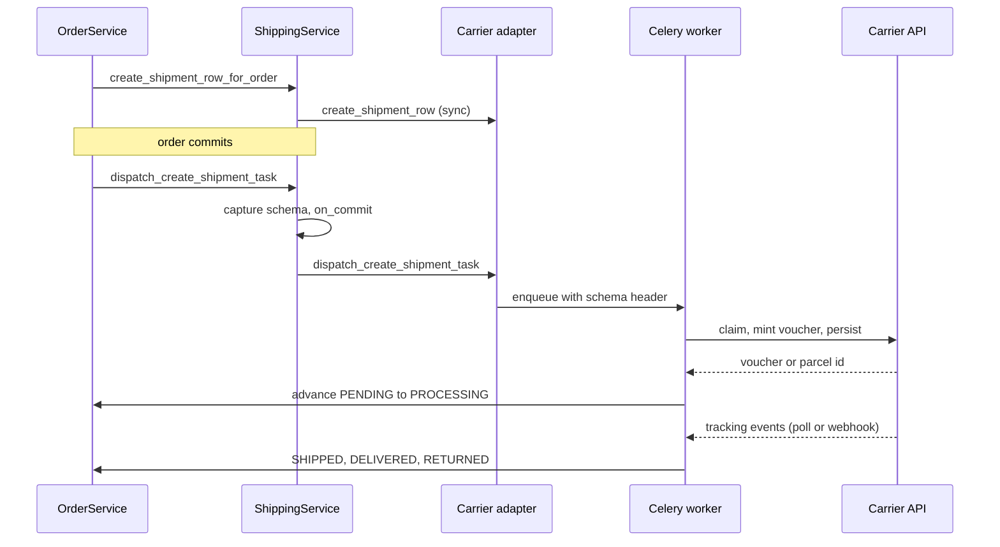

# Shipping

A carrier is an adapter class plus a database row. The adapter
(`shipping/interfaces.py: ShippingCarrierInterface`) is code registered
at app start; the row (`shipping/models/provider.py: ShippingProvider`)
is the runtime switch and capability declaration. Nothing above the
shipping layer imports a provider app — the order flow, the serializers,
the pay-way filter and the pricing calculator all go through
`shipping/services.py: ShippingService`, which resolves the row and then
the adapter. Adding a courier is one app plus one row.

Two carriers exist today: ACS Courier (`shipping_acs/`, REST, polled) and
BoxNow (`shipping_boxnow/`, REST plus webhook).

## Diagram

## How it works

### The adapter contract

`ShippingCarrierInterface` declares the methods every carrier must have,
even as no-ops. The abstract ones are `create_shipment`,
`cancel_shipment`, `fetch_label_bytes`, `fetch_tracking_events`,
`shipment_for_order`, `serialize_shipment` and `validate_order_payload`.
The optional hooks are where a carrier states what it is:

| Hook | Purpose |
|---|---|
| `payload_keys` | Which non-`Order` keys the carrier reads out of the create-order body (`boxnow_locker_id`, `acs_station_external_id`, …) |
| `calculate_shipping_cost` | The carrier prices its own kinds; returning `None` falls back to the platform flat rate |
| `free_shipping_threshold` | The marketing promise, read by `GET /api/v1/shipping/free-shipping-info` |
| `is_kind_enabled` | Per-kind gate a carrier controls itself, e.g. ACS Smartpoint |
| `create_shipment_row` | Persist the child row synchronously during checkout |
| `dispatch_create_shipment_task` | Enqueue the Celery task that talks to the carrier API |
| `supported_settlements` | Which settlements the carrier can physically perform |
| `filter_pay_ways` | Derived from the above; overriding it directly is almost always wrong |

`supported_settlements` is a capability declaration, not a preference.
ACS returns `{online, courier_cash, offline_transfer}` — a courier takes
cash at a door. BoxNow returns `{online, carrier_terminal}` — nobody
meets the shopper at a locker, so `courier_cash` money would never be
collected. Merchant preferences belong in `PayWayShippingExclusion` rows,
which `PayWayService.filter_by_carrier` applies on top and which change
without a deploy.

Registration is `@register_provider` at `AppConfig.ready()` time into the
module-level `_REGISTRY` in `shipping/interfaces.py`. Re-registering the
same code overwrites, which is how test doubles are swapped in.

### Provider rows, and the factory trap

`ShippingProvider` carries `code` (matching the adapter), `is_active` as
the master switch, `supports_home_delivery` / `supports_pickup_point`,
`live_mode`, `priority`, a `metadata` JSON bag and two logo fields
(pickup-point rows prefer `logo_pickup_point` and fall back to `logo`).

**`shipping/factories.py: ShippingProviderFactory` sets
`django_get_or_create = ("code",)`.** Every other declared attribute —
`is_active`, `supports_home_delivery`, `supports_pickup_point`,
`live_mode`, `priority`, `metadata` — is passed as a `defaults` value, and
`get_or_create` ignores `defaults` when the row already exists. So a
factory call that names `is_active=True` against a code a seed migration
already created returns the **seeded** row unchanged, flags and all, and
the test or fixture silently runs against the wrong configuration. If you
need a provider in a specific state, assert or set the flags explicitly
after the factory call.

### Method offering at checkout

`ShippingService.available_options` filters to active providers that have
a registered adapter, optionally by `metadata["supported_countries"]`,
then emits one row per supported kind that passes `is_kind_enabled`. Each
row carries the price the adapter quotes, the kind-aware logo URL, and
the pay-ways that combination can settle — resolved by calling the same
`PayWayService.filter_by_carrier` the checkout calls, so the delivery
step can never advertise a method the payment step would refuse. Rows
sort by `(priority, provider_code)`.

Pricing goes through the same registry.
`OrderService.calculate_shipping_cost` auto-resolves a bare
`home_delivery` request to the active home-delivery carrier with the
lowest `priority` (`_resolve_active_home_delivery_code`), and
`_resolve_shipping_provider` uses the **same helper** to set the order's
FK — otherwise the order would be priced against one carrier's threshold
and served by another.

### Dispatch on transaction commit

`ShippingService.dispatch_create_shipment_task` captures
`connection.schema_name` and then wraps the per-carrier dispatch in
`transaction.on_commit`. Both halves matter. Without the deferral the
worker looks up the order on a different connection before the creating
transaction has committed and gives up permanently, because
`Order.DoesNotExist` is not retryable. Without the captured schema, an
`on_commit` that fires after the request's tenant context has unwound
dispatches against the public schema and fails the same way.

The shipment **row** is created synchronously during checkout
(`create_shipment_row_for_order`); only the carrier API call is deferred.

## ACS Courier

### Voucher creation

`AcsService.create_voucher_for_order` is a three-phase design so the
carrier API call never happens with a Postgres row lock held:

1. **Claim** — short atomic block: lock the shipment, short-circuit if a
   `voucher_no` exists, sync `cod_amount`, stamp
   `metadata["mint_started_at"]`.
2. **API call** — no lock, no open transaction.
3. **Persist** — fresh atomic block with `select_for_update` and a race
   re-check; a voucher that lost the race is deleted at ACS and the
   winner's row returned.

The claim TTL is 300 seconds (`_MINT_CLAIM_TTL_SECONDS`). It was 90 until
a slow ACS round trip let a second worker re-mint and leak an orphan
voucher. A stale claim with no `voucher_no` logs loudly, naming
`Reference_Key1` so the orphan can be found in the ACS dashboard.

### The contract is cash-on-delivery only

Every voucher is minted with `Charge_Type = COD`, whatever the order's
pay way. What varies is the amount: `cod_amount` is synced to the order
total **only** for `COURIER_CASH` pay-ways. An online-paid or
locker-settled order ships at `0,00` so the courier collects nothing at
the door.

Two encodings on the wire are easy to get wrong:

- **`Cod_Ammount` is Greek-locale.** ACS reads a dot as a thousands
  separator, so `"47.01"` becomes 4701 and trips the cash cap. The value
  is quantised to two places and written comma-decimal, always, even at
  zero.
- **`Cod_Payment_Way` is omitted when the amount is zero.** Sending `0`
  (cash) tells the driver to collect nothing, which some log as a
  confused proof-of-delivery entry.

`Delivery_Notes` carries `Order.customer_notes` through
`shipping/services.py: sanitize_delivery_notes`, which collapses
whitespace runs and caps at 500 characters — an embedded carriage return
can be read as a record separator by ACS.

### Labels and the pickup list

`Print_Type` defaults to **1, thermal/roll** (`shipping_acs/config.py:
print_type`), overridable per tenant through
`ShippingProvider.metadata["print_type"]`. Value 2 is the laser layout,
four vouchers per A4. ACS accepts nothing else.

**The pickup list is mandatory.** A voucher that is not on an issued
pickup list is not presented to the courier for collection, so the parcel
never moves. `AcsService.issue_daily_pickup_list` runs Mon–Fri at 16:30
Athens, guarded by a Redis `cache.add` mutex so the beat task and the
admin "issue now" view cannot double-issue. It is the same three-phase
shape as the voucher mint.

Two ACS behaviours make this fragile, and both are handled:

- **ACS rejects the whole list if any voucher on it is unprinted**, and
  offers no partial issue. `warn_unprinted_acs_vouchers` runs at 15:45,
  45 minutes earlier, and emails the tenant's operators the exact orders
  that still need a label.
- **ACS scopes a list to that day's pickup date.** On one production run
  the manifest covered 2 of 9 candidates. Vouchers minted on earlier days
  are simply not on it, and **they are not swept up by a later list** —
  they need a list issued for their own pickup date. So the persist step
  reads back the manifest's actual membership
  (`ACS_Pickup_List_Display_Voucher`) and links only those, logging the
  ones left behind. Linking every candidate would file them under a
  manifest the courier never received them on and hide them from the run
  that could still get them collected.

A response with no `PickupList_No` is a failure, not a no-op — but ACS
has been observed creating the manifest and not echoing the number back,
so `_adopt_pickup_lists_from_acs` asks ACS what it holds for the date
before raising.

### Tracking and order status

`poll_acs_tracking_batch` runs every 15 minutes through the tenant
fanout, with a distributed mutex and a per-sub-task stagger to stay under
the carrier's rate cap. `AcsService.poll_shipment_tracking` is split into
read, API call and persist so a slow response cannot lose
`last_polled_at`.

`order_status_for_shipment_state` is the pure mapping from carrier state
to order status, shared by the live poll and the reconcile command so
they cannot drift. `_apply_order_status_transition` then performs it,
bridging through SHIPPED when the carrier jumped straight to DELIVERED or
RETURNED, and for DELIVERED it calls `maybe_advance_to_completed` so an
already-paid order lands on COMPLETED in the same pass.

`acs_send_arrival_notification` emails and notifies the shopper when the
parcel goes out for delivery.

### COD payout reconciliation

`reconcile_acs_cod_payouts` runs daily at 02:30 Athens and upserts
`AcsCodPayout` rows from the ACS beneficiary endpoint, idempotent on
`(voucher_no, cod_payment_date)`.

**The wire schema has no `Voucher_No` column.** The voucher number
arrives in `POD`; `Customer_RefNo_1` and `Customer_RefNo_2` echo the
`Reference_Key1/2` sent at mint (`order.id` and `order.uuid`) and are the
fallback match keys. An implementation that assumed `Voucher_No` silently
skipped every real payout row for ten weeks.

A matched row flips the order through
`AcsService._mark_cod_order_paid_if_pending`, which moves
`payment_status` from PENDING to COMPLETED: `mark_as_paid` with
`payment_method="acs_cod"`, then `order_paid` so the Meta CAPI Purchase
dispatch runs, then the DELIVERED to COMPLETED auto-advance. The nightly
task passes `silent_for_customer=True` — the shopper paid the courier in
person and already had the DELIVERED notification. The backfill command
passes it only when given `--silent`, which is why that flag matters
below.

Unattributable rows are still persisted (it is real money) and reported
separately: `unmatched` means a legible voucher nobody recognises,
usually a voucher created by hand in the ACS portal; `skipped` means no
voucher could be read at all. Backfill a missed date with
`manage.py reconcile_acs_cod --days N --silent` — `--silent` is mandatory
for backfills or weeks-old orders email their customers.

`alert_unremitted_cod_payouts` runs at 03:00, half an hour later so an
overnight payout is already recorded. It finds COD parcels delivered more
than `ACS_COD_REMITTANCE_ALERT_DAYS` (default 10) days ago with no payout
row. Nothing else looks for these: the poller and the staleness digest
both exclude terminal states, and a delivered-but-unpaid parcel is
precisely a delivered parcel.

## BoxNow

`BoxNowService.create_shipment_for_order` uses the same three-phase claim
design. Lockers are synced nightly into `BoxNowLocker` by
`sync_boxnow_lockers` (per-tenant fanout — the table is tenant-scoped)
and served to the picker through `GET /api/v1/shipping/boxnow/lockers`
and `.../nearest`.

The webhook is `POST /boxnow/webhook/`, registered at the URL root rather
than under `api/v1/` so BoxNow reaches it without a language prefix or
auth headers (`core/urls.py`). Its only gate is HMAC-SHA256:

- The signed payload is the **raw bytes of the top-level `data` object**,
  extracted from the request body by brace-walking without any JSON
  re-serialise cycle (`shipping_boxnow/webhook.py: extract_data_substring`),
  because whitespace and key order are part of the signature.
- `verify_signature` rejects anything that is not 64 hex digits on shape
  before comparing, because `hmac.compare_digest` raises `TypeError` on
  other types and that reached the client as a 500 on an endpoint BoxNow
  retries.
- The tenant is resolved by searching each active schema for the
  `parcelId`, then the signature is checked against **that tenant's**
  `box_now_webhook_secret`. There is no platform fallback; an
  unconfigured tenant answers 503.

Response contract, because BoxNow retries until 200: 200 accepted
(including duplicates), 400 malformed, 401 bad signature, 500 transient,
503 misconfigured.

`BoxNowService.apply_webhook_event` dedupes on the CloudEvents `id`
(`webhook_message_id`) **and** on a SHA-256 fingerprint of the signed
`data` bytes, so a replay under a forged id still collides. It applies a
state change only when the event is newer than `last_event_at`, so a
late-arriving `in-depot` cannot overwrite `delivered`.
`poll_boxnow_tracking_batch` runs every 15 minutes as defence in depth,
because the webhook URL is partner-managed by BoxNow support and a single
misconfiguration would freeze parcel state silently.

`delivered` is proof of payment for `carrier_terminal` orders:
`_mark_cod_order_paid_on_delivery` moves the order's **payment status**
from PENDING to COMPLETED with `payment_method="boxnow_cod"`. It does not
move `Order.status`, which the carrier events drive separately.
`final-destination` triggers `boxnow_send_arrival_notification`.

## Invariants

- **Nothing above the shipping layer imports `shipping_acs` or
  `shipping_boxnow`.** Go through `ShippingService`.
- **`dispatch_create_shipment_task` is wrapped in
  `transaction.on_commit`** with the schema captured beforehand.
- **The voucher mint is claim, call, persist** — never an open
  transaction across the carrier API call.
- **A carrier declares settlements, never preferences.** Preferences are
  `PayWayShippingExclusion` rows.
- **`calculate_shipping_cost` and `_resolve_shipping_provider` resolve
  `home_delivery` through the same helper**, so the price charged and the
  carrier assigned always agree.
- **Operational alerts go to `tenant_admin_recipients()`**, not to
  `settings.ADMINS`. `shipping/alerts.py: send_ops_alert` falls back to
  the platform list only on the public schema or when the tenant carries
  no contact address, and returns `False` (logged) when there is no
  recipient at all. These are merchant-operations mails: "fix the address
  and re-dispatch".
- **An ACS voucher that missed its pickup list stays uncollected** until
  a list is issued for its own pickup date.
- **Cancelling an order cascades to the carrier from two entry points**,
  guarded by the `shipment_cancel` breadcrumb so it fires once.

## Failure modes

- **Transient ACS 403/406.** Roughly 2% of tracking polls return a
  sporadic 406 that self-heals. `AcsAuthError` is retryable for exactly
  this reason; only a persistent rejection means a bad key or an IP that
  is not allowlisted.
- **Orphan voucher.** A worker died between the ACS mint and the local
  save. The next mint logs a stale-claim WARNING naming
  `Reference_Key1=<order id>`; search the ACS dashboard for it and retire
  the duplicate.
- **Pickup list not issued.** Either ACS rejected unprinted vouchers (the
  15:45 warning already named them, and the 16:30 failure names them
  again with the ACS message) or the response carried no number, in which
  case the adopt path asks ACS what it actually holds before raising.
- **Stale shipment.** `check_stale_acs_shipments` runs daily at 09:00 and
  emails the tenant's operators about non-terminal shipments with no
  event for `ACS_STALE_SHIPMENT_DAYS` (default 3) days, plus mints stuck
  at `pending_creation` for over 24 hours. It claims rows with
  `stale_alert_sent` before sending and rolls the claim back if the mail
  fails; the poller re-arms the flag when a new event arrives. Dead
  vouchers are retired by a human through the admin's retire action,
  which cancels locally and stops the poller without calling
  `ACS_Delete_Voucher`.
- **Carrier permanently rejects a shipment.** Bad address, unacceptable
  destination station, invalid locker id. The task logs and gives up, the
  shipment strands at `pending_creation`, the order strands at PENDING,
  and `alert_admins_shipment_creation_failed` emails the operators the
  same moment. One production order sat silently for ten days before this
  alert existed.
- **Verified BoxNow webhook that cannot be applied.** The endpoint has
  already answered 200, so BoxNow will not retry and the transition is
  lost. `alert_admins_webhook_processing_failed` makes the drop loud.
- **Cancel cascade refused.** ACS will not delete a voucher already on a
  pickup list; BoxNow will not cancel a parcel already accepted at a
  locker. The rejection is swallowed and recorded on
  `metadata["cancellation"]["shipment_cancel"]` so an operator can see
  why and arrange the return out of band.

## Source

| File | Role |
|---|---|
| `grooveshop-django-api/shipping/interfaces.py` | `ShippingCarrierInterface`, `_REGISTRY`, `register_provider`, `all_payload_keys` |
| `grooveshop-django-api/shipping/services.py` | `ShippingService` dispatcher, `available_options`, `free_shipping_info`, `sanitize_delivery_notes` |
| `grooveshop-django-api/shipping/models/provider.py` | `ShippingProvider` fields and kind-aware logo resolution |
| `grooveshop-django-api/shipping/factories.py` | `django_get_or_create = ("code",)` — the defaults trap |
| `grooveshop-django-api/shipping/alerts.py` | `send_ops_alert` and the two operational alerts |
| `grooveshop-django-api/shipping/utils.py` | `compute_total_weight_grams` |
| `grooveshop-django-api/shipping/urls.py` | Options, free-shipping-info, providers |
| `grooveshop-django-api/shipping_acs/services.py` | Voucher mint, cancel, pickup list, polling, COD reconcile, status mapping |
| `grooveshop-django-api/shipping_acs/tasks.py` | Every ACS beat task and its alerts |
| `grooveshop-django-api/shipping_acs/config.py` | `print_type` and other clamped provider-metadata reads |
| `grooveshop-django-api/shipping_acs/carrier.py` | ACS adapter, `supported_settlements`, `is_kind_enabled` |
| `grooveshop-django-api/shipping_boxnow/webhook.py` | Raw-bytes `data` extraction and HMAC verification |
| `grooveshop-django-api/shipping_boxnow/views/webhook.py` | Tenant resolution and the response contract |
| `grooveshop-django-api/shipping_boxnow/services.py` | Shipment creation, `apply_webhook_event`, locker sync, COD on delivery |
| `grooveshop-django-api/shipping_boxnow/carrier.py` | BoxNow adapter and `supported_settlements` |
| `grooveshop-django-api/pay_way/services.py` | `filter_by_carrier`, `filter_by_shipping_kind` |
| `grooveshop-django-api/settings.py` | Beat cadences for every carrier task |
| `grooveshop-storefront-ui-node-nuxt/shared/shipping/index.ts` | Checkout method to carrier mapping |
| `grooveshop-storefront-ui-node-nuxt/app/components/Checkout/StepShipping.vue` | The delivery step and locker pickers |
