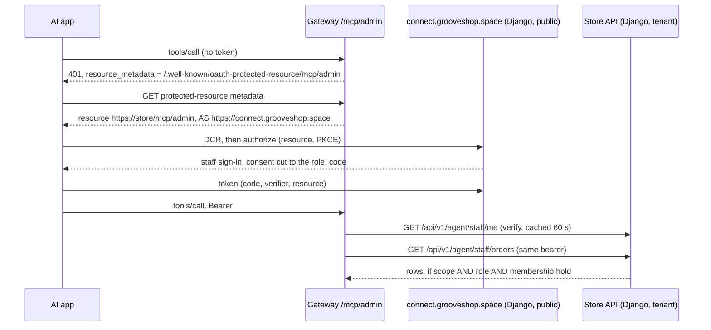

# Store-admin tools over MCP

A store's owner and staff connect their own AI app (Claude, ChatGPT, Gemini and other MCP clients) to `https://<store>/mcp/admin` and ask it about the store: orders, sales, profit, products and stock, customers, reviews and contact messages. What they see follows their role in the store. **Every tool only reads.** Write tools are proposed below and wait for the owner's approval.

This is a different surface from the shoppers' `/mcp` ([Agentic commerce](/dev/flows/agentic-commerce)), with a different identity:

| | Shoppers, `/mcp` | Staff, `/mcp/admin` |
|---|---|---|
| Who signs in | The store's customers (tenant schema) | Platform identities with a role in the store (public schema) |
| Authorization server | The store's own issuer, on its API host | The platform's staff issuer, on `connect.grooveshop.space` |
| Token tables | The store's schema | `public` |
| Resource (RFC 8707) | `https://<store>/mcp` | `https://<store>/mcp/admin` |
| Without a token | Most tools work anonymously | Every call gets the 401 challenge |

## Diagram

## Steps

1. **Challenge.** `RequireStaff` (`grooveshop-agent-gateway/internal/adminmcp/identity.go`) answers a call without a bearer with 401. The challenge names every read scope and `resource_metadata` of the store's `/mcp/admin` metadata.
2. **Discovery.** `ResourceMetadataHandler` (`internal/adminmcp/metadata.go`) serves `/.well-known/oauth-protected-resource/mcp/admin`. The resource is the store's `/mcp/admin` on its primary domain, and the authorization server is `https://$STAFF_CONNECT_HOST`. Each store's ingress routes that path to the gateway (`grooveshop-infrastructure`, the stores' `ingress*.yaml`).
3. **The connect host.** `PlatformTenantMainMiddleware` (`grooveshop-django-api/tenant/middleware.py`) maps `STAFF_CONNECT_HOST` to the public schema. It gives the host its own URLconf, `agent/urls_connect.py`, which serves nothing but the staff issuer. `allauth.idp.oidc` is in `SHARED_APPS` as well as `TENANT_APPS` (`settings.py`), so the issuer has client and token tables in `public`. The IdP routes are not served on the platform host at all (`core/urls.py`).
4. **Registration.** DCR is open, as for shoppers. `AgentOIDCAdapter._register_staff_client` (`agent/oidc.py`) gives a staff client every staff scope plus `offline_access`, and refuses any grant type but `authorization_code` and `refresh_token`. The device flow is not routed.
5. **Sign-in.** `StaffConnectLoginView` (`agent/staff_connect.py`) uses the admin's own `PlatformAdminAuthenticationForm`. That form brings the staff lockouts and a superuser's authenticator code. A superuser who has not set one up is sent to the admin first. `prompt=login` signs the current person out and back to this page, never to allauth's account login.
6. **Consent.** `StaffAuthorizationView` (`agent/staff_connect.py`) requires exactly one `resource`, naming an active store's `/mcp/admin` on its primary domain (`store_for_staff_resource`, `agent/staff.py`). It also requires an active membership in that store. It offers only the requested scopes the role opens (`scopes_for_role`), and the page wears that store's brand (`core/templates/agent/staff_connect/`).
7. **Every call.** `StaffAgentTokenAuthentication` (`agent/staff_auth.py`) looks the token up in `public` only. It requires the token's resource to equal this store's `/mcp/admin`, the account to be active and `is_staff`, and an active membership in this store. Each failure is 401 with `realm="agent-staff"`. `HasStaffScope` then needs the scope on the token **and** the permission behind it on the role, read from `TenantRolePermissionBackend` directly, so a superuser gets their store role and nothing more.
8. **Tools.** `internal/adminmcp/server.go` and `tools.go` hold the tools. A scope not granted (`not_granted`) or not open to the role (`not_allowed`) is refused before Django is asked, from the cached `/agent/staff/me`. Customer-written text comes back as `{untrusted: true, source, text}`.

## Scopes and tools

| Tool | Endpoint (`agent/staff_views.py`) | Scope | Permission | STAFF | ADMIN | OWNER |
|---|---|---|---|---|---|---|
| `whoami` | `GET agent/staff/me` | any | — | ✓ | ✓ | ✓ |
| `list_orders`, `get_order` | `agent/staff/orders`, `orders/{id}` | `admin:orders:read` | `order.view_order` | ✓ | ✓ | ✓ |
| `sales_report` | `agent/staff/sales` (`order/turnover.py`) | `admin:sales:read` | `order.view_turnover_report` | | ✓ | ✓ |
| `profit_report` | `agent/staff/profit` (`order/profit.py`) | `admin:profit:read` | `order.view_profit_report` | | | ✓ |
| `list_products` | `agent/staff/products` | `admin:catalog:read` | `product.view_product` | ✓ | ✓ | ✓ |
| `find_customers` | `agent/staff/customers` | `admin:customers:read` | `user.view_useraccount` | ✓ | ✓ | ✓ |
| `list_reviews` | `agent/staff/reviews` | `admin:reviews:read` | `product.view_productreview` | ✓ | ✓ | ✓ |
| `list_messages` | `agent/staff/messages` | `admin:messages:read` | `contact.view_contact` | ✓ | ✓ | ✓ |

The scope table is `STAFF_SCOPE_PERMISSIONS` (`agent/staff.py`). The role columns follow `tenant/role_scopes.py`, because the check is the same one the admin makes. Every tool is annotated `readOnlyHint: true`, `destructiveHint: false`, `idempotentHint: true` and `openWorldHint: false`. Lists are capped at `STAFF_AGENT_LIST_LIMIT`. Reports default to the last `STAFF_AGENT_REPORT_DEFAULT_DAYS` days.

## Invariants

- **A customer token never opens a staff tool.** Staff tokens are looked up in `public` only, and customer tokens live in the store's schema. Proven on real schemas in `tests_mt/test_staff_agent_schema_binding.py`, and against a real stack in `internal/realstack/staff_test.go`.
- **A staff token works only on the store it was connected to**, and only while the holder is on that store's team. The resource and the membership are both checked on every call.
- **A staff token never opens the shopper surface.** It is not in the store's token table, and its resource is not `/mcp`.
- **No street or phone leaves the store.** Order detail carries city and country; customers carry name, email and order counts.
- **No customer data or token in logs.** The gateway logs the tool, store, outcome and duration of each call. Django's request log already redacts `Authorization`.
- **The platform host keeps its basic-auth.** The connect host serves only the issuer (`agent/urls_connect.py`), so leaving it outside basic-auth opens nothing else. On staging, the connect host's browser pages stay behind staging basic-auth (`overlays/staging/ingress-connect.yaml`).

## Failure modes

| What happens | Answer |
|---|---|
| No bearer on `/mcp/admin` | 401, `scope="admin:orders:read …"`, `resource_metadata` |
| Unknown, expired, revoked or refresh token; another store's token; not on the team; `is_staff` cleared | 401 `error="invalid_token"`: the client connects again |
| Scope not granted at consent | Tool error `not_granted`: disconnect and connect again, approving it |
| Role does not open the area | Tool error `not_allowed` (Django: 403) |
| An authorize request naming no store, or an unknown one | 400 page on the connect host, before sign-in |
| Signed in, but not on that store's team | 403 page, no consent form |
| A superuser with no authenticator yet | Asked to set one up in the admin first |
| Django down | Gateway 503 on verification; `unavailable` on a tool |

## Write tools: proposed, not built

Writes need the owner's approval, tool by tool. Each would carry `destructiveHint: true` and `_meta["anthropic/requiresUserInteraction"]: true`, so Claude, ChatGPT and Gemini all ask the person before it runs. Clients that support form elicitation would also ask in-band. Each would get its own `admin:<area>:write` scope, call the service the admin uses, and record django-simple-history with the staff member and the AI app. The proposed list:
- product published state;
- review status;
- stock adjustment;
- order status, forward only;
- product price.

Refunds, payment capture or cancellation, order cancellation, deletions, customer-data edits, settings, team changes and replies to customers stay out of MCP. The list with risks and undo paths is in the design note.

## Source

| Concern | Files |
|---|---|
| Policy: scopes, resource, role check | `grooveshop-django-api/agent/staff.py` |
| The two issuers | `grooveshop-django-api/agent/oidc.py`, `settings.py` (`SHARED_APPS`, `STAFF_CONNECT_HOST`) |
| Connect host routing and pages | `grooveshop-django-api/tenant/middleware.py`, `agent/urls_connect.py`, `agent/staff_connect.py`, `core/templates/agent/staff_connect/` |
| Staff API | `grooveshop-django-api/agent/staff_auth.py`, `agent/staff_views.py`, `agent/staff_serializers.py`, `agent/urls.py` |
| Gateway server | `grooveshop-agent-gateway/internal/adminmcp/`, `internal/django/client_staff.go`, `internal/server/routes.go` |
| Routes | `grooveshop-infrastructure/manifests/app-constructs/grooveshop/overlays/*/ingress-connect.yaml`, the stores' ingresses |
| Tests | `grooveshop-django-api/tests/unit/agent/test_staff_agent_api.py`, `tests_mt/test_staff_agent_schema_binding.py`, `grooveshop-agent-gateway/internal/adminmcp/adminmcp_test.go`, `internal/realstack/staff_test.go` |
| Runbook | `grooveshop-agent-gateway/docs/agent-protocols-runbook.md` §7 |
