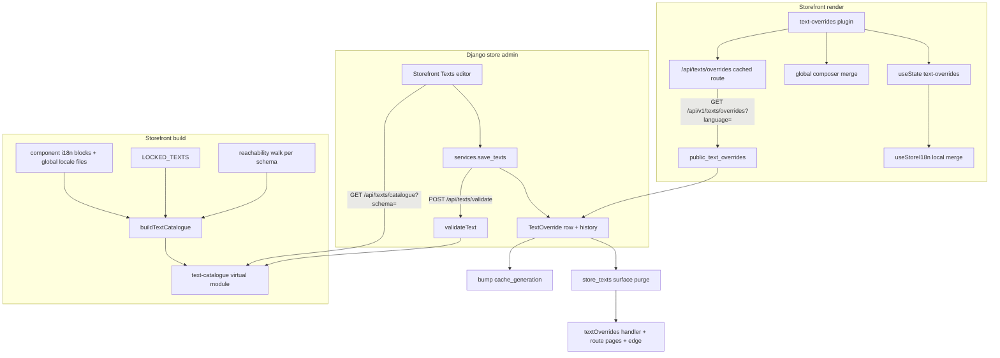

# Store-editable texts

A store replaces the wording of its own storefront, per language, from one
editor page in its admin. The **storefront owns every default**: its
component `<i18n>` blocks and global locale files are the only source of
keys, defaults, placeholders and message syntax. Django never keeps a copy
of them. It asks the storefront what can be edited (the catalogue) and
whether a value is allowed (validate), stores only the store's sparse
overrides in the store's own schema, and serves them back on a public read
that never calls the storefront. The storefront merges them over its
defaults at render time, skipping locked keys and keys its build no longer
has.

The Django side is described in depth in the synced
[Store-editable texts reference](/dev/django/reference/store-texts); this page
is the end-to-end flow.

## Diagram

## How it works

### 1. Namespaces and keys

A text is identified by `(namespace, key)`.

- A component's texts use the component's path under `app/` without `.vue`:
  `components/Chrome/Footer`, `components/variants/webside/Footer/Desktop`,
  `layouts/auth-split`. The key is the dotted path inside its `<i18n>` block
  (`modules/text-catalogue/extract.ts: namespaceOf`, `flattenMessages`).
- The global locale files (`i18n/locales/**`) share the namespace `global`;
  the key's first segment says what it is (`cookies.…`, `validation.…`).

Only string leaves are texts; a boolean in a block is data and is left out.
Django stores the pair as given and treats it as opaque: there is no foreign
key, and the overrides body is not camelCased (`texts/views.py`).

`surface` is a third part of the id on the Django side (`texts/models.py:
TextSurface`); `storefront` is the only one today.

### 2. The catalogue, built with the storefront

`modules/text-catalogue/index.ts` runs `buildTextCatalogue`
(`modules/text-catalogue/extract.ts`) on every build and dev start and hands
the result to the server bundle as the Nitro virtual module
`#text-catalogue`. The client bundle never imports it. Each entry is
`{namespace, key, defaults, placeholders, locked}`: the default per locale,
the default's message shape (named, list and linked params, number of plural
cases; `shared/utils/messageShape.ts: analyzeMessage`), and whether a lock
rule matches. A default that does not compile fails the build.

`GET /api/texts/catalogue` (`server/api/texts/catalogue.get.ts`) serves it
with the content hash as ETag and `Cache-Control: public, no-cache`; there is
no Nitro cache, because the body is a constant of the server bundle.

### 3. Per-store catalogue (storefront #266)

A store must only be offered texts its own design renders: the catalogue
holds every tree, including other stores' frozen or custom designs under
`components/variants/<schema>/**`. Storefront #266 adds a build-time
reachability walk, `modules/text-catalogue/reachability.ts`:

- Roots are read from the source of `app/utils/variantRegistry.ts`
  (`page:<key>@<schema>`, `chrome:<slot>@<schema>`, the design layouts) and
  `app/utils/componentRegistry.ts` (page-builder sections
  `<type>@<schema>`).
- From the roots it follows template tags, `<component :is>` literals,
  `resolveComponent('…')` and `.vue` imports, naming components the way Nuxt
  does from the `components` option of `nuxt.config.ts` (so the frozen
  webside tree's `Webside` prefix).
- It produces one **view** per schema that has a variant tree, plus
  `default` for every other store. A view lists the component namespaces
  with texts that store renders; `global` is in every view.
- A reference the walk cannot place fails the build: an unknown tag, a
  computed `resolveComponent`, an `import()` outside the registries, or a
  registry entry that is not one lazy import.

`?schema=<schema>` selects the view (`server/utils/textCatalogue.ts:
textCatalogueDocument`); an unknown schema gets `default`, and no `schema`
returns every entry, for tooling. Each view has its own hash, so the ETag
varies by schema. `POST /api/texts/validate` takes the same `schema` and
answers `unknown_key` for a namespace that store does not render
(`findTextEntry`). Django always passes the current schema
(`texts/storefront.py`, `texts/services.py: _schema`).

### 4. The locked list

`shared/constants/lockedTexts.ts: LOCKED_TEXTS` holds the rules, each a
namespace regex, a key regex and a reason; `isLockedText(namespace, key)` is
the one check. Every component rule also matches the same component in any
`variants/<schema>/` tree. Locked today:

- the EU Omnibus prior-price label (`Product/PriorPrice`);
- cookie consent: the `Cookie/*` components, `Chrome/CookieConsent` and
  `global` `cookies.*`;
- the titles of the four legal pages (breadcrumb and footer keys in `global`
  and `Storefront/Legal`);
- consent wording: `Checkout/TermsConsent`, the sign-up form's `terms.*`, the
  contact form's `consent`, the contact panel section's `panel.consent`;
- `global` `validation.*` (form messages Django's error contract names) and
  `errors.codes.*` (the text of each API error code).

The same function is used in three places: the catalogue marks the entry
`locked`, validate refuses it with `locked_key`, and the render merge skips
it. Django does not hold the list.

### 5. The editor

The store sidebar entry is `page("texts.TextOverride", _("Storefront Texts"),
"translate")` in the **Content** group (`admin/navigation.py`).
`texts/admin.py: TextOverrideAdmin` replaces the changelist with one editor
page (`texts/templates/admin/texts/editor.html`) and adds htmx endpoints
`validate/`, `save/`, `reset/`, `history/` and `restore/`. The model has no
add, change or delete form: a form would bypass the storefront's validation.

- `texts/editor.py` merges the catalogue with the store's rows and does the
  search (every word in namespace, key, defaults and the store's values,
  case-folded), the filters (area, changed only, missing a translation) and
  paging (`PER_PAGE`).
- `texts/areas.py: AREAS` is the one table mapping namespaces (with any
  `variants/<schema>` segment dropped) and `global` key heads onto human
  areas, each with an optional storefront preview path. Unclaimed texts are
  **Common**.
- `texts/storefront.py: fetch_catalogue` holds the catalogue per process and
  revalidates it with `If-None-Match` every
  `TEXTS_CATALOGUE_REVALIDATE_SECONDS`; requests time out after
  `TEXTS_STOREFRONT_TIMEOUT_SECONDS`. The base URL is
  `NUXT_INTERNAL_BASE_URL`.

### 6. Validate and save

`texts/services.py` is the only writer, for save, reset and restore:

1. **Permission.** `texts.change_textoverride`. `tenant/role_scopes.py` puts
   `texts` in `STORE_SETTINGS_APP_LABELS` (Staff's operational grant leaves
   it out) and in `STAFF_READ_ONLY_APP_LABELS` (Staff gets `view`), applied
   in `tenant/auth_backends.py`. So Admin and Owner edit; Staff opens the
   editor read-only. The `validate/` endpoint needs the change permission
   too.
2. **Normalise and cap** (`texts/validation.py: check_value`): CRLF to LF,
   strip; blank refused (`value_blank`); `TEXTS_MAX_VALUE_LENGTH`
   (`value_too_long`).
3. **The storefront's verdict.** `POST /api/texts/validate`
   (`server/api/texts/validate.post.ts`, `server/utils/textValidation.ts:
   validateText`) answers `unknown_key`, `locked_key`, `syntax_error` (the
   app's own message compiler) or `placeholder_mismatch` (params and plural
   case count must equal the same locale's default, or every other locale's
   when this one has none).
4. **Write.** A value equal to the default deletes the override; a save is
   all or nothing across the card's languages; each write records the staff
   member and a change reason in django-simple-history. Restore re-validates
   the historical value, since the storefront may have changed.

Every refusal is a `ValidationError` with a stable code and a message in the
admin's language; the storefront's English detail travels in
`params["detail"]`.

### 7. What a save moves

- `tenant/signals.py: bump_generation_on_text_override_change` (post_save and
  post_delete) bumps the store's `Tenant.cache_generation`. The public read
  is cached under `texts:overrides:<cache_generation>:<language>`
  (`texts/views.py: overrides_cache_key`), so Django serves the new value at
  once.
- `core/cache/surfaces.py` registers the `store_texts` surface with
  `invalidated_by=("texts.TextOverride",)`: `_nuxt("textOverrides")` (the
  storefront handler's Redis keys `cache:nitro:handlers:textOverrides…`),
  every cached route of the store (`cache:nitro:routes:_:*`), and
  `invalidates_tenant_config=True`, which moves the storefront's tenant
  epoch. `core/cache/invalidation.py` batches the purge after commit and
  queues it about ten seconds later (`PURGE_DELAY_SECONDS`), followed by the
  Cloudflare edge purge.

### 8. The overrides route (storefront #268)

`GET /api/v1/texts/overrides?language=<code>` (`texts/views.py:
public_text_overrides`, AllowAny) returns `{namespace: {key: text}}` for the
current store. It reads the database and the cache only and never calls the
storefront, so a slow storefront pod cannot fail text delivery; `400
invalid_language` for a language outside `STOREFRONT_LOCALES`.

The storefront fronts it with `server/api/texts/overrides.get.ts`, a
`defineCachedRoute` (`server/utils/cachedRoute.ts`) **named
`textOverrides`**, keyed by `tenantCacheKey(event,
"text-overrides:<language>")` (`server/utils/cacheKey.ts`: host, page locale,
key and tenant epoch), `maxAge` one hour with SWR. The response is parsed
with the generated Zod schema. An empty object is cached like any answer, so
a store with no overrides costs a cache hit per render.

### 9. Merging global texts (#268)

`app/plugins/text-overrides.ts` (after `i18n:plugin` and `api`):

- On the server it fetches the page locale's overrides; they travel to the
  browser in `useState('text-overrides')` (`app/composables/useTextOverrides.ts`).
  The state is set only when a locale has overrides, so a store without any
  leaves the payload unchanged, and the browser does not refetch the
  hydrated locale.
- On a language switch it loads the new locale in `i18n:beforeLocaleSwitch`,
  which the router awaits, so the switch never shows the defaults first.
  Each locale is fetched once; a failed fetch is forgotten so it can retry.
- It **wraps the global composer's `mergeLocaleMessage` and
  `setLocaleMessage`** so that every write of a locale re-applies the store's
  `global` texts for it. A single merge on `i18n:localeSwitched` is not
  enough: @nuxtjs/i18n merges the fallback chain into the global composer
  more than once around a switch (measured: Greek again before
  `i18n:localeSwitched`, both languages after it), each time putting the
  defaults back over the store's texts. With the wrapper, no load in any
  order can leave a default over an override.

### 10. Merging component texts (#268)

Every component with an `<i18n>` block calls `useStoreI18n('<its path under
app/>')` instead of `useI18n()` (`app/composables/useStoreI18n.ts`). It
returns the component's local composer and, with an immediate watcher on the
overrides state for the composer's locale and that namespace, merges the
store's texts into it, again whenever the locale changes or its texts
arrive. The texts are merged after the composer exists, not passed as
`useI18n({ messages })`, because vue-i18n copies the component's block over
`options.messages`. `test/unit/source-rules/store-i18n.spec.ts` holds the
invariant: no block component calls `useI18n()`, and each calls
`useStoreI18n` once with its own path. The frozen webside tree is covered
too.

### 11. The merge rules (#268)

`app/utils/textOverrides.ts: mergeStoreTexts(composer, locale, namespace,
texts)` is the one merge, used by both the plugin and `useStoreI18n`. For
each override it **skips**:

- a key `isLockedText(namespace, key)` matches, even if a row exists (a lock
  added after the text was saved);
- a key that is not a message in the composer's own tree for that locale
  (own properties only; a string, compiled function or AST). So a stale
  override can neither add a key nor replace a group of keys.

The rest is built into a nested tree and passed to `mergeLocaleMessage`. The
texts stay raw strings and are compiled by the message compiler that already
ships to browsers.

## Invariants

- **The storefront is the only authority** on keys, defaults, placeholders,
  syntax and locks. Django has no fallback: when the storefront cannot answer
  the catalogue or validate, nothing is saved (`storefront_unavailable`,
  `texts/validation.py`) and the editor says so.
- **Overrides are sparse.** No row means the platform default, so an
  untouched text follows every storefront release; an edited one stays as
  written.
- **Every stored override was validated** against the build that was live
  when it was saved. Only a later build can make it stale, which is why the
  merge, not Django, drops locked and unknown keys.
- **The public read never calls the storefront** (`texts/views.py`).
- **The handler name `textOverrides` is a contract.** Django's purge names it
  (`core/cache/surfaces.py`, `_nuxt("textOverrides")`). Renaming the cached
  route without changing the surface leaves edits invisible until the TTL
  runs out.
- **A namespace is the component's own path**, enforced by the source rule;
  a store's editor lists only namespaces of components its view reaches.
- **Overrides live in the store's schema** (`texts` is a tenant app) with
  history; the editing staff member is a plain id (`updated_by_staff`).

## Failure modes

- **Storefront unreachable from Django.** The editor shows that the list is
  unavailable; save, history and restore answer with a warning in the
  page's alert region (`HX-Retarget`, `texts/admin.py:
  _unavailable_response`). Nothing is written.
- **Overrides fetch fails during SSR (#268).** The page renders with the
  build's defaults rather than failing: one endpoint's outage must not take
  every page down. It is logged at ERROR and the render is kept out of every
  cache (Nitro's page cache, the Cloudflare edge and the browser), so the
  defaults cannot outlive the failure and hide the store's wording; the next
  request asks again. The mechanism: `markDegradedRender`
  (`shared/utils/degradedRender.ts`) answers 503 while the render is inside
  Nitro's page cache, which stores nothing at 400 or above; the edge-cache
  plugin then puts the real status back as the response ends and sends
  `Cache-Control: private, no-store` with no edge headers, so the visitor
  sees a normal page (`app/plugins/text-overrides.ts`,
  `shared/constants/degradedRender.ts`, `server/plugins/edge-cache.ts`; the
  e2e suite covers it with a store whose texts answer 503).
- **Overrides fetch fails in the browser** (a language switch). The defaults
  are kept and a warning is logged; the next switch to that language retries.
- **Purge missed.** The `textOverrides` entry still expires after its
  one-hour `maxAge`; an operator can purge **Storefront texts** on the Cache
  page.
- **A key renamed or removed by a storefront release.** The row stays in
  Django but the merge ignores it; the editor no longer lists it, and a save
  or restore answers `unknown_key`.
- **A lock added after a text was saved.** The row stays; the merge skips it
  and the editor shows the text locked.
- **A reachability reference the walk cannot place (#266).** The storefront
  build fails, by design, rather than showing a store another store's texts.

## Source

| File | Role |
|---|---|
| `grooveshop-storefront-ui-node-nuxt/modules/text-catalogue/index.ts` | Builds the catalogue into the `#text-catalogue` virtual module |
| `grooveshop-storefront-ui-node-nuxt/modules/text-catalogue/extract.ts` | `buildTextCatalogue`, `namespaceOf`, `flattenMessages` |
| `grooveshop-storefront-ui-node-nuxt/modules/text-catalogue/reachability.ts` | Per-store views (storefront #266) |
| `grooveshop-storefront-ui-node-nuxt/shared/constants/lockedTexts.ts` | `LOCKED_TEXTS`, `isLockedText` |
| `grooveshop-storefront-ui-node-nuxt/shared/types/textCatalogue.ts` | Catalogue and entry types |
| `grooveshop-storefront-ui-node-nuxt/shared/utils/messageShape.ts` | `analyzeMessage`: params and plural cases of a message |
| `grooveshop-storefront-ui-node-nuxt/server/api/texts/catalogue.get.ts` | `GET /api/texts/catalogue` |
| `grooveshop-storefront-ui-node-nuxt/server/api/texts/validate.post.ts` | `POST /api/texts/validate` |
| `grooveshop-storefront-ui-node-nuxt/server/utils/textCatalogue.ts` | The served document per view, `findTextEntry` |
| `grooveshop-storefront-ui-node-nuxt/server/utils/textValidation.ts` | `validateText` |
| `grooveshop-storefront-ui-node-nuxt/server/api/texts/overrides.get.ts` | Cached route `textOverrides` (storefront #268) |
| `grooveshop-storefront-ui-node-nuxt/app/plugins/text-overrides.ts` | SSR fetch, language switch, global composer wrapper (#268) |
| `grooveshop-storefront-ui-node-nuxt/app/composables/useStoreI18n.ts` | Component composer with the store's texts (#268) |
| `grooveshop-storefront-ui-node-nuxt/app/composables/useTextOverrides.ts` | Overrides state per locale (#268) |
| `grooveshop-storefront-ui-node-nuxt/app/utils/textOverrides.ts` | `mergeStoreTexts`, the merge rules (#268) |
| `grooveshop-storefront-ui-node-nuxt/test/unit/source-rules/store-i18n.spec.ts` | Source rule for `useStoreI18n` (#268) |
| `grooveshop-storefront-ui-node-nuxt/server/utils/cacheKey.ts` | `tenantCacheKey` |
| `grooveshop-storefront-ui-node-nuxt/server/plugins/edge-cache.ts` | Edge cache headers per response; restores a degraded render's status and marks it `private, no-store` |
| `grooveshop-storefront-ui-node-nuxt/shared/utils/degradedRender.ts` | `markDegradedRender`: keeps a defaults-only render out of the page cache |
| `grooveshop-storefront-ui-node-nuxt/shared/constants/degradedRender.ts` | The 503 a degraded render carries inside the page cache |
| `grooveshop-django-api/texts/models.py` | `TextOverride`, `TextSurface` |
| `grooveshop-django-api/texts/storefront.py` | Catalogue and validate client |
| `grooveshop-django-api/texts/validation.py` | `check_value`, refusal codes and messages |
| `grooveshop-django-api/texts/services.py` | `save_texts`, `reset_text`, `restore_text` |
| `grooveshop-django-api/texts/editor.py` | Search, filters, history for the editor |
| `grooveshop-django-api/texts/areas.py` | `AREAS`: namespaces to human areas |
| `grooveshop-django-api/texts/admin.py` | `TextOverrideAdmin`: editor page and htmx endpoints |
| `grooveshop-django-api/texts/views.py` | `public_text_overrides` |
| `grooveshop-django-api/admin/navigation.py` | Sidebar entry under Content |
| `grooveshop-django-api/tenant/role_scopes.py` | `STORE_SETTINGS_APP_LABELS`, `STAFF_READ_ONLY_APP_LABELS` |
| `grooveshop-django-api/tenant/signals.py` | `bump_generation_on_text_override_change` |
| `grooveshop-django-api/core/cache/surfaces.py` | `store_texts` surface |
| `grooveshop-django-api/core/cache/invalidation.py` | Batched purge after commit |
| `grooveshop-django-api/settings.py` | `TEXTS_*` settings |
