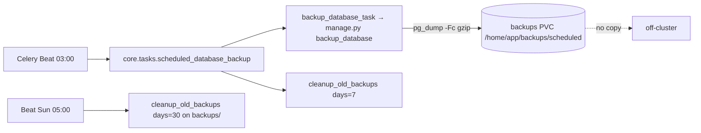

# Backups

The database is dumped nightly by a Celery task into a Longhorn volume on
the same cluster. That is the whole backup story today: there is no
Kubernetes CronJob, no operator-side logical backup, no Longhorn backup
target and no off-cluster copy. Media, Redis and the search index are not
backed up at all. Read the gaps section before assuming anything else.

## Diagram



## The nightly database dump

`settings.py` schedules `scheduled-database-backup` at 03:00 Athens
(`SCHEDULE_PRESETS["daily_3am"]`). The task (`core/tasks.py:
scheduled_database_backup`) dispatches a Celery chain:

```python
chain(
    backup_database_task.s(
        output_dir="backups/scheduled",
        filename=filename,          # scheduled_backup_<YYYYmmdd_HHMMSS>
        compress=True,
        format_type="custom",
    ),
    cleanup_old_backups.si(days=7, backup_dir="backups/scheduled"),
).apply_async()
```

`backup_database_task` calls the `backup_database` management command
(`core/management/commands/backup_database.py`), which runs `pg_dump` in
custom format with gzip compression and lets `pg_dump` own the output
file. The command raises `CommandError` on a non-zero exit and unlinks the
zero-byte partial file `pg_dump --file` creates before it connects, and
the task no longer swallows that error, so a failed dump is a failed task
that retries and shows in Flower rather than a green task with an empty
file. The Dockerfile installs the PostgreSQL client matching the deployed
server major so `pg_dump` and the engine agree.

Where it lands: `BASE_DIR/backups/scheduled/` in the container, which is
the `grooveshop-backend-backups-pvc` (20Gi, `longhorn-rwx`) mounted at
`/home/app/backups` on both the backend and celery-worker Deployments
(`base/backend.yaml`). Retention: seven days for the scheduled directory
(the chained cleanup), thirty days for anything under `backups/` by the
weekly `cleanup-old-backups` entry.

Proof the backup works is the file listing: consecutive daily dumps with
growing sizes. A zero-byte file is the old failure signature.

```bash
kubectl -n grooveshop exec deploy/backend -- ls -la /home/app/backups/scheduled/
```

Run one on demand:

```bash
kubectl -n grooveshop exec deploy/backend -- .venv/bin/python manage.py backup_database \
  --output-dir backups/manual --compress --format custom
```

The Zalando operator's own logical backup is deliberately disabled in
`base/backend-database.yaml` (`enableLogicalBackup` is not set) because it
has no target to write to; the comment there is the authoritative
statement of the gap.

## What is not backed up

| Data | Where it lives | Status |
|---|---|---|
| Product and blog images, uploads | `grooveshop-backend-media-pvc` (60Gi, `longhorn-rwx`) | no backup; single Longhorn replica |
| Invoice PDFs | `grooveshop-backend-media-private-pvc` (10Gi) | no backup; these are tax records |
| Collected static files | `grooveshop-backend-static-pvc` (30Gi) | rebuildable by the PreSync `collectstatic` |
| Redis (cache, Nitro SWR pages, Channels layer) | Redis CR PVC (5Gi) | no backup; all of it is rebuildable from the database on the next request |
| RabbitMQ queues | RabbitmqCluster PVC (5Gi) | no backup; in-flight tasks are lost on volume loss, `acks_late` limits the damage |
| Meilisearch index | chart PVC on `longhorn-rwx` | no backup; rebuild with `meilisearch_sync_all_indexes --all-tenants` |
| Logs | VictoriaLogs, 14-day retention capped at 8GiB | not a backup |
| The sealed-secrets controller key | `sealed-secrets` namespace | exported by hand to a vault; see [Secrets](/dev/operations/secrets) |

## Restore

There is no dedicated restore runbook. The only exercised procedure is the
staging refresh (`grooveshop-infrastructure/scripts/staging-refresh.sh`,
steps 2 and 3), which drops and recreates a database and `pg_restore`s a
custom-format dump into it, excluding the operator-owned schemas and
extensions. A production restore would follow the same shape:

1. Scale the backend, celery-worker and celery-beat Deployments to zero so
   nothing writes.
2. Copy the chosen dump off the backups PVC (`kubectl cp` from a backend
   pod, or mount it in `utils/debug.yaml`).
3. Inside the Postgres pod, as the `postgres` superuser over the unix
   socket, drop and recreate `groovedb` owned by `groovedbu`, then
   `pg_restore --no-owner --role=groovedbu` the dump.
4. Scale the Deployments back, hard-refresh the Argo Application so the
   PreSync hook runs `migrate_schemas` if the dump predates the running
   code.
5. Purge every cache layer ([Caches & purging](/dev/operations/caches))
   and resync Meilisearch.

Test the restore on staging first; the refresh script is exactly that
rehearsal. Media cannot be restored because it was never copied.

## Longhorn

- `defaultClassReplicaCount: 1` and `storageOverProvisioningPercentage:
  200` in `manifests/app-constructs/longhorn-system/values.yaml`. One
  replica means a node disk loss takes the volume; there is no second
  copy anywhere.
- Over-provisioning counts **requests**, not bytes written. At the chart
  default of 100 the cluster refused to expand the Redis volume during an
  outage while most of the physical disk was free. Size a volume against
  what its workload needs at its worst (an AOF rewrite needs three to four
  times `maxmemory`), not by round numbers.
- The CSI snapshot CRDs and `snapshot-controller` are installed
  (`longhorn-system/setup/kustomization.yaml`), but no `RecurringJob`, no
  `VolumeSnapshotClass` policy and no backup target exist in the
  manifests. Snapshots are a manual act through the Longhorn UI and stay
  on the same disk; they are not a backup.
- The Redis CR's `storage:` is declared intent only: StatefulSet
  `volumeClaimTemplates` are immutable and the operator drops a change
  silently. Expand the live PVC in place and keep the manifest in step.
- The Longhorn chart version is pinned in
  `manifests/app-directory/app-longhorn.yaml`; read the upstream upgrade
  notes for the exact skew rules before moving it, since every PVC on the
  cluster rides on it.

## Monitoring

What exists:

- `core.tasks.monitor_system_health` every 30 minutes: database, cache
  round-trip, Redis persistence status (`CustomCache.failing_persistence_statuses()`),
  and the rest of the health checks. Any failed check mails `ADMINS`
  (`ADMIN_EMAIL`) and raises, so the task shows failed in Flower. The
  interval is the throttle: a sustained outage costs two mails an hour.
- VictoriaLogs (`app-victoria-logs`) for log search; Argo CD notifications
  for sync events (`manifests/app-constructs/argocd/argocd-notifications-cm-patch.yaml`).
- Flower for task state, behind basic-auth.

What does not exist, and is the open item alongside the off-cluster copy:

- **No metrics or alerting stack.** No Prometheus, no Alertmanager, no
  dashboards. The Redis outage was found by 503s, not by an alert.
- **No error tracker.** Sentry is not wired into any service; errors are
  log lines in VictoriaLogs and, for Celery, `MonitoredTask.on_failure`.
- **No backup verification.** Nothing restores a dump automatically to
  prove it is usable; the staging refresh is the only exercise.

## Invariants

- The scheduled dump is a Celery task, not a Kubernetes resource
  (`settings.py`, `core/tasks.py`, `base/backend-database.yaml` comment).
- A failed `pg_dump` fails the task (`backup_database.py` raises
  `CommandError`; `backup_database_task` propagates it).
- Backups share the cluster, the storage class and the replica count with
  the data they protect (`base/backend.yaml`, `longhorn-system/values.yaml`).

## Failure modes

- **Zero-byte or missing nightly dumps**: `pg_dump` version mismatch or a
  full PVC; the task now fails loudly, check Flower and the worker log.
- **Backups PVC full**: retention is 7 days scheduled and 30 days overall;
  a manual dump directory outside `backups/` is never cleaned.
- **Node disk loss on the database node**: primary and every backup are
  gone together. This is the risk the off-cluster copy would close.

## Source

| File | Role |
|---|---|
| `grooveshop-django-api/settings.py` | `scheduled-database-backup`, `cleanup-old-backups`, `monitor-system-health` beat entries |
| `grooveshop-django-api/core/tasks.py` | `scheduled_database_backup`, `backup_database_task`, `cleanup_old_backups`, `monitor_system_health` |
| `grooveshop-django-api/core/management/commands/backup_database.py` | `pg_dump` invocation |
| `grooveshop-django-api/core/caches.py` | `failing_persistence_statuses()` |
| `grooveshop-infrastructure/manifests/app-constructs/grooveshop/base/backend.yaml` | Backups, media, media-private and static PVCs and mounts |
| `grooveshop-infrastructure/manifests/app-constructs/grooveshop/base/backend-database.yaml` | Postgres CR, logical backup disabled, the gap statement |
| `grooveshop-infrastructure/manifests/app-constructs/grooveshop/base/redis.yaml`, `backend-message-broker.yaml` | Redis and RabbitMQ volumes |
| `grooveshop-infrastructure/manifests/app-constructs/longhorn-system/values.yaml`, `setup/kustomization.yaml` | Replica count, over-provisioning, snapshot CRDs |
| `grooveshop-infrastructure/manifests/app-constructs/victoria-logs/values.yaml` | Log retention |
| `grooveshop-infrastructure/manifests/app-constructs/argocd/argocd-notifications-cm-patch.yaml` | Argo CD notifications |
| `grooveshop-infrastructure/scripts/staging-refresh.sh` | The only exercised `pg_restore` |
| `grooveshop-infrastructure/utils/debug.yaml` | PVC inspection pod |
