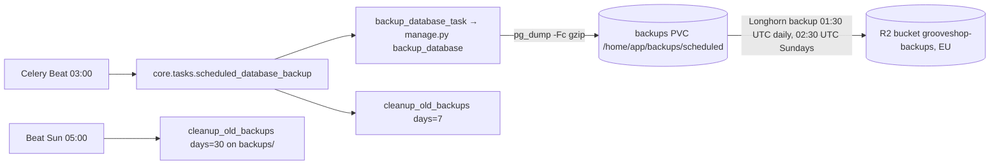

# Backups

The database is dumped nightly by a Celery task into a Longhorn volume, and
Longhorn copies that volume, the uploaded media, the private media and the agent
gateway's Redis daily to a Cloudflare R2 bucket in the EU jurisdiction. There is
no Kubernetes CronJob and no operator-side logical backup, the Postgres volume
itself is not copied (the dump is its backup), and production is the only
environment that is backed up. The infrastructure repository's `docs/backups.md`
is the runbook (retention, cost, credentials, the tested restores); this page
describes what the manifests do. Read the gaps section before assuming anything
else.

## Diagram



## The nightly database dump

`src/settings/schedule.py` schedules `scheduled-database-backup` at 03:00 Athens
(`SCHEDULE_PRESETS["daily_3am"]`). The task (`src/tenant/tasks.py:
scheduled_database_backup`, registered as `core.tasks.scheduled_database_backup`) dispatches a Celery chain:

```python
chain(
    backup_database_task.s(
        output_dir="backups/scheduled",
        filename=filename,          # scheduled_backup_<YYYYmmdd_HHMMSS>
        compress=True,
        format_type="custom",
    ),
    cleanup_old_backups.si(days=7, backup_dir="backups/scheduled"),
).apply_async()
```

`backup_database_task` calls the `backup_database` management command
(`src/core/management/commands/backup_database.py`), which runs `pg_dump` in
custom format with gzip compression and lets `pg_dump` own the output
file. The command raises `CommandError` on a non-zero exit and unlinks the
zero-byte partial file `pg_dump --file` creates before it connects, and
the task no longer swallows that error, so a failed dump is a failed task
that retries and shows in Flower rather than a green task with an empty
file. The Dockerfile installs the PostgreSQL client matching the deployed
server major so `pg_dump` and the engine agree.

Where it lands: `BASE_DIR/backups/scheduled/` in the container, which is
the `grooveshop-backend-backups-enc-pvc` (20Gi, `longhorn-rwx-encrypted`) mounted at
`/home/app/backups` on both the backend and celery-worker Deployments
(`grooveshop-infrastructure/manifests/app-constructs/grooveshop/base/backend.yaml`). Retention: seven days for the scheduled directory
(the chained cleanup), thirty days for anything under `backups/` by the
weekly `cleanup-old-backups` entry.

Proof the backup works is the file listing: consecutive daily dumps with
growing sizes. A zero-byte file is the old failure signature.

```bash
kubectl -n grooveshop exec deploy/backend -- ls -la /home/app/backups/scheduled/
```

Run one on demand:

```bash
kubectl -n grooveshop exec deploy/backend -- .venv/bin/python manage.py backup_database \
  --output-dir backups/manual --compress --format custom
```

The Zalando operator's own logical backup is deliberately disabled in
`grooveshop-infrastructure/manifests/app-constructs/grooveshop/base/backend-database.yaml` (`enableLogicalBackup` is not set) because the
operator's backup provider has no target configured; the dump above is the
database backup, and the comment there says so.

## What is copied off the cluster

`grooveshop-infrastructure/manifests/app-constructs/longhorn-system/setup/offsite-backup.yaml` declares
the Longhorn backup target `s3://grooveshop-backups@auto/` (a Cloudflare R2
bucket in the EU jurisdiction, credentials in the sealed Secret
`longhorn-r2-backup`) and two recurring jobs on the `offsite-backup` group:
`offsite-backup-daily` (`30 1 * * *`, keeps 7) and `offsite-backup-weekly`
(`30 2 * * 0`, keeps 4). A volume is in the group when its claim carries the
labels `recurring-job.longhorn.io/source: enabled` and
`recurring-job-group.longhorn.io/offsite-backup: enabled`, which the production
overlay patch `grooveshop-infrastructure/manifests/app-constructs/grooveshop/overlays/production/patches/pvc-offsite-backup-patch.yaml` adds to
exactly four claims:

| Claim | Holds |
|---|---|
| `grooveshop-backend-backups-enc-pvc` | the nightly `pg_dump` files |
| `grooveshop-backend-media-enc-pvc` | uploaded product and blog media |
| `grooveshop-backend-media-private-enc-pvc` | invoice PDFs |
| `redis-gateway-redis-gateway-0` | the agent gateway's Redis: each store's sealed UCP signing key, order links, open checkouts, undelivered webhooks |

The claims use encrypted storage classes (`longhorn-rwx-encrypted`,
`longhorn-encrypted`), so what reaches R2 is ciphertext and restores only with the
Longhorn volume key. The gateway's signing keys are also sealed by the gateway
with `SIGNING_KEY_ENCRYPTION_KEY`, so a restored gateway volume needs both keys.
Retention is a count, not an age: the bucket takes no lifecycle rule.

## What is not backed up

| Data | Where it lives | Status |
|---|---|---|
| The Postgres volume | the Postgres CR volume (10Gi) | not copied itself: the nightly dump above is its backup, so the recovery point is up to about a day |
| Collected static files | `grooveshop-backend-static-pvc` (30Gi) | rebuildable by the PreSync `collectstatic` |
| Redis (cache, Nitro SWR pages, Channels layer) | Redis CR PVC (5Gi) | no backup; all of it is rebuildable from the database on the next request. The gateway's own Redis is different: it is in the table above |
| Staging | the staging overlay | the offsite labels are in the production overlay only |
| RabbitMQ queues | RabbitmqCluster PVC (5Gi) | no backup; in-flight tasks are lost on volume loss, `acks_late` limits the damage |
| Meilisearch index | chart PVC on `longhorn-rwx` | no backup; rebuild with `meilisearch_sync_all_indexes --all-tenants` |
| Logs | VictoriaLogs, 14-day retention capped at 8GiB | not a backup |
| The sealed-secrets controller key | `sealed-secrets` namespace | exported by hand to a vault; see [Secrets](/dev/operations/secrets) |

## Restore

The restore runbook is the infrastructure repository's `docs/backups.md`: a
backup is restored through a StorageClass with `fromBackup` and the same volume
key (a bare Longhorn restore of an encrypted backup hangs), the newest dump is
restored into a scratch database first, and the gateway's Redis has its own
procedure with Argo CD paused. The document records the restores that were
tested by hand. The procedure a database restore follows, and the one exercised
routinely, is the staging refresh (`grooveshop-infrastructure/scripts/staging-refresh.sh`,
steps 2 and 3), which drops and recreates a database and `pg_restore`s a
custom-format dump into it, excluding the operator-owned schemas and
extensions. A production restore would follow the same shape:

1. Scale the backend, celery-worker and celery-beat Deployments to zero so
   nothing writes.
2. Copy the chosen dump off the backups PVC (`kubectl cp` from a backend
   pod, or mount it in `grooveshop-infrastructure/utils/debug.yaml`).
3. Inside the Postgres pod, as the `postgres` superuser over the unix
   socket, drop and recreate `groovedb` owned by `groovedbu`, then
   `pg_restore --no-owner --role=groovedbu` the dump.
4. Scale the Deployments back, hard-refresh the Argo Application so the
   PreSync hook runs `migrate_schemas` if the dump predates the running
   code.
5. Purge every cache layer ([Caches & purging](/dev/operations/caches))
   and resync Meilisearch.

Test the restore on staging first; the refresh script is exactly that
rehearsal.

## Longhorn

- `defaultClassReplicaCount: 1` and `storageOverProvisioningPercentage:
  200` in `grooveshop-infrastructure/manifests/app-constructs/longhorn-system/values.yaml`. One
  replica means a node disk loss takes the volume; the only second copy of
  the four volumes above is the R2 backup, and every other volume has none.
- Over-provisioning counts **requests**, not bytes written. At the chart
  default of 100 the cluster refused to expand the Redis volume during an
  outage while most of the physical disk was free. Size a volume against
  what its workload needs at its worst (an AOF rewrite needs three to four
  times `maxmemory`), not by round numbers.
- The CSI snapshot CRDs and `snapshot-controller` are installed
  (`grooveshop-infrastructure/manifests/app-constructs/longhorn-system/setup/kustomization.yaml`). The off-site backup is
  Longhorn's own (the `BackupTarget` and the two backup `RecurringJob`s in
  `grooveshop-infrastructure/manifests/app-constructs/longhorn-system/setup/offsite-backup.yaml`); a bare snapshot stays on the same disk and is not
  a backup. A weekly `filesystem-trim-weekly` job (`grooveshop-infrastructure/manifests/app-constructs/longhorn-system/setup/filesystem-trim.yaml`)
  trims the volumes of the `default` group, which leaves out the encrypted ones.
- The Redis CR's `storage:` is declared intent only: StatefulSet
  `volumeClaimTemplates` are immutable and the operator drops a change
  silently. Expand the live PVC in place and keep the manifest in step.
- The Longhorn chart version is pinned in
  `grooveshop-infrastructure/manifests/app-directory/app-longhorn.yaml`; read the upstream upgrade
  notes for the exact skew rules before moving it, since every PVC on the
  cluster rides on it.

## Monitoring

What exists:

- `core.tasks.monitor_system_health` every 30 minutes: database, cache
  round-trip, Redis persistence status (`CustomCache.failing_persistence_statuses()`),
  and the rest of the health checks. Any failed check mails `ADMINS`
  (`ADMIN_EMAIL`) with the `platform.health_alert` email, in the platform's
  language and from the platform's sender, and raises, so the task shows
  failed in Flower. A failed send of the alert is logged and never hides
  the failure. The interval is the throttle: a sustained outage costs two
  mails an hour.
- `core.tasks.scheduled_database_backup` mails `ADMINS` the
  `platform.backup_failed` email when it cannot dispatch the backup chain,
  then re-raises. It says nothing about a dump that fails later, inside
  `backup_database_task`.
- VictoriaLogs (`app-victoria-logs`) for log search; Argo CD notifications
  for sync events (`grooveshop-infrastructure/manifests/app-constructs/argocd/argocd-notifications-cm-patch.yaml`).
- Flower for task state, behind basic-auth.

What alerts on the backups: `GrooveShopBackupFailed`, `GrooveShopBackupStale`,
`GrooveShopBackupsMissing` and `GrooveShopBackupSizeNearFreeTier` in
`grooveshop-infrastructure/manifests/app-constructs/victoria-metrics/rules/vmrule-grooveshop.yaml` (see
[Monitoring and alerting](/dev/operations/monitoring)). They watch the Longhorn
backups to R2, not the dump itself: a nightly dump that did not happen is seen
through the task mail above and the file listing.

What does not exist:
- **No error tracker.** Sentry is not wired into any service; errors are
  log lines in VictoriaLogs and, for Celery, `MonitoredTask.on_failure`.
- **No scheduled restore check.** The restores were tested by hand and are
  recorded in the infrastructure repository's `docs/backups.md`; the staging
  refresh is the routine exercise of a dump.

## Invariants

- The scheduled dump is a Celery task, not a Kubernetes resource
  (`src/settings/schedule.py`, `src/tenant/tasks.py`, `grooveshop-infrastructure/manifests/app-constructs/grooveshop/base/backend-database.yaml` comment).
- A failed `pg_dump` fails the task (`backup_database.py` raises
  `CommandError`; `backup_database_task` propagates it).
- The dump shares the cluster, the storage class and the replica count with the
  data it protects; the R2 copy is what survives the cluster
  (`grooveshop-infrastructure/manifests/app-constructs/grooveshop/base/backend.yaml`, `grooveshop-infrastructure/manifests/app-constructs/longhorn-system/values.yaml`, `grooveshop-infrastructure/manifests/app-constructs/longhorn-system/setup/offsite-backup.yaml`).
- Never add an age-based expiry rule to the R2 bucket: retention is the
  recurring jobs' count, and an expiry rule would corrupt restore points
  (the comment in `grooveshop-infrastructure/manifests/app-constructs/longhorn-system/setup/offsite-backup.yaml`).

## Failure modes

- **Zero-byte or missing nightly dumps**: `pg_dump` version mismatch or a
  full PVC; the task now fails loudly, check Flower and the worker log.
- **Backups PVC full**: retention is 7 days scheduled and 30 days overall;
  a manual dump directory outside `backups/` is never cleaned.
- **Node disk loss on the database node**: the primary and the on-cluster dumps
  go together. The R2 copy of the backups volume (up to about a day behind) is
  what restores them.
- **A backup alert fires**: the Longhorn backup to R2 failed, is stale or is
  missing. Check the backup target and the `longhorn-r2-backup` credentials;
  the runbook is `docs/backups.md` in the infrastructure repository.

## Source

| File | Role |
|---|---|
| `grooveshop-django-api/src/settings/schedule.py` | `scheduled-database-backup`, `cleanup-old-backups`, `monitor-system-health` beat entries |
| `grooveshop-django-api/src/tenant/tasks.py`, `src/tenant/emails.py` | `scheduled_database_backup`, `monitor_system_health` and the platform alert emails they send |
| `grooveshop-django-api/src/core/tasks.py` | `backup_database_task`, `cleanup_old_backups` |
| `grooveshop-django-api/src/core/management/commands/backup_database.py` | `pg_dump` invocation |
| `grooveshop-django-api/src/core/caches.py` | `failing_persistence_statuses()` |
| `grooveshop-infrastructure/manifests/app-constructs/grooveshop/base/backend.yaml` | Backups, media, media-private and static PVCs and mounts |
| `grooveshop-infrastructure/manifests/app-constructs/grooveshop/base/backend-database.yaml` | Postgres CR, logical backup disabled, the gap statement |
| `grooveshop-infrastructure/manifests/app-constructs/grooveshop/base/redis.yaml`, `backend-message-broker.yaml` | Redis and RabbitMQ volumes |
| `grooveshop-infrastructure/manifests/app-constructs/longhorn-system/values.yaml`, `grooveshop-infrastructure/manifests/app-constructs/longhorn-system/setup/kustomization.yaml` | Replica count, over-provisioning, snapshot CRDs |
| `grooveshop-infrastructure/manifests/app-constructs/longhorn-system/setup/offsite-backup.yaml`, `grooveshop-infrastructure/manifests/app-constructs/longhorn-system/setup/filesystem-trim.yaml` | The R2 backup target, the daily and weekly backup jobs, the weekly trim |
| `grooveshop-infrastructure/manifests/app-constructs/grooveshop/overlays/production/patches/pvc-offsite-backup-patch.yaml` | The four claims in the off-site group |
| `grooveshop-infrastructure/manifests/app-constructs/victoria-metrics/rules/vmrule-grooveshop.yaml` | `GrooveShopBackup*` alerts |
| `grooveshop-infrastructure/docs/backups.md` | The runbook: retention, cost, credentials, tested restores |
| `grooveshop-infrastructure/manifests/app-constructs/victoria-logs/values.yaml` | Log retention |
| `grooveshop-infrastructure/manifests/app-constructs/argocd/argocd-notifications-cm-patch.yaml` | Argo CD notifications |
| `grooveshop-infrastructure/scripts/staging-refresh.sh` | The only exercised `pg_restore` |
| `grooveshop-infrastructure/utils/debug.yaml` | PVC inspection pod |
