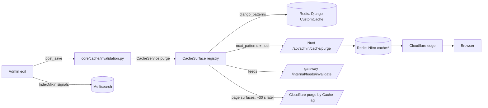

# Caches and purging

There are six places a stale value can hide: Django's Redis cache, the
Nuxt Nitro SWR cache (also Redis, but a different key layout), the
media-stream image cache, the agent gateway's feed cache, the Meilisearch
index, and Cloudflare in front of the storefront. A purge that targets the
wrong layer reports success and changes nothing, so start from the
symptom table at the end of this page.

## Diagram



## Layer 1: Django `CustomCache` (Redis)

`CACHES["default"]` is `core.caches.CustomCache`, a `RedisCache` subclass,
with `KEY_FUNCTION = tenant.cache.make_tenant_key`. Every key is prefixed
with the active schema, `{schema}:{prefix}:{version}:{key}`, so one store's
cache is never visible to another. Keys that start with `global:` swap the
schema for the literal `global`, which is how `tenant_resolve` and
`tenant_domains` entries are shared by every schema that reads them.

`CustomCache.__init__` injects redis-py resilience options (retry,
health-check interval, keepalive) that redis-py ships off and Django never
sets. They live in the backend rather than in `CACHES["OPTIONS"]` because
the backend is also instantiated directly with empty params by tests and
by callers targeting a specific Redis database. `keys()` uses SCAN and
raises on a Redis outage rather than reporting an empty match;
`delete_raw_keys()` and `clear_by_prefixes()` UNLINK selectively, never
FLUSHDB. `failing_persistence_statuses()` reads `INFO persistence` so the
health monitor can see a full volume that a `set`/`get` round-trip cannot.

The `tenant_resolve` entry is keyed by the shape of
`TenantConfigSerializer` (`tenant/cache.py: tenant_resolve_key()`): a
release that adds a field reads a new key, so a cached pre-release payload
is never served against a Zod schema that requires the new field.

Both tenant families are invalidated by **generation, never by delete**.
`Tenant.cache_generation` is part of their keys (`tenant_resolve_key`,
`tenant_domains_key`), and every write that changes what they hold bumps it
in the database inside the write's own transaction: `Tenant.save` in the
same UPDATE, `TenantDomain` saves and deletes and the folded pay-way and
agent-setting writes through `bump_cache_generation` (`tenant/signals.py`).
After the commit every reader builds a new key; the old entry is never read
again and ages out on its TTL. The reason is the fail-open backend: during
a Redis outage a `delete` is a logged no-op, so a purge-by-delete left the
pre-write payload in Redis for up to an hour. Strict keys would have made
the reads raise instead, and resolve is on every storefront request. The
counter is only ever written as `F() + 1`, so a stale in-memory copy cannot
move it back. Resolve therefore reads the domain's tenant row on every call
(one indexed query) and caches only the serializer output. Downstream
copies still expire on their own: Nuxt's five-minute tenant config and the
gateway's tenant cache.

The ViewSet response cache (`cache_methods` in `core/utils/views.py`,
Django's `cache_page`) is scoped to the running release.
`response_cache_key_prefix()` leads every key prefix with
`settings.RELEASE_VERSION`, which `settings.py` reads from the
`pyproject.toml` the image ships (semantic-release bumps it in the release
commit). A deploy therefore never serves a body an earlier release cached;
the old entries are never read again and expire on the timeout each
`cache_methods` decorator was given. Before this, a release that changed an endpoint's
shape kept serving the old cached body until it expired: on 2026-09-24 a
blog list cached before the SEO move still lacked its SEO fields. Only the
response cache is scoped this way. Sessions, throttle counters and locks
share `CACHES["default"]` and must survive a deploy, so the backend's own
`KEY_PREFIX`/`VERSION` stay fixed. The `*<Class>ViewSet_*` purge patterns
match inside the key and reach every release's entries.

## Layer 2: cache surfaces and `CacheService`

`core/cache/registry.py` holds `CacheSurface` objects, each with a `code`,
Django key patterns, Nuxt key patterns, an optional `invalidated_by` list
of model labels and `related` surfaces. `core/cache/surfaces.py` registers
the core set: `pay_way`, `recommendations`, `shipping`, `products`,
`categories`, `blog`, `regions_countries`, `loyalty`, `page_config`,
`promotions`, `tags`, `settings`, `store_pages`, `sitemap_seo`,
`translations`. Apps may add their own in `AppConfig.ready()`.

`CacheService.purge(codes, dry_run=, actor=, include_related=)`
(`core/cache/service.py`) expands related surfaces, runs each surface's
Django patterns against `CustomCache`, posts the Nuxt patterns to the
storefront's purge endpoint, calls the gateway's feed invalidation for
catalogue surfaces, filters out anything matching
`core/cache/protected.py: PROTECTED_FRAGMENTS` (throttles, allauth state,
Knox, sessions, bull queues, image cache, circuit breakers, dj-stripe,
carrier tokens, celery results) **after** SCAN so a misregistered surface
can never wipe security state, and writes a `CachePurgeLog` row
(`core/cache/models.py`) with actor, surfaces, counts and detail.

`core/cache/invalidation.py` connects `post_save` / `post_delete` for every
model named in a surface's `invalidated_by`: the merchant-edited models of
products, categories, blog, page layouts and content pages, navigation,
promotions, tags, pay-ways and recommendations. User-generated rows
(reviews, comments, favourites, stock alerts) are left out. A commit only
adds its stale surfaces to a per-schema Redis set and queues one
`invalidate_cache_surfaces_task` 10 seconds later, which every commit in
that window rides, so a catalogue import costs one purge and an edit shows
within about ten seconds (plus the edge purge that follows it). A save
whose `update_fields` fall inside the surface's `ignored_update_fields` is
skipped: every order's `save(update_fields=["stock", "updated_at"])` would
otherwise empty the store's product cache on each sale. The `pageConfigNavigation` Nitro handler
name is what the `page_config` surface must match; a shorter pattern
purged zero keys and reported success, which is why the surface file
carries the exact name.

A **store feature switch** purges `store_pages`: the storefront's
settings read (`settingsPublic`) and every page it has rendered for the
store, since the navigation, footer and product cards of every page show
what the store offers. `tenant/signals.py` registers
`tenant/switches.py: on_switch_change` over every setting and plan flag in
`tenant/features.py: STORE_FEATURES`, which queues
`core/tasks.py: purge_store_pages_task` in the store's schema on a real
change. A store setting purges at once. A plan flag waits
`STOREFRONT_TENANT_CACHE_SECONDS` (300 by default): the storefront reads
plan flags from its copy of the resolve payload, kept in each pod's memory
that long (`server/utils/tenant.ts`), and a page rendered from that copy
before it expired would be cached with the old flag again.

### Ways to invoke it

- **Admin**: the store sidebar's **Settings → Cache** entry
  (`admin/navigation.py: store_sidebar`, listed for `core.purge_cache`
  holders; `admin:clear-cache`,
  `admin/admin.py: MyAdminSite.clear_cache_view`) lists every surface
  with a live key count, purges the selection, and shows the result. On a
  tenant host the purge is scoped to that tenant's storefront host; on the
  platform host it is deliberately global. The **Cache purge logs** model
  (superuser-only, `core/admin.py: CachePurgeLogAdmin`) is the audit trail.
- **Management command**:

```bash
manage.py clear_cache <surface> [<surface> ...] [--dry-run] [--no-related]
manage.py clear_cache --all                      # every non-heavy surface, skips translations
manage.py clear_cache --all --schema <tenant>    # one tenant
manage.py clear_cache --all --public-only        # control plane only
manage.py clear_cache --prefixes <raw prefix>    # raw Redis prefixes
```

  Run it with no arguments to list the surfaces.
- **Code**: `CacheService.purge(["promotions"])` after a write that bypasses
  signals (`QuerySet.update()`, `bulk_create`, seed scripts); purging
  promotions after a seed is manual.
- **Scheduled**: `core.tasks.clear_all_cache_task` on the first of the
  month.

## Layer 3: Nuxt Nitro SWR cache (Redis)

`nuxt.config.ts` derives three sets of route rules from
`shared/constants/prerender.ts`, all with
`cache: { varies: ['host', 'x-device-class'] }`: the brand pages at
`swr: 3600`, the homepage at 300 seconds, and the blog and catalogue
families at 600 and 300. Server handlers use `defineCachedEventHandler`,
the sitemap source and RSS feeds `defineCachedFunction`. `/sitemap.xml`
itself is a route-rule cache too (`swr` for a day, `varies: ['host']`);
@nuxtjs/sitemap's own cache is off (`sitemap.cacheMaxAgeSeconds: false`)
because it kept the sitemap under a storage base nothing mounts, in each
pod's memory, keyed by a hash of the host, where no purge reached it. On
2026-10-15 a store's sitemap kept listing `/products` after the store
switched its catalogue off. All of it lives in the
`cache:` mount in shared Redis, namespaced by build as
`cache:<buildId>:nitro:...` (`server/plugins/storage.ts`). A deploy
therefore starts from an empty cache — there is no post-deploy purge
step — and the previous build's namespace is unlinked a minute after
the new pods start.

The tenant host sits in a different place in each key family, and the
purge endpoint's host scoping (`server/utils/cacheKey.ts:
cacheKeyBelongsToHost`) has to recognise all three:

| Family | Key shape | Where the host is |
|---|---|---|
| `nitro:handlers:<name>:<entry>` | `tenantCacheKey` (`host__locale__key`) after Nitro's `escapeKey` (word characters only) | the entry starts with the host stripped of punctuation, then `__` |
| `nitro:routes:_:<path>.<hash>:host.<hash>:xdeviceclass.<hash>` | route-rule cache; `/` is stored as `index` | `host.<hash>` — Nitro's vary-header hash of the host, never the host text |
| `nitro:functions:<name>:…:<host>:<locale>:…` | cached functions keyed on the raw host, then the locale | a whole `:`-delimited segment |

The locale follows the host in both keyed families because Django
answers in the `X-Language` it is sent: without it, an entry filled by
an English page would be served to a Greek one. It sits AFTER the host
so store-scoped purges still match every language. Route-rule pages are
keyed by path, which already carries the locale prefix.

Until 2026-09-18 only the first shape was recognised: a tenant purge of
`page_config` cleared the handler JSON and left every rendered page, and
a `sitemap_seo` purge matched nothing — each reporting success. The
endpoint also marked a key as handled before its regex ran, so of the
five `_nuxt_routes()` patterns in `page_config` only the first ever
matched. Both are pinned by `test/unit/server/api/admin/cache/purge.post.spec.ts`
against keys copied from the production keyspace.

The purge endpoint is `POST /api/admin/cache/purge`
(`server/api/admin/cache/purge.post.ts`), authenticated by the
`X-Cache-Purge-Token` header compared in constant time against
`NUXT_CACHE_PURGE_TOKEN`. Body: `{ patterns: string[], dryRun?: boolean,
host?: string }`. A `host` scopes the purge to one tenant's keys; omit it
for a platform-wide purge. Only a trailing `*` is a prefix; a mid-pattern
`*` becomes a regex post-filter. Django's `core/cache/nuxt.py` calls it
through `NUXT_INTERNAL_BASE_URL` (the in-cluster Service) with the same
token, passing the current tenant's primary domain as `host`.

From a pod, after a storefront deploy or when Django is not the writer:

```bash
kubectl exec -i -n grooveshop deploy/frontend-nuxt -- node <<'JS'
const token = process.env.NUXT_CACHE_PURGE_TOKEN
fetch('http://127.0.0.1:3000/api/admin/cache/purge', {
  method: 'POST',
  headers: { 'X-Cache-Purge-Token': token, 'Content-Type': 'application/json' },
  body: JSON.stringify({ patterns: ['*routes*', '*pageConfig*'], dryRun: true }),
}).then(r => r.text()).then(console.log)
JS
```

Flip `dryRun` to `false` once the counts look right. `*` reports the
total; `nitro:routes:*` and `nitro:handlers:*` match nothing because the
stored keys carry the `cache:` mount and escaping. Entries refill on the
next request.

## Layer 4: media-stream image cache

The media service keeps processed images in memory, Redis and on disk
under the namespace `image:{tenantSchema}`. Django's
`PROTECTED_FRAGMENTS` includes `image:` so a surface purge never touches
it. The flush is per tenant: `POST /admin/cache/flush-tenant` with body
`{"tenantSchema": "<schema>"}` and the `x-internal-secret` header
(`src/MediaStream/Cache/controllers/admin-cache.controller.ts`, guarded by
`InternalSecretGuard`, secret `INTERNAL_ADMIN_SECRET`). It invalidates
every cache layer and sweeps the on-disk `.rsm` / `.rsc` pairs, because
the disk tier is read directly and would otherwise resurrect the entry.
Django calls it from `tenant/media_flush.py` through
`tenant.tasks.flush_tenant_media_task`, using `MEDIA_STREAM_INTERNAL_URL`
and `MEDIA_STREAM_INTERNAL_SECRET`; suspending a tenant
(`tenant/lifecycle.py: suspend_tenant`) and destroying one (`destroy_tenant`)
queue it. Do it by hand from a backend pod:

```bash
kubectl -n grooveshop exec deploy/backend -- .venv/bin/python manage.py shell -c \
  "from tenant.media_flush import flush_tenant_media; print(flush_tenant_media('<schema>'))"
```

The flush reaches **every replica**. Memory and disk are private to a pod,
and the request lands on one pod through the Service, so the pod that
takes it flushes itself and publishes the tenant on the Redis channel
`mediastream:tenant-flush:{REDIS_DB}`; every other pod flushes itself the
same way (`Cache/services/tenant-flush.service.ts`). The response carries
`broadcastReceivers`, the number of pods that got the message: the replica
count when healthy. Pub/sub is fire-and-forget, so a pod that is down or
reconnecting at that moment misses it.

Each pod clears its tiers **bottom-up**: disk, then Redis, then memory. A
tier can only be refilled from the tiers below it (memory from Redis, both
from disk), so a request arriving mid-flush cannot copy a stale entry into
a tier that is already done. Before each tier the pod advances a
per-tenant epoch (`TenantCacheEpochs`); a request records the epoch when
it starts, and every write that could put an entry back (the processed
result, a disk-hit backfill, the Redis-to-memory backfill, cache warming)
is skipped when the epoch has moved and removed again when it moves during
the write. A request already running still answers with its own result,
and a request that starts after the flush never joins work that began
before it (the epoch is part of the deduplication key). The 5-minute
negative cache is not covered.

A tier that could not be cleared (Redis unreachable, or a pair of the
tenant that could not be removed from disk) answers **503
`TENANT_FLUSH_INCOMPLETE`**, after the remaining tiers and the broadcast,
so the Celery task retries. A sidecar the sweep cannot read does not
count: its tenant is unknown and a pair without a valid sidecar is never
served.

**media-stream refuses a suspended store.** Django's internal tenant feed
(`tenant/internal.py: build_domains_payload`) lists the suspended stores in
`suspendedSchemas`, by `SuspendedTenantMiddleware`'s rule (`is_active`).
media-stream refuses an image of one before reading any cache tier: **503**
`TENANT_SUSPENDED` with `Cache-Control: no-store`, logged at WARN,
`outcome=suspended` (`TenantSuspendedError`). Django queues the flush after
the suspension commits (`dispatch_on_commit`), and every replica re-reads
the feed when the flush reaches it, before clearing its tiers, so the
refusal applies at once. Between flushes the feed is polled every
`TENANT_DOMAINS_REFRESH_INTERVAL_MS` (5 minutes); refreshes run in order and
a failed one retries from 1 s, doubling up to the poll interval. It is a
deny list, so a feed media-stream cannot read refuses nothing.

**No original is served as uploaded.** They live in `MEDIA_ROOT/{schema}`,
and only media-stream reads them, in-cluster from `static-svc` with
`Host: static-svc`. A public request for one reaches the static nginx
through a static host (`static.grooveshop.space`, `static.webside.gr`, a
`static-staging.` twin or a store's own `static.<domain>`) and is answered
**301** to the media-stream URL of the same image on the matching assets
host, full size (`…/0/0/inside/center/transparent/0/90.{format}`), so an
old link (a pin, an image search result, rich text) keeps working and a
suspended store's images are refused there; anything under `/media` that
media-stream does not serve as an image is 404 in public
(grooveshop-infrastructure `base/static.yaml`). A suspension therefore
moves no file: refusing the store is media-stream's job, and the flush only
drops cached copies. Reactivating flushes and purges again, which makes
media-stream serve the store at once and drops what was cached while it
was away. Destroying a tenant erases its uploads (`purge_tenant_files`).

### The Cloudflare edge copy

Cloudflare keeps each processed image for a year (`s-maxage` 360 days, no
`Cache-Tag`), so flushing media-stream alone
leaves the edge copies of a suspended or destroyed tenant's images in place. The same Celery task purges
the edge **after** the flush, never before, because a purge that ran
first would let the edge refetch images media-stream still holds. It
purges by URL prefix (`core/cache/edge.py: tenant_media_purges`,
`purge_media`): the processed images at
`{assets-host}/media_stream-image/media/{schema}/`. A static host is not
purged: it serves no original in public, so the edge holds only redirects
there. The shared assets host (`MEDIA_STREAM_BASE_URL`) and any white-label
assets host on a platform hostname go to the platform zone; a tenant's own
assets host goes to its own zone. A prefix purge reaches images cached before the
purge existed. The plan is read while the tenant row exists, so
`destroy_tenant` builds it before the row is deleted; an own-zone entry
carries the zone's token encrypted under the database's key ring
(`token_ciphertext`, `FIELD_ENCRYPTION_KEYS`), never in clear. When the
purge runs it uses the tenant's current token while the row exists (so a
token rotated after planning still works) and the planned ciphertext only
once a destroy has removed the row. A token that no longer decrypts is
logged with the prefixes for a manual purge and skipped; any other failure
retries with the task. From a backend pod, for a tenant that still
exists:

```bash
kubectl -n grooveshop exec deploy/backend -- .venv/bin/python manage.py shell -c \
  "from core.cache import edge; from tenant.models import Tenant; t = Tenant.objects.get(schema_name='<schema>'); edge.purge_media(t.schema_name, edge.tenant_media_purges(t))"
```

Cloudflare's Free plan allows five prefix purges a minute per account;
one suspend or destroy sends one request per zone.

## Layer 5: agent gateway feeds

The Go gateway caches the generated catalogue feeds per tenant.
`core/cache/gateway.py: invalidate_feeds()` posts to
`AGENT_GATEWAY_INTERNAL_URL` + `/internal/feeds/invalidate` with
`AGENT_GATEWAY_INTERNAL_SECRET`; `CacheService._purge_surface` calls it for
every surface flagged `invalidates_gateway_feeds`, so a product purge also
drops the feeds. There is no dry-run for this step. See
[Agentic commerce](/dev/flows/agentic-commerce).

## Layer 6: Meilisearch

Not a cache in the TTL sense, but a copy that drifts. `IndexMixin` signals
update documents on save through `meili/tasks.py`; a bulk change, a
`MeiliMeta` edit or a restore needs a resync:

```bash
manage.py meilisearch_sync_all_indexes --all-tenants
manage.py meilisearch_sync_index product.ProductTranslation
manage.py meilisearch_apply_settings --all-tenants   # also run by the PreSync hook
```

The daily `sync-meilisearch-indexes` beat entry fans out over tenants.
Command reference:
[Meilisearch management commands](/dev/django/reference/search/management-commands).

## Cloudflare

Cloudflare caches the storefront's pages as well as its hashed `/_nuxt`
assets, but only the pages Nitro served from its own page cache: the
storefront adds `Cloudflare-CDN-Cache-Control: max-age=60,
stale-while-revalidate=86400` and `Cache-Tag: storefront-html,
storefront-html-<schema>` to those (`server/plugins/edge-cache.ts`), and a
`storefront pages` Cache Rule per zone makes them eligible and follows the
header. A response without it — account, cart, checkout, an uncached
locale — is never stored. Browsers get `Cache-Control: no-cache` and
revalidate against the edge.

Two purges keep the edge honest (`core/cache/edge.py`):

- **After an edit.** When `CacheService` purges a surface with page
  renders, it queues one purge of the store's tag, about 30 seconds later,
  so a burst of saves costs one request — Cloudflare's Free plan allows
  five a minute per account. On the public schema it purges every store.
- **After a deploy.** The `backend-edge-purge` PostSync hook runs
  `manage.py purge_edge_cache`, which purges the `storefront-html` tag from
  every zone before the warm-up: an edge copy from the previous build
  points at `/_nuxt` chunks the new pods no longer serve.

The platform zone (`*.grooveshop.space`) is purged with the platform's
token (`CLOUDFLARE_PLATFORM_*` settings); a store on its own domain in its
own Cloudflare account carries its zone ID and a Cache-Purge-only token on
its Tenant row. The rule's definition, and why it lists paths instead of
excluding them, are in the infrastructure repo's
`docs/cloudflare-zone-settings.md`.

**Speed Brain must stay off** on every zone. It answers
`Sec-Purpose: prefetch` requests for non-cacheable content with an
edge-generated 503, which showed up as dozens of `/_nuxt` 503s in
PageSpeed runs while Traefik's counters never moved.

## Symptom to layer to command

| Symptom | Layer | Purge |
|---|---|---|
| Admin edit not visible in an API response (`/api/v1/...`) | Django `CustomCache` | Admin Cache tool for the surface, or `manage.py clear_cache <surface>` |
| Seeded promotions or bulk-updated rows not visible | Django, signals bypassed | `CacheService.purge(["promotions"])` or `clear_cache promotions` |
| Whole storefront 404 "Store not found" after a Django deploy that touched `TenantConfigSerializer` | Django `global:tenant_resolve` | fixed by shape keying; if still on an older tag, `clear_cache --prefixes global:tenant_resolve` |
| Old HTML right after a green storefront deploy | Cloudflare, if the `backend-edge-purge` hook failed (Nitro has a namespace per build) | the hook's log; rerun `manage.py purge_edge_cache` from a backend pod |
| Edit visible with `?cb=1` but not on the plain URL for over a minute | Cloudflare, the store's tag purge failed | Celery log for `purge_edge_cache_task`; the store's Cloudflare credentials |
| Content edit not visible on a rendered page after ~40 s | Nitro `nitro:routes:` (the edit bypassed signals, or its model is not in the surface's `invalidated_by`) | the surface's Cache tool purge from the tenant admin (`page_config` covers `/`, `/about`, `/contact`, …), or the purge endpoint with `*routes*` |
| Navigation menu edit not showing | Nitro handler `pageConfigNavigation` | `clear_cache page_config` (purges `*pageConfig*`) |
| A switched-off feature still on a page | Nitro `nitro:routes:`; after a plan-flag change, until `STOREFRONT_TENANT_CACHE_SECONDS` has passed | `clear_cache store_pages` |
| One API route returns pre-edit data | Nitro `nitro:handlers:<name>` | purge endpoint with `*<handlerName>*` |
| Replaced product image still served | media-stream `image:{schema}` | `flush-tenant` with the internal secret |
| Google/Meta/TikTok feed stale | gateway feeds | `clear_cache products` (calls `invalidate_feeds`) |
| Product missing or stale in search | Meilisearch | `meilisearch_sync_index` for the model |
| `/_nuxt` 503s only in PageSpeed | Cloudflare Speed Brain | dashboard: Speed Brain off, `_nuxt` cache rule eligible |
| Purge reports 0 keys | wrong pattern | `dryRun: true` with `*` to see the real key shapes |

## Invariants

- Every Django key carries the schema prefix or the `global:` marker
  (`tenant/cache.py`).
- Protected fragments are filtered after SCAN, never before
  (`core/cache/service.py`, `core/cache/protected.py`).
- A tenant-host purge passes its primary domain as `host`; only the
  platform host purges globally (`core/cache/nuxt.py`). On the Nuxt side
  the host is matched per key family, never as a substring
  (`server/utils/cacheKey.ts: cacheKeyBelongsToHost`).
- The Nitro cache is namespaced by build id (`server/plugins/storage.ts`);
  a Nitro purge is merchant-time invalidation, never a deploy step. The
  Cloudflare edge is the opposite: a deploy purges it.
- Only a response carrying `Cloudflare-CDN-Cache-Control` is stored at the
  edge, and only a Nitro page-cache response carries it
  (`server/utils/edgeCache.ts`). Never `s-maxage` there: it disables the
  edge's stale-while-revalidate.
- The Nitro navigation handler is `pageConfigNavigation`
  (`core/cache/surfaces.py`).
- Purge tokens and internal secrets never leave the cluster; run purges
  from inside a pod.

## Source

| File | Role |
|---|---|
| `grooveshop-django-api/core/caches.py` | `CustomCache`, resilience options, SCAN helpers |
| `grooveshop-django-api/tenant/cache.py`, `tenant/signals.py`, `tenant/models.py` | `make_tenant_key`, `tenant_resolve_key`, `tenant_domains_key`, `bump_cache_generation`, `Tenant.cache_generation` |
| `grooveshop-django-api/core/cache/registry.py`, `surfaces.py`, `service.py`, `invalidation.py`, `protected.py`, `nuxt.py`, `gateway.py`, `models.py` | Surface registry, purge service, signal wiring, Nuxt and gateway clients, `CachePurgeLog` |
| `grooveshop-django-api/admin/admin.py`, `core/admin.py` | Cache tool and purge log admin |
| `grooveshop-django-api/core/management/commands/clear_cache.py` | Command |
| `grooveshop-django-api/core/cache/edge.py`, `core/tasks.py` (`purge_edge_cache_task`), `core/management/commands/purge_edge_cache.py` | Cloudflare purge by tag, per edit and per deploy; by prefix for a tenant's media (`tenant_media_purges`, `purge_media`) |
| `grooveshop-storefront-ui-node-nuxt/server/plugins/edge-cache.ts`, `server/utils/edgeCache.ts` | Edge directive and cache tags |
| `grooveshop-infrastructure/manifests/app-constructs/grooveshop/prepare-helm/templates/edge-purge-job.yaml` | Post-deploy purge hook |
| `grooveshop-django-api/tenant/media_flush.py`, `tenant/tasks.py` | Media flush |
| `grooveshop-django-api/tenant/lifecycle.py` (`suspend_tenant`, `activate_tenant`), `grooveshop-django-api/tenant/offboarding.py` (`purge_tenant_files`) | The flush and purge a suspension and a reactivation queue; erasing the uploads on destroy |
| `grooveshop-infrastructure/manifests/app-constructs/grooveshop/base/static.yaml` | Originals served only to media-stream; public requests redirected to it |
| `grooveshop-django-api/core/urls.py` | Dev/CI media route, which refuses dot-segment paths like the static nginx |
| `grooveshop-django-api/settings.py` | `CACHES`, `NUXT_INTERNAL_BASE_URL`, `NUXT_CACHE_PURGE_TOKEN`, `STOREFRONT_TENANT_CACHE_SECONDS`, `CLOUDFLARE_PLATFORM_*` |
| `grooveshop-django-api/tenant/switches.py`, `tenant/features.py`, `core/tasks.py` (`purge_store_pages_task`) | The purge a feature switch triggers |
| `grooveshop-storefront-ui-node-nuxt/server/utils/tenant.ts` | The storefront's in-memory copy of the resolve payload |
| `grooveshop-storefront-ui-node-nuxt/server/api/admin/cache/purge.post.ts` | Nitro purge endpoint |
| `grooveshop-storefront-ui-node-nuxt/nuxt.config.ts`, `shared/constants/prerender.ts` | SWR route rules |
| `grooveshop-media-stream/src/MediaStream/Cache/controllers/admin-cache.controller.ts` | `flush-tenant` |
| `grooveshop-django-api/meili/management/commands/` | Meilisearch commands |
| `grooveshop-infrastructure/manifests/app-constructs/grooveshop/base/backend-config.yaml` | Internal service URLs |
