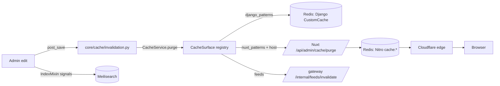

# Caches and purging

There are six places a stale value can hide: Django's Redis cache, the
Nuxt Nitro SWR cache (also Redis, but a different key layout), the
media-stream image cache, the agent gateway's feed cache, the Meilisearch
index, and Cloudflare in front of the storefront. A purge that targets the
wrong layer reports success and changes nothing, so start from the
symptom table at the end of this page.

## Diagram



## Layer 1: Django `CustomCache` (Redis)

`CACHES["default"]` is `core.caches.CustomCache`, a `RedisCache` subclass,
with `KEY_FUNCTION = tenant.cache.make_tenant_key`. Every key is prefixed
with the active schema, `{schema}:{prefix}:{version}:{key}`, so one store's
cache is never visible to another. Keys that start with `global:` swap the
schema for the literal `global`, which is how `tenant_resolve` and
`tenant_domains` entries can be written from any schema and invalidated
from the public one.

`CustomCache.__init__` injects redis-py resilience options (retry,
health-check interval, keepalive) that redis-py ships off and Django never
sets. They live in the backend rather than in `CACHES["OPTIONS"]` because
the backend is also instantiated directly with empty params by tests and
by callers targeting a specific Redis database. `keys()` uses SCAN and
raises on a Redis outage rather than reporting an empty match;
`delete_raw_keys()` and `clear_by_prefixes()` UNLINK selectively, never
FLUSHDB. `failing_persistence_statuses()` reads `INFO persistence` so the
health monitor can see a full volume that a `set`/`get` round-trip cannot.

The `tenant_resolve` entry is keyed by the shape of
`TenantConfigSerializer` (`tenant/cache.py: tenant_resolve_key()`): a
release that adds a field reads a new key, so a cached pre-release payload
is never served against a Zod schema that requires the new field. Every
reader and every invalidator in `tenant/signals.py` goes through that
helper.

## Layer 2: cache surfaces and `CacheService`

`core/cache/registry.py` holds `CacheSurface` objects, each with a `code`,
Django key patterns, Nuxt key patterns, an optional `invalidated_by` list
of model labels and `related` surfaces. `core/cache/surfaces.py` registers
the core set: `pay_way`, `recommendations`, `shipping`, `products`,
`categories`, `blog`, `regions_countries`, `loyalty`, `page_config`,
`promotions`, `tags`, `settings`, `sitemap_seo`, `translations`. Apps may
add their own in `AppConfig.ready()`.

`CacheService.purge(codes, dry_run=, actor=, include_related=)`
(`core/cache/service.py`) expands related surfaces, runs each surface's
Django patterns against `CustomCache`, posts the Nuxt patterns to the
storefront's purge endpoint, calls the gateway's feed invalidation for
catalogue surfaces, filters out anything matching
`core/cache/protected.py: PROTECTED_FRAGMENTS` (throttles, allauth state,
Knox, sessions, bull queues, image cache, circuit breakers, dj-stripe,
carrier tokens, celery results) **after** SCAN so a misregistered surface
can never wipe security state, and writes a `CachePurgeLog` row
(`core/cache/models.py`) with actor, surfaces, counts and detail.

`core/cache/invalidation.py` connects `post_save` / `post_delete` for every
model named in a surface's `invalidated_by`, marks the surface stale and
flushes once per transaction. This is how a PayWay edit reaches the
checkout on the next request. The `pageConfigNavigation` Nitro handler
name is what the `page_config` surface must match; a shorter pattern
purged zero keys and reported success, which is why the surface file
carries the exact name.

### Ways to invoke it

- **Admin**: the site dropdown's **Cache** tool (`admin:clear-cache`,
  `admin/admin.py: MyAdminSite.clear_cache_view`) lists every surface
  with a live key count, purges the selection, and shows the result. On a
  tenant host the purge is scoped to that tenant's storefront host; on the
  platform host it is deliberately global. The **Cache purge logs** model
  (superuser-only, `core/admin.py: CachePurgeLogAdmin`) is the audit trail.
- **Management command**:

```bash
manage.py clear_cache <surface> [<surface> ...] [--dry-run] [--no-related]
manage.py clear_cache --all                      # every non-heavy surface, skips translations
manage.py clear_cache --all --schema <tenant>    # one tenant
manage.py clear_cache --all --public-only        # control plane only
manage.py clear_cache --prefixes <raw prefix>    # raw Redis prefixes
```

  Run it with no arguments to list the surfaces.
- **Code**: `CacheService.purge(["promotions"])` after a write that bypasses
  signals (bulk operations, seed scripts); purging promotions after a
  seed is manual.
- **Scheduled**: `core.tasks.clear_all_cache_task` on the first of the
  month.

## Layer 3: Nuxt Nitro SWR cache (Redis)

`nuxt.config.ts` route rules give the prerendered marketing routes
(`shared/constants/prerender.ts`) `swr: 3600` with
`cache: { varies: ['host', 'x-device-class'] }`, and server handlers use
`defineCachedEventHandler`. Both store in the `cache:` mount in shared
Redis: page renders under `nitro:routes:` (with the host escaped into the
key, and `/` stored as `index`) and handlers under `nitro:handlers:<name>`.

The purge endpoint is `POST /api/admin/cache/purge`
(`server/api/admin/cache/purge.post.ts`), authenticated by the
`X-Cache-Purge-Token` header compared in constant time against
`NUXT_CACHE_PURGE_TOKEN`. Body: `{ patterns: string[], dryRun?: boolean,
host?: string }`. A `host` scopes the purge to one tenant's keys; omit it
for a platform-wide purge. Only a trailing `*` is a prefix; a mid-pattern
`*` becomes a regex post-filter. Django's `core/cache/nuxt.py` calls it
through `NUXT_INTERNAL_BASE_URL` (the in-cluster Service) with the same
token, passing the current tenant's primary domain as `host`.

From a pod, after a storefront deploy or when Django is not the writer:

```bash
kubectl exec -i -n grooveshop deploy/frontend-nuxt -- node <<'JS'
const token = process.env.NUXT_CACHE_PURGE_TOKEN
fetch('http://127.0.0.1:3000/api/admin/cache/purge', {
  method: 'POST',
  headers: { 'X-Cache-Purge-Token': token, 'Content-Type': 'application/json' },
  body: JSON.stringify({ patterns: ['*routes*', '*pageConfig*'], dryRun: true }),
}).then(r => r.text()).then(console.log)
JS
```

Flip `dryRun` to `false` once the counts look right. `*` reports the
total; `nitro:routes:*` and `nitro:handlers:*` match nothing because the
stored keys carry the `cache:` mount and escaping. Entries refill on the
next request.

## Layer 4: media-stream image cache

The media service keeps processed images in memory, Redis and on disk
under the namespace `image:{tenantSchema}`. Django's
`PROTECTED_FRAGMENTS` includes `image:` so a surface purge never touches
it. The flush is per tenant: `POST /admin/cache/flush-tenant` with body
`{"tenantSchema": "<schema>"}` and the `x-internal-secret` header
(`src/MediaStream/Cache/controllers/admin-cache.controller.ts`, guarded by
`InternalSecretGuard`, secret `INTERNAL_ADMIN_SECRET`). It invalidates
every cache layer and sweeps the on-disk `.rsm` / `.rsc` pairs, because
the disk tier is read directly and would otherwise resurrect the entry.
Django calls it from `tenant/media_flush.py` through
`tenant.tasks.flush_tenant_media_task`, using `MEDIA_STREAM_INTERNAL_URL`
and `MEDIA_STREAM_INTERNAL_SECRET`; tenant offboarding (`tenant/lifecycle.py`)
queues it. Do it by hand from a backend pod:

```bash
kubectl -n grooveshop exec deploy/backend -- .venv/bin/python manage.py shell -c \
  "from tenant.media_flush import flush_tenant_media; print(flush_tenant_media('<schema>'))"
```

## Layer 5: agent gateway feeds

The Go gateway caches the generated catalogue feeds per tenant.
`core/cache/gateway.py: invalidate_feeds()` posts to
`AGENT_GATEWAY_INTERNAL_URL` + `/internal/feeds/invalidate` with
`AGENT_GATEWAY_INTERNAL_SECRET`; `CacheService._purge_surface` calls it for
every surface flagged `invalidates_gateway_feeds`, so a product purge also
drops the feeds. There is no dry-run for this step. See
[Agentic commerce](/dev/flows/agentic-commerce).

## Layer 6: Meilisearch

Not a cache in the TTL sense, but a copy that drifts. `IndexMixin` signals
update documents on save through `meili/tasks.py`; a bulk change, a
`MeiliMeta` edit or a restore needs a resync:

```bash
manage.py meilisearch_sync_all_indexes --all-tenants
manage.py meilisearch_sync_index product.ProductTranslation
manage.py meilisearch_apply_settings --all-tenants   # also run by the PreSync hook
```

The daily `sync-meilisearch-indexes` beat entry fans out over tenants.
Command reference:
[Meilisearch management commands](/dev/django/reference/search/management-commands).

## Cloudflare

The first tenant's storefront is proxied by Cloudflare; the platform hosts
are not. Two things to know: hashed `/_nuxt` assets should be edge-cached
by a Cache Rule, and **Speed Brain must stay off** for that zone. Speed
Brain answers `Sec-Purpose: prefetch` requests for non-cacheable content
with an edge-generated 503, which showed up as dozens of `/_nuxt` 503s in
PageSpeed runs while Traefik's counters never moved. Cloudflare's cache is
purged from its dashboard, not from anything in these repositories.

## Symptom to layer to command

| Symptom | Layer | Purge |
|---|---|---|
| Admin edit not visible in an API response (`/api/v1/...`) | Django `CustomCache` | Admin Cache tool for the surface, or `manage.py clear_cache <surface>` |
| Seeded promotions or bulk-updated rows not visible | Django, signals bypassed | `CacheService.purge(["promotions"])` or `clear_cache promotions` |
| Whole storefront 404 "Store not found" after a Django deploy that touched `TenantConfigSerializer` | Django `global:tenant_resolve` | fixed by shape keying; if still on an older tag, `clear_cache --prefixes global:tenant_resolve` |
| Old HTML on a marketing route after a green storefront deploy | Nitro `nitro:routes:` | purge endpoint with `*routes*` |
| Navigation menu edit not showing | Nitro handler `pageConfigNavigation` | `clear_cache page_config` (purges `*pageConfig*`) |
| One API route returns pre-deploy data | Nitro `nitro:handlers:<name>` | purge endpoint with `*<handlerName>*` |
| Replaced product image still served | media-stream `image:{schema}` | `flush-tenant` with the internal secret |
| Google/Meta/TikTok feed stale | gateway feeds | `clear_cache products` (calls `invalidate_feeds`) |
| Product missing or stale in search | Meilisearch | `meilisearch_sync_index` for the model |
| `/_nuxt` 503s only in PageSpeed | Cloudflare Speed Brain | dashboard: Speed Brain off, `_nuxt` cache rule eligible |
| Purge reports 0 keys | wrong pattern | `dryRun: true` with `*` to see the real key shapes |

## Invariants

- Every Django key carries the schema prefix or the `global:` marker
  (`tenant/cache.py`).
- Protected fragments are filtered after SCAN, never before
  (`core/cache/service.py`, `core/cache/protected.py`).
- A tenant-host purge passes its primary domain as `host`; only the
  platform host purges globally (`core/cache/nuxt.py`).
- The Nitro navigation handler is `pageConfigNavigation`
  (`core/cache/surfaces.py`).
- Purge tokens and internal secrets never leave the cluster; run purges
  from inside a pod.

## Source

| File | Role |
|---|---|
| `grooveshop-django-api/core/caches.py` | `CustomCache`, resilience options, SCAN helpers |
| `grooveshop-django-api/tenant/cache.py`, `tenant/signals.py` | `make_tenant_key`, `tenant_resolve_key`, invalidators |
| `grooveshop-django-api/core/cache/registry.py`, `surfaces.py`, `service.py`, `invalidation.py`, `protected.py`, `nuxt.py`, `gateway.py`, `models.py` | Surface registry, purge service, signal wiring, Nuxt and gateway clients, `CachePurgeLog` |
| `grooveshop-django-api/admin/admin.py`, `core/admin.py` | Cache tool and purge log admin |
| `grooveshop-django-api/core/management/commands/clear_cache.py` | Command |
| `grooveshop-django-api/tenant/media_flush.py`, `tenant/tasks.py` | Media flush |
| `grooveshop-django-api/settings.py` | `CACHES`, `NUXT_INTERNAL_BASE_URL`, `NUXT_CACHE_PURGE_TOKEN` |
| `grooveshop-storefront-ui-node-nuxt/server/api/admin/cache/purge.post.ts` | Nitro purge endpoint |
| `grooveshop-storefront-ui-node-nuxt/nuxt.config.ts`, `shared/constants/prerender.ts` | SWR route rules |
| `grooveshop-media-stream/src/MediaStream/Cache/controllers/admin-cache.controller.ts` | `flush-tenant` |
| `grooveshop-django-api/meili/management/commands/` | Meilisearch commands |
| `grooveshop-infrastructure/manifests/app-constructs/grooveshop/base/backend-config.yaml` | Internal service URLs |
