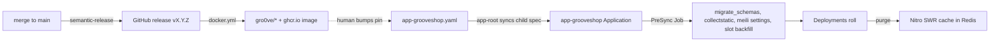

# Deploying

A deploy is three separate things that are easy to conflate: a release
(CI cuts a tag and publishes an image), a pin change (a commit to the
infrastructure repository), and a rollout (Argo CD applies the pin and
Kubernetes rolls the pods). Each has its own place to verify, and the last
one has a cache in front of it.

## Diagram



## Release flow per repository

| Repository | Version cut by | Image published by | Registries |
|---|---|---|---|
| `grooveshop-django-api` | python-semantic-release in `ci.yml` on `main` | `docker.yml` on `release: published` | `gro0ve/grooveshop-django-api`, `ghcr.io/<repo>` |
| `grooveshop-storefront-ui-node-nuxt` | semantic-release (`package.json`) on `main` | `docker.yml` on `release: published`, plus `workflow_dispatch` with an explicit tag for branch builds | `gro0ve/grooveshop-storefront-ui-node-nuxt`, `ghcr.io/<repo>` |
| `grooveshop-media-stream` | semantic-release on `main` | `docker.yml` as above | `gro0ve/grooveshop-media-stream`, `ghcr.io/<repo>` |
| `grooveshop-docs` | semantic-release on `main` | `docker.yml` as above | `gro0ve/grooveshop-docs`, `ghcr.io/<repo>` |
| `grooveshop-agent-gateway` | **manual tag**: `release.yml` runs on `push: tags: ['v*.*.*']` and creates the GitHub release itself | the same workflow | `gro0ve/grooveshop-agent-gateway`, `ghcr.io/<repo>` |

Commit type decides the bump (`feat` minor, `fix`/`perf` patch). The image
workflow triggers on the published release and lags the tag by several
minutes, so a green CI run does not mean the image exists yet. Check
before pinning:

```bash
curl -s "https://hub.docker.com/v2/repositories/gro0ve/grooveshop-django-api/tags/vX.Y.Z" | head -c 120
```

A pin to a tag that is not there parks the rollout in `ImagePullBackOff`.

## Where the pins live

`grooveshop-infrastructure/manifests/app-directory/app-grooveshop.yaml`
(production, automated sync) and `app-grooveshop-staging.yaml` (staging,
manual sync). Each carries:

- `spec.sources[0].kustomize.images`: one entry per image
  (`grooveshop-django-api`, `grooveshop-storefront-ui-node-nuxt`,
  `grooveshop-media-stream`, `grooveshop-agent-gateway`,
  `grooveshop-docs`).
- `spec.sources[1].helm.valuesObject.image.tag`: the PreSync
  `backend-prepare` hook's tag. It lives in its own Helm chart
  (`prepare-helm`) because kustomize rejects the bare `generateName` Argo
  needs for hook resources.

**The Django tag appears twice per file and must move together.** Hook
bumped but pods not: migrations relocate tables and the old pods query
`public` and find nothing, a total outage. Pods bumped but hook not: the
hook's `migrate_schemas` runs the old image, `set -e` aborts PreSync, the
sync never applies, and `hook-delete-policy: HookFailed` deletes the Job
so the logs vanish. The `/update-deploy-version` skill in the
infrastructure repository edits every pin and confirms both Django sites
moved; it does not commit or push.

## A push alone changes nothing

Both files are Argo `Application` manifests managed by the app-of-apps
root (`manifests/app-root.yaml`, path `manifests/app-directory`). A commit
changes the manifest in git; the child's spec in the cluster changes only
when `app-root` syncs it. Until then the child reports **Synced against the
old pins**. Force the root, then confirm the child's spec:

```bash
kubectl -n argocd patch app app-root --type merge \
  -p '{"metadata":{"annotations":{"argocd.argoproj.io/refresh":"hard"}}}'
kubectl get app app-grooveshop -n argocd \
  -o jsonpath='{.spec.sources[0].kustomize.images}{"\n"}{.spec.sources[1].helm.valuesObject.image.tag}{"\n"}'
```

That proves the spec changed. The child compares it against the cluster on
its own reconciliation tick (three minutes by default), and its status still
reads `Synced` / `Succeeded` from the previous operation until then.
Hard-refresh the child too, then judge the deploy by the Deployment and its
rollout, never by Argo's status alone:

```bash
kubectl -n argocd patch app app-grooveshop --type merge \
  -p '{"metadata":{"annotations":{"argocd.argoproj.io/refresh":"hard"}}}'
kubectl -n grooveshop get deploy -o jsonpath='{range .items[*]}{.metadata.name}{"\t"}{.spec.template.spec.containers[0].image}{"\n"}{end}'
kubectl -n grooveshop rollout status deploy/backend --timeout=600s
```

## The PreSync job

`prepare-helm/templates/job.yaml` runs once per deploy, before any pod
rolls: `migrate_schemas`, `collectstatic`, `meilisearch_apply_settings
--all-tenants` (its failure is swallowed so a tenant-less bring-up is not
blocked) and `backfill_recommendation_slots`. It needs the Redis and
RabbitMQ secrets to start Django, has `activeDeadlineSeconds: 1800` and
`backoffLimit: 2`. Because the schema lands before the new code, every
migration must be backwards-compatible with the previous release; see the
synced [Migration Safety Rules](/dev/django/reference/migrations). Do not
create a tenant while a sync is in flight: the tenant-creation migrate
races the hook.

Read the hook's log while it is alive:

```bash
kubectl -n grooveshop logs -l app.kubernetes.io/component=backend-prepare -f
```

## Staging is its own file and manual

`app-grooveshop-staging.yaml` has no `automated` block. Bump it in its own
commit and sync by hand:

```bash
argocd app sync app-grooveshop-staging
# or, without the CLI
kubectl -n argocd patch app app-grooveshop-staging --type merge \
  -p '{"operation":{"sync":{"syncStrategy":{"hook":{}}}}}'
```

See [Staging](/dev/operations/staging).

## `base/` edits reach production immediately

`manifests/app-constructs/grooveshop/base/` is shared by both overlays and
production auto-syncs. Every Deployment there carries
`reloader.stakater.com/auto: "true"`, so a ConfigMap or Secret change rolls
the production pods the moment it merges, on whatever image production is
pinned to. Keep `base/` changes out of a staging-pin PR; put them in the
production-pin PR or their own.

## Storefront deploys serve stale HTML until you purge

A storefront bump does not refresh the routes in
`shared/constants/prerender.ts`. `nuxt.config.ts` gives them `swr: 3600`
with `cache: { varies: ['host', 'x-device-class'] }` and the rendered HTML
lives in shared Redis, so it survives the pod roll: new pods, new image,
old page, for up to an hour, while Argo reads Healthy. After any
storefront deploy purge from inside a frontend pod (the token never leaves
it):

```bash
kubectl exec -i -n grooveshop deploy/frontend-nuxt -- node <<'JS'
const token = process.env.NUXT_CACHE_PURGE_TOKEN
fetch('http://127.0.0.1:3000/api/admin/cache/purge', {
  method: 'POST',
  headers: { 'X-Cache-Purge-Token': token, 'Content-Type': 'application/json' },
  body: JSON.stringify({ patterns: ['*routes*', '*pageConfig*'], dryRun: false }),
}).then(r => r.text()).then(console.log)
JS
```

Page renders live under `nitro:routes:`, every `defineCachedEventHandler`
under `nitro:handlers:<name>`; `*routes*` clears only the first. A deploy
that changes what an API route returns needs `*<handlerName>*` as well.
Probe with `dryRun: true` first: the wrong prefix reports `deleted: 0` and
exits green. Diagnose without purging by appending `?cb=<timestamp>`: a
fresh cache key renders fresh, so old text on the bare URL and new text
with `?cb=` is this cache, not a failed deploy. Staging cannot catch this
class of bug because its Redis is separate from production's. The full
list of layers is in [Caches & purging](/dev/operations/caches).

## Traefik-facing pods need `preStop`

Every Deployment that Traefik routes to (`backend`, `frontend-nuxt`,
`media-stream`, `agent-gateway`, `static-nginx`, `docs`) carries a native
`lifecycle.preStop.sleep` of 10 seconds so in-flight keep-alive connections
drain before the endpoint is removed. Without it a rolling update produces
a burst of 503s on `/_nuxt` chunks. Add it to any new Ingress-backed
Deployment.

## Verify what is served, not what is deployed

1. Pods actually run the new tag:
   `kubectl get pods -n grooveshop -o jsonpath='{range .items[*]}{.metadata.name}{"\t"}{.spec.containers[0].image}{"\n"}{end}'`
2. The PreSync migration applied: the hook log shows `Applying ...` lines
   and no error.
3. The rendered text changed: `curl -s https://<storefront host>/<route> | grep -c "<new string>"`.
4. For a tenant-aware change, check more than one tenant host; anything
   from one tenant showing on another's host is a cross-tenant leak.

## Failure modes

- **`ImagePullBackOff`**: the tag does not exist yet; wait for
  `docker.yml` or fix the pin.
- **Argo Synced, pods on the old image**: `app-root` has not synced the
  child spec, or the child has not reconciled; hard-refresh both.
- **PreSync Job gone, sync loops**: the hook failed and
  `HookFailed` deleted it; re-run with matching Django tags and watch the
  log live.
- **Green rollout, old page**: the Nitro SWR cache; purge `*routes*`.
- **Green rollout, one API route stale**: a `defineCachedEventHandler`;
  purge `*<handlerName>*`.

## Source

| File | Role |
|---|---|
| `grooveshop-infrastructure/manifests/app-directory/app-grooveshop.yaml` | Production pins, automated sync |
| `grooveshop-infrastructure/manifests/app-directory/app-grooveshop-staging.yaml` | Staging pins, manual sync |
| `grooveshop-infrastructure/manifests/app-root.yaml` | App-of-apps root |
| `grooveshop-infrastructure/manifests/app-constructs/grooveshop/prepare-helm/templates/job.yaml` | PreSync hook |
| `grooveshop-infrastructure/manifests/app-constructs/grooveshop/base/*.yaml` | Deployments, Reloader annotations, `preStop` |
| `grooveshop-infrastructure/docs/deploying.md` | The runbook this page distils |
| `grooveshop-infrastructure/.claude/skills/update-deploy-version/SKILL.md` | Pin-bump skill |
| `grooveshop-django-api/.github/workflows/ci.yml`, `docker.yml` | Release and image publish |
| `grooveshop-storefront-ui-node-nuxt/.github/workflows/docker.yml`, `grooveshop-media-stream/.github/workflows/docker.yml`, `grooveshop-docs/.github/workflows/docker.yml` | Image publish on release |
| `grooveshop-agent-gateway/.github/workflows/release.yml` | Tag-triggered release and image |
| `grooveshop-storefront-ui-node-nuxt/nuxt.config.ts`, `shared/constants/prerender.ts` | SWR route rules |
| `grooveshop-storefront-ui-node-nuxt/server/api/admin/cache/purge.post.ts` | Purge endpoint |
