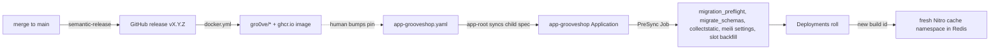

# Deploying

A deploy is three separate things that are easy to conflate: a release
(CI cuts a tag and publishes an image), a pin change (a commit to the
infrastructure repository), and a rollout (Argo CD applies the pin and
Kubernetes rolls the pods). Each has its own place to verify, and the last
one has a cache in front of it.

## Diagram



## Release flow per repository

| Repository | Version cut by | Image published by | Registries |
|---|---|---|---|
| `grooveshop-django-api` | python-semantic-release in `ci.yml` on `main` | `docker.yml` on `release: published` | `gro0ve/grooveshop-django-api`, `ghcr.io/<repo>` |
| `grooveshop-storefront-ui-node-nuxt` | semantic-release (`package.json`) on `main` | `docker.yml` on `release: published`, plus `workflow_dispatch` with an explicit tag for branch builds | `gro0ve/grooveshop-storefront-ui-node-nuxt`, `ghcr.io/<repo>` |
| `grooveshop-media-stream` | semantic-release on `main` | `docker.yml` as above | `gro0ve/grooveshop-media-stream`, `ghcr.io/<repo>` |
| `grooveshop-docs` | semantic-release on `main` | `docker.yml` as above | `gro0ve/grooveshop-docs`, `ghcr.io/<repo>` |
| `grooveshop-agent-gateway` | **manual tag**: `release.yml` runs on `push: tags: ['v*.*.*']` and creates the GitHub release itself | the same workflow | `gro0ve/grooveshop-agent-gateway`, `ghcr.io/<repo>` |

Commit type decides the bump (`feat` minor, `fix`/`perf` patch). The image
workflow triggers on the published release and lags the tag by several
minutes, so a green CI run does not mean the image exists yet. Check
before pinning:

```bash
curl -s "https://hub.docker.com/v2/repositories/gro0ve/grooveshop-django-api/tags/vX.Y.Z" | head -c 120
```

A pin to a tag that is not there parks the rollout in `ImagePullBackOff`.

## Where the pins live

`grooveshop-infrastructure/manifests/app-directory/app-grooveshop.yaml`
(production, automated sync) and `app-grooveshop-staging.yaml` (staging,
manual sync). Each file carries six pin sites:

- `spec.sources[0].kustomize.images`: five entries, one per image
  (`grooveshop-django-api`, `grooveshop-storefront-ui-node-nuxt`,
  `grooveshop-media-stream`, `grooveshop-agent-gateway`,
  `grooveshop-docs`).
- `spec.sources[1].helm.valuesObject.image.tag`: the PreSync
  `backend-prepare` hook's tag. It lives in its own Helm chart
  (`prepare-helm`) because kustomize rejects the bare `generateName` Argo
  needs for hook resources.

A third source pulls the Meilisearch chart from its upstream repository;
its `targetRevision` is a chart version, not an image pin, and moving it
moves the search engine too.

**The Django tag appears twice per file and must move together.** Hook
bumped but pods not: migrations relocate tables and the old pods query
`public` and find nothing, a total outage. Pods bumped but hook not: the
hook's `migrate_schemas` runs the old image, `set -e` aborts PreSync, the
sync never applies, and `hook-delete-policy: HookFailed` deletes the Job
so the logs vanish. The `/update-deploy-version` skill in the
infrastructure repository edits every pin and confirms both Django sites
moved; it does not commit or push.

## A push alone changes nothing

Both files are Argo `Application` manifests managed by the app-of-apps
root (`manifests/app-root.yaml`, path `manifests/app-directory`). A commit
changes the manifest in git; the child's spec in the cluster changes only
when `app-root` syncs it. Until then the child reports **Synced against the
old pins**. Force the root, then confirm the child's spec:

```bash
kubectl -n argocd patch app app-root --type merge \
  -p '{"metadata":{"annotations":{"argocd.argoproj.io/refresh":"hard"}}}'
kubectl get app app-grooveshop -n argocd \
  -o jsonpath='{.spec.sources[0].kustomize.images}{"\n"}{.spec.sources[1].helm.valuesObject.image.tag}{"\n"}'
```

That proves the spec changed. The child compares it against the cluster on
its own reconciliation tick (three minutes by default), and its status still
reads `Synced` / `Succeeded` from the previous operation until then.
Hard-refresh the child too, then judge the deploy by the Deployment and its
rollout, never by Argo's status alone:

```bash
kubectl -n argocd patch app app-grooveshop --type merge \
  -p '{"metadata":{"annotations":{"argocd.argoproj.io/refresh":"hard"}}}'
kubectl -n grooveshop get deploy -o jsonpath='{range .items[*]}{.metadata.name}{"\t"}{.spec.template.spec.containers[0].image}{"\n"}{end}'
kubectl -n grooveshop rollout status deploy/backend --timeout=600s
```

## The PreSync job

`prepare-helm/templates/job.yaml` runs one shell script per deploy, before
any pod rolls. Step 0, `migration_preflight`, and steps 1 and 2,
`migrate_schemas` and `collectstatic`, run under `set -e` and abort the
sync on failure. Steps 3
and 4 are convergence, not gates, and the script continues past either:
`meilisearch_apply_settings --all-tenants` (exit 3 means no active tenants
yet, which is normal on a fresh bring-up; any other non-zero exit is
logged as real index drift) and `backfill_recommendation_slots`, which
seeds the recommendation slot rows for tenants that predate the engine.
It needs the Redis and RabbitMQ secrets to start Django, has
`activeDeadlineSeconds: 1800` and `backoffLimit: 2`. Do not create a
tenant while a sync is in flight: the tenant-creation migrate races the
hook.

### Step 0: the migration preflight

The schema lands before the new code, and the previous release keeps
querying it until its last pod exits. `manage.py migration_preflight`
(`grooveshop-django-api/core/db/migration_safety.py`) checks `public` and
every tenant schema. For each one it compares the pending migrations with
the migrations already applied there, which are the serving release's
models. It blocks any pending operation whose database effect removes,
renames or tightens a table or column those models still use:

- a dropped or renamed column or table;
- a NOT NULL column added without `db_default`;
- a column made NOT NULL without `db_default`;
- a `RunSQL` drop that does not declare `contract_of`, or whose expand
  migration is pending in the same deploy.

It writes nothing. A failure stops the sync before any DDL runs, and the
old pods keep serving. The same command runs in the Django CI `Migration
Check` job after migrating a database at the base commit.

Because it reads the database, not the git history, it also catches a pin
that skips a Django release. The expand migration and its contract then
arrive together, and the fix is to pin the intermediate release first. The
rule and the two-release recipe are the synced
[Migration Safety Rules](/dev/django/reference/migrations). The runbook
for a failed preflight is in `grooveshop-infrastructure/docs/deploying.md`.

Read the hook's log while it is alive:

```bash
kubectl -n grooveshop logs -l app.kubernetes.io/component=backend-prepare -f
```

## The documentation site

This site is the sixth repository and deploys the same way as the rest.
`grooveshop-docs` cuts a version with semantic-release in its own
`ci.yml`, `docker.yml` publishes the image on the published release, and
its tag is one of the five kustomize pins in both Argo files.

The workload is `base/docs.yaml` in the shared construct: Deployment
`docs-deployment` running nginx on port 80 behind Service `docs-svc`, with
the same `preStop` sleep as every other Traefik-facing pod. Its Ingress is
**not** in `base/` — each overlay publishes its own host:

- **Production** (`overlays/production/ingress-docs.yaml`) serves
  `docs.grooveshop.space` as two Ingress objects on one host, because the
  middleware chains differ. Everything is public except `/dev`, which goes
  through the `docs-basic-auth` middleware; Traefik matches the longer
  `PathPrefix` first, so the developer tree takes the gated router. The
  `llms.txt` corpora follow the same split. Only the first Ingress carries
  the `cert-manager` annotation; a second owner on the same host would
  make ingress-shim fight over the `Certificate`.
- **Staging** (`overlays/staging/ingress-docs.yaml`) serves
  `docs-staging.grooveshop.space` as a single Ingress with the whole host
  behind the staging basic-auth, so the production path split is moot
  there.

One step is specific to this repository: both `ci.yml` and `docker.yml`
check out `grooveshop-django-api` next to the docs checkout and run
`scripts/sync-sources.mjs` before building, which is what copies the
synced reference pages in. The image is built from the result, so the
reference tree in a published image is as fresh as the Django `main` at
build time.

## Staging is its own file and manual

`app-grooveshop-staging.yaml` has no `automated` block. Bump it in its own
commit and sync by hand:

```bash
argocd app sync app-grooveshop-staging
# or, without the CLI
kubectl -n argocd patch app app-grooveshop-staging --type merge \
  -p '{"operation":{"sync":{"syncStrategy":{"hook":{}}}}}'
```

See [Staging](/dev/operations/staging).

## `base/` edits reach production immediately

`manifests/app-constructs/grooveshop/base/` is shared by both overlays and
production auto-syncs. Every Deployment there carries
`reloader.stakater.com/auto: "true"`, so a ConfigMap or Secret change rolls
the production pods the moment it merges, on whatever image production is
pinned to. Keep `base/` changes out of a staging-pin PR; put them in the
production-pin PR or their own.

## Storefront deploys start from an empty page cache

The SSR renders of the routes in `shared/constants/prerender.ts` live in
shared Redis for up to an hour (`nuxt.config.ts` gives them
`cache: { varies: ['host', 'x-device-class'] }` with `swr: 3600` for the
brand pages, 300 seconds for the homepage, 600 and 300 for the blog and
catalogue families). Until 2026-09-07 a deploy inherited the previous
build's entries — old text, and asset URLs the new image no longer served
— for as long as each entry lived, while Argo read Healthy (2026-08-27:
prod served the old jurisdiction clause on `/terms-of-use` after a fully
green v3.160.3 rollout). `server/plugins/storage.ts` now mounts the cache
under `cache:<buildId>:`, a uuid Nuxt mints per build, so new pods read and
write a namespace nothing has written to yet, and the superseded build's
keys are unlinked a minute after start-up (`sweepSupersededBuildCaches`).
There is no purge step after a storefront deploy. A purge probe run right
after one reports low counts because the cache is cold, not because a
pattern is wrong.

The purge endpoint is for merchant-time invalidation — a Django edit that
must show before a route's TTL — and every layer and command is in
[Caches & purging](/dev/operations/caches). Diagnose a suspected stale
page without purging by appending `?cb=<timestamp>`: a fresh cache key
renders fresh, so old text on the bare URL and new text with `?cb=` is an
entry inside the current build's TTL, not a failed deploy.

## Traefik-facing pods need `preStop`

Every Deployment that Traefik routes to (`backend`, `frontend-nuxt`,
`media-stream`, `agent-gateway`, `static-deployment`, `docs-deployment`)
carries a native
`lifecycle.preStop.sleep` of 10 seconds so in-flight keep-alive connections
drain before the endpoint is removed. Without it a rolling update produces
a burst of 503s on `/_nuxt` chunks. Add it to any new Ingress-backed
Deployment.

## Verify what is served, not what is deployed

1. Pods actually run the new tag:
   `kubectl get pods -n grooveshop -o jsonpath='{range .items[*]}{.metadata.name}{"\t"}{.spec.containers[0].image}{"\n"}{end}'`
2. The PreSync migration applied: the hook log shows `Applying ...` lines
   and no error.
3. The rendered text changed: `curl -s https://<storefront host>/<route> | grep -c "<new string>"`.
4. For a tenant-aware change, check more than one tenant host; anything
   from one tenant showing on another's host is a cross-tenant leak.

## Failure modes

- **`ImagePullBackOff`**: the tag does not exist yet; wait for
  `docker.yml` or fix the pin.
- **Argo Synced, pods on the old image**: `app-root` has not synced the
  child spec, or the child has not reconciled; hard-refresh both.
- **PreSync Job gone, sync loops**: the hook failed and
  `HookFailed` deleted it; re-run with matching Django tags and watch the
  log live.
- **PreSync fails at step 0 with `BLOCK ...` lines**: the preflight
  refused a migration that would break the serving release. Nothing was
  migrated. `contract_of ... is pending in this same deploy` means the
  pin skips a release, so pin the intermediate one first. Anything else
  needs a Django fix: revert the pin and split the change.
- **Green rollout, old page**: not the Nitro cache — each build has its
  own namespace. Confirm the pods run the new image, then Cloudflare. A
  page that differs with `?cb=` is a within-build TTL entry; purge its
  surface from the tenant's Cache tool.
- **Green rollout, one API response stale**: Django's own `CustomCache`,
  which is not per build; `clear_cache <surface>`.

## Source

| File | Role |
|---|---|
| `grooveshop-infrastructure/manifests/app-directory/app-grooveshop.yaml` | Production pins, automated sync |
| `grooveshop-infrastructure/manifests/app-directory/app-grooveshop-staging.yaml` | Staging pins, manual sync |
| `grooveshop-infrastructure/manifests/app-root.yaml` | App-of-apps root |
| `grooveshop-infrastructure/manifests/app-constructs/grooveshop/prepare-helm/templates/job.yaml` | PreSync hook |
| `grooveshop-infrastructure/manifests/app-constructs/grooveshop/base/*.yaml` | Deployments, Reloader annotations, `preStop` |
| `grooveshop-infrastructure/manifests/app-constructs/grooveshop/base/docs.yaml` | Documentation Deployment and Service |
| `grooveshop-infrastructure/manifests/app-constructs/grooveshop/overlays/production/ingress-docs.yaml`, `overlays/staging/ingress-docs.yaml` | Documentation hosts and the `/dev` basic-auth split |
| `grooveshop-infrastructure/docs/deploying.md` | The runbook this page distils |
| `grooveshop-infrastructure/.claude/skills/update-deploy-version/SKILL.md` | Pin-bump skill |
| `grooveshop-django-api/.github/workflows/ci.yml`, `docker.yml` | Release and image publish; the `Migration Check` deploy replay |
| `grooveshop-django-api/core/management/commands/migration_preflight.py`, `core/db/migration_safety.py` | PreSync step 0 and its classifier |
| `grooveshop-storefront-ui-node-nuxt/.github/workflows/docker.yml`, `grooveshop-media-stream/.github/workflows/docker.yml`, `grooveshop-docs/.github/workflows/docker.yml` | Image publish on release |
| `grooveshop-agent-gateway/.github/workflows/release.yml` | Tag-triggered release and image |
| `grooveshop-storefront-ui-node-nuxt/nuxt.config.ts`, `shared/constants/prerender.ts` | SWR route rules |
| `grooveshop-storefront-ui-node-nuxt/server/api/admin/cache/purge.post.ts` | Purge endpoint |
