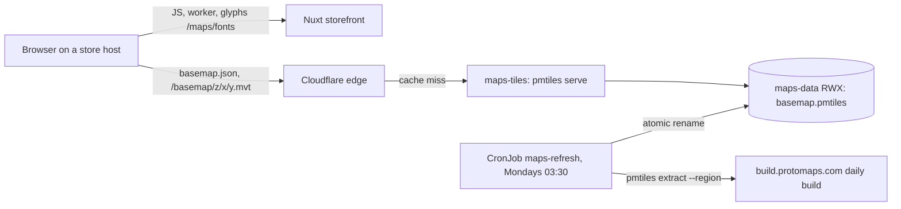

# Maps

Every storefront map — the checkout locker picker and the Location Map page
section — draws on one basemap: a Greece + Cyprus extract of the Protomaps
daily build of OpenStreetMap, served as vector tiles from the platform host
`maps.grooveshop.space`. No map provider, no key and no per-domain allowlist:
a new store domain needs nothing, and a visitor's browser talks only to the
store's own host and the maps host.

## Diagram



## The client

- `app/composables/useMapLibre.ts` imports MapLibre GL JS, its stylesheet and
  its worker on demand, when a map's container first appears, so no other
  page downloads any of it. The worker is a same-origin `/_nuxt/` file
  (Vite `?worker&url`).
- `app/utils/basemap.ts` builds the style in code from `@protomaps/basemaps`:
  the light or dark flavour by colour mode, place names in the page's locale,
  no sprite (the icon layers are dropped). The OpenStreetMap credit is always
  visible.
- `app/components/Checkout/SmartpointMap.client.vue` clusters the carrier's
  lockers into HTML `<button>` markers (keyboard and screen-reader reachable);
  a locker's popup emits it by `key`. `app/components/PageSection/LocationCanvas.client.vue`
  pins the store's location with cooperative gestures.
- `NUXT_PUBLIC_MAPS_TILEJSON_URL` (`runtimeConfig.public.mapsTileJsonUrl`)
  names the TileJSON; empty means no map renders and an error is logged.
  The CSP adds its origin to `connect-src` and `worker-src 'self'`
  (`shared/utils/csp.ts`).
- Without WebGL2, or when the style or tiles fail before the first frame, the
  picker shows "map unavailable" and offers the list.

## The server

`grooveshop-infrastructure/.../overlays/production/maps/`: a two-replica
Deployment of the official `pmtiles serve`, an RWX volume holding
`basemap.pmtiles`, the Ingress for `maps.grooveshop.space`, and a weekly
CronJob. One instance in the production namespace serves staging too; the
data is identical and public.

The refresh (`refresh.sh`) reads the newest key from
`build-metadata.protomaps.dev/builds.json`, extracts the region
(`region.geojson`, Natural Earth Greece + Cyprus, buffered) from the planet
build over HTTP range requests (about 575 MB), verifies it, and
renames it over the served file. `pmtiles serve` keys its cache on the file's
mtime and size, so the pods serve the new archive without a restart. The
Deployment's init container runs the same script when the volume is empty, so
a new or lost volume heals itself.

Run a refresh now:

```sh
kubectl --context grooveshop -n grooveshop create job --from=cronjob/maps-refresh maps-refresh-manual-$(date +%s)
```

## Caching and purge

`pmtiles serve` sends no `Cache-Control`; a Traefik middleware adds
`public, max-age=86400`, and the `maps tiles` Cache Rule in the
`grooveshop.space` zone makes the host cacheable at Cloudflare. A refreshed
archive therefore shows within a day; purge the hostname to show it at once.
The glyphs are storefront files (`public/maps/fonts`, one-year immutable) and
are cached with the store host's own rules.

## Failure modes

| Symptom | Check |
|---|---|
| "Map unavailable" on every store | The browser console: MapLibre logs the failing URL. `curl https://maps.grooveshop.space/basemap.json` |
| `basemap.json` answers 404 | The archive is missing: the `seed` init container's log, then run a refresh |
| A refresh Job failed | Its log. Nothing is renamed before `verify` passes, so the old archive keeps serving |
| Tiles blank when zoomed in somewhere | Outside the region; add it to `region.geojson` and refresh |
| "Find my location" does nothing | The storefront's `Permissions-Policy` must allow `geolocation=(self)` (`base/ingress-traefik.yaml`, `security-headers`) |

## Source

| What | Where |
|---|---|
| Client composable, style, maps | `grooveshop-storefront-ui-node-nuxt/app/composables/useMapLibre.ts`, `app/utils/basemap.ts`, `app/components/Checkout/SmartpointMap.client.vue`, `app/components/PageSection/LocationCanvas.client.vue` |
| CSP | `grooveshop-storefront-ui-node-nuxt/shared/utils/csp.ts` |
| Glyphs | `grooveshop-storefront-ui-node-nuxt/public/maps/fonts/` |
| Tile server, refresh, region, Ingress | `grooveshop-infrastructure/manifests/app-constructs/grooveshop/overlays/production/maps/` |
| Runbook, Cloudflare settings | `grooveshop-infrastructure/docs/maps.md`, `docs/cloudflare-zone-settings.md` |
