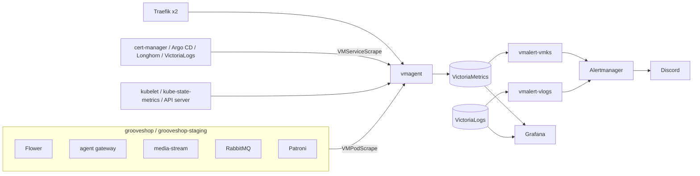

# Monitoring and alerting

Metrics, alerts and dashboards run in the `app-victoria-metrics`
Application (namespace `monitoring`): VictoriaMetrics stores the series,
vmalert evaluates the rules, Alertmanager routes them to Discord, and
Grafana shows them at `grafana.grooveshop.space`, behind its own
Cloudflare Access application. Grafana signs you in from the Access token
itself (`auth.jwt` in `victoria-metrics/values.yaml`), so the Access
one-time code is the only login; see `docs/operator-dashboards.md` in the
infrastructure repository. Logs live in VictoriaLogs
(`app-victoria-logs`); a second vmalert turns log lines into alerts.

Everything is declared in git. Grafana's storage is an emptyDir, so a
dashboard, folder or datasource that is not in the repository does not
survive a pod restart. Sign-ins do: JWT auth checks the Access token on
every request and keeps no session.

## Diagram

## What is scraped

| Source | Scrape object | What it answers |
|---|---|---|
| Traefik | `victoria-metrics/scrapes/vmpodscrape-traefik.yaml` | Every request by Service, by router (one per Ingress host, so one per store) and by status. Django and the storefront export no metrics of their own |
| Flower | `grooveshop/base/metrics-scrapes.yaml` | Celery task events (`flower_events_total`, including `task-failed`), runtimes, workers online |
| Agent gateway | same file | Routes, status codes, Django upstream latency, rate limiting, tenant cache |
| Media stream | same file | Sharp pipelines, cache layers, admission control. Requires a bearer token, see below |
| RabbitMQ | same file | Node metrics from `/metrics`, per-queue depth and consumers from `/metrics/detailed` |
| Patroni | same file | Primary role, PostgreSQL running, timeline, WAL position |
| PostgreSQL | same file, from `grooveshop/base/postgres-exporter.yaml` | Connections by state against `max_connections`, transactions, locks, long and idle-in-transaction transactions, deadlocks, database and WAL size, checkpointer, the top 100 statements (normalised text) |
| Redis | same file, from the `redisExporter` sidecar in `grooveshop/base/redis.yaml` | Memory against `maxmemory`, evictions, hit ratio, clients, AOF size, and whether the last AOF rewrite, AOF write and RDB save succeeded |
| cert-manager, Argo CD controller, Longhorn, VictoriaLogs | `victoria-metrics/scrapes/vmservicescrape-*.yaml` | Certificate Ready and renewal, Application health and sync, volume robustness, log ingestion |
| Kubernetes | the chart | Nodes, kubelet and cAdvisor, kube-state-metrics, the API server |

`grooveshop/base/metrics-scrapes.yaml` carries no namespace, so each
overlay places a copy in its own namespace and production and staging are
scraped separately. vmagent picks the objects up in every namespace.

## Dashboards

Grafana folder **GrooveShop**, one JSON file per dashboard under
`victoria-metrics/dashboards/grooveshop/`, each with an **Environment**
selector:

| Dashboard | Answers |
|---|---|
| HTTP Traffic & Latency | Requests, 5xx, 4xx and latency by Service and by store host; load shedding; certificates; media stream; agent gateway |
| Background Work | Celery outcomes and failing tasks, queue depth and consumers, worker CPU and memory, ERROR log lines |
| Platform Health | Volumes (kubelet and Longhorn), PostgreSQL (role and statistics, top statements), Redis (persistence, AOF size against its volume, memory, evictions), container resources and restarts, Argo CD applications, the monitoring pipeline itself |

The chart's own dashboards go to the **Cluster** folder. Dashboards for
hardware and topologies this cluster does not have (Windows, AIX, macOS,
multi-cluster, Prometheus) are disabled, and every upstream source is
pinned to a tag or commit in `victoria-metrics/values.yaml`.

To change a dashboard, edit its JSON and push; the dashboards are
`editable: false` because a change saved in the UI would vanish on the next
restart. The generator in `victoria-metrics/dashboards/kustomization.yaml`
wraps each file into the ConfigMap the Grafana sidecar loads.

## Alerts

| Rule file | Covers |
|---|---|
| `victoria-metrics/rules/vmrule-grooveshop.yaml` | 5xx on the storefront and API, load shedding, certificates (cert-manager not Ready, served certificate near expiry), Celery task failures, no Celery workers, a queue with work and no consumer, no PostgreSQL primary, PostgreSQL unreachable, connection saturation, a transaction idle for over 5 minutes, deadlocks, Redis down or failing to persist, an unhealthy Longhorn volume, Argo CD applications unhealthy or auto-synced and stuck OutOfSync, log ingestion stopped |
| `victoria-metrics/logs-alerting/vmrule-grooveshop-logs.yaml` | Any ERROR, CRITICAL or FATAL log line in production, by container |
| chart (`vmks-rule-*`) | Kubernetes itself, including `TargetDown` for any scrape that fails |

The log rule exists because some failures produce no metric: the tasks
that send transactional mail catch their own exceptions and return
`False`, so a broken relay raises no 5xx and no `task-failed`.

## Attributing traffic to an environment and a store

Traefik labels a request with its own Service key,
`<namespace>-<service>-<port>@kubernetes`. That string cannot be split by
regex, because namespaces contain dashes:
`grooveshop-staging-backend-service-80` could be either namespace. The
`grooveshop.traefik` recording rules instead join against
`kube_service_info`, whose namespace and Service name are authoritative,
and publish:

| Series | Labels |
|---|---|
| `namespace_service_code:traefik_service_requests:rate5m` | `namespace`, `service`, `code` |
| `namespace_service_le:traefik_service_request_duration_seconds_bucket:rate5m` | `namespace`, `service`, `le` |
| `namespace_host_code:traefik_router_requests:rate5m` | `namespace`, `host`, `code` |
| `namespace_host_le:traefik_router_request_duration_seconds_bucket:rate5m` | `namespace`, `host`, `le` |

Every tenant shares the same Services, so the per-store view comes from
the router. Traefik names an Ingress router
`Normalize(namespace-ingress-host+path)`, and the host rules rebuild that
key from `kube_ingress_path`, which carries the real host. Routers on
`websecure` carry Traefik's `websecure-` prefix, which the rules strip.
Router metrics are enabled in `traefik/helmchartconfig.yaml`
(`addRoutersLabels`).

Dashboards and alerts read these series. Do not filter raw Traefik series
by a namespace regex.

## Invariants

- Log rules and log panels match the parsed `log.level` field, never the
  message text. Vector nests every JSON log line under `log.*`, so `_msg`
  holds only the message (`victoria-metrics/logs-alerting/vmrule-grooveshop-logs.yaml`).
- Every LogsQL alert carries its own `_time:` window; vmalert's `step` is
  ignored by VictoriaLogs.
- media-stream's `/metrics` accepts only `Authorization: Bearer` with the
  `media-stream-metrics-token` Secret, which is read-only by construction
  and not the admin secret that can flush caches (`MetricsTokenGuard` in
  the media-stream repository). The Deployment and the VMPodScrape read
  the same Secret.
- The VictoriaLogs datasource maps `log.level` to Grafana levels through
  `logLevelRules`, so log panels show levels instead of `UNK`.
- The VictoriaMetrics datasources declare the real 30-second scrape
  interval, so `$__rate_interval` never produces an empty rate window.
- postgres-exporter is a Deployment, not a Spilo sidecar: a sidecar would
  restart the single-member database and receive the superuser's
  credentials. It logs in as `postgres_exporter`, a member of `pg_monitor`
  only, which the operator creates on every cluster as an infrastructure
  role (`postgres-op/v2.0.2/configmap.yaml`). One password is sealed three
  times: for the operator and for each app namespace.
- The storefront's evlog events have no message key. VictoriaLogs'
  `VL-Msg-Field` list (`victoria-logs/values.yaml`) falls back to their
  error text, request path or tag, so their lines are readable. Media
  stream logs JSON in production (`src/main.ts` in its repository).
  Because of that fallback a storefront request's path is its `_msg`,
  not a `log.path` field: filter with `_msg:"/products"*`.
- The storefront logs every request, page renders and `_payload.json`
  included, except the assets a page view pulls (`evlog.exclude` in its
  `nuxt.config.ts`). 10% of successful requests are kept, and every
  request of 1 s or more and every 4xx/5xx. Each line carries
  `log.tenantSchema` and `log.tenantName`, set on the request logger by
  `server/middleware/0.tenant.ts`. Page and other browser-facing events
  also carry `log.client` (`server/middleware/2.evlog-client.ts`): browser
  and major version, OS name, the device class the page was rendered for,
  `bot` and the Cloudflare country — never the raw User-Agent. A render's
  internal `/api` events have no User-Agent and no `client`. evlog's
  `evlog:enrich` hooks run after the line is printed and reach no log, so
  every field is set on the request logger before it emits.
- One correlation id follows a request across services. Every storefront
  call to Django sends `X-Correlation-ID`: the caller's own header, else
  the request's evlog `requestId` (`server/utils/backendFetch.ts`). Django
  binds it in `core/middleware/correlation_id.py` (minting a UUID when
  none came), stamps it on every log record as `log.correlation_id` and
  echoes it on the response. To follow a storefront request into Django,
  take its `requestId` and filter Django on `log.correlation_id`.
- Django logs one INFO access line per request it handles
  (`core/middleware/access_log.py`): `log.method`, `log.route` (the URL
  pattern, never the raw path or query string; `unmatched` for a path no
  pattern matches), `log.status`, `log.duration_ms` and
  `log.correlation_id`. Kubelet's probes are answered before it and are
  not logged.
- A failed Celery task logs one ERROR line from `MonitoredTask.on_failure`
  with the traceback in `log.exception` and redacted arguments
  (`core/tasks.py`); Celery's own `celery.app.trace` line also carries
  one.
- Browser errors (uncaught Vue, startup and window errors, unhandled
  rejections) reach the logs as `log.source:client` with
  `log.action:client:*`, each distinct error once per page load
  (`app/plugins/error-reporting.client.ts`).
- Traefik's request-duration histograms use 11 buckets from 25 ms to
  10 s (`traefik/helmchartconfig.yaml`), so a storefront p95 moves when a
  render gets faster. No query pins an `le` value.
- vmalert-vmks loads 42 groups and 264 rules. A different count after a
  change means a selector or a rule file broke.

## Failure modes

- **A panel goes blank rather than red.** Its target is down, which reads
  as healthy. Platform Health shows "Scrape targets down", and
  `TargetDown` alerts on it.
- **Longhorn metrics refused.** Longhorn's own NetworkPolicy admits only
  its pods; `longhorn-system/setup/networkpolicy-allow-metrics.yaml` opens
  port 9500 to vmagent. Remove it and both manager targets go down.
- **media-stream target returns 401.** The pod and the VMPodScrape
  disagree on the token, or the Secret was rotated without the pods
  restarting. `TargetDown` fires.
- **postgres-exporter reports `pg_up 0` after a rotation.** The operator
  and the exporter hold different copies of the password; re-seal all
  three files from one value. A bare secret name in
  `infrastructure_roles_secrets` resolves to `default/` and the role is
  silently never created, so the name must stay namespaced.
- **Changing the Redis exporter restarts Redis.** It is a container in
  the Redis pod, so any change to its image or resources rolls the pod.
- **Log alerts silent during an incident.** Check ingestion first
  (`GrooveShopLogIngestionStopped`, "Logs ingested / s"): with no rows
  arriving, every log rule sees zero errors.
- **The per-host panels lose a store.** A router name no longer matches
  its rebuilt key, for example because Traefik hashed two conflicting
  routers or a new entrypoint gained its own HTTP config. Check with an
  `unless` join of the router series against the rebuilt keys.

## Source

| File | Role |
|---|---|
| `grooveshop-infrastructure/manifests/app-directory/app-victoria-metrics.yaml` | The Application, its git paths and the `ignoreDifferences` for defaulted rule fields |
| `grooveshop-infrastructure/manifests/app-constructs/victoria-metrics/values.yaml` | Chart values: datasources, plugins, dashboard folders and pins, API server metric drops |
| `grooveshop-infrastructure/manifests/app-constructs/victoria-metrics/dashboards/` | Dashboard JSON and the ConfigMap generator |
| `grooveshop-infrastructure/manifests/app-constructs/victoria-metrics/rules/vmrule-grooveshop.yaml` | Recording rules and metric alerts |
| `grooveshop-infrastructure/manifests/app-constructs/victoria-metrics/logs-alerting/` | The log vmalert and its rule |
| `grooveshop-infrastructure/manifests/app-constructs/victoria-metrics/scrapes/` | Traefik and cluster-component scrapes |
| `grooveshop-infrastructure/manifests/app-constructs/grooveshop/base/metrics-scrapes.yaml` | Scrapes for the app's own components |
| `grooveshop-infrastructure/manifests/app-constructs/grooveshop/base/postgres-exporter.yaml` | The PostgreSQL exporter and its collectors |
| `grooveshop-infrastructure/manifests/app-constructs/postgres-op/v2.0.2/configmap.yaml` | `infrastructure_roles_secrets`: the exporter's role |
| `grooveshop-infrastructure/manifests/app-constructs/grooveshop/base/redis.yaml` | The Redis exporter sidecar |
| `grooveshop-infrastructure/manifests/app-constructs/victoria-logs/values.yaml` | `VL-Msg-Field`: which field becomes a log line's message |
| `grooveshop-infrastructure/manifests/app-constructs/traefik/helmchartconfig.yaml` | Router metrics and latency buckets |
| `grooveshop-storefront-ui-node-nuxt/nuxt.config.ts` | `evlog.exclude` and the production sampling and keep rules |
| `grooveshop-storefront-ui-node-nuxt/server/middleware/0.tenant.ts` | Puts the tenant on the request's log line |
| `grooveshop-storefront-ui-node-nuxt/server/middleware/2.evlog-client.ts` | Puts the client (browser, OS, device class, bot, country) on the request's log line |
| `grooveshop-storefront-ui-node-nuxt/server/utils/backendFetch.ts` | Sends the correlation id on every Django call |
| `grooveshop-storefront-ui-node-nuxt/app/plugins/error-reporting.client.ts` | Reports browser errors through evlog's client transport |
| `grooveshop-django-api/core/middleware/correlation_id.py` | Binds and echoes the correlation id |
| `grooveshop-django-api/core/middleware/access_log.py` | Django's per-request access line |
| `grooveshop-django-api/core/tasks.py` | `MonitoredTask`: the task failure line with its traceback |
| `grooveshop-infrastructure/manifests/app-constructs/longhorn-system/setup/networkpolicy-allow-metrics.yaml` | Opens Longhorn metrics to vmagent |
| `grooveshop-media-stream/src/MediaStream/Metrics/guards/metrics-token.guard.ts` | The bearer check on `/metrics` |
