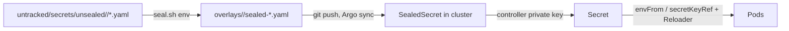

# Secrets

Secrets reach the cluster as Bitnami SealedSecrets committed to the
infrastructure repository. Plaintext never enters git, never enters a
container image, and never appears in a ConfigMap. Per-merchant
credentials are not secrets in this sense at all: they are columns on the
`Tenant` row, edited in the admin.

## Workflow



1. Edit the plaintext under `untracked/secrets/unsealed/` (production,
   flat) or `untracked/secrets/unsealed/staging/`. The directory is
   gitignored; keep an offline backup of it, it is the only copy of the
   plaintext.
2. Run `untracked/secrets/seal.sh production` or `seal.sh staging` with the
   kubectl context on the cluster (the sealing key is cluster-scoped). Do
   not hand-run `kubeseal`; the script carries the controller flags,
   namespaces and output paths.
3. The script writes straight into
   `manifests/app-constructs/grooveshop/overlays/<env>/sealed-*.yaml`.
   Review the diff and commit. `base/` carries no secrets; it is
   env-neutral.
4. Push. Production auto-syncs; staging needs a manual sync. Every
   Deployment carries `reloader.stakater.com/auto: "true"`, so pods roll on
   the new value.

### Compare key names, not counts

`kubeseal` re-encrypts every value on every run, so the whole sealed file
always shows as changed. The check that means something is that the set of
key names is unchanged (or changed exactly as intended):

```bash
diff <(git show HEAD:manifests/app-constructs/grooveshop/overlays/production/sealed-backend-secrets.yaml | grep -E '^\s{4}[A-Z_]+:' | sort) \
     <(grep -E '^\s{4}[A-Z_]+:' manifests/app-constructs/grooveshop/overlays/production/sealed-backend-secrets.yaml | sort)
```

A "expect N keys" rule goes stale the first time a key is added; a name
diff does not.

## Where each secret lives

Key names as committed in `overlays/production/`; staging mirrors them
under `overlays/staging/` with its own values.

| Secret | Keys | Consumed by |
|---|---|---|
| `backend-secrets` | `SECRET_KEY`, `AGENT_GATEWAY_INTERNAL_SECRET`, `NUXT_CACHE_PURGE_TOKEN`, `MEILI_SEARCH_KEY`, `FLOWER_BASIC_AUTH`, `DEEPL_AUTH_KEY`, `EMAIL_*` (backend, host, port, TLS, user, password, default from), `SOCIALACCOUNT_GOOGLE_*`, `SOCIALACCOUNT_FACEBOOK_*`, `SOCIALACCOUNT_DISCORD_*` | backend, celery-worker, celery-beat, flower, PreSync job |
| `frontend-secrets` | `NUXT_SESSION_PASSWORD`, `NUXT_SECRET_KEY`, `NUXT_CACHE_PURGE_TOKEN`, `NUXT_OAUTH_GOOGLE_*`, `NUXT_OAUTH_FACEBOOK_*`, `NUXT_OAUTH_DISCORD_*`, `NODE_AUTH_TOKEN` | frontend-nuxt |
| `media-stream-secrets` | `INTERNAL_DOMAINS_SECRET`, `NODE_AUTH_TOKEN` | media-stream |
| `media-stream-internal-secret` | `secret` (the `INTERNAL_ADMIN_SECRET` that guards `flush-tenant`) | media-stream, and the backend as `MEDIA_STREAM_INTERNAL_SECRET` |
| `media-stream-metrics-token` | `token` (read-only bearer for `/metrics`; sealed straight from a generated value, no plaintext copy — the rotation command is in the file) | media-stream as `METRICS_BEARER_TOKEN`, and the `media-stream` VMPodScrape |
| `agent-gateway-secrets` | `INTERNAL_EVENTS_SECRET` (same value as the backend's `AGENT_GATEWAY_INTERNAL_SECRET`) | agent-gateway |
| `redis-auth` | `password` | Redis CR, backend, workers, frontend, gateway |
| `app-grooveshop-meilisearch-master-key` | `MEILI_MASTER_KEY` | Meilisearch chart, PreSync job |
| `platform-admin-basic-auth` | `users` (htpasswd) | Traefik middleware on the platform host |
| `docs-basic-auth` | `users` (htpasswd) | Traefik middleware gating `/dev` on the documentation host; until it exists Traefik cannot load the Middleware and `/dev` fails closed with no route |
| `staging-basic-auth` (staging only) | `users` (htpasswd) | Traefik middleware on every staging Ingress |
| `backend-message-broker-default-user` | generated by the RabbitMQ operator, not sealed | `CELERY_BROKER_URL` assembly in `backend.yaml` |

Two values that look like secrets but are ConfigMap entries in the
overlay's `backend-config-patch.yaml`: `INFO_EMAIL` and `ADMIN_EMAIL`.
`SECRET_KEY_FALLBACK` stays an empty ConfigMap value until a `SECRET_KEY`
rotation needs it.

## Per-tenant credentials are rows, not env

Viva Wallet, Stripe, ACS, BoxNow, Meta CAPI, analytics ids, chat and ACP
tokens all live on the `Tenant` model and are read through
`tenant/credentials.py`, which has no platform-wide fallback: an empty
field means the integration is off for that tenant. They were removed from
the Secrets at the multi-tenant cutover, and their last plaintext values
sit in `untracked/secrets/retired/` for the record. Onboarding a store
therefore needs no kubeseal run; see the infrastructure repository's
`docs/tenant-onboarding.md`. The exception is the shared infrastructure:
email transport, Meilisearch host, base URLs and internal service secrets
stay platform env.

## Never bake a secret into an image

`nuxt build` serialises `runtimeConfig` defaults into `.output`, and the
production image ships `.output`. The storefront CI once wrote the real
session password, secret key and OAuth client secrets into `.env` before
building, so all of them were extractable from the public image on Docker
Hub; runtime env overrides masked it. The fix in the storefront's
`ci.yml` and `docker.yml`: the build gets only non-secret `NUXT_*` values
from GitHub *variables* plus build-only placeholders for the two keys the
prerender-time startup validation requires; OAuth secrets are not in the
build at all because the callback handlers read `process.env` at request
time and the pod injects them with `envFrom: secretRef: frontend-secrets`.
The leaked values were rotated and the old tags deleted from both
registries. The rule that survives: anything that reaches `runtimeConfig`
at build time ships in the image, so only public values or throwaway
placeholders may be present at build time. The same applies to any
`ARG`/`ENV` in a Dockerfile.

## Rotation

- **Any key**: edit the plaintext, reseal, commit, push, sync; Reloader
  rolls the pods. Runbook: `docs/missing-secrets-runbook.md`.
- **`SECRET_KEY`**: seal the old value as `SECRET_KEY_FALLBACK`, deploy,
  seal the new `SECRET_KEY`, deploy, remove the fallback once sessions,
  Knox tokens, password-reset links and signed cookies have re-issued.
  `settings.py` reads both.
- **The sealing key itself**: the controller's active RSA key in the
  `sealed-secrets` namespace is the one secret that decrypts every other.
  Export it with `scripts/export-sealed-secrets-key.sh` into an encrypted
  vault after initial setup and after every rotation; rotate by relabeling
  the active key and restarting the controller; restore a rebuilt cluster
  by applying the backed-up key before anything else. Full procedure:
  `docs/sealed-secrets-key-management.md`.

## Invariants

- `base/` contains no Secret and no SealedSecret; only overlays do
  (`manifests/app-constructs/grooveshop/base/kustomization.yaml`).
- `untracked/` is gitignored; `seal.sh` reads from it and writes into the
  overlay (`.gitignore`, `untracked/secrets/seal.sh`).
- The backend refuses to start in production without `SECRET_KEY` and
  `CELERY_BROKER_URL` (`settings.py`); Flower refuses to start without
  `FLOWER_BASIC_AUTH` (`base/backend.yaml`).
- Merchant credentials have no env fallback (`tenant/credentials.py`).
- Purge and internal-admin tokens are used only from inside the cluster.

## Failure modes

- **Pod CrashLoops after a reseal**: a key name changed or vanished;
  diff names against `HEAD`.
- **SealedSecret shows `Synced=False`**: sealed for the wrong namespace or
  with a stale key; reseal with the context on the cluster.
- **Everything undecryptable after a cluster rebuild**: restore the
  controller key from the vault, restart the controller, check
  `kubectl get sealedsecrets -A`.
- **A tenant integration silently off**: the credential is a blank Tenant
  field, not a missing env var; check the admin's Payments or Shipping
  section.

## Source

| File | Role |
|---|---|
| `grooveshop-infrastructure/untracked/secrets/seal.sh` | Seals every plaintext per environment (local, gitignored) |
| `grooveshop-infrastructure/manifests/app-constructs/grooveshop/overlays/production/sealed-*.yaml`, `overlays/staging/sealed-*.yaml` | Committed SealedSecrets |
| `grooveshop-infrastructure/manifests/app-constructs/grooveshop/base/backend.yaml`, `frontend.yaml`, `media-stream.yaml`, `agent-gateway.yaml` | `envFrom` / `secretKeyRef` wiring, Reloader annotations |
| `grooveshop-infrastructure/docs/missing-secrets-runbook.md` | Add or rotate a key |
| `grooveshop-infrastructure/docs/sealed-secrets-key-management.md` | Controller key export, rotation, restore |
| `grooveshop-infrastructure/docs/tenant-onboarding.md` | Tenant-row credential reference |
| `grooveshop-infrastructure/scripts/export-sealed-secrets-key.sh` | Key export |
| `grooveshop-django-api/settings.py` | `SECRET_KEY`, `SECRET_KEY_FALLBACKS`, production guards |
| `grooveshop-django-api/tenant/credentials.py` | Per-tenant credential access, no fallback |
| `grooveshop-storefront-ui-node-nuxt/.github/workflows/ci.yml`, `docker.yml` | Build-time env hygiene |
