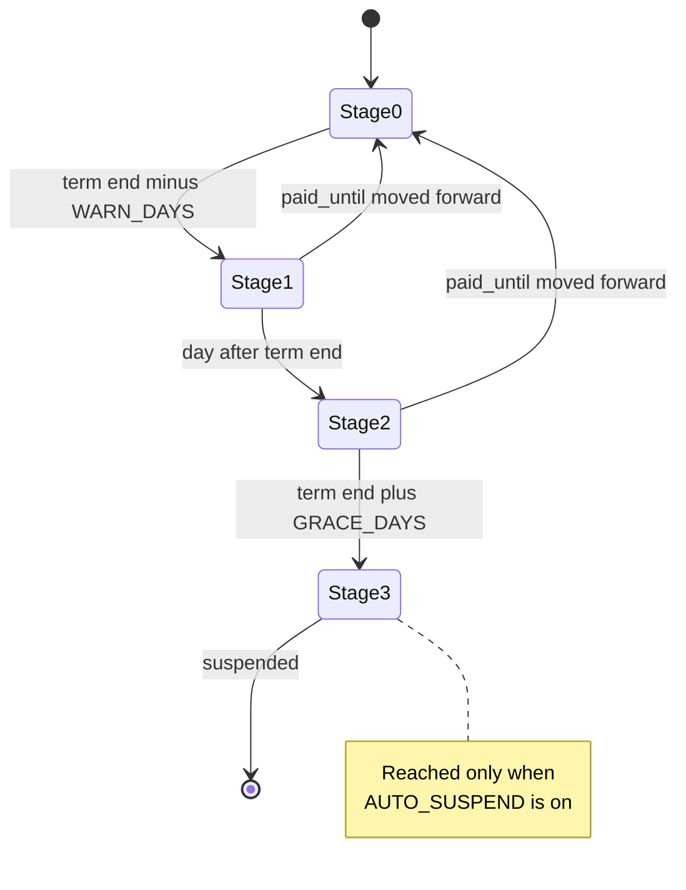

# Plans, billing & dunning

Billing on this platform is manual bookkeeping with automated reminders.
There is no subscription integration, no invoice generation and no card on
file for a merchant's own plan: an operator records a term end on the
tenant row, and a daily task (`tenant/billing.py: run_billing_cycle`)
reads that date, emails the owner as it approaches and passes, and —
**only if a switch that currently ships off is turned on** — suspends the
store.

Everything on this page runs in the `public` schema. `Tenant` rows, the
dunning bookkeeping and the outbound mail all live there, so no tenant
schema is entered and a half-provisioned store cannot break the cycle
(`tenant/billing.py` module docstring).

## The fields

All six live on `Tenant` (`tenant/models.py`). Open a store from
<span class="sidebar-path">Control plane → Tenants</span>: the first four
are in the **Plan & Billing** section of the change form and the two
suspension fields are in the unnamed section at the top
(`tenant/admin.py: TenantAdmin.fieldsets`).

| Field | Meaning |
|---|---|
| `plan` | `TenantPlan` — `trial`, `basic`, `pro`, `enterprise`. Defaults to `trial`. |
| `paid_until` | Last day of the current term, **inclusive**, for trials and paid plans alike. Empty means the term never expires. |
| `billing_notice_stage` | Highest dunning stage already notified for the current term (0–3). Written only by the billing task. |
| `billing_notice_term` | The `paid_until` value that stage refers to. A mismatch means the stage is stale. |
| `suspended_at` | When the store was last suspended. Also the anchor for the 24-hour destroy cooldown. |
| `suspended_reason` | `SuspendedReason.MANUAL` (an operator acted) or `BILLING` (the dunning task acted). Empty when the store is running. |

`billing_notice_stage` and `billing_notice_term` are in
`TenantAdmin.readonly_fields` — they are the task's bookkeeping, not an
operator control. `plan` and `paid_until` are editable by platform staff
and are deliberately **absent** from `TENANT_SELF_EDITABLE_FIELDS`
(`tenant/role_scopes.py`), so a merchant sees them read-only on their own
store console: "commercial terms, security policy, or identity, none of
which a merchant may set for themselves".

## Plan tiers

`TenantPlan` (`tenant/models.py`) has four values, and it is worth being
precise about what the tier actually decides today.

| Plan | Where the value is read |
|---|---|
| `trial` | `billing_state()` special-cases it (an in-term trial reads "trial", not "paid"); `tenant_create --trial-days` stamps a `paid_until` for it; it is rank 0 in `recommendation/strategies/base.py: _PLAN_RANK`. |
| `basic` | Rank 1. |
| `pro` | Rank 2. |
| `enterprise` | Rank 3. Also the plan `recommendation/context.py` reports for the public schema, which is never plan-gated. |

Two things follow, and both are easy to get wrong:

- **The tier is not the feature gate.** Per-feature plan gating is done
  with boolean columns on the same row — `b2b_enabled`,
  `recommendations_enabled`, `gift_cards_enabled`, `loyalty_enabled`,
  `promotions_enabled`, `blog_enabled`, `agent_commerce_enabled` — each
  paired with a merchant-controlled `extra_settings` toggle, and both must
  hold (`tenant/membership.py: tenant_plan_allows`). Moving a store from
  `basic` to `pro` changes no feature on its own; the operator flips the
  matching flag in the **Features** section of the same change form. See
  [The tenant record](/dev/operator/tenants).
- **The one place the rank is consulted withholds nothing today.**
  `RecommendationStrategy.min_plan` ranks a strategy against the tenant's
  plan (`plan_allows()`), but every shipped strategy —
  `category`, `curated`, `popular`, `variant_group` — sets
  `min_plan = TenantPlan.TRIAL`. So no strategy is currently reserved for
  a higher tier. The machinery is there for when one is.

An unknown plan string ranks as the free tier rather than unlocking
everything (`plan_allows()` docstring), so a typo degrades instead of
escalating.

## Billing states

`billing_state(tenant, today)` (`tenant/billing.py`) is the single
classifier. The Tenants changelist renders it as a badge
(`TenantAdmin.display_billing_state`) and
<span class="sidebar-path">Control plane → Plan & Billing</span> renders
the same call (`admin/platform_billing.py`), so the two surfaces cannot
disagree with what the automation will do. That page is reachable only to
a platform superuser — it is mounted exclusively on `PlatformAdminSite`
(`admin/platform_site.py: get_urls`), so it is structurally absent from
every merchant admin rather than reachable-but-403.

| State | Condition | Badge (`tenant/admin.py: _STATE_BADGES`) |
|---|---|---|
| `suspended` | `suspended_at` is set — checked first, whatever the dates say | Suspended |
| `trial` | plan is `trial` and either no term, or the term is further out than the warning window | Trial |
| `unbilled` | no `paid_until` on a **paid** plan | No term recorded |
| `past_due` | `paid_until` is before today | Past due |
| `expiring` | `paid_until` is today or within `WARN_DAYS` | Expires soon |
| `paid` | anything else | Paid |

`unbilled` is deliberately not `past_due`: an empty term on a paid plan is
a bookkeeping gap, and calling it past due "would accuse a store that may
simply predate the field". A trial with a real term end runs the same
ladder as a paid plan — an expiring trial reads `expiring`, a lapsed one
`past_due`.

## The dunning ladder



`target_stage(paid_until, today, warn_days, grace_days)` computes the
stage from dates alone. `run_billing_cycle()` then compares it with what
has already been notified.

| Stage | Fires when | Email type (template in `core/templates/emails/billing/`) | Recipients |
|---|---|---|---|
| 1 | today is within `WARN_DAYS` of the term end | `platform.billing_expiring` (`expiring`) | the tenant's `owner_email` |
| 2 | today is past the term end | `platform.billing_expired` (`expired`) | owner, **plus** `platform.billing_stage_copy` to `ADMINS` |
| 3 | today is past term end + `GRACE_DAYS` | `platform.billing_suspended` (`suspended`) | owner, **plus** `platform.billing_stage_copy` to `ADMINS` |

Each is an email type of the platform (`Owner.PLATFORM`, declared in
`tenant/emails.py`), sent through `send_email` under the `public` schema, so
it is branded as the platform and never as a store; it is required, so no
store's switch or the platform's can mute it. The stage-to-type-and-copy map
is `_STAGES` in `tenant/billing.py`; `_send_stage_email` hands the pipeline a
`BillingNotice` (the tenant row and the grace days). The subject is the
type's msgid (`{store} — your plan expires on {date}`) and the whole message
renders in `tenant.default_locale`, in the store's own language. The sender is
the platform's named `"{SITE_NAME}" <DEFAULT_FROM_EMAIL>`, not the merchant's
address.

The operators' copy (`platform.billing_stage_copy`) is a template pair with
a translated subject (`[{site}] Tenant billing stage {stage}: {schema}`) in
the platform's language (`LANGUAGE_CODE`). A failure of the copy is logged and
never fails the owner's notice it follows, and with `ADMINS` empty there is
nobody to write to and it is skipped (`ADMINS` is built from the `ADMIN_EMAIL`
environment variable in `settings.py`).

### How a run advances

Per tenant, `run_billing_cycle()` does exactly this:

1. Read the recorded stage — but **only if `billing_notice_term` equals
   the current `paid_until`**. Otherwise treat it as stage 0. This is
   what makes a renewal reset the pipeline with no extra signal and no
   extra field.
2. Compute `target_stage()` from today's date.
3. If `AUTO_SUSPEND` is off, cap the target at 2.
4. If `target <= stage`, skip. **A run sends at most the single highest
   newly-reached stage**, so a store discovered long past due gets one
   email, never a catch-up burst of three.
5. At stage 3, skip a protected tenant before sending, so a store that
   `suspend_tenant` would refuse anyway never receives a suspension notice
   that cannot come true.
6. Send the email, **then** suspend (stage 3 only), **then** record
   `billing_notice_stage` / `billing_notice_term`.

Step 6's order is deliberate: if the send raises, nothing is recorded and
the tenant stays active, so the next run retries the whole step. That is
at-least-once — a crashed run re-sends rather than silently skipping a
notice.

The queryset itself is narrow: `is_active=True`, `suspended_at__isnull=True`,
`paid_until__isnull=False`, excluding the public schema. A store with no
term recorded is never dunned, and a store already suspended is left
alone. Per-tenant failures are caught, logged and counted in the returned
summary (`{"warned", "expired", "suspended", "errors"}`) so one broken row
cannot halt dunning for the rest of the estate.

## Automatic suspension ships OFF

```python
TENANT_BILLING = {
    "WARN_DAYS": int(getenv("TENANT_BILLING_WARN_DAYS", "14")),
    "GRACE_DAYS": int(getenv("TENANT_BILLING_GRACE_DAYS", "7")),
    "AUTO_SUSPEND": getenv("TENANT_BILLING_AUTO_SUSPEND", "False") == "True",
}
```

`settings.py`. Verified across the cluster manifests: **no Deployment,
ConfigMap or Secret in `grooveshop-infrastructure` sets any of these three
variables**, so every environment runs on the defaults above. The only
place they appear at all is `grooveshop-django-api/.env.example`, where
`TENANT_BILLING_AUTO_SUSPEND=False` documents the default for local work.

So today: warnings and expired notices flow, **nothing is ever suspended
by the billing task**, and stage 3 is never recorded. When the switch is
flipped, every store already past its grace window moves 2 → 3 on the
very next run — there is no gradual catch-up.

### The stage 1 and 2 emails promise a suspension that will not happen

`tenant/billing.py`'s docstring says "no email ever claims a suspension
that did not happen". That is true of the stage 3 email, which is capped
away. It is **not** true of the two that still send: `expiring.txt` tells
the owner "your store keeps running for a grace period of _N_ days before
it is suspended", and `expired.txt` tells them "unless a renewal is
recorded within _N_ days of the term end, your store will be suspended".
While `AUTO_SUSPEND` is off, no such suspension follows. Either flip the
switch or soften those two templates before the wording is quoted back at
you.

## What an operator actually does

### Record a payment

1. <span class="sidebar-path">Control plane → Tenants</span>, then open the
   store.
2. Under **Plan & Billing**, set `paid_until` to the new term end
   (inclusive) and `plan` if the tier changed.
3. Save.

That is the whole operation. Three things then happen without further
input:

- The dunning pipeline resets, because `billing_notice_term` no longer
  matches `paid_until` and the recorded stage is treated as 0.
- `billing_state()` re-reads as `paid` (or `trial`) immediately, on both
  the Tenants changelist and **Plan & Billing**.
- If the store was suspended **for billing**, it reactivates on the spot —
  see below.

### Grant an extension

The same edit. There is no separate grace or extension field: an extension
is a `paid_until` further out, and the ladder re-derives from the new date.
A short extension granted while a store sits at stage 2 will re-arm stage 1
if the new term end falls inside `WARN_DAYS`, so the owner gets a fresh
warning rather than silence.

### Reverse a suspension

Which path depends on `suspended_reason`, and the distinction is
load-bearing.

- **`billing`** — set `paid_until` to today or later and save. The
  `reactivate_on_renewal` receiver (`tenant/signals.py`, `post_save` on
  `Tenant`) calls `activate_tenant()` immediately, so the operator does
  not have to remember a second step. It is recursion-safe: the
  reactivating save re-enters the receiver with `is_active=True` and exits
  on the first guard.
- **`manual`** — recording a payment does **nothing**. The receiver is
  scoped strictly to `SuspendedReason.BILLING` precisely so bookkeeping
  can never resurrect a store an operator took down for abuse or on legal
  advice. Use the **Activate selected tenants** bulk action on the Tenants
  changelist (`TenantAdmin.activate_tenants` → `tenant/lifecycle.py:
  activate_tenant`), which clears `is_active`, `suspended_at` and
  `suspended_reason` together.

Note that clearing `suspended_at` also clears the anchor for the 24-hour
destroy cooldown. See [Suspend, export & destroy](/dev/operator/lifecycle).

### Know what a suspension does

`suspend_tenant()` sets `is_active=False`, stamps `suspended_at` on the
**first** suspension only (so re-suspending never resets the destroy
cooldown), records the reason, and dispatches a best-effort media-cache
flush. From then on `SuspendedTenantMiddleware` (`tenant/middleware.py`)
answers **503** for every request on that store's host — not just the
storefront, but the API too, which is the path that used to keep serving
catalogue reads, cart mutations and order creation on a frozen store.
Nothing is deleted.

## Where the cycle is scheduled

| | |
|---|---|
| Beat entry | `process-tenant-billing` in `settings.py: get_celery_beat_schedule()` |
| Task | `tenant.tasks.process_tenant_billing` → `tenant.billing.run_billing_cycle` |
| Cadence | daily 06:00 Athens; hourly when `DEBUG` |
| Schema | `public` — **not** a fan-out |
| Retries | `max_retries=3`, `autoretry_for=(Exception,)`, backoff with jitter |

It is defined in `tenant/tasks.py` rather than `tenant/billing.py` only
because Celery autodiscovery scans `tasks.py` modules. Everything about
the beat schedule, fan-out and the result backend is in
[Celery and background jobs](/dev/django/celery); the console screens for
it are in [Scheduled work & platform data](/dev/operator/background-jobs).

## Invariants

- A dunning stage is valid only for the term it was recorded against.
  Moving `paid_until` forward invalidates it (`billing_notice_term`
  comparison in `run_billing_cycle`).
- One email per tenant per run, at most — the highest newly-reached stage.
- The stage is recorded only after a successful send.
- A protected tenant (`is_protected`, or the public schema) is never
  suspended by billing, and is skipped before the stage 3 email is
  composed (`tenant/lifecycle.py: is_protected_tenant`).
- The billing task can only ever set `suspended_reason = BILLING`;
  `suspend_tenant` refuses to relabel a store that is already suspended,
  so it can never overwrite an operator's `MANUAL` reason.
- No tenant schema is entered by any of this.

## Failure modes

- **A store went past due and nobody was emailed.** Check `paid_until` is
  set at all — the queryset filters `paid_until__isnull=False`, so an
  `unbilled` store is invisible to the ladder by design. It shows as **No
  term recorded** on **Plan & Billing**.
- **The owner says they never got the warning.** `billing_notice_stage`
  is only written after a successful send, so a stage of 0 on a past-due
  term means no mail left the process. A stage of 1 with no mail received
  is a delivery problem, not a dunning one — see
  [Notifications & email](/dev/flows/notifications-and-email).
- **A store was expected to be suspended and is still serving.**
  `AUTO_SUSPEND` is off in every environment. That is the default, not a
  misconfiguration.
- **A renewal did not lift the suspension.** Read `suspended_reason`. If
  it is `manual`, that is the designed behaviour; activate it explicitly.
- **A protected store is past grace.** `run_billing_cycle` logs
  `billing: protected tenant %s is past grace — left running` and moves
  on. Nothing else will happen to it.

## Related

- [The tenant record](/dev/operator/tenants) — the plan flags and what a merchant may edit
- [Suspend, export & destroy](/dev/operator/lifecycle) — the rest of the suspension path
- [Celery and background jobs](/dev/django/celery) — the schedule this task sits in
- [Scheduled work & platform data](/dev/operator/background-jobs) — the console screens for it

## Source

| File | Role |
|---|---|
| `grooveshop-django-api/tenant/billing.py` | `billing_config`, `billing_state`, `target_stage`, `_STAGES`, `_send_stage_email`, `run_billing_cycle` |
| `grooveshop-django-api/tenant/models.py` | `TenantPlan`, `SuspendedReason`, the six billing fields and their `help_text` |
| `grooveshop-django-api/tenant/lifecycle.py` | `suspend_tenant`, `activate_tenant`, `is_protected_tenant`, `SUSPEND_COOLDOWN` |
| `grooveshop-django-api/tenant/signals.py` | `reactivate_on_renewal` |
| `grooveshop-django-api/tenant/tasks.py` | `process_tenant_billing` |
| `grooveshop-django-api/tenant/admin.py` | `TenantAdmin` fieldsets, `readonly_fields`, `_STATE_BADGES`, `activate_tenants` |
| `grooveshop-django-api/admin/platform_billing.py` | The **Plan & Billing** control-plane page |
| `grooveshop-django-api/tenant/role_scopes.py` | `TENANT_SELF_EDITABLE_FIELDS` — why a merchant cannot edit plan or term |
| `grooveshop-django-api/tenant/middleware.py` | `SuspendedTenantMiddleware` (503 for a suspended host) |
| `grooveshop-django-api/settings.py` | `TENANT_BILLING`, `ADMINS`, `process-tenant-billing` beat entry |
| `grooveshop-django-api/core/templates/emails/billing/` | `expiring`, `expired`, `suspended` (html + txt) |
| `grooveshop-django-api/.env.example` | The only declaration of the three `TENANT_BILLING_*` variables anywhere |
