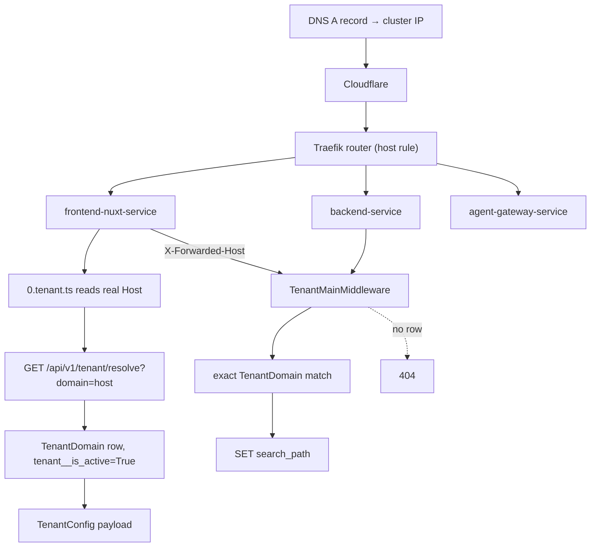

# Domains & certificates

A hostname is **data**, not configuration. Every host the platform serves
is a `TenantDomain` row in the public schema, and the request's `Host`
header is the only thing that decides which store's schema, cache keys,
search indexes and credentials a request sees. Adding a domain therefore
has two halves that must be done in the right order: the rows in Django,
and the Ingress plus certificate in the cluster — with DNS before both.

Throughout this page, `<store-slug>` is the store's `slug` and
`example.com` stands in for its own domain. Platform hosts are real:
they live under `grooveshop.space` and belong to no tenant.

## Diagram



## The `TenantDomain` row

`tenant/models.py: TenantDomain` adds nothing but `Meta` and `__str__` to
django-tenants' `DomainMixin`, so the fields are that mixin's:

| Field | Shape |
|---|---|
| `domain` | `CharField(max_length=253)`, **unique**, indexed. A bare hostname, no scheme and no port |
| `tenant` | FK to `Tenant`, `related_name="domains"`, `on_delete=CASCADE` |
| `is_primary` | `BooleanField(default=True)`, indexed |

`DomainMixin.save()` is atomic and enforces single-primary semantics: if
the tenant has no primary domain yet the row is forced primary, and if the
row **is** primary every sibling is demoted in the same transaction.

That default is the trap on this page. `is_primary` defaults to **True**,
so a new row added through `TenantDomainInline` without unticking it
silently takes primacy from the store's real domain — which moves the
canonical URL, the derived `api.` host, the `django_site` lookup and the
cookie scope all at once. Untick it for every host that is not the store's
front door.

The primary domain is what `TenantConfigSerializer.get_primary_domain`
reports and what canonical URLs, RSS and OAuth metadata are built from.

## Resolution, end to end

### Django

`django_tenants.middleware.main.TenantMainMiddleware` looks the request
host up in `TenantDomain` and switches the connection's search path. It is
third in `MIDDLEWARE` (`settings.py`), after two middlewares that must
answer before any tenant exists: `core/middleware/health_probe.py` (kubelet
probes carry a pod IP as `Host`, which no row can match) and
`tenant/internal.py: InternalDomainsMiddleware` (the cluster-internal
domains feed). Matching is **exact** — a host that looks derivable but has
no row is a host Django refuses to serve.

Immediately after resolution:

- `tenant/middleware.py: SuspendedTenantMiddleware` answers **503** for a
  store whose `is_active` is false. django-tenants resolves the host with a
  bare `domain=` lookup that ignores `is_active`, so without this a
  suspended store kept serving its API in full — catalogue reads, cart
  mutations, order creation and payment-intent creation against its own
  live provider keys. 503 rather than 404 because the domain is known and
  the condition is temporary.
- `tenant/middleware.py: TenantCookieDomainMiddleware` rewrites the
  `Domain` attribute of the session and CSRF cookies from the request host:
  it strips a leading `api.` or `www.` and dot-prefixes the rest, so
  `api.example.com`, `www.example.com` and `example.com` all scope to
  `.example.com`. It derives from the host alone, never from
  `connection.tenant`, because several code paths enter and leave
  `schema_context` during a request and the connection's tenant may be a
  bare stand-in by the time the response phase unwinds. Hosts with no dot
  are internal service names and keep the configured value.

On the WebSocket path `tenant/middleware_ws.py: TenantWebsocketMiddleware`
does the same lookup and closes with code **4004** when no active tenant
matches.

The public schema is served only on the platform host, through
`PUBLIC_SCHEMA_URLCONF`. An unknown host is a 404, because
`SHOW_PUBLIC_IF_NO_TENANT_FOUND` is not set.

### The resolve endpoint

`GET /api/v1/tenant/resolve?domain=<host>` (`tenant/views.py:
tenant_resolve`, routed in `tenant/urls.py`) is anonymous and lives in the
shared URL patterns, so it answers on **any** host and can be asked about a
host other than the caller's own. It queries
`TenantDomain.objects.filter(domain=domain, tenant__is_active=True)` and
returns `TenantConfigSerializer`, or `404 Store not found`.

The payload is cached for an hour under `tenant/cache.py:
tenant_resolve_key(domain, tenant)` — a `global:` key that is
schema-independent (the endpoint is called through one tenant's domain to
resolve another's), that fingerprints the serializer's field names, so a
release that adds a field never serves the old shape, and that carries the
tenant's `cache_generation`. The domain lookup runs on every call, cache
hit or not, because the generation comes from that row.

When the caller proves it is the gateway with `X-Internal-Token`, the
response also carries `chat_api_key` and `acp_bearer_token`; that variant
is never cached, is marked `Cache-Control: private, no-store`, and the
response always sets `Vary: X-Internal-Token`.

### Nuxt

`server/middleware/0.tenant.ts` runs before every other server middleware.
It reads the host with `getRequestHost(event, { xForwardedHost: false })`,
so a forwarded header can never switch tenants, skips a fixed bypass list,
and calls `getTenantConfig(host)` (`server/utils/tenant.ts`), which strips
the port, checks a **five-minute in-memory cache**, proxies to the resolve
endpoint and validates the answer with the generated `zTenantConfig`. A
Django 5xx becomes a 503 that is not cached; a 404 or a schema failure
becomes "Store not found".

### Gateway and media stream

The gateway resolves from `req.Host` only and explicitly ignores
`X-Forwarded-Host` (`internal/tenant/middleware.go`). The media stream
needs no host lookup at all — tenancy is in the path
(`media/:tenantSchema/uploads/…`) — but it refreshes its upstream host
allowlist from `GET /api/v1/tenant/internal/domains`, gated by the same
internal token.

### Cache invalidation

`tenant/signals.py: bump_generation_on_domain_change` fires on every
`TenantDomain` save **and** delete and bumps the owning tenant's
`cache_generation`, in the same transaction. Every key of that tenant —
each sibling domain's resolve payload and the domain set behind CORS and
CSRF — moves to the new generation at once. Covering the siblings is
load-bearing: the payload embeds cross-row derivations, so adding an
`assets*` row changes what the *primary* domain resolves to. No Redis
delete is involved, so a Redis outage during the change cannot leave the
old payload served ([Caches & purging](/dev/operations/caches)). Nuxt's
five-minute copy still has to expire on its own.

## The host families a store needs

| Host | Row required | What depends on it |
|---|---|---|
| `example.com` | yes, `is_primary=True` | The storefront. Canonical URLs, RSS, OAuth metadata, the `django_site` row, cookie scope |
| `www.example.com` | yes | A plain route to the storefront, not a Traefik redirect — the Nuxt app 301s `www` → apex itself. Needs its own DNS record and its own TLS secret |
| `api.example.com` | **yes — not optional** | The browser-facing API: WebSocket notifications, the social-login redirect, CSP `connect-src`, the `.well-known` OAuth metadata |
| `assets.example.com`, `static.example.com` | only for white-label | A dedicated asset origin. Absent by default |

### Why the `api.` row is mandatory

`core/utils/tenant_urls.py: resolve_tenant_api_domain` **derives** the
API host when no explicit `api*` row exists (`derive_api_domain`:
`api.<primary>`, or `api-<label>.grooveshop.space` for a store on a platform
subdomain, so Cloudflare's Universal SSL covers it), and the storefront
dials that derived value. But routing matches rows exactly. A derived host
with no row is a host Django refuses to serve, and the failure is
deceptive: the storefront looks perfectly healthy while real-time
notifications close 4004 on every attempt and every social login 404s at
the form POST.

`tenant/provisioning.py: ensure_api_domain` is what stops that happening.
It finds the primary domain, derives the API host the same way, and `get_or_create`s
the row with `is_primary=False`. It runs from both entry points — the
`tenant_create` management command and `TenantAdmin.save_related` on the
admin's New Store flow — so the two can never drift. It returns `None`
when there is no primary domain to derive from, and the callers report
that differently (a `CommandError` for the CLI, a warning message in the
admin).

The prefix match has a boundary rule
(`core/utils/tenant_urls.py: _has_prefix_boundary`): a row counts as the
`api` host only if the prefix is followed by `.` or `-`. Both are in real
use — `api.example.com` in production and an `api-staging.` shape on
staging — and without the rule a store on a domain merely *starting* with
those letters resolved its own storefront domain as its API host.

`tenant/provisioning.py: ensure_site` is the second provisioning step that
depends on the primary domain. It creates a `django.contrib.sites` `Site`
for it, **in the public schema**, because `sites` is in `SHARED_APPS` only
and its rows are platform-global. That row is what
`TenantSocialAccountAdapter.get_app` resolves a per-store `SocialApp`
against; without it the lookup always misses and allauth silently falls
back to the platform-wide OAuth credentials, so the merchant's own client
id and secret are unreachable even after they fill them in.

### Asset origins: shared by default, white-label by opt-in

`resolve_tenant_assets_domain` and `resolve_tenant_static_domain` are
**explicit-row only** — they pass `derive=False`. The media and static
services are platform infrastructure and tenancy is enforced at the path
level (`media/{schema}/…`), so with no `assets*`/`static*` row the resolve
payload reports empty `assetsDomain`/`staticDomain` and every consumer
falls back to the platform origins `assets.grooveshop.space` and
`static.grooveshop.space`.

Those platform hosts are shared by every tenant and belong to none. They
used to be the first store's own `assets.`/`static.` hosts, which put that
store's brand into every other tenant's product feeds, agent payloads and
transactional emails. **If a store emits a hostname belonging to another
store, that is the bug, not a quirk.**

Opting a store into white-label asset URLs is four steps, all required:

1. DNS for `assets.example.com` and `static.example.com`.
2. The two hosts and their certificates appended to the tenant Ingress,
   mirroring the platform assets ingress.
3. `TenantDomain` rows for both (`is_primary=False`).
4. Nothing else — the resolver and every consumer (Nuxt media composables,
   CSP, RSS, emails) pick the dedicated origin up automatically once the
   rows exist and the sibling cache purge has run.

### CORS, CSRF and the domain set

`tenant/middleware.py: origin_belongs_to_tenant` is the single rule both
CORS and CSRF use, built from `tenant_domain_set(tenant)`: a browser on the
store's registered domains may make credentialed requests to that store's
API, and nobody else may. Adding a host to a store therefore widens its
CORS and CSRF surface — that is the intended effect, and the reason
domains are platform-controlled rather than merchant-editable
(`TenantAdmin.get_inlines` returns no inlines for a merchant, because
domains steer routing and TLS).

## The infrastructure half

### Where a tenant's Ingress lives

```
grooveshop-infrastructure/manifests/app-constructs/grooveshop/
  overlays/production/tenants/
    TEMPLATE/          # copy this
    <store-slug>/
      ingress.yaml
      kustomization.yaml
```

Onboarding the routing is: copy `TEMPLATE` to `<store-slug>/`, replace
every `TENANT_SLUG` and `TENANT_DOMAIN`, commit and push. That is the whole
infrastructure step.

`TEMPLATE/ingress.yaml` renders five Ingress objects:

| Object | Hosts | Backend | Middlewares |
|---|---|---|---|
| `<slug>-ingress-storefront` | apex + `www.` | `frontend-nuxt-service` | redirect-https, security-headers, compress-responses |
| `<slug>-ingress-api` | `api.` | `backend-service` | the same plus `rate-limit-api` |
| `<slug>-ingress-agent` | apex, paths `/mcp`, `/.well-known/ucp`, `/.well-known/ard.json`, `/.well-known/ai-catalog.json`, `/feeds`, `/acp` | `agent-gateway-service` | security-headers, `rate-limit-agent`, compress-responses |
| `<slug>-ingress-agent-chat` | apex, path `/chat` | `agent-gateway-service` | `rate-limit-chat` — the chat surface pays per LLM token |
| `<slug>-ingress-contact-attachment` | apex `/api/contact/attachment` and `api.` `/api/v1/contact/attachment` | Nuxt and Django respectively | `limit-attachment-body` — the ingress is the only place an oversized body can be refused for free, because Django's ASGI body spool happens before any application code |

The agent surfaces are path-routed on the **storefront** host on purpose:
UCP discovery must live on the shop's own domain, because the gateway
resolves the tenant from the `Host` header. Those two Ingress objects carry
no `tls:` stanza — the storefront certificate already covers the host and
their routers pick it up from the TLS store via SNI.

`kustomization.yaml` adds a `tenant: <store-slug>` label through the
`labels` transformer with `includeSelectors: false`, so a selector-bearing
resource added later never has the label baked into an immutable selector.

### The ApplicationSet that discovers them

`manifests/app-directory/appset-grooveshop-tenants.yaml` is a git
**directory generator** over
`overlays/production/tenants/*`, with `TEMPLATE` explicitly excluded. Every
other directory becomes an Argo Application named `tenant-<basename>`, in
the `grooveshop` namespace, with `automated` sync, `prune` and `selfHeal`,
and a `resources-finalizer` so deleting the directory prunes that store's
resources.

One Application per tenant, deliberately: a store whose DNS or certificate
breaks parks **its own** Application unhealthy instead of degrading
`app-grooveshop` and masking a real platform incident.

::: danger Never register the tenant directory in the parent overlay
`overlays/production/kustomization.yaml` must **not** list
`tenants/<store-slug>`. The parent overlay and the generated
`tenant-<slug>` Application would then both own the same Ingress objects,
both with `prune: true` and `selfHeal: true`. Each reads the other's
tracking annotation as drift, so they fight over the store's routing, and
removing the directory later has one Application deleting while the other
recreates.
:::

### Certificates

Every host gets its **own** Certificate from the
`letsencrypt-http01-cluster-issuer` ClusterIssuer
(`cert-manager/setup/issuers/letsencrypt-http01.cluster-issuer.yaml`),
solved over **HTTP-01** through Traefik. There is no wildcard and no
DNS-01 solver configured.

The consequence is the single most important ordering rule on this page:
**DNS must resolve to the cluster before the overlay is synced**, or the
challenge cannot be answered and the Certificate stays `Pending`
indefinitely. Verify with `dig +short example.com` for all three hosts
before pushing.

The standard tenant gets three secrets: `<slug>-tls`, `<slug>-www-tls`,
`<slug>-api-tls`.

Two hazards worth carrying in your head:

- **Never delete-and-recreate a live Ingress**, and never rename one.
  ingress-shim owns each Certificate through an `ownerReference` to the
  Ingress that declared it, so a recreated Ingress has a new uid and
  Kubernetes garbage-collects its Certificates. The Secrets are *not*
  owned, so they survive and TLS keeps serving — the certificates simply
  stop renewing and expire silently weeks later. Letting Argo's `prune`
  remove an Ingress during a restructure is the same thing. After any
  change that touches Ingress objects, list TLS secrets and Certificates
  and check that the two sets match; repair by annotating the owning
  Ingress so cert-manager adopts the existing valid secret rather than
  re-issuing.
- **Let's Encrypt allows 50 certificates per registered domain per week.**
  Onboarding several stores under one registered domain, or retrying failed
  requests, can exhaust it. That is also why DNS is verified before the
  push rather than after.

### The edge

Cloudflare sits in front of Traefik for the platform zone. Two operational
consequences:

- **Proxy mode.** The tenant go-live runbook records tenant hosts as
  DNS-only (grey cloud) so the HTTP-01 challenge reaches Traefik directly;
  the platform asset hosts are proxied, and the manifest notes that HTTP-01
  still completes through the proxy. Match the proxy mode of the host you
  are copying rather than assuming either way, and if you proxy a host,
  confirm the certificate actually issues.
- **Client IP.** Traefik keeps `X-Forwarded-For` only from Cloudflare's
  address ranges, and a middleware sees it before Traefik appends its own
  hop, so every rate-limit middleware sets `ipStrategy.depth: 1`
  (`base/middleware-ratelimit.yaml`): the visitor Cloudflare appended. A
  DNS-only host's visitors arrive from non-Cloudflare peers, whose header
  Traefik deletes, so they share one bucket per router. The full model is
  `docs/edge-trust-boundary.md` in the infrastructure repository.

### Unmapped hosts

`overlays/production/ingress-tenant-catchall.yaml` is a router of priority
1 with no host rule, HTTP-only (no `tls:` stanza, so Traefik never tries to
terminate TLS for a host it has no certificate for) and only the
`redirect-https` middleware. Any explicit per-tenant rule outranks it. A
domain pointed at the cluster with no tenant Ingress therefore gets
redirected to HTTPS and then fails the TLS handshake — a visible, expected
failure rather than a wrong certificate.

## Checklist — adding a domain to an existing store

For a store that is already live, adding `shop.example.com` (or a second
brand domain, or the white-label asset hosts):

1. **Decide whether it becomes the primary.** Moving the primary moves the
   canonical URL, the derived `api.` host, the `django_site` row and the
   cookie scope. If it does, plan the redirect for the old host and expect
   to add an `api.` host for the new primary too.
2. **DNS first.** An A record for every new host pointing at the cluster
   ingress IP. Match the proxy mode used by the store's existing hosts.
   Verify each with `dig +short` before touching git.
3. **Extend the store's Ingress** at
   `overlays/production/tenants/<store-slug>/ingress.yaml`: add the host to
   the right rule and add a `tls:` entry with a **new** `secretName`. Edit
   the existing objects — do not rename or recreate them.
4. **Push.** The `tenant-<store-slug>` Application syncs automatically.
   Do not add the directory to the parent overlay's kustomization.
5. **Wait for the certificate** to reach `Ready=True`. If it hangs
   `Pending`, the cause is almost always DNS or proxy mode, not
   cert-manager.
6. **Create the `TenantDomain` row** in the control plane, under
   **Tenant Domains** or the tenant's own inline. Leave `is_primary`
   unticked unless step 1 said otherwise. Without the row Django refuses
   the host even though Traefik routes it and TLS terminates.
7. **Add the `api.` row** if this host is now the primary — or run
   `ensure_api_domain` — and check that a `django_site` row exists for the
   primary if social login is in use.
8. **Verify.** `GET /api/v1/tenant/resolve?domain=<new host>` returns the
   store's config and not 404; the storefront renders on the new host; the
   WebSocket connects rather than closing 4004; a social login completes.
   Remember Nuxt's five-minute config cache before concluding something is
   broken.
9. **Third-party registration.** OAuth providers need the new host's
   callback URL added, or social login 400s on that host only.

## Invariants

- **Every public hostname is either a platform host under
  `grooveshop.space` or a `TenantDomain` row.** No tenant hostname belongs
  in code, env or manifests, because `NUXT_PUBLIC_*` values are serialised
  into every tenant's HTML.
- **Routing matches rows exactly.** Derivation fills in a *value*
  (`apiDomain`); it never creates a *route*.
- **One primary per tenant**, enforced by `DomainMixin.save()`.
- **One Certificate per host, HTTP-01, no wildcard** — so DNS precedes the
  sync, always.
- **Forwarded hosts are trusted from the inside only.** Nuxt and the
  gateway resolve from the real `Host`; Django trusts `X-Forwarded-Host`
  because only in-cluster callers reach it with that header.
- **A tenant directory is owned by exactly one Argo Application.**

## Failure modes

| Symptom | Cause |
|---|---|
| Certificate stuck `Pending` | DNS does not resolve to the cluster yet, or the host is proxied in a way that breaks the HTTP-01 challenge. It is not a cert-manager fault |
| Browser TLS error on a host that used to work | The host has no per-tenant Ingress rule and fell through to the catch-all, which is HTTP-only by design |
| Storefront healthy, WebSocket closes 4004, social login 404s at the form POST | The `api.<primary>` `TenantDomain` row is missing. Django derives the value but refuses to serve the host |
| Store is reachable but shows another store's logo in feeds or emails | The store has no `assets*` row and is on the shared platform origin — correct — **or** a tenant hostname has leaked into a platform default, which is a bug |
| "Store not found" on every route | Resolve returned 404: no row for that host, or the tenant is `is_active=False`. On staging, remember the refresh script re-clones production's rows |
| Every request answers 503 | `SuspendedTenantMiddleware` — the store is suspended. See [Suspend, export & destroy](/dev/operator/lifecycle) |
| Admin login POSTs 403 on a new host | Cookie `Domain` scope. `TenantCookieDomainMiddleware` derives it from the host; a host shape it cannot reduce (no dot) keeps the configured default |
| Old images or links persist after a domain change | The resolve cache was purged, but Nuxt holds the config for five minutes and rendered pages sit in the SWR cache — see [Caches & purging](/dev/operations/caches) |
| A tenant's Ingress keeps reverting | The directory is registered in the parent overlay as well as the ApplicationSet, and two Applications are self-healing against each other |
| TLS still serves but certificates stop renewing | An Ingress was renamed, recreated or pruned and its Certificates were garbage-collected. Compare TLS secrets against Certificates |

## Source

| File | Role |
|---|---|
| `grooveshop-django-api/tenant/models.py` | `TenantDomain` |
| `grooveshop-django-api/tenant/middleware.py` | `SuspendedTenantMiddleware`, `TenantCookieDomainMiddleware`, `origin_belongs_to_tenant`, `tenant_domain_set` |
| `grooveshop-django-api/tenant/middleware_ws.py` | WebSocket resolution, close code 4004 |
| `grooveshop-django-api/tenant/views.py` | `tenant_resolve`, the internal-token variant |
| `grooveshop-django-api/tenant/urls.py`, `tenant/urls_public.py` | Where the resolve endpoint and the control plane are mounted |
| `grooveshop-django-api/tenant/provisioning.py` | `ensure_api_domain`, `ensure_site` |
| `grooveshop-django-api/tenant/serializers.py` | `primary_domain`, `api_domain`, `assets_domain`, `static_domain` |
| `grooveshop-django-api/tenant/cache.py` | `tenant_resolve_key` |
| `grooveshop-django-api/tenant/signals.py` | `invalidate_domain_caches` and the sibling purge |
| `grooveshop-django-api/tenant/internal.py` | The internal domains feed |
| `grooveshop-django-api/core/utils/tenant_urls.py` | `_resolve_prefixed_service_domain`, `_has_prefix_boundary`, the three resolvers |
| `grooveshop-django-api/settings.py` | `MIDDLEWARE` order, `PUBLIC_SCHEMA_URLCONF` |
| `grooveshop-storefront-ui-node-nuxt/server/middleware/0.tenant.ts`, `server/utils/tenant.ts` | Host resolution and the five-minute cache |
| `grooveshop-agent-gateway/internal/tenant/middleware.go` | Host-only resolution in the gateway |
| `grooveshop-infrastructure/manifests/app-constructs/grooveshop/overlays/production/tenants/TEMPLATE/` | The tenant overlay: `ingress.yaml`, `kustomization.yaml`, `README.md` |
| `grooveshop-infrastructure/manifests/app-directory/appset-grooveshop-tenants.yaml` | The directory generator |
| `grooveshop-infrastructure/manifests/app-constructs/cert-manager/setup/issuers/letsencrypt-http01.cluster-issuer.yaml` | The HTTP-01 ClusterIssuer |
| `grooveshop-infrastructure/manifests/app-constructs/grooveshop/base/middleware-ratelimit.yaml` | `ipStrategy.depth: 1` behind Cloudflare |
| `grooveshop-infrastructure/manifests/app-constructs/grooveshop/overlays/production/ingress-tenant-catchall.yaml` | The unmapped-host router |
| `grooveshop-infrastructure/manifests/app-constructs/grooveshop/overlays/production/ingress-platform.yaml`, `ingress-platform-assets.yaml` | Platform hosts and the shared asset origins |
| `grooveshop-infrastructure/docs/tenant-onboarding.md` | The full runbook, DNS step and certificate hazards |
